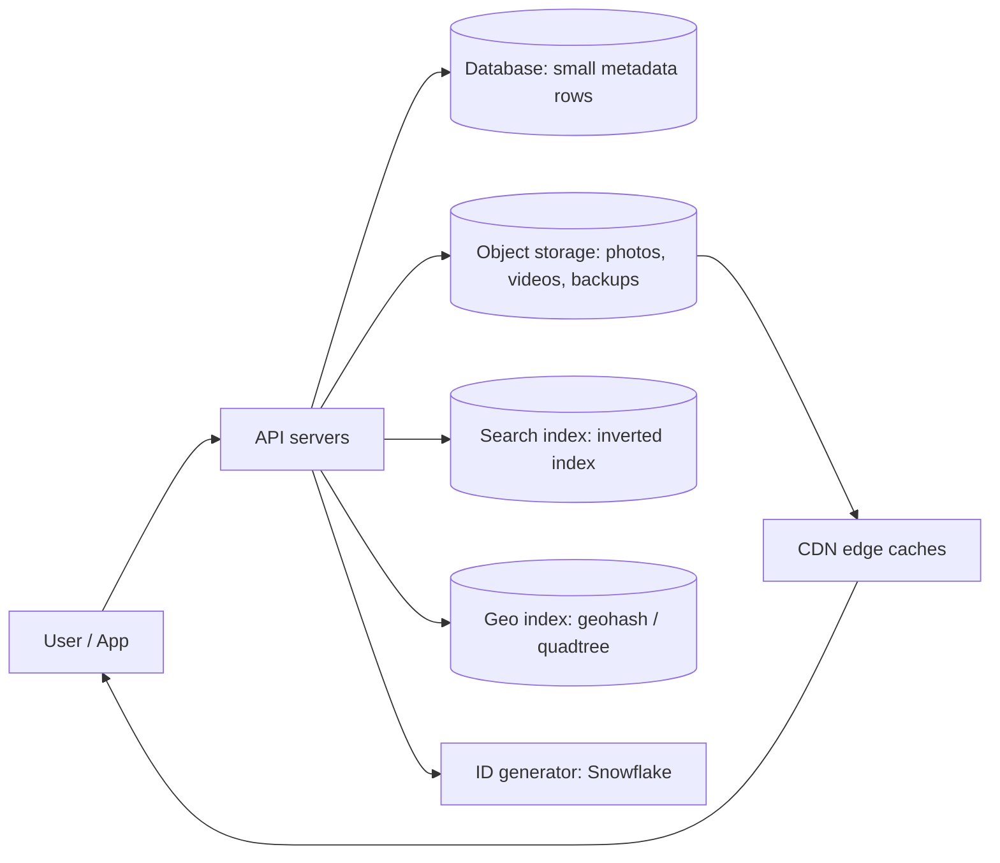
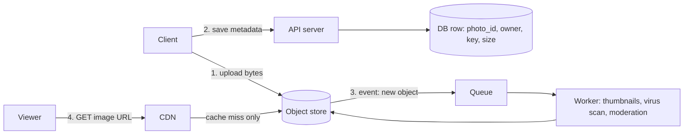
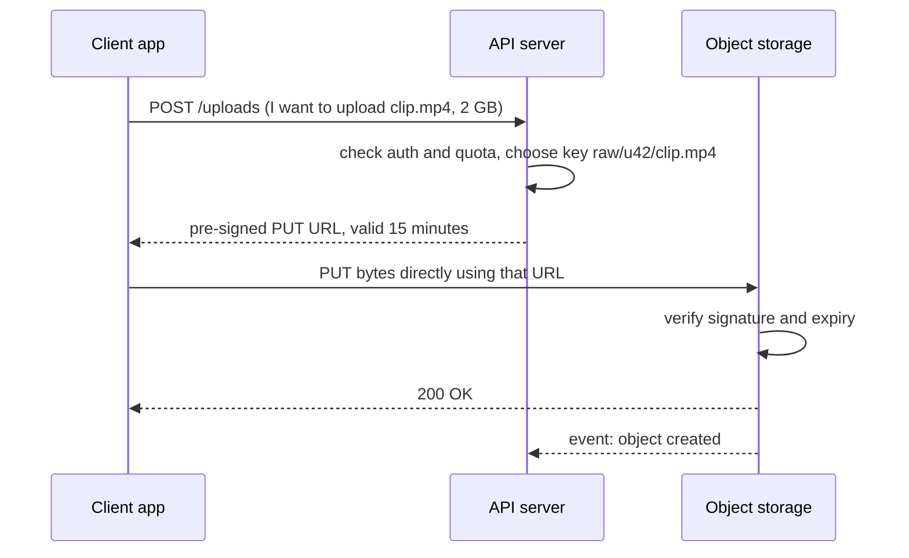
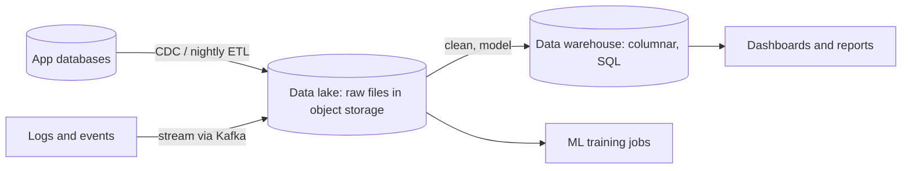
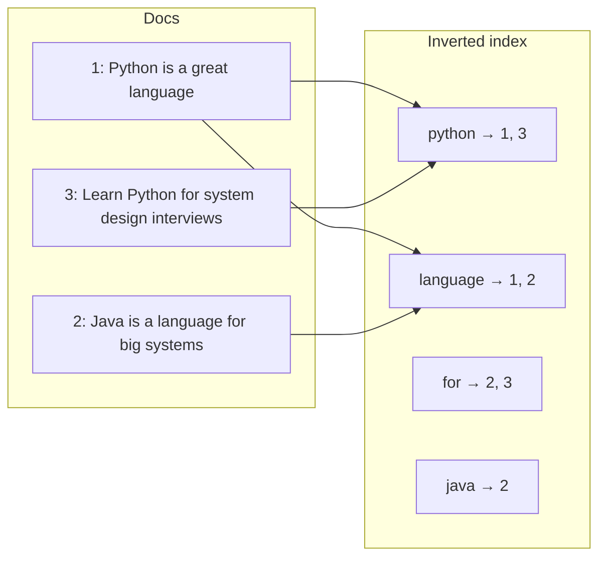
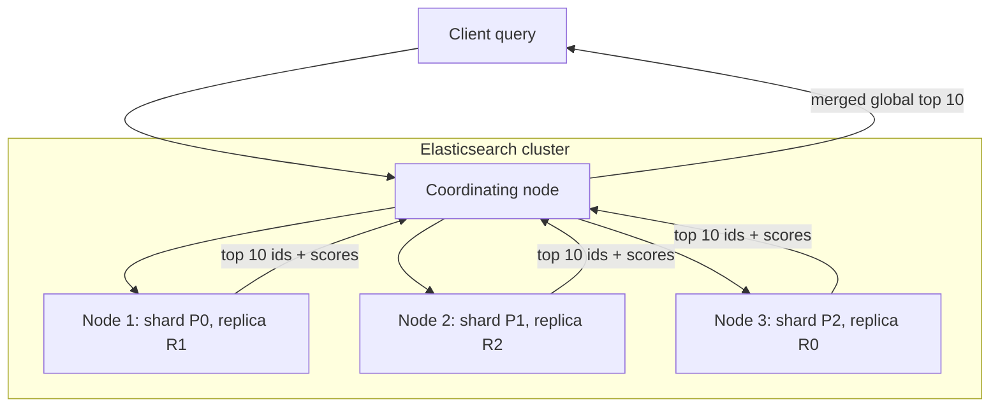
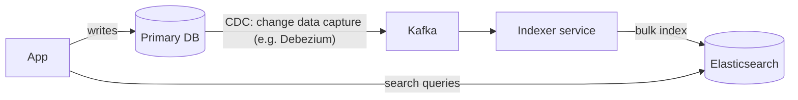
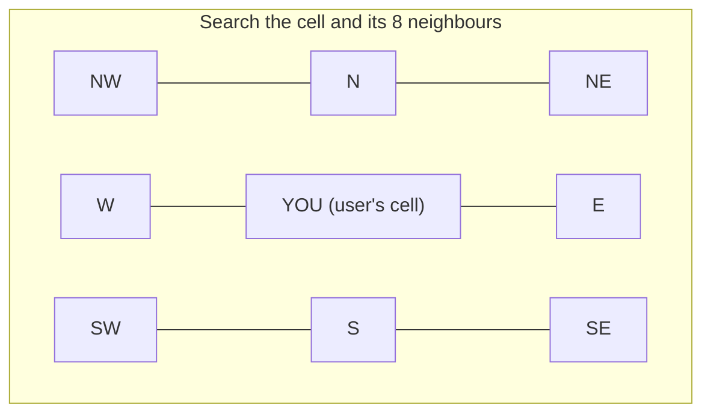
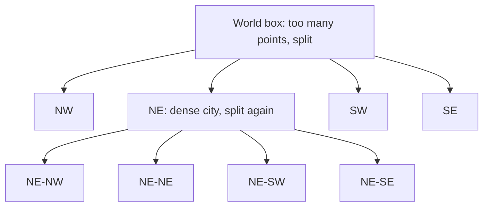
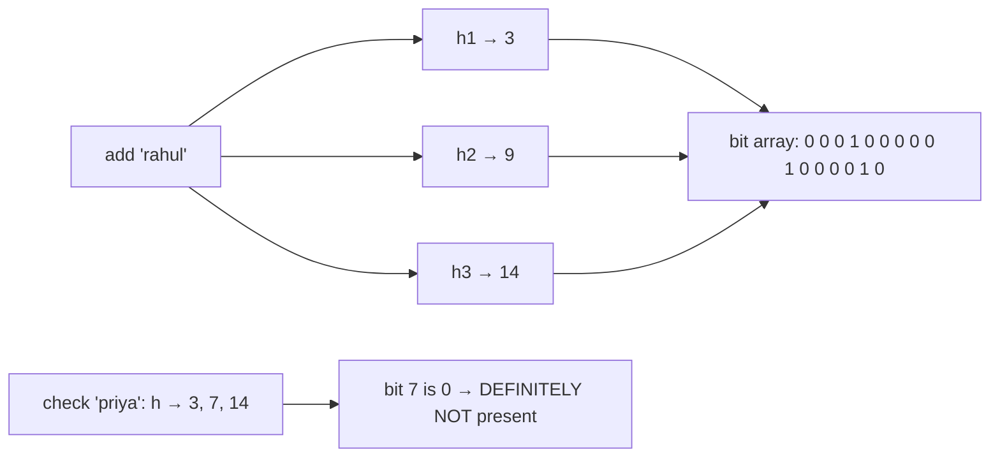

# Chapter 10 · Storage, Search & Unique IDs

> Jo bhi app tumhe pasand hai, wo chupchaap din mein arabon baar chaar sawaalon ka jawab deta hai: *Ye 2 GB ka video kahan rakhun? Ek arab posts mein se wo ek post kaise dhoondhun jismein "biryani" likha hai? Tumse 2 km ke andar kaun kaun se restaurants hain? Aur is naye tweet ka naam kya rakhun taaki duniya ke kisi bhi doosre tweet ka same naam na ho?* Ye chapter tumhe in chaaron ke liye poora toolkit deta hai. Saath mein kuch "jaadu wale" data structures bhi, jo itni kam memory mein jawab de dete hain ki tumhe yakeen nahi hoga.

**Is chapter mein tum seekhoge:**
- **Block vs file vs object storage**, S3 model kaise kaam karta hai, aur photos/videos kabhi database ke andar kyun nahi rehte
- **Pre-signed URLs** aur **chunked, resumable uploads** (aur dono ko khud kaise banate hain)
- **Data lakes aur warehouses**, ek page mein
- Search engines kaise kaam karte hain: zero se bana hua **inverted index**, tokenisation, phrase queries, aur **TF-IDF aur BM25** se ranking
- **Elasticsearch** ka architecture aur **typeahead** (autocomplete) ke basics
- **Geospatial indexing:** geohash, quadtree aur H3 ka overview
- **Unique ID generation:** auto-increment, UUID, ticket servers aur **Snowflake** (runnable bit layout ke saath)
- Probabilistic data structures: **Bloom filters** (runnable), **HyperLogLog** aur **count-min sketch**

**Isse pehle padho:** [Databases](03-databases.md) · [Caching & CDNs](04-caching-cdn.md) · [Replication, Sharding & Consistent Hashing](05-replication-sharding.md) · [Message Queues](08-queues-events.md) · Part 2 se kaam aayenge: [Two Pointers](../part-2-dsa/03-two-pointers.md), [Tries](../part-2-dsa/19-tries.md), [Bit Manipulation](../part-2-dsa/23-bits-math.md)

---

## 🧠 The Big Idea · Asli Baat

Ek bahut bade shehar ki library socho.

- **Kitaabein khud** bhaari aur badi hain. Unhe librarian ki table pe nahi rakhte. Wo ek giant godown mein rakhi hain, har ek pe ek numbered tag laga hai. Yahi hai **object storage**.
- **Catalogue cards** (title, author, kaunsi shelf) chhote hain aur unhe tum baar baar search karte ho. Wo ek saaf-suthri almaari mein rehte hain. Yahi hai tumhara **database**.
- **Har kitaab ke peeche wala index** ("dragons: page 4, 19, 210") tumhe seedha sahi page pe le jaata hai, poori kitaab padhne ki zaroorat nahi. Ab *saari* kitaabon ka ek giant index bana do, toh tumhare paas **search engine** hai.
- **Deewar pe laga map**, jo numbered zones mein bata hua hai, tumhe "mere paas wali libraries" dhoondhne deta hai, bina desh ki har library tak distance naapey. Yahi hai **geospatial indexing**.
- Har nayi kitaab ko ek **accession number** milta hai jo kisi aur kitaab ko kabhi nahi milega, chahe das branches ek hi pal mein kitaabein add kar rahi hon. Yahi hai **unique ID generation**.
- Aur gate pe khada guard, jo member register khole bina turant bol deta hai "ye banda *pakka member nahi* hai"? Wo hai **Bloom filter**.



> 🇮🇳 **Desi Analogy:** Ek bade railway junction ko socho. **Parcel office** ka godown (bhaari saamaan, har packet pe tag) = object storage. **Reservation chart** (naam, seat, coach: chhoti si info jo baar baar dekhi jaati hai) = database. **Enquiry counter** jahan tum "Rajdhani" bolo aur wo turant saari matching trains bata de = search index. Platform pe laga **zone map** ("coach S1-S4 yahan rukenge") = geo index. Har ticket ka **PNR number**, jo poore desh mein kabhi repeat nahi hota = unique ID. Aur TTE jo ek nazar mein bol de "is coach mein tumhari seat *hai hi nahi*" = Bloom filter. Har cheez ka apna counter hai, kyunki har sawaal alag type ka hai.

> 💡 **Is poore chapter ke peeche ek hi rule hai:** *har tarah ke data aur har tarah ke sawaal ko apna specialised structure chahiye.* Database "mujhe row 42 do" mein kamaal hai. Lekin "ye 2 GB file rakh lo", "kaun se documents mein ye teen words hain?" aur "is point ke paas kya hai?" mein wo bekaar hai. Senior engineers interview isi se jeet-te hain: sahi specialised tool ka naam lena, aur *kyun* wo sahi hai ye samjhaana.

---

## 🔨 Building It Up · Zero Se Shuru

Hum paanch hisson mein chalenge: **Storage** (sections 1–7), **Search** (8–15), **Geospatial** (16–19), **Unique IDs** (20–24) aur **Probabilistic structures** (25–27).

### 1. Three kinds of storage: block, file, object · Teen tarah ke storage

Aakhir mein har storage bas disks pe pade bytes hi hai (ghoomne wali hard drives ya SSDs). Farak hai **interface** ka: un bytes ko tum *maangte kaise ho*.

| | **Block storage** | **File storage** | **Object storage** |
|---|---|---|---|
| Analogy | Khaali lockers ki ek numbered line. Kya kahan jaayega, tum decide karte ho. | Ek filing cabinet, jismein folders ke andar folders hain. | Ek cloakroom: coat do, token lo, token dikhao aur coat wapas lo. |
| Data ko address kaise karte ho | Block number (jaise "block 81,920") | Path (`/home/asha/notes.txt`) | Bucket ke andar key (`photos/users/42/avatar.jpg`) |
| Beech mein se 1 byte edit kar sakte ho? | Haan, bahut fast | Haan | Nahi. Poora object replace karna padta hai (ya special APIs se append) |
| Typical latency | Sub-millisecond | Kuch milliseconds | First byte tak dasiyon milliseconds |
| Scale | Ek disk volume, aam taur pe ek machine se juda | Kai machines share karti hain, par arabon files tak scale karna mushkil | Practically unlimited: trillions objects, exabytes |
| Examples | AWS EBS, laptop ka SSD, SAN volumes | NFS, AWS EFS, Windows file shares | AWS S3, Google Cloud Storage, Azure Blob, MinIO |
| Best for | Databases, VM boot disks | Shared folders, legacy apps, home directories | Images, videos, backups, logs, data lakes, static websites |

**Block storage** sabse neeche ka level hai. Disk ek giant array hai fixed-size blocks ka (aksar 4 KB ke). Isse files ke baare mein kuch nahi pata. Upar tumhare operating system ka file system, ya PostgreSQL jaisa database engine baitha hota hai, aur wahi decide karta hai ki kaunse block mein kya hai. Kyunki tum kisi bhi block ko usi jagah overwrite kar sakte ho, ye databases ke liye sahi ghar hai, jo lagaatar pages ke chhote chhote tukde update karte rehte hain.

**File storage** upar se folders aur files ka jaana-pehchaana tree, permissions aur locking jodta hai. Network file system se kai servers ek hi folder ko mount kar sakte hain. Bahut bade scale pe yahi tree iski kamzori ban jaata hai: 5 crore files wale folder ko list karna, ya kai machines pe folder tree ko consistent rakhna, bahut dard deta hai.

**Object storage** tree ko hi phenk deta hai. Yahan ek **flat** namespace hai: ek **bucket** (top-level container) ke andar **objects** hain, aur har object ki pehchaan ek **key** (ek string) hai. Har object = bytes + **metadata** (size, content type, custom tags) + ek version ya checksum (jise aksar **ETag** kehte hain). Keys mein slashes *ho sakte* hain, jaise `users/42/avatar.jpg`, aur tools unhe folders ki tarah *dikhaate* bhi hain, lekin ye ek illusion hai: andar wo ek lambi string hi hai.

> 🇮🇳 **Desi Analogy:** Railway station ka **cloakroom** ekdum object storage hai. Tum bag dete ho (bytes), counter wala ek token deta hai (key), aur register mein likhta hai "bada neela bag, 12 kg" (metadata). Bag ke andar se ek kapda badalna hai? Nahi hoga. Poora bag wapas lo, badlo, phir naya token lo (object replace hota hai, edit nahi). Aur cloakroom mein "folders ke andar folders" nahi hote, bas token number aur racks. Isi liye wo hazaaron bags bina confusion sambhal leta hai.

> 💡 Tree phenkne se fayda kyun hota hai? Kyunki flat key → bytes map bas ek giant distributed hash map hai. Tum ise [consistent hashing](05-replication-sharding.md) se hazaaron machines pe shard kar sakte ho, bina kabhi folder tree ko coordinate kiye. Simplicity scale karti hai.

> 🤔 **Mann mein sawaal:** S3 console mein toh mujhe folders dikhte hain, phir tum keh rahe ho folders hote hi nahi?
>
> **Jawab:** Console tumhari suvidha ke liye `/` pe keys ko tod ke folder jaisa dikhata hai. Andar sirf `users/42/avatar.jpg` naam ki ek poori string hai. "Folder kholna" asal mein "is prefix se shuru hone wali saari keys do" wala query hai. Isi liye ek "folder" rename karna S3 mein mehenga hai: har object ko nayi key pe copy karna padta hai.

### 2. The S3 model in code · S3 ka model, code mein

Ye raha object-storage ka *interface*, ek chhote se toy mein jo ek screen pe aa jaaye. Asli cheez ek HTTP API hai (`PUT`, `GET`, `HEAD`, `DELETE`, `LIST`), lekin shape bilkul same hai.

```python
import hashlib

class ToyObjectStore:
    """A tiny in-memory 'S3': a flat map of bucket/key -> (bytes, metadata)."""
    def __init__(self):
        self.objects = {}

    def put(self, bucket, key, data, content_type="application/octet-stream"):
        etag = hashlib.md5(data).hexdigest()
        self.objects[(bucket, key)] = (data, {"size": len(data),
                                              "content_type": content_type,
                                              "etag": etag})
        return etag

    def get(self, bucket, key):
        return self.objects[(bucket, key)][0]

    def head(self, bucket, key):
        return self.objects[(bucket, key)][1]

    def list(self, bucket, prefix=""):
        return sorted(k for (b, k) in self.objects if b == bucket and k.startswith(prefix))

s3 = ToyObjectStore()
s3.put("photos", "users/42/avatar.jpg", b"\xff\xd8 fake jpeg", "image/jpeg")
s3.put("photos", "users/42/trip/goa-1.jpg", b"beach", "image/jpeg")
s3.put("photos", "users/7/avatar.jpg", b"cat", "image/jpeg")

print(s3.list("photos", prefix="users/42/"))
print(s3.head("photos", "users/7/avatar.jpg"))
print(s3.get("photos", "users/42/trip/goa-1.jpg"))
```

```text
['users/42/avatar.jpg', 'users/42/trip/goa-1.jpg']
{'size': 3, 'content_type': 'image/jpeg', 'etag': 'd077f244def8a70e5ea758bd8352fcd8'}
b'beach'
```

Abhi kya hua:
- `list(prefix="users/42/")` *dikhta* hai folder kholne jaisa, lekin asal mein ye sorted keys pe ek **prefix scan** hai. S3 mein "folders" bas itne hi hain.
- `head` sirf metadata return karta hai, bytes download kiye bina. Asli systems ise size ya existence sasti mein check karne ke liye use karte hain.
- Yahan **ETag** content ka MD5 hai. Clients isse corruption pakadte hain, aur ye poochte hain "maine pichli baar download kiya tha, tab se ye badla kya?"

Asli S3-style stores ke baare mein ye facts interviewers sunna pasand karte hain:
- **Durability vs availability.** AWS ne S3 Standard ko 99.999999999% ("eleven nines") **durability** ke liye design kiya hai: object *khone* ka chance bahut hi chhota hai, kyunki data kai devices aur data centres pe faila hota hai. **Availability** (kya main ise *abhi isi waqt* padh sakta hoon?) ek alag number hai, aur kam hai.
- **Consistency.** December 2020 se S3 strong read-after-write consistency deta hai: successful `PUT` ke baad `GET` naya data hi dekhega. Purane articles "eventually consistent" kehte hain; wo outdated hai.
- **Objects replace hote hain, edit nahi.** 1 GB object ka ek byte badalna hai? Naya 1 GB object upload karo. Photos aur videos ke liye ye theek hai, kyunki wo ek baar likhe jaate hain aur kai baar padhe jaate hain.
- **Saste tiers.** Purane objects ko lifecycle rules se thande, saste storage classes (jaise S3 Glacier) mein bhej sakte ho: "90 din baad cold storage mein daalo; 1 saal baad delete karo".

> 🤔 **Mann mein sawaal:** Durability aur availability mein farak kya hai? Dono "data safe hai" jaisa hi toh lagta hai.
>
> **Jawab:** Durability = "data *kabhi kho toh nahi jaayega*?" Availability = "data *abhi* mil raha hai ya nahi?" Socho bank locker: andar ka sona 100% safe hai (durability), lekin Sunday ko bank band hai toh tum use nikaal nahi sakte (availability down). S3 ka data almost kabhi nahi khota, lekin kisi kisi minute request fail ho sakti hai. Interview mein dono ko alag alag bolna, mix mat karna.

### 3. Storing images and videos: bytes in blobs, facts in the database · Bytes blob store mein, facts database mein

Beginner ka pehla instinct hota hai uploaded photo ko database ke ek column (`BLOB`) mein daal do. Mat karo. Standard design photo ko do hisson mein baant-ta hai:

1. **Bytes** object storage mein jaate hain, kisi key ke neeche.
2. **Facts** (owner, key, size, width, height, upload time, privacy setting) ek normal database row mein jaate hain.



Ye split kyun jeet-ta hai:

| Concern | Photo DB column mein | Photo object storage mein + DB row |
|---|---|---|
| DB size aur backups | Phat jaata hai; backups mein ghante lagte hain | DB chhota aur fast rehta hai |
| Users ko serve karna | Har view tumhare DB aur app servers ko hit karta hai | CDN edge se serve karta hai ([Chapter 04](04-caching-cdn.md)) |
| Cost per GB | Mehenga SSD storage, replicated | Bahut sasta, cold tiers ke saath |
| Scaling | Mushkil: DB sharding | Practically unlimited |

> 🇮🇳 **Desi Analogy:** Shaadi ka album socho. Asli bhaari album (bytes) almaari ke upar wale box mein rakha hai. Lekin ghar ki diary (database) mein bas ek line likhi hai: "Shaadi album, 2019, upar wala box, 3 kg, Mummy ke paas chaabi". Jab bhi koi poochta hai "album kahan hai, kitna bada hai?", diary dekh ke jawab mil jaata hai, box utaarna nahi padta. Album ko diary ke panno ke beech chipkaaoge toh diary itni moti ho jaayegi ki koi use utha bhi nahi paayega. Yahi hai photo ko DB column mein rakhna.

Media ke liye extra tricks:
- **Multiple renditions.** Ek background worker (queue se feed hota hai, dekho [Chapter 08](08-queues-events.md)) thumbnails banata hai (150 px, 600 px, 1080 px), taaki 4G pe chal raha phone ek chhota sa avatar dikhane ke liye 12 MB ka original download na kare. Videos ko kai resolutions mein **transcode** kiya jaata hai aur adaptive streaming ke liye chhote segments mein kaata jaata hai; iska poora end-to-end design hum [Chapter 13](13-case-studies-2.md) mein karenge.
- **Immutable keys.** Image badli? Toh use *nayi* key do (jaise version ya hash daal do). Phir CDNs use hamesha ke liye cache kar sakte hain, aur stale cache se kabhi ladna nahi padta.
- **Content-addressed storage.** *Bytes ka hash* hi key bana do. Identical files (wahi viral meme jo das lakh log forward kar rahe hain) sirf ek baar store hoti hain:

```python
import hashlib

store = {}           # object key -> bytes     (the blob store, e.g. S3)
photos = []          # metadata rows           (the database)

def upload_photo(user_id, data):
    digest = hashlib.sha256(data).hexdigest()
    key = f"photos/{digest[:2]}/{digest}"        # content-addressed key
    is_new = key not in store
    if is_new:
        store[key] = data                         # only store bytes we've never seen
    photos.append({"user": user_id, "key": key, "size": len(data)})
    return key[:20] + "...", "stored" if is_new else "deduplicated"

meme = b"<same viral meme bytes>" * 1000
print(upload_photo(1, meme))
print(upload_photo(2, meme))        # 2nd user forwards the same meme
print(upload_photo(3, b"<a unique holiday photo>"))
print("metadata rows:", len(photos), "| blobs stored:", len(store),
      "| bytes stored:", sum(len(v) for v in store.values()))
```

```text
('photos/5a/5a34db93ad...', 'stored')
('photos/5a/5a34db93ad...', 'deduplicated')
('photos/24/24c75ad929...', 'stored')
metadata rows: 3 | blobs stored: 2 | bytes stored: 23024
```

Abhi kya hua: teen users, teen metadata rows, lekin blobs sirf do. Har user abhi bhi ek photo ka "maalik" hai (uski apni row), jabki bytes share ho rahe hain. Delete karte waqt dhyaan chahiye: blob tabhi delete kar sakte ho jab **koi bhi** row usse point na kar rahi ho (reference counting).

> 🤔 **Mann mein sawaal:** User 1 ne apni meme delete kar di. Kya blob bhi delete kar doon?
>
> **Jawab:** Nahi! User 2 ki row abhi bhi usi key ko point kar rahi hai. Pehle sirf user 1 ki row hatao, phir gino ki us key ko kitni rows point kar rahi hain. Count zero ho gaya, tab blob delete karo. Isi ko **reference counting** kehte hain, bilkul waise jaise Python apne objects ke saath karta hai.


### 4. Pre-signed URLs: let clients talk to storage directly · Client ko seedha storage se baat karne do

Agar har upload tumhare API servers ke *through* jaaye, toh ek 2 GB video ek app server ko minutes tak baandh ke rakhega, aur bandwidth ka paisa tum do baar doge (client → tum → storage). Iske bajaye tumhara server client ko ek **pre-signed URL** deta hai: ek normal URL jiske saath ek cryptographic signature juda hai, jo kehta hai "is URL ka holder sirf *isi* key pe `PUT` kar sakta hai, sirf *is* time tak".

> 🇮🇳 **Desi Analogy:** Society ka watchman socho. Tumhare ghar Swiggy order aa raha hai. Tum MyGate app pe ek **gate pass** banate ho: "Delivery boy, sirf flat B-402, sirf aaj shaam 8 baje tak". Watchman ko tumse baar baar phone karke poochna nahi padta; pass pe sab likha hai aur society ki stamp lagi hai. Pass ka time nikal gaya? Entry band. Kisi ne pen se B-402 ko B-403 kar diya? Stamp match nahi karegi, entry band. Pre-signed URL bilkul yahi hai: **flat number = key**, **time = expiry**, **stamp = signature**, aur **watchman = storage service**, jo bina tumse poochhe khud verify kar leta hai.



Storage service us URL pe bharosa kaise kare jo usne pehle kabhi dekha hi nahi? Dono sides ke paas ek **secret key** share hoti hai jo clients kabhi nahi dekhte. Server "method + bucket + key + expiry" ke upar ek **HMAC** (keyed hash, yaani aisa hash jo secret key ke bina koi bana hi nahi sakta) compute karta hai. URL ka ek bhi letter badlo, signature match nahi karega. Poora idea code mein:

```python
import hashlib
import hmac
from urllib.parse import urlencode, urlparse, parse_qs

SECRET = b"server-side-secret-never-sent-to-clients"

def presign(bucket, key, method, expires_at):
    """Return a URL that allows exactly this method on this object until expires_at."""
    message = f"{method}\n{bucket}\n{key}\n{expires_at}".encode()
    sig = hmac.new(SECRET, message, hashlib.sha256).hexdigest()[:16]
    query = urlencode({"expires": expires_at, "sig": sig})
    return f"https://storage.example.com/{bucket}/{key}?{query}"

def verify(url, method, now):
    """What the storage service does when the request arrives."""
    parts = urlparse(url)
    bucket, key = parts.path.lstrip("/").split("/", 1)
    q = parse_qs(parts.query)
    expires_at, sig = int(q["expires"][0]), q["sig"][0]
    if now > expires_at:
        return "403 expired"
    message = f"{method}\n{bucket}\n{key}\n{expires_at}".encode()
    expected = hmac.new(SECRET, message, hashlib.sha256).hexdigest()[:16]
    if not hmac.compare_digest(sig, expected):
        return "403 bad signature"
    return "200 OK"

now = 1_700_000_000                      # pretend clock (Unix seconds)
url = presign("videos", "raw/u42/clip.mp4", "PUT", expires_at=now + 900)
print(url)
print(verify(url, "PUT", now + 60))      # within 15 minutes
print(verify(url, "PUT", now + 1000))    # too late
print(verify(url, "GET", now + 60))      # different method -> different signature
tampered = url.replace("u42", "u43")     # try to write someone else's file
print(verify(tampered, "PUT", now + 60))
```

```text
https://storage.example.com/videos/raw/u42/clip.mp4?expires=1700000900&sig=08d395b777164f78
200 OK
403 expired
403 bad signature
403 bad signature
```

Abhi kya hua:
- URL apni permission khud saath lekar chalta hai. Storage ko check karne ke liye bas shared secret chahiye; koi database lookup nahi.
- User id, method ya expiry badalte hi signature toot jaata hai. `hmac.compare_digest` constant time mein compare karta hai, taaki attackers timing ke farak se signature ko byte-by-byte guess na kar sakein.
- Asli systems (AWS Signature Version 4) aur bhi fields sign karte hain (headers, content type, region), lekin idea bilkul yahi hai.

> 🤔 **Mann mein sawaal:** Signature toh URL mein khula likha hai. Koi use copy karke doosri key ke saath laga de toh?
>
> **Jawab:** Signature sirf *usi* message ke liye valid hai jispe wo bana tha ("PUT + videos + raw/u42/clip.mp4 + expiry"). Key badli toh message badla, aur naya sahi signature banane ke liye SECRET chahiye, jo attacker ke paas hai hi nahi. Isi liye code mein `u42` → `u43` karte hi "403 bad signature" aaya. Signature dikh jaana problem nahi hai; secret dikh jaana problem hai.

Pre-signed URLs **downloads** ke liye bhi kaam karte hain: private files (tumhara bank statement, paid course ka video) ko short-lived `GET` URLs milte hain, taaki kisi forum pe copy-paste kiya gaya link kuch hi minutes mein bekaar ho jaaye.

### 5. Chunked and resumable uploads · Tukdon mein upload, jo beech se phir shuru ho sake

2 GB file ek hi request mein upload karna bahut naazuk hai. Train mein ho, 1.9 GB pe connection gaya, aur tum zero se shuru. Iska ilaaj hai **multipart (chunked) upload**:

1. **Initiate:** server ek upload session banata hai aur ek `upload_id` return karta hai.
2. **Upload parts:** client file ko chunks mein todta hai (S3 parts 5 MiB se 5 GiB ke hote hain, sirf last wala chhota ho sakta hai; maximum 10,000 parts) aur har ek ko uske part number aur checksum ke saath upload karta hai. Parts **parallel** mein bhi jaa sakte hain.
3. **Resume:** failure ke baad client poochta hai "tumhare paas kaunse parts hain?" aur sirf missing wale bhejta hai.
4. **Complete:** server parts ko part-number ke order mein jod ke ek object bana deta hai.

> 🇮🇳 **Desi Analogy:** Shift karte waqt **Packers and Movers** ka truck socho. Poora ghar ek giant box mein nahi jaata; 40 numbered cartons bante hain, aur ek list hoti hai "carton 1 se 40". Raaste mein tempo kharab ho gaya aur sirf 1–25 pahunche? Koi baat nahi, agle din sirf 26–40 bhejo. Naye ghar mein list se mila ke dekho kaunse aa gaye. Galti se carton 12 do baar aa gaya? Wahi carton hai, doosri copy ko usi jagah rakh do, kuch kharab nahi hota. Ye hai **resumable + idempotent** upload. Aur har carton pe chipki "andar kya hai" wali list = **checksum**: toota hua carton turant pakda jaata hai.

```python
import hashlib

CHUNK = 4  # bytes per part; real systems use 5-100 MB parts

class MultipartUpload:
    """Server side: remembers which parts arrived, then stitches them together."""
    def __init__(self, total_parts):
        self.total_parts = total_parts
        self.parts = {}                      # part_number -> bytes

    def upload_part(self, number, data, checksum):
        if hashlib.md5(data).hexdigest() != checksum:
            return "corrupted, resend"
        self.parts[number] = data            # re-uploading a part just overwrites it
        return "ok"

    def missing_parts(self):
        return [n for n in range(1, self.total_parts + 1) if n not in self.parts]

    def complete(self):
        assert not self.missing_parts(), "cannot complete yet"
        return b"".join(self.parts[n] for n in range(1, self.total_parts + 1))

file_bytes = b"HELLO-WORLD-THIS-IS-A-BIG-VIDEO!"
chunks = [file_bytes[i:i + CHUNK] for i in range(0, len(file_bytes), CHUNK)]
upload = MultipartUpload(total_parts=len(chunks))

# First attempt: the Wi-Fi dies after part 5.
for number, data in enumerate(chunks, start=1):
    if number == 6:
        print("connection lost!")
        break
    upload.upload_part(number, data, hashlib.md5(data).hexdigest())

# Later: ask the server what is missing and send only that.
print("missing:", upload.missing_parts())
for number in upload.missing_parts():
    data = chunks[number - 1]
    upload.upload_part(number, data, hashlib.md5(data).hexdigest())

result = upload.complete()
print(result == file_bytes, len(chunks), "parts")
```

```text
connection lost!
missing: [6, 7, 8]
True 8 parts
```

Abhi kya hua: server received part numbers ka ek set rakhta hai. Part dobara bhejna **idempotent** hai (wo bas usi slot ko overwrite kar deta hai), isliye retries hamesha safe hain. Har part ka checksum corrupted chunks pakad leta hai. Google Drive, YouTube aur Dropbox ke uploads ekdum isi tarah flaky networks jhel jaate hain.

> 🤔 **Mann mein sawaal:** "Idempotent" ka matlab exactly kya hai, aur yahan itna important kyun hai?
>
> **Jawab:** Idempotent = ek kaam ek baar karo ya das baar, result same. Network pe tumhe kabhi pakka pata nahi hota ki request pahunchi ya nahi (shayad pahunch gayi, bas "OK" wapas aate aate connection gaya). Agar retry safe na ho, toh darr rehta ki part do baar jud jaayega. Yahan part 5 hamesha `parts[5]` mein hi likha jaata hai, toh dobara bhejne se bas wahi slot dobara bhar jaata hai. Isliye client bina soche retry kar sakta hai.

> 💡 Bonus: jab files chunks mein hain, toh tum **har chunk ko deduplicate** kar sakte ho. Dropbox-style sync har chunk ko hash karta hai; 100 MB document ka ek page edit kiya, toh sirf badle hue chunks upload hote hain.

> ⚠️ Adhoore chhode gaye multipart uploads ke parts pade rehte hain (aur unka paisa lagta rehta hai) jab tak tum unhe abort na karo. Ek lifecycle rule lagao jaise "7 din baad incomplete uploads abort kar do".

### 6. A quick word on video · Video pe ek chhoti si baat

Video bas "bada media" hai, kuch extra steps ke saath, aur [Chapter 13](13-case-studies-2.md) mein hum poora YouTube design karenge. Storage side ka summary:
- Raw upload → object storage (pre-signed multipart upload ke through).
- Ek queue **transcoding** workers ko trigger karti hai, jo kai resolutions (240p … 4K) aur codecs banate hain, har ek ko chhote segments mein kaatte hain (har segment kuch seconds ka), saath mein ek playlist file (HLS ya DASH).
- Players playlist download karte hain aur apni bandwidth ke hisaab se segment quality chunte hain; network badla toh quality upar-neeche switch hoti hai: ise kehte hain **adaptive bitrate streaming**.
- Segments CDN se serve hote hain. Popular videos edge pe pehle se pre-warm kar diye jaate hain; long tail saste storage mein padi rehti hai.

> 🇮🇳 **Desi Analogy:** IPL match Hotstar pe dekh rahe ho, Mumbai local mein. Tunnel aaya, signal gira, video blurry (240p) ho gaya lekin ruka nahi. Tunnel ke baad phir HD. Ye isliye ho paata hai kyunki match pehle se 4-4 second ke tukdon mein, har quality mein kata hua hai. Player har tukde se pehle sochta hai "abhi network kaisa hai?" aur usi quality ka agla tukda utha leta hai. Yahi **adaptive bitrate streaming** hai.

### 7. Data lakes and warehouses (the one-page version) · Ek page wala version

Tumhare app ka database **OLTP** (online transaction processing) ke liye bana hai: bahut saare chhote chhote reads aur writes, jaise "ye order insert karo", "user 42 lao". Analysts ek alag tarah ka sawaal poochte hain, **OLAP** (online analytical processing): "3 saal ka, har city ka, har mahine ka total revenue". Wo query *arabon* rows padhti hai lekin sirf kuch columns, aur tumhare production database ko kuchal degi.

Isliye companies data ko alag analytics systems mein copy karti hain:



| | **Data lake** | **Data warehouse** |
|---|---|---|
| Kya store karta hai | Sab kuch, raw: JSON logs, CSVs, Parquet files, images | Saaf kiye hue, structured tables |
| Kahan | Object storage (S3, GCS, ADLS) | Specialised engines: Snowflake, BigQuery, Redshift |
| Schema | **Schema-on-read** (structure query karte waqt decide karo) | **Schema-on-write** (load karte waqt data ko tables mein fit hona hi padega) |
| Users | Data engineers, ML teams | Analysts, business dashboards |
| Taakat | Sasta, flexible, sab kuch rakh leta hai | Huge tables pe fast SQL, achhe se governed |

Dono **columnar storage** pe tike hain (Parquet aur ORC jaise formats): row by row store karne ke bajaye, har column ko ek saath store karte hain. Jis query ko sirf `city` aur `revenue` chahiye, wo sirf wahi do columns padhti hai, aur ek jaisi values paas paas hone se compression zabardast hota hai. Ek **lakehouse** (jaise Delta Lake, Apache Iceberg, Apache Hudi table formats) lake files ke upar warehouse wale features jodta hai, jaise transactions aur schemas.

> 🇮🇳 **Desi Analogy:** Kirana store ka **khata** (har line ek transaction: "Sharma ji, 2 kg atta, ₹90") OLTP hai: ek ek entry jaldi likho, jaldi dhoondho. Ab saal ke end mein CA poochta hai "poore saal mein atta kitne ka bika?" Ek ek page palat ke sirf atta wali entries jodni padengi. Agar dukaan wala ek alag register rakhe jismein har item ka apna page ho (atta ka page, chawal ka page), toh CA sirf atta wala page jod dega. Wo alag register hai **columnar warehouse**. Aur peeche godown mein saare purane bills, parchiyaan, receipts jaise ke taise bori mein bhare hain = **data lake**: sasta, sab kuch hai, lekin padhne se pehle saaf karna padta hai.

> 🤔 **Mann mein sawaal:** Columnar storage se compression itna achha kyun hota hai?
>
> **Jawab:** Ek column mein ek hi type ki, milti-julti values hoti hain. `city` column mein "Delhi, Delhi, Delhi, Mumbai, Mumbai..." aata hai, toh use "Delhi×3, Mumbai×2" likh sakte ho. Row-wise storage mein ek row mein naam, city, amount, date sab mix hote hain, wahan aise patterns bante hi nahi.

> 💡 System design interview mein aksar ek line kaafi hoti hai: "Events go to Kafka, land in an S3 data lake as Parquet, and analytics runs in a warehouse, so analytical queries never touch the production database."

### 8. Why databases are bad at search · Database search mein kamzor kyun hain

Maan lo tumne 10 crore product descriptions store kiye hain aur user type karta hai `wireless headphones`. Seedha sa SQL:

```sql
SELECT id, title FROM products
WHERE description LIKE '%wireless%' AND description LIKE '%headphones%';
```

Scale pe ye ek disaster hai:
- Normal B-tree index ([Chapter 03](03-databases.md)) value ke *shuru* ke hisaab se sorted hota hai, isliye wo `LIKE 'wireless%'` mein madad kar sakta hai lekin `LIKE '%wireless%'` mein **bilkul nahi**. Database ko **har ek row** scan karni padti hai: har query pe O(total text size).
- Ye substrings match karta hai, toh `%cat%` "**cat**alogue" aur "lo**cat**ion" bhi pakad leta hai.
- `Headphones`, `headphone` aur `HEADPHONES` iske liye teen alag strings hain.
- Ye nahi bata sakta ki kaunsa match *sabse achha* hai. Search karne wale users ko sabse relevant result sabse upar chahiye.

> 🤔 **Mann mein sawaal:** B-tree index `'wireless%'` mein madad karta hai lekin `'%wireless%'` mein kyun nahi?
>
> **Jawab:** Telephone directory socho, jo surname ke shuru se sorted hai. "Sharma se shuru hone wale" dhoondhna easy hai: seedha S pe jaao. Lekin "jinke naam mein kahin bhi 'arm' aata hai" dhoondhna ho toh? Sorting kisi kaam ki nahi, poori directory padhni padegi. Leading `%` ka matlab hai "shuru mein kuch bhi ho sakta hai", toh sorted order ka fayda khatam.

Search engines problem ko ulta kar dete hain. "Har document ke liye, isme kaunse words hain?" poochne ke bajaye, wo pehle se compute kar lete hain **"har word ke liye, kaunse documents mein ye hai?"**

### 9. The inverted index, from scratch · Inverted index, zero se

Textbook ke peeche wala index yaad karo: `recursion → 112, 140, 301`. **Inverted index** wahi cheez hai, poore collection ke liye: har **term** (word) se ek **posting list** tak ka map, yaani un document ids ki sorted list jinme wo word hai.

> 🇮🇳 **Desi Analogy:** School mein board exam ka result aata hai. Ek tareeka: har student ki marksheet kholo aur dekho usne kaunse subjects liye (document → words). Doosra tareeka: school ka notice board, jahan har subject ki alag list lagi hai, "**Sanskrit:** roll no. 12, 45, 78" (word → documents). Principal ko poochna hai "kaun kaun Sanskrit aur Computer dono le raha hai?" Notice board pe do lists dekho, common roll numbers nikaal lo. Hazaar marksheets kholne ki zaroorat nahi. Wo notice board hi **inverted index** hai, aur har subject ki list ek **posting list**.



```python
from collections import defaultdict

docs = {
    1: "Python is a great language",
    2: "Java is a language for big systems",
    3: "Learn Python for system design interviews",
}

def tokenize(text):
    return text.lower().split()

# Build: word -> sorted list of document ids (the "posting list")
index = defaultdict(list)
for doc_id in sorted(docs):
    for word in set(tokenize(docs[doc_id])):
        index[word].append(doc_id)

print("python ->", index["python"])
print("language ->", index["language"])
print("for ->", index["for"])

def search_and(query):
    """Documents containing ALL query words."""
    postings = [set(index.get(w, [])) for w in tokenize(query)]
    return sorted(set.intersection(*postings)) if postings else []

def search_or(query):
    """Documents containing ANY query word."""
    result = set()
    for w in tokenize(query):
        result |= set(index.get(w, []))
    return sorted(result)

print(search_and("python language"))
print(search_or("java interviews"))
print(search_and("system"))       # only doc 3: doc 2 says "systems", a different token
```

```text
python -> [1, 3]
language -> [1, 2]
for -> [2, 3]
[1]
[2, 3]
[3]
```

Abhi kya hua:
- **Indexing** mein saare text pe ek pass lagta hai, ek baar (aur naye documents ke liye thoda thoda, incrementally).
- **Querying** sirf query words ki posting lists ko chhoota hai. Agar "python" 10 crore mein se 3,000 documents mein hai, toh hum 3,000 ids dekhte hain, 10 crore documents nahi. Search fast hone ki poori wajah bas yahi hai.
- Aakhri query ek kamzori dikhati hai: `system` ne `systems` ko match nahi kiya. Ise hum section 11 mein text analysis se theek karenge.

### 10. Intersecting posting lists: two pointers strike again · Two pointers phir se kaam aaye

Asli index posting lists ko disk pe **sorted** aur compressed rakhta hai, Python sets ki tarah nahi. `python AND design` ka jawab dene ke liye engine do sorted lists pe ek saath chalta hai, bilkul [Two Pointers](../part-2-dsa/03-two-pointers.md) wala "do arrays, har ek pe ek pointer" shape:

```python
def intersect(a, b):
    """Merge-walk two sorted posting lists: O(len(a) + len(b))."""
    i = j = 0
    out = []
    while i < len(a) and j < len(b):
        if a[i] == b[j]:
            out.append(a[i]); i += 1; j += 1
        elif a[i] < b[j]:
            i += 1
        else:
            j += 1
    return out

python_docs = [3, 8, 15, 21, 42, 99]
design_docs = [2, 8, 21, 50, 99, 120]
print(intersect(python_docs, design_docs))
```

```text
[8, 21, 99]
```

Chalo ek baar haath se chala ke dekhte hain, taaki logic dimaag mein baith jaaye:
- `3` vs `2`: 2 chhota hai, toh `j` aage. `3` vs `8`: 3 chhota, `i` aage. `8` vs `8`: match! 8 output mein, dono aage.
- `15` vs `21`: `i` aage. `21` vs `21`: match. `42` vs `50`: `i` aage. `99` vs `50`: `j` aage. `99` vs `99`: match.
- Har step pe kam se kam ek pointer aage badhta hai, isliye total steps ≤ dono lists ki length ka jod: **O(len(a) + len(b))**.

Iske upar engine ki tricks:
- **Sabse rare term se shuru karo.** `the AND python AND kubernetes` ke liye pehle do sabse chhoti lists ko intersect karo; result chhota sa aata hai, aur "the" ki giant list ko mushkil se chhoona padta hai.
- **Skip pointers.** Posting lists mein "aage kudo" wale markers hote hain, taaki jab `a[i]`, `b[j]` se bahut peeche ho, toh pointer ek ek step chalne ke bajaye kai entries ek saath laangh jaaye.
- **Compression.** Sorted ids ke beech ke *gaps* store karo (3, 8, 15 → 3, 5, 7). Gaps chhote numbers hote hain, toh ek ya do byte mein aa jaate hain (variable-byte encoding). Posting lists kai guna chhoti ho jaati hain.

### 11. Text analysis: tokenisation, stop words, stemming · Words ko saaf karna

Words index mein jaane se pehle ek **analyzer** unhe saaf karta hai. *Wahi same* analyzer documents aur queries dono pe chalna chahiye, warna dono beech mein milenge hi nahi.

1. **Tokenisation:** text ko tokens mein todna. Sirf spaces pe nahi: "don't", "e-mail", "C++", "₹500", aur bina space wali languages (Chinese, Japanese), sabke liye rules chahiye.
2. **Normalisation:** lowercase karo, accents hatao (`café` → `cafe`).
3. **Stop words:** bahut common words ("the", "is", "a") hata do jo lagbhag har cheez se match karte hain. Modern engines aksar inhe *rakhte* hain aur ranking ko inka weight kam karne dete hain, kyunki "to be or not to be" jaise phrase mein saare words stop words hi hain.
4. **Stemming / lemmatisation:** word ke alag forms ko ek common root pe le aao: `running`, `runs` → `run`. Stemming rules se suffixes kaat-ta hai (fast, kabhi kabhi galat). Lemmatisation ek dictionary use karta hai (`better` → `good`).
5. Optional: **synonyms** (`tv` ↔ `television`), partial matching ke liye **n-grams**, galat spelling wale naamon ke liye **phonetic** codes.

> 🇮🇳 **Desi Analogy:** Shaadi ke card mein mehmaanon ki list banani hai. Mummy ne likha "Sharma Uncle", Papa ne "sharma ji", bua ne "SHARMA JI (Lajpat Nagar)". Agar inhe waise ka waisa jod diya toh Sharma ji ko teen card jaayenge. Pehle sab ko ek tarah se likhna padega: lowercase, "uncle/ji" jaise extra words hatao, sirf "sharma" bachao. Yahi analyzer ka kaam hai. Aur sabse zaroori: jo rule list banate waqt lagaya, wahi rule tab bhi lagao jab koi poochhe "Sharma Uncle ko card gaya?", warna "Sharma Uncle" list ke "sharma" se kabhi match nahi karega.

```python
import re

STOP_WORDS = {"a", "an", "the", "is", "are", "for", "of", "to", "and", "in", "on"}

def stem(word):
    """A toy stemmer: chop a few common English endings.
    Real engines use Porter/Snowball stemmers or dictionary lemmatisers."""
    for suffix in ("ing", "ers", "er", "es", "s", "ed"):
        if word.endswith(suffix) and len(word) - len(suffix) >= 3:
            word = word[: -len(suffix)]
            if word[-1] == word[-2]:          # "runn" -> "run"
                word = word[:-1]
            return word
    return word

def analyze(text):
    words = re.findall(r"[a-z0-9]+", text.lower())      # 1. lowercase + split on non-letters
    words = [w for w in words if w not in STOP_WORDS]   # 2. drop stop words
    return [stem(w) for w in words]                     # 3. normalise word forms

print(analyze("The Running Dogs are RUNNING in the park!"))
print(analyze("Designing systems for millions of users"))
print(analyze("system design, designers & user"))
```

```text
['run', 'dog', 'run', 'park']
['design', 'system', 'million', 'user']
['system', 'design', 'design', 'user']
```

Abhi kya hua: do bilkul alag sentences ("Designing systems for millions of users" aur "system design, designers & user") ab overlapping tokens banaate hain, toh ek ko search karne pe doosra mil jaata hai. Hamara stemmer ek toy hai (ye galti se "news" ko "new" bana deta hai, aur "mice" → "mouse" sambhal nahi sakta), isi liye asli engines achhe se tested stemmers aur language-specific analyzers use karte hain.

### 12. Phrase queries need positions · Phrase ke liye positions chahiye

Quotes mein `"new york"` ka matlab hai *ye words ek doosre ke bagal mein, isi order mein*. Plain posting list iska jawab nahi de sakti: ek document mein "new" aur "york" door door bhi ho sakte hain. Isliye engines **positions** bhi store karte hain: `york → {doc 1: [1], doc 2: [0, 12]}`.

```python
from collections import defaultdict

docs = {
    1: "new york is big",
    2: "york is a city in england and new jersey is not new york",
    3: "is new delhi in york",
}

# Positional index: word -> {doc_id: [positions]}
index = defaultdict(lambda: defaultdict(list))
for d, text in docs.items():
    for pos, word in enumerate(text.split()):
        index[word][d].append(pos)

def phrase_search(phrase):
    words = phrase.split()
    first, rest = words[0], words[1:]
    hits = []
    for d, positions in index[first].items():
        for p in positions:
            # every following word must sit exactly one step further along
            if all(p + i + 1 in index[w].get(d, []) for i, w in enumerate(rest)):
                hits.append(d)
                break
    return sorted(hits)

print(phrase_search("new york"))     # doc 3 has both words but not side by side
print(phrase_search("york is"))
```

```text
[1, 2]
[1, 2]
```

Thoda ruk ke doc 3 dekho: "is new delhi in york". Isme "new" position 1 pe hai aur "york" position 4 pe. Phrase ke liye "york" ko position 2 pe hona chahiye tha (1 + 1). Nahi hai, toh doc 3 reject. Doc 2 mein "new" positions 7 aur 11 pe hai; position 7 ke baad "jersey" hai, lekin position 11 ke baad "york" (position 12) hai, toh match. Bas yahi `p + i + 1` wala check kar raha hai.

Positions **proximity** ranking ko bhi power dete hain: jin documents mein query words paas paas aate hain, wo zyada score paate hain, quotes ke bina bhi.

### 13. Ranking: TF-IDF and BM25 · Kaunsa result sabse upar?

*Matching* documents dhoondhna aadha kaam hai. Das lakh matches hain toh order hi sab kuch hai. Lagbhag saari classic ranking do intuitions pe chalti hai:

1. **Term frequency (TF):** jo document "python" 10 baar bolta hai, wo shayad us document se zyada Python ke baare mein hai jo ek baar bolta hai.
2. **Inverse document frequency (IDF):** jo word *har* document mein hai ("tips", "the"), wo kuch khaas nahi batata. Rare word ("kubernetes") ek strong signal hai. IDF lagbhag `log(N / df)` hai, jahan N documents ki ginti hai aur **df** (document frequency) hai kitne documents mein wo word hai.

**TF-IDF** score kisi document ka, kisi query ke liye = query ke har word ka `TF × IDF`, sabka jod.

> 🇮🇳 **Desi Analogy:** Cricket commentary ke transcripts mein "Dhoni ka helicopter shot" dhoondh rahe ho. "shot" toh har match ke transcript mein 200 baar hai, wo kuch nahi batata (low IDF). "helicopter" sirf kuch hi matches mein aata hai, wo asli signal hai (high IDF). Aur jis transcript mein "helicopter" 8 baar aaya, wo shayad usi match ka hai jahan Dhoni ne wo shot baar baar maara (high TF). Lekin 8 baar ke baad 9va "helicopter" utna naya kuch nahi batata: yahi BM25 ka **saturation** hai.

**BM25** (Best Matching 25, Elasticsearch, OpenSearch aur Lucene ka default) raw TF-IDF ki do kamiyaan theek karta hai:
- **TF saturation:** "python" ka 10va mention pehle mention se bahut kam add karna chahiye. BM25 `tf × (k1 + 1) / (tf + k1 × ...)` use karta hai, jo shuru mein tezi se badhta hai phir flat ho jaata hai. `k1` (lagbhag 1.2) control karta hai ki kitni jaldi saturate ho.
- **Length normalisation:** 5,000 words ka page sirf lamba hone ki wajah se har cheez kuch baar bol deta hai. BM25 document ki length ko average length se divide karke compare karta hai, jise `b` (lagbhag 0.75) control karta hai.

> 🤔 **Mann mein sawaal:** Saturation ka formula `tf × (k1 + 1) / (tf + k1)` dekhne mein darawna hai. Ye karta kya hai?
>
> **Jawab:** Numbers daal ke dekho (length normalisation ko abhi 1 maan lo, k1 = 1.2). tf = 1: 1 × 2.2 / 2.2 = **1.0**. tf = 2: 2 × 2.2 / 3.2 ≈ **1.38**. tf = 3: 3 × 2.2 / 4.2 ≈ **1.57**. tf = 10: 10 × 2.2 / 11.2 ≈ **1.96**. Aur tf kitna bhi bada ho, value kabhi **2.2** (yaani k1 + 1) cross nahi karti. Matlab pehla mention sabse zyada count hota hai, aur spam karke word 100 baar likhne se bhi tum aasmaan nahi chhoo sakte.

```python
import math
from collections import Counter, defaultdict

docs = {
    1: "python python python tips",
    2: "python for data science and machine learning with python",
    3: "cooking tips for beginners",
    4: "machine learning interview tips",
}
tokenized = {d: text.split() for d, text in docs.items()}
N = len(docs)
avg_len = sum(len(t) for t in tokenized.values()) / N

# Inverted index that also stores term frequency: word -> {doc_id: count}
index = defaultdict(dict)
for d, words in tokenized.items():
    for word, count in Counter(words).items():
        index[word][d] = count

def idf(word):
    df = len(index.get(word, {}))                 # how many docs contain the word
    return math.log((N - df + 0.5) / (df + 0.5) + 1)   # BM25's IDF (always > 0)

def tf_idf(query):
    scores = defaultdict(float)
    for word in query.split():
        for d, tf in index.get(word, {}).items():
            scores[d] += tf * idf(word)
    return sorted(scores.items(), key=lambda x: -x[1])

def bm25(query, k1=1.2, b=0.75):
    scores = defaultdict(float)
    for word in query.split():
        for d, tf in index.get(word, {}).items():
            length_norm = 1 - b + b * len(tokenized[d]) / avg_len
            scores[d] += idf(word) * tf * (k1 + 1) / (tf + k1 * length_norm)
    return sorted(scores.items(), key=lambda x: -x[1])

def show(name, ranked):
    print(name, [(d, round(s, 2)) for d, s in ranked])

show("idf:", [(w, idf(w)) for w in ("python", "tips", "machine", "cooking")])
show("tf-idf python tips   :", tf_idf("python tips"))
show("bm25   python tips   :", bm25("python tips"))
show("bm25   machine tips  :", bm25("machine tips"))
```

```text
idf: [('python', 0.69), ('tips', 0.36), ('machine', 0.69), ('cooking', 1.2)]
tf-idf python tips   : [(1, 2.44), (2, 1.39), (3, 0.36), (4, 0.36)]
bm25   python tips   : [(1, 1.54), (2, 0.79), (3, 0.4), (4, 0.4)]
bm25   machine tips  : [(4, 1.16), (2, 0.54), (1, 0.4), (3, 0.4)]
```

Abhi kya hua:
- `tips` 4 mein se 3 documents mein hai, toh uska IDF (0.36) kam hai. `cooking` sirf ek mein hai, toh uska IDF (1.2) zyada hai. Rare words zyada maayne rakhte hain.
- TF-IDF mein doc 1 ka score 3 × 0.69 + 0.36 = 2.44 hai: teen "python" ek "python" se teen guna count hote hain. BM25 mein extra mentions **saturate** ho jaate hain, toh doc 1 aage toh hai lekin kam margin se.
- "machine tips" ke liye doc 4, doc 2 ko hara deta hai jabki "machine" dono mein hai: doc 4 chhota hai (4 words) aur usme "tips" bhi hai, jabki doc 2 lamba hai (9 words), toh BM25 ka length normalisation uska score chhota kar deta hai.

> 💡 Modern search BM25 ke upar layers jodta hai: business signals (popularity, freshness, ratings, personalisation), **learning-to-rank** models jo saikdon features ko combine karte hain, aur **semantic / vector search**, jo text ko embedding vectors mein badal ke "sabse paas" wale vectors dhoondhta hai, taaki "cheap phone" "budget smartphone" se match kar sake. Kai systems **hybrid search** karte hain: exact keywords ke liye BM25 + meaning ke liye vectors, phir re-rank.

### 14. Elasticsearch architecture · Elasticsearch andar se

Production mein tum lagbhag kabhi khud inverted index nahi banaoge. Tum **Elasticsearch** ya **OpenSearch** use karoge (dono Java library **Lucene** pe bane hain), ya Solr. Ye tumhare toy index ko arabon documents tak aise scale karte hain:



Vocabulary:
- **Document:** ek JSON object (ek product, ek tweet, ek log line).
- **Index:** documents ka ek collection, table jaisa. (Confusing baat: "index" ka matlab ye bhi hai aur inverted-index wala structure bhi.)
- **Shard:** ek index N **primary shards** mein bata hota hai; har shard ek poora Lucene index hai jismein documents ka ek hissa hai. Document jaata hai shard `hash(doc_id) % number_of_primary_shards` pe. Isi wajah se primary shards ki ginti index banate waqt hi fix ho jaati hai (badalne pe har document ko move karna padega; iske bajaye tum **reindex** karte ho ya split/shrink APIs use karte ho).
- **Replica:** primary shard ki ek copy, *doosre* node pe. Replicas fault tolerance aur extra read capacity dete hain.
- **Node:** cluster ka ek server. Kuch **master-eligible** hote hain (cluster state sambhalte hain: kaunsa shard kahan hai), kuch **data** nodes, kuch sirf **coordinate** karte hain.

> 🤔 **Mann mein sawaal:** Shards ki ginti baad mein kyun nahi badal sakte? Ek aur shard jod do, bas.
>
> **Jawab:** Routing formula dekho: `hash(doc_id) % 3`. Shards 3 se 4 kiye toh formula `hash(doc_id) % 4` ho gaya, aur lagbhag har document ka "ghar" badal gaya. Purana doc shard 1 pe pada hai, naya formula use shard 2 pe dhoondhega aur nahi milega. Isliye ya toh poora data naye index mein reindex karo, ya split API use karo jo shards ko exact multiples mein todta hai (3 → 6) taaki maths bigde nahi. Yahi problem [consistent hashing](05-replication-sharding.md) solve karta hai, lekin Elasticsearch ne simple modulo chuna hai.

**Search kaise chalta hai (scatter-gather, "query then fetch"):**
1. Coordinating node query ko **har** shard ki ek copy (primary ya replica) pe bhejta hai.
2. **Query phase:** har shard apne local inverted index mein search karta hai aur sirf apne local top k ke ids aur scores lautaata hai.
3. Coordinator inhe merge karke global top k banata hai (sorted lists ka merge, ya heap).
4. **Fetch phase:** sirf un k ids ke poore documents fetch karta hai.

> 🇮🇳 **Desi Analogy:** Board exam ka state topper nikaalna hai. Board har district office ko bolta hai "apne top 10 bhejo, sirf roll number aur marks" (query phase). Saare districts ki lists aati hain, board unhe merge karke state ke top 10 nikaalta hai. Phir sirf un 10 bacchon ki poori details aur photo mangwata hai (fetch phase). Har district se saare bacchon ki poori files mangwaata toh dak-ghar hi bhar jaata.

**Writes kaise kaam karte hain (near real-time):**
- Naya document ek in-memory buffer mein aur ek **translog** (write-ahead log, durability ke liye) mein likha jaata hai.
- Har **refresh** interval pe (default 1 second) buffer ek naya chhota, **immutable segment** ban jaata hai jo searchable hai. Isi liye Elasticsearch ko **near real-time** kehte hain: document ko results mein aane mein lagbhag ek second lag sakta hai.
- Segments kabhi edit nahi hote. Delete bas doc ko "deleted" mark karta hai; update matlab "delete + naya add". Background mein **merging** chhote segments ko bade segments mein jodta hai aur aakhir mein deleted docs ko hata deta hai.

**Search ko database ke saath sync mein rakhna.** Elasticsearch aam taur pe tumhara source of truth *nahi* hota. Database hota hai. Common pipelines:



App se seedha DB aur ES dono mein likhna ("dual writes") lalchaata hai lekin risky hai: ek write fail hua toh dono alag alag ho jaate hain. **Change data capture** ya **outbox pattern** ([Chapter 08](08-queues-events.md)) use karne se tumhe changes ka ek ordered, retry ho sakne wala stream milta hai. Maan lo ki search DB ke saath **eventually consistent** hai (aam taur pe kuch seconds peeche), aur hamesha ye capability rakho ki poora index DB se dobara bana sako.

### 15. Typeahead (autocomplete) basics · Type karte hi suggestions

Jaise hi tum `sys` type karte ho, ek box suggest karta hai "system design", "system of a down"... Iske liye **har keystroke pe 100 ms se kaafi kam** mein jawab chahiye, toh query time pe kuch bhi scan nahi kar sakte. Classic structure hai ek [trie](../part-2-dsa/19-tries.md) (prefix tree), jiske har node pe uske prefix ke **top k completions cached** hote hain. Phir lookup bas itna hai: "`len(prefix)` nodes neeche chalo aur cached list lauta do".

> 🇮🇳 **Desi Analogy:** Chai tapri wale bhaiya ko socho. Tum "ek cutting..." bolte ho aur wo bina poore order ka intezaar kiye bol dete hain "adrak wali ya elaichi?" Kyunki unke dimaag mein pehle se ready hai ki "cutting" ke baad log sabse zyada kya maangte hain. Wo har baar saare customers ki history nahi sochte; top 2-3 options pehle se yaad hain. Trie ka har node bhi yahi karta hai: apne prefix ke top k jawab pehle se ratt ke baitha hai.

```python
import heapq

class Node:
    __slots__ = ("children", "top")
    def __init__(self):
        self.children = {}
        self.top = []          # cached best completions for this prefix: [(-count, phrase)]

class Autocomplete:
    def __init__(self, k=3):
        self.root = Node()
        self.k = k

    def add(self, phrase, count):
        node = self.root
        for ch in phrase:
            node = node.children.setdefault(ch, Node())
            # keep only the k most popular phrases at every prefix node
            node.top.append((-count, phrase))
            node.top = heapq.nsmallest(self.k, node.top)

    def suggest(self, prefix):
        node = self.root
        for ch in prefix:
            if ch not in node.children:
                return []
            node = node.children[ch]
        return [phrase for _, phrase in node.top]   # O(len(prefix)), no subtree walk

searches = {"system design": 900, "system of a down": 300, "sys admin jobs": 150,
            "python": 1000, "python list": 700, "pycharm": 400, "pyramid": 50}
ac = Autocomplete(k=3)
for phrase, count in searches.items():
    ac.add(phrase, count)

print(ac.suggest("sys"))
print(ac.suggest("py"))
print(ac.suggest("pyt"))
print(ac.suggest("java"))
```

```text
['system design', 'system of a down', 'sys admin jobs']
['python', 'python list', 'pycharm']
['python', 'python list']
[]
```

Abhi kya hua: humne **speed** (query time pe koi subtree search nahi) ke liye **memory** (har node k phrases rakhta hai) ka sauda kiya. Production mein:
- Counts search logs se aate hain, **offline** aggregate hote hain (jaise har ghante ya roz), aur trie dobara bana ke servers pe bhej diya jaata hai; read path kabhi write path ka intezaar nahi karta.
- Results ko aggressively cache kiya jaata hai (CDN, browser), aur client **debounce** karta hai (aakhri keystroke ke ~100 ms baad tak rukta hai) taaki har letter pe request na jaaye.
- Trie ko prefix se shard kiya jaata hai (`a–f` ek server pe...) ya agar memory mein fit ho jaaye toh poora replicate kar diya jaata hai.

Poora design (data collection, sampling, trending terms, offensive suggestions filter karna) [Chapter 13](13-case-studies-2.md) ki ek case study hai.

### 16. Geospatial: why "near me" is hard · "Mere paas" itna mushkil kyun hai

"2 km ke andar ke restaurants dikhao" sunne mein ek simple filter lagta hai:

```sql
SELECT id, name FROM restaurants
WHERE lat BETWEEN 28.60 AND 28.64
  AND lon BETWEEN 77.20 AND 77.24;
```

`lat` pe ek index aur `lon` pe doosra index ho, tab bhi database ek index ko achhe se use kar sakta hai, dono ko ek saath nahi. Sirf latitude wala filter ek patli si patti match karta hai jo *poori duniya* ka chakkar lagaati hai (us latitude pe har restaurant, Delhi se Mexico tak), aur phir us patti ko longitude se filter karta hai. Two-dimensional data one-dimensional sorted indexes mein naturally fit nahi hota.

Har geospatial index ke peeche trick ek hi hai: **2D locations ko kisi 1D, sortable cheez mein badlo (ya boxes ke ek tree mein), aise ki map pe paas paas wale points aam taur pe index mein bhi paas paas aayein.**

### 17. Geohash: the map as nested boxes with names · Map ko naam wale boxes mein baanto

**Geohash** duniya ko baar baar aadha karta hai:
1. Longitude left half (−180..0) mein hai ya right half (0..180) mein? 0 ya 1 likho.
2. Latitude neeche wale half mein hai ya upar wale mein? 0 ya 1.
3. Chune hue half ke andar yahi repeat karo, longitude aur latitude bits baari baari.
4. Har 5 bits ek base-32 alphabet ka ek character ban jaate hain.

Har extra character box ko 32 guna chhota kar deta hai. Jin points ka **common prefix** hai, wo same box mein hain. Toh "paas wale dhoondho" ek **prefix query** ban jaata hai, jo normal sorted indexes, B-trees aur Redis tak achhe se sambhal lete hain.

> 🇮🇳 **Desi Analogy:** **PIN code** socho. 110001 mein pehla digit "1" = North zone (Delhi, Haryana, Punjab...), "11" = Delhi, "110" = Delhi ka ek sorting district, aur "110001" = Connaught Place ka post office. Jin do pateon ke PIN codes "1100" se shuru hote hain, wo paas paas hain, ye bina map khole pata chal jaata hai. Geohash bhi yahi hai, bas duniya bhar ke liye aur har character ke saath area 32 guna chhota. Aur PIN code ki tarah hi ek kamzori bhi hai: border ke dono taraf ke do ghar, jo ek gali ke aar-paar hain, alag PIN mein ho sakte hain. Isi ko neeche "edge problem" kehte hain.

```python
BASE32 = "0123456789bcdefghjkmnpqrstuvwxyz"   # geohash alphabet (no a, i, l, o)

def geohash(lat, lon, precision=6):
    lat_lo, lat_hi = -90.0, 90.0
    lon_lo, lon_hi = -180.0, 180.0
    bits, even = [], True                  # bits alternate: lon, lat, lon, lat, ...
    while len(bits) < precision * 5:
        if even:
            mid = (lon_lo + lon_hi) / 2
            if lon >= mid:
                bits.append(1); lon_lo = mid    # right half
            else:
                bits.append(0); lon_hi = mid    # left half
        else:
            mid = (lat_lo + lat_hi) / 2
            if lat >= mid:
                bits.append(1); lat_lo = mid    # top half
            else:
                bits.append(0); lat_hi = mid    # bottom half
        even = not even
    out = ""
    for i in range(0, len(bits), 5):        # every 5 bits -> one base-32 character
        value = int("".join(map(str, bits[i:i + 5])), 2)
        out += BASE32[value]
    return out

places = {
    "India Gate, Delhi":        (28.6129, 77.2295),
    "Connaught Place, Delhi":   (28.6315, 77.2167),
    "Gateway of India, Mumbai": (18.9220, 72.8347),
}
for name, (lat, lon) in places.items():
    print(f"{name:26} {geohash(lat, lon, 7)}")
```

```text
India Gate, Delhi          ttnfv2u
Connaught Place, Delhi     ttnfvh5
Gateway of India, Mumbai   te7g9ks
```

Abhi kya hua: India Gate aur Connaught Place (lagbhag 2 km door) prefix `ttnfv` share karte hain. Mumbai sirf `t` share karta hai. India Gate ke paas wali jagahein dhoondhni hain? `ttnfv` se shuru hone wali keys dekho.

Approximate cell sizes (latitude ke saath thode badalte hain):

| Geohash length | Cell size (lagbhag) | Kiske liye achha |
|---|---|---|
| 4 | 39 km × 20 km | "is city region mein" |
| 5 | 4.9 km × 4.9 km | "kuch km ke andar" |
| 6 | 1.2 km × 0.6 km | paas ke restaurants, drivers |
| 7 | 153 m × 153 m | "isi street pe" |
| 8 | 38 m × 19 m | building level |

**Edge problem.** Do points 10 metre door ho sakte hain lekin cell border ke alag alag taraf, toh unka common prefix chhota hoga (ya bilkul nahi hoga, equator ya 0° meridian pe). Standard ilaaj: user ke cell **aur uske 8 neighbours** mein search karo, phir har candidate ki asli distance nikaal ke filter karo. Nau prefix lookups, phir bhi fast.



> 🤔 **Mann mein sawaal:** 8 neighbours kyun? Sirf apna cell kaafi kyun nahi?
>
> **Jawab:** Socho tum apne cell ke bilkul right edge pe khade ho. Tumse 50 metre right wala restaurant agle cell (E) mein hai, aur uska geohash tumhare geohash se alag prefix rakhta hai. Sirf apna cell dekha toh wo miss ho jaayega, jabki wo sabse paas wala hai! Tum cell mein kahin bhi ho sakte ho, toh kisi bhi disha (N, S, E, W aur chaaron kone) ka padosi cell kaam ka ho sakta hai. Isliye 3×3 ka poora block dekho. Shart ye hai ki cell ka size tumhare search radius se chhota na ho; tab radius ke andar ka har point in 9 cells mein hi hoga.

Geohash popular isliye hai kyunki ye *bas ek string* hai: ise index wale column mein rakho, ya Redis ka `GEOADD` / `GEOSEARCH` use karo (Redis ek sorted set mein 52-bit geohash-style score store karta hai).

### 18. Quadtree: boxes that split only where it's crowded · Jahan bheed, wahin box tootega

Geohash cells har jagah ek hi size ke hote hain. Lekin city centre mein ek km² mein 10,000 restaurants hain, aur registaan mein ek bhi nahi. **Quadtree** khud ko adjust karta hai: poore map ko cover karne wale ek box se shuru karo; jab kisi box mein kisi capacity se zyada points ho jaayein, use **chaar children mein tod do** (NW, NE, SW, SE). Bheed wale areas mein gehre, chhote boxes bante hain; khaali areas ek bada box hi rehte hain.

> 🇮🇳 **Desi Analogy:** **Election booths** socho. Rajasthan ke ek registaani gaon mein 30 km ke area ka ek hi booth hai, kyunki log kam hain. Mumbai ke Dharavi mein har kuch sau metre pe booth hai, kyunki ek booth pe 1,500 se zyada voters ho gaye toh area ko tod ke naya booth banta hai. Rule ek hi hai: "capacity cross hui, area todo". Quadtree yahi karta hai, bas har baar chaar hisson mein.



```python
import random

class QuadTree:
    CAPACITY = 4                     # split a box when it holds more than this

    def __init__(self, x0, y0, x1, y1):
        self.box = (x0, y0, x1, y1)
        self.points = []
        self.children = None         # four sub-trees once split

    def insert(self, p):
        x0, y0, x1, y1 = self.box
        if not (x0 <= p[0] < x1 and y0 <= p[1] < y1):
            return False             # not my area
        if self.children is None:
            self.points.append(p)
            if len(self.points) > self.CAPACITY:
                self._split()
            return True
        return any(child.insert(p) for child in self.children)

    def _split(self):
        x0, y0, x1, y1 = self.box
        mx, my = (x0 + x1) / 2, (y0 + y1) / 2
        self.children = [QuadTree(x0, y0, mx, my), QuadTree(mx, y0, x1, my),
                         QuadTree(x0, my, mx, y1), QuadTree(mx, my, x1, y1)]
        for p in self.points:
            any(child.insert(p) for child in self.children)
        self.points = []

    def query(self, qx0, qy0, qx1, qy1, found, stats):
        x0, y0, x1, y1 = self.box
        if qx1 < x0 or qx0 >= x1 or qy1 < y0 or qy0 >= y1:
            return found             # no overlap: skip this whole subtree
        stats["boxes"] += 1
        for p in self.points:
            stats["points"] += 1
            if qx0 <= p[0] <= qx1 and qy0 <= p[1] <= qy1:
                found.append(p)
        if self.children:
            for child in self.children:
                child.query(qx0, qy0, qx1, qy1, found, stats)
        return found

    def depth(self):
        return 1 + (max(c.depth() for c in self.children) if self.children else 0)

random.seed(7)
tree = QuadTree(0, 0, 100, 100)
# a dense "city centre" near (20, 20) plus a few scattered points
points = [(random.uniform(15, 25), random.uniform(15, 25)) for _ in range(200)]
points += [(random.uniform(0, 100), random.uniform(0, 100)) for _ in range(50)]
for p in points:
    tree.insert(p)

stats = {"boxes": 0, "points": 0}
nearby = tree.query(18, 18, 19, 19, [], stats)
brute = [p for p in points if 18 <= p[0] <= 19 and 18 <= p[1] <= 19]
print("tree depth:", tree.depth())
print("found:", len(nearby), "| brute force agrees:", sorted(nearby) == sorted(brute))
print("points examined:", stats["points"], "of", len(points))
```

```text
tree depth: 9
found: 2 | brute force agrees: True
points examined: 6 of 250
```

Abhi kya hua: dense city centre ne tree ko wahan 9 levels gehra kar diya, jabki khaali gaon-dehaat wala area shallow raha. Range query ne har wo box skip kar diya jo search area se overlap nahi karta, isliye usne 250 mein se sirf 6 points dekhe aur phir bhi bilkul brute-force wala jawab nikaala.

Quadtrees aam taur pe dedicated location servers pe **memory mein** rakhe jaate hain (kuch sau million points dasiyon GB mein aa jaate hain) aur jagahein add hone pe rebuild ya update kiye jaate hain. **Chalti** cheezon ke liye (drivers jo har kuch second mein location update karte hain), baar baar boxes ko todna aur jodna mehenga hai, ye ek wajah hai ki ride-hailing systems live locations ke liye geohash ya H3 jaise fixed grids pasand karte hain. (Ise hum [Chapter 13](13-case-studies-2.md) mein design karenge.)

### 19. H3, S2 and friends: a quick tour · Ek chhota sa tour

- **H3** (Uber ne open-source kiya) poori duniya ko **hexagons** se dhak deta hai, 16 resolutions pe (0 se 15). Hexagons kyun? Hexagon ka har neighbour uske centre se **same distance** pe hota hai (square ke 4 edge neighbours hote hain aur 4 kone wale, jo zyada door hain). Isse "search ring ek aur badhao" aur smooth heatmaps (area ke hisaab se surge pricing, demand forecasting) saaf-suthre ban jaate hain. Har cell ka ek 64-bit id hai, aur "k rings ke andar ke cells" jaise functions built-in hain.
- **S2** (Google) Earth ko ek cube pe project karta hai aur cells ko ek **Hilbert curve** ke saath number karta hai. Ye ek space-filling curve hai jo paas wale cells ko 1D ordering mein bhi paas rakhta hai, geohash ke Z-order curve se bhi behtar. Cell ids 64-bit integers hain. Google Maps mein use hota hai, aur MongoDB aur CockroachDB jaise databases mein geo indexes ke liye.
- **R-trees** (PostgreSQL ka PostGIS use karta hai) paas wale objects ko overlapping bounding rectangles mein group karte hain. Shapes (polygons, roads) ke liye bahut badhiya, sirf points ke liye nahi.

> 🇮🇳 **Desi Analogy:** Hexagon samajhne ke liye **madhumakkhi ka chhatta** dekho. Har khaane ke chhe padosi, sab ek jaisi doori pe. Ab chessboard dekho: ek khaane ke 4 padosi deewar se jude hain, aur 4 sirf kone se, thode door. Uber ko "is area mein surge kitna?" nikaalna hai toh chhatta better hai, kyunki har padosi ko barabar treat kar sakte ho, kone wale ka jhanjhat hi nahi.

| | Geohash | Quadtree | H3 | S2 |
|---|---|---|---|---|
| Cell shape | Rectangles | Rectangles, adaptive | Hexagons | Cube pe quadrilaterals |
| Density ke hisaab se adapt? | Nahi (precision chuno) | Haan | Nahi (resolution chuno) | Nahi (lekin levels mix kar sakte ho) |
| Storage | Kisi bhi DB / Redis mein ek string | In-memory tree | 64-bit int | 64-bit int |
| Neighbour search | 8 neighbours, uneven | Tree walk | k-rings, uniform | Region covering |
| Typical users | Redis geo, Elasticsearch geo, simple apps | Yelp-style "nearby" servers | Uber, analytics, pricing zones | Google Maps, MongoDB |

### 20. Unique IDs: what we actually need · Humein asal mein chahiye kya

Har tweet, order, message aur photo ko ek ID chahiye. Ek database mein `AUTO_INCREMENT` ye kar deta hai. Lekin jab saikdon servers har second 1,00,000 objects bana rahe hon, toh soch samajh ke chunna padta hai. Typical requirements:

1. Poore system mein, hamesha ke liye **unique**.
2. **Scalable / available:** ID banane ke liye har request pe ek single central bottleneck nahi hona chahiye.
3. Aksar **time se sortable** ("roughly k-sorted"): naye IDs bade hote hain, toh "latest 20 tweets" bas `ORDER BY id DESC` hai, aur B-tree inserts index ke end pe girte hain.
4. Aksar **compact:** 64 bits ek `BIGINT` mein fit hota hai aur index karna sasta hai; 128 bits bada hai.
5. Kabhi kabhi **guess na ho sake:** sequential IDs business ki info leak karte hain ("order #1052" bata deta hai ki tumhare customers kam hain) aur logon ko `/orders/1053`, `/orders/1054`... scrape karne ka nyota dete hain.

> 🇮🇳 **Desi Analogy:** **IRCTC ka PNR number** socho. Poore desh mein lakhon tickets ek saath book ho rahe hain, Tatkal ke time toh ek second mein hazaaron. Phir bhi do logon ko kabhi same PNR nahi milta (unique). Har booking ke liye Delhi ke ek hi computer se poochna pade toh Tatkal ke time sab ruk jaaye (bottleneck nahi chahiye). Aur PNR itna chhota hai ki SMS mein aa jaata hai (compact). Unique ID design ka poora khel yahi hai: in sab requirements ko ek saath kaise poora karein.

### 21. Database auto-increment (and the odd/even trick) · Auto-increment aur odd/even wali jugaad

Sabse simple generator: database ko ginti karne do. Unique hai, compact hai, sortable hai. Problems: ek database **single point of failure** hai aur write bottleneck bhi, aur sharding ke baad har shard apni apni ginti karta hai, toh do shards dono id 1 bana dete hain.

Classic patch: N databases mein se har ek ko alag **offset** aur N ka **step** do. 2 servers ke saath: server A deta hai 1, 3, 5, …; server B deta hai 2, 4, 6, …. (MySQL ye `auto_increment_increment` aur `auto_increment_offset` se support karta hai.) Ye kaam karta hai, lekin teesra server jodna ho toh har jagah step badalna padega, aur servers ke across IDs ab time ke order mein nahi rehte.

### 22. UUIDs: generate anywhere, no coordination · Kahin bhi banao, kisi se poochna nahi

**UUID** (universally unique identifier) 128 bits ka hota hai, 36 characters mein likha jaata hai jaise `bdd640fb-0667-4ad1-9c80-317fa3b1799d`. Common **version 4** mein 122 random bits hote hain (6 bits version aur variant batate hain). Koi bhi machine bina kisi network call ke ek bana sakti hai. Collision ka chance itna chhota hai ki ek collision expect karne ke liye tumhe dashakon tak har second lagbhag ek arab UUIDs banane padenge.

```python
import random
import uuid

random.seed(42)

def seeded_uuid4():
    """uuid.uuid4() uses the OS random source; we use a seeded one so the output is repeatable."""
    return uuid.UUID(int=random.getrandbits(128), version=4)

a, b = seeded_uuid4(), seeded_uuid4()
print(a)
print(b)
print("version:", a.version, "| bits:", len(a.bytes) * 8, "| as text:", len(str(a)), "chars")
print("sortable by time?", str(a) < str(b), "(v4 has no time order at all)")

# uuid5: same namespace + same name -> always the same id (deterministic)
print(uuid.uuid5(uuid.NAMESPACE_URL, "https://example.com/u/42"))
print(uuid.uuid5(uuid.NAMESPACE_URL, "https://example.com/u/42"))
```

```text
bdd640fb-0667-4ad1-9c80-317fa3b1799d
23b8c1e9-3924-46de-beb1-3b9046685257
version: 4 | bits: 128 | as text: 36 chars
sortable by time? False (v4 has no time order at all)
593fa2df-baa2-5fe0-b8a4-9b08fe0306ae
593fa2df-baa2-5fe0-b8a4-9b08fe0306ae
```

(Asli code mein bas `uuid.uuid4()` call karo. Humne sirf isliye seed kiya taaki is book ka output har baar same aaye.)

UUID ke trade-offs:
- ✅ Koi coordination nahi, offline kaam karta hai, client-generated ids aur idempotency keys ke liye badhiya.
- ❌ 128 bits ek `BIGINT` ka double hai, aur 36-char string ke roop mein toh aur bhi bada.
- ❌ **Random v4 keys B-tree indexes ko nuksaan pahunchaati hain:** har insert index mein kisi random jagah girta hai, random pages ko chhoota hai, pages split karta hai aur cache barbaad karta hai. Sequential keys hamesha right edge pe append hoti hain.
- ✅ **UUIDv7** (RFC 9562 mein standardise hua, 2024) sorting wali problem theek karta hai: ye 48-bit Unix millisecond timestamp se shuru hota hai, phir random bits. Time-ordered bhi aur coordination-free bhi. Aaj UUIDs ko primary keys banana hai toh v7 chuno.
- `uuid5` (namespace + name ka hash) **deterministic** hai: kaam ka jab same input hamesha same id pe map hona chahiye.

> 🤔 **Mann mein sawaal:** Random key se B-tree ko itni dikkat kyun? Insert toh insert hai.
>
> **Jawab:** Railway reservation chart socho jo PNR ke order mein chhapa hai. Agar naye PNRs hamesha bade aate hain, toh har naya naam bas aakhri page ke neeche jud jaata hai: ek hi page khula rakho, likhte jaao. Agar naye PNRs random hain, toh har naam chart ke beech mein kisi bhi page pe ghusaana padega; page bhar gaya toh use do pages mein todna padega (page split), aur har baar alag page kholna padega (cache miss). Bade table pe ye fark writes ko kai guna slow kar deta hai.

### 23. Ticket servers: a central counter, used cleverly · Central counter, lekin smartly

Flickr ne mashhoor taur pe **ticket servers** use kiye: dedicated chhote databases jinka ek hi kaam hai numbers baantna. *Har* id ke liye inhe call karna inhe bottleneck bana deta hai, isliye smart version **blocks** deta hai: "tumhe 1–1000 milte hain". Phir har app server apne block se memory mein ids assign karta hai aur sirf tab wapas call karta hai jab block khatam ho jaaye.

> 🇮🇳 **Desi Analogy:** Bank ki **cheque book** socho. Har cheque ke liye tum bank nahi jaate ki "mujhe ek cheque number do". Bank ek baar mein 1–50 number wali cheque book de deta hai, aur tum ghar baithe ek ek use karte ho. Khatam hui toh nayi book. Tumhare bhai ko alag book milti hai, 51–100. Dono ke cheque numbers kabhi takraate nahi. Aur agar beech mein book kho gayi? Wo numbers bas skip ho jaate hain, koi bada nuksaan nahi. Ticket server ka block allocation ekdum yahi hai.

```python
class TicketServer:
    """Hands out blocks of ids. App servers then assign ids from memory."""
    def __init__(self, block_size):
        self.next_start = 1
        self.block_size = block_size
        self.calls = 0

    def get_block(self):
        self.calls += 1                     # in real life: one DB transaction
        start = self.next_start
        self.next_start += self.block_size
        return start, start + self.block_size - 1

class AppServer:
    def __init__(self, name, ticket_server):
        self.name, self.ts = name, ticket_server
        self.current, self.end = 1, 0       # empty block

    def next_id(self):
        if self.current > self.end:         # block used up: fetch a new one
            self.current, self.end = self.ts.get_block()
        value = self.current
        self.current += 1
        return value

ts = TicketServer(block_size=1000)
s1, s2 = AppServer("s1", ts), AppServer("s2", ts)
ids = [s1.next_id(), s2.next_id(), s1.next_id(), s2.next_id()]
print(ids)
for _ in range(2000):
    s1.next_id()
print("s1 next:", s1.next_id(), "| ticket server calls:", ts.calls)
```

```text
[1, 1001, 2, 1002]
s1 next: 3003 | ticket server calls: 4
```

Abhi kya hua: 2,004 ids ke liye central server ko sirf 4 calls gayi. Trade-offs: ids unique aur compact hain lekin sirf **roughly** time-ordered (s2 ka 1001, s1 ke 2 se pehle bana tha), aur agar koi server crash ho jaaye, toh uske block ke bache numbers bas **skip** ho jaate hain (gaps chalte hain; uniqueness maayne rakhti hai). Single point of failure se bachne ke liye do ticket servers chalao (odd/even, jaise section 21 mein).

Calls ka hisaab ek baar haath se laga lo: s1 ne pehla block liya (1–1000), s2 ne doosra (1001–2000). Phir s1 ne 2000 aur ids li, toh uska block 1000 pe khatam hua aur usne teesra block liya (2001–3000), wo bhi khatam hua toh chautha (3001–4000). Isliye s1 ka agla id 3003 hai aur total calls 4.

### 24. Snowflake: 64 bits with a timestamp inside · 64 bits jinke andar time chhupa hai

Twitter ka **Snowflake** har machine pe ids banata hai, **har id ke liye koi coordination nahi**, unhe 64 bits mein pack karta hai aur time-sortable rakhta hai. Layout:

```text
| 1 bit  |        41 bits         |     10 bits     |   12 bits    |
| sign=0 | milliseconds since a   | machine id      | sequence no. |
|        | custom epoch           | (0..1023)       | (0..4095)    |
```

- **Timestamp sabse pehle** → ids ko sort karo toh wo creation time se sort ho jaate hain.
- **Machine id** → do machines kabhi same id nahi bana sakti (deploy ke time assign hota hai, jaise config se ya ZooKeeper jaisi coordination service se).
- **Sequence** → ek machine pe har millisecond mein 4,096 ids tak. Agar machine ne saare use kar liye, toh wo agle millisecond ka intezaar karti hai.

> 🇮🇳 **Desi Analogy:** Ek **token number** socho jo aisa dikhta hai: `[aaj ka time] - [counter number] - [us counter ka aaj ka serial]`. RTO office mein 10 counters hain. Counter 5 pe 10:30:01 ke andar teen log aaye: unke tokens "10:30:01-05-0", "10:30:01-05-1", "10:30:01-05-2". Counter 7 pe usi second ka token "10:30:01-07-0" hai. Takraav ho hi nahi sakta: counter number alag hai, ya time alag hai, ya serial alag hai. Aur tokens ko sort karo toh wo lagbhag aane ke time ke order mein aa jaate hain, kyunki time sabse aage likha hai. Snowflake yahi hai, bas bits mein.

```python
class Snowflake:
    """64-bit id = 1 sign bit | 41 bits ms timestamp | 10 bits machine | 12 bits sequence."""
    EPOCH = 1_288_834_974_657          # Twitter's custom epoch (Nov 2010), in ms
    MACHINE_BITS, SEQ_BITS = 10, 12
    MAX_SEQ = (1 << SEQ_BITS) - 1      # 4095

    def __init__(self, machine_id, clock):
        assert 0 <= machine_id < (1 << self.MACHINE_BITS)
        self.machine_id = machine_id
        self.clock = clock               # injected so the demo is deterministic
        self.last_ms = -1
        self.seq = 0

    def next_id(self):
        now = self.clock()
        if now < self.last_ms:
            raise RuntimeError("clock moved backwards: refuse to make duplicates")
        if now == self.last_ms:
            self.seq = (self.seq + 1) & self.MAX_SEQ
            if self.seq == 0:            # 4096 ids already used this ms: wait for the next ms
                while now <= self.last_ms:
                    now = self.clock()
        else:
            self.seq = 0
        self.last_ms = now
        return ((now - self.EPOCH) << (self.MACHINE_BITS + self.SEQ_BITS)) \
               | (self.machine_id << self.SEQ_BITS) | self.seq

def decode(id_):
    seq = id_ & 0xFFF
    machine = (id_ >> 12) & 0x3FF
    ms = (id_ >> 22) + Snowflake.EPOCH
    return ms, machine, seq

# A fake clock: the same millisecond is returned 3 times, then time moves on.
ticks = iter([1_700_000_000_000] * 3 + [1_700_000_000_001] * 2)
gen = Snowflake(machine_id=5, clock=lambda: next(ticks))
ids = [gen.next_id() for _ in range(5)]
for i in ids:
    print(i, decode(i))
print("sorted == generated order:", sorted(ids) == ids)
bits = f"{ids[0]:064b}"
print("sign | timestamp | machine | sequence")
print(bits[0], bits[1:42], bits[42:52], bits[52:])
```

```text
1724551110456266752 (1700000000000, 5, 0)
1724551110456266753 (1700000000000, 5, 1)
1724551110456266754 (1700000000000, 5, 2)
1724551110460461056 (1700000000001, 5, 0)
1724551110460461057 (1700000000001, 5, 1)
sorted == generated order: True
sign | timestamp | machine | sequence
0 00101111110111011010110000110010000111111 0000000101 000000000000
```

Abhi kya hua:
- Same millisecond ke andar sirf aakhri 12 bits (sequence) badle: …752, …753, …754.
- Jab clock aage badhi, timestamp wala hissa 1 se badha, jo id mein 2²² = 4,194,304 ki chhalaang hai, aur sequence 0 pe reset ho gaya. Ids sorted rehti hain.
- `decode` shifts aur masks se packing ko ulta kar deta hai ([Bit Manipulation](../part-2-dsa/23-bits-math.md)). Tum kisi bhi id se seedha uska creation time padh sakte ho, jo debugging ke liye aur bina alag column ke time-range queries ke liye kaam ka hai.
- **Custom epoch** maayne rakhta hai: 1970 ke bajaye 2010 se ginti shuru karne ka matlab hai ki 41-bit timestamp *2010 se* lagbhag 69 saal chalega.

> 🤔 **Mann mein sawaal:** Timestamp 1 badha toh id 4,194,304 kyun badh gayi? 1 hi kyun nahi?
>
> **Jawab:** Kyunki timestamp id ke "bade" hisse mein baitha hai. Uske neeche 10 bits machine ke aur 12 bits sequence ke hain, total 22 bits. Timestamp ko id mein daalne se pehle `<< 22` kiya jaata hai, yaani 2²² se multiply. Jaise decimal mein "lakh wale ank" mein 1 badhao toh number 1 lakh badhta hai, 1 nahi. Isi wajah se time hamesha sequence aur machine pe bhaari padta hai, aur sorting time ke hisaab se hoti hai.

Sabse bada khatra hai **clock**. Agar NTP (network time protocol) kisi server ki clock ko *peeche* kar de, toh wo purane timestamps dobara de sakta hai aur duplicates bana sakta hai. Hamara code tab tak ids banane se mana kar deta hai jab tak clock wapas pakad na le. Asli implementations ya toh intezaar karti hain (chhoti jumps ke liye) ya alarm bajaati hain.

> 💡 Variants: Instagram ne milte-julte 64-bit ids *PostgreSQL ke andar hi* banaaye (41-bit time + 13-bit shard id + 10-bit sequence). Discord, Mastodon aur kai aur Snowflake-style ids use karte hain. Sonyflake 10 ms ke ticks aur 16 machine bits use karta hai: zyada machines, lekin har second kam ids.

### 25. Bloom filters: "definitely not" or "probably yes" · "Pakka nahi" ya "shayad haan"

Tum sign-up bana rahe ho. Kya username `rahul_99` already liya ja chuka hai? 50 crore usernames hain. Har keystroke pe database hit karna mehenga hai, aur har naam memory mein rakhne mein gigabytes lagte hain.

**Bloom filter** ek chhote se bit array se set-membership ke sawaalon ka jawab deta hai:
- Item **add** karna: use **k** hash functions se guzaaro, k positions milengi, un bits ko 1 kar do.
- Item **check** karna: wahi k positions nikaalo. Agar **koi bhi** bit 0 hai, toh item **pakka kabhi add nahi hua**. Agar **saare** 1 hain, toh **shayad** add hua tha (ya doosre items ne sanyog se wo bits set kar di hon: ise **false positive** kehte hain).

> 🇮🇳 **Desi Analogy:** Shaadi mein entry gate pe ek uncle khade hain jinhe har mehmaan ke bas teen nishaan yaad hain: "kurta ka rang, chashma hai ya nahi, mooch hai ya nahi". Koi aaya jiske teeno nishaan kisi mehmaan se match nahi karte? Uncle pakka bol sakte hain "**aap list mein nahi ho**", kyunki agar hote toh nishaan zaroor match karte (no false negative). Lekin teeno match kar gaye? Uncle bolenge "shayad aap mehmaan ho", kyunki ho sakta hai koi ajnabi sanyog se neela kurta, chashma aur mooch wala nikal aaye (false positive). Uncle ko poori list yaad nahi, bas nishaan yaad hain, isi liye unki memory itni kam lagti hai. **Nishaan = k hash positions**, **uncle ki yaaddasht = bit array**.



Ye kabhi **false negatives** nahi deta: agar tumne add kiya tha, toh uski saari bits 1 hain, hamesha ke liye. Yahi ek-tarfa nature ise ek mehenge lookup ke aage ek sasta **filter** banane ke liye perfect banata hai.

```python
import hashlib
import math

class BloomFilter:
    def __init__(self, n_expected, fp_rate):
        # standard sizing formulas
        self.m = math.ceil(-n_expected * math.log(fp_rate) / (math.log(2) ** 2))  # bits
        self.k = max(1, round(self.m / n_expected * math.log(2)))                  # hash functions
        self.bits = bytearray((self.m + 7) // 8)

    def _positions(self, item):
        # double hashing: derive k positions from two hash values
        digest = hashlib.sha256(item.encode()).digest()
        h1 = int.from_bytes(digest[:8], "big")
        h2 = int.from_bytes(digest[8:16], "big")
        return [(h1 + i * h2) % self.m for i in range(self.k)]

    def add(self, item):
        for p in self._positions(item):
            self.bits[p // 8] |= 1 << (p % 8)

    def might_contain(self, item):
        return all(self.bits[p // 8] & (1 << (p % 8)) for p in self._positions(item))

bf = BloomFilter(n_expected=10_000, fp_rate=0.01)
print("bits:", bf.m, "| bytes:", len(bf.bits), "| hash functions:", bf.k)

taken = [f"user{i}" for i in range(10_000)]
for name in taken:
    bf.add(name)

print("all added names found:", all(bf.might_contain(n) for n in taken))   # never a false negative
trials = [f"newbie{i}" for i in range(20_000)]
false_pos = sum(bf.might_contain(n) for n in trials)
print(f"false positive rate: {false_pos / len(trials):.2%}")
print("raw strings would need about", sum(len(n) for n in taken), "bytes")
```

```text
bits: 95851 | bytes: 11982 | hash functions: 7
all added names found: True
false positive rate: 0.91%
raw strings would need about 78890 bytes
```

Abhi kya hua:
- 1% false-positive target pe 10,000 naam lagbhag 12 KB mein aa gaye: **har item ke liye 10 bits se kam**, naam chahe kitne bhi lambe hon. (Sirf raw characters 79 KB lete hain, aur Python set kai guna zyada lega.)
- Napa hua false-positive rate (0.91%) hamare design wale 1% se match karta hai.
- Humne **double hashing** use kiya: do hash values ko `h1 + i·h2` ki tarah jodne se wo k independent hashes jaisa behave karte hain, toh har item ke liye sirf ek SHA-256 compute karna padta hai.

> 🤔 **Mann mein sawaal:** Bloom filter "shayad haan" bolta hai. Itne adhoore jawab ka kya fayda?
>
> **Jawab:** Fayda "nahi" wale jawab mein hai. Username check mein 99% naye naam *available* hote hain. Bloom filter unke liye turant, bina database chhue, "pakka available" bol deta hai. Bache hue "shayad liya hua" wale kuch cases mein hi DB se confirm karte hain. Matlab database ka load 100 guna kam. Bloom filter kabhi final judge nahi hota, wo bas darwaze ka chowkidar hai jo zyadatar logon ko wahin se lauta deta hai.

Bloom filters asli systems mein kahan rehte hain:
- **LSM-tree databases** (Cassandra, RocksDB, HBase, ScyllaDB): har on-disk file (SSTable) ka ek Bloom filter hota hai, toh read un files ko skip kar deta hai jinme key pakka nahi hai. Har lookup pe disk reads bachti hain.
- **Web crawlers:** arabon URLs mein "ye URL main pehle crawl kar chuka hoon kya?" ([Chapter 13](13-case-studies-2.md)).
- **CDNs / caches:** Akamai ne bataya ki wo object ko uski *doosri* request pe hi cache karte hain ("one-hit wonders" kabhi cache nahi hote), aur ye Bloom filters se track hota hai.
- **Safe browsing, weak-password checks, "recommended articles jo tumne nahi dekhe"**.

Limitations: tum **delete nahi kar sakte** (ek bit clear karne se kisi doosre item ki bit bhi mit sakti hai; **counting Bloom filter**, jismein bits ki jagah chhote counters hote hain, ise theek karta hai), items ki list nahi nikaal sakte, aur jitne items ke liye size kiya tha usse zyada daalo toh false-positive rate badh jaata hai.

### 26. HyperLogLog: count distinct visitors with 1 KB · 1 KB mein unique visitors gino

"Aaj kitne **unique** users aaye?" Exact jawab ke liye har dekhe gaye user id ka set chahiye: 10 crore ids × 8 bytes = 800 MB, har counter ke liye, har din. **HyperLogLog (HLL)** count ka andaaza lagbhag 1–2% error ke saath lagata hai, lagbhag **12 KB** mein (Redis ki `PFADD`/`PFCOUNT` implementation), chahe tumhare paas hazaar visitors hon ya ek arab.

**Intuition (sikka uchaalna):** agar koi tumse kahe "sequence ke shuru mein mujhe sabse lamba heads ka run 10 baar lagaatar mila", toh tum andaaza lagaoge ki usne lagbhag 2¹⁰ = 1,024 sequences uchaali hongi, kyunki 10 heads lagaatar aane ki probability 1/1024 hai. Har item ko random dikhne wali bits mein hash karo aur shuru ke zeros gino: agar koi hash bahut saare zeros se shuru hota hai, toh shayad tumne bahut saare *distinct* items dekhe hain. Duplicates ka hash same hota hai, toh wo jawab kabhi nahi badalte. Ek akela andaaza bahut noisy hota hai, isliye HLL items ko hash ki pehli kuch bits se m buckets (registers) mein baant-ta hai, har bucket ka maximum rakhta hai, aur unhe **harmonic mean** se jodta hai. Standard error lagbhag `1.04 / √m` hai.

> 🇮🇳 **Desi Analogy:** Kumbh mele mein kitne alag log aaye, ye gin-na hai, lekin har aadmi ka naam likhna namumkin hai. Ek jugaad: har aadmi ka mobile number ka aakhri hissa dekho aur bas ye yaad rakho ki "ab tak sabse zyada lagaatar zeros wala number kaunsa dekha" (jaise ...0000 pe khatam hone wala). Do-chaar sau log aaye toh shayad "00" tak hi dikhega. Lakhon aaye toh kisi na kisi ka "000000" zaroor milega. Aur ek hi aadmi das baar gate se guzre toh bhi uska number wahi rehta hai, toh ginti nahi badhti. Ek gate pe ye andaaza tukka ho sakta hai, isliye 1,024 gates pe alag alag ye record rakho aur sabka average lo. Yahi HLL hai.

```python
import hashlib
import math

class HyperLogLog:
    def __init__(self, b=10):
        self.b = b
        self.m = 1 << b                      # 1024 registers
        self.registers = [0] * self.m
        self.alpha = 0.7213 / (1 + 1.079 / self.m)

    def add(self, item):
        h = int.from_bytes(hashlib.sha1(item.encode()).digest()[:8], "big")  # 64-bit hash
        bucket = h >> (64 - self.b)                     # first b bits pick a register
        rest = h & ((1 << (64 - self.b)) - 1)           # remaining 54 bits
        rank = (64 - self.b) - rest.bit_length() + 1    # position of the first 1-bit
        self.registers[bucket] = max(self.registers[bucket], rank)

    def count(self):
        estimate = self.alpha * self.m * self.m / sum(2.0 ** -r for r in self.registers)
        zeros = self.registers.count(0)
        if estimate <= 2.5 * self.m and zeros:          # small-range correction
            estimate = self.m * math.log(self.m / zeros)
        return round(estimate)

hll = HyperLogLog(b=10)
for i in range(50_000):
    hll.add(f"visitor-{i % 20_000}")      # 50,000 visits, only 20,000 distinct people
est = hll.count()
print("true distinct: 20000 | HLL estimate:", est,
      f"| error: {abs(est - 20000) / 20000:.1%}")
print("memory: 1024 registers x 6 bits = 768 bytes, vs 20,000 stored ids")
```

```text
true distinct: 20000 | HLL estimate: 19886 | error: 0.6%
memory: 1024 registers x 6 bits = 768 bytes, vs 20,000 stored ids
```

Abhi kya hua: 20,000 logon ki 50,000 visits, 1,024 chhote registers (har ek 6 bits mein fit) se 0.6% ke andar estimate ho gayi. m = 1024 ke liye expected error lagbhag 1.04/√1024 ≈ 3.3% hai, toh hum thode lucky rahe; zyada registers matlab kam error. Ek superpower: do HLLs ko har register ka max lekar **merge** kiya ja sakta hai, toh tum har server ke unique visitors alag gin ke jod sakte ho, ya 7 daily HLLs merge karke weekly unique count nikaal sakte ho, bina un logon ko do baar gine jo kai din aaye.

> 🤔 **Mann mein sawaal:** Merge mein jodna (sum) kyun nahi, max kyun?
>
> **Jawab:** Kyunki register "ginti" nahi rakhta, wo "ab tak ka sabse lamba zeros ka run" rakhta hai. Ravi Monday aur Tuesday dono aaya: dono din ke HLL mein uska hash same register ko same value deta hai. Max lene se Ravi ek hi baar count hota hai. Agar sum karte toh wo do baar gin liya jaata. Max = "dono dino ko milake jo sabse lamba run dikha", aur wahi us combined set ka sahi register hai.

### 27. Count-min sketch: approximate counts for heavy hitters · Popular cheezon ki lagbhag ginti

"Pichhle ghante mein har hashtag kitni baar use hua?" Laakhon alag hashtags ke saath counters ki exact dictionary bahut badi ho jaati hai. **Count-min sketch** counters ki ek chhoti 2D table hai jismein `depth` rows hain, har row ka apna hash function:
- Item **add** karo: har row mein use hash karke ek column pe pahuncho aur wo counter badhao.
- Item ka **estimate**: har row mein uska counter dekho aur **minimum** lo.

Collisions sirf doosre items ki ginti *jodte* hain, toh har row **over-estimate** karti hai, kabhi under-estimate nahi. Rows mein se minimum wo row hai jismein sabse kam collisions hue: sabse achha andaaza.

> 🇮🇳 **Desi Analogy:** Joint family WhatsApp group mein kaun kitne messages bhejta hai, ye 4 alag log apni apni diary mein gin rahe hain. Lekin har diary mein sirf 10 khaane hain, toh har ginne wala kai logon ko ek khaane mein daal deta hai (Chachu aur Bua ek khaane mein, kyunki naam "C" aur "B" ko usne same khaane mein rakha). Ab Chachu ke messages kitne? Har diary mein Chachu ke khaane ka number dekho. Har number thoda zyada hi hoga (kyunki khaane mein koi aur bhi juda hai), kam kabhi nahi. Toh sabse chhota number lo: wo diary jismein Chachu ke saath sabse kam log jude the. Chachu jaise "heavy" sender ke liye ye lagbhag exact aata hai; jo cousin saal mein 2 message bhejta hai, uska number bahut fula hua aayega.

```python
import hashlib

class CountMinSketch:
    def __init__(self, width=200, depth=4):
        self.width, self.depth = width, depth
        self.table = [[0] * width for _ in range(depth)]

    def _cols(self, item):
        for row in range(self.depth):
            h = hashlib.md5(f"{row}:{item}".encode()).digest()   # a different hash per row
            yield row, int.from_bytes(h[:4], "big") % self.width

    def add(self, item, count=1):
        for row, col in self._cols(item):
            self.table[row][col] += count

    def estimate(self, item):
        # every row over-counts (collisions only ADD), so the smallest row is the best guess
        return min(self.table[row][col] for row, col in self._cols(item))

cms = CountMinSketch()
true_counts = {"#ipl": 5000, "#python": 1200, "#diwali": 800}
for i in range(1000):
    true_counts[f"#rare{i}"] = 3                     # a long tail of rare hashtags
for tag, c in true_counts.items():
    cms.add(tag, c)

for tag in ("#ipl", "#python", "#diwali", "#rare7"):
    print(f"{tag:9} true={true_counts[tag]:5}  estimate={cms.estimate(tag)}")
print("cells used:", cms.width * cms.depth, "for", len(true_counts), "distinct tags")
```

```text
#ipl      true= 5000  estimate=5006
#python   true= 1200  estimate=1203
#diwali   true=  800  estimate=812
#rare7    true=    3  estimate=15
cells used: 800 for 1003 distinct tags
```

Abhi kya hua: 800 counters ne 1,003 hashtags track kiye. Popular tags lagbhag exact hain (error 2% se kam), kyunki kuch bhatke hue collisions unki asli ginti ke saamne chhote hain. Rare tag `#rare7` over-count hua (3 ki jagah 15), kyunki doosre tags ke collisions uski ginti ke *relative* bade hain. Count-min ka sauda yahi hai: error saare counts ke **total** ke relative bounded hota hai, isliye ye **heavy hitters** ke liye badhiya hai (top trending hashtags, sabse zyada requests bhejne wale IPs, sabse zyada baje gaane) aur rare items ke liye kamzor. Ise current top k ke ek chhote heap ([Heaps](../part-2-dsa/15-heaps.md)) ke saath jodo, aur stream mein "top 10 trending" track ho jaayega.

---

## 🔬 Under the Hood · Andar Ki Kahani

### How object stores reach "eleven nines" · "Eleven nines" tak kaise pahunchte hain

Har object ki teen poori copies rakhna (3× replication) 200% extra disk khaata hai. Bade object stores iske bajaye **erasure coding** use karte hain, wahi idea jo RAID mein ya CD ke error-correcting codes mein hai. Object ko, maan lo, 6 data fragments mein todo, Reed–Solomon code se 3 extra **parity** fragments compute karo, aur 9 fragments ko 9 alag disks pe rakho (ideally alag racks aur data centres mein). 9 mein se **koi bhi 6** object ko dobara banane ke liye kaafi hain. Tum 3 ek saath failures jhel lete ho, sirf 50% overhead mein (9/6 = 1.5×), 200% ki jagah. Background mein "scrubbers" lagaatar data padhte rehte hain, checksums verify karte hain aur failed disks ke fragments ko dobara bana dete hain, isse pehle ki doosra failure aa jaaye. Durability isi combination se aati hai: failaana, parity, aur tez repair.

> 🇮🇳 **Desi Analogy:** Exam se pehle 6 dost notes ke 6 chapters baant lete hain. Ab koi ek bimaar pad gaya toh uska chapter gaya. Jugaad: 3 aur dost "summary sheets" banate hain jo sab chapters ko aise mix karke likhte hain ki 9 sheets mein se koi bhi 6 mil jaayein toh poore notes dobara likhe ja sakein. Teen log gayab ho jaayein tab bhi notes bach jaate hain, aur kaam sirf 1.5 guna hua, teen poori copies (3 guna) banane ki zaroorat nahi padi. Yahi erasure coding hai.

Andar se ek object store teen systems hai:
- Ek **front-end** fleet jo HTTP, authentication aur signature checks sambhalti hai (section 4).
- Ek **metadata service**: ek huge, sharded, strongly consistent key-value store jo `bucket/key` → (version, size, fragments kahan pade hain) map karta hai. Asli mushkil hissa yahi hai, aur isi wajah se S3 ka `LIST` sorted keys ka prefix scan hai.
- Ek **storage node** fleet jo fragments ko disk pe rakhti hai, zyadatar append-only.

### Why search engines love immutable segments · Search engines ko immutable segments kyun pasand hain

Lucene kabhi index file edit nahi karta. Naye documents naye chhote segments banaate hain; deletes "deleted doc ids" ka ek bitmap hain; merges taaze bade segments likhte hain aur purane phenk dete hain. Immutability sab kuch aasaan bana deti hai:
- Readers ko **locks nahi** chahiye: segment unke neeche kabhi badalta hi nahi.
- Segments operating system ke page cache mein bahut achhe se **cache** hote hain.
- Compression aggressive ho sakta hai, kyunki data ko kabhi in-place update nahi karna.

Keemat hai write amplification (merges ke dauraan data dobara likha jaata hai) aur ~1 second ka "near real-time" delay. Ye wahi trade-off hai jo Cassandra aur RocksDB ke **LSM trees** mein hai, jo segments skip karne ke liye Bloom filters bhi use karte hain: ye saare ideas ek hi khaandaan ke hain.

### Why posting lists are cheap to intersect · Posting lists ka intersection sasta kyun hai

p aur q size ki sorted posting lists ke saath merge walk O(p + q) hai. Skip pointers ya galloping (exponential) search ke saath, ek chhoti list ko ek huge list se intersect karna O(p log q) ke kareeb pahunch jaata hai. Search engines jaldi ruk bhi jaate hain: top-k queries ke liye **WAND** aur **block-max WAND** jaise algorithms un documents ko skip kar dete hain jinka maximum possible score bhi current top k mein nahi ghus sakta, toh zyadatar matching documents ka score kabhi calculate hi nahi hota.

### The Bloom filter math · Bloom filter ka hisaab

m bits, k hash functions aur n inserted items ke saath, kisi ek particular bit ke abhi bhi 0 hone ki probability lagbhag `e^(−kn/m)` hai. False positive ke liye saari k bits 1 honi chahiye:

```text
p ≈ (1 − e^(−kn/m))^k
best k = (m/n) · ln 2
bits needed m = −n · ln(p) / (ln 2)²   ≈ 9.6 bits per item for p = 1%
                                         ≈ 14.4 bits per item for p = 0.1%
```

Har item pe har extra 4.8 bits false-positive rate ko 10 guna kam kar deti hain. Size sirf **n aur p** pe depend karta hai, items kitne bade hain uspe nahi. 200 bytes ka URL aur 8 bytes ka user id, dono ka kharcha same ~10 bits.

Ye 4.8 kahan se aaya, ek line mein: formula hai `m/n = −ln(p) / (ln 2)²`. p ko 10 guna chhota karne se −ln(p) mein ln(10) ≈ 2.30 judta hai, aur 2.30 / (ln 2)² = 2.30 / 0.48 ≈ **4.8**. Isi liye 1% pe 9.6 bits aur 0.1% pe 14.4 bits.

### Snowflake capacity, in numbers · Snowflake ki capacity, numbers mein

- 41 bits milliseconds: 2⁴¹ ms ≈ 2.2 × 10¹² ms ≈ custom epoch ke baad **69.7 saal**.
- 10 machine bits: **1,024** generators.
- 12 sequence bits: **har machine pe har ms mein 4,096 ids** ≈ har machine pe har second 41 lakh ids.
- Poora system: lagbhag 4 **arab** ids per second. Ids khatam hone se pehle tumhara paisa khatam ho jaayega.

Tum 22 non-time bits ko apni zaroorat ke hisaab se dobara baant sakte ho: zyada machine bits (jaise datacentre id + worker id) aur kam sequence bits, ya ulta.

### Geohash is a Z-order curve · Geohash ek Z-order curve hai

Longitude aur latitude bits ko interleave karna (lon, lat, lon, lat…) ek **Z-order (Morton) curve** banata hai: ye map ko ek recursive "Z" pattern mein ghoomta hai. Interleaved bits se sort karne pe zyadatar padosi paas rehte hain, lekin har "Z" jump pe do padosi cells order mein door jaa girte hain. Edge problem aur 8-neighbour search ki mathematical wajah yahi hai. S2 ki **Hilbert curve** mein jumps chhote hote hain, toh wo locality behtar bachaati hai, lekin code zyada complex hai.

---

## 🧩 Pattern Decoder · Pattern Pakdo

### Decision guide: storage

- Agar **badi binary files** (images, video, PDFs, backups) store karni hain → **object storage + DB mein metadata row + reads ke liye CDN**, kyunki ye sasta hai, practically unlimited hai aur tumhare servers se traffic hata deta hai.
- Agar kisi **database ya VM** ko fast random writes wali disk chahiye → **block storage**.
- Agar **kai servers ko normal file semantics ke saath ek folder share** karna hai (legacy apps, ML training files, CMS uploads) → **file storage** (NFS/EFS).
- Agar clients badi files upload ya download karte hain → **pre-signed URLs**, taaki bytes tumhare app servers ko bypass karein.
- Agar files ~100 MB se badi hain ya network flaky hai → **multipart, resumable uploads**, har part ke checksum ke saath.
- Agar analysts ko saalon ka data query karna hai → **data lake** (raw, object storage mein) **+ warehouse** (saaf, columnar), production DB kabhi nahi.

### Decision guide: search

- Agar sirf **key se exact lookups ya simple filters** chahiye → tumhara database aur uske indexes kaafi hain.
- Agar **full-text search, relevance ranking, typo tolerance, facets** ("brand, price range se filter karo") chahiye → **Elasticsearch/OpenSearch**, DB se CDC/outbox ke through feed hota hua.
- Agar search chhota hai (kuch million rows) aur tum already PostgreSQL chala rahe ho → uska built-in **full-text search** (`tsvector` + GIN index) kaafi ho sakta hai. Operate karne ke liye ek system kam.
- Agar **user ke type karte karte prefix suggestions** chahiye → **cached top-k wala trie** (ya engine ka completion suggester), offline precompute kiya hua.
- Agar **sirf words nahi, matlab** chahiye → vector search / hybrid search.

### Decision guide: geospatial

- **Zyadatar static jagahon pe simple "nearby", existing DB ya Redis ke saath** → **geohash** (prefix + 8 neighbours).
- **Bahut uneven density, in-memory location service** → **quadtree**.
- **Chalti cheezein, uniform neighbour rings, area analytics (surge pricing, heatmaps)** → **H3**.
- **Polygons, roads, "kya ye point is area ke andar hai?" chahiye** → **PostGIS (R-tree)** ya S2.

### Decision guide: unique IDs

| Need | Choose | Why |
|---|---|---|
| Ek database, simple app | Auto-increment | Sabse simple; compact; sorted |
| Ids clients pe / offline bante hain / idempotency keys | UUID (v4, ya DB key ke roop mein use ho toh v7) | Koi coordination hi nahi |
| 64-bit, time-sortable, bahut high scale | Snowflake | Local generation, sortable, compact |
| Compact, ghane numbers, moderate scale | Block allocation wala ticket server | Simple; central calls kam |
| Public ids jo guess nahi hone chahiye | Random (UUIDv4) ya numeric id ko encode/obfuscate karo | Volume aur order chhupa rehta hai |
| Short codes (URL shortener) | Counter / Snowflake → **base-62** encoding | Chhoti strings ([Chapter 12](12-case-studies-1.md)) |

### Trade-off table: ID schemes

| | Auto-increment | Multi-master step | UUIDv4 | UUIDv7 | Ticket server (blocks) | Snowflake |
|---|---|---|---|---|---|---|
| Size | 64-bit | 64-bit | 128-bit | 128-bit | 64-bit | 64-bit |
| Time-sortable | Haan | Sirf per server | Nahi | Haan | Roughly | Haan (machines ke across roughly) |
| Har id pe coordination | Central DB | Har DB | Koi nahi | Koi nahi | Kabhi kabhi (per block) | Koi nahi |
| Single point of failure | Haan | Partial | Nahi | Nahi | Haan, jab tak double na karo | Nahi (unique machine ids chahiye) |
| Guessable | Bahut | Bahut | Nahi | Thoda (time dikhta hai) | Bahut | Thoda (time dikhta hai) |
| Main danger | Bottleneck | Servers jodna mushkil | Index fragmentation | Badi keys | Gaps, central service | Clock ka peeche jaana |

### Decision guide: probabilistic structures

| Question | Structure | Error type | Memory |
|---|---|---|---|
| "Ye pehle dekha hai kya?" | **Bloom filter** | Sirf false positives (false negatives kabhi nahi) | 1% ke liye ~10 bits/item |
| "Kitni **distinct** cheezein?" | **HyperLogLog** | ~1–2% relative error | Total ~1–12 KB, count kitna bhi ho |
| "X kitni baar hua?" / top-k | **Count-min sketch** (+ heap) | Sirf over-estimates | Fixed table, width × depth |
| "Exact jawab, chhota data" | Set / dict | Koi nahi | Data ke saath badhta hai |

> 💡 Signal phrases: "billions of URLs, avoid re-crawling", "check username availability fast", "skip disk reads" → **Bloom filter**. "Unique visitors / distinct users per day" → **HyperLogLog**. "Trending / top-k / heavy hitters in a stream" → **count-min sketch + heap**.

---

## ⚠️ Traps & Common Mistakes · Yahan Sab Phisalte Hain

1. **Images ya videos ko database mein store karna.** Backups phool jaate hain, cache hit rates gir jaate hain, aur har view tumhare DB ko hit karta hai. Bytes object storage mein rakho; DB mein sirf key aur metadata.

2. **Uploads ko apne app servers ke through stream karna.** Ek 2 GB upload ek server thread ya connection ko minutes tak pakad ke rakhta hai. Pre-signed URLs use karo taaki client seedha storage se baat kare.

3. **Lambe chalne wale ya bahut khule pre-signed URLs.** Ek hafte tak valid URL, ya aisa URL jo *koi bhi* key likhne de, ek leak hua password hai. Unhe chhota rakho (minutes), ek key aur ek method tak scoped, aur size/type limits validate karo.

4. **Same key pe object overwrite karna aur ummeed rakhna ki CDNs notice kar lenge.** Caches khushi khushi purana version serve karte rahenge. Versioned ya content-hashed keys use karo.

    ```text
    ❌ /img/avatar/42.jpg            (same URL after every change → stale caches)
    ✅ /img/avatar/42-v7.jpg         (new version → new URL → fresh everywhere)
    ```

5. **Scale pe search ke liye `LIKE '%term%'` use karna.** Full table scans, koi ranking nahi, koi stemming nahi. Inverted index use karo.

6. **Index time aur query time pe alag analyzers.** Agar documents stem kiye gaye lekin queries nahi, toh `running` (query) kabhi `run` (index) se match nahi karega. Dono taraf same analyzer lagao.

7. **Elasticsearch ko source of truth maan lena.** Ye ek index hai jo dobara banaya ja sakta hai. Sach database mein rakho aur CDC/outbox se sync karo. Aur yaad rakho, naye documents refresh ke baad hi searchable hote hain (default ~1 s): "create karo aur turant search karo" wala test fail ho sakta hai.

8. **Bina safety net ke dual writes.**

    ```py
    # ❌ if the second write fails, DB and search disagree forever
    db.insert(product)
    es.index(product)

    # ✅ write once, propagate reliably
    with db.transaction():
        db.insert(product)
        db.insert_outbox_event("product_created", product)   # relayed to the indexer
    ```

9. **Sirf user ke apne geohash cell mein search karna.** Border ke bas us paar wale points miss ho jaate hain. Hamesha 8 neighbours shaamil karo, phir asli distance se filter karo.

10. **"Nearby" ke liye single latitude/longitude B-tree index use karna.** Ye poori duniya ke chakkar wali ek patti scan karta hai. Geohash, ek geo index (PostGIS, Redis GEO, Elasticsearch `geo_point`), ya quadtree use karo.

11. **Write-heavy table pe random UUIDv4 ko clustered primary key banana.** Random inserts B-tree mein bikhar jaate hain, page splits aur kharab cache use hota hai. Time-ordered id (UUIDv7, Snowflake) ya alag sequential key use karo.

12. **Snowflake mein clock skew ko ignore karna.** Peeche kudi clock duplicate ids bana sakti hai. Ise detect karo aur ya toh wait karo ya fail karo; ye bhi pakka karo ki do live generators ek hi machine id share na karein.

13. **Sequential ids public mein dikhaana.** `/invoice/1001` kisi ko bhi `/invoice/1002` try karne ka nyota deta hai. Ids access control nahi hain: hamesha authorisation check karo, aur non-guessable public ids ke baare mein socho.

14. **Bloom filter se "haan, pakka" sunne ki ummeed rakhna.** Ye sirf "pakka nahi" ya "shayad" bol sakta hai. Agar jawab maayne rakhta hai toh "shayad" ko hamesha asli data store se confirm karo. Aur ise utne items ke liye size karo jitne tum sach mein pahunchoge.

---

## 💡 Tips & Tricks · Pro Wale Moves

- Interviews mein split ko zor se bolo: **"bytes in S3, metadata in the DB, reads via CDN, uploads via pre-signed URLs."** Lagbhag har media feature ke liye yahi expected answer hai.
- Object keys ka prefix samajhdaari se rakho: `user/{id}/...` se per-user listing aur deletion aasaan ho jaata hai. (S3 ko ab performance ke liye random key prefixes ki zaroorat nahi; wo har prefix ka request rate khud scale kar leta hai, toh purani advice aankh band karke mat follow karo.)
- Thumbnails: common sizes background job mein pehle se bana lo; rare sizes pehli request pe lazily banao aur cache kar lo.
- Search ke liye do pipelines mein socho: **indexing** (DB → CDC → indexer → engine) aur **querying** (user → API → engine → zaroorat ho toh fresh details ke liye DB).
- Elastic ka shard sizing rule of thumb: shards **dasiyon GB** ke rakho (lagbhag 10–50 GB). Hazaaron chhote shards memory barbaad karte hain; ek giant shard nodes mein phail nahi sakta.
- Elasticsearch mein **aliases** use karo: background mein naya index banao, phir alias ko atomically switch karo. Zero-downtime reindexing.
- Geohash precision: wo **sabse chhoti** precision chuno jiska cell kam se kam tumhare search radius jitna bada ho, phir 9 cells search karo.
- Production ke liye apna geo maths mat banao: `haversine` formulas sirf final distance filter ke liye use karo, aur candidates dhoondhne ka kaam geo index ko karne do.
- Snowflake ids 64-bit integers hain, lekin JavaScript numbers 2⁵³ ke upar precision kho dete hain. Isi liye Twitter aur Discord ke APIs ids ko **strings** (`id_str`) ki tarah lautaate hain. Tum bhi yahi karo.
- IDs ke liye interview line: "I'll use Snowflake-style 64-bit ids: time-sortable, no coordination per id, 4,096 per ms per machine; clock skew is the risk, and I'll handle it by waiting."
- Redis tumhe probabilistic structures free mein deta hai: `PFADD`/`PFCOUNT` (HyperLogLog) built in; Bloom filters aur count-min sketches RedisBloom module se.


---

## 🎯 Interview Questions · Interview Mein Yahi Poochenge

### 1. Block vs file vs object storage: what's the difference, and when do you use each? 🔥🔥

<details><summary>Answer dekho 👀</summary>

Inka farak **interface** mein hai:
- **Block** storage raw numbered blocks deta hai; upar file system ya database baith-ta hai. Sabse kam latency, in-place updates support karta hai. **Databases aur VM disks** ke liye use karo (AWS EBS).
- **File** storage paths, permissions aur locking ke saath ek folder tree deta hai, jo network pe share ho sakta hai (NFS, EFS). Tab use karo jab **kai servers ko ek shared file system chahiye** ya koi legacy app files expect karta hai.
- **Object** storage HTTP pe ek flat `bucket/key → bytes + metadata` API deta hai. Objects poore likhe jaate hain, in-place edit nahi hote. Practically bina limit ke scale karta hai, sasta hai aur bahut durable hai. **Media, backups, logs, static assets aur data lakes** ke liye use karo (S3, GCS).

Ek line ka summary: "Block for databases, file for shared folders, object for everything big and write-once."

> 🗣️ **Interview mein aise bolo:** "The difference is the interface. Block storage gives raw blocks with in-place updates, so it's for databases and VM disks. File storage gives a shared folder tree for servers that need POSIX semantics. Object storage is a flat key-to-bytes API over HTTP that scales almost infinitely and cheaply, so it's for media, backups and data lakes."

</details>

### 2. Users upload photos and videos. Where do you store them and how does the upload flow work? 🔥🔥🔥

<details><summary>Answer dekho 👀</summary>

- **Bytes** object storage mein jaate hain; **metadata** (owner, key, size, dimensions, status) database mein. Reads **CDN** se serve hote hain.
- **Upload flow:** client `POST /uploads` call karta hai; API auth aur quota check karti hai, ek key chunti hai aur ek **pre-signed URL** lautaati hai (chhoti expiry, ek key, ek method). Client **seedha** storage pe upload karta hai, badi files ke liye **multipart** chunks mein, taaki resume aur parallel ho sake. Storage ek "object created" event queue mein bhejta hai.
- **Processing:** workers event consume karte hain, viruses/abuse ke liye scan karte hain, thumbnails banate hain ya videos ko kai resolutions mein transcode karte hain, renditions wapas storage mein likhte hain aur DB row ko `ready` mark karte hain.
- **Kyun:** app servers kabhi bhaari bytes nahi dhote, storage alag se scale hota hai, CDN read traffic jhel leta hai, aur immutable/versioned keys caching ko simple bana dete hain.

> 🗣️ **Interview mein aise bolo:** "I'd keep the bytes in object storage like S3 and only the metadata row in the database, and serve reads through a CDN. The client asks my API for a short-lived pre-signed URL and uploads directly to storage, using multipart uploads for large files so they can resume. An object-created event goes to a queue, and workers generate thumbnails or transcode, then mark the row as ready, so my app servers never touch the heavy bytes."

</details>

### 3. Why shouldn't you store images in a relational database? 🔥🔥

<details><summary>Answer dekho 👀</summary>

*Kar sakte* ho, lekin scale pe dard hota hai: DB bahut bada ho jaata hai, toh backups, replication aur restores slow ho jaate hain; badi values kaam ki rows ko buffer cache se bahar dhakel deti hain; har image view DB connections aur I/O khaata hai; DB storage object storage se per GB kahin zyada mehenga hai; aur DB ke aage CDN lagana aasaan nahi. Image ko object storage mein rakho aur DB mein sirf uski key. (Chhoti images, jaise kisi chhote app mein 1 KB ka icon, ek chalne layak exception hain.)

</details>

### 4. How does a search engine find documents so fast? Explain the inverted index. 🔥🔥🔥

<details><summary>Answer dekho 👀</summary>

**Index time** pe har document ek **analyzer** se guzarta hai (tokenise, lowercase, stop words hatao, stem). Har nikle hue term ke liye, document id (term frequency aur positions ke saath) us term ki **posting list** mein jod di jaati hai. Ye structure `term → doc ids ki sorted list` hi **inverted index** hai.

**Query time** pe query bhi usi analyzer se guzarti hai. Engine sirf query terms ki posting lists laata hai, AND ke liye unhe **intersect** karta hai (sorted lists pe merge walk, sabse rare term pehle, skip pointers ke saath) ya OR ke liye union, aur matches ko BM25 aur doosre signals se **rank** karta hai, heap se sirf top k rakhta hai.

Ye fast hai kyunki kaam relevant posting lists ke size ke proportional hai, poore collection ke size ke nahi. Positions se phrase aur proximity queries possible hoti hain; compression (delta + variable-byte encoding) lists ko itna chhota rakhta hai ki wo cache ho sakein.

> 🗣️ **Interview mein aise bolo:** "An inverted index maps each term to a sorted posting list of document IDs, built by running every document through an analyzer. At query time I run the same analyzer, fetch only the posting lists for the query terms, intersect them with a merge walk starting from the rarest term, and rank the matches with BM25 using a heap for the top k. The cost depends on the size of those posting lists, not on the size of the whole collection, which is why it's fast."

</details>

### 5. How would you add search to an existing product database, and keep it in sync? 🔥🔥

<details><summary>Answer dekho 👀</summary>

Elasticsearch/OpenSearch ko ek **secondary index** ki tarah use karo, aur database ko **source of truth**:
1. **Initial load:** saare products ko ek naye index mein bulk-index karo.
2. **Ongoing sync:** changes ko **CDC** (jaise Debezium jo DB ka write-ahead log padhta hai) ya **outbox pattern** se pakdo, Kafka pe publish karo, aur ek indexer service unhe bulk mein apply kare. Isse inconsistent dual writes se bachte ho, aur har product ke liye retries aur ordering milti hai (product id se partition karo).
3. **Reads:** search queries Elasticsearch pe jaati hain; agar page ko ekdum fresh data chahiye (price, stock), toh wo fields id se DB/cache se lao.
4. **Schema changes:** background mein naya index banao aur ek **alias** ko atomically switch karo.

Consistency trade-off zaroor bolo: search DB se lagbhag kuch seconds peeche rehta hai (CDC lag + ~1 s refresh). Search ke liye ye chalta hai, lekin, maan lo, checkout pe stock check ke liye nahi.

> 🗣️ **Interview mein aise bolo:** "The database stays the source of truth and Elasticsearch is a secondary index. I'd bulk-load once, then stream changes through CDC or an outbox into Kafka, with an indexer applying them in bulk, partitioned by product ID for ordering. Search is eventually consistent by a few seconds, so for critical fields like price or stock I'd read the fresh value from the database, and I'd use index aliases for zero-downtime reindexing."

</details>

### 6. Explain how Elasticsearch scales and what happens when a node dies. 🔥🔥

<details><summary>Answer dekho 👀</summary>

Ek index **primary shards** mein bata hota hai (har ek poora Lucene index); documents `hash(id) % primaries` se route hote hain. Har primary ke **replica** shards doosre nodes pe hote hain. Search har shard ki ek copy pe fan out hota hai (query phase top-k ids aur scores lautaata hai), coordinating node unhe merge karta hai aur jeetne wale documents fetch karta hai (fetch phase). Zyada replicas → zyada read throughput; zyada primary shards → zyada data aur write parallelism (lekin primary count creation pe fix hota hai, toh plan karo ya reindex karo).

Jab ek node marta hai, **master** node notice karta hai. Us node pe jo bhi primary shard tha, uske liye doosre node ka ek replica **promote** hokar primary ban jaata hai, aur replica count wapas laane ke liye kahin aur naye replicas banaaye jaate hain. Kam se kam ek replica ho toh koi data nahi jaata aur searches chalti rehti hain (cluster health yellow ho jaati hai, aur replicas ban jaane pe phir green).

</details>

### 7. TF-IDF vs BM25: what's the difference? 🔥

<details><summary>Answer dekho 👀</summary>

Dono document ko score karte hain query terms ke upar jod ke: (term doc mein kitni baar hai) × (term docs mein kitna rare hai). **TF-IDF** raw term frequency use karta hai, toh jo document ek word 50 baar repeat kare wo 50 guna score paata hai, aur lambe documents sirf lambe hone se jeet jaate hain. **BM25** jodta hai **term-frequency saturation** (parameter k1 ≈ 1.2: har extra occurrence kam add karta hai) aur **document-length normalisation** (parameter b ≈ 0.75: average se lambe documents ke scores chhote kiye jaate hain). BM25 Lucene, Elasticsearch aur OpenSearch ka default ranking function hai.

</details>

### 8. Design a distributed unique ID generator. 🔥🔥🔥

<details><summary>Answer dekho 👀</summary>

**Clarify:** 64-bit ya koi bhi size? Kya ids time se sortable honi chahiye? Throughput (maan lo 100k ids/s)? Kya wo non-guessable honi chahiye?

**Options:** DB auto-increment (bottleneck, SPOF), multi-master step (nodes jodna mushkil), UUID (128 bits, v7 na ho toh sortable nahi, random ho toh B-trees ke liye bura), blocks wala ticket server (central dependency), **Snowflake**.

**Snowflake chuno:** `1 sign bit | 41 bits ms since custom epoch | 10 bits machine id | 12 bits sequence`. Har generator ids locally banata hai: same millisecond → sequence badhao; sequence overflow (4,096) → agle ms ka wait karo; naya ms → sequence reset.
- Capacity: ~69 saal, 1,024 machines, 4,096 ids/ms/machine.
- Ids machines ke across roughly time-ordered hain (har machine pe exactly ordered), jisse "latest first" queries aur B-tree inserts efficient ho jaate hain.
- **Machine ids** config se assign hote hain ya ZooKeeper/etcd se lease kiye jaate hain, taaki do live generators ek id share na karein.
- **Clock skew:** NTP use karo; agar clock peeche jaaye, toh pakadne tak wait karo (chhote jumps) ya ruk ke alert karo (bade jumps). Kabhi past ke ids issue mat karo.

Generator har service ke andar ek library ho sakta hai (koi network hop nahi) ya ek chhoti stateless service. Poori case study: [Chapter 12](12-case-studies-1.md).

> 🗣️ **Interview mein aise bolo:** "I'd use a Snowflake-style 64-bit ID: 41 bits of milliseconds since a custom epoch, 10 bits of machine ID and 12 bits of sequence. Each node generates IDs locally with no coordination, they're roughly time-sortable, and the capacity is about 69 years, 1,024 machines and 4,096 IDs per millisecond per machine. Machine IDs are leased from ZooKeeper or config, and the main risk is the clock moving backwards, which I handle by waiting or refusing to issue IDs."

</details>

### 9. What's wrong with using UUIDs as primary keys? 🔥🔥

<details><summary>Answer dekho 👀</summary>

- **Size:** 16 bytes (text mein 36) vs `BIGINT` ke 8. Har secondary index jo primary key store karta hai, wo bhi bada ho jaata hai.
- **Random insert order (v4):** inserts poore B-tree mein idhar udhar girte hain, page splits, fragmentation, aur ek aisa working set jo cache mein fit nahi hota. Bade tables pe write throughput gir jaata hai.
- Creation time se **sortable nahi**.

Ilaaj: **UUIDv7** use karo (time-ordered prefix), ya Snowflake-style 64-bit ids, ya andar ek sequential internal key rakho aur public id ke liye UUID. UUIDs ab bhi badhiya hain jab ids clients pe ya offline banni hon, ya idempotency keys ke roop mein.

</details>

### 10. How would you find restaurants within 2 km of a user? 🔥🔥🔥

<details><summary>Answer dekho 👀</summary>

Plain lat/lon index achha kaam nahi karta (wo latitude ki poori patti scan karta hai). Geospatial index use karo:
- **Geohash:** har restaurant ka geohash (jaise precision 6, cells lagbhag 1.2 km × 0.6 km) ek indexed column ya Redis GEO mein rakho. Query ke liye user ka geohash us precision pe nikaalo jiska cell radius ko cover kare: 2 km radius ke liye wo precision 5 hai (~4.9 km), kyunki precision 6 ka 0.6 km wala side 2 km se chhota hai. Stored precision-6 geohash ke pehle 5 characters hi uska precision-5 cell hain, toh wahi column prefix query se kaam aata hai. Cell **aur uske 8 neighbours** prefix se laao, phir exact (haversine) distance nikaal ke filter/sort karo.
- **Quadtree:** ek in-memory tree jo bheed wale boxes ko tod deta hai, toh ghane shehar aur khaali area dono sambhal jaate hain; query mein sirf un boxes mein chalo jo search circle ko kaatte hain. Dedicated location service ke liye achha; restaurants kam badalte hain, toh ise periodically rebuild kar do.
- Uniform neighbourhoods ke liye **H3/S2** ka zikr karo, aur polygons chahiye toh **PostGIS**.

Restaurants read-heavy hain aur hilte nahi, toh results ko geohash cell ke hisaab se cache karo. Drivers se contrast karo (lagaatar chal rahe hain): unka cell har kuch second mein ek in-memory store mein update karo.

> 🗣️ **Interview mein aise bolo:** "A plain lat/lon index scans a whole latitude band, so I'd use a geospatial index. With geohash, I pick a precision whose cell is at least the search radius, which is precision 5 for 2 km, fetch the user's cell plus its eight neighbours by prefix, and then filter by exact haversine distance. For very uneven density I'd consider an in-memory quadtree, and since restaurants rarely move, I'd cache results per cell."

</details>

### 11. What is a Bloom filter? Give real uses. 🔥🔥

<details><summary>Answer dekho 👀</summary>

m bits ka ek bit array aur k hash functions. Item add karne pe uski k bits set hoti hain; query unhe check karti hai. Koi bhi 0 → **pakka present nahi**; saari 1 → **shayad present** (false-positive rate m, n aur k se tay hota hai; har item pe lagbhag 9.6 bits se 1% milta hai). Koi false negatives nahi, delete nahi kar sakte (counting Bloom filter na ho toh), items ki list nahi nikaal sakte.

Uses: LSM-tree databases (Cassandra, RocksDB) un SSTables ko skip karte hain jinme key nahi hai; web crawlers URLs dobara crawl karne se bachte hain; caches one-hit wonders ko cache karne se bachte hain; DB hit karne se pehle username/weak-password checks; recommendation systems pehle dekhe gaye items ko filter karte hain.

> 🗣️ **Interview mein aise bolo:** "A Bloom filter is a bit array with k hash functions that answers 'definitely not present' or 'probably present', with no false negatives. At about 10 bits per item it gives a 1% false-positive rate, regardless of item size. I'd put it in front of an expensive lookup, like LSM-tree SSTable reads or a crawler's seen-URL check, and confirm any 'maybe' against the real store."

</details>

### 12. Count unique daily visitors for a site with 500 million users. 🔥🔥

<details><summary>Answer dekho 👀</summary>

Exact counting ke liye har din saari ids ka set chahiye (har counter ke liye gigabytes). Agar ~1% error chalta hai (analytics ke liye aam taur pe chalta hai), toh **HyperLogLog** use karo: Redis mein har counter ke liye fixed ~12 KB (`PFADD page:2024-06-01 user_id`, `PFCOUNT ...`), count chahe kitna bhi ho. HLLs **merge** hote hain (registers ka max), toh 7 daily HLLs ko merge karke (`PFMERGE`) weekly uniques nikaal sakte ho, aur kai servers ke counts bina double counting ke jod sakte ho. Agar exact numbers zaroori hain (billing), toh iske bajaye data lake pe ek batch job mein exact ginti karo.

</details>

### 13. How would you find the top 10 trending hashtags in a stream? 🔥

<details><summary>Answer dekho 👀</summary>

Har hashtag ki exact ginti bahut badi ho sakti hai, toh fixed memory mein counts estimate karne ke liye **count-min sketch** use karo, saath mein current top candidates ke liye **size 10 ka min-heap**. Har hashtag ke liye: sketch update karo, uska estimate padho, aur agar wo heap ke sabse chhote ko harata hai, toh use andar daalo. Count-min sirf over-estimate karta hai aur heavy hitters ke liye accurate hai, jo "top k" ko bilkul yahi chahiye. "Pichhle ghante mein trending" ke liye har minute ka ek sketch rakho aur aakhri 60 ko jodo (ya decaying counts use karo). Bade scale pe stream ko hashtag se workers mein partition karo aur har worker ki top lists merge karo. Moderate scale ke liye ek simpler exact alternative: Kafka + windowed counts wala stream processor.

</details>

### 14. Data lake vs data warehouse? 🔥

<details><summary>Answer dekho 👀</summary>

**Data lake** kisi bhi shape ka raw data (JSON, CSV, Parquet, images) object storage mein saste mein rakhta hai, **schema-on-read** ke saath: structure query ke time decide karte ho. **Data warehouse** saaf, modelled tables rakhta hai, **schema-on-write** ke saath, analysts ke fast SQL analytics ke liye optimised (columnar storage, compression). Typical flow: production DBs aur event streams → lake (raw) → transformation jobs → warehouse (curated) → dashboards. **Lakehouse** (Iceberg, Delta Lake, Hudi) seedha lake files ke upar transactions aur schemas jodta hai. Dono isliye hain taaki bhaari analytical (OLAP) queries kabhi production (OLTP) databases ko na chhuein.

</details>

---

## 🏋️ Practice · Ab Tumhari Baari

**🟢 1. Pick the storage.** Har ek ke liye block, file ya object storage chuno: (a) PostgreSQL data directory, (b) 5 saal ke nightly DB backups, (c) ek profile-picture feature, (d) 20 legacy servers jo sab ek hi `/shared/reports` folder padhte aur likhte hain, (e) data lake ke liye raw clickstream.

<details><summary>Solution dekho 👀</summary>

(a) **Block**: database ko fast in-place random writes chahiye. (b) **Object**, ek lifecycle rule ke saath jo purane backups ko cold tier mein bheje. (c) **Object** + DB row + CDN + pre-signed uploads. (d) **File** (NFS/EFS): wo POSIX folder semantics expect karte hain. (e) **Object**: data lakes object storage pe hi bante hain, ideally Parquet jaise columnar format mein.

</details>

**🟢 2. Pick the geohash precision.** Tumhe "lagbhag 500 m ke andar ke drivers" chahiye. Kaunsi geohash length use karoge, aur kitne cells query karoge?

<details><summary>Solution dekho 👀</summary>

Precision 7 ke cells (lagbhag 153 m) radius se chhote hain, toh 9 cells har disha mein 500 m cover nahi karenge. Precision 6 ke cells lagbhag 1.2 km × 0.6 km hain: dono dishaon mein kam se kam 500 m. Toh user ka precision-6 cell aur uske **8 neighbours** (9 cells) query karo: 500 m ke andar ka har point inme se kisi ek mein hi hoga. Phir candidates ko exact distance se filter karo. (Precision 5, ~4.9 km pe, bhi sahi hoga lekin filter karne ke liye kahin zyada candidates lautaayega.)

Kyun 9 cells kaafi hain, ek baar socho: tum apne cell mein kahin bhi khade ho, aur cell ka sabse chhota side 600 m hai. 500 m chaloge toh zyada se zyada ek cell paar karoge, kisi bhi disha mein. Isliye tumhara 3×3 ka block 500 m ke circle ko poora dhak leta hai.

</details>

**🟢 3. Deletes and updates in an inverted index.** Toy index ko aage badhao taaki tum document delete kar sako aur update bhi (update ko uske purane words hatane chahiye).

<details><summary>Solution dekho 👀</summary>

Ek forward map `doc id → words` rakho taaki pata ho kaunsi posting lists saaf karni hain. Update = delete + add, bilkul Lucene ki tarah.

```python
from collections import defaultdict

class Index:
    def __init__(self):
        self.postings = defaultdict(set)      # word -> doc ids
        self.doc_words = {}                   # doc id -> its words (needed to delete)

    def add(self, doc_id, text):
        if doc_id in self.doc_words:
            self.delete(doc_id)               # update = delete + add
        words = set(text.lower().split())
        self.doc_words[doc_id] = words
        for w in words:
            self.postings[w].add(doc_id)

    def delete(self, doc_id):
        for w in self.doc_words.pop(doc_id, ()):
            self.postings[w].discard(doc_id)
            if not self.postings[w]:
                del self.postings[w]          # don't keep empty posting lists

    def search(self, word):
        return sorted(self.postings.get(word.lower(), ()))

idx = Index()
idx.add(1, "cheap flights to goa")
idx.add(2, "goa beach hotels")
print(idx.search("goa"))
idx.delete(1)
print(idx.search("goa"), idx.search("flights"))
idx.add(2, "manali hotels")                   # an edit
print(idx.search("goa"), idx.search("manali"))
```

```text
[1, 2]
[2] []
[] [2]
```

</details>

**🟡 4. Size a Bloom filter for a crawler.** Ek crawler 1 arab URLs dekh chuka hai (average 100 bytes). 1% aur 0.1% false positives ke liye Bloom filter ko kitni memory chahiye, aur kitne hash functions? URLs ko store karne se compare karo.

<details><summary>Solution dekho 👀</summary>

`m = −n·ln(p)/(ln 2)²` aur `k = (m/n)·ln 2` use karo.

```python
import math

def bloom_size(n, p):
    m = -n * math.log(p) / (math.log(2) ** 2)
    k = m / n * math.log(2)
    return m, k

n = 1_000_000_000
for p in (0.01, 0.001):
    m, k = bloom_size(n, p)
    print(f"p={p}: {m / n:.1f} bits/item, {m / 8 / 2**30:.2f} GiB, k={round(k)}")
print(f"exact set of 100-byte URLs: about {n * 100 / 2**30:.0f} GiB")
```

```text
p=0.01: 9.6 bits/item, 1.12 GiB, k=7
p=0.001: 14.4 bits/item, 1.67 GiB, k=10
exact set of 100-byte URLs: about 93 GiB
```

Lagbhag 1.1 GiB ek machine ki RAM mein aaraam se aa jaata hai, jabki sirf raw URL bytes ke liye ~93 GiB chahiye (hash-set ka overhead alag). Keemat: har 100 mein se 1 sach mein naya URL galti se skip ho jaata hai. Crawler ke liye ye aam taur pe chalta hai; nahi chalta toh sirf 50% zyada memory mein 0.1% chuno.

</details>

**🟡 5. Re-design the Snowflake layout.** Tumhari company ke paas 5,000 generator instances hain lekin har ek ko zyada se zyada 3,00,000 ids per second chahiye. Ek bit layout propose karo aur uski lifetime aur per-machine capacity nikaalo.

<details><summary>Solution dekho 👀</summary>

5,000 machines ke liye 13 machine bits chahiye (8,192). Bachte hain 9 sequence bits: 512 per ms = 5,12,000 per second, kaafi hai. Timestamp 41 bits hi rakhta hai.

```python
def layout(machine_bits, seq_bits, tick_ms=1):
    time_bits = 63 - machine_bits - seq_bits
    years = (2 ** time_bits) * tick_ms / 1000 / 3600 / 24 / 365.25
    per_sec = (2 ** seq_bits) * (1000 / tick_ms)
    return time_bits, 2 ** machine_bits, per_sec, years

for name, args in [("Snowflake", (10, 12)), ("More machines", (13, 9)),
                   ("Sonyflake-like (10 ms ticks)", (16, 8, 10))]:
    t, machines, per_sec, years = layout(*args)
    print(f"{name:29} time={t} bits, machines={machines:6}, "
          f"ids/s/machine={per_sec:>9,.0f}, lifetime={years:6.1f} years")
```

```text
Snowflake                     time=41 bits, machines=  1024, ids/s/machine=4,096,000, lifetime=  69.7 years
More machines                 time=41 bits, machines=  8192, ids/s/machine=  512,000, lifetime=  69.7 years
Sonyflake-like (10 ms ticks)  time=39 bits, machines= 65536, ids/s/machine=   25,600, lifetime= 174.2 years
```

Bits ek budget hain: sequence se machine mein shift ki gayi har bit machines double karti hai aur per-machine rate aadha. Mote ticks (10 ms) kam time bits mein bhi lambi lifetime khareed dete hain.

</details>

**🟡 6. Wildcard search.** `pyt*` jaisi queries (koi bhi term jo `pyt` se shuru ho) ek sorted term dictionary se support karo.

<details><summary>Solution dekho 👀</summary>

Vocabulary ko sorted rakho. Kisi prefix wale saare terms ek lagaatar range banaate hain, jise do binary searches O(log V) mein dhoondh leti hain.

```python
import bisect

postings = {"pycharm": [4], "pygame": [2, 9], "python": [1, 3, 7],
            "pytorch": [3, 8], "rust": [5], "java": [6]}
vocab = sorted(postings)                      # the term dictionary, kept sorted

def wildcard(prefix):
    """All docs containing any term that starts with prefix (query: 'pyt*')."""
    start = bisect.bisect_left(vocab, prefix)
    end = bisect.bisect_left(vocab, prefix + "￿")   # just past the last match
    terms = vocab[start:end]
    docs = sorted({d for t in terms for d in postings[t]})
    return terms, docs

print(wildcard("pyt"))
print(wildcard("py"))
print(wildcard("go"))
```

```text
(['python', 'pytorch'], [1, 3, 7, 8])
(['pycharm', 'pygame', 'python', 'pytorch'], [1, 2, 3, 4, 7, 8, 9])
([], [])
```

Lucene ki term dictionary isi principle pe kaam karti hai (wo Python list ki jagah FST naam ka ek compact automaton use karti hai). `*thon` jaisa leading wildcard ye range trick use nahi kar sakta, isliye asli engines mein aisi queries slow hoti hain, jab tak tum reversed terms bhi index na karo.

(Code mein `prefix + "￿"` dekh ke chaunkna mat: wo ek aisa character hai jo lagbhag har normal character se bada hai, toh `"pyt" + wo` us range ka "ant" ban jaata hai jahan `pyt` se shuru hone wale saare words khatam hote hain.)

</details>

**🔴 7. K nearest drivers with a grid.** Drivers 1 km ke grid cells mein bucketed hain (geohash buckets jaise). Rider ke k sabse paas wale drivers ring by ring bahar ki taraf search karke lautaao, aur jaise hi koi unseen driver paas na ho sake, ruk jaao.

<details><summary>Solution dekho 👀</summary>

Ring r tak ke saare cells scan karne ke baad, koi bhi unseen driver kam se kam r+1 cells door wale cell mein hai, toh wo kam se kam r km door hai. Ruk jaao jab mila hua k-va best distance ≤ r km ho.

```python
import heapq
import math
import random
from collections import defaultdict

CELL = 1.0                                   # grid cell size in km

def cell_of(x, y):
    return (math.floor(x / CELL), math.floor(y / CELL))

random.seed(3)
drivers = {f"d{i}": (random.uniform(0, 20), random.uniform(0, 20)) for i in range(300)}
grid = defaultdict(list)                     # cell -> driver ids (like a geohash bucket)
for d, (x, y) in drivers.items():
    grid[cell_of(x, y)].append(d)

def k_nearest(x, y, k):
    cx, cy = cell_of(x, y)
    found, ring = [], 0
    while True:
        # visit only the cells on the border of the current square ring
        for i in range(cx - ring, cx + ring + 1):
            for j in range(cy - ring, cy + ring + 1):
                if max(abs(i - cx), abs(j - cy)) == ring:
                    for d in grid.get((i, j), []):
                        dx, dy = drivers[d][0] - x, drivers[d][1] - y
                        found.append((math.hypot(dx, dy), d))
        # anything outside this ring is at least ring*CELL km away
        if len(found) >= k and heapq.nsmallest(k, found)[-1][0] <= ring * CELL:
            return [(d, round(dist, 2)) for dist, d in heapq.nsmallest(k, found)], ring
        ring += 1

result, rings = k_nearest(10.0, 10.0, 3)
brute = sorted((math.hypot(x - 10, y - 10), d) for d, (x, y) in drivers.items())[:3]
print(result, "| rings searched:", rings + 1)
print("matches brute force:", [d for d, _ in result] == [d for _, d in brute])
```

```text
[('d49', 0.89), ('d267', 0.92), ('d212', 1.31)] | rings searched: 3
matches brute force: True
```

Ye wahi "search ring badhao" wala idea hai jo geohash neighbours aur H3 k-rings ke saath use hota hai. (Asli system ek maximum radius pe bhi ruk jaayega, taaki khaali area mein khada rider hamesha ke liye loop na kare.)

</details>

**🔴 8. A Bloom filter that supports delete.** Users accounts delete kar sakte hain, jisse usernames free hote hain. Bloom filter ko aise badlo ki items hataaye ja sakein.

<details><summary>Solution dekho 👀</summary>

Har bit ki jagah ek chhota **counter** rakho (**counting Bloom filter**). Add k counters badhata hai; remove unhe ghataata hai; "present" matlab saare k counters > 0. Asli implementations 4-bit counters use karti hain, toh ye plain Bloom filter ki ~4 guna memory leta hai.

```python
import hashlib

class CountingBloomFilter:
    def __init__(self, m=1000, k=5):
        self.m, self.k = m, k
        self.counters = [0] * m              # small counters instead of single bits

    def _positions(self, item):
        d = hashlib.sha256(item.encode()).digest()
        h1, h2 = int.from_bytes(d[:8], "big"), int.from_bytes(d[8:16], "big")
        return [(h1 + i * h2) % self.m for i in range(self.k)]

    def add(self, item):
        for p in self._positions(item):
            self.counters[p] += 1

    def remove(self, item):
        # only safe for items that were really added, otherwise you corrupt others
        if not self.might_contain(item):
            raise KeyError(item)
        for p in self._positions(item):
            self.counters[p] -= 1

    def might_contain(self, item):
        return all(self.counters[p] > 0 for p in self._positions(item))

cbf = CountingBloomFilter()
for name in ("asha", "ravi", "meera"):
    cbf.add(name)
print(cbf.might_contain("ravi"))
cbf.remove("ravi")
print(cbf.might_contain("ravi"), cbf.might_contain("asha"), cbf.might_contain("meera"))
```

```text
True
False True True
```

Caveat: koi aisa item hataaoge jo kabhi add hi nahi hua tha (lekin false positive hai), toh wo doosre items ke counters ghata dega aur false negatives bana sakta hai. Sirf wahi items hatao jo tumhe pata hai add hue the (jaise database se confirm kiye hue). Cuckoo filters ek modern alternative hain jo kam memory mein deletes support karte hain.

</details>

---

## 🧠 Never-Forget Summary · Kabhi Mat Bhoolna

- **Block** = databases ke liye raw disk; **file** = shared folder tree; **object** = har badi aur ek-baar-likhi cheez ke liye flat `bucket/key → bytes`.
- Media pattern: **bytes object storage mein, metadata DB mein, reads CDN se, uploads pre-signed URLs se, badi files resumable multipart chunks mein**, processing queue se.
- Analytics jaata hai **data lake** (raw, sasta) aur **warehouse** (saaf, columnar) mein, production DB mein kabhi nahi.
- Search = **inverted index**: term → sorted posting list. Documents aur queries pe same analyzer. Phrases ke liye positions.
- AND queries = posting lists ka **two-pointer merge**, rarest pehle. Ranking = **BM25** (saturation wala TF × IDF × length normalisation).
- **Elasticsearch**: shards + replicas, scatter-gather (query then fetch), immutable segments, ~1 s near real-time, DB se CDC/outbox ke through sync.
- **Typeahead** = har node pe cached top-k wala trie, offline bana hua, zor se cached.
- **Geo**: geohash (prefix + 8 neighbours), quadtree (adaptive, memory mein), H3 (hexagons, uniform rings), S2 (Hilbert curve).
- **IDs**: auto-increment (simple, central), UUID (koi coordination nahi; key ke liye v7 chuno), ticket server (blocks), **Snowflake** (41 time | 10 machine | 12 seq, sortable, clock pe nazar rakho).
- **Bloom** = "pakka nahi / shayad", 1% ke liye ~10 bits per item. **HLL** = KB mein distinct counts. **Count-min** = heavy hitters ke liye over-estimate karne wale counters.

**Memory hooks:**
- **"Locker, Cabinet, Cloakroom"**: block lockers ki line hai jise tum khud sajaate ho, file folders ki almaari hai, object cloakroom ka token hai.
- **"Bytes to the bucket, facts to the table."**
- **"Search flips the book: word → pages, not page → words."**
- **"Time, Machine, Counter"** Snowflake ke liye: *T-M-C*, "**T**witter **M**akes **C**ounters".
- **"Bloom says No for sure, Yes maybe."**

**🪝 Yaad rakhne ka jugaad:** Poora chapter ek railway station pe yaad rakho: **"Saamaan cloakroom mein, naam chart pe, enquiry pe index, platform pe zone, har ticket ka PNR, aur gate pe TTE."** Cloakroom = object storage (bytes), chart = database (metadata), enquiry counter = inverted index (word bolo, trains milo), platform zone map = geohash, PNR = Snowflake ID (time + counter + serial), aur TTE jo "tumhari seat hai hi nahi" pakka bol deta hai = Bloom filter. Aur Bloom ke liye ek tukbandi: **"Bloom ki 'na' pakki, 'haan' kacchi."**

**One picture:**

| Problem | Tool | Key idea | Watch out for |
|---|---|---|---|
| Badi files store karna | Object storage + CDN | Flat keys, write-once, erasure coding | Bytes ko app servers se mat guzaaro |
| Badi files upload karna | Pre-signed URL + multipart | Signed permission; resumable idempotent parts | Chhoti expiry; stale uploads abort karo |
| Analytics | Lake + warehouse | Columnar, schema-on-read vs write | OLAP ke liye prod kabhi query mat karo |
| Full-text search | Inverted index / Elasticsearch | term → posting list, BM25 | Same analyzer; DB hi source of truth |
| Autocomplete | Trie + har node pe top-k | Precompute, O(prefix) lookups | Offline rebuild, debounce |
| Nearby | Geohash / quadtree / H3 | 2D → prefix ya boxes ka tree | 8 neighbours search karo |
| Unique IDs | Snowflake / UUIDv7 | Time-first bits, local generation | Clock skew, JS 53-bit limit |
| Pehle dekha? | Bloom filter | k hashes, bit array | False positives |
| Distinct count | HyperLogLog | Leading zeros, registers | ~1–2% error |
| Top-k counts | Count-min + heap | Rows ka min | Rare items ko over-count karta hai |

> **Agar sirf ek cheez yaad rakhni hai:** tumhara system jo bhi sawaal poochta hai, uske liye usi shape ka structure banta hai: **bytes ke liye object storage, words ke liye inverted indexes, jagahon ke liye geo cells, IDs ke liye time-first bits, aur jab "lagbhag exact" kaafi ho tab sketches.**

---
**Aage:** [Chapter 11 · Estimation & The Interview Framework](11-estimation-framework.md)  ·  **Wapas** [Contents](../README.md)
