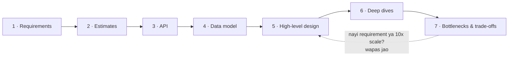
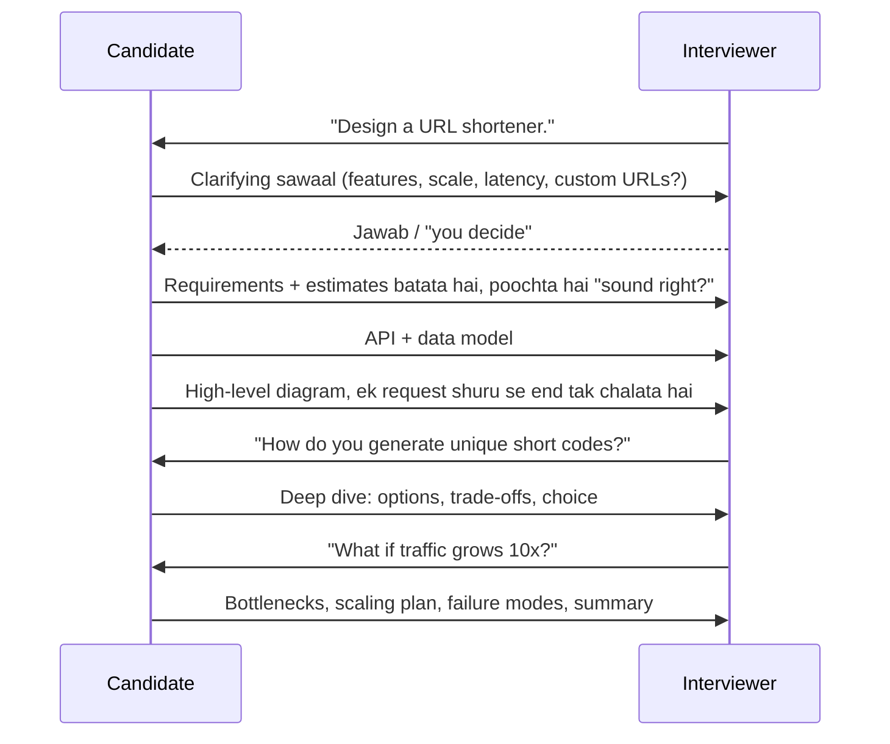
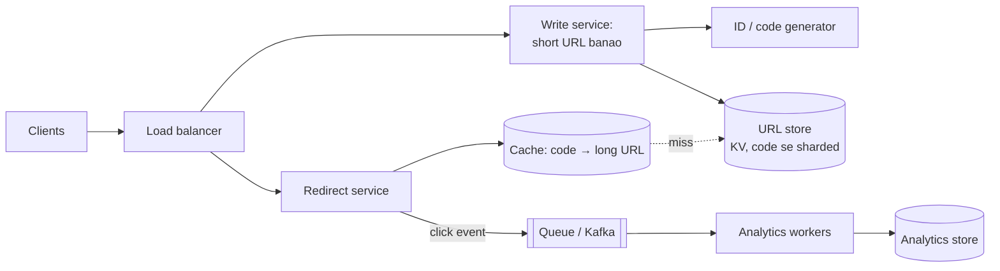
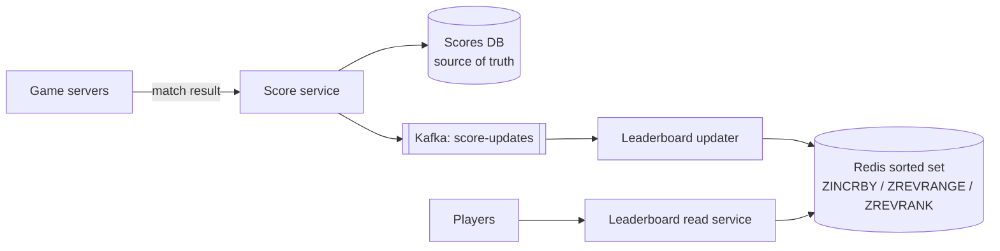

# Chapter 11 · Estimation & The Interview Framework

> Jo architect "din mein kitne trucks guzrenge?" poochhe bina pul (bridge) design karta hai, woh ya toh ek pagdandi bana deta hai ya ek monument. Dus minute ka rough hisaab-kitaab hi batata hai ki problem ko inmein se kya chahiye. Aur baaki 35 minute ke liye ek shaant, har baar dohraya ja sakne wala plan hi tumhari knowledge ko "strong hire" mein badalta hai.

**Is chapter mein tum seekhoge:**
- Woh gine-chune numbers jo har system designer dimaag mein lekar ghoomta hai (powers of 10, din ke seconds, latency aur size cheat sheets)
- QPS, peak load, storage, bandwidth, cache memory aur server count paanch minute se kam mein kaise estimate karein
- Ek darjan poori tarah hal kiye hue estimation examples jo tum baar-baar use kar sakte ho
- **7-step interview framework**, aur 45 minute us pe exactly kaise kharch karne hain
- Communication kaise karein: zor se sochna (thinking out loud), conversation drive karna, hints aur pushback handle karna
- Har level (SDE-1 se Staff tak) pe interviewers kya dekhte hain, aur woh galtiyan jo candidates ko dubo deti hain
- Ek reusable answer template jo tum kisi bhi "Design X" question ke liye bhar sakte ho

**Isse pehle padho:** [Chapters 01–10 of Part 3](01-foundations-internet.md), khaas kar [Scalability](02-scalability-load-balancing.md), [Databases](03-databases.md), [Caching](04-caching-cdn.md) aur [Queues](08-queues-events.md). Ye chapter un building blocks ko ek interview performance mein badalta hai.

---

## 🧠 The Big Idea · Asli Baat

System design interview ek quiz nahi hai jiska ek sahi answer ho. Ye ek **45-minute ki design meeting ka simulation** hai jismein tum lead engineer ho. Interviewer dekhna chahta hai ki tum ek dhundhli si request ("WhatsApp design karo") ko kaise ek samajhdaar plan mein badalte ho, aur saath-saath apne reasons kaise samjhaate ho.

Ise doctor ke appointment jaisa socho:

| Doctor | Interview mein tum |
|---|---|
| "Kya symptoms hain? Kab se?" | **Requirements clarify karo**: system ko kya karna hai, kitne users ke liye? |
| Temperature, blood pressure leta hai | **Estimate karo**: load, data, traffic kitna bada hai? |
| Diagnosis banata hai | **High-level design**: main boxes aur arrows |
| Risky hisson ke liye specific tests likhta hai | **Deep dives**: mushkil component detail mein |
| Har treatment ke risks samjhaata hai | **Trade-offs**: ye kyun, aur iske badle humne kya chhoda |

Jo doctor ek bhi sawaal poochhe bina dawai likh de, woh khatarnaak hai, chahe kitna bhi hoshiyaar ho. Tumhare saath bhi yahi hai: acche engineers design rounds mein sabse zyada isliye fail nahi hote ki unhe kuch pata nahi tha. Woh isliye fail hote hain ki doosre hi minute mein boxes aur arrows banane kood padte hain.

> 🇮🇳 **Desi Analogy:** Shaadi ka caterer socho. Achha caterer pehle hi din menu nahi bata deta. Woh poochta hai: "Kitne mehmaan? (scale) Veg ya non-veg? (functional requirements) Lunch ya dinner, buffet ya plated? Kitne bajay tak serve karna hai? (non-functional)". Phir hisaab lagata hai: "800 log × 3 roti = 2,400 roti, peak pe 9 baje 400 log ek saath aayenge, toh 6 tandoor lagenge" (estimates). Tab jaake kitchen ka layout banata hai (high-level design), aur sabse risky cheez pe dhyaan deta hai, jaise "baraat late aayi toh khana thanda na ho" (deep dive + failure modes). Jo caterer bina poochhe 200 logon ka khana bana de aur 800 aa jaayein, uski izzat gayi. Interview mein bhi yahi hota hai.



Aur estimation woh dhaaga hai jo sabko jodta hai. Numbers hi design decide karte hain: 50 writes per second ek database mein aaraam se aa jaate hain, jagah bachti hai; 500,000 writes per second ke liye sharding, queues aur ek bilkul alag conversation chahiye.

> 💡 **The core insight:** tumhe *tum kaise sochte ho* us pe grade kiya jaata hai, is pe nahi ki tumne kisi company ka asli architecture hu-ba-hu copy kiya ya nahi. Saaf requirements, rough-lekin-sensible numbers, ek simple design jise tum phir khud stress-test aur improve karo: yahi sequence *khud* answer hai.

---

## 🔨 Building It Up · Zero Se Shuru

### 1. Why estimate at all?

Back-of-the-envelope estimation (lifafe ke peeche kiya gaya hisaab) ka matlab hai simple arithmetic se **approximate** answers nikaalna, aur bebaaki se round karna. Goal hai **order of magnitude**: kya ye 10 per second hai, 1,000 ya 1,000,000? Gigabytes hai ya petabytes?

Numbers seedhe design questions ka answer dete hain:

| Agar estimate kehta hai... | Design pe asar |
|---|---|
| Write QPS ~ 50 | Ek SQL primary kaafi se zyada hai |
| Write QPS ~ 50,000 | Database shard karo ya write-optimised store use karo; shayad writes queue karo |
| Read:write = 100:1 | Caching aur read replicas load utha lenge |
| Storage ~ 500 GB total | Ek machine pe aa jaata hai; over-engineer mat karo |
| Storage ~ 5 PB | Object storage, tiering, sharding zaroori hain |
| Hot data ~ 30 GB | Ek cache node (ya chhote cluster) ki RAM mein aa jaata hai |
| Egress ~ 10 Gbps+ | Tumhe CDN chahiye |

> ⚠️ Precision goal nahi hai. "Lagbhag 12,000 QPS" aur "11,574 QPS" dono same design tak le jaate hain. Interviewers dheemi exactness se zyada jaldi, rounded, saaf bole gaye math ko pasand karte hain.

> 🇮🇳 **Desi Analogy:** Sabzi wala tumhe "₹47.35" nahi bolta, "₹50 de do" bolta hai, aur dono khush. Kyunki faisla (kitne note nikalne hain) ₹47 aur ₹50 se nahi badalta. Lekin agar woh ₹500 bole, toh faisla badal jaata hai. Estimation mein bhi yahi: **sirf woh farak maayne rakhta hai jo faisla badle.** 11,574 aur 12,000 ek hi faisla dete hain; 500 aur 50,000 alag.

### 2. Numbers you must know by heart

#### Powers of ten and two

Computers 2 ki powers mein ginte hain, lekin 2¹⁰ = 1,024 ≈ 1,000 = 10³, isliye estimation ke liye hum dono ko barabar maan lete hain.

| Power of 2 | ≈ Power of 10 | Naam | Bytes unit |
|---|---|---|---|
| 2¹⁰ | 10³ | Thousand (hazaar) | 1 KB |
| 2²⁰ | 10⁶ | Million (das lakh) | 1 MB |
| 2³⁰ | 10⁹ | Billion (sau crore) | 1 GB |
| 2⁴⁰ | 10¹² | Trillion (lakh crore) | 1 TB |
| 2⁵⁰ | 10¹⁵ | Quadrillion | 1 PB |

Kaam ki multiplications: thousand × thousand = million; million × thousand = billion; 1 million users × 1 KB = 1 GB; 1 billion × 1 KB = 1 TB.

> 🤔 **Mann mein sawaal:** Hum desi log lakh-crore mein sochte hain, interview mein million-billion. Dimaag mein convert kaise karoon bina atke?
>
> **Jawab:** Interview mein hamesha **million/billion** mein hi socho aur bolo, lakh-crore beech mein mat laao, warna galti pakki hai. Bas ye teen pul yaad rakho: **1 million = 10 lakh**, **10 million = 1 crore**, **1 billion = 100 crore**. Toh "India ke 100 crore users" = 1 billion. Aur ek trick: millions ko hamesha 10⁶ likho, billions ko 10⁹. Phir multiply karna sirf exponents jodna hai (Tips section mein aur detail hai).

#### Time

```python
SECONDS_PER_DAY = 24 * 60 * 60
print("seconds in a day  :", SECONDS_PER_DAY)
print("seconds in a month:", SECONDS_PER_DAY * 30)
print("seconds in a year :", SECONDS_PER_DAY * 365)
for per_day in [1_000_000, 10_000_000, 100_000_000, 1_000_000_000]:
    print(f"{per_day:>13,} per day = {per_day / SECONDS_PER_DAY:>8,.0f} per second")
```

```text
seconds in a day  : 86400
seconds in a month: 2592000
seconds in a year : 31536000
    1,000,000 per day =       12 per second
   10,000,000 per day =      116 per second
  100,000,000 per day =    1,157 per second
1,000,000,000 per day =   11,574 per second
```

Abhi kya hua? Poora QPS estimation bas "86,400 se divide karo" hai. Mental math ke liye ise **100,000 (10⁵)** pe round kar do. Isse is chapter ka sabse kaam ka rule nikalta hai:

> 💡 **1 million per day ≈ 12 per second.** (10⁵ wale shortcut se ≈ 10 per second.) Toh 100 million per day ≈ 1,200/s aur 1 billion per day ≈ 12,000/s.

Ye bhi kaam ka hai: ek mahina ≈ 2.5 million seconds; ek saal ≈ 30 million seconds (impress karna ho toh π × 10⁷).

#### Sizes of common things

| Cheez | Rough size |
|---|---|
| Ek character (ASCII / UTF-8 English) | 1 byte (UTF-8 mein ek character 4 bytes tak ho sakta hai) |
| Ek integer / timestamp (64-bit) | 8 bytes |
| Ek UUID | 16 bytes binary, text ki tarah 36 bytes |
| Metadata ke saath ek chhota text post | ~0.5–1 KB |
| Ek user profile row | ~1 KB |
| Ek compressed photo (phone, web-optimised) | ~200 KB – 2 MB |
| Ek thumbnail | ~10–50 KB |
| 1 minute video, 720p–1080p streaming quality | ~20–100 MB (bitrate pe bahut depend karta hai) |
| Ek web page (sirf HTML) | ~50–100 KB |

(Ek chhota desi note: Hindi ya kisi bhi Devanagari text ka har character UTF-8 mein 3 bytes leta hai. Toh agar tumhara app Indian languages mein messages store karta hai, toh "1 character = 1 byte" wala estimate lagbhag 3× kam pad sakta hai.)

#### Latency numbers (orders of magnitude)

Ye mashhoor "latency numbers every programmer should know" list se aate hain. Exact values hardware ke saath badalti hain; **ratios** maayne rakhte hain.

| Operation | Approx. time | Aise socho |
|---|---|---|
| L1 cache reference | ~1 ns | turant |
| Main memory (RAM) reference | ~100 ns | L1 ka 100× |
| RAM se 1 MB sequentially padhna | ~10–250 µs | |
| SSD random read | ~10–100 µs | RAM ka 1,000× |
| Data centre ke andar round trip | ~0.5 ms | |
| SSD se 1 MB sequentially padhna | ~0.2–1 ms | |
| HDD disk seek | ~10 ms | RAM ka 100,000× |
| Round trip India ↔ US | ~150–250 ms | |

> 🇮🇳 **Desi Analogy:** Maan lo L1 cache = **jeb mein rakha phone** (1 second mein nikaal liya). Toh RAM = **kamre ki almirah** (100 seconds, ~2 minute). SSD read = **gali ki kirana dukaan tak jaana** (lagbhag 1 din). HDD seek = **doosre shehar ki train journey** (~4 mahine!). Aur India ↔ US round trip = **lagbhag 5-8 saal ka wanvaas**. Isliye har architect RAM (cache) ke peeche bhaagta hai aur doosre continent ki call se darta hai.

Is table se teen sabak:
1. **Memory disk/network se ~1,000× fast hai**: isiliye caches ([Chapter 04](04-caching-cdn.md)) exist karte hain.
2. **Sequential random ko harata hai**: isiliye Kafka aur LSM-tree databases append karte hain ([Chapter 08](08-queues-events.md)).
3. **Cross-continent round trips mehenge hain**: isiliye CDNs aur multi-region deployments exist karte hain.

#### Rough capacity of common components

Ye hardware aur query complexity ke hisaab se 10× tak badal sakte hain. Inhe **starting assumptions** ki tarah use karo aur ye zor se bolo bhi.

| Component | Har node ka ballpark |
|---|---|
| Web/app server, simple API calls | ~1,000–10,000 requests/s |
| Relational DB (SQL), simple indexed queries | ~1,000s–10,000s reads/s; writes kam |
| Redis / Memcached | ~100,000+ ops/s |
| Kafka broker | ~100s of MB/s throughput |
| Ek modern server ki RAM | ~64–512 GB |
| Ek modern server ka network | ~10–25 Gbps |

### 3. Estimating QPS (and peak)

**QPS** (queries per second) request rate hai. Recipe:

```text
daily requests  = daily active users (DAU) × actions per user per day
average QPS     = daily requests / 86,400   (≈ / 100,000)
peak QPS        = average QPS × peak factor (usually 2–3×; 10× or more for flash events)
```

Hamesha **reads** aur **writes** alag karo: woh system ke alag hisson pe padte hain aur alag tareeke se scale hote hain.

**Worked example 1: a photo-sharing app.**
Maan lo 100 million DAU. Har user din mein 0.5 photos upload karta hai aur 50 photos dekhta hai.

```text
uploads/day = 100M × 0.5 = 50M        → write QPS ≈ 50M / 100k = 500/s,   peak ≈ 1,500/s
views/day   = 100M × 50  = 5B         → read QPS  ≈ 5B / 100k  = 50,000/s, peak ≈ 150,000/s
read : write = 100 : 1  → read-heavy → cache + CDN + read replicas
```

Abhi kya hua? Do multiplications aur do divisions ne sabse important design fact de diya: ye system bhaari maatra mein read-heavy hai, toh design ki zyaadatar mehnat reads ko fast serve karne mein jaayegi.

> 💡 "Peak factor 2–3×" aata kahan se hai? Traffic din ke saath chalta hai: shaam busy, raat shaant. Peak hours usually daily average ke kuch guna hote hain. Events (cricket final, New Year ki aadhi raat, flash sale) 10× ya usse zyada spike kar sakte hain, aur aksar *wahi* requirement asli maayne rakhti hai. Poocho: "Kya humare paas predictable spikes hain?"

> 🇮🇳 **Desi Analogy:** IRCTC socho. Din bhar ka average traffic theek-thaak hai. Lekin subah 10 baje AC Tatkal khulta hai aur 11 baje non-AC, aur us ek minute mein traffic average ka kai guna ho jaata hai. Agar IRCTC average ke hisaab se servers lagaye, toh roz 10 baje site girti. Isliye design **peak** ke liye hota hai, average ke liye nahi. Aur Diwali-Chhath ki booking wala din? Wahi "10× event" hai.

### 4. Estimating storage

```text
storage/day   = new items/day × size per item
total storage = storage/day × 365 × years to keep × replication factor
```

**Worked example 2: the same photo app, 5 years.**

```text
photos/day     = 50M × 1 MB (stored original, compressed) = 50 TB/day
5 years        = 50 TB × 365 × 5 ≈ 50 × 1,800 ≈ 90 PB
+ thumbnails   ~ a few % extra; replication handled by object storage
metadata/day   = 50M × 1 KB = 50 GB/day → ~90 TB over 5 years (DB, sharded)
```

Step by step dekho: 50M × 1 MB = 50 × 10⁶ × 10⁶ bytes = 50 × 10¹² = 50 TB. Phir 365 × 5 = 1,825 ≈ 1,800, aur 50 × 1,800 = 90,000 TB = 90 PB.

Sabak: **storage pe media ka raaj hai**; metadata uske saamne kuch bhi nahi (90 PB vs 90 TB, 1000× farak). Photos object storage mein jaati hain ([Chapter 10](10-storage-search-ids.md)); metadata ek database mein jaata hai jise tum user ya photo ID se shard karte ho.

### 5. Estimating bandwidth

```text
ingress (upload)   = write QPS × average upload size
egress (download)  = read QPS  × average response size
```

**Worked example 3: photo app bandwidth.**

```text
ingress = 500 uploads/s × 1 MB       = 500 MB/s ≈ 4 Gbps
egress  = 50,000 views/s × 200 KB    = 10 GB/s  ≈ 80 Gbps (average!) → CDN is mandatory
```

(Bytes se bits: 8 se multiply karo. 1 GB/s = 8 Gbps.)

> 🤔 **Mann mein sawaal:** Egress mein 200 KB kyun liya, jab upload 1 MB ka tha?
>
> **Jawab:** Kyunki log feed mein original 1 MB photo nahi dekhte. Phone screen ke liye compressed, resized version serve hota hai (~200 KB). Original sirf tab jaata hai jab koi "full size" download kare. Ye real systems ka common pattern hai: **ek baar bada likho, baar-baar chhota padho.** Estimation mein hamesha socho "client ko asal mein kya bheja ja raha hai?"

**Worked example 4: video streaming egress.**
1 million concurrent viewers × 5 Mbps (ek typical HD bitrate) = 5,000,000 Mbps = **5 Tbps**. Koi akela data centre itna serve nahi karta; bilkul isi kaam ke liye ISPs ke andar edge servers wale CDNs hote hain ([Chapter 13](13-case-studies-2.md)).

> 🇮🇳 **Desi Analogy:** IPL final pe Hotstar (JioCinema) pe crore viewers ek saath. Agar sab Mumbai ke ek data centre se stream karein, toh poore desh ka internet ek pipe mein ghusne ki koshish karega. Isliye content tumhare shehar ke, balki tumhare ISP (Jio/Airtel) ke andar rakhe edge servers se aata hai, jaise Amul ka doodh har gali ke booth pe pahunchaya jaata hai, factory se seedha nahi.

### 6. Estimating cache memory

**80/20 rule** (Pareto): lagbhag 20% items ko 80% traffic milta hai. Toh ek din ke hot data ka ~20% cache karne se zyaadatar reads serve ho jaate hain.

```text
cache memory ≈ 0.2 × (daily read requests × response size)       ← upper bound, counts repeats
           or ≈ 0.2 × (unique items read per day × item size)     ← better if you know uniques
```

**Worked example 5: cache for a URL shortener.**
Reads: 1 billion redirects/day; har cached entry (short code + long URL + overhead) ≈ 500 bytes.

```text
0.2 × 1B × 500 B = 100 GB
```

100 GB ek bade server ki RAM mein aa jaata hai, ya replicas ke saath 3–4 node Redis cluster mein aaraam se. Un billion reads mein se kaafi same popular links pe padte hain, toh unique hot data aur bhi chhota hai: ye ek upper bound hai.

> 🇮🇳 **Desi Analogy:** Kirana dukaan ka counter socho. Dukaan mein 2,000 cheezein hain, lekin 80% customers wahi 400 cheezein maangte hain: doodh, bread, Maggi, Parle-G. Samajhdaar dukandaar ye 400 cheezein **counter ke paas** (cache, RAM) rakhta hai, baaki godown (disk/DB) mein. Counter chhota hai, lekin zyaadatar customers wahin se nipat jaate hain.

### 7. Estimating server count

```text
servers = peak QPS / (QPS one server handles × target utilisation)
then add redundancy: survive a server, or a whole availability zone, failing
```

Servers ko 100% pe chalana musibat ko nyota dena hai: full load ke paas latency phat jaati hai, aur ek failure baaki sab ko overload kar deta hai. Peak pe 50–70% utilisation target karo.

```python
import math

def servers_needed(peak_qps, per_server_qps, target_util=0.6, zones=3):
    """Servers for peak load at target utilisation, then spread so the
    system survives losing an entire availability zone."""
    base = math.ceil(peak_qps / (per_server_qps * target_util))
    per_zone = math.ceil(base / (zones - 1))      # bache hue zones ko poora load uthana padega
    return base, per_zone * zones

base, with_zone_failure = servers_needed(peak_qps=30_000, per_server_qps=2_000)
print("servers for peak load      :", base)
print("servers to survive a zone  :", with_zone_failure)
```

```text
servers for peak load      : 25
servers to survive a zone  : 39
```

Abhi kya hua? 30,000 / (2,000 × 0.6) = 30,000 / 1,200 = 25 servers peak utha lete hain. Lekin agar 3 mein se ek zone mar jaaye, toh baaki do ko sab uthana padega, isliye har zone ko 13 chahiye (25 / 2 = 12.5, upar round karke), total 39. "Aur ek zone failure jhelne ke liye main lagbhag 40 provision karunga" bolna ek pyaara senior-level touch hai.

> 🤔 **Mann mein sawaal:** 25 servers ko 3 zones mein baant do (9+8+8), itna kaafi kyun nahi?
>
> **Jawab:** Kyunki jab ek zone (maan lo 9 wala) gira, toh bache 16 servers ko 25 ka kaam karna padega, yaani ~94% utilisation. Aur agle section ke "Under the Hood" mein dekhoge ki 90%+ pe latency 10-20× ho jaati hai: system lagbhag gir hi gaya. Isliye hum sochte hain "do zones bachein toh bhi 25 hon", yaani har zone mein 13. Ye 14 extra servers **insurance premium** hain.

### 8. Little's Law: how many requests are "in flight"?

**Little's Law:** system ke andar items ki average ginti = arrival rate × har item ka andar bitaya average time.

```text
L = λ × W        (concurrency = throughput × latency)
```

Ye "mujhe kitne threads / connections chahiye?" jaise sawaalon ka answer deta hai.

> 🇮🇳 **Desi Analogy:** Ek chai tapri pe har minute 10 customers aate hain (λ = 10/min), aur har customer chai peene mein 6 minute lagata hai (W = 6 min). Toh kisi bhi waqt tapri pe average 10 × 6 = **60 log** khade honge (L). Agar tapri pe sirf 40 cup hain (connection pool), toh 20 log line mein khade honge. Ab socho chai wala slow ho gaya aur har customer ko 12 minute lagne lage: same 10/min aane wale, ab 120 log khade honge. Customers zyada nahi aaye, bas **har ek ruk zyada raha hai**. Yahi slow dependency ka khel hai.

```python
def in_flight(qps, latency_ms):
    return qps * latency_ms / 1000

print("API: 5,000 QPS at 200 ms ->", in_flight(5_000, 200), "requests in flight")
print("DB : 2,000 QPS at 5 ms   ->", in_flight(2_000, 5), "busy connections")
print("Slow DB: same QPS at 50 ms ->", in_flight(2_000, 50), "busy connections")
```

```text
API: 5,000 QPS at 200 ms -> 1000.0 requests in flight
DB : 2,000 QPS at 5 ms   -> 10.0 busy connections
Slow DB: same QPS at 50 ms -> 100.0 busy connections
```

Abhi kya hua? Agar database 5 ms se 50 ms pe slow ho jaaye, toh same traffic ko **10× zyada connections** chahiye. Agar connection pool 20 pe capped hai, toh requests queue hone lagti hain aur time out hone lagti hain. Isi tarah ek slow dependency chupchaap poora system gira deti hai, aur isiliye timeouts aur circuit breakers ([Chapter 09](09-microservices-reliability.md)) zaroori hain.

### 9. A complete estimation in code

Chalo Twitter jaisi service ke liye sab kuch jodte hain. Upar ka har number ek **assumption** hai jo hum zor se bolenge aur interviewer se agree karenge.

```python
def human(n, unit="B"):
    """Format with decimal prefixes (K, M, G, ...), the convention for estimation."""
    for prefix in ["", "K", "M", "G", "T", "P", "E"]:
        if abs(n) < 1000:
            return f"{n:,.1f} {prefix}{unit}"
        n /= 1000
    return f"{n:,.1f} Z{unit}"

SECONDS_PER_DAY = 86_400
a = dict(dau=200e6, posts_per_user=2, reads_per_user=100, post_bytes=1_000,
         media_fraction=0.10, media_bytes=500e3, peak_factor=3, years=5)

writes_per_day = a["dau"] * a["posts_per_user"]
reads_per_day = a["dau"] * a["reads_per_user"]
write_qps = writes_per_day / SECONDS_PER_DAY
read_qps = reads_per_day / SECONDS_PER_DAY

text_per_day = writes_per_day * a["post_bytes"]
media_per_day = writes_per_day * a["media_fraction"] * a["media_bytes"]
total_storage = (text_per_day + media_per_day) * 365 * a["years"]

avg_read_bytes = a["post_bytes"] + a["media_fraction"] * a["media_bytes"]
egress = read_qps * avg_read_bytes
cache = 0.2 * text_per_day

print(f"write QPS : {write_qps:,.0f} avg, {write_qps * a['peak_factor']:,.0f} peak")
print(f"read QPS  : {read_qps:,.0f} avg, {read_qps * a['peak_factor']:,.0f} peak")
print(f"text/day  : {human(text_per_day)}   media/day: {human(media_per_day)}")
print(f"5 years   : {human(total_storage)} (before replication)")
print(f"egress    : {human(egress)}/s = {human(egress * 8, 'bps')}")
print(f"cache     : {human(cache)} (20% of a day's posts)")
```

```text
write QPS : 4,630 avg, 13,889 peak
read QPS  : 231,481 avg, 694,444 peak
text/day  : 400.0 GB   media/day: 20.0 TB
5 years   : 37.2 PB (before replication)
egress    : 11.8 GB/s = 94.4 Gbps
cache     : 80.0 GB (20% of a day's posts)
```

Abhi kya hua, aur **design ke liye iska matlab kya hai**:
- Reads writes se 50:1 zyada hain (100 reads vs 2 posts per user) aur peak pe ~700k/s ke paas: cache mein precomputed timelines, read replicas, media ke liye CDN.
- Writes peak pe ~14k/s: is workload ke liye ek akele SQL primary ko jitna lena chahiye usse zyada, toh posts ko shard karo (user ID ya post ID se).
- Storage ka 98% media hai (20 TB vs 0.4 TB per day): object storage + CDN, metadata database mein.
- 80 GB hot text ek chhote cache cluster mein aa jaata hai.

Dhyaan do, **har number ek design decision ban gaya**. Jo numbers koi decision nahi badalte, woh waqt ki barbaadi hain: unhe skip karo.

### 10. More worked examples (rapid fire)

Inhe zor se bolne ki practice karo, har ek do minute se kam mein.

**Example 6: chat app messages.** 500M DAU × 40 messages/day = 20B messages/day → 20B / 10⁵ = **200k msgs/s** average (exact ≈ 230k), peak ~500k–700k/s. 100 bytes per message pe: 20B × 100 B = **2 TB/day**, replication se pehle 5 saal mein ≈ 3.6 PB. Conclusion: write-heavy, ek horizontally scalable write-optimised store chahiye (Cassandra/HBase jaisa wide-column), conversation ID se partitioned.

**Example 7: URL shortener keys.** 10 saal tak har mahine 100M naye URLs = 12 billion URLs. Base62 characters (a–z, A–Z, 0–9) ke saath short code kitna lamba hona chahiye?

```python
import math

needed = 100e6 * 12 * 10
for length in range(5, 9):
    print(f"base62 length {length}: {62 ** length:,} codes")
print("minimum length for", f"{needed:,.0f}", "URLs:", math.ceil(math.log(needed, 62)))
```

```text
base62 length 5: 916,132,832 codes
base62 length 6: 56,800,235,584 codes
base62 length 7: 3,521,614,606,208 codes
base62 length 8: 218,340,105,584,896 codes
minimum length for 12,000,000,000 URLs: 6
```

Chhe characters 56.8 billion codes dete hain, 12 billion ke liye kaafi, lekin 7 characters (3.5 trillion) kaafi headroom dete hain aur random codes ko guess karna mushkil bana dete hain. 7 chuno. ([Chapter 12](12-case-studies-1.md) poori service design karta hai.)

> 🤔 **Mann mein sawaal:** 6 characters mein 56.8 billion hain aur humein sirf 12 billion chahiye, toh 7 kyun? Ye toh over-engineering hui na?
>
> **Jawab:** Nahi, teen wajah hain. (1) Agar codes **random** generate karte ho, toh space 21% bhar jaane pe har naye code pe collision ki chance ~21% ho jaati hai, retries badhte jaate hain. (2) 12 billion ek *estimate* hai; business 3× bada ho gaya toh 6 chars khatam. (3) Space bhara hua ho toh koi bhi random 6-char try karke kisi ka private link khol sakta hai (guessability). 7 chars mein sirf ek character extra, lekin space 62× bada. Sasta insurance.

**Example 8: URL shortener QPS.** Writes: 100M/month ÷ 2.5M s/month = **40/s**. Reads 100:1 pe = **4,000/s**, peak ~10–12k/s. Storage: 12B × 500 B = **6 TB** 10 saal mein. Itna chhota ki kuch shards (ya replicas ke saath ek badi machine bhi) ise rakh sakti hai.

**Example 9: notification system.** 50M notifications/day → ~600/s average; lekin marketing campaigns 10 minute mein 10M bhejte hain → 10M / 600 s ≈ **17k/s burst**. Burst hi asli requirement hai: queue + scalable workers + per-channel rate limits ([Chapter 12](12-case-studies-1.md)).

**Example 10: ride-hailing location updates.** 1M active drivers har 4 second mein apna GPS bhejte hain → **250k writes/s**. Har update ~100 bytes → 25 MB/s. Sirf latest position memory mein rakho (Redis jaise stores mein geo index) aur history cold storage mein stream kar do. 250k/s ko relational table mein mat daalo.

**Example 11: web crawler.** Har mahine 1B pages crawl karo → 1B / 2.5M s ≈ **400 pages/s**. Average page 100 KB → 40 MB/s download ≈ 320 Mbps, aur 1B × 100 KB = har mahine **100 TB** raw HTML. Conclusion: distributed fetchers, har domain ke saath politeness (ek site pe zyada requests mat bhejo), compression, object storage.

**Example 12: video uploads.** Maan lo 100k uploads/day, average 10 minute, 4 resolutions mein stored, kul ~1 GB per 10 minutes. 100k × 1 GB = **100 TB/day**, ≈ 36 PB/year. Roz 100k videos transcode karna ≈ 1.2 videos/s, har ek mein minutes ka CPU: queue se feed hone wale hazaaron transcoding workers.

> 🤔 **Mann mein sawaal:** 1.2 videos/s toh bahut kam hai, phir hazaaron workers kyun?
>
> **Jawab:** Little's Law yaad karo: L = λ × W. Agar ek video transcode karne mein (4 resolutions) maan lo 20-30 minute CPU lagta hai, toh W ≈ 1,500 s. L = 1.2 × 1,500 ≈ **1,800 videos ek saath process mein**. Har worker ek video sambhaale toh ~1,800 workers, aur peak ke liye aur zyada. Rate chhota hai, lekin har kaam lamba hai, isliye concurrency badi hai.

### 11. The 7-step interview framework

Ab asli event. 45-minute round ka plan ye raha (introductions ke baad lagbhag 40 minute design). Time ek guide hai, stopwatch nahi.

| Step | Minutes | Goal | Whiteboard pe output |
|---|---|---|---|
| 1. Requirements | 0–5 | Kya banana hai aur kitna bada, is pe agree karo | 3–5 functional, 3–5 non-functional requirements |
| 2. Estimates | 5–9 | Problem ka size naapo | QPS (read/write, peak), storage, bandwidth, cache |
| 3. API | 9–13 | Contract define karo | Inputs/outputs ke saath 3–5 endpoints |
| 4. Data model | 13–17 | Kya kahan store hoga, decide karo | Entities, key fields, DB choice, partition key |
| 5. High-level design | 17–27 | Ek end-to-end kaam karta design | Diagram: clients → LB → services → stores, caches, queues |
| 6. Deep dives | 27–40 | Sabse mushkil hisson pe depth dikhao | 2–3 components detail mein, alternatives ke saath |
| 7. Bottlenecks & trade-offs | 40–45 | Judgement dikhao, wrap up karo | Failure modes, scaling limits, aage kya karoge |



> 🇮🇳 **Desi Analogy:** 45 minute ka interview = **ek T20 innings ki planning**. Pehle 5 minute = toss aur pitch report (requirements: pitch kaisi hai, target kya hai). Estimates = "required run rate" nikaalna. API + data model = batting order tay karna. High-level design = powerplay mein ek solid start, wicket bachake. Deep dives = middle overs jahan match jeeta jaata hai (yahin level decide hota hai). Bottlenecks & wrap-up = death overs, jahan tum khud batate ho ki risk kahan hai. Jo batsman pehle 6 overs mein hi 3 wicket gawa de (requirements skip karke diagram mein kood jaaye), woh deep dives tak pahunchta hi nahi.

Chalo har step ko ek-ek karke dekhte hain.

### 12. Step 1: Requirements (0–5 min)

Kya bana rahe ho ye jaane bina kabhi drawing shuru mat karo. Requirements ko do kism mein baanto:

- **Functional requirements (FRs):** system *kya karta* hai. Features, user stories ki tarah: "users can shorten a URL", "users get redirected", "users can see click counts".
- **Non-functional requirements (NFRs):** woh kaam *kitni acchi tarah* karta hai: scale, latency, availability, consistency, durability, security, cost.

> 🇮🇳 **Desi Analogy:** Ghar kharidte waqt "3 BHK, ek balcony, ek parking" = **functional** (kya hona chahiye). "Metro se 10 minute, 24 ghante paani, earthquake-safe, 1 crore se kam" = **non-functional** (kitna accha, kis constraint mein). Dhyaan do: do 3 BHK flats ke features same ho sakte hain, lekin ek Andheri mein aur ek Virar mein, aur unki keemat aur design bilkul alag. Software mein bhi, same features 1,000 users aur 100M users pe bilkul alag design dete hain.

**Sawaal jo lagbhag har problem pe chalte hain:**

| Category | Sawaal |
|---|---|
| Users & scale | Kitne users (DAU)? Har user din mein kitne actions? Growth expected hai? |
| Features | Kaunse 3–4 features scope mein hain? Kya explicitly out of scope hai? |
| Read/write pattern | Reads zyada ya writes? Koi burst events? |
| Latency | Kitna response time acceptable hai? (jaise reads ke liye p99 < 200 ms) |
| Consistency | Kya user ko thoda purana data dikhe toh chalega? Kahan *nahi* chalega (paisa, inventory)? |
| Availability | Downtime kitna bura hai? (99.9% vs 99.99%) |
| Data | Data kitni der rakhna hai? Koi size limits (message length, file size)? |
| Clients & geography | Mobile, web, dono? Ek desh ya global? |

**Phir prioritise karo aur likh do.** URL shortener ka example:

```text
Functional (in scope)
  1. Create a short URL for a long URL (optional custom alias, optional expiry)
  2. Redirect short URL -> long URL
  3. Basic click analytics (count per link)
Out of scope: user accounts UI, link editing, spam detection (mention, don't design)

Non-functional
  - 100M new URLs/month, reads 100x writes
  - Redirect latency p99 < 50 ms (it sits in front of every click)
  - Highly available for redirects (99.99%); creation can be slightly less
  - Short codes must be unique and not easily guessable
  - Links kept 10 years by default
```

> 💡 Agar interviewer kahe "you decide", toh **decide karo, bolo, aur aage badho**: "I'll assume 100 million DAU, global users, and that a few seconds of staleness in counts is fine." Thoda galat assumption utna nuksaan nahi karta jitna faisla na kar paana.

> 🤔 **Mann mein sawaal:** 99.9% aur 99.99% mein toh bas ek 9 ka farak hai. Itna bada deal kyun?
>
> **Jawab:** Saal mein downtime mein badlo toh farak dikhega. 99.9% = saal mein ~8.8 **ghante** down. 99.99% = saal mein ~53 **minute** down. Har extra 9 downtime ko 10× kam karta hai, aur design ko kaafi mehenga bana deta hai (multi-zone, automatic failover, koi single point of failure nahi). Isliye ye sawaal poochna zaroori hai: redirect service ke liye 99.99% chahiye, admin dashboard ke liye 99.9% kaafi hai.

### 13. Step 2: Estimates (5–9 min)

Sections 3–7 wala math exactly karo, **sirf un numbers ke liye jo design badalte hain**. Typically:

1. Read QPS aur write QPS (average aur peak) → batata hai read-heavy hai ya write-heavy, aur kya ek DB sambhal lega.
2. N saal ka storage → batata hai single node ya sharding, hot ya cold storage.
3. Bandwidth (sirf agar media involved hai) → batata hai CDN chahiye ya nahi.
4. Cache size (sirf agar read-heavy hai) → batata hai kitne cache nodes.

Result ko board pe ek chhoti table ki tarah likho, phir **conclusion bolo**: "So we're read-heavy at ~100:1, with ~4k reads/s average and ~6 TB over 10 years. A cache will absorb most reads, and storage fits on a few shards."

> ⚠️ Kuch interviewers kehte hain "estimates skip karo". Tab unhe izzat se skip karo aur scale assumptions ek sentence mein bol do. Behas mat karo.

### 14. Step 3: API design (9–13 min)

Clients aur tumhare system ke beech ka contract define karo. Usually REST ([Chapter 07](07-apis-communication.md)). Endpoints, key parameters aur responses ke naam bolo. Jahan relevant ho wahan auth aur pagination bhi daalo.

```text
POST /v1/urls
  body: { "long_url": "https://...", "custom_alias": "diwali-sale" (optional),
          "expires_at": "2027-01-01T00:00:00Z" (optional) }
  auth: API key / user token
  201 -> { "short_url": "https://sho.rt/aZ3kP9q", "code": "aZ3kP9q" }
  409 -> alias already taken

GET /{code}
  302 Found, Location: https://...        (or 301 if we never need analytics)
  404 if unknown or expired

GET /v1/urls/{code}/stats
  200 -> { "clicks": 12873, "created_at": "..." }
```

Chhota rakho: interview mein API ka kaam features ko concrete banana hai. Jin create endpoints ko clients retry kar sakte hain unke liye idempotency keys ka zikr karo, aur lists (feeds, messages) ke liye cursor-based pagination ka.

> 🤔 **Mann mein sawaal:** 302 aur 301 mein kya farak hai, aur analytics ka isse kya lena-dena?
>
> **Jawab:** **301 = Moved Permanently**: browser (aur beech ke caches) ise yaad rakh lete hain, aur agli baar same short link pe tumhare server ke paas aate hi nahi, seedhe long URL pe chale jaate hain. Server ka load kam, lekin tumhe click ginne ka mauka hi nahi milta. **302 = Found (temporary)**: browser har baar tumhare server se poochta hai, toh har click tumhare paas se guzarta hai aur gina ja sakta hai. Isliye analytics chahiye toh 302, sirf speed aur kam load chahiye toh 301.

### 15. Step 4: Data model (13–17 min)

Core entities, unke key fields, aur **woh kahan rehte hain** list karo. Phir ek reason ke saath database type chuno ([Chapter 03](03-databases.md)), aur agar shard karoge toh **partition key** bhi ([Chapter 05](05-replication-sharding.md)).

```sql
-- urls: har short link ki ek row. Access pattern: code se lookup (bahut hot), insert.
CREATE TABLE urls (
    code        VARCHAR(10) PRIMARY KEY,   -- shard kiya toh yahi partition key
    long_url    TEXT NOT NULL,
    user_id     BIGINT,
    created_at  TIMESTAMP NOT NULL,
    expires_at  TIMESTAMP
);
```

Reasoning bolo: "The access pattern is a simple key lookup by `code` with no joins, so a key-value or wide-column store works well and shards trivially by `code`. A relational DB also works at this scale. I'll pick a KV store for horizontal scaling, and keep click counts in a separate analytics pipeline so redirects stay fast."

> 💡 Data model ko **access patterns** (jo queries tum chalaoge) se design karo, problem ke nouns se nahi. "Top 3 queries kaunsi hain, aur har ek index ko kaise hit karti hai?"

### 16. Step 5: High-level design (17–27 min)

Sabse simple end-to-end design banao jo functional requirements poori kare, phir ek request ko usmein se guzaaro.



**Ek request narrate karo:** "A redirect hits the load balancer, goes to a stateless redirect server, which checks the cache; on a hit (most of the time) it returns a 302 in a few ms. On a miss it reads the KV store and fills the cache. It also publishes a click event to Kafka asynchronously, so analytics never slows the redirect."

Is step ke rules:
- **Simple se shuru karo, phir evolve karo.** Har zimmedari ka ek box. Caches, queues, replicas tab add karo jab koi requirement ya estimate unhe maange, aur bolo kaunsa.
- **Read aur write paths alag karo** jab unka scale bahut alag ho.
- **Stateless services** load balancers ke peeche; state databases, caches aur queues mein rehti hai.
- **Har arrow samjhaaya ja sake:** sync ya async? kaunsa protocol? fail hua toh kya hoga?

### 17. Step 6: Deep dives (27–40 min)

Yahin levels decide hote hain. 2–3 sabse mushkil components chuno (ya interviewer ko chunne do) aur gehraai mein jao: alternatives, trade-offs, ek choice, aur failure handling.

Deep dive ke liye kya chunein:
- **Is problem ka unique challenge** (URL shortener: code generation; chat: message delivery aur ordering; feed: fan-out; ride-hailing: geo-matching).
- **Sabse bada scaling bottleneck** jo tumhare estimates ne dikhaya.
- **Jis taraf interviewer le jaa raha hai.** Agar woh kisi cheez ke baare mein poochte hain, toh wahi deep dive hai. Unke peeche chalo.

Ek acche deep dive ka ek shape hota hai. Har baar ise use karo:

```text
1. The problem:     "We need globally unique 7-char codes at 40 writes/s, not guessable."
2. Options:         (a) hash + truncate, (b) counter + base62, (c) pre-generated key pool
3. Trade-offs:      collisions vs coordination vs predictability (a table)
4. Choice + why:    "(b) with a ticket range per server: no collisions, no hot path coordination;
                     I'll shuffle/encode the counter so codes aren't sequential."
5. Failure modes:   "If a server dies, it loses its unused range: we waste some IDs, which is fine."
```

> 🇮🇳 **Desi Analogy:** Deep dive ka shape = **DRS review**. (1) Problem: "kya ball stumps ko lagti?" (2) Options: ball-tracking, UltraEdge, Hot Spot. (3) Trade-offs: har technology kya pakadti hai aur kya miss karti hai. (4) Faisla + kyun: "pitching in line, impact in line, wickets hitting: OUT." (5) Failure mode: "umpire's call", yaani jahan technology pakki nahi, wahan kya karenge. Third umpire seedha "OUT" nahi bolta; poora process dikhata hai. Tumhe bhi interviewer ko poora process dikhana hai, sirf faisla nahi.

### 18. Step 7: Bottlenecks, trade-offs and wrap-up (40–45 min)

Apne hi design ko stress-test karke khatam karo. Interviewers un candidates ko pasand karte hain jo poochhe jaane se pehle hi apne design ki kamzoriyan dhoondh lete hain.

Jaldi se is checklist se guzro:
- **Single points of failure?** Load balancer, DB primary, ID generator, cache. Har ek ko redundancy ya failover plan chahiye.
- **10× traffic pe kya tootega?** Usually database writes, ek hot key, ya ek fan-out step.
- **Hot spots:** celebrity users, viral links, popular products. Ilaaj: replicated hot keys, local caches, request coalescing (same cheez ki kai requests ko ek mein jodna).
- **Consistency gaps:** users ko kahan purana ya conflicting data dikh sakta hai? Kya woh acceptable hai?
- **Monitoring:** kaunse metrics aur alerts (latency p99, error rate, queue lag) ([Chapter 09](09-microservices-reliability.md)).
- **Security & abuse:** rate limiting, auth, input validation (jaise malicious URLs).
- **Cost:** storage tiering (hot → cold), CDN, right-sizing.

Phir **30 second mein summary do**: "To recap: a stateless redirect tier behind a CDN-cacheable 302, Redis cache absorbing ~90% of reads, a sharded KV store, counter-based codes with per-server ranges, and an async analytics pipeline over Kafka. The main trade-off is eventual consistency of click counts in exchange for fast redirects. Next I'd look at multi-region replication."

### 19. Communicating like a senior engineer

Material aana aadhi ladaai hai. Baaki aadhi ye hai ki tum use pesh kaise karte ho.

1. **Zor se socho (think out loud).** Chuppi sabse bura signal hai: interviewer un khayalon ko grade nahi kar sakta jo use sunaayi hi nahi dete. Narrate karo: "I'm considering two options here..."
2. **Drive karo, wait mat karo.** Meeting tum lead kar rahe ho. Shuru mein plan announce karo: "I'll clarify requirements, do quick estimates, sketch the API and data model, then a high-level design, and then dive into the hard parts. Sound good?"
3. **Milestones pe check in karo**, har sentence pe nahi: "Before I go deeper, does this high-level design make sense, or is there an area you'd like me to focus on?"
4. **Har choice ke saath ek "because".** "I'll use Cassandra" nahi, balki "I'll use Cassandra because we have 200k writes/s, simple key access by conversation ID, and we can tolerate eventual consistency."
5. **Jo alternative reject kiya uska naam lo.** "Fan-out on read would save storage, but celebrity reads would be slow, so I'll use a hybrid." Woh ek sentence trade-off thinking dikha deta hai.
6. **Hints ko tohfa samjho.** Agar interviewer poochhe "what about a celebrity with 50M followers?", toh woh ek kamzori ki taraf ishaara kar rahe hain. Bolo "Good point, that breaks fan-out on write. Let me adjust..." Kabhi defensive mat bano.
7. **Gaps ke baare mein imaandaar raho.** "I haven't used Cassandra in production, but my understanding is..." bluff karne se behtar hai. Bluff agle hi follow-up mein pakda jaata hai.
8. **Board saaf rakho.** Requirements upar-baayein, unke neeche estimates, beech mein diagram. Components pe number daalo taaki unka hawaala de sako.
9. **Precise words use karo**: p99 latency, read replica, partition key, idempotent, eventual consistency. Har ek experience ka ek chhota signal hai.
10. **Time manage karo.** Agar minute 25 pe ho aur abhi bhi data model pe atke ho, toh bolo "Let me move to the high-level design so we have time for deep dives" aur aage badho.

> 🇮🇳 **Desi Analogy:** Interview mein tumhe **cricket commentator + captain** dono banna hai. Captain (drive karo): field khud set karta hai, bowler khud badalta hai, umpire ka intezaar nahi karta. Commentator (think out loud): har decision ke saath batata hai "ye fielder slip mein isliye, kyunki ball swing ho rahi hai". Jo captain chupchaap field badle aur kuch na bole, uski strategy koi samajh nahi paata, chahe kitni bhi acchi ho.

### 20. What interviewers evaluate, by level

Har company ka rubric alag hota hai, lekin zyaadatar chaar-paanch dimensions pe grade karte hain:

| Dimension | Woh kya dhoondhte hain |
|---|---|
| **Problem navigation** | Scope clarify karta hai, pehchaanta hai kya maayne rakhta hai, prioritise karta hai, bhatakta nahi |
| **Solution design** | Ek kaam karta, coherent end-to-end design jo requirements poori kare |
| **Technical depth** | Components ki asli samajh: woh kaise kaam karte hain, scale hote hain aur fail hote hain |
| **Trade-offs & judgement** | Alternatives sochta hai, choices ko requirements aur numbers se justify karta hai |
| **Communication** | Saaf, structured, collaborative, feedback ke liye khula |

Aur level ke saath bar upar jaata hai:

| Level | Expected performance |
|---|---|
| **New grad / SDE-1** | Aksar koi HLD round nahi, ya ek simple sa. Basics dikhao: clients, servers, DB, cache, load balancer. Samajhdaar API aur schema. Interviewer kaafi guide kar sakta hai. Is level pe LLD/machine-coding rounds ([Chapter 14](14-low-level-design.md)) zyada common hain. |
| **SDE-2 / mid-level** | Standard components ko sahi use karte hue ek complete, kaam karta design drive karta hai. 1–2 deep dives competently sambhaalta hai. Thodi trade-off discussion. Sirf halki guidance chahiye. |
| **Senior (SDE-3)** | Poora interview drive karta hai. Deep dives asli depth dikhate hain (failure modes, consistency, data partitioning, hot spots). Bottlenecks aur trade-offs khud aage badhke uthata hai. Estimates decisions ko guide karte hain. |
| **Staff+** | Upar ka sab, plus: bhaari ambiguity sambhaalta hai, buniyadi taur pe alag architectures compare karta hai, operations, cost, migrations, multi-region, team/org boundaries aur system saalon mein kaise evolve hoga ye sochta hai. Aksar interviewer ki ummeed se zyada gehraai mein jaata hai. |

> 💡 Same question, alag bar. "Design a URL shortener" SDE-2 interview bhi ho sakta hai aur Staff interview bhi. Farak ye hai ki tumhara answer kitna gehra aur kitna self-driven hai.

### 21. Common mistakes (and their fixes)

| Galti | Kyun nuksaan karti hai | Fix |
|---|---|---|
| Seedha diagram pe kood jaana | Galat problem solve kar sakte ho; junior lagta hai | Pehle 5 minute hamesha requirements pe |
| Kabhi na khatam hone wali requirements gathering | 15 minute jal gaye, design zero | ~5 minute pe cap karo; assumptions lo |
| Har cheez 3 decimal places tak estimate karna | Waqt barbaad, insight zero | Zor se round karo; sirf woh compute karo jo decision chalaaye |
| Buzzword soup ("Kafka, Kubernetes, microservices, GraphQL...") | Bina samjhe ratta dikhata hai | Har component sirf ek requirement se jude reason ke saath add karo |
| Pehle minute se over-engineering | Bina zaroorat complexity | Simple shuru karo; jab numbers maangein tab scale karo |
| Interviewer ke hints ignore karna | Jo signal woh test kar rahe hain woh miss | Unke sawaalon ke peeche chalo; woh *hi* rubric hain |
| Sirf happy path | Real systems fail hote hain | Failure discuss karo: retries, timeouts, failover, duplicates |
| Koi trade-offs nahi | Lagta hai tum sochte ho ek hi sahi answer hai | Har bade choice ke liye ek alternative aur "kyun nahi" bolo |
| Design mein single points of failure chhod dena | Availability requirement poori nahi | Replicate karo, failover add karo, aur ye bolo |
| Sochte waqt chup ho jaana | Interviewer tumhe evaluate nahi kar sakta | Narrate karo, chahe "let me think about the write path for a second" hi ho |
| Deep dives se pehle time khatam | Level decide karne wala hissa hua hi nahi | Ghadi dekho; HLD ~minute 27 tak khatam |
| Bina conclusion "it depends..." pe atak jaana | Faisla na kar paane wala lagta hai | "It depends on X; given our requirement Y, I choose Z" |

### 22. A worked mini-interview: "Design a game leaderboard"

Chalo poora framework ek baar, chhote mein, waise hi chalaate hain jaise tum bologe.

**1. Requirements.** "Players get scores in matches. Features: (1) update a player's score after a match, (2) show the global top 100, (3) show a player's own rank. Out of scope: friends leaderboards, anti-cheat. Scale: 50M DAU, each plays 10 matches/day. Leaderboard should feel real-time (updates visible within a few seconds). High availability; a slightly stale rank is fine."

**2. Estimates.** "Score updates: 50M × 10 = 500M/day ≈ 5,000/s average, ~15k/s peak. Reads of top-100: assume 20 views per user per day = 1B/day ≈ 12k/s. Storage: 50M players × ~50 bytes (ID + score) = 2.5 GB. That fits in memory on one machine."

**3. API.**

```text
POST /v1/scores        { "player_id": "p42", "match_id": "m9", "points": 120 }   (match_id = idempotency key)
GET  /v1/leaderboard/top?limit=100
GET  /v1/leaderboard/rank/{player_id}  -> { "rank": 18342, "score": 98120 }
```

**4. Data model.** "Source of truth: a `scores` table (player_id, total_score, updated_at) in a durable DB, plus a `match_results` table keyed by match_id for idempotency. Serving structure: a Redis **sorted set** `leaderboard` with member = player_id, score = total. Sorted sets keep members ordered by score using a skip list, so add/update is O(log n) and rank lookup is O(log n), and top-100 is O(log n + 100)."

(Hinglish mein: Redis ka sorted set ek aisa register hai jo hamesha score ke hisaab se sorted rehta hai. Andar skip list hai, isliye kisi ka score badalna aur kisi ka rank nikaalna dono O(log n) hain, 50 million players pe bhi lagbhag 26 steps. Top 100 nikaalna = pehli position dhoondho (log n) + 100 entries padho.)

**5. High-level design.**



**6. Deep dives.** (a) *Idempotency:* same match result retry ho sakta hai; score service `match_id` ko ek unique constraint ke saath record karti hai aur uske baad hi increment karti hai, toh duplicates scores ko phulaate nahi. (b) *Scaling Redis:* 2.5 GB aur ~30k ops/s ek primary mein aa jaate hain, reads ke liye replicas ke saath; agar 100× zyada chahiye, toh score range se shard karo ya har shard ka top-K rakho aur merge karo, kyunki saare shards ka top-100 = har shard ke top-100 ka merge (ek heap merge, [Part 2 Chapter 15](../part-2-dsa/15-heaps.md)). (c) *Recovery:* agar Redis kho gaya, toh scores DB se sorted set dobara bana lo.

**7. Trade-offs.** "Redis gives real-time ranks but is memory-bound; the DB stays the source of truth. Updates through Kafka make ranks eventually consistent by a second or two, accepted in requirements. Bottleneck at 10×: a single Redis primary's write rate; mitigate by batching increments per player in the updater. For 'rank among friends' we'd compute on read from a small friend set."

Ye ek complete, level ke hisaab ka answer hai, chhote roop mein. [Chapters 12](12-case-studies-1.md) aur [13](13-case-studies-2.md) 14 classic systems ke liye yahi poori gehraai mein karte hain.

> 🤔 **Mann mein sawaal:** Jab Redis mein hi sab hai aur fast bhi hai, toh alag "Scores DB" kyun? Double kaam nahi hai?
>
> **Jawab:** Redis memory mein rehta hai. Machine crash hui ya galti se data flush ho gaya, toh 50 million players ke scores ud sakte hain (persistence options hain, lekin unki guarantees ek proper durable DB jaisi nahi). Isliye pattern hai: **durable DB = source of truth** (hisaab ka asli register), **Redis = fast serving copy** (counter pe rakha display board). Display board toota toh register se dobara bana lo (deep dive c). Ye "double kaam" asal mein ek sasta insurance hai.

### 23. The reusable answer template

Har system design interview ke shuru mein ye structure whiteboard (ya doc) pe copy kar lo aur chalte-chalte bharte jao:

```text
=== 1. REQUIREMENTS ===================================== (~5 min)
Functional (in scope):   1. ...  2. ...  3. ...
Out of scope:            ...
Non-functional:          scale (DAU, actions/user) | latency (p99) | availability |
                         consistency (where strong? where eventual?) | durability | retention

=== 2. ESTIMATES ======================================== (~4 min)
Write QPS: avg ... / peak ...      Read QPS: avg ... / peak ...    Read:Write = ...
Storage:   per item ... × items/day ... × 365 × years = ...
Bandwidth: egress = read QPS × size = ...  (CDN?)
Cache:     20% of hot data = ...
=> Conclusions: read-heavy? write-heavy? fits one node? needs sharding/CDN?

=== 3. API =============================================== (~4 min)
POST /v1/...   GET /v1/...   (auth, pagination, idempotency key)

=== 4. DATA MODEL ======================================== (~4 min)
Entities + key fields | access patterns | DB choice + why | partition key

=== 5. HIGH-LEVEL DESIGN ================================= (~10 min)
Client → CDN/LB → stateless services → cache → DB; async work via queue
Walk one write request and one read request end to end

=== 6. DEEP DIVES ======================================== (~13 min)
For each: problem → options → trade-off table → choice + why → failure modes

=== 7. BOTTLENECKS & WRAP-UP ============================= (~5 min)
SPOFs | 10x scale | hot keys | consistency gaps | monitoring | security | cost
30-second summary + "next steps I'd take"
```

Ye template English mein hi rakha hai kyunki interview English mein hoga, aur whiteboard pe yahi words likhne hain. Ise ek-do baar haath se copy karke likho, yaad ho jaayega.

---

## 🔬 Under the Hood · Andar Ki Kahani

### Why rough numbers are good enough

Design decisions **order-of-magnitude** ki seemaon pe badalte hain, doosre significant digit pe nahi. Sharding chahiye ya nahi, ye 4,630 vs 5,000 writes/s pe depend nahi karta; ye 500 vs 50,000 pe depend karta hai. Estimation ki galtiyan bhi kuch had tak ek doosre ko cancel kar deti hain: ek factor zyada aanka, doosra kam. Isiliye physicists inhe **Fermi estimates** kehte hain (Enrico Fermi ke naam pe, jo rough andaazon se hairaan kar dene wali accuracy ke saath quantities estimate karne ke liye mashhoor the): anjaan cheez ko aise factors mein todo jinhe tum 2–3× ke andar guess kar sako, multiply karo, aur result usually sach ke 10× ke andar hota hai, jo exactly woh precision hai jo design ko chahiye.

> 🇮🇳 **Desi Analogy:** "Mumbai mein kitne vada pav roz bikte hain?" Kisi ko exact nahi pata, lekin Fermi style mein todo: Mumbai ki aabaadi ~2 crore (20M). Maan lo har din 10 mein se 1 insaan ek vada pav khaata hai → ~20 lakh (2M) roz. Factors 2-3× galat bhi hon, answer 10 lakh aur 50 lakh ke beech hi aayega. Aur "kya ek vada pav company ko 100 factories chahiye ya 1?" jaise faisle ke liye itna kaafi hai. Interview mein yahi soch dikhani hai.

### Why the 86,400 → 100,000 rounding is safe

86,400 ki jagah 10⁵ use karne se tumhara QPS lagbhag 14% *kam* aata hai (86,400 / 100,000 = 0.864). Kyunki uske baad tum 2–3 ke peak factor se multiply karte ho (jo khud ek rough guess hai) aur 50–70% utilisation pe provision karte ho, toh 14% ki galti safety margins ke andar gayab ho jaati hai. Agar safe rehna hai, toh *conservative* direction mein round karo: shaq ho toh zyada load maano, kam nahi.

### Why we provision for peak, not average

Queueing theory kehti hai ki jaise-jaise server ka utilisation 100% ke paas pahunchta hai, waiting time tezi se badhta hai, linearly nahi. Ek simple single-server queue model ke liye, system mein bitaya average time 1 / (1 − utilisation) ke proportional hota hai: 50% load pe woh factor 2 hai, 90% pe 10, 99% pe 100. Isiliye systems 60% pe theek lagte hain aur 95% pe khaai se gir jaate hain, aur isiliye **peak** pe 50–70% target utilisation standard salaah hai.

```python
for util in [0.5, 0.7, 0.8, 0.9, 0.95, 0.99]:
    slowdown = 1 / (1 - util)
    print(f"utilisation {util:>4.0%}: requests take ~{slowdown:5.1f}x the bare service time")
```

```text
utilisation  50%: requests take ~  2.0x the bare service time
utilisation  70%: requests take ~  3.3x the bare service time
utilisation  80%: requests take ~  5.0x the bare service time
utilisation  90%: requests take ~ 10.0x the bare service time
utilisation  95%: requests take ~ 20.0x the bare service time
utilisation  99%: requests take ~100.0x the bare service time
```

Abhi kya hua? Load 80% se 95% karne se latency *chaar guna* ho jaati hai (5× se 20×). "Headroom rakho", lagbhag 60–70% CPU pe autoscaling triggers, aur load shedding ke peeche yahi mathematical wajah hai.

> 🇮🇳 **Desi Analogy:** Mumbai ka **Western Express Highway**. 50% bhara hai toh gaadiyan araam se 60 ki speed pe. 80% pe thoda dheema. 95% pe ek gaadi ne break maara aur peeche 2 km jam, jo khulne mein aadha ghanta lega. Road ki capacity 5% hi zyada use hui, lekin waqt 4× ho gaya. Kyunki khaali jagah (headroom) hi woh cheez hai jo chhote jhatkon ko absorb karti hai. Servers ke saath bilkul yahi hota hai.

> 🤔 **Mann mein sawaal:** 50% utilisation pe bhi requests 2× time le rahi hain? Toh kya 50% pe bhi system slow hai?
>
> **Jawab:** "2× the bare service time" ka matlab hai: agar ek request ka asli kaam 10 ms hai, toh average 10 ms queue mein wait + 10 ms kaam = 20 ms. Ye bilkul normal aur acceptable hai. Problem tab hai jab curve upar mudta hai: 90% pe 100 ms, 99% pe 1 second. Isliye hum 50-70% pe rukte hain: latency abhi bhi 2-3× pe hai, aur kisi zone ke girne ya spike aane pe bhi system 90% ki khaai tak nahi pahunchta.

### What the interviewer's rubric is really measuring

Design interview ek sawaal ka proxy hai: *"Kya main is insaan pe apni team ke ek system ka design lead karne ka bharosa karunga?"* Har behaviour usi se judta hai. Requirements clarify karna dikhata hai ki tum galat cheez nahi banaoge. Estimation dikhata hai ki tum solutions ko problems ke size ka banate ho. Trade-offs dikhate hain ki tum jaante ho ki muft ka khaana nahi hota. Deep dives dikhate hain ki tum boxes ke neeche jaa sakte ho. Communication dikhata hai ki team tumhara design samjhegi aur follow karegi. Interview mein jab samajh na aaye ki kya karein, toh khud se poocho ki ek real design review mein ek bharosemand tech lead kya karta, aur wahi karo.

---

## 🧩 Pattern Decoder · Pattern Pakdo

### Decision guide: turning numbers into architecture

- **Agar** write QPS ~1k/s se kam hai aur data ek machine pe aa jaata hai (< kuch TB), **toh chuno** ek single relational primary with replicas, **kyunki** ye simple, consistent aur battle-tested hai ([Chapter 03](03-databases.md)).
- **Agar** write QPS dasiyon hazaar ya usse zyada hai, **toh chuno** sharding ya ek horizontally scalable store (Cassandra, DynamoDB), **kyunki** ek primary ise nahi jhel sakta ([Chapter 05](05-replication-sharding.md)).
- **Agar** read:write 10:1 ya usse zyada hai, **toh chuno** ek cache (aur read replicas), **kyunki** zyaadatar reads repeat hote hain ([Chapter 04](04-caching-cdn.md)).
- **Agar** responses bade static media hain aur egress kai Gbps hai, **toh chuno** CDN + object storage, **kyunki** edge se serve karna sasta aur fast hai ([Chapter 10](10-storage-search-ids.md)).
- **Agar** bursts average se bahut bade hain, **toh chuno** slow hisse ke aage ek queue, **kyunki** queues spikes ko jhel leti hain ([Chapter 08](08-queues-events.md)).
- **Agar** kaam ka response se pehle khatam hona zaroori nahi, **toh chuno** async processing, **kyunki** ye latency kaat'ta hai aur failures ko isolate karta hai.
- **Agar** hot data RAM mein aa jaata hai, **toh chuno** serving ke liye in-memory store aur source of truth ke liye ek durable DB, **kyunki** memory ~1,000× fast hai.
- **Agar** data ko strongly consistent hona chahiye (paisa, inventory, bookings), **toh chuno** ek transactional store aur critical decision ko cache karne se bacho, **kyunki** wahan stale reads ki keemat asli paisa hai ([Chapter 06](06-cap-consistency.md)).
- **Agar** system global aur latency-sensitive hai, **toh chuno** geo-routing ke saath multi-region deployment, **kyunki** cross-continent round trips 150 ms+ lete hain.

### The estimation cheat-sheet

| Quantity | Formula | Shortcut |
|---|---|---|
| Avg QPS | daily requests / 86,400 | ÷ 10⁵; 1M/day ≈ 12/s |
| Peak QPS | avg × 2–3 (events ke liye ×10) | Spikes ke baare mein poocho |
| Storage | items/day × size × 365 × years × replicas | 1B × 1 KB = 1 TB |
| Bandwidth | QPS × response size; bits ke liye × 8 | 1 GB/s = 8 Gbps |
| Cache | 20% × daily hot data | 80/20 rule |
| Servers | peak QPS / (per-server QPS × 0.6), phir + zone redundancy | 30–50% headroom rakho |
| Concurrency | QPS × latency (s) | Little's Law |
| Key length | ⌈log_base(count)⌉ | base62: 7 chars ≈ 3.5 trillion |

### Template: the first 60 seconds of any design interview

```text
"Before I start designing, I'd like to clarify a few things.
 1. Which features matter most? I'm thinking A, B and C; is D in scope?
 2. Roughly how many users, and how active are they?
 3. Any latency or availability targets? Is eventual consistency OK for X?
 4. Global or single region? Mobile, web, or both?
 Then my plan is: requirements, quick estimates, API, data model,
 a high-level design, and deep dives into the hardest parts. Sound good?"
```

Ye 60 second wala script ratt lo, bilkul English mein. Nervousness mein pehla minute sabse mushkil hota hai, aur ye script tumhe ek confident, structured shuruaat de deti hai.

### Variation: when the interviewer hands you the requirements

Kuch interviewers shuru mein hi detailed spec de dete hain. Sab kuch dobara mat poocho. Uski jagah use apne shabdon mein **dohraao** (2–3 sentences), jo ek-do ambiguities maayne rakhti hain unhe confirm karo, aur estimates pe chalo. Dohraana saabit karta hai ki tumne suna, aur galatfehmiyan jaldi pakad leta hai.

### Variation: when the interviewer says "now make it 10× bigger"

Apne diagram ko baayein se daayein chalo aur har component pe poocho: "kya ye 10× jhel lega?" Typical answers:

| Component | 10× pe | Fix |
|---|---|---|
| Stateless app servers | Theek | LB ke peeche aur add karo, autoscale |
| Cache | Shayad zyada memory/ops | Nodes add karo (consistent hashing) |
| DB writes | Usually sabse pehle tootta hai | Shard karo; writes batch karo; queue karo |
| Hot keys | Aur bura hota hai | Hot keys replicate karo, local caches, counters split karo |
| Fan-out steps | Phat jaata hai | Hybrid fan-out, async workers |
| Single-region | Latency + blast radius | Multi-region, geo-routing |

### Variation: the "product-style" vs "infrastructure-style" question

- **Product-style** ("design Instagram", "design Uber"): features, data model, read/write paths, feeds, caching pe zor do. Product companies mein sabse common.
- **Infrastructure-style** ("design a rate limiter", "design a distributed KV store", "design a message queue"): algorithms, consistency, replication, partitioning, failure handling pe zor do. Consensus aur correctness pe zyada gehre sawaal expect karo.

Framework same; bas deep dives ka wazan khiskao.

### When NOT to follow the framework rigidly

- Jab interviewer saaf taur pe kisi specific component pe kood jaana chahta hai ("let's just talk about how you'd store the messages"). Unke peeche chalo.
- Jab problem sankari hai (rate limiter ka algorithm design karo): requirements aur estimates kul milaake do minute le sakte hain.
- LLD/machine-coding rounds mein, iski jagah [Chapter 14](14-low-level-design.md) wala LLD method use karo.

---

## ⚠️ Traps & Common Mistakes · Yahan Sab Phisalte Hain

1. **Bytes aur bits mein confusion.** Network speeds **bits** per second (Gbps) mein hoti hain; storage **bytes** mein. 1 GB/s = 8 Gbps. Dono ko mila diya toh 8× ki galti.
2. **Peak bhool jaana.** Average ke liye design kiya matlab har shaam gir jaana. Hamesha ek peak factor bolo.
3. **Storage totals mein replication bhool jaana.** Teen replicas matlab 3× disk. "Before replication" bolo ya use shaamil karo.
4. **Daily aur monthly figures mila dena.** 100M per *month* ~40/s hai; 100M per *day* ~1,200/s hai. Har number ke saath uski unit likho.
5. **Aisi cheezein estimate karna jo design pe asar nahi daalti.** Agar number use nahi karoge, toh compute mat karo.
6. **Maan lena ki ek server kuch bhi kar sakta hai.** "One Postgres box handles 500k writes/s" bharose laayak assumption nahi hai. Rough capacity table yaad rakho.
7. **Framework ko script ki tarah treat karna.** Ye naksha hai, pinjra nahi. Agar interviewer minute 12 pe tumhe deep dive ki taraf kheenche, toh jao.
8. **"It depends" bolke ruk jaana.** Hamesha sentence poora karo: "...it depends on X; here, because Y, I'd pick Z."
9. **Aisa design banana jo tumhari apni requirements se match na kare.** Tumne bola "99.99% available" aur bina replica ka single database bana diya. Interviewers notice karte hain.
10. **Kamzori chhupaana, naam lene ki jagah.** "This is a single point of failure; here's how I'd fix it" bolna points dilata hai. Pakde jaana points ganwata hai.

```text
❌ "We'll have 100 million users so we need Kafka, Cassandra and Kubernetes."
✅ "100M DAU × 2 posts = 200M writes/day ≈ 2.3k/s avg, ~7k/s peak. That's beyond a
    comfortable single SQL primary for this workload, so I'll shard posts by user_id.
    Fan-out to followers is async through a queue, because it's slow and can lag a bit."
```

Dono answers ka farak dekho: ❌ wala sirf naam ginata hai. ✅ wala **number → conclusion → choice → because** ki chain dikhata hai. Interviewer ko technology ke naam nahi, yahi chain sunni hai.

> 🤔 **Mann mein sawaal:** Trap 1 mein bits-bytes ka itna bawaal kyun? 8× ka farak hi toh hai.
>
> **Jawab:** 8× ka farak design badal deta hai. Socho tumne calculate kiya egress = 10 GB/s, aur bola "server ka network 25 Gbps hai, toh 1 server kaafi." Galat! 10 GB/s = 80 Gbps, yaani kam se kam 4 servers ka poora network, aur headroom ke saath aur zyada. Ulta bhi hota hai: ISP ka "100 Mbps" plan sirf ~12.5 MB/s download deta hai. Aadat daalo: **chhota b = bits (network), bada B = bytes (storage)**, aur unit hamesha likho.

---

## 💡 Tips & Tricks · Pro Wale Moves

- Sirf teen anchors yaad karo: **86,400 s/day (≈10⁵)**, **1M/day ≈ 12/s**, **2¹⁰ ≈ 10³**. Baaki sab inse nikal aata hai.
- Bade multiplications ke liye scientific notation use karo: 2×10⁸ × 5×10² = 10×10¹⁰ = 10¹¹. Exponents jodo, chhote numbers multiply karo.
- Assumptions ko friendly numbers pe round karo: 86,400 → 100,000; 1,024 → 1,000; 365 → 400 (ya 365 × 5 ≈ 1,800).
- Har cheez pe unit likho: "/s", "/day", "B", "b". Isse 8× aur 30× wali galtiyan rukti hain.
- Har number ke baad **"so what"** bolo: "...so we need a CDN", "...so it fits in RAM".
- Deep dives se pehle poocho "Which area would you like me to go deeper into?" Ye collaborative *bhi* hai aur ye bhi bata deta hai ki unke rubric pe kya hai.
- Timer ke saath practice karo. 10 designs zor se bolke, har ek 45 minute mein, karo aur pacing mehsoos hone lagegi.
- "Deep dive" ke stock answers ki apni personal list rakho: ID generation, cache invalidation, fan-out, rate limiting, consistent hashing, idempotency, hot keys. Ye kai sawaalon mein aate hain.
- Jab atak jao, requirements pe wapas jao: "kaunsi requirement main fail kar raha hoon?" usually tumhe nikaal deta hai.
- Next steps ke saath khatam karo: monitoring, multi-region, cost. Ye dikhata hai ki tum whiteboard se aage sochte ho.

> 🇮🇳 **Desi Analogy:** Scientific notation = **zero ginne ki jagah zero ka "count" rakhna**. Ek company ke 2 lakh employees hain aur har ek ko ₹500 ka Diwali gift voucher milta hai. Kul kharcha? 2×10⁵ × 5×10² = 10×10⁷ = 10⁸ = ₹10 crore. Zero line mein likh ke ginoge toh galti pakki; exponents jodoge (5 + 2 = 7) aur chhote numbers multiply karoge (2 × 5 = 10), toh 5 second mein sahi answer.

---

## 🎯 Interview Questions · Interview Mein Yahi Poochenge

### 1. Estimate the QPS and storage for a service with 100 million daily users who each post 5 messages a day. 🔥🔥🔥

<details><summary>Answer dekho 👀</summary>

```text
writes/day = 100M × 5 = 500M
avg write QPS = 500M / 10^5 ≈ 5,000/s   (precisely ~5,800/s)
peak (×3) ≈ 15–17k/s
size per message ≈ 200 B (text ~100 B + metadata) → 500M × 200 B = 100 GB/day
5 years ≈ 100 GB × 1,800 ≈ 180 TB, ×3 replication ≈ 540 TB
```

Conclusions jo bolne hain: peak pe ~15k writes/s ke liye sharding ya ek write-scalable store chahiye; 180 TB ke liye kai nodes chahiye; reads (diye nahi gaye) shayad kahin zyada hain, toh read pattern ke baare mein poocho aur caching plan karo. Assumptions (message size, peak factor) saaf bolo aur round karo.

> 🗣️ **Interview mein aise bolo:** "100 million users times 5 posts is 500 million writes a day; dividing by roughly 10 to the 5 gives about 5,000 writes per second on average, and around 15,000 at a 3x peak. At about 200 bytes per message that's 100 GB a day, roughly 180 TB over five years before replication. So I'd need a sharded or write-scalable store, and I'd ask about the read pattern since reads are probably much higher."

</details>

### 2. How do you start a system design interview? What do you ask first? 🔥🔥🔥

<details><summary>Answer dekho 👀</summary>

Design karne se pehle clarify karo. Plan announce karo, phir in cheezon ke baare mein poocho:
- Scope mein **core features** (aur explicitly kya out of scope hai), 3–5 user stories ki tarah.
- **Scale**: DAU, har user ke actions, read/write ratio, growth, bursts.
- **Non-functional zaroortein**: latency targets (p99), availability, consistency (kahan stale chalega, kahan nahi), durability, retention.
- **Context**: clients (mobile/web), geography (single region/global), koi constraints.

Unhe likho, prioritise karo, jahan interviewer "you decide" kahe wahan sensible assumptions lo, aur confirm karo: "I'll focus on A, B, C at this scale; does that work?" Isse lagbhag 5 minute mein rakho.

> 🗣️ **Interview mein aise bolo:** "Before designing, I'd like to clarify scope and scale. Which three or four features matter most, and what's out of scope? Roughly how many daily users and how active are they, and is it read-heavy or write-heavy? What are the latency and availability targets, and where is eventual consistency acceptable? Then I'll do quick estimates, the API and data model, a high-level design, and deep dives."

</details>

### 3. What's the difference between functional and non-functional requirements? Give examples. 🔥🔥🔥

<details><summary>Answer dekho 👀</summary>

**Functional** requirements batate hain ki system *kya* karta hai: behaviours aur features. "Users can send a message to a group", "users can see their order history", "drivers receive ride requests".

**Non-functional** requirements batate hain ki woh *kitni acchi tarah* karta hai: qualities aur constraints. Scalability ("50M DAU"), latency ("p99 < 200 ms"), availability ("99.99%"), consistency ("payments strongly consistent; likes eventually consistent"), durability ("never lose a message"), security, cost, compliance.

NFRs architecture ko FRs se zyada chalaate hain: same feature list 1,000 users pe aur 100M users pe bilkul alag designs deti hai.

> 🗣️ **Interview mein aise bolo:** "Functional requirements describe what the system does, like sending a message or viewing order history. Non-functional requirements describe how well it does it: scale, latency, availability, consistency, durability, security and cost. Non-functional requirements usually drive the architecture more, because the same features at a thousand users and at a hundred million users lead to completely different designs."

</details>

### 4. How many servers would you need to handle 1 million requests per second? 🔥🔥

<details><summary>Answer dekho 👀</summary>

Ye har request ke kaam pe depend karta hai, toh ek assumption bolo:

```text
assume one app server handles ~5,000 simple req/s (measured by load testing)
target 60% utilisation at peak → effective 3,000 req/s per server
1,000,000 / 3,000 ≈ 334 servers
survive losing 1 of 3 zones → each zone must carry half → 167 per zone × 3 ≈ 500 servers
```

Phir ye zikr karo: app tier aasaan hissa hai (stateless, horizontally scalable); asli sawaal uske peeche ka data tier hai (caches, sharded DB), aur kya ek CDN requests ka bada hissa jhel sakta hai taaki woh servers tak pahunche hi nahi.

> 🗣️ **Interview mein aise bolo:** "It depends on the work per request, so I'll assume a server handles about 5,000 simple requests per second. At 60% target utilisation that's 3,000 effective, so about 334 servers. To survive losing one of three zones, each zone must carry half the load, so roughly 500 servers in total. The app tier is the easy part though; the real question is the data tier and how much a CDN can absorb."

</details>

### 5. How much memory do you need to cache the hot data of a service with 500M reads per day? 🔥🔥

<details><summary>Answer dekho 👀</summary>

Ek item size ke saath 80/20 rule use karo:

```text
assume each cached response ≈ 2 KB
0.2 × 500M × 2 KB = 200 GB (upper bound: repeated reads of the same item counted many times)
```

200 GB → jaise 4–5 cache nodes jinmein har ek mein ~64 GB usable ho, plus availability ke liye replicas. Agar tumhe din mein padhe gaye *unique* items ki ginti pata hai, toh uski jagah woh use karo; woh usually kahin chhoti hoti hai. Eviction (LRU) aur expected hit ratio ka bhi zikr karo.

</details>

### 6. What is Little's Law and how is it useful in system design? 🔥🔥

<details><summary>Answer dekho 👀</summary>

**L = λ × W**: system mein requests ki average ginti (concurrency) = arrival rate × system mein bitaya average time.

Uses:
- **Thread pools / connection pools ka size tay karna:** 2,000 DB queries/s × 10 ms = 20 concurrent connections chahiye.
- **Cascading failures samajhna:** agar ek dependency ki latency 10× badhe, toh zaroori concurrency 10× badhti hai; pools khatam ho jaate hain aur requests queue hoti hain, isiliye timeouts zaroori hain.
- **Lambe chalne wale connections ki capacity planning:** 1M concurrent WebSocket users matlab 1M open connections, QPS kuch bhi ho.

> 🗣️ **Interview mein aise bolo:** "Little's Law says the average number of requests in a system equals the arrival rate times the average time each spends inside. I use it to size thread and connection pools: 2,000 queries per second at 10 milliseconds needs about 20 connections. It also explains cascading failures, because if a dependency gets ten times slower, you need ten times the concurrency and pools run out."

</details>

### 7. Walk me through how you'd structure a 45-minute system design interview. 🔥🔥🔥

<details><summary>Answer dekho 👀</summary>

1. **Requirements (≈5 min):** functional + non-functional, scope, scale.
2. **Estimates (≈4 min):** QPS (read/write, peak), storage, bandwidth, cache, sirf woh jo decisions chalaaye.
3. **API (≈4 min):** inputs/outputs ke saath key endpoints.
4. **Data model (≈4 min):** entities, access patterns, DB choice, partition key.
5. **High-level design (≈10 min):** simple end-to-end diagram; ek read aur ek write chala ke dikhao.
6. **Deep dives (≈13 min):** 2–3 sabse mushkil hisse: options, trade-offs, choice, failure modes.
7. **Bottlenecks & wrap-up (≈5 min):** SPOFs, 10× scale, hot spots, monitoring, 30-second summary.

Poore waqt: zor se socho, har choice justify karo, milestones pe check in karo, interviewer jidhar le jaaye udhar chalo.

> 🗣️ **Interview mein aise bolo:** "I spend about five minutes clarifying functional and non-functional requirements, four on estimates that drive decisions, then the API and data model in about four minutes each. Then around ten minutes on a simple end-to-end high-level design where I walk a read and a write, thirteen minutes on deep dives into the two or three hardest parts, and the last five on bottlenecks, failure modes and a short summary. Throughout, I think out loud and check in at milestones."

</details>

### 8. Estimate the bandwidth needed for a video streaming service with 2 million concurrent viewers. 🔥🔥

<details><summary>Answer dekho 👀</summary>

```text
mix of qualities: assume average bitrate ≈ 3 Mbps (some HD at 5+, mobile at ~1)
2M × 3 Mbps = 6,000,000 Mbps = 6 Tbps of egress
```

Conclusions: ek origin se impossible; users ke paas (aksar ISPs ke andar) edge caches wala CDN chahiye, adaptive bitrate streaming taaki congestion mein clients quality gira dein, aur popularity ke hisaab se content pehle se edges pe rakhna (pre-positioning). Origin traffic bas CDN ke cache misses hain, ek chhota hissa.

</details>

### 9. How do you decide what to deep-dive into? 🔥🔥

<details><summary>Answer dekho 👀</summary>

Woh components chuno jo (1) **is problem ke liye unique** hain (chat: delivery guarantees aur ordering; feed: fan-out; Uber: geo-matching; URL shortener: code generation), (2) **tumhare estimates ne jo bottleneck dikhaya** (jaise 200k writes/s → storage partitioning), ya (3) **jidhar interviewer tumhe le jaaye**. Poocho: "I think the interesting parts are X and Y; which would you like me to dive into?" Phir har ek ke liye: problem, 2–3 options, trade-off comparison, justification ke saath choice, failure handling.

</details>

### 10. The interviewer says your design won't scale. How do you respond? 🔥🔥

<details><summary>Answer dekho 👀</summary>

Ise hint samjho, hamla nahi. Zaroorat ho toh ek clarifying sawaal poocho ("is it the write path you're concerned about?"), phir zor se reason karo: bottleneck dhoondho (aksar DB writes, ek hot key, ya ek fan-out step), apne estimates se use quantify karo, 1–2 fixes propose karo (sharding, caching, async queues, replication, precomputation), aur jo naya trade-off accept kar rahe ho woh bolo ("this makes counts eventually consistent"). Diagram update karo. Interviewers is baat ko kahin zyada score karte hain ki tum kaise adapt karte ho, is baat se kam ki tumhara pehla draft perfect tha ya nahi.

> 🗣️ **Interview mein aise bolo:** "That's a fair point, let me find the bottleneck. Is it the write path you're concerned about? Based on my estimates, the database writes would hit their limit first at around 10x, so I'd shard by user ID and buffer writes through a queue. The trade-off is that counts become eventually consistent, which our requirements allow. Let me update the diagram."

</details>

### 11. What do interviewers look for differently in senior vs mid-level candidates? 🔥

<details><summary>Answer dekho 👀</summary>

Mid-level: standard components use karte hue ek sahi, complete design, interviewer ke deep-dive sawaalon ke competent answers aur thodi trade-off awareness; moderate guidance theek hai.

Senior: bina prompt kiye poora interview drive karta hai; scope tez dhaar se tay karta hai; decisions ke liye estimates use karta hai; deep dives failure modes, consistency, partitioning aur hot spots pe mahaarat dikhate hain; bottlenecks aur trade-offs khud saamne laata hai; alternatives samjhaata hai.

Staff: woh sab, plus gehri ambiguity sambhaalna, buniyadi taur pe alag architectures compare karna, operations/cost/migration/multi-region concerns, aur long-term evolution.

</details>

### 12. How long should a short URL be if you expect 50 billion URLs? 🔥🔥

<details><summary>Answer dekho 👀</summary>

Base62 characters ke saath, length-k code 62^k combinations deta hai. 62⁶ ≈ 56.8 billion, 50 billion se bas zara sa upar (bahut tight: random generation ke saath collisions, koi headroom nahi). 62⁷ ≈ 3.5 trillion ~70× headroom deta hai. Answer: **7 characters**. General formula: k = ⌈log₆₂(N × safety factor)⌉.

</details>

---

## 🏋️ Practice · Ab Tumhari Baari

**🟢 1. Convert karo:** (a) 300 million requests/day ko average QPS mein, (b) 40 Gbps ko GB/s mein, (c) 2 billion rows × 500 bytes ko TB mein.

<details><summary>Solution dekho 👀</summary>

```python
print("a)", round(300e6 / 86_400), "QPS")
print("b)", 40 / 8, "GB/s")
print("c)", 2e9 * 500 / 1e12, "TB")
```

```text
a) 3472 QPS
b) 5.0 GB/s
c) 1.0 TB
```

Mental math: (a) 300M / 10⁵ = 3,000/s (exact ≈ 3,500); (b) 8 se divide karo; (c) 2×10⁹ × 5×10² = 10×10¹¹ = 10¹² bytes = 1 TB.

</details>

**🟢 2. Requirements drill.** "Design a food-delivery app's order tracking" ke liye 3 functional aur 4 non-functional requirements likho.

<details><summary>Solution dekho 👀</summary>

Functional:
1. Customer order ka status dekhta hai (placed, preparing, picked up, delivered).
2. Customer map pe delivery partner ki live location dekhta hai.
3. Status badalne pe customer ko push notifications milti hain.

Non-functional:
1. Scale: jaise dinner peak pe 2M concurrent active orders; har 5 s pe partner location → 400k location updates/s.
2. Latency: location asliyat se ~2–5 s ke andar dikhe; status changes seconds mein.
3. Availability: tracking ke liye 99.9%+; thodi der ka stale data acceptable.
4. Consistency: location ke liye eventual (latest jeet'ta hai); status transitions order mein hone chahiye ("delivered" se kabhi wapas "preparing" pe nahi).

Bonus: location history sirf thodi der rakho (privacy aur cost).

(400k ka hisaab: 2M orders, har order ka ek partner, har 5 second ek update → 2M / 5 = 400k/s. Dekha, ek NFR likhte-likhte estimate bhi ho gaya.)

</details>

**🟡 3. Full estimate.** Ek short-video app ke 150M DAU hain. Har user din mein 60 videos dekhta hai aur 0.1 videos upload karta hai. Average video: dekhte waqt 30 s, 2 Mbps pe; stored originals 30 MB ke, plus 3 transcoded versions kul 20 MB. Estimate karo: upload QPS, view QPS, storage per day, 3-year storage, aur average egress.

<details><summary>Solution dekho 👀</summary>

```python
dau = 150e6
uploads_day = dau * 0.1
views_day = dau * 60
upload_qps = uploads_day / 86_400
view_qps = views_day / 86_400
storage_day = uploads_day * (30e6 + 20e6)
storage_3y = storage_day * 365 * 3
egress_bps = view_qps * 30 * 2e6          # har view 30 s tak 2 Mbps pe stream hota hai

print(f"upload QPS : {upload_qps:,.0f}")
print(f"view QPS   : {view_qps:,.0f}")
print(f"storage/day: {storage_day / 1e12:,.0f} TB")
print(f"3 years    : {storage_3y / 1e15:,.1f} PB")
print(f"egress     : {egress_bps / 1e12:,.1f} Tbps (average)")
```

```text
upload QPS : 174
view QPS   : 104,167
storage/day: 750 TB
3 years    : 821.2 PB
egress     : 6.2 Tbps (average)
```

Egress formula pe dhyaan do: average mein har second ~104k views shuru hote hain aur har ek 60 Mb stream karta hai (30 s × 2 Mbps), jo ~6.2 Tbps data ke barabar hai. Conclusions: CDN zaroori; storage ko tiering chahiye (purane, kam dekhe gaye videos cold storage mein bhejo, shayad transcoding ke baad original hata do); upload QPS mamooli hai lekin transcoding bhaari hai, toh queue + worker fleet use karo.

> 🤔 **Mann mein sawaal:** "Views per second × bits per view" se bandwidth kaise aa gayi? Bandwidth toh "concurrent viewers × bitrate" hoti hai na?
>
> **Jawab:** Dono same hain, Little's Law ki wajah se! Concurrent viewers = views shuru hone ki rate × har view ki duration = 104,167/s × 30 s ≈ 3.1M log ek saath dekh rahe hain. Unka total = 3.1M × 2 Mbps ≈ 6.25 Tbps. Code ne bas `view_qps × 30 × 2e6` likha, jo exactly `(view_qps × 30) × 2e6` = concurrent × bitrate hai. Ek hi hisaab, do raaste.

</details>

**🟡 4. Server and connection sizing.** Ek API peak pe 40k requests/s serve karti hai, average latency 150 ms. Har server 500 concurrent requests sambhaal sakta hai aur uska CPU 4,000 req/s allow karta hai. Kitne servers? Kaunsi limit pehle lagti hai (binds)?

<details><summary>Solution dekho 👀</summary>

```python
import math

peak_qps, latency_s = 40_000, 0.150
in_flight = peak_qps * latency_s                       # Little's Law
by_concurrency = math.ceil(in_flight / 500)
by_cpu = math.ceil(peak_qps / 4_000)
need = max(by_concurrency, by_cpu)
print("in flight:", in_flight)
print("servers by concurrency:", by_concurrency, "| by CPU:", by_cpu)
print("servers with 60% target utilisation:", math.ceil(need / 0.6))
```

```text
in flight: 6000.0
servers by concurrency: 12 | by CPU: 10
servers with 60% target utilisation: 20
```

Concurrency pehle lagti hai (12 > 10). Headroom jodo → ~20 servers, phir uske upar zone redundancy. Aur: agar ek dependency slow hone se latency double ho jaaye, toh tumhe 24 servers jitni concurrency chahiye hogi (40k × 0.3 s = 12,000 in flight ÷ 500 = 24), isiliye timeouts zaroori hain.

</details>

**🟡 5. Timing drill.** Interview ke 22 minute ho gaye hain aur tum abhi bhi data model discuss kar rahe ho. Kya karoge, aur kya bologe?

<details><summary>Solution dekho 👀</summary>

Data model ko ek-do sentences mein samet do, baaki details ko saaf taur pe "park" karo, aur aage badho: "I'll leave secondary indexes for later; let me sketch the high-level design now so we have time to go deep on the hard parts." Phir sabse simple end-to-end diagram jaldi se banao (5–7 minute), ek request chala ke dikhao, aur interviewer se poocho ki kis hisse mein dive karein. Levels deep dives mein decide hote hain, toh unka waqt bachana schema ko chamkaane se zyada zaroori hai.

</details>

**🔴 6. Poora framework khud chalao:** "Design a distributed counter for YouTube-style view counts." Timer ke saath 45 minute do, section 23 ka template use karke. Phir neeche wali outline se compare karo.

<details><summary>Solution outline dekho 👀</summary>

1. **Requirements:** har video ke views increment karo; har video ka count padho; counts seconds peeche ho sakte hain aur spikes ke dauraan approximate ho sakte hain; views kabhi hamesha ke liye nahi khone chahiye (eventual accuracy); scale: jaise 5B views/day, viral videos ko 100k views/s milte hain.
2. **Estimates:** 5B / 10⁵ ≈ 50k increments/s average, ~150k/s peak; ek akela viral video hi 100k/s le sakta hai, toh **hot key** hi asli problem hai. Reads lagbhag utne ya zyada; storage chhota sa (video_id → count).
3. **API:** `POST /videos/{id}/view` (fire-and-forget, 202) aur `GET /videos/{id}/views`.
4. **Data model:** ek durable store mein `video_counts(video_id PK, count BIGINT)`; audit/fraud ke liye raw view events ek log mein.
5. **HLD:** clients → view-ingest service → Kafka (video_id se partitioned) → aggregator workers jo increments ko memory mein **batch** karte hain (jaise har 1–5 s mein har video ka sum) → har interval mein har video ki counts DB mein ek write → reads ke liye cache.
6. **Deep dives:** (a) hot keys: batching + **sharded counters** (ek hot video ke counter ko N sub-counters mein todo, padhte waqt jodo) taaki koi ek row 100k writes/s na le; (b) exactly-once-jaisi counting: Kafka offsets aggregated writes ke saath commit hon, ya har (video, window) ke liye idempotent upserts; (c) counting se pehle stream processing se fraud/bot filtering.
7. **Trade-offs:** counts kuch second peeche (acceptable); sharded counters reads ko thoda mehenga bana dete hain (sum ko cache karo); agar *unique* viewers chahiye toh approximate counting (HyperLogLog, [Chapter 10](10-storage-search-ids.md)).

> 🇮🇳 **Desi Analogy:** Sharded counter = **election ki ginti**. Poore desh ke vote ek hi table pe nahi gine jaate (ek hot row pe 100k writes). Har booth apni ginti alag karta hai (sub-counters), aur result ke din sab jod diye jaate hain (sum on read). Batching = booth officer har vote pe headquarters phone nahi karta, ghante mein ek baar total bhejta hai.

</details>

**🔴 7. Is answer ki critique karo.** Ek candidate ka "design a URL shortener" ka poora answer tha: *"I'll use microservices on Kubernetes, Kafka for events, Cassandra for storage, Redis for cache and Elasticsearch for search."* Kam se kam paanch problems aur unke fix batao.

<details><summary>Solution dekho 👀</summary>

1. **Koi requirements clarify nahi ki**: na scope, na scale, na latency targets. Fix: FRs/NFRs se shuru karo.
2. **Koi estimates nahi**: isliye inmein se koi choice justified nahi hai. 40 writes/s ko Cassandra nahi chahiye. Fix: pehle QPS/storage compute karo, phir chuno.
3. **Buzzword soup**: Elasticsearch ka yahan koi kaam nahi (koi search requirement nahi hai). Fix: har component ek requirement se map hona chahiye.
4. **Na API, na data model**: saaf nahi ki kya store ho raha hai ya redirects kaise kaam karte hain (301 vs 302). Fix: endpoints aur `urls` table define karo.
5. **Koi request flow nahi**: kabhi nahi samjhaaya ki redirect kaise serve hota hai ya codes kaise bante hain, jo core deep dive hai. Fix: ek read aur ek write chala ke dikhao; code generation pe deep dive (counter + base62, key ranges, collisions).
6. **Na failure handling, na trade-offs**: SPOFs, cache misses, hot links, abuse. Fix: replication, rate limiting, analytics ki eventual consistency discuss karo.
7. **Over-engineering**: Kubernetes aur microservices deployment choices hain, design nahi. Fix: simple design se shuru karo aur saboot ke saath scale karo.

</details>

---

## 🧠 Never-Forget Summary · Kabhi Mat Bhoolna

- System design interviews **tum kaise sochte ho** ye test karte hain: ek design meeting lead karne ka 45-minute simulation.
- Estimates decisions chalaane ke liye hain. Zor se round karo, assumptions bolo, aur har number ke baad "so what" bolo.
- **86,400 s/day ≈ 10⁵; 1M/day ≈ 12/s; 2¹⁰ ≈ 10³; 1B × 1 KB = 1 TB; bytes × 8 = bits.**
- QPS = daily actions / 86,400; peak = 2–3× (events ke liye 10×+). Reads aur writes hamesha alag karo.
- Storage = items/day × size × 365 × years × replicas. Media ka raaj hai; metadata chhota hai.
- Cache ≈ hot daily data ka 20%. Servers = peak / (per-server × 0.6), plus zone redundancy. Concurrency = QPS × latency (Little's Law).
- Utilisation 100% ke paas latency phat jaati hai (∝ 1/(1−ρ)); peak ke liye headroom ke saath provision karo.
- **7 steps**: Requirements → Estimates → API → Data model → High-level design → Deep dives → Bottlenecks & trade-offs. Timings ≈ 5 / 4 / 4 / 4 / 10 / 13 / 5 minutes.
- Deep dive ka shape: problem → options → trade-offs → choice + why → failure modes.
- Communicate: zor se socho, drive karo, justify karo ("because..."), reject kiye alternatives ka naam lo, hints follow karo, milestones pe check in karo.
- Level ke saath bar upar jaata hai: kaam karte design (mid) se, self-driven depth aur trade-offs (senior) tak, ambiguity, operations aur evolution (staff) tak.

**Memory hook for the framework: "Really Every Architect Designs Huge Deep Buildings"**
**R**equirements · **E**stimates · **A**PI · **D**ata model · **H**igh-level design · **D**eep dives · **B**ottlenecks

**Memory hook for estimation: "Day is 10⁵, million is twelve, bits are bytes times eight."**

**🪝 Yaad rakhne ka jugaad:** 7 steps ko ek desi line se yaad karo: **"Ramu Ek Aloo Dosa Hamesha Double Butter mein khaata hai."** **R**amu = Requirements (pehle poochho Ramu ko chahiye kya), **E**k = Estimates (kitne dose, kitne log), **A**loo = API (order kaise diya jaayega), **D**osa = Data model (tawe pe kya-kya rakha hai), **H**amesha = High-level design (poori thali ki picture), **D**ouble = Deep dives (asli swaad yahin hai), **B**utter = Bottlenecks (zyada butter = heart problem, yaani kya tootega). Tawa garam karne se pehle order poochho, warna dosa bekaar. Aur numbers ke liye: **"Din mein ek lakh second, million pe barah, byte ko aath se guna."** (86,400 ≈ 10⁵; 1M/day ≈ 12/s; bytes × 8 = bits.)

**Ek picture mein:**

| Step | Time | Key question | Must-have output |
|---|---|---|---|
| Requirements | 0–5 | Kya aur kitna bada? | FRs, NFRs, scope |
| Estimates | 5–9 | Scale kya force karta hai? | QPS, storage, bandwidth, cache + conclusions |
| API | 9–13 | Contract kya hai? | 3–5 endpoints |
| Data model | 13–17 | Kya store, kahan, kis key se? | Entities, DB choice, partition key |
| High-level design | 17–27 | Kya shuru se end tak chalta hai? | Diagram + ek request chala ke dikhayi |
| Deep dives | 27–40 | Kya tum boxes ke neeche jaa sakte ho? | 2–3 components: options, trade-offs, failures |
| Bottlenecks | 40–45 | Kya tootega, aur aage kya? | SPOFs, 10× plan, summary |

> **Agar sirf ek cheez yaad rakhni hai:** design se pehle clarify karo, numbers ko architecture chunne do, aur har box ko ek "because" se justify karo.

---
**Aage:** [Chapter 12 · Case Studies I: URL Shortener, Rate Limiter, Notifications, KV Store](12-case-studies-1.md)  ·  **Wapas** [Contents](../README.md)
