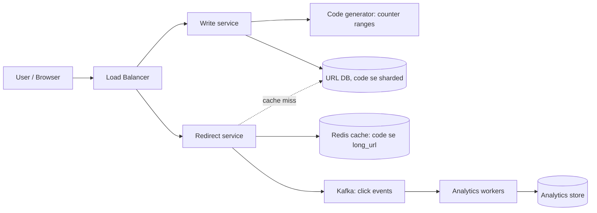
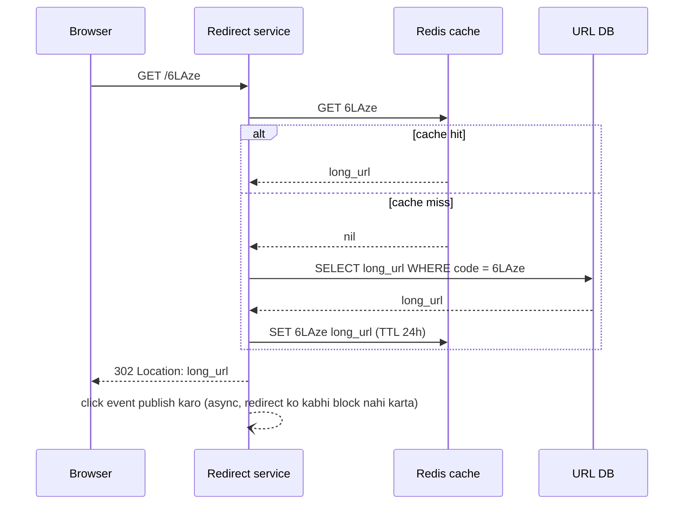
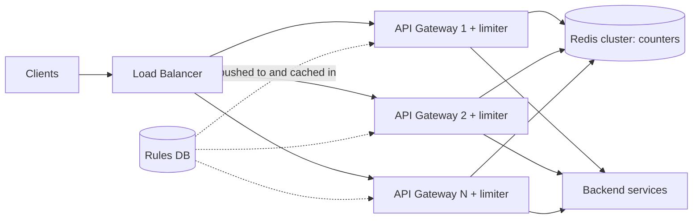
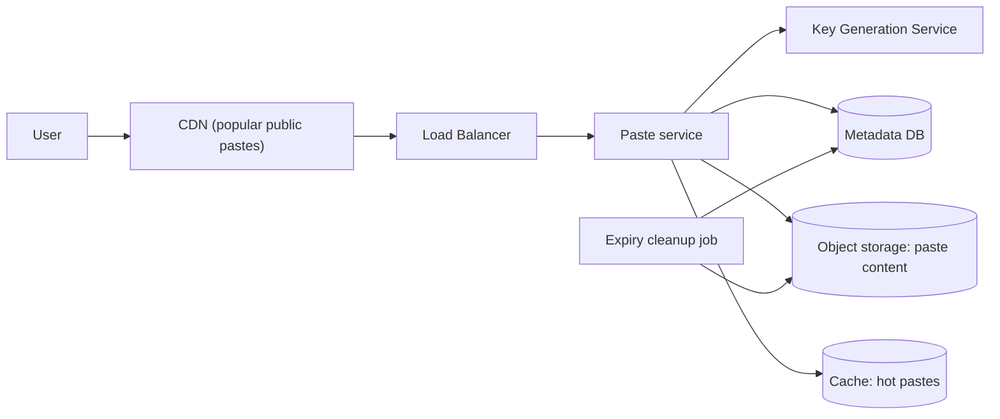
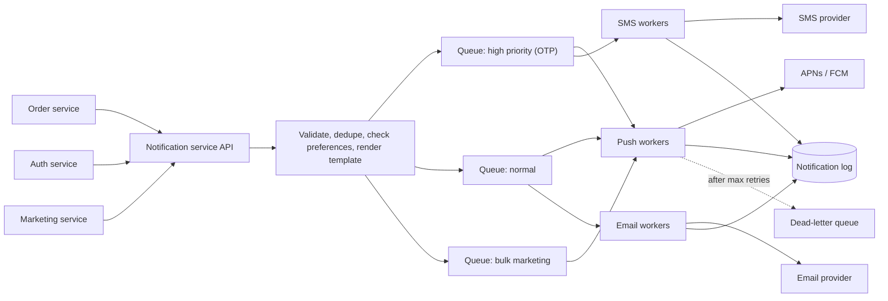
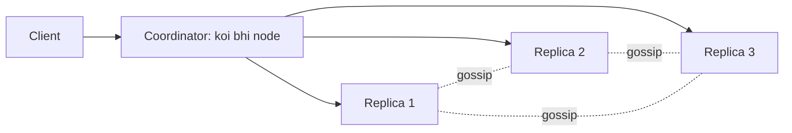
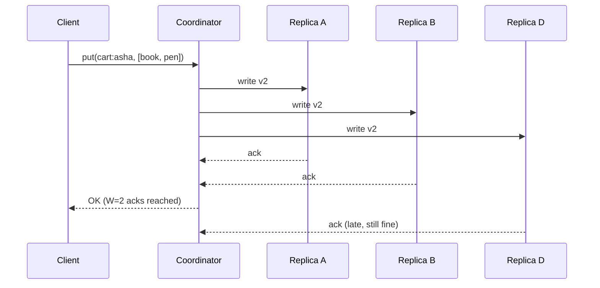
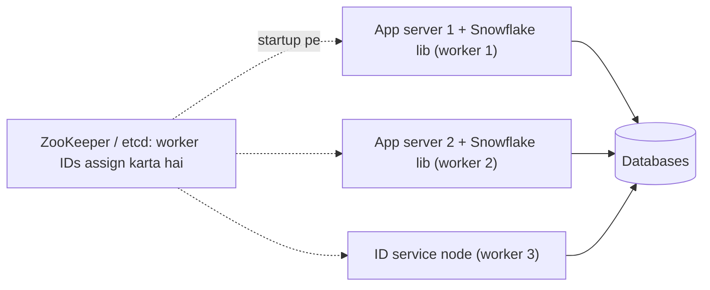

# Chapter 12 · Case Studies I: URL Shortener, Rate Limiter, Notifications, KV Store

> Sirf theory se system design seekhna waisa hi hai jaise ingredients ki list padh ke khaana banana seekhna. Ye chapter asli kitchen hai. Hum chhe classic interview problems lenge aur har ek ko shuru se end tak pakayenge, zor se bolte hue, bilkul waise jaise tum interview room mein karoge.

**Is chapter mein tum seekhoge:**
- 7-step framework ko end to end chhe real problems pe kaise chalana hai: **URL shortener**, **distributed rate limiter**, **Pastebin**, **notification system**, **distributed key-value store** aur **unique ID generator**
- Har problem ke andar chhupa woh ek "core trick" jiska interviewer asal mein intezaar kar raha hota hai
- Requirements ko numbers mein, numbers ko decisions mein, aur decisions ko diagram mein kaise badalna hai
- Mushkil hisson ke runnable Python simulations: base-62 codes, atomic rate limiting, quorum reads aur writes, vector clocks, Merkle trees aur Snowflake IDs
- Tumhare pehle design ke baad interviewer jo follow-up questions poochte hain, aur unke strong answers
- Reusable building blocks jo tum [Chapter 13](13-case-studies-2.md) mein dobara pehchaanoge

**Isse pehle padho:** [Estimation & The Interview Framework](11-estimation-framework.md) · [Scalability & Load Balancing](02-scalability-load-balancing.md) · [Databases](03-databases.md) · [Caching & CDNs](04-caching-cdn.md) · [Replication, Sharding & Consistent Hashing](05-replication-sharding.md) · [CAP & Consensus](06-cap-consistency.md) · [Message Queues](08-queues-events.md) · [Microservices & Reliability](09-microservices-reliability.md) · [Storage, Search & Unique IDs](10-storage-search-ids.md)

---

## 🧠 The Big Idea · Asli Baat

Har system design answer ek hi **chhote se pantry** ke parts se banta hai: load balancers, app servers, caches, databases, queues, object storage, CDNs. Problem badalne pe jo cheez badalti hai woh hai: **kaunsa part pressure mein hai**, aur **kaunsa ek decision design ko bana ya bigaad deta hai**.

Ek doctor ke baare mein socho. Har patient ke andar same organs hote hain. Accha doctor har patient ke liye anatomy dobara nahi padhta. Woh same examination chalata hai (temperature, pulse, blood pressure...) aur phir us organ pe zoom karta hai jismein problem hai. Tumhara examination hai [Chapter 11](11-estimation-framework.md) wala 7-step framework:


Aur is chapter ki har problem mein ek organ takleef mein hai:

| Problem | Kis cheez pe pressure hai | Core trick |
|---|---|---|
| URL shortener | Reads (writes se 100× zyada) | Bina collision ke unique short codes + heavy caching |
| Rate limiter | Shared counters jinhe har request touch karti hai | Fast shared store mein atomic counter updates |
| Pastebin | Text ke bade blobs | Metadata DB mein, content object storage mein |
| Notification system | Unreliable third-party providers, achanak bursts | Queues + retries + dedup + per-user preferences |
| Key-value store | Machines fail hote hue bhi availability | Consistent hashing + replication + quorums |
| Unique ID generator | Machines ke beech coordination | Time + machine + sequence ko 64 bits mein pack karo |

> 🇮🇳 **Desi Analogy:** Ek shaadi ka halwai socho. Uski kitchen mein wahi gas ke chulhe, wahi bade bhagone, wahi masale hain, chahe shaadi Punjabi ho ya South Indian. Har function pe naye bartan nahi khareedta. Bas ye dekhta hai ki *is* function mein dikkat kahan aayegi: kahin 2,000 log ek saath buffet pe tootenge (reads ka pressure, jaise URL shortener), kahin har plate ka hisaab rakhna hai ki koi do baar na le (shared counter, jaise rate limiter), kahin catering wala supplier time pe nahi aaya toh backup chahiye (unreliable provider, jaise notification system). Pantry = tumhare standard components. Dikkat wali jagah = "what's under stress". Us dikkat ka jugaad = **core trick**.

> 💡 **Har case study kaise padhna hai:** pehle sirf requirements padho aur paper pe 10 minute khud design try karo. Phir aage padho. Apni koshish ko model answer se compare karne se tum passive reading ke mukable 3× zyada seekhte ho.

Numbers ke baare mein ek note: neeche ke traffic figures **hamare chune hue assumptions** hain taaki maths concrete rahe, bilkul waise jaise tum interview mein assumptions bolte ho. Ye kisi company ke real statistics nahi hain.

---

## 🔨 Building It Up · Zero Se Shuru

### 1. URL Shortener (TinyURL / bit.ly)

**Kahani:** tum `https://www.example.com/blog/2026/10/how-we-scaled-our-checkout-flow?utm_source=newsletter` paste karte ho aur wapas milta hai `https://sho.rt/6LAze`. Jo bhi short link pe click karega, woh lamba page pe pahunch jaayega. Dikhne mein toy problem lagta hai. Hai nahi. Ye interviewer ke liye sabse saaf tareeka hai 45 minute mein hashing, encoding, caching, read-heavy scaling aur database choice sab ek saath test karne ka.

> 🇮🇳 **Desi Analogy:** URL shortener ek railway **PNR number** jaisa hai. Tumhari poori booking (naam, train, coach, seat, date, quota) ek lambi detail hai. Railway tumhe ek chhota sa 10-digit PNR de deta hai. PNR bolo, system poori detail nikaal deta hai. Yahan PNR = short code, poori booking = long URL, aur "PNR status check karo" = redirect. Aur dhyaan do: log PNR status **baar baar** check karte hain, booking sirf ek baar karte hain. Wahi read-heavy nature yahan bhi hai.

#### 1.1 Requirements

Hamesha requirements ko do hisson mein baanto: functional (system *kya* karta hai) aur non-functional (*kitna accha* karta hai). Sawaal poocho; chupchaap assume mat karo.

**Functional:**
1. Lamba URL do, short URL wapas milna chahiye.
2. Short URL visit karne pe long URL pe redirect hona chahiye.
3. Optional: custom alias (`sho.rt/diwali-sale`), expiry time.
4. Optional: click analytics (kitne clicks, kahan se).

**Non-functional:**
- **Bahut kam redirect latency** (redirect user ke critical path mein hai; server-side 100 ms se kaafi neeche ka target rakho).
- **Highly available**: agar redirects toote, toh internet pe kabhi bhi share hua har link toot jaayega.
- Short codes **unique** hone chahiye aur sequence mein **aasaani se guess nahi hone chahiye** (nice to have).
- Read-heavy: log link banate kam hain, click bahut zyada karte hain.

**Out of scope (zor se bolo):** user accounts, link editing, spam detection (end mein mention karenge).

#### 1.2 Estimates

Assumptions: **roz 100 million naye URLs**, read:write ratio **100:1**, links **5 saal** tak rakhne hain, har record lagbhag **500 bytes** (long URL ~2 KB tak ja sakta hai par zyaadatar chhote hote hain, plus code, timestamps, owner).

| Quantity | Maths | Result |
|---|---|---|
| Write QPS | 100M / 86,400 s | ≈ **1,200/s** (peak ×2 ≈ 2,400/s) |
| Read QPS | 1,200 × 100 | ≈ **120,000/s** (peak ≈ 240,000/s) |
| 5 saal mein records | 100M × 365 × 5 | ≈ **182.5 billion** |
| Storage | 182.5B × 500 B | ≈ **91 TB** (replication se pehle) |
| Code length | 62⁷ ≈ 3.5 trillion > 182.5B | base-62 ke **7 characters** |
| Cache | Hot set ≈ din mein click hue links ka 20%; maan lo ~100M alag links roz click hote hain → 0.2 × 100M × 500 B | ≈ **10 GB**; overhead ke saath kuch tens of GB provision karo |

Ye numbers humein kya bata rahe hain:
- 120k reads/s ek single database ko kuchal dega. **Caching mandatory hai.**
- 1,200 writes/s modest hai. Ek sharded database aaraam se sambhal lega.
- 91 TB ek machine ke liye bahut bada hai. Hum **shard** karenge (ya aisa database lenge jo khud shard karta hai).
- 7 characters kaafi hain. Badhiya: chhota hona hi toh poora point hai.

> 🤔 **Mann mein sawaal:** 7 characters kaise nikla? Seedha 6 ya 8 kyun nahi?
>
> **Jawab:** Humein 5 saal mein ~182.5 billion codes chahiye. Ab try karo: 62⁶ ≈ 56.8 billion, jo 182.5 billion se **kam** hai, toh 6 characters fit nahi honge. 62⁷ ≈ 3.5 trillion, jo zaroorat se ~19 guna zyada hai, toh aaram se fit. 8 characters bhi chalega, par ek character lamba link bina wajah. Rule: sabse chhota `k` dhoondo jahan `62^k > total codes needed`.

#### 1.3 API

```text
POST /api/v1/urls
Body:    { "long_url": "https://...", "custom_alias": "diwali-sale", "expires_at": "2027-01-01T00:00:00Z" }
Returns: 201 Created  { "short_url": "https://sho.rt/6LAze", "code": "6LAze" }
Errors:  400 invalid URL or alias · 409 alias already taken · 429 too many requests

GET /{code}
Returns: 302 Found, header  Location: https://www.example.com/blog/...
Errors:  404 unknown code · 410 Gone (expired)

GET /api/v1/urls/{code}/stats       (optional analytics)
Returns: 200 { "clicks": 18234, "by_country": {...} }
```

Do chhoti cheezein jo interviewers ko impress karti hain: create call ke liye **API key** zaroori ho (taaki abusers ko rate-limit kar sako), aur tum **301 vs 302** mention karo (deep dive neeche hai).

#### 1.4 Data model

```sql
CREATE TABLE urls (
    code        VARCHAR(16) PRIMARY KEY,   -- short code (ya custom alias)
    long_url    TEXT        NOT NULL,
    user_id     BIGINT,                    -- kisne banaya (anonymous ke liye NULL ho sakta hai)
    created_at  TIMESTAMP   NOT NULL,
    expires_at  TIMESTAMP                  -- NULL matlab kabhi expire nahi hoga
);
```

Access pattern lagbhag poora **"code do, long_url do"** hai: ek pure key-value lookup, koi join nahi. Isliye dono option chalenge:
- ek **relational DB** (PostgreSQL/MySQL) jo `code` se sharded ho, ya
- ek **key-value / wide-column store** (DynamoDB, Cassandra) jismein `code` partition key ho, jo automatically shard aur replicate karta hai.

Dono defend kiye ja sakte hain. Bas bolo ki ek ko kyun chuna: "No joins, simple key lookups, 91 TB and growing, so I'll use a horizontally scalable key-value store like DynamoDB or Cassandra."

#### 1.5 High-level design



Redirect path, step by step:



Hum **write** aur **redirect** services ko alag karte hain kyunki dono ka scale bilkul alag hai (peak pe 2k/s vs 240k/s). Alag services hone se hum write path ko chhue bina redirect servers badha sakte hain.

#### 1.6 Deep dive: generating the short code

Ye *woh* sawaal hai. Teen approaches hain; teeno aur unke trade-offs pata hone chahiye.

**Pehle, base-62 encoding.** Letters (a–z, A–Z) plus digits (0–9) = 62 URL-safe characters. Kisi number ko base 62 mein badalna bilkul waisa hi hai jaise number ko decimal digits mein likhna, bas yahan 10 ki jagah 62 "digits" hain.

> 🇮🇳 **Desi Analogy:** Gaadi ka odometer socho. Normal odometer ke har wheel pe 0 se 9 tak 10 digits hote hain. 9 ke baad wheel 0 pe wapas aata hai aur bagal wala wheel ek aage badhta hai, isliye 9 ke baad "10" aata hai. Ab socho ek jaadui odometer jiske har wheel pe 62 symbols hain: 0–9, phir a–z, phir A–Z. Uska wheel "Z" (61) ke baad 0 pe aata hai aur bagal wala ek badhta hai, isliye 61 ke baad "10" aata hai. Base-62 encoding bas yahi odometer hai. Wheels zyada symbols wale hain, isliye 7 wheels mein trillions fit ho jaate hain.

```python
ALPHABET = "0123456789abcdefghijklmnopqrstuvwxyzABCDEFGHIJKLMNOPQRSTUVWXYZ"
BASE = len(ALPHABET)  # 62

def encode(n):
    """Turn a non-negative integer into a base-62 string."""
    if n == 0:
        return ALPHABET[0]
    chars = []
    while n > 0:
        n, rem = divmod(n, BASE)
        chars.append(ALPHABET[rem])
    return "".join(reversed(chars))

def decode(s):
    n = 0
    for ch in s:
        n = n * BASE + ALPHABET.index(ch)
    return n

for n in [0, 61, 62, 125, 1_000_000, 3_521_614_606_207]:
    code = encode(n)
    print(f"{n:>16} -> {code:>8} -> {decode(code)}")
print("7 chars can hold", f"{BASE ** 7:,}", "codes")
```

```text
               0 ->        0 -> 0
              61 ->        Z -> 61
              62 ->       10 -> 62
             125 ->       21 -> 125
         1000000 ->     4c92 -> 1000000
   3521614606207 ->  ZZZZZZZ -> 3521614606207
7 chars can hold 3,521,614,606,208 codes
```

Abhi kya hua: `62` ban gaya `"10"`, usi wajah se jis wajah se decimal mein das ban jaata hai `"10"`. `encode` baar baar 62 se divide karta hai; har baar ka remainder ek "digit" deta hai (sabse right wala pehle), isliye end mein list ko `reversed` karte hain. `decode` ulta karta hai: har character pe "ab tak ka number × 62 + is character ki value". Saat base-62 characters mein 3.5 trillion values aati hain, jo hamare 182.5 billion se aaram se upar hai.

**Approach A: long URL ko hash karo.** URL ka MD5/SHA-256 lo, use base-62 encode karo, pehle 7 characters rakh lo.
- ✅ Same long URL hamesha same code deta hai (free deduplication).
- ❌ **Collisions**: do alag URLs ke pehle 7 characters same ho sakte hain. Tumhe DB check karna padega aur collision hone pe salt ke saath retry karna padega. Har write "pehle read, phir write" ban jaata hai, aur 91 TB pe har collision check ke liye ek index lookup lagta hai.

**Approach B: ek unique counter + base-62.** Har naye URL ko agla integer milta hai; use encode kar do. Collisions *by construction* namumkin hain. Problem: ek single global counter bottleneck bhi hai aur single point of failure bhi. Fix hai **range allocation**: ek coordinator (ZooKeeper, ya ek DB row jo transaction mein update hoti hai) har app server ko numbers ka ek **block** de deta hai, maan lo 1,000 numbers. Server unhe memory se use karta hai aur naya block tabhi maangta hai jab purana khatam ho jaaye.

> 🇮🇳 **Desi Analogy:** Bank ki cheque book. Bank har customer ko ek baar mein 25 cheque leaves de deta hai, har leaf pe pehle se unique number chhapa hai. Tum har cheque likhte waqt bank ko phone karke "agla number kya hai?" nahi poochte. Book khatam, toh nayi book maango. Do customers ke cheque numbers kabhi clash nahi hote kyunki bank ne alag alag ranges di hain. Yahan bank = range allocator, cheque book = block, har leaf = ek code.

**Approach C: ek Key Generation Service (KGS).** Random codes pehle se offline generate karke ek `unused_keys` table mein rakh do; app servers batches utha lete hain. Ise hum Pastebin case study mein banayenge.

Yahan A aur B saath saath:

```python
import hashlib

ALPHABET = "0123456789abcdefghijklmnopqrstuvwxyzABCDEFGHIJKLMNOPQRSTUVWXYZ"

def encode(n):
    chars = []
    while True:
        n, rem = divmod(n, 62)
        chars.append(ALPHABET[rem])
        if n == 0:
            return "".join(reversed(chars))

class RangeAllocator:
    """Stands in for ZooKeeper / a DB row that hands out blocks of IDs."""
    def __init__(self, block_size):
        self.next_start = 100_000_000      # high se shuru karo taaki codes bahut chhote na hon
        self.block_size = block_size

    def grab_block(self):
        start = self.next_start
        self.next_start += self.block_size
        return start, start + self.block_size

class AppServer:
    def __init__(self, name, allocator, db):
        self.name, self.allocator, self.db = name, allocator, db
        self.cur, self.end = allocator.grab_block()

    def shorten(self, long_url):
        if self.cur == self.end:                     # block khatam: naya lo
            self.cur, self.end = self.allocator.grab_block()
        code = encode(self.cur)
        self.cur += 1
        self.db[code] = long_url                     # code unique hai: collision check ki zaroorat nahi
        return code

db = {}
alloc = RangeAllocator(block_size=3)
s1, s2 = AppServer("s1", alloc, db), AppServer("s2", alloc, db)
for i, server in enumerate([s1, s1, s2, s1, s1, s2]):
    url = f"https://example.com/page/{i}"
    print(server.name, server.shorten(url), "->", url)
print("rows:", len(db))

# Hashing approach: hash ke pehle 7 chars lo, collisions check karo
def hash_code(long_url, salt=""):
    digest = hashlib.md5((long_url + salt).encode()).hexdigest()
    return encode(int(digest, 16))[:7]

store = {}
def shorten_by_hash(long_url):
    salt = ""
    while True:
        code = hash_code(long_url, salt)
        if code not in store or store[code] == long_url:
            store[code] = long_url
            return code
        salt += "!"                                   # collision: input badlo, retry karo

a = shorten_by_hash("https://example.com/a")
b = shorten_by_hash("https://example.com/a")
print("same URL, same code:", a == b, a)
```

```text
s1 6LAze -> https://example.com/page/0
s1 6LAzf -> https://example.com/page/1
s2 6LAzh -> https://example.com/page/2
s1 6LAzg -> https://example.com/page/3
s1 6LAzk -> https://example.com/page/4
s2 6LAzi -> https://example.com/page/5
rows: 6
same URL, same code: True 6fBJVPc
```

Abhi kya hua: `s1` ne numbers 100,000,000–100,000,002 liye aur `s2` ne agla block (100,000,003–100,000,005). Har server **kisi se baat kiye bina** codes de raha hai, aur codes kabhi clash nahi hote. Jab `s1` ka block khatam hua (4th URL ke baad), usne `s2` ke block ke *baad* wala block uthaya (100,000,006 se). Isliye output mein codes poori tarah order mein nahi dikhte: `6LAzh` (s2) `6LAzg` (s1) se pehle aaya. Unique hain, bas globally sorted nahi. Agar koi server crash ho jaaye, toh uske block ka bacha hua hissa bas waste ho jaata hai, aur ye theek hai: hamare paas trillions codes hain.

| | Hash + truncate | Counter ranges | KGS (pre-generated) |
|---|---|---|---|
| Collisions | Ho sakte hain, check karna padega | Namumkin | Namumkin |
| Coordination | Koi nahi | Har block pe ek call | Har batch pe ek call |
| Same URL → same code | Haan (free dedup) | Nahi (lookup table chahiye) | Nahi |
| Guessable | Nahi | Haan, sequential (fix: bits shuffle karo ya counter encrypt karo) | Nahi (random) |
| Interview verdict | Theek hai, collisions mention karo | **Sabse common accha answer** | Badhiya, thodi zyada machinery |

> ⚠️ **Sequential codes information leak karte hain.** Counters ke saath, koi competitor ek ghante ke gap pe do links shorten karke jaan sakta hai ki tumne us ghante mein kitne links banaye, ya har code ko order mein crawl kar sakta hai. Agar ye matter karta hai, toh encode karne se pehle counter pe ek reversible bit-shuffle (ya block cipher) lagao: abhi bhi unique, par ab sequential nahi.

> 🤔 **Mann mein sawaal:** Server crash hua toh uske block ke bache numbers waste ho gaye. Kya ye galti nahi hai? Kahin koi number do baar toh nahi mil jaayega?
>
> **Jawab:** Do baar kabhi nahi milega, kyunki allocator har block sirf ek baar deta hai aur `next_start` sirf aage badhta hai. Waste hona bas "gap" hai, "duplicate" nahi. Aur gap ka koi nuksaan nahi: 3.5 trillion mein se kuch hazaar khaali reh gaye toh kya farak padta hai. Uniqueness ki guarantee chahiye thi, continuity ki nahi.

#### 1.7 Deep dive: 301 or 302?

- **301 Moved Permanently**: browser redirect ko cache kar leta hai. Agli baar woh tumhare server ko poori tarah skip karta hai. Load kam, par repeat clicks ke liye tum **analytics kho dete ho**, aur us browser ke liye link na badal sakte ho na expire kar sakte ho.
- **302 Found (temporary)**: browser har baar tumhare server se poochta hai. Load zyada, par har click count hota hai aur expiry kaam karti hai.

Accha answer: "302 if analytics matter (bit.ly's business), 301 if we only care about load." Trade-off bolo; wahi test ho raha hai.

#### 1.8 Deep dive: making reads fast

- **Cache**: `code` se keyed Redis cluster. Link popularity bahut skewed hoti hai (ek viral link ko millions clicks milte hain; zyaadatar ko gine-chune), isliye chhota cache bhi high hit rate deta hai. TTL ke saath **cache-aside** aur **LRU** eviction use karo ([Chapter 04](04-caching-cdn.md)).
- **CDN / edge**: bahut hi hot links ke liye, redirect khud thodi der ke liye edge pe cache ho sakta hai.
- **Replicas**: cache miss ke liye database ke read replicas hote hain.
- **Negative caching**: unknown codes ke liye "not found" ko bhi thodi der cache karo, taaki random codes scan karne wale bots DB ko na thokein.

#### 1.9 Deep dive: analytics without slowing redirects

Redirect path mein kabhi bhi main DB mein click counter mat likho. Iske bajaye ek chhota click event (`code, timestamp, country, referrer`) asynchronously **Kafka** pe publish karo aur redirect turant return karo. Consumers batches mein aggregate karke ek analytics store (columnar DB ya time-series store) mein likhte hain. Agar analytics pipeline down hai, tab bhi redirects chalte rahenge: decoupling ka yahi toh point hai ([Chapter 08](08-queues-events.md)).

#### 1.10 Bottlenecks and trade-offs

| Concern | Decision | Kaunsa trade-off accept kiya |
|---|---|---|
| 240k reads/s | Redis cache + read replicas + alag redirect service | Update/delete ke baad cache thodi der stale ho sakta hai |
| Code uniqueness | Counter ranges + base-62 | Codes sequential hain jab tak shuffle na karo |
| 91 TB | `code` se sharded key-value store | Complex queries nahi (zaroorat bhi nahi) |
| Analytics | Kafka ke through async | Stats kuch seconds peeche chalte hain |
| Expired links | Read pe lazy check + nightly cleanup job | Expired rows ek din tak disk pe pade reh sakte hain |
| Hot link | Cache + CDN | Edge se expired link serve hone ki ek chhoti si window |

**Single points of failure?** Range allocator: agar woh down hai, toh servers apna current block use karte rehte hain, jisse time mil jaata hai. Use replicated ZooKeeper ensemble ya primary/replica DB ki tarah chalao.

#### 1.11 Follow-up questions

- *"How do you support custom aliases?"* Alias ko primary key bana ke insert karo; uniqueness violation matlab 409. `api`, `admin` jaise words reserve karo. Pakka karo ki generated codes aliases se collide na kar sakein (alag length range rakho, ya use karne se pehle check karo).
- *"Same long URL submitted twice: same code?"* Sirf tab jab tum ek `long_url_hash → code` index rakho. Aam taur pe har user ke liye iski keemat nahi hoti; (user, URL) ke level pe kiya ja sakta hai.
- *"How do you stop abuse (phishing links)?"* Creation ko per API key rate-limit karo (agla case study), URLs ko asynchronously ek blocklist / safe-browsing service se check karo, reports aur takedown allow karo.
- *"Multi-region?"* Har region mein redirect service aur cache, DB regions ke across replicated. Writes ek region mein jaayein ya per-region counter ranges use karo taaki codes kabhi clash na hon.

---

### 2. Distributed Rate Limiter

**Kahani:** tumhari public API **har user ko 100 requests per minute** allow karti hai. Load balancer ke peeche 50 API gateway servers hain. Ek user ki requests sabhi 50 pe bikhar jaati hain. Ab gateway #17 ko kaise pata chalega ki user baaki 49 ke through already 99 requests kar chuka hai? Bas yahi shared-state wala sawaal poori problem hai.

Algorithms khud (token bucket, leaky bucket, fixed window, sliding log, sliding window counter) [Chapter 09](09-microservices-reliability.md) mein banaye gaye hain. Yahan hum focus karenge unhe **bahut saari machines ke across** chalane pe.

> 🇮🇳 **Desi Analogy:** Ek metro station socho jahan 50 entry gates hain, aur rule hai ki ek smart card se din mein sirf 10 entries. Agar har gate apni alag copy-book mein likhe ki "is card se kitni entries hui", toh banda har baar alag gate se ghus ke 50 × 10 = 500 entries kar lega. Isliye har gate card swipe hote hi **ek central server** se poochta hai. Yahan gates = API gateways, smart card = user/API key, central server = Redis counter store. Aur central server ko ek hi waqt pe aaye do swipes ko "ek ke baad ek" process karna padega, warna dono ko purana count dikhega. Yahi neeche wala race condition hai.

#### 2.1 Requirements

**Functional:**
1. Requests ko ek key se limit karo: user ID, API key, IP address, ya (user, endpoint).
2. Rules configurable hon: jaise `POST /login: 5 per minute per IP`, `GET /search: 1,000 per hour per API key`.
3. Limit cross hone pe **HTTP 429 Too Many Requests** se reject karo aur client ko batao kab retry kare.

**Non-functional:**
- **Bahut kam added latency**: ye *har* request pe chalta hai. Budget: lagbhag 1–2 ms.
- **Highly available**: agar limiter down hai, toh zyaadatar endpoints ke liye API chalti rehni chahiye (**fail open**).
- **Kaafi accurate**: thoda overshoot (100 ki jagah 101) chalega; 2× nahi chalega.
- Distributed: saare gateway servers pe consistent limits.

#### 2.2 Estimates

Maan lo peak pe **1 million requests/second** aur ek waqt pe **10 million active users**.

| Quantity | Maths | Result |
|---|---|---|
| Limiter checks | Har request pe 1 | Counter store pe **1M ops/s** |
| Memory per key | key ~50 B + counters/timestamps ~30 B + overhead | ~**100 B** |
| Total memory | 10M keys × 100 B (× kuch rules) | ~**1–3 GB**: RAM mein aaram se fit |
| Store nodes | Ek Redis node lagbhag 100k simple ops/s karta hai | ~**10–20 shards** (+ replicas) |

Conclusion: data chhota hai; hum **op rate** ke hisaab se size karte hain. **Redis** jaisa in-memory store ekdum fit hai.

> 🤔 **Mann mein sawaal:** Data sirf 1–3 GB hai, ek machine mein aa jaayega. Toh 10–20 shards kyun?
>
> **Jawab:** Kyunki yahan problem "kitna data" nahi, "kitni baar touch" hai. 1M ops/s ko ek Redis node (~100k ops/s) sambhal nahi sakta, chahe data kitna bhi chhota ho. 1,000,000 / 100,000 = 10 nodes minimum, aur headroom ke liye 10–20. **Storage se nahi, throughput se sizing.** Ye interview mein bolne layak insight hai.

#### 2.3 API

Limiter aam taur pe public API **nahi** hota; ye gateway ke andar ek check hota hai. Internally:

```text
check(key="user:42", rule="api_default", cost=1)
  -> { allowed: true, remaining: 57, reset_after_ms: 21000 }
```

Reject hone pe **client** ko kya dikhta hai:

```text
HTTP/1.1 429 Too Many Requests
Retry-After: 21
X-RateLimit-Limit: 100
X-RateLimit-Remaining: 0
X-RateLimit-Reset: 1761900000
```

`Retry-After` ek standard HTTP header hai; `X-RateLimit-*` headers ek widely used convention hain.

#### 2.4 Data model

Rules (kabhi kabhaar badalte hain, har gateway mein cached):

```sql
CREATE TABLE rate_limit_rules (
    rule_id        VARCHAR(64) PRIMARY KEY,   -- 'login_per_ip'
    key_type       VARCHAR(16),               -- 'ip' | 'user' | 'api_key'
    endpoint       VARCHAR(128),              -- 'POST /login' ya '*'
    algorithm      VARCHAR(32),               -- 'token_bucket' | 'sliding_window'
    limit_count    INT,
    window_seconds INT
);
```

Counters (hot, Redis mein), jaise:
- fixed window: `rl:{user:42}:{minute 29358812}` → integer, window se thoda zyada TTL ke saath
- token bucket: `rl:{user:42}` → hash `{tokens: 3.5, last_refill_ms: 1761899979000}`

#### 2.5 High-level design



(Rules DB se dotted arrows ka matlab: rules har gateway ko push hote hain aur wahin cache ho jaate hain, har request pe DB nahi padha jaata.)

Limiter kahan rehna chahiye? Options:
1. **API gateway / middleware mein** (upar dikhaya): ek jagah, saari services protected. Sabse common answer.
2. **Ek alag rate-limit service** jise gateway call kare: saaf separation, par ek extra network hop.
3. **Har service mein**: per-service rules ke liye theek, par logic duplicate hota hai.
4. **Client side**: protection ke liye kabhi bharosa mat karo; sirf polite rehne ke liye.

#### 2.6 Deep dive: the race condition

Har gateway mein naive approach ye hai: counter padho, agar limit se neeche hai toh counter + 1 likh do. Agar do gateways ek hi moment pe same user ko handle kar rahe hain, toh dono **same** purani value padhte hain. Dekho kaise tootta hai:

```python
class FakeRedis:
    """A tiny shared key-value store. Real Redis runs one command at a time."""
    def __init__(self):
        self.data = {}

    def get(self, key, default=0):
        return self.data.get(key, default)

    def set(self, key, value):
        self.data[key] = value

    def incr(self, key):                 # atomic: read + add + write EK hi step mein
        self.data[key] = self.data.get(key, 0) + 1
        return self.data[key]

LIMIT = 3
redis = FakeRedis()

# --- Naive: do gateways pehle GET, phir decide, phir SET karte hain (race!) ---
key = "user:42:minute:0"
seen = []
for _ in range(3):                       # 3 rounds, har round mein do gateways
    a = redis.get(key)                   # gateway A padhta hai
    b = redis.get(key)                   # gateway B bhi SAME purani value padhta hai
    if a < LIMIT:
        redis.set(key, a + 1); seen.append("A allowed")
    if b < LIMIT:
        redis.set(key, b + 1); seen.append("B allowed")
print("naive allowed:", len(seen), "requests (limit was", LIMIT, ")")

# --- Sahi tareeka: atomic INCR, phir compare ---
redis = FakeRedis()
allowed = 0
for _ in range(3):
    for gateway in "AB":
        if redis.incr(key) <= LIMIT:
            allowed += 1
print("atomic allowed:", allowed, "requests")
```

```text
naive allowed: 6 requests (limit was 3 )
atomic allowed: 3 requests
```

Abhi kya hua: read-then-write mein dono gateways ke updates ek doosre ko overwrite kar dete hain ("lost update"). Round 1 mein dono ne 0 padha, dono ne 1 likha: do requests allow hui par counter sirf 1 badha. Isliye user ko limit ka **double** mil gaya. `INCR` ke saath store read aur write ko ek indivisible step mein karta hai, isliye har request ko ek alag count dikhta hai (1, 2, 3, 4...), aur 3 ke baad sab reject.

> 🇮🇳 **Desi Analogy:** Joint family ka fridge aur aakhri do Mango Frooti. Bhai ne fridge khola, dekha "2 hain", socha ek le leta hoon. Usi second behen ne bhi dekha "2 hain". Dono ne ek ek li aur dono ne family group pe likha "ab 1 bachi hai". Asal mein 0 bachi. Ye hai **lost update**. `INCR` aisa hai jaise fridge pe ek chowkidar baitha ho jo ek waqt mein ek hi haath andar jaane de aur turant count update kare.

Real Redis mein tumhare paas do tools hain:
- **`INCR` + `EXPIRE`**: fixed-window counter ke liye perfect.
- **Lua scripts** (`EVAL`): Redis poori script **atomically** chalata hai (woh commands ek ek karke execute karta hai, aur script bina interruption ke chalti hai). Token bucket aur sliding window ko kai reads aur writes chahiye, isliye woh Lua script mein jaate hain.

#### 2.7 Deep dive: token bucket in a shared store

Woh trick jo token bucket ko sasta banati hai: **timer pe refill mat karo**. Sirf `tokens` aur `last_refill_time` store karo, aur har request pe calculate karo ki tab se ab tak kitne tokens *tapak chuke hote*. Ise **lazy refill** kehte hain. Neeche wala function bilkul wahi hai jo Lua script Redis ke andar, atomically, karti hai.

> 🇮🇳 **Desi Analogy:** Ek aisa mobile data pack socho jo dheere dheere wapas bharta hai. Telecom company har second karodon users ke account mein jaake "+0.01 MB" nahi likhegi, woh pagalpan hoga. Woh bas likh ke rakhti hai "aakhri baar kab check kiya aur kitna bacha tha". Jab tum data use karte ho, tab hisaab lagati hai: "itna time beeta, toh itna refill ho gaya hota, max limit tak". Yahi lazy refill hai: kaam sirf tab, jab request aaye.

```python
class TokenBucketStore:
    """What the Redis Lua script does, atomically, per request.
    State per user is just two numbers: tokens left and last refill time."""
    def __init__(self, capacity, refill_per_sec):
        self.capacity, self.rate = capacity, refill_per_sec
        self.state = {}                                   # key -> [tokens, last_ts]

    def allow(self, key, now):
        tokens, last = self.state.get(key, [self.capacity, now])
        tokens = min(self.capacity, tokens + (now - last) * self.rate)  # lazy refill
        if tokens >= 1:
            self.state[key] = [tokens - 1, now]
            return True, int(tokens - 1)
        self.state[key] = [tokens, now]
        return False, 0

bucket = TokenBucketStore(capacity=5, refill_per_sec=1)
timeline = [0, 0, 0, 0, 0, 0, 0.5, 1.0, 3.0, 3.0, 3.0]
for t in timeline:
    ok, left = bucket.allow("ip:1.2.3.4", t)
    print(f"t={t:<4} {'ALLOW' if ok else '429  '} tokens_left={left}")
```

```text
t=0    ALLOW tokens_left=4
t=0    ALLOW tokens_left=3
t=0    ALLOW tokens_left=2
t=0    ALLOW tokens_left=1
t=0    ALLOW tokens_left=0
t=0    429   tokens_left=0
t=0.5  429   tokens_left=0
t=1.0  ALLOW tokens_left=0
t=3.0  ALLOW tokens_left=1
t=3.0  ALLOW tokens_left=0
t=3.0  429   tokens_left=0
```

Abhi kya hua: 5 ka burst turant allow hua (bucket ki capacity), phir client ko 1 per second ke refill rate tak limit kar diya gaya. t=0.5 pe sirf aadha token tapka tha (0.5 < 1, toh reject, par woh aadha token save ho gaya). t=1.0 pe aur aadha aaya, poora 1 token ho gaya, allow. t=3.0 pe 2 seconds beete, 2 tokens aaye: do allow, teesra reject. Clock ke liye **store ki clock** (Redis `TIME`) use karo ya synchronised servers se timestamp bhejo; skewed clocks wale gateways thode unfair results dete hain.

#### 2.8 Deep dive: sliding window counter (the accuracy/memory sweet spot)

**Fixed window** (har calendar minute ka count) mein user 12:00:59 pe 100 requests aur 12:01:00 pe 100 aur bhej sakta hai: do second mein 200. **Sliding log** (har timestamp store karo) exact hai par har request ki memory lagti hai. **Sliding window counter** sirf do counters rakhta hai (is window ka aur pichhli window ka) aur estimate karta hai:

`estimate = previous_count × (fraction of previous window still inside the last 60 s) + current_count`

```python
class SlidingWindowCounter:
    """Approximate sliding window: weight the previous window by how much
    of it still overlaps the last `window` seconds."""
    def __init__(self, limit, window):
        self.limit, self.window = limit, window
        self.counts = {}                         # (user, window_index) -> count

    def allow(self, user, now):
        idx = int(now // self.window)
        cur = self.counts.get((user, idx), 0)
        prev = self.counts.get((user, idx - 1), 0)
        elapsed = (now % self.window) / self.window   # window mein kitna aage: 0.0 .. 1.0
        estimate = prev * (1 - elapsed) + cur
        if estimate < self.limit:
            self.counts[(user, idx)] = cur + 1
            return True
        return False

rl = SlidingWindowCounter(limit=10, window=60)
# Minute 0 ke end mein 10 requests poora budget kha jaati hain
print([rl.allow("u1", 50 + i) for i in range(10)].count(True), "allowed in minute 0")
# Minute 1: pichhli window abhi bhi kuch der tak "count" hoti hai
for t in [70, 100]:
    results = [rl.allow("u1", t) for _ in range(5)]
    print(f"burst of 5 at t={t}s -> {results.count(True)} allowed")
```

```text
10 allowed in minute 0
burst of 5 at t=70s -> 2 allowed
burst of 5 at t=100s -> 5 allowed
```

Abhi kya hua: t=70 pe hum minute 1 mein 1/6 aage hain, toh pichhli window abhi bhi 10 × 5/6 ≈ 8.3 ka wazan rakhti hai. 8.3 + 0 < 10 (allow), 8.3 + 1 < 10 (allow), 8.3 + 2 = 10.3 (reject). Isliye sirf 2 aur fit hui. Plain fixed window ne saari 5 allow kar di hoti (aur 5 aur bhi). t=100 tak purani window ka zyaadatar hissa slide out ho chuka hai: wazan sirf 10 × 1/3 ≈ 3.3, toh 3.3 + 2 se 3.3 + 6 tak sab 10 se neeche, saari 5 allow. Ye approximation maanta hai ki pichhli window ki requests barabar faili hui thi; practice mein ye kaafi accurate hai aur bahut saare production limiters yahi use karte hain.

> 🤔 **Mann mein sawaal:** Pichhli window ki saari 10 requests toh t=50 se t=59 ke beech aayi thi, yaani last 60 seconds mein poori ki poori. Toh t=70 pe asli count 10 hona chahiye, 8.3 nahi?
>
> **Jawab:** Bilkul sahi pakda. Yahi is algorithm ki approximation hai: woh maanta hai ki pichhli minute ki 10 requests poori minute mein barabar faili thi, jabki yahan woh end mein jhund mein thi. Isliye estimate thoda kam aaya aur 2 requests extra nikal gayi. Ye "thoda overshoot" hai jo humne requirements mein accept kiya tha ("101 chalega, 2× nahi"). Exact chahiye toh sliding log lo, par har request ka timestamp store karne ki memory chukao.

#### 2.9 Deep dive: scaling and failure

- **Counters ko key se shard karo** (Redis Cluster keys ko slots mein hash karta hai). Ek user ke saare counters ek hi shard pe rehte hain, isliye ek single atomic script kaam kar jaati hai.
- **Latency**: Redis call ek network round trip hai. Redis ko gateways ke **same region/zone** mein rakho. Pipelining use karo ya rules ko ek script mein combine karo.
- **Redis down?** Soch samajh ke chuno:
  - **Fail open** (sab allow karo): user experience bachata hai; normal API traffic ke liye use hota hai.
  - **Fail closed** (reject karo): wahan jahan abuse mehenga hai, jaise login ya OTP-sending endpoints.
  - **Local limits pe fall back**: har gateway memory mein `limit / number_of_gateways` enforce karta hai. Rough hai, par phir bhi ek safety net.
- **Hot keys**: ek abusive client ek key ko thokta rahe toh ek shard overload ho sakta hai. Har gateway mein ek sasta **local pre-check** lagao (jaise ek local token bucket) taaki obvious floods Redis tak pahunchne se pehle hi reject ho jaayein.
- **Multi-region**: ya toh har region ki alag limits (simple, globally N× overshoot allow karta hai) ya regions ke beech counts ka asynchronous syncing (eventually consistent). Continents ke across strict global limits ka matlab har request pe ek cross-region round trip, jo aam taur pe worth nahi hota.

#### 2.10 Trade-offs

| Decision | Chuna gaya option | Alternative | Kyun |
|---|---|---|---|
| Kahan | API gateway middleware | Alag service | Ek network hop kam |
| Store | Redis cluster | DB, local memory | Sub-ms atomic ops; local memory state share nahi kar sakti |
| Algorithm | Token bucket (APIs), sliding window counter (strict quotas) | Fixed window, sliding log | Bursts allowed par bounded; bahut kam memory |
| Atomicity | Lua script / INCR | Locks | Locks round trips badhaate hain aur deadlock kar sakte hain |
| Store fail ho toh | Fail open (login/OTP ke liye fail closed) | Hamesha closed | Product ki availability zyada matter karti hai |

#### 2.11 Follow-up questions

- *"How do you rate-limit by multiple dimensions at once?"* Ek Lua script mein kai keys check karo (per IP, per user, per endpoint) aur agar koi bhi over hai toh reject karo.
- *"How do clients behave well?"* `Retry-After` ki izzat karo; exponential backoff aur jitter ke saath retry karo ([Chapter 09](09-microservices-reliability.md)).
- *"Rate limiting vs. load shedding?"* Rate limiting har client ke saath fairness hai. **Load shedding** tab kaam giraata hai jab *server* overloaded ho, chahe bhejne wala koi bhi ho. Aam taur pe tumhe dono chahiye.
- *"Different tiers (free vs paid)?"* Rule lookup user ka plan dhyaan mein rakhta hai: key mein tier shaamil hota hai, ya limit value plan se aati hai.

---
### 3. Pastebin

**Kahani:** user text ka ek block paste karta hai (ek log, code snippet, config) aur share karne ke liye `paste.it/aZ3kQ9pL` jaisa link milta hai. Ye URL shortener jaisa dikhta hai, aur interviewer aksar ise uske turant baad poochta hai ye dekhne ke liye ki tum **woh ek bada farak** pakadte ho ya nahi: **payload bada hai**. Ek URL 100 bytes ka hai; ek paste 10 MB ka ho sakta hai.

#### 3.1 Requirements

**Functional:**
1. Paste banao (text **10 MB** tak), ek unique link pao.
2. Link se paste padho.
3. Optional expiry (10 minute, 1 din, kabhi nahi), optional "private / unlisted".
4. Optional: syntax highlighting, custom URL, user accounts.

**Non-functional:**
- Highly available aur durable: koi paste kabhi chupchaap gum nahi hona chahiye.
- Kam read latency.
- Private pastes ke links **unguessable** hone chahiye.

#### 3.2 Estimates

Maan lo **roz 1 million naye pastes**, read:write **5:1**, average paste **10 KB**, data **10 saal** tak rakhna hai.

| Quantity | Maths | Result |
|---|---|---|
| Write QPS | 1M / 86,400 | ≈ **12/s** |
| Read QPS | × 5 | ≈ **60/s** (kuch viral ho toh peaks zyada) |
| Roz ka content | 1M × 10 KB | **10 GB/day** |
| 10 saal ka content | 10 GB × 3,650 | ≈ **36.5 TB** |
| Metadata | 1M × ~200 B × 3,650 | ≈ **0.7 TB** |
| 10 saal mein pastes | 1M × 3,650 | 3.65 billion; 62⁸ ≈ 218 trillion, isliye **8-char random keys** itni sparse hain ki guess nahi ho sakti |

Dekho ye URL shortener se kitna alag hai: QPS chhota sa hai, par **bytes** bahut zyada hain. Design ka sawaal badal jaata hai: "request rate kaise sambhalein?" se "36 TB text rakhein kahan?"

#### 3.3 API

```text
POST /api/v1/pastes
Body:    { "content": "...", "expires_in": "1d", "visibility": "unlisted", "language": "python" }
Returns: 201 { "key": "aZ3kQ9pL", "url": "https://paste.it/aZ3kQ9pL" }

GET /api/v1/pastes/{key}
Returns: 200 { "content": "...", "language": "python", "created_at": "...", "expires_at": "..." }
         or 404 / 410

DELETE /api/v1/pastes/{key}      (owner only)
```

Bahut bade pastes ke liye ek aur behtar API: server ek **pre-signed upload URL** return karta hai aur client text seedha object storage pe upload karta hai ([Chapter 10](10-storage-search-ids.md)). App servers 10 MB body ko kabhi chhoote hi nahi.

#### 3.4 Data model

**Metadata** (chhota, query hota hai) ko **content** (bada, bas key se fetch hota hai) se alag karo:

```sql
CREATE TABLE pastes (
    paste_key    CHAR(8)      PRIMARY KEY,
    user_id      BIGINT,                      -- anonymous ke liye NULL
    object_path  VARCHAR(256) NOT NULL,       -- jaise 's3://pastes/aZ/aZ3kQ9pL'
    size_bytes   INT          NOT NULL,
    language     VARCHAR(32),
    visibility   VARCHAR(16)  NOT NULL,       -- public | unlisted | private
    created_at   TIMESTAMP    NOT NULL,
    expires_at   TIMESTAMP
);
CREATE INDEX idx_pastes_expiry ON pastes (expires_at);   -- cleanup job ke liye
CREATE INDEX idx_pastes_user   ON pastes (user_id, created_at);
```

Content **object storage** (S3 ya waisa kuch) mein `object_path` ke neeche jaata hai. Object storage per GB sasta hai, behad durable hai (tumhare liye replicate karta hai), aur tumhe kuch shard kiye bina scale karta hai.

> 🇮🇳 **Desi Analogy:** Library ka system socho. Front desk pe ek register hai jismein har kitaab ki ek line: naam, author, kis rack pe rakhi hai, kisne issue ki. Register patla hai, jaldi search hota hai. Asli moti kitaabein godown jaise bade racks mein padi hain. Tum register mein dekhte ho "Rack B-14", phir wahan se kitaab uthate ho. Register = metadata DB, racks = object storage, "Rack B-14" = `object_path`. Koi bhi library 1,000 page ki kitaabein register ke andar chipka ke nahi rakhti.

> 💡 **Rule of thumb:** "Kya ye ek bada blob hai jo ek baar likha jaata hai aur poora padha jaata hai?" → object storage. "Kya ye chhota structured data hai jise main fields se query karta hoon?" → database. Pastebin dono use karta hai.

#### 3.5 High-level design



Write flow: KGS se key lo → content object storage pe upload karo → metadata row insert karo → link return karo. (Metadata insert karne se **pehle** upload karo, taaki koi row kabhi missing content ki taraf point na kare. Agar metadata insert fail ho jaaye, toh ek orphan object peeche reh jaata hai, jise ek periodic sweeper delete kar sakta hai.)

Read flow: cache → metadata DB → object storage. Popular public pastes CDN pe cache hote hain.

> 🤔 **Mann mein sawaal:** Order ulta kyun nahi? Pehle row daal do, phir upload karo, kya farak padta hai?
>
> **Jawab:** Farak failure ke waqt padta hai. Agar row pehle daali aur upload fail ho gaya, toh ek *live* link hai jo khulne pe "content missing" dikhayega: user ko dikhne wala bug. Sahi order mein agar row insert fail hui, toh bas ek orphan object storage mein pada hai jise koi link point hi nahi karta: user ko kuch nahi dikhta, aur sweeper baad mein saaf kar deta hai. **Rule: dono mein se jo bhi fail ho, galti invisible honi chahiye.**

#### 3.6 Deep dive: the Key Generation Service (KGS)

Random 8-character keys guess nahi ho sakti, par unhe usi waqt generate karne ka matlab hai collisions check karna. **KGS** random unique keys offline pehle se generate karke ek `unused_keys` table mein rakh deta hai. App servers ek baar mein ek **batch** fetch karte hain aur unhe memory mein rakhte hain.

```python
import random

random.seed(1)
ALPHABET = "0123456789abcdefghijklmnopqrstuvwxyzABCDEFGHIJKLMNOPQRSTUVWXYZ"

class KeyGenerationService:
    """Pre-generates random 8-char keys offline; hands them out in batches."""
    def __init__(self, pool_size):
        keys = set()
        while len(keys) < pool_size:
            keys.add("".join(random.choice(ALPHABET) for _ in range(8)))
        self.unused = sorted(keys)        # 'unused_keys' table ki jagah
        self.used = set()                 # 'used_keys' table ki jagah

    def take_batch(self, n):
        batch, self.unused = self.unused[:n], self.unused[n:]
        self.used.update(batch)           # dene se PEHLE used mark karo
        return batch

kgs = KeyGenerationService(pool_size=10)
server_a_keys = kgs.take_batch(3)        # app server A inhe memory mein rakhta hai
server_b_keys = kgs.take_batch(3)
print("A got", server_a_keys)
print("B got", server_b_keys)
print("overlap:", set(server_a_keys) & set(server_b_keys))
server_a_keys = []                       # server A crash: uski 3 keys kho gayi
print("unused left:", len(kgs.unused), "| used (incl. lost):", len(kgs.used))
```

```text
A got ['1Fy0YUoH', '6v1VRorC', '8ASPM4g7']
B got ['MN0IshKP', 'MtYiX1qR', 'WzXF6bEK']
overlap: set()
unused left: 4 | used (incl. lost): 6
```

Abhi kya hua: keys KGS se nikalne se **pehle** used mark ho jaati hain, isliye do servers ko kabhi same key nahi mil sakti, chahe ek crash bhi ho jaaye. Keemat ye hai ki crash hone pe uska batch waste hota hai; trillions possible keys ke saath kisi ko farak nahi padta. KGS khud single point of failure nahi hona chahiye: ek standby replica chalao, aur real system mein "batch lo" wala step ek database transaction hota hai (ya `SELECT ... FOR UPDATE SKIP LOCKED`) taaki concurrent KGS instances same rows na de dein.

> 🇮🇳 **Desi Analogy:** Board exam ke roll numbers. Board pehle se hi unique roll numbers chhaap ke rakhta hai. Har exam centre ko ek gaddi milti hai, aur register mein gaddi dene se *pehle* likha jaata hai "ye numbers Centre 12 ko gaye". Agar Centre 12 ki gaddi baarish mein bheeg gayi, toh woh numbers bas kisi ko nahi milenge; par koi doosra centre unhe kabhi dobara nahi paayega. Exam ke din kisi ko roll number "generate" nahi karna padta, bas gaddi se agla uthao. Board = KGS, gaddi = batch, register entry = "used mark karna".

Key space ka maths: 8 base-62 chars = 218 trillion keys; humein ~3.65 billion chahiye. Har 60,000 possible keys mein se sirf lagbhag 1 kabhi use hoti hai, isliye brute force se valid private link guess karna practically namumkin hai, khaaskar jab reads pe rate limiting lagi ho.

#### 3.7 Deep dive: expiry and cleanup

Do layers:
1. **Lazy expiry**: read pe, agar `expires_at < now`, toh 410 return karo aur use gone maano.
2. **Active cleanup**: ek scheduled job `idx_pastes_expiry` ko chhote batches mein expired rows ke liye scan karta hai, pehle object delete karta hai, phir row. Object storage ke **lifecycle rules** bhi prefix/age ke hisaab se objects auto-delete kar sakte hain.

Free hui keys KGS pool mein wapas di ja sakti hain, par zyaadatar designs is jhanjhat mein nahi padte.

#### 3.8 Trade-offs and follow-ups

| Decision | Kyun | Keemat |
|---|---|---|
| Content object storage mein | Sasta, durable, infinitely scalable | Reads pe extra hop (cache/CDN se kam hota hai) |
| Metadata SQL mein | Chhota, indexes chahiye (user se, expiry se) | Sharding sirf door future mein chahiye |
| KGS keys | Unguessable, koi collision check nahi | Chalane ke liye ek aur service |
| Compression | Text achhe se compress hota hai (aksar kai ×) | Write/read pe CPU |

Follow-ups:
- *"How would you add view counts?"* URL analytics jaisa hi: async events, batched counters.
- *"Small pastes: is object storage overkill?"* Ek acchi optimisation: ek size threshold (jaise kuch KB) se chhote pastes ko DB row mein inline rakho, aur sirf bade wale object storage mein.
- *"How do you avoid storing the same paste twice?"* Content-address karo: object path = content ka SHA-256. Do identical pastes ek hi object share karte hain (aur ek reference count decide karta hai kab delete karna hai).

---

### 4. Notification System

**Kahani:** ek e-commerce app ko users ko batana hai "Your OTP is 4821" (SMS, *abhi*), "Your order shipped" (push + email, jaldi) aur "50% off this weekend!" (push, kabhi bhi, par please raat ke 2 baje nahi). Darjanon internal services notifications bhejna chahti hain. Tum woh ek platform design karte ho jise sab call karti hain.

Ye problem **asynchronous processing** test karti hai: queues, retries, deduplication, priorities, aur unreliable third parties se baat karna.

> 🇮🇳 **Desi Analogy:** Mumbai ke **dabbawalas** socho. Hazaaron gharon se dabbe aate hain (internal services), unhe station pe sort kiya jaata hai (validate + preferences), alag alag train lines pe chadhaya jaata hai (alag queues per channel), aur har area ka dabbawala apne route pe deliver karta hai (workers). Agar ek train late hai (SMS provider down), toh baaki lines ke dabbe nahi rukte. Aur kisi ke ghar se do baar same dabba nahi uthta, kyunki har dabbe pe ek code likha hai (idempotency key). Bas fark itna hai ki hamare system mein ek "VIP dabba" (OTP) bhi hai jo hamesha line ke aage jaata hai.

#### 4.1 Requirements

**Functional:**
1. Notifications **push** (iOS/Android), **SMS**, **email** (aur in-app) pe bhejo.
2. Internal services call karti hain, ya toh ek user ke liye ("order shipped") ya ek bade segment ke liye ("all users in Mumbai").
3. **User preferences** (har channel aur har category ke opt-outs) aur **quiet hours** ka khayal rakho.
4. Variables wale templates (`"Hi {name}, your order {id} shipped"`), localisation ke saath.
5. Status track karo: sent, delivered, opened, failed.

**Non-functional:**
- **Reliable**: koi notification kabhi kho na jaaye. At-least-once delivery + deduplication prefer karo.
- **Urgent types ke liye low latency** (OTP seconds mein), chahe us waqt bahut bada marketing blast chal raha ho.
- Bursts ke liye scalable, aur **no spamming**: same notification do baar mat bhejo.

#### 4.2 Estimates

Maan lo total **roz 500 million notifications**, aur ek marketing campaign **10 minute mein 10 million users** ko target kar sakta hai.

| Quantity | Maths | Result |
|---|---|---|
| Average rate | 500M / 86,400 | ≈ **5,800/s** |
| Campaign burst | 10M / 600 s | ≈ **17,000/s** extra |
| Log storage | 500M × ~1 KB per record | ≈ **500 GB/day**; 30–90 din rakho |
| Third-party limits | providers apni rate limits lagaate hain | humein **khud ko throttle** karna padega |

Burst wala number interesting hai. Agar OTPs ek 10-million-message campaign ke saath same queue share karein, toh ek OTP lakhon promos ke peeche intezaar kar sakta hai. Yahi ek observation poora design chalata hai: **har priority aur har channel ki alag queues**.

> 🤔 **Mann mein sawaal:** 17,000/s ko toh workers badha ke handle kar lenge. Phir alag queue ka itna drama kyun?
>
> **Jawab:** Kyunki problem speed ki nahi, **line mein position** ki hai. Ek FIFO queue mein agar 10 million promos pehle se pade hain, toh OTP ko unke khatam hone ka wait karna padega, chahe workers kitne bhi hon. Aur SMS/push providers humein ek limit se zyada fast bhejne bhi nahi denge, toh "aur workers" se line jaldi khaali nahi hogi. Alag high-priority queue ka matlab OTP ki line hamesha almost khaali rehti hai. Jaise airport pe business class ki alag counter: economy ki line kitni bhi lambi ho, unhe farak nahi padta.

#### 4.3 API

```text
POST /api/v1/notifications
Body: {
  "idempotency_key": "order-5512-shipped",
  "user_ids": [42],                       // or "segment_id": "mumbai_active"
  "category": "transactional",            // otp | transactional | marketing
  "template_id": "order_shipped",
  "params": { "order_id": "5512" },
  "channels": ["push", "email"]           // optional; default from preferences
}
Returns: 202 Accepted { "notification_id": "n_8f3a..." }

GET /api/v1/notifications/{id}   -> per-channel status
PUT /api/v1/users/{id}/preferences  { "marketing": { "push": true, "sms": false }, "quiet_hours": ["22:00", "08:00"] }
```

`202 Accepted` (200 nahi) ka matlab hai "maine ise queue kar diya hai; ho jaayega". Ek async system ke liye yahi imaandaar jawab hai.

#### 4.4 Data model

```sql
CREATE TABLE user_devices (            -- push kahan bhejna hai
    user_id      BIGINT,
    device_token VARCHAR(256),
    platform     VARCHAR(8),           -- ios | android
    last_seen    TIMESTAMP,
    PRIMARY KEY (user_id, device_token)
);

CREATE TABLE preferences (
    user_id   BIGINT,
    category  VARCHAR(32),             -- marketing | transactional
    channel   VARCHAR(16),             -- push | sms | email
    enabled   BOOLEAN,
    PRIMARY KEY (user_id, category, channel)
);

CREATE TABLE notification_log (        -- high volume: wide-column store iske liye sahi hai
    notification_id VARCHAR(40),
    channel         VARCHAR(16),
    user_id         BIGINT,
    status          VARCHAR(16),       -- queued | sent | delivered | failed
    attempts        INT,
    updated_at      TIMESTAMP,
    PRIMARY KEY (notification_id, channel)
);
```

Templates ek chhoti table/config store mein rehte hain aur heavily cached hote hain.

#### 4.5 High-level design



Real system mein har **(channel × priority)** ki ek queue (ya topic) hogi, taaki ek atka hua email provider SMS ko block na kar sake, aur marketing ki baadh OTPs ko late na kar sake. High-priority queues ke workers ko reserved capacity milti hai.

Segment sends ("all 10M Mumbai users") ke liye API list ko wahin expand nahi karta. Woh **ek job** enqueue karta hai; ek **fan-out worker** segment ke pages padhta hai aur chunks mein per-user messages enqueue karta hai.

#### 4.6 Deep dive: reliability = queue + retry + dedup + DLQ

Ye raha poora pipeline chhote roop mein: ek idempotency-key check, preferences, ek priority queue, ek flaky provider, retries, aur ek dead-letter queue.

```python
import heapq
import random

random.seed(13)

PRIORITY = {"otp": 0, "transactional": 1, "marketing": 2}   # kam number = pehle

preferences = {                       # user -> kaunse channels allow karta hai
    "asha": {"push", "email"},
    "ravi": {"sms"},
    "meera": set(),                   # sab se opt out
}

class FlakyProvider:
    """Pretends to be APNs / Twilio / SES: fails 30% of the time."""
    def __init__(self, name):
        self.name = name

    def send(self, user, text):
        return random.random() > 0.3

providers = {c: FlakyProvider(c) for c in ["push", "sms", "email"]}
queue, seen_keys, dead_letters, delivered = [], set(), [], []
seq = 0

def enqueue(idem_key, user, kind, text):
    global seq
    if idem_key in seen_keys:                       # producer ne retry kiya: dup drop karo
        print(f"  dedup: {idem_key}")
        return
    seen_keys.add(idem_key)
    for channel in sorted(preferences.get(user, set())):
        seq += 1                                     # tie-breaker FIFO order bachata hai
        heapq.heappush(queue, (PRIORITY[kind], seq, user, channel, text, 0))

def worker(max_attempts=3):
    global seq
    while queue:
        prio, _, user, channel, text, attempt = heapq.heappop(queue)
        if providers[channel].send(user, text):
            delivered.append((user, channel, text))
        elif attempt + 1 < max_attempts:            # baad mein retry (real system: backoff)
            seq += 1
            heapq.heappush(queue, (prio, seq, user, channel, text, attempt + 1))
        else:
            dead_letters.append((user, channel, text))

enqueue("promo-1-asha", "asha", "marketing", "50% off!")
enqueue("otp-9-ravi", "ravi", "otp", "Your OTP is 4821")
enqueue("otp-9-ravi", "ravi", "otp", "Your OTP is 4821")   # duplicate
enqueue("order-5-asha", "asha", "transactional", "Order shipped")
enqueue("promo-1-meera", "meera", "marketing", "50% off!")
worker()
for d in delivered:
    print("delivered:", d)
print("dead letters:", dead_letters)
```

```text
  dedup: otp-9-ravi
delivered: ('ravi', 'sms', 'Your OTP is 4821')
delivered: ('asha', 'email', 'Order shipped')
delivered: ('asha', 'push', 'Order shipped')
delivered: ('asha', 'email', '50% off!')
dead letters: [('asha', 'push', '50% off!')]
```

Abhi kya hua:
- OTP promo ke **baad** enqueue hua, par deliver **pehle** hua: priority arrival order ko hara deti hai. (Heap mein tuple ka pehla element priority hai, toh `0` wala hamesha upar aata hai; doosra element `seq` same priority walon mein pehle aaye ko pehle rakhta hai.)
- Duplicate OTP request (auth service ne timeout ke baad retry kiya tha) apni **idempotency key** se drop ho gayi. Iske bina Ravi ko do OTP SMS milte aur tum do baar paise dete.
- Meera ne opt out kiya tha, isliye uske liye kuch queue hi nahi hua.
- Ek push teen baar fail hua aur hamesha retry karne ke bajaye **dead-letter queue** mein chala gaya. Ek engineer (ya automated job) baad mein DLQ messages dekh ke replay kar sakta hai.

Production mein retry **exponential backoff aur jitter** ke saath wait karega, dedup set TTL wala Redis hoga (`SET key 1 NX EX 86400`), aur queue Kafka/SQS/RabbitMQ hogi ([Chapter 08](08-queues-events.md)).

> ⚠️ **Phone tak exactly-once delivery namumkin hai.** Agar SMS provider ne message accept kar liya par acknowledgement raaste mein kho gaya, toh tum jaan hi nahi sakte ki SMS gaya ya nahi. OTPs aur order updates ke liye tum **at-least-once** chunte ho (retry karo; kabhi kabhaar duplicate ka risk lo), aur jahan bhi ho sake dedupe karte ho: apne queue consumers mein (idempotency key), aur push ke liye client app mein (notification ID).

> 🇮🇳 **Desi Analogy:** Speed post se zaroori document bhejna. Tumne bheja, par acknowledgement card wapas nahi aaya. Ab do hi raaste: dobara bhejo (at-least-once: shayad saamne wale ko do copies mil jaayein) ya mat bhejo (at-most-once: shayad pahuncha hi na ho). Zaroori document ke liye tum dobara bhejoge. Aur saamne wala clerk har document ka reference number register mein check karta hai, "ye toh aa chuka hai", aur doosri copy file nahi karta. Reference number = idempotency key, clerk ka register = dedup store.

#### 4.7 Deep dive: respecting users

- **Preferences check** enqueue karne se pehle hota hai (sasta), aur bhejne se thik pehle dobara (ho sakta hai user ne beech mein opt out kar diya ho).
- **Quiet hours** ke liye user ka **time zone** chahiye. Quiet hours mein aaye marketing messages ek delayed queue mein **defer** hote hain, drop nahi.
- **Frequency caps**: "har user ko din mein max 2 marketing pushes", Redis mein `(user, date)` se keyed counter ki tarah rakha jaata hai.
- Email mein **unsubscribe links** kai deshon mein legal requirement hain.
- **Invalid tokens**: APNs/FCM batate hain jab koi device token valid nahi raha. Use delete karo, warna hamesha ke liye capacity waste karoge.

#### 4.8 Deep dive: tracking status

Providers delivery ki report **callbacks (webhooks)** se dete hain: "message X delivered", "email bounced", "user opened". Ek chhoti callback service `notification_log` update karti hai. Opens aur clicks ke liye emails mein ek tracking pixel/link embed hota hai, aur app report karti hai jab push khola gaya. Ye events Kafka ke through analytics tak bhi jaate hain.

#### 4.9 Trade-offs and follow-ups

| Decision | Kyun | Keemat |
|---|---|---|
| Async queues | Bursts absorb karo, slow providers se decouple karo | Kuch seconds ki delay, zyada moving parts |
| Har channel × priority ki queue | Isolation (bulkheads) | Operate karne ke liye zyada queues |
| At-least-once + idempotency keys | Messages kabhi nahi khote | Dedup storage chahiye |
| Har channel ke kai providers | Ek SMS provider down ho toh failover | Integration ki mehnat, cost ke farak |
| Self-throttling | Providers humein rate-limit karte hain | Campaigns khatam hone mein zyada time |

Follow-ups:
- *"How do you handle a provider outage?"* Har provider pe circuit breaker; secondary provider pe fail over karo; tab tak messages queue mein rehte hain.
- *"How do you send 10M emails without getting marked as spam?"* Sending IPs ko warm up karo, email authentication standards (SPF, DKIM, DMARC) follow karo, unsubscribes ki izzat karo, har receiving domain ke liye throttle karo.
- *"How do you guarantee ordering (e.g. 'order placed' before 'order shipped')?"* Queue ko `user_id` se partition karo taaki ek user ke messages ek consumer order mein process kare; ya ek sequence number daalo aur client app ko reorder karne do.

---

### 5. Distributed Key-Value Store (Dynamo / Cassandra style)

**Kahani:** ek aisa store design karo jismein sirf do operations hain, `put(key, value)` aur `get(key)`, jo sainkdon machines pe chalta hai, kuch machines mar jaayein tab bhi kaam karta rehta hai, aur sale ke beech kabhi nahi bolta "sorry, tumhara write nahi le sakta". Ye Amazon ka **Dynamo** paper hai interview ke roop mein, aur ye [Chapter 05](05-replication-sharding.md) aur [Chapter 06](06-cap-consistency.md) ki lagbhag har cheez ko ek saath jodta hai.

#### 5.1 Requirements

**Functional:**
1. `put(key, value)` aur `get(key)`. Values chhoti hain (aam taur pe 10 KB se kam; cap lagbhag 1 MB).
2. Optional: `delete(key)`, har key pe TTL.

**Non-functional:**
- **Highly available**, khaaskar writes ke liye ("always writable": failures ke beech bhi shopping cart mein items add hone chahiye).
- **Scalable**: machines jodo aur storage aur throughput linearly badhe.
- **Tunable consistency**: caller har operation pe chune ki zyada fast/available chahiye ya zyada consistent.
- Low latency (median pe single-digit ms).
- **Durable**: machine mare toh data loss nahi.

Kyunki hum partitions ke waqt availability ko favour karte hain, ye ek **AP** system hai jo default mein **eventual consistency** deta hai (CAP, [Chapter 06](06-cap-consistency.md)). Ye saaf saaf bolo; aage ka har decision isi se shape hota hai.

#### 5.2 Estimates

Maan lo **10 TB** data, **100,000 operations/second** (70% reads), replication factor **3**.

| Quantity | Maths | Result |
|---|---|---|
| Raw storage | 10 TB × 3 replicas | **30 TB** |
| Storage ke liye nodes | 30 TB / ~2 TB usable per node | ~**15 nodes**, headroom ke liye 20 maan lo |
| Ops per node | 100k ops × ~2–3 replicas touch / 20 nodes | ~**10–15k ops/s per node**: aaram se |

#### 5.3 API

```text
put(key, value, context)  -> ok          // context carries version info from a previous get
get(key)                  -> (value(s), context)
// Per-call consistency knobs (Cassandra style): consistency = ONE | QUORUM | ALL
```

Dhyaan do, `get` **kai values** return kar sakta hai: agar do writes conflict hue, toh store dono "siblings" wapas de sakta hai aur application ko merge karne de sakta hai (shopping cart union se merge karta hai).

#### 5.4 The building blocks

Ek KV store ko aath sawaalon ke jawab dene padte hain. Ye raha cheat sheet; har ek pe deep jaayenge.

| Sawaal | Technique |
|---|---|
| Key K kaunsa node store karega? | **Consistent hashing** with **virtual nodes** |
| Node mare toh kaise bachein? | N nodes pe **replication** ("preference list") |
| Reads kitne consistent hain? | **Quorums**: N, R, W |
| Do writes conflict hue: kaun jeeta? | **Vector clocks** (ya last-write-wins timestamps) |
| Ek node thodi der down tha | **Sloppy quorum + hinted handoff** |
| Replicas time ke saath alag ho gaye | **Read repair** + **anti-entropy with Merkle trees** |
| Kaun zinda hai? | **Gossip** protocol |
| Ek node pe data kaise store hota hai? | **LSM tree**: commit log + memtable + SSTables |

#### 5.5 High-level design

Koi master nahi hai. Har node barabar hai (**peer-to-peer**), aur koi bhi node koi bhi request coordinate kar sakta hai.



N=3, W=2 ke saath ek write:



#### 5.6 Deep dive: partitioning and replication

Keys ek ring pe hash hoti hain; har physical node ring pe bahut saare **virtual nodes** (points) own karta hai, taaki load barabar faile aur jab koi node aaye ya jaaye, toh sirf uske padosiyon ki ranges move hon (lagbhag 1/N keys, sab nahi). Replicate karne ke liye key ki position se clockwise chalo aur pehle **N distinct physical nodes** chuno: wahi key ki **preference list** hai.

> 🇮🇳 **Desi Analogy:** Ek gol dining table socho jispe mithai ke dabbe ghadi ki direction mein baante jaate hain. Har dabba table pe apni "jagah" pe rakha jaata hai (key ka hash), aur us jagah se clockwise baithe pehle 3 alag log uski copy rakhte hain (preference list, N=3). Ek hi aadmi ko table pe kai kursiyan mili hain (virtual nodes), taaki kisi ek ke paas saare dabbe na aa jaayein. Koi naya mehmaan beech mein baithe, toh sirf uske bagal walon ke kuch dabbe uske paas jaate hain; poori table ka shuffle nahi hota.

#### 5.7 Deep dive: quorums (N, R, W)

- **N** = har key ke kitne replicas rakhne hain.
- **W** = write ko successful bolne se pehle kitne acks chahiye.
- **R** = read return karne se pehle kitne replies chahiye.

Agar **R + W > N** hai, toh har read set har write set ke saath kam se kam ek node pe overlap karta hai, isliye read latest acknowledged write dekhta hai (maan ke chalo ki sloppy quorum wali gadbad nahi hai; neeche dekho). Common setting: N=3, R=2, W=2.

| Setting | Behaviour |
|---|---|
| W=1, R=1 | Sabse fast, sabse available, stale data padh sakta hai |
| W=2, R=2 (N=3) | Balanced; reads aur writes dono ke liye 1 node down tolerate karta hai |
| W=3, R=1 | Fast reads, koi bhi replica down ho toh writes fail |
| W=1, R=3 | Fast writes, slow aur fragile reads |

> 🇮🇳 **Desi Analogy:** Ek joint family mein 3 log ghar ka khaata rakhte hain (N=3). Koi kharcha tab "pakka" maana jaata hai jab kam se kam 2 log apni copy mein likh lein (W=2). Kharcha poochna ho toh kam se kam 2 logon se poochho (R=2). 2 + 2 = 4 > 3, toh jin 2 se tum poochoge, unmein se kam se kam ek woh hoga jisne latest kharcha likha tha. Teen mein se do ka group aur teen mein se do ka doosra group bina overlap ke ho hi nahi sakte.

> 🤔 **Mann mein sawaal:** R + W > N hai, aur read ko ek purani value aur ek nayi value mili. Toh client ko kaise pata kaunsi sahi hai?
>
> **Jawab:** Overlap sirf ye guarantee karta hai ki replies mein *kam se kam ek* latest wali hogi. Kaunsi latest hai, ye **version** batata hai. Har value ke saath ek version (number, timestamp ya vector clock) store hota hai, aur coordinator sabse naya version chunta hai. Isiliye neeche ke code mein `max(replies)` hai. Aur saath hi purane replica ko update kar deta hai: yahi **read repair** hai.

Ye raha ek working mini store: virtual nodes ke saath consistent hashing, preference list, quorum writes aur reads, versioned values aur read repair.

```python
import bisect
import hashlib

def h(key):
    return int(hashlib.md5(key.encode()).hexdigest(), 16) % (2 ** 32)

class Node:
    def __init__(self, name):
        self.name, self.data, self.up = name, {}, True   # data: key -> (version, value)

class KVStore:
    def __init__(self, names, vnodes=8, n=3, r=2, w=2):
        self.nodes = {name: Node(name) for name in names}
        self.n, self.r, self.w = n, r, w
        self.ring = sorted((h(f"{name}#{i}"), name) for name in names for i in range(vnodes))
        self.positions = [pos for pos, _ in self.ring]

    def preference_list(self, key):
        """Walk clockwise from the key's position; collect N DISTINCT nodes."""
        i = bisect.bisect(self.positions, h(key)) % len(self.ring)
        owners = []
        while len(owners) < self.n:
            name = self.ring[i][1]
            if name not in owners:
                owners.append(name)
            i = (i + 1) % len(self.ring)
        return owners

    def put(self, key, value, version):
        acks = 0
        for name in self.preference_list(key):
            node = self.nodes[name]
            if node.up:
                node.data[key] = (version, value)
                acks += 1
        return "OK" if acks >= self.w else f"FAIL ({acks} acks < W={self.w})"

    def get(self, key):
        replies = []
        for name in self.preference_list(key):
            node = self.nodes[name]
            if node.up:
                replies.append((node.data.get(key, (0, None)), name))
        if len(replies) < self.r:
            return f"FAIL ({len(replies)} replies < R={self.r})"
        (version, value), _ = max(replies)               # sabse naya version jeetta hai
        for (v, _), name in replies:                     # stale replicas ki read repair
            if v < version:
                self.nodes[name].data[key] = (version, value)
                print(f"  read-repair: {name} updated to v{version}")
        return value

store = KVStore(["A", "B", "C", "D", "E"])
owners = store.preference_list("cart:asha")
print("replicas for cart:asha ->", owners)
print(store.put("cart:asha", ["book"], version=1))

store.nodes[owners[0]].up = False                        # ek replica crash
print(store.put("cart:asha", ["book", "pen"], version=2))
store.nodes[owners[0]].up = True                         # wapas aaya, par stale
print("stale copy on", owners[0], "=", store.nodes[owners[0]].data["cart:asha"])
print("get ->", store.get("cart:asha"))

store.nodes[owners[1]].up = store.nodes[owners[2]].up = False
print(store.put("cart:asha", ["laptop"], version=3))     # sirf 1 replica zinda
```

```text
replicas for cart:asha -> ['C', 'A', 'D']
OK
OK
stale copy on C = (1, ['book'])
  read-repair: C updated to v2
get -> ['book', 'pen']
FAIL (1 acks < W=2)
```

Abhi kya hua:
1. `cart:asha` ring pe ek jagah hash hua; clockwise chalne pe replicas C, A, D mile.
2. C down hone pe bhi write W=2 (A aur D) tak pahunch gaya: failure ke beech bhi **store writable raha**.
3. C purane `['book']` ke saath wapas aaya. Agle read ne saare reachable replicas se poocha, sabse naya version chuna, aur C ko wahin ke wahin **repair** kar diya.
4. Do replicas down hone pe write sirf ek node tak pahuncha, isliye coordinator ne failure report kiya. Dhyaan do ki us ek zinda node ne v3 *store kar liya*: Dynamo-style stores partial writes ko roll back nahi karte. Ek "failed" write baad mein dikh bhi sakta hai. Isiliye clients same version info ke saath retry karte hain, aur isiliye **idempotent writes** matter karte hain.

(Simplicity ke liye demo saare replicas se baat karta hai aur ek single integer version use karta hai. Real systems saare N ko bhejte hain, R ya W replies aate hi return kar dete hain, aur versions ke liye vector clocks ya timestamps use karte hain.)

#### 5.8 Deep dive: conflicts and vector clocks

W < N aur failures ke saath, do clients same key ko alag replicas pe update kar sakte hain bina ek doosre ka write dekhe. Kaun jeetega?

- **Last-write-wins (LWW)**: ek timestamp lagao; bada wala jeetega. Simple hai, Cassandra use karta hai. Khatra: clock skew ki wajah se purana write "jeet" sakta hai, aur concurrent updates chupchaap kho jaate hain.
- **Vector clocks**: har version ke saath ek chhota map `{node: counter}` chalta hai. Do clocks compare karke pata chalta hai ki ek version doosre se **descend** karta hai (purana drop karna safe hai) ya dono **concurrent** hain (ek asli conflict jo resolve karna padega).

```python
def compare(a, b):
    """Return 'a<b', 'a>b', 'equal' or 'concurrent' for two vector clocks."""
    nodes = set(a) | set(b)
    a_le_b = all(a.get(n, 0) <= b.get(n, 0) for n in nodes)
    b_le_a = all(b.get(n, 0) <= a.get(n, 0) for n in nodes)
    if a_le_b and b_le_a:
        return "equal"
    if a_le_b:
        return "a<b  (b is newer, drop a)"
    if b_le_a:
        return "a>b  (a is newer, drop b)"
    return "concurrent (conflict: keep both, let client merge)"

def bump(clock, node):
    new = dict(clock)
    new[node] = new.get(node, 0) + 1
    return new

v1 = bump({}, "A")                  # node A ne write handle kiya
v2 = bump(v1, "A")                  # A ke through ek aur write, v1 ke upar
v3 = bump(v2, "B")                  # client ne v2 padha, B ke through likha
v4 = bump(v2, "C")                  # doosre client ne v2 padha, C ke through likha

print("v1 vs v2:", compare(v1, v2))
print("v3 vs v2:", compare(v3, v2))
print("v3 vs v4:", compare(v3, v4))
merged = {n: max(v3.get(n, 0), v4.get(n, 0)) for n in set(v3) | set(v4)}
v5 = bump(merged, "A")              # client dono siblings merge karke A ke through likhta hai
print("v5 =", dict(sorted(v5.items())), "| v5 vs v4:", compare(v5, v4))
```

```text
v1 vs v2: a<b  (b is newer, drop a)
v3 vs v2: a>b  (a is newer, drop b)
v3 vs v4: concurrent (conflict: keep both, let client merge)
v5 = {'A': 3, 'B': 1, 'C': 1} | v5 vs v4: a>b  (a is newer, drop b)
```

Abhi kya hua: v3 = `{A:2, B:1}` aur v4 = `{A:2, C:1}` dono v2 ke upar bane, par kisi ne doosre ko nahi dekha. Har ek ke paas ek counter hai jo doosre ke paas nahi (`B:1` vs `C:1`), isliye woh **concurrent** hain. Store dono rakhta hai; agla reader unhe merge karta hai (cart ke liye: items ka union) aur v5 likhta hai, jo dono ko dominate karta hai. Merge mein har node ka max liya (`{A:2, B:1, C:1}`), phir A ne apna counter badhaya, toh v5 = `{A:3, B:1, C:1}`.

**Analogy:** vector clocks aise hain jaise do log ek hi Google Doc ki copies offline edit kar rahe hon. Jab woh reconnect karte hain, tum farak bata sakte ho: "Priya ki copy mein Rahul ke saare edits pehle se hain" (bas Priya wali le lo) vs "dono ne alag alag edits kiye" (kisi ko merge karna padega).

> 🇮🇳 **Desi Analogy:** Shaadi ki guest list jo teen bhai-behen apni apni copy mein update kar rahe hain. Har copy pe likha hai "Ravi ne kitni baar badla, Priya ne kitni baar, Amit ne kitni baar". Ek copy mein sab counts doosri ke barabar ya zyada hain? Toh woh nayi hai, purani phaad do. Par agar ek copy mein "Priya: 1" hai aur doosri mein "Amit: 1", aur dono ko ek doosre ki khabar nahi, toh dono ne alag log jode hain. Kisi ek ko phaadoge toh kisi ke mehmaan chhoot jaayenge. Dono lists jod do (merge). LWW wala tareeka hota "jiski copy pe baad ka time likha hai woh jeeta", aur doosre ke mehmaan chupchaap gayab.

#### 5.9 Deep dive: handling failures

**Temporary failures: sloppy quorum aur hinted handoff.** Agar preference list ka koi replica down hai, toh coordinator ring pe **agle healthy node** pe likh deta hai, ek **hint** ke saath: "ye asal mein B ka hai". Jab B theek hota hai, stand-in data wapas de deta hai aur apni copy delete kar deta hai. Chhote outages ke beech writes succeed hote rehte hain. (Isiliye Dynamo mein R + W > N strict guarantee nahi hai: W acks normal preference list ke bahar ke stand-ins se bhi aa sakte hain.) Ise tum Practice exercise 6 mein banaoge.

> 🇮🇳 **Desi Analogy:** Courier wala aaya, tum ghar pe nahi ho. Woh parcel padosi ko de deta hai aur ek parchi chhod deta hai "aapka parcel Sharma ji ke paas hai". Tum lautte ho, Sharma ji parcel wapas de dete hain. Delivery ruki nahi (write succeed hua), aur parcel aakhir mein sahi ghar pahuncha. Sharma ji = stand-in node, parchi = hint, wapas dena = handoff.

**Permanent drift: Merkle trees ke saath anti-entropy.** Read repair sirf un keys ko theek karta hai jo padhi jaati hain. Baaki ke liye replicas samay samay pe data compare karte hain. Har key bhejna bahut zyada hoga, isliye har replica ek **Merkle tree** banata hai: leaves key ranges ke hashes hain, har parent apne children ka hash hai. Roots compare karo: agar barabar hain, toh poori range match karti hai (sirf ek hash compare hua!). Agar nahi, toh sirf alag children mein neeche jao.

```python
import hashlib

def sha(text):
    return hashlib.sha256(text.encode()).hexdigest()[:8]

def build_merkle(items):
    """items: sorted list of 'key=value'. Returns list of levels, leaves first."""
    level = [sha(x) for x in items]
    levels = [level]
    while len(level) > 1:
        if len(level) % 2:
            level = level + [level[-1]]           # odd ho toh aakhri wala duplicate karo
        level = [sha(level[i] + level[i + 1]) for i in range(0, len(level), 2)]
        levels.append(level)
    return levels

def diff(t1, t2, level=None, idx=0):
    """Walk down only where hashes differ; return differing leaf indexes."""
    if level is None:
        level = len(t1) - 1
    if t1[level][idx] == t2[level][idx]:
        return []                                  # poora subtree same: skip
    if level == 0:
        return [idx]
    out = []
    for child in (2 * idx, 2 * idx + 1):
        if child < len(t1[level - 1]):
            out += diff(t1, t2, level - 1, child)
    return out

replica1 = [f"k{i}=v{i}" for i in range(8)]
replica2 = list(replica1)
replica2[5] = "k5=STALE"

t1, t2 = build_merkle(replica1), build_merkle(replica2)
print("roots:", t1[-1][0], t2[-1][0])
print("keys that differ:", [replica1[i].split("=")[0] for i in diff(t1, t2)])
```

```text
roots: a6051995 e9d25c8c
keys that differ: ['k5']
```

Abhi kya hua: roots alag hain, toh hum neeche utre. Har level pe sirf ek child alag tha, isliye humne saari 8 keys ki jagah ek hi path pe O(log n) hashes compare kiye (root → right half → uska left quarter → leaf k5). Millions keys aur thode se farak ke saath, ye bahut zyada bandwidth bachata hai.

> 🤔 **Mann mein sawaal:** Merkle tree aur simply poore data ka ek hash compare karne mein kya farak hai?
>
> **Jawab:** Ek single hash sirf "haan/na" batata hai: alag hai ya nahi. Alag hai, toh *kahan* alag hai ye nahi batata, aur phir tumhe saari keys bhejni padengi. Merkle tree ek "binary search on differences" hai: har level pe aadha data turant "same hai, skip" ho jaata hai. Isliye 1 million keys mein ek stale key dhoondhne ke liye ~20 levels ke hashes kaafi hain, million keys nahi.

**Membership: gossip.** Har node, lagbhag har second, kuch random peers chunta hai aur apna view share karta hai: "kaun zinda hai, kis heartbeat counter ke saath". Khabar cluster mein afwaah ki tarah failti hai, O(log n) rounds mein, aur koi central coordinator nahi jo fail ho sake.

> 🇮🇳 **Desi Analogy:** Mohalle ki aunties wala news network. Kisi ek ne kuch dekha, apni do saheliyon ko bataya, unhone apni do ko, aur shaam tak poore mohalle ko pata. Koi "news centre" nahi hai jo band ho jaaye toh khabar ruk jaaye. Yahi gossip protocol hai, bas yahan khabar hoti hai "Node D ne 10 second se heartbeat nahi bheji".

#### 5.10 Deep dive: storage on one node (LSM tree)

Ek single node pe write path (Cassandra, RocksDB, LevelDB aur baaki aise hi kaam karte hain):
1. Write ko disk pe ek **commit log** mein append karo (sequential, fast, crash ke baad bhi bachta hai).
2. Ek in-memory sorted table, **memtable**, mein insert karo.
3. Jab memtable bhar jaaye, use disk pe ek immutable sorted file ki tarah flush karo: **SSTable**.
4. Background **compaction** SSTables ko merge karta hai aur overwritten/deleted values hata deta hai.

Read path: memtable → SSTables, newest se oldest. Har SSTable ke paas ek **Bloom filter** hota hai ([Chapter 10](10-storage-search-ids.md)) jo bolta hai "ye key yahan pakka nahi hai", isliye zyaadatar SSTables bina disk read ke skip ho jaate hain.

Deletes bhi writes hi hain: ek **tombstone** marker jise compaction aakhir mein hata deta hai. (Agar kisi replica ne tombstone miss kar diya aur repair se pehle tombstone purge ho gaya, toh delete hui value "zinda" hoke wapas aa sakti hai. Real systems tombstones ko ek grace period tak rakhte hain jo repairs chalne ke liye kaafi lamba ho.)

> 🇮🇳 **Desi Analogy:** Kirana store ka khaata. Dukaandar din bhar har udhaar ek rough diary mein turant likhta hai, bina mitaaye, bas neeche neeche (commit log + memtable: fast append). Raat ko woh diary ko saaf karke naam ke order mein ek pakke register mein utaar deta hai (SSTable flush). Mahine mein ek baar purane registers ko jod ke ek naya clean register bana deta hai, jismein chuka hua udhaar hata diya (compaction). Aur "Sharma ji ka khaata band" likhna bhi ek entry hai, page phaadna nahi (tombstone).

#### 5.11 Trade-offs and follow-ups

| Choice | Hamara pick | Alternative | Trade-off |
|---|---|---|---|
| CAP | AP (available, eventually consistent) | CP (jaise har shard pe Raft) | Stale reads possible vs. partitions ke waqt unavailability |
| Topology | Leaderless, peer-to-peer | Har shard ka leader | Failover ki zaroorat nahi vs. simpler conflict-free writes |
| Conflicts | Vector clocks + client merge | LWW timestamps | Correctness vs. simplicity |
| Storage engine | LSM tree | B-tree | Fast writes vs. faster reads / kam compaction |

Follow-ups:
- *"How do you make it strongly consistent?"* Strict (sloppy nahi) quorums ke saath R + W > N use karo, ya consensus (Raft) wale leader-per-partition design pe switch karo, jaise etcd ya Spanner-style systems. Jab majority reachable na ho, tab writes unavailable ho jaate hain.
- *"How do you add a node?"* Woh ring pe virtual-node positions le leta hai; sirf padosi ranges stream hoke uske paas aati hain. Cluster ko uske baare mein gossip se pata chalta hai.
- *"Hot key?"* Use client/coordinator pe cache karo; writes ke liye key ko split karo (jaise `counter#1..#10`) aur read pe sum karo.

---
### 6. Unique ID Generator Service

**Kahani:** tumhara app ek saath sainkdon servers pe tweets, orders aur messages banata hai. Har ek ko ek aisi ID chahiye jo **saare servers ke across unique** ho, ek **64-bit integer** mein fit ho (taaki index fast rahe), aur **roughly time se sorted** ho (taaki "newest first" ka matlab bas "biggest ID first" ho). Ek single database ka `AUTO_INCREMENT` speed mein peeche reh jaata hai aur single point of failure bhi hai. ID families [Chapter 10](10-storage-search-ids.md) mein introduce hui thi; yahan hum *service* design karte hain.

#### 6.1 Requirements

**Functional:**
1. Maangne pe unique IDs generate karo.
2. IDs numeric hon aur 64 bits mein fit hon.
3. IDs creation time se ordered hon (k-sorted: roughly sorted, lagbhag ek millisecond ke andar tak).

**Non-functional:**
- **High throughput**: maan lo overall 10,000+ IDs/second, bursts mein kaafi zyada.
- **Low latency**: ek ID banane mein microseconds lagne chahiye, ideally bina network call ke.
- **Highly available**: agar ID generation ruka, toh company ka har write ruk jaayega.

#### 6.2 Estimates

| Quantity | Value |
|---|---|
| Zaroorat | ~10k IDs/s average, 100× bursts ke liye plan karo |
| Har worker ki Snowflake capacity | 4,096 per ms = ~4 million/s |
| Possible workers | 2¹⁰ = 1,024 |
| 41-bit ms timestamp ki umar | chune hue epoch se ~69 saal |

Bahut headroom hai. Design ka sawaal **coordination** ka hai, capacity ka nahi.

#### 6.3 The options

| Option | Kaise | Pros | Cons |
|---|---|---|---|
| DB auto-increment (single) | `AUTO_INCREMENT` | Simple, sorted | Bottleneck, SPOF |
| Multi-master step | m servers mein se server k, k se shuru karta hai aur m ke steps leta hai | Koi coordination nahi | Servers ke across time-sorted nahi; naye servers jodna mushkil |
| UUID v4 | 122 random bits | Bilkul koi coordination nahi | 128 bits, random order B-tree index locality ko nuksaan karta hai, sortable nahi |
| UUID v7 | Timestamp prefix + random | Sortable, koi coordination nahi | Phir bhi 128 bits |
| Ticket server / ranges | Central DB IDs ya blocks deta hai | Simple, numeric | Central dependency (blocks se kam hoti hai) |
| **Snowflake** | 64 bits mein time + worker ID + sequence | Sortable, 64-bit, har ID pe coordination nahi | Clocks pe depend; worker IDs assign karne padte hain |

Multi-master trick (Flickr ke ticket servers ne do MySQL servers ke saath ye use kiya tha), chhote roop mein:

```python
class TicketServer:
    """Flickr-style: a DB with auto_increment_increment=2 and a fixed offset."""
    def __init__(self, offset, step=2):
        self.next_value, self.step = offset, step
    def next_id(self):
        value = self.next_value
        self.next_value += self.step
        return value

odd, even = TicketServer(offset=1), TicketServer(offset=2)
print("server 1:", [odd.next_id() for _ in range(4)])
print("server 2:", [even.next_id() for _ in range(4)])
```

```text
server 1: [1, 3, 5, 7]
server 2: [2, 4, 6, 8]
```

Abhi kya hua: do servers kabhi collide nahi karte kyunki ek sirf odd numbers banata hai aur doosra sirf even. Par agar server 1 busy hai aur server 2 khaali baitha hai (aur woh 50 tak pahunch gaya), toh ID 7 ID 50 ke *baad* ban sakti hai: time-ordered nahi. Aur teesra server jodne ka matlab hai har jagah step badalna.

#### 6.4 High-level design: Snowflake

```text
| 1 bit | 41 bits                         | 10 bits   | 12 bits     |
| sign  | milliseconds since custom epoch | worker ID | sequence    |
|  0    | ~69 years of range              | 1,024     | 4,096 / ms  |
```

10 worker bits aksar 5 bits datacenter + 5 bits machine mein baante jaate hain.

> 🇮🇳 **Desi Analogy:** Train ka **PNR / ticket number** socho jo aisa bana ho: pehle booking ki date-time, phir kis counter (station + window) se bana, phir us counter pe us second ka kaunsa ticket. Do counters kabhi same number nahi bana sakte kyunki counter number beech mein hai. Ek counter ek second mein do tickets bhi banaye toh aakhri hissa (sequence) alag hoga. Aur kyunki number ki shuruaat date-time se hoti hai, numbers ko sort karo toh woh apne aap booking time ke order mein aa jaate hain. Date-time = 41-bit timestamp, counter = worker ID, aakhri hissa = sequence.



Deploy karne ke do styles:
- Har app server ke andar ek **library**: har ID ke liye koi network call nahi. Sabse fast.
- Ek **chhoti ID service** jise apps RPC se call karte hain: worker IDs aur clock monitoring ek jagah manage karna aasaan, keemat ek hop ki. Batch requests ("mujhe 100 IDs do") ye keemat kam karti hain.

Ye raha ek complete Snowflake generator, scripted clock ke saath taaki output deterministic rahe:

```python
EPOCH_MS = 1_288_834_974_657          # Twitter ka custom epoch (Nov 2010)
WORKER_BITS, SEQ_BITS = 10, 12
MAX_SEQ = (1 << SEQ_BITS) - 1         # 4095

class FakeClock:
    """Real code uses time.time_ns() // 1_000_000. We script the clock."""
    def __init__(self, ticks):
        self.ticks = list(ticks)
    def now_ms(self):
        return self.ticks.pop(0) if len(self.ticks) > 1 else self.ticks[0]

class Snowflake:
    def __init__(self, worker_id, clock):
        assert 0 <= worker_id < (1 << WORKER_BITS)
        self.worker_id, self.clock = worker_id, clock
        self.last_ms, self.seq = -1, 0

    def next_id(self):
        now = self.clock.now_ms()
        if now < self.last_ms:
            raise RuntimeError("clock moved backwards: refuse to make IDs")
        if now == self.last_ms:
            self.seq = (self.seq + 1) & MAX_SEQ
            if self.seq == 0:                       # is ms mein 4096 IDs ho gayi: agle ms ka wait
                while now <= self.last_ms:
                    now = self.clock.now_ms()
        else:
            self.seq = 0
        self.last_ms = now
        return ((now - EPOCH_MS) << (WORKER_BITS + SEQ_BITS)) \
            | (self.worker_id << SEQ_BITS) | self.seq

def parse(snowflake_id):
    return {
        "ms_since_epoch": snowflake_id >> (WORKER_BITS + SEQ_BITS),
        "worker": (snowflake_id >> SEQ_BITS) & ((1 << WORKER_BITS) - 1),
        "seq": snowflake_id & MAX_SEQ,
    }

t = 1_700_000_000_000
gen = Snowflake(worker_id=37, clock=FakeClock([t, t, t, t + 1]))
ids = [gen.next_id() for _ in range(4)]
for i in ids:
    print(i, parse(i))
b = f"{ids[-1]:064b}"
print("bit layout:", " | ".join([b[0], b[1:42], b[42:52], b[52:]]))
print("sorted by time?", ids == sorted(ids))
print("years until 41-bit timestamp runs out:", round((1 << 41) / (1000 * 3600 * 24 * 365.25), 1))
```

```text
1724551110456397824 {'ms_since_epoch': 411165025343, 'worker': 37, 'seq': 0}
1724551110456397825 {'ms_since_epoch': 411165025343, 'worker': 37, 'seq': 1}
1724551110456397826 {'ms_since_epoch': 411165025343, 'worker': 37, 'seq': 2}
1724551110460592128 {'ms_since_epoch': 411165025344, 'worker': 37, 'seq': 0}
bit layout: 0 | 00101111110111011010110000110010001000000 | 0000100101 | 000000000000
sorted by time? True
years until 41-bit timestamp runs out: 69.7
```

Abhi kya hua: ek hi millisecond ki teen IDs sirf sequence (0, 1, 2) mein alag hain. Agle millisecond mein sequence 0 pe reset hota hai, aur kyunki timestamp **high bits** mein baitha hai, nayi ID pichhli sab IDs se badi hai. Kisi bhi ID se tum creation time, worker aur sequence seedha padh sakte ho, jo debugging ke liye kamaal hai. `0000100101` binary mein 37 hai: hamara worker ID.

> 🤔 **Mann mein sawaal:** Ye `<<` aur `|` wala jod-tod samajh nahi aaya. ID asal mein bani kaise?
>
> **Jawab:** Ise teen dibbon wali almaari samjho. `<< 22` ka matlab timestamp ko 22 jagah left khiska do, taaki right ke 22 bits khaali ho jaayein (10 worker + 12 sequence ke liye). `worker_id << 12` worker ko uske beech wale dibbe mein bithata hai. Sequence sabse right wale 12 bits mein seedha baith jaata hai. `|` (bitwise OR) teeno ko overlap kiye bina jod deta hai, kyunki har ek ke bits alag dibbe mein hain. `parse` ulta karta hai: `>>` se right khiskao aur `&` (mask) se sirf apna dibba nikaalo.

#### 6.5 Deep dive: the hard parts

**Worker IDs assign karna.** Same worker ID wali do machines duplicate IDs banayengi. Options: static config (chhote fleets ke liye theek), ya ek coordination service (ZooKeeper/etcd) jahan har instance startup pe ek **ephemeral** node/lease ke saath ek free ID claim karta hai aur marne pe woh automatically release ho jaati hai. Kubernetes mein, StatefulSet ka stable pod ordinal (`id-gen-0`, `id-gen-1`...) ek badhiya source hai.

**Clock ka peeche jaana.** NTP clock ko peeche step kar sakta hai. Agar clock 5 ms peeche gayi, toh hum woh timestamps dobara bana sakte hain jo pehle use ho chuke: duplicates! Options:
- **Mana kar do** (jaise code karta hai) aur alert karo; ya agar jump chhota hai toh clock ke wapas aage aane tak wait karo.
- NTP ko clock **step** karne ke bajaye **slew** (dheere dheere adjust) karne ke liye configure karo.
- Last timestamp persist karo, taaki peeche wali clock ke saath restart hua process ise notice kar le.

**Sequence exhaustion.** Ek worker pe ek ms mein 4,096 se zyada IDs: agle millisecond tak spin karo (jaise code mein). Har worker pe 4 million IDs/s ke saath ye kam hi hota hai.

**Ordering sirf "roughly" sorted hai.** Do workers ki clocks mein kuch ms ka farak ho sakta hai, isliye alag workers ki IDs sirf clock skew ke andar tak ordered hain. "Newest first" timelines ke liye theek hai; strict global order ka ye **substitute nahi** hai (uske liye single sequencer ya consensus chahiye).

**Security.** IDs creation time aur roughly kitni IDs bani ye reveal karti hain. Agar ye sensitive hai (jaise order counts), toh ek alag public ID expose karo.

#### 6.6 Trade-offs and follow-ups

| Zaroorat | Pick |
|---|---|
| 64 bits mein fit, time-sorted, huge scale | Snowflake (ya variants jaise Sonyflake, Instagram ka DB-based scheme) |
| Bilkul koi coordination nahi, 128 bits chalega | UUID v7 (sortable) ya v4 (random) |
| Chhota scale, simple | Database auto-increment / blocks wala ticket server |
| Chhote user-facing codes | Counter ranges + base-62 (URL shortener) |

Follow-ups:
- *"Need more than 1,024 workers?"* Bits ko re-balance karo: jaise 10 ms units ke 39 bits (Sonyflake 10 ms time units use karta hai), machine ke 16 bits, sequence ke 8 bits. Har layout umar, machines aur per-tick throughput ke beech ek sauda hai.
- *"How does Instagram do it?"* PostgreSQL ka har logical shard ek stored procedure mein IDs banata hai: 41 bits time + 13 bits shard ID + 10 bits per-shard sequence. Wahi idea, bas "worker" yahan shard hai.
- *"Can we make IDs strictly increasing globally?"* Sirf ek single sequencer (bottleneck) ya consensus-backed counter se. Pehle poocho ki kya "roughly sorted" sach mein kaafi nahi hai.

---

## 🔬 Under the Hood · Andar Ki Kahani

### Why caching works so well for URL shorteners

Real-world access patterns **skewed** hote hain: items ka ek chhota hissa zyaadatar traffic le jaata hai (ek viral link, ek trending paste). Agar 20% links ko 80% clicks milte hain, toh sirf us 20% ko cache karne se 80% database reads khatam. Cache ko sab kuch rakhne ki zaroorat nahi; use **hot set** rakhna hai. Isiliye "hot 20% cache karo" default estimate hai, aur isiliye LRU eviction kaam karta hai: popular items baar baar touch hote rehte hain aur andar bane rehte hain.

> 🇮🇳 **Desi Analogy:** Chai tapri wale ke counter pe sirf woh cheezein hoti hain jo baar baar bikti hain: chai, Parle-G, samosa. Godown mein 200 item hain, par 80% customers in teen mein se hi kuch maangte hain. Counter = cache, godown = database. Jo cheez hafte bhar nahi biki, woh counter se godown chali jaati hai (LRU).

### Why R + W > N guarantees overlap

N replicas ko N kursiyan samjho. Ek write W kursiyon pe "baithta" hai; baad ka read R kursiyan check karta hai. Agar R + W > N, toh dono groups bina ek kursi share kiye side by side fit hi nahi ho sakte: **pigeonhole principle** se, kam se kam ek kursi dono groups mein hogi. Us replica ke paas latest acknowledged write hai, aur versions reader ko use chunne dete hain. R + W ≤ N ke saath, tum groups ko disjoint chun sakte ho, toh read latest write ko poori tarah miss kar sakta hai.

Guarantee ye maanti hai ki W acks key ki asli preference list se aaye. Sloppy quorums (stand-ins pe likhna) is guarantee ko availability ke liye trade karte hain, aur bilkul isiliye Dynamo "eventually" consistent hai.

### Why atomic operations beat locks for rate limiting

Distributed lock ka matlab: lock lo (round trip), counter padho (round trip), counter likho (round trip), lock chhodo (round trip). Chaar network hops, aur upar se ye sawaal ki lock holder crash ho gaya toh kya. Ek atomic `INCR` ya Lua script **ek** round trip hai, aur Redis guarantee karta hai ki beech mein kuch aur nahi chalega, kyunki woh commands ek ek karke execute karta hai. Kam hops, koi deadlock nahi, kuch saaf nahi karna.

### Why consistent hashing moves only ~1/N of keys

`hash(key) % N` mein N badalne se lagbhag har key ka server badal jaata hai: 4 mein 5th server jodne pe lagbhag 80% keys remap hoti hain. (Key tabhi apni jagah rehti hai jab `k % 4 == k % 5`, jo har 20 mein se sirf 4 numbers ke liye sach hai: 20% rukte hain, 80% hilte hain.) Ring ke saath, naya node sirf apni positions ke thik pehle wale arcs le leta hai, jo total mein ring ka lagbhag 1/N hai. Virtual nodes ring ko bahut saare chhote arcs mein kaat dete hain, isliye woh 1/N kisi ek bechare padosi se nahi, **saare** existing nodes se barabar liya jaata hai.

### Why Snowflake IDs sort by time

Do integers compare karte waqt pehle unka sabse bada alag bit compare hota hai. Timestamp sabse high bits mein baitha hai, isliye kisi baad ke millisecond ki koi bhi ID, pehle ke millisecond ki har ID se badi hogi, worker ya sequence chahe kuch bhi ho. Ek millisecond ke andar, worker bits aate hain, phir sequence. Ye wahi wajah hai jisse "2026-10-31" string ki tarah bhi sahi sort hota hai: sabse significant hissa pehle.

### Why at-least-once + idempotency ≈ exactly-once

Sender "message kho gaya" aur "acknowledgement kho gaya" mein farak nahi kar sakta. Isliye ek reliable sender ko retry karna hi padega, aur retry duplicate bana sakta hai. Agar receiver har process ki hui **idempotency key** yaad rakhe aur repeats ignore kare, toh *delivery* do baar hone ke bawajood *effect* ek hi baar hota hai. Queues, payment APIs aur hamare notification system mein "exactly-once processing" ke peeche bas yahi trick hai.

> 🇮🇳 **Desi Analogy:** UPI payment karte waqt network atak gaya, "pending" dikh raha hai, tumne dobara "Pay" daba diya. Paise do baar nahi katte, kyunki har transaction ki ek unique reference ID hoti hai, aur bank pehle check karta hai "ye reference ID pehle process ho chuki hai?". Button do baar daba (delivery twice), paisa ek baar kata (effect once).

---

## 🧩 Pattern Decoder · Pattern Pakdo

### Decision guide: what the requirement is really telling you

| Agar problem kehti hai... | Ye uthao... | Kyunki... |
|---|---|---|
| "read-heavy", "100:1" | Cache (Redis) + read replicas + CDN | Zyaadatar reads DB ko chhoote hi nahi |
| "short unique code" | Counter ranges + base-62, ya KGS | Uniqueness by construction, koi collision check nahi |
| "large blobs", "files", "up to 10 MB" | Object storage + metadata DB | Sasta, durable, bina sharding ke scale |
| "per user limit", "throttle" | Redis mein atomic counters (Lua) | Bahut saare gateways ke across shared state |
| "send to third parties", "bursts" | Queues + workers + retries + DLQ | Speed aur failures ko decouple karo |
| "never send twice" | Idempotency keys | At-least-once + dedup |
| "urgent vs bulk" | Har priority ki alag queues | Bulkheads: bulk urgent ko bhookha nahi rakh sakta |
| "always writable", "survive node failures" | Leaderless replication + quorums | Koi failover pause nahi |
| "concurrent updates", "conflicts" | Vector clocks ya LWW | Divergence detect ya resolve karo |
| "replicas out of sync" | Read repair + Merkle trees | Sasta convergence |
| "IDs sorted by time, 64-bit" | Snowflake | Time high bits mein |
| "no coordination at all" | UUID (sortable chahiye toh v7) | Coordination ki jagah randomness |

### The reusable template for any case study

```text
1. Requirements (5 min)
   Functional: 3-5 bullets. Non-functional: latency, availability, consistency, durability.
   Out of scope: say it.
2. Estimates (5 min)
   QPS (avg, peak), storage over N years, read:write ratio, bandwidth, cache size.
   Write ONE line of "so what" for each number.
3. API (5 min)
   3-5 endpoints with request/response and status codes. Idempotency keys for writes.
4. Data model (5 min)
   Tables/keys, the main access pattern, SQL vs NoSQL with a reason.
5. High-level design (10 min)
   Boxes and arrows: client -> LB -> services -> cache/DB/queue/object storage.
   Walk one read and one write through the diagram.
6. Deep dives (10-15 min)
   The core trick of THIS problem. Offer 2-3 options, compare, pick one.
7. Bottlenecks and trade-offs (5 min)
   SPOFs, hot keys, failure modes, what you'd monitor, what you'd do at 10x.
```

Is template ko interview room mein apne dimaag ka "checklist" bana lo. Har step pe ek line zor se bolo, phir aage badho. Sabse badi galti hoti hai step 6 mein 30 minute kho dena aur step 7 tak pahunchna hi nahi.

### The core trick of each problem (memorise this table)

| Problem | Interviewer intezaar kar raha hai ki tum bolo |
|---|---|
| URL shortener | "base-62 of a unique counter, with ranges so servers don't coordinate; 302 for analytics; cache because 100:1" |
| Rate limiter | "token bucket / sliding window in Redis with a Lua script for atomicity; fail open; return 429 + Retry-After" |
| Pastebin | "content in object storage, metadata in DB; KGS for unguessable keys; lifecycle cleanup" |
| Notifications | "queues per channel and priority, retries with backoff, DLQ, idempotency keys, preferences, provider failover" |
| KV store | "consistent hashing + vnodes, N/R/W quorums, vector clocks, hinted handoff, Merkle trees, gossip, LSM" |
| ID generator | "Snowflake: 41 time + 10 worker + 12 sequence; worker IDs via ZooKeeper; handle clock going backwards" |

### Trade-off table: consistency knobs you can offer

| Knob | Upar ghumao | Neeche ghumao |
|---|---|---|
| Cache TTL | Fresher data, zyada DB load | Staler data, kam load |
| W (write quorum) | Durable writes, kam write availability | Faster, riskier writes |
| R (read quorum) | Fresher reads, slower | Faster, shayad stale reads |
| Retry count | Kam lost messages, zyada duplicates | Kam duplicates, zyada DLQ |
| Rate limit strictness | Behtar protection, zyada galat 429s | Khush users, zyada abuse |

> 🤔 **Mann mein sawaal:** Cache TTL "upar ghumana" matlab TTL bada karna ya chhota? Table mein "fresher data" likha hai, confuse ho gaya.
>
> **Jawab:** Achha pakda. Is table mein "upar ghumao" ka matlab hai **consistency ki taraf** knob ghumana. Cache TTL ke liye iska matlab hai TTL **chhota** karna: entries jaldi expire hoti hain, isliye data fresher, par DB pe zyada misses aate hain. TTL bada karoge toh ulta: staler data, kam load. Baaki knobs (W, R, retries, strictness) mein "upar" sach mein number badhana hi hai.

### When NOT to over-engineer

- 12 writes/s (Pastebin) ko pehle din se sharding ki **zaroorat nahi**. Bolo "one primary + replicas, shard later by key if needed".
- Jis design mein koi asynchronous kaam nahi, usmein Kafka mat jodo.
- URL shortener ke interview mein custom KV store mat banao: wahan "use DynamoDB/Cassandra" ek complete answer hai. Use tabhi banao jab sawaal *khud* KV store ho.

---

## ⚠️ Traps & Common Mistakes · Yahan Sab Phisalte Hain

1. **Requirements se pehle boxes pe kood padna.** Tum aisa feature design kar dete ho jo kisi ne maanga hi nahi, aur woh miss kar dete ho jo chahiye tha (jaise analytics). Pehle 5 minute sawaal poochne mein lagao.
2. **Bina conclusion ke estimates.** "120,000 QPS" ka koi matlab nahi jab tak tum na jodo "so a single DB can't serve it; we need a cache". Har number ko ek decision badalna chahiye.
3. **Collisions mention kiye bina hash-and-truncate.** Interviewer turant poochega "what if two URLs give the same 7 chars?" Collision check mention karo (ya counters se use avoid karo).
4. **Distributed limiter mein read-then-write counters.**

```py
# ❌ race: do gateways same value padhte hain aur dono allow kar dete hain
count = redis.get(key)
if count < limit:
    redis.set(key, count + 1)

# ✅ atomic increment, phir compare (fixed window)
count = redis.incr(key)
if count == 1:
    redis.expire(key, window_seconds)
allowed = count <= limit
```

   (✅ version mein bhi ek chhota sa gap hai: agar process `INCR` aur `EXPIRE` ke beech mar gaya, toh key kabhi expire nahi hogi. Dono ko ek Lua script mein daalo ya pehle `SET key 0 EX 60 NX` use karo.)

5. **Database mein bade blobs store karna.** Har row mein 10 MB ka paste DB ko, uske backups ko aur uske replicas ko phula deta hai. Blobs object storage mein rakho; DB mein bas ek pointer.
6. **Sab kuch ke liye ek queue.** Marketing blast OTPs ko late kar deta hai. Priority aur channel se alag karo.
7. **Unlimited retries.** Jo message kabhi succeed ho hi nahi sakta (invalid phone number), woh hamesha retry hota rahega aur queue jam kar dega. Attempts cap karo, phir DLQ.
8. **Producer side pe idempotency bhool jaana.** Caller timeout hota hai aur retry karta hai; idempotency key ke bina user ko do SMS milte hain.
9. **Ye claim karna ki R + W > N linearizability deta hai.** Ye simple case mein latest acknowledged write ke saath overlap deta hai. Sloppy quorums, concurrent writes aur LWW clock skew phir bhi surprising results de sakte hain. "Stronger consistency" bolo, "perfect" nahi.
10. **Snowflake mein clock problems ignore karna.** Clock peeche gayi = duplicate IDs. Hamesha mention karo.
11. **301 use karke analytics ka waada karna.** Browsers 301s cache karte hain; tumhe repeat clicks dikhenge hi nahi.
12. **Koi failure story nahi.** Tumhara banaya har box "what if it dies?" ko nyota deta hai. Har ek ka jawab ready rakho: replicas, failover, fail open, queues buffering.

---

## 💡 Tips & Tricks · Pro Wale Moves

- **Read:write ratio** jaldi zor se bolo. Wahi decide karta hai ki tum caching se shuru karoge (read-heavy) ya write scaling se (write-heavy).
- Har design ke liye diagram mein **ek request** ko client se storage tak aur wapas chala ke dikhao. Isse missing boxes pakde jaate hain.
- Real technologies ka naam lo, par unhe property se justify karo: "Redis, because I need sub-millisecond atomic increments", na ki "Redis because everyone uses it".
- Jab pata na ho interviewer kaunsa option chahta hai, toh comparison table ke saath do options rakho aur ek chuno. Wahi *toh* skill test ho rahi hai.
- "Hamesha mention karo" wali ek mental list rakho: **cache, replicas, sharding key, async queue, idempotency, monitoring, rate limiting**.
- Jo bhi queue hota hai uske liye `202 Accepted`, synchronous creation ke liye `201 Created`, rate limits ke liye `429`, expired resources ke liye `410 Gone`.
- Base-62 lengths yaad rakho: 6 chars ≈ 56.8 billion, 7 chars ≈ 3.5 trillion, 8 chars ≈ 218 trillion.
- Snowflake ke numbers yaad rakho: **1 + 41 + 10 + 12**, har worker pe har ms 4,096, ~69 saal.
- Quorum default yaad rakho: **N=3, R=2, W=2**.
- Agar interviewer kisi aise deep dive pe dabaav daale jo tumhe nahi aata, toh chup mat ho jao; first principles se zor se socho ("the risk here is two servers doing X at the same time, so I need either atomicity or a single owner...").

---

## 🎯 Interview Questions · Interview Mein Yahi Poochenge

### 1. Design a URL shortener. How do you generate short codes without collisions? 🔥🔥🔥

<details><summary>Answer dekho 👀</summary>

Estimates se shuru karo (≈1.2k writes/s, ≈120k reads/s, 5 saal mein 182B URLs → 7 base-62 chars). Phir options:

1. **Hash + truncate** (MD5 → base-62 → pehle 7 chars): deterministic, par collisions ke liye DB check aur salt ke saath retry chahiye.
2. **Counter + base-62**: by construction unique. Single counter bottleneck se bachne ke liye **range allocation**: har app server ZooKeeper ya ek DB row se ek block (jaise 1,000 IDs) reserve karta hai aur use memory se use karta hai. Crash pe kho gaye blocks acceptable hain.
3. **Key Generation Service**: random keys pehle se generate, batches mein di jaati hain, dene se pehle used mark hoti hain.

Main counter ranges chunta (simple, koi collision nahi), aur agar sequential codes chinta ki baat hain toh counter bits shuffle karta. Reads Redis se jaate hain (cache-aside, LRU) kyunki traffic 100:1 read-heavy aur skewed hai; redirects 302 use karte hain taaki analytics har click dekhe, aur click events asynchronously Kafka ko jaate hain.

> 🗣️ **Interview mein aise bolo:** "At 100 million new URLs a day for five years we need about 182 billion codes, so seven base-62 characters, which give 3.5 trillion, are enough. I'll generate codes by base-62 encoding a unique counter, and to avoid a single counter bottleneck each app server leases a block of a thousand IDs from ZooKeeper, so there are no collisions and no per-request coordination. Since reads outnumber writes 100 to 1, redirects go through a Redis cache, and I'll return 302 so every click reaches us for analytics."

</details>

### 2. 301 vs 302 redirects for a URL shortener? 🔥🔥

<details><summary>Answer dekho 👀</summary>

301 permanent hai: browsers ise cache kar lete hain aur tumhare server se poochna band kar dete hain, jisse load kam hota hai par repeat clicks analytics se chhup jaate hain aur un browsers ke liye expiry/edit namumkin ho jaata hai. 302 temporary hai: har click tumhare server pe aata hai, toh tum use gin sakte ho aur expiry enforce kar sakte ho, zyada traffic ki keemat pe. 302 chuno jab analytics ya link management matter karte hain (zyaadatar commercial shorteners), 301 jab tumhe sirf load kam karna hai.

> 🗣️ **Interview mein aise bolo:** "A 301 is cached by the browser, so repeat clicks never reach us: less load, but we lose analytics and can't expire or change the link. A 302 sends every click through our servers, so we can count it and enforce expiry. For a commercial shortener where analytics are the product, I'd use 302."

</details>

### 3. Design a distributed rate limiter for an API with 50 gateway servers. 🔥🔥🔥

<details><summary>Answer dekho 👀</summary>

- **Kahan**: API gateway mein middleware, rules locally cached.
- **State**: Redis cluster mein counters, rate-limit key (user/API key/IP) se sharded.
- **Algorithm**: general APIs ke liye token bucket (bounded bursts allow karta hai; state = tokens + last refill timestamp, lazy refill ke saath), jahan quotas smooth hone chahiye wahan sliding window counter. Fixed window sabse simple hai par window edges pe 2× bursts allow karta hai.
- **Atomicity**: read-modify-write ek Redis Lua script ki tarah chalta hai (ya fixed window ke liye `INCR`), kyunki kai gateways se GET-then-SET updates kho deta hai.
- **Response**: `Retry-After` aur `X-RateLimit-*` headers ke saath 429.
- **Failure**: normal traffic ke liye fail open, login/OTP jaise sensitive endpoints ke liye fail closed; optional local fallback limits.
- **Scale**: ~1M checks/s → replicas ke saath 10–20 Redis shards; memory chhoti (GBs). Ek single client ki baadh ko absorb karne ke liye local pre-check.

> 🗣️ **Interview mein aise bolo:** "The limiter runs as middleware in every gateway, but the counters live in a shared Redis cluster sharded by the rate-limit key, because each gateway only sees a fraction of a user's traffic. I'd use a token bucket with lazy refill, executed as a Lua script so the read-modify-write is atomic; plain GET-then-SET from 50 gateways would lose updates. Rejected requests get a 429 with Retry-After, and if Redis is down I fail open for normal traffic but fail closed for login and OTP."

</details>

### 4. Token bucket vs leaky bucket vs sliding window: which would you use? 🔥🔥

<details><summary>Answer dekho 👀</summary>

- **Token bucket**: tokens rate r se capacity b tak refill hote hain; har request ek kharch karti hai. b tak bursts allow, average rate r. Sabse accha general-purpose API limiter (kai cloud providers use karte hain).
- **Leaky bucket**: requests ek queue mein jaati hain jo fixed rate se khaali hoti hai. Output ekdum smooth; bursts queue ya drop hote hain. Accha jab tumhe ek downstream ko bachana hai jise steady rate chahiye.
- **Fixed window**: har calendar window ka ek counter. Sabse sasta, par window boundary ke across limit ka 2× tak.
- **Sliding log**: har timestamp store karo; exact par memory traffic ke saath badhti hai.
- **Sliding window counter**: overlap se weighted do counters. Lagbhag exact, bahut kam memory.

Mera default: APIs ke liye token bucket, strict quotas ke liye sliding window counter.

> 🇮🇳 **Desi Analogy:** Token bucket = mobile ka daily data jo dheere bharta hai, chaaho toh ek saath poora use kar lo (burst). Leaky bucket = paani ki tanki jiske neeche ek patli tap hai: upar kitna bhi daalo, neeche se ek hi speed se tapakta hai. Fixed window = "har mahine 1 tareekh ko quota reset", jisse 31 tareekh raat aur 1 tareekh subah dono quote ek saath use ho jaate hain.

</details>

### 5. Design Pastebin. How is it different from a URL shortener? 🔥🔥

<details><summary>Answer dekho 👀</summary>

Traffic kam hai (roz 1M pastes ke liye ≈12 writes/s, 60 reads/s) par payload bada hai (10 MB tak, 10 GB/day, 10 saal mein ~36 TB). Isliye: **content object storage mein** (S3) aur **metadata database mein** (key, owner, size, expiry, object path). Keys ek **Key Generation Service** se aati hain jo pehle se generate ki gayi random 8-char keys batches mein deta hai, taaki private pastes guess na ho sakein. Bade uploads pre-signed URLs ke through seedha object storage pe ja sakte hain. Popular pastes cache/CDN se serve hote hain. Expiry: read pe lazy check + `expires_at` ke index ko scan karne wala cleanup job + object lifecycle rules.

> 🗣️ **Interview mein aise bolo:** "Pastebin looks like a URL shortener, but the QPS is tiny and the payload is large, so the real question is where to put tens of terabytes of text. I'd keep content in object storage and only small metadata in the database, with unguessable keys from a key generation service."

</details>

### 6. Design a notification system that supports push, SMS and email. 🔥🔥🔥

<details><summary>Answer dekho 👀</summary>

- **API**: `POST /notifications` ek idempotency key, user(s) ya segment, category, template, params ke saath. 202 return karta hai.
- **Pipeline**: validate → dedupe (TTL ke saath Redis mein idempotency key) → preferences aur quiet hours check → template render → **har channel × priority ki queues** mein enqueue.
- Har channel ke **workers** providers (APNs/FCM, SMS gateway, email service) ko call karte hain, **retries + exponential backoff + jitter**, har provider pe **circuit breaker**, secondary provider pe failover, aur max attempts ke baad **DLQ** ke saath.
- **Segment sends**: ek job, jise ek fan-out worker chunks mein faila deta hai.
- **Tracking**: notification log (wide-column store), provider webhooks status update karte hain.
- **Delivery semantics**: dedup ke saath at-least-once; device tak exactly-once namumkin hai kyunki acks kho sakte hain.
- **User ki izzat**: opt-outs, frequency caps, user ke time zone mein quiet hours, invalid token cleanup.

> 🗣️ **Interview mein aise bolo:** "Internal services call one API with an idempotency key and get a 202 back, because delivery is asynchronous. After deduplication, preference checks and template rendering, messages go into separate queues per channel and priority, so a marketing blast can never delay an OTP and a slow email provider can't block SMS. Workers retry with exponential backoff, use a circuit breaker and a secondary provider, and move messages to a dead-letter queue after the last attempt. The delivery guarantee is at-least-once with dedup, since exactly-once to a phone is impossible."

</details>

### 7. How do you guarantee a notification is not sent twice? 🔥🔥

<details><summary>Answer dekho 👀</summary>

End-to-end guarantee nahi kar sakte (provider deliver kar de aur ack kho jaaye), par duplicates ko rare bana sakte ho:
1. API pe **producer idempotency key** check (`SET key NX EX 86400` Redis mein): retried calls ignore ho jaati hain.
2. **Consumer dedup**: workers provider ko call karne se pehle/baad `(notification_id, channel)` ko sent record karte hain, aur redelivery pe pehle se bheje hue skip karte hain.
3. Jahan supported ho, notification ID provider/client ko pass karo taaki woh bhi dedupe kar sakein.
Trade-off bolo: at-least-once + dedup, kyunki at-most-once OTPs kho dega.

> 🗣️ **Interview mein aise bolo:** "End to end it can't be guaranteed, because the provider may deliver while the acknowledgement is lost. So I choose at-least-once and dedupe at every layer: an idempotency key at the API, a sent-record per notification and channel in the workers, and the notification ID passed to the client app."

</details>

### 8. Design a distributed key-value store like Dynamo. 🔥🔥🔥

<details><summary>Answer dekho 👀</summary>

Requirements: put/get, highly available (always writable), scalable, tunable consistency → ek **AP**, eventually consistent design.
- **Partitioning**: virtual nodes ke saath consistent hashing.
- **Replication**: clockwise agle N distinct nodes pe N replicas (preference list).
- **Consistency**: quorums; normal case mein read-your-latest-ack ke liye R + W > N (jaise 3/2/2); speed ke liye R=W=1.
- **Conflicts**: concurrent versions detect karne ke liye vector clocks; siblings client ko merge ke liye wapas do, ya simplicity ke liye LWW timestamps.
- **Temporary failures**: sloppy quorum + hinted handoff.
- **Permanent drift**: read repair + Merkle-tree anti-entropy.
- **Membership/failure detection**: gossip.
- **Node storage**: LSM tree (commit log, memtable, SSTables, compaction, Bloom filters), deletes ke liye tombstones.

> 🗣️ **Interview mein aise bolo:** "Since the requirement is always-writable, this is an AP, leaderless design. Keys are placed with consistent hashing and virtual nodes and replicated to the next three distinct nodes on the ring, with tunable quorums such as N=3, R=2, W=2. Conflicts are detected with vector clocks, short outages are handled by sloppy quorum and hinted handoff, and replicas converge through read repair and Merkle-tree anti-entropy. Membership is gossip-based, and each node stores data in an LSM tree."

</details>

### 9. What do N, R and W mean, and why does R + W > N matter? 🔥🔥🔥

<details><summary>Answer dekho 👀</summary>

N = har key ke replicas, W = successful write ke liye zaroori acks, R = read ke liye zaroori replies. Agar R + W > N hai, toh koi bhi read set aur koi bhi write set kam se kam ek replica share karte hain (pigeonhole), isliye read latest acknowledged write dekhta hai aur versioning use chun leti hai. Example: N=3, W=2, R=2 reads aur writes dono ke liye ek node down tolerate karta hai. R=1/W=1 sabse fast hai par stale ho sakta hai; W=N writes ko fragile bana deta hai. Sloppy quorums ke saath guarantee kamzor hoti hai kyunki acks stand-in nodes se aa sakte hain.

> 🗣️ **Interview mein aise bolo:** "N is the number of replicas per key, W is how many must acknowledge a write, and R is how many must answer a read. If R plus W is greater than N, every read set overlaps every write set in at least one replica, by the pigeonhole principle, so the read sees the latest acknowledged write and the version number picks it out. With N=3, R=2, W=2 we tolerate one node down for both reads and writes. Sloppy quorums weaken this, because acks can come from stand-in nodes."

</details>

### 10. What are vector clocks, and when would you prefer last-write-wins? 🔥🔥

<details><summary>Answer dekho 👀</summary>

Vector clock ek map `{node: counter}` hai jo har version ke saath juda hota hai. Agar A ki har entry B ki matching entry se ≤ hai, toh B A se descend karta hai aur A discard ho sakta hai; agar dono ke paas ek ek entry doosre se badi hai, toh versions **concurrent** hain aur conflict karte hain, isliye store dono rakhta hai aur application unhe merge karti hai. LWW bade timestamp wala version rakhta hai: simpler, chhota metadata, client merge logic nahi, par concurrent updates chupchaap kho jaate hain aur clock skew purane write ko jita sakta hai. LWW prefer karo jab updates kam conflict karte hain ya ek kho jaana harmless hai (jaise "last seen" field); vector clocks (ya CRDTs) prefer karo jab merges matter karte hain (shopping cart).

> 🗣️ **Interview mein aise bolo:** "A vector clock is a per-node counter map attached to each version, which lets the store tell whether one version descends from another or whether they are concurrent. Last-write-wins is simpler but silently drops concurrent updates and is vulnerable to clock skew, so I'd use it for fields like 'last seen', and vector clocks or CRDTs where merges matter, like a shopping cart."

</details>

### 11. Design a unique ID generator for a distributed system. 🔥🔥🔥

<details><summary>Answer dekho 👀</summary>

Poocho: numeric? 64-bit? time se sorted? throughput? Phir compare karo: DB auto-increment (bottleneck), multi-master step (time-sorted nahi), UUID (128-bit, v4 sortable nahi), ranges wala ticket server, **Snowflake**.

Snowflake: 1 sign bit + custom epoch se ms ke 41 bits (~69 saal) + worker ID ke 10 bits (1,024 workers) + sequence ke 12 bits (4,096/ms/worker). Bina network call ke locally generate hota hai; IDs roughly time-sorted hain kyunki time high bits mein hai. Mushkil hisse: unique worker IDs assign karna (ZooKeeper/etcd leases ya StatefulSet ordinals), clock ka peeche jaana (refuse/wait, NTP slewing use karo), sequence exhaustion (agle ms ka wait), aur cross-worker ordering sirf clock skew ke andar tak.

> 🗣️ **Interview mein aise bolo:** "If we need 64-bit, roughly time-sorted IDs at high throughput, I'd use Snowflake: one sign bit, 41 bits of milliseconds since a custom epoch, 10 bits of worker ID and 12 bits of sequence, which gives about 69 years and 4,096 IDs per millisecond per worker with no network call. Because the timestamp sits in the high bits, IDs sort by time. The hard parts are assigning unique worker IDs, which I'd do with ZooKeeper leases, and handling the clock moving backwards, where I refuse or wait rather than risk duplicates."

</details>

### 12. What happens when a Snowflake generator's clock moves backwards? 🔥

<details><summary>Answer dekho 👀</summary>

Woh ek aisa timestamp bana sakta hai jo pehle use ho chuka, aur same worker ID aur reset sequence ke saath **duplicate IDs** bana sakta hai. Bachaav: last timestamp yaad rakho; agar `now < last`, toh ya toh clock ke `last` paar karne tak wait karo (chhote jumps) ya mana karo aur alert raise karo (bade jumps); NTP ko step ke bajaye slew karne ke liye configure karo; restarts ke across last timestamp persist karo; ya temporarily ek spare worker ID pe switch karo.

</details>

---

## 🏋️ Practice · Ab Tumhari Baari

**🟢 1. Code length.** Ek function likho jo minimum kitne base-62 characters chahiye ye return kare, taaki har URL ko unique code mile. Use 1 thousand, 1 million, 182.5 billion aur 10 trillion URLs ke liye check karo.

<details><summary>Hint chahiye?</summary>

Length 1 se shuru karo, capacity 62. Jab tak capacity URLs se kam hai, length badhao aur capacity ko 62 se guna karo.

</details>

<details><summary>Solution dekho 👀</summary>

```python
def min_code_length(total_urls, alphabet_size=62):
    length, capacity = 1, alphabet_size
    while capacity < total_urls:
        length += 1
        capacity *= alphabet_size
    return length

for total in [1_000, 1_000_000, 182_500_000_000, 10 ** 13]:
    print(f"{total:>18,} URLs -> {min_code_length(total)} chars")
```

```text
             1,000 URLs -> 2 chars
         1,000,000 URLs -> 4 chars
   182,500,000,000 URLs -> 7 chars
10,000,000,000,000 URLs -> 8 chars
```

Check karo: 62² = 3,844 ≥ 1,000 (2 chars), 62³ = 238,328 < 1M par 62⁴ ≈ 14.8M ≥ 1M (4 chars), aur 10 trillion ke liye 62⁷ ≈ 3.5T kam pad jaata hai, isliye 8.

</details>

**🟢 2. Estimate it.** Ek image-hosting service ko roz 2 million uploads milte hain, average image 300 KB, read:write 20:1, images hamesha ke liye rakhni hain. Write QPS, read QPS, har saal ka storage estimate karo, aur batao ki har number design ke liye kya matlab rakhta hai.

<details><summary>Solution dekho 👀</summary>

- Write QPS: 2M / 86,400 ≈ **23/s** (peak ~50/s): app tier ke liye maamuli.
- Read QPS: × 20 ≈ **460/s** average, peaks kuch hazaar: images **CDN** se serve karo taaki origin tak ek chhota hissa hi aaye.
- Storage: 2M × 300 KB = 600 GB/day ≈ **220 TB/year** (replication se pehle): **object storage**, DB nahi; metadata (har image ke kuch sau bytes) DB mein.
- Bandwidth out: 460/s × 300 KB ≈ **138 MB/s** average: CDN ki ek aur wajah.

</details>

**🟡 3. Custom aliases and expiry.** Ek counter-based shortener ko extend karo taaki woh custom aliases support kare (alphanumeric, 4–16 chars, reserved words blocked, taken ho toh 409) aur optional TTLs (expiry ke baad 410). Pakka karo ki generated codes kabhi aliases se collide na karein.

<details><summary>Hint chahiye?</summary>

Alias aur generated code dono ek hi `rows` dictionary mein jaate hain. Generate karte waqt agar counter ka code pehle se kisi alias ne le liya hai, toh agla counter try karo.

</details>

<details><summary>Solution dekho 👀</summary>

```python
ALPHABET = "0123456789abcdefghijklmnopqrstuvwxyzABCDEFGHIJKLMNOPQRSTUVWXYZ"

def encode(n):
    chars = []
    while True:
        n, rem = divmod(n, 62)
        chars.append(ALPHABET[rem])
        if n == 0:
            return "".join(reversed(chars))

class Shortener:
    RESERVED = {"api", "admin", "login", "help"}

    def __init__(self):
        self.counter = 10_000
        self.rows = {}                    # code -> (long_url, expires_at ya None)

    def shorten(self, long_url, now, alias=None, ttl=None):
        if alias is not None:
            if not alias.isalnum() or not 4 <= len(alias) <= 16:
                return "400 invalid alias"
            if alias.lower() in self.RESERVED or alias in self.rows:
                return "409 alias taken"
            code = alias
        else:
            while True:                   # jo counter values custom alias le chuka, unhe skip karo
                code = encode(self.counter)
                self.counter += 1
                if code not in self.rows:
                    break
        self.rows[code] = (long_url, None if ttl is None else now + ttl)
        return code

    def resolve(self, code, now):
        row = self.rows.get(code)
        if row is None:
            return "404"
        url, expires = row
        if expires is not None and now >= expires:
            del self.rows[code]           # lazy delete; baaki cron job saaf karta hai
            return "410 expired"
        return "302 " + url

s = Shortener()
print(s.shorten("https://a.com", now=0))
print(s.shorten("https://b.com", now=0, alias="sale2026", ttl=100))
print(s.shorten("https://c.com", now=0, alias="sale2026"))
print(s.shorten("https://d.com", now=0, alias="admin"))
print(s.resolve("sale2026", now=50))
print(s.resolve("sale2026", now=150))
print(s.resolve("nope", now=0))
```

```text
2Bi
sale2026
409 alias taken
409 alias taken
302 https://b.com
410 expired
404
```

(`admin` 5 alphanumeric characters ka hai, isliye format check paas karta hai aur phir reserved hone ki wajah se reject hota hai.) Real DB mein, `code` primary key ka uniqueness constraint "taken" check ko atomically karta hai: check-then-insert ke bajaye insert karo aur duplicate-key error pakdo.

</details>

**🟡 4. Marketing guard.** Notification system ke liye per-user rule engine likho: OTP/transactional messages hamesha jaate hain; marketing messages har user ko din mein 2 tak capped hain aur quiet hours 22:00–08:00 mein deferred hote hain (drop nahi).

<details><summary>Solution dekho 👀</summary>

```python
class MarketingGuard:
    """Max `cap` marketing messages per user per day, none in quiet hours."""
    def __init__(self, cap=2, quiet_start=22, quiet_end=8):
        self.cap, self.quiet = cap, (quiet_start, quiet_end)
        self.sent = {}                                   # (user, day) -> count

    def decide(self, user, kind, day, hour):
        if kind != "marketing":
            return "send"                                # OTPs kabhi throttle nahi hote
        start, end = self.quiet
        if hour >= start or hour < end:
            return "defer to 08:00"
        key = (user, day)
        if self.sent.get(key, 0) >= self.cap:
            return "drop (daily cap)"
        self.sent[key] = self.sent.get(key, 0) + 1
        return "send"

g = MarketingGuard()
events = [("asha", "marketing", 1, 9), ("asha", "marketing", 1, 12),
          ("asha", "marketing", 1, 15), ("asha", "otp", 1, 23),
          ("asha", "marketing", 1, 23), ("asha", "marketing", 2, 9)]
for user, kind, day, hour in events:
    print(f"day {day} {hour:02}:00 {kind:<9} -> {g.decide(user, kind, day, hour)}")
```

```text
day 1 09:00 marketing -> send
day 1 12:00 marketing -> send
day 1 15:00 marketing -> drop (daily cap)
day 1 23:00 otp       -> send
day 1 23:00 marketing -> defer to 08:00
day 2 09:00 marketing -> send
```

Production mein `sent` counter ek Redis key `cap:{user}:{date}` hota hai, `INCR` + ek din ke TTL ke saath, aur `hour` **user ke** time zone mein calculate hota hai.

Ek baarik baat: quiet hours ka check `hour >= start or hour < end` hai, `and` nahi, kyunki 22:00–08:00 aadhi raat ko "wrap around" karta hai. 23 (≥ 22) bhi quiet hai aur 3 (< 8) bhi.

</details>

**🟡 5. Design the bits.** Tumhe 4,000 machines ke liye IDs chahiye, har machine har second 200,000 IDs tak banati hai, aur scheme kam se kam 30 saal chalni chahiye. Kya ye 63 bits mein fit ho sakta hai (sign bit 0 rakhte hue)? Millisecond timestamps use karo.

<details><summary>Solution dekho 👀</summary>

- Machines: 4,000 ≤ 2¹² = 4,096 → **12 bits**.
- Per ms: 200,000 / 1,000 = 200 IDs ≤ 2⁸ = 256 → **8 bits**.
- Time: 30 saal ≈ 30 × 365.25 × 86,400,000 ms ≈ 9.47 × 10¹¹ ms; 2⁴⁰ ≈ 1.1 × 10¹² → **40 bits** (≈ 34.8 saal).
- Total: 40 + 12 + 8 = **60 bits** ≤ 63. Fit ho jaata hai, aur 3 spare bits bachte hain jo time ko de sakte ho (→ ~278 saal) ya sequence ko.

```python
import math

ms_needed = 30 * 365.25 * 86_400_000
time_bits = math.ceil(math.log2(ms_needed))
machine_bits = math.ceil(math.log2(4_000))
seq_bits = math.ceil(math.log2(200_000 / 1_000))
total = time_bits + machine_bits + seq_bits
print(time_bits, machine_bits, seq_bits, "->", total, "bits; fits in 63:", total <= 63)
```

```text
40 12 8 -> 60 bits; fits in 63: True
```

Method yaad rakho: har hisse ke liye "kitne alag values chahiye" nikaalo, phir `ceil(log2(values))` = bits. Bas teeno jod ke 63 se compare karo.

</details>

**🔴 6. Hinted handoff.** Ek 5-node ring simulate karo (A–E, har ek ki ek position, N=3, W=2). Jab koi intended replica down ho, preference list ke aage wale agle healthy node pe ek hint ke saath likho. Jab node theek ho jaaye, data wapas de do.

<details><summary>Hint chahiye?</summary>

Ring walk ko do hisson mein baanto: pehle N nodes "intended" hain, baaki "extras" (stand-in candidates). Har node ke paas `data` ke alawa ek alag `hints` list rakho, taaki pata rahe ki ye copy asal mein kiski hai.

</details>

<details><summary>Solution dekho 👀</summary>

```python
class Node:
    def __init__(self, name):
        self.name, self.up, self.data, self.hints = name, True, {}, []

nodes = {n: Node(n) for n in "ABCDE"}
ring_order = list("ABCDE")                     # simplified ring: har node ka ek token

def ring_walk(start):
    """All nodes clockwise starting at `start`."""
    i = ring_order.index(start)
    return [ring_order[(i + k) % len(ring_order)] for k in range(len(ring_order))]

def put(key, value, home, n=3, w=2):
    walk = ring_walk(home)
    intended, extras = walk[:n], walk[n:]
    acks = 0
    for target in intended:
        if nodes[target].up:
            nodes[target].data[key] = value
            acks += 1
        else:                                  # sloppy quorum: agla healthy node udhaar lo
            stand_in = next(nodes[e] for e in extras if nodes[e].up)
            extras.remove(stand_in.name)
            stand_in.hints.append((target, key, value))
            acks += 1
            print(f"  {stand_in.name} holds a hint for {target}")
    return "OK" if acks >= w else "FAIL"

def handoff():
    for node in nodes.values():
        still_waiting = []
        for target, key, value in node.hints:
            if nodes[target].up:
                nodes[target].data[key] = value
                print(f"  {node.name} handed {key} back to {target}")
            else:
                still_waiting.append((target, key, value))
        node.hints = still_waiting

nodes["B"].up = False
print(put("k1", "v1", home="A"))
nodes["B"].up = True
handoff()
print("B now has:", nodes["B"].data)
```

```text
  D holds a hint for B
OK
  D handed k1 back to B
B now has: {'k1': 'v1'}
```

Dhyaan do ki D ki hinted copy D ke apne data se *alag* rakhi gayi hai: D `k1` ka asli owner nahi hai, isliye `k1` ka normal read (jo A, B, C se poochta hai) handoff tak use nahi dekhega. Bilkul isiliye sloppy quorums R + W > N guarantee ko kamzor karte hain.

</details>

**🔴 7. Design challenge: a "Pastebin for images" with view-once links.** Requirements: ek image upload karo (≤ 20 MB), link pao; image **sirf ek baar** dekhi ja sakti hai, phir gayab. Roz 5M uploads. Design sketch karo aur samjhao ki jab do log ek hi pal mein click karein tab tum "once" ki guarantee kaise doge.

<details><summary>Hint chahiye?</summary>

"Once" ka matlab hai do log ek saath "claim" karein toh sirf ek jeete. Ye wahi race condition hai jo rate limiter mein tha. Read-then-write nahi, ek atomic conditional update chahiye.

</details>

<details><summary>Solution dekho 👀</summary>

- **Estimates**: 5M/day ≈ 58 uploads/s; ~2 MB average pe roz ≈ 10 TB uploads, par data short-lived hai (dekhte hi delete, ya ek max TTL ke baad, maan lo 7 din), isliye steady-state storage ≈ zyada se zyada 70 TB.
- **Upload**: client ek pre-signed URL maangta hai, seedha object storage pe upload karta hai; metadata row `{key, object_path, status='active', expires_at}`; keys ek KGS se (unguessable).
- **View once**: "claim" **atomic** hona chahiye: `UPDATE images SET status='viewed' WHERE key=? AND status='active'` aur affected row count check karo (1 = tum jeete, 0 = kisi aur ne pehle hi dekh li). Ya Redis mein `DEL` / `GETDEL`, jahan sirf ek caller ko value milti hai. Jeetne wale ko ek **short-lived pre-signed download URL** milta hai (jaise 60 s); haarne wale ko 410.
- **Cleanup**: claim ke baad object asynchronously delete karo; lifecycle rule TTL paar kar chuki har cheez delete karta hai.
- In responses ke liye **koi CDN caching nahi** (`Cache-Control: no-store`), warna "once" toot jaayega.
- **Trade-off**: agar jeetne wale ka download beech mein fail ho gaya, toh image gayi. Option: pre-signed URL ki 60-second window ke andar re-download allow karo.

</details>

---

## 🧠 Never-Forget Summary · Kabhi Mat Bhoolna

- Har design = wahi 7 steps; badalta hai sirf ye ki **kaunsa component pressure mein hai**.
- **URL shortener**: 100:1 read-heavy → cache; **counter ranges + base-62** se unique codes (7 chars ≈ 3.5T); analytics ke liye 302; clicks asynchronously Kafka ko.
- **Rate limiter**: shared counters **Redis** mein, **atomically** update (INCR / Lua); **lazy refill** wala token bucket; 429 + `Retry-After`; fail open (login/OTP ke liye closed).
- **Pastebin**: chhota QPS, bade bytes → **content ke liye object storage, metadata ke liye DB**; unguessable keys ke liye KGS; lazy + scheduled expiry.
- **Notifications**: **har channel × priority** ki queues, backoff ke saath retries, DLQ, **idempotency keys**, preferences + quiet hours, provider failover.
- **KV store**: consistent hashing + vnodes, **N/R/W** quorums (3/2/2), vector clocks ya LWW, hinted handoff, read repair, Merkle trees, gossip, LSM storage.
- **ID generator**: **Snowflake = 1 + 41 + 10 + 12** bits; 4,096 IDs/ms/worker; ~69 saal; worker-ID assignment aur peeche jaati clocks pe nazar rakho.
- Estimate ka har number ek decision tak le jaana chahiye.
- At-least-once + idempotency hi woh tareeka hai jisse real systems "exactly-once effects" paate hain.

**Memory hook: "CRAQ-IN"** chhe problems ki core tricks ke liye:
- **C**ounter + base-62 (URL shortener)
- **R**edis atomic counters (rate limiter)
- **A**side storage for blobs (Pastebin: DB ke bagal mein object store)
- **Q**ueues with retries and dedup (notifications)
- **I**dempotent, quorum-replicated ring (KV store)
- **N**umber packing: time | worker | sequence (Snowflake)

**🪝 Yaad rakhne ka jugaad:** "**Chhota Link, Chowkidar Counter, Godown mein Kitaab, Dabbawala Queue, Gol Table, PNR Number.**" Ek kahani ki tarah socho: tumne ek *chhota link* (URL shortener) share kiya, metro gate pe *chowkidar* ne tumhara *counter* atomically badhaya (rate limiter), library ki *kitaab godown* mein aur register mein sirf rack number (Pastebin), *dabbawalas* ne VIP dabba pehle pahunchaya aur duplicate dabba phenk diya (notifications), *gol table* pe mithai ke dabbe teen padosiyon ke paas (KV store ring + N=3), aur aakhir mein ticket pe *PNR* jismein time + counter + sequence chhapa hai (Snowflake). Aur do number ratt lo: **"3-2-2"** (quorum) aur **"1-41-10-12"** (Snowflake).

**Ek picture:**

| Problem | Scale driver | Storage | Core trick | Key trade-off |
|---|---|---|---|---|
| URL shortener | 120k reads/s | KV store + Redis | Counter ranges + base-62 | 301 (load) vs 302 (analytics) |
| Rate limiter | 1M checks/s | Redis | Atomic Lua token bucket | Fail open vs fail closed |
| Pastebin | 10 GB/day | Object storage + SQL | Blob/metadata split, KGS | Chhote pastes inline vs hamesha S3 |
| Notifications | 17k/s bursts | Queues + log store | Priority queues, retry, DLQ, dedup | Duplicates vs lost messages |
| KV store | Node failures | Har node pe LSM | Ring + quorums + vector clocks | Consistency vs availability |
| ID generator | Coordination | Koi nahi (in memory) | Snowflake bit packing | Clock dependence vs coordination |

> **Agar sirf ek cheez yaad rakhni ho:** problem ka woh ek hissa dhoondo jispe sabse zyada pressure hai, *us* hisse ko do-teen compared options ke saath design karo, aur jo bhi number tumne estimate kiya, use ek decision justify karne do.

---
**Aage:** [Chapter 13 · Case Studies II: Chat, News Feed, Video, Ride-Hailing, Crawler, Autocomplete](13-case-studies-2.md)  ·  **Wapas** [Contents](../README.md)
