# Chapter 13 · Case Studies II: Chat, News Feed, Video, Ride-Hailing, Crawler, Autocomplete

> Jo bhi famous app tum roz use karte ho, uske andar ek genuinely mushkil problem chhupi hoti hai. WhatsApp ki problem hai: "ye message **exactly once**, **sahi order mein**, us phone tak pahunchao jo baar baar tunnel mein ghus jaata hai". Instagram ki: "30 crore logon ko **200 ms** mein fresh feed dikhao". Uber ki: "das lakh chalte-phirte dots mein se **sabse paas wali khaali car** dhoondho". Bas woh ek mushkil problem pehchaanna seekh lo. Baaki design toh woh plumbing hai jo tum pehle se jaante ho.

**Is chapter mein tum seekhoge:**
- **Chat**, **news feed**, **video streaming**, **ride-hailing**, **web crawler** aur **autocomplete** ke poore, interview-ready designs, plus **e-commerce checkout** aur **ticket booking** ke chhote designs
- Har design ko [Chapter 11](11-estimation-framework.md) ke same 7 steps se chalana, real numbers ke saath
- Har system ki signature technique: WebSockets aur per-conversation sequence numbers, **fan-out on write vs read**, **adaptive bitrate streaming**, **geohash** cells, politeness wala **URL frontier**, **top-k tries**, **seat holds with expiry**, aur **optimistic locking**
- Har system ke tricky core ke runnable Python simulations
- Tumhare pehle design ke baad interviewer jo follow-up questions phenkte hain, aur unke jawab kaise dene hain

**Isse pehle padho:** [Estimation & The Interview Framework](11-estimation-framework.md) · [Case Studies I](12-case-studies-1.md) · aur building blocks: [Caching & CDNs](04-caching-cdn.md), [Replication & Sharding](05-replication-sharding.md), [APIs & Protocols](07-apis-communication.md), [Message Queues](08-queues-events.md), [Storage, Search & IDs](10-storage-search-ids.md)

---

## 🧠 The Big Idea · Asli Baat

Ek bade system design question ko ek **heist movie** ki tarah socho. Har heist movie mein guards hote hain, cameras hote hain, ek getaway car hoti hai aur ek vault hota hai. Guards aur car har movie mein same hote hain (load balancers, caches, databases, queues). Har movie ko alag banata hai **vault**: woh ek taala jo aaj tak kisi ne nahi khola.

Interview mein tumhara kaam hai crew ko jaldi set karna (standard architecture, 10 minute mein), aur phir zyada se zyada time **vault todne** mein lagana (yaani deep dive). Jo candidates fail hote hain, woh aksar 30 minute getaway car ka description dene mein nikaal dete hain.

> 🇮🇳 **Desi Analogy:** Shaadi ka caterer socho. Har shaadi mein tent, kursiyan, chulha, bartan aur waiters same hote hain. Ye hai "crew". Lekin har shaadi ki ek alag asli dikkat hoti hai: kisi mein 3,000 log ek saath buffet pe tootenge (read-heavy, jaise news feed), kisi mein dulhe ki baraat ka exact time pe pahunchna zaroori hai (real-time delivery, jaise chat), kisi mein ek hi VIP table pe do families claim kar rahi hain (contention, jaise ticket booking). Accha caterer tent lagane mein ghanta waste nahi karta. Woh pehle din hi bolta hai: "is shaadi mein asli tension buffet hai". Wahi **vault** pehchaanna hai.

Is chapter ke har system ka vault ye raha:

| System | Vault (woh ek mushkil problem) | Use kholne wali chaabi |
|---|---|---|
| Chat app | Flaky phones tak real-time delivery, sahi order mein, bina duplicates ke | Persistent WebSocket connections + per-conversation sequence numbers + reconnect pe sync |
| News feed | Saikdon logon ke posts se ek fresh, ranked feed jaldi banana | Precomputed feeds (fan-out on write), celebrities ke liye pull path |
| Video streaming | Bahut bade files, har tarah ke device aur network | Chunk + transcode karke kai bitrates, CDN se adaptive streaming |
| Ride-hailing | Lakhon chalte points mein "nearest free driver" | Geospatial cells (geohash / H3) memory mein, region ke hisaab se sharded |
| Web crawler | Arbon pages, bina kisi ek site ko hathoda maare, bina infinite loop ke | Per-host politeness queues wala URL frontier + URL aur content dedup |
| Autocomplete | Har keystroke pe 100 ms se kam mein jawab | Ek trie jiske har node pe top-k results cached hain, offline rebuild |
| Checkout | Kabhi oversell nahi, kabhi double charge nahi | Inventory pe optimistic locking + idempotency keys + saga |
| Ticket booking | Do log same millisecond pe same seat click karte hain | Expiry wale temporary seat holds, database se atomic banaye hue |

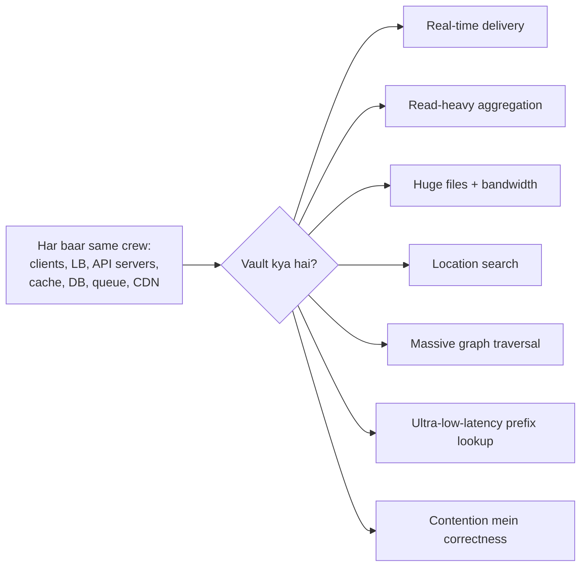

> 💡 **The core insight:** neeche ka har design same skeleton hai, plus ek ya do specialised ideas. Agar tum pehle paanch minute mein vault ka naam le sako ("the hard part here is X"), toh interviewer ko wahin samajh aa jaata hai ki tum senior jaisa sochte ho.

> 🤔 **Mann mein sawaal:** Agar har design ka skeleton same hai, toh interviewer itne alag-alag systems kyun poochta hai? Ek hi kaafi nahi?
>
> **Jawab:** Kyunki woh skeleton nahi, tumhari **pehchaan** test kar raha hai. Load balancer aur cache toh sab bol dete hain. Asli signal ye hai ki tum chat mein "ordering + no duplicates" pakadte ho, feed mein "read:write ratio", aur booking mein "contention". Alag systems = alag vaults = alag tareeke se tumhari soch check karna.

---

## 🔨 Building It Up · Zero Se Shuru

### 1. How to read each case study · Har case study kaise padhein

Har design [Chapter 11](11-estimation-framework.md) ke 7 steps follow karta hai:

1. **Requirements**: functional (system kya karta hai) aur non-functional (kitna accha karta hai: latency, availability, consistency, scale).
2. **Estimates**: QPS, storage, bandwidth. Sirf woh numbers jo koi decision badalte hain.
3. **API**: woh gine-chune endpoints ya events jo matter karte hain.
4. **Data model**: tables ya key layouts, kaunsa database aur kyun.
5. **High-level design**: ek architecture diagram, phir main flows (aksar sequence diagram ke roop mein).
6. **Deep dives**: vault. Score yahin decide hota hai.
7. **Bottlenecks and trade-offs**: sabse pehle kya tootega, tumne kya choose kiya, aur badle mein kya chhoda.

Phir aate hain **follow-up questions**: woh curveballs jo interviewer tab phenkta hai jab tumhara pehla design board pe aa chuka hota hai.

Neeche ke numbers usual shortcuts use karte hain: quick math ke liye **1 day ≈ 86,400 s ≈ 10⁵ s**, peak ≈ **average ka 2–3×**, aur storage ko khul ke round karna. Interviewer ko isse matlab hai ki numbers *reasonable hon aur use kiye jaayein*, isse nahi ki woh ekdum precise hon.

> 💡 **Ek chhota sa jugaad:** 86,400 ko 10⁵ maan lo toh division ek second mein ho jaata hai. "20 billion per day" = 2 × 10¹⁰ / 10⁵ = 2 × 10⁵ = **200k/s**. Asli answer 230k hai. Interview ke liye itna close kaafi se zyada hai.

---

### 2. Chat / Messaging App (WhatsApp, Messenger, Slack)

**Kahani:** tum Asha ho. Tum Ravi ko "hi!" bhejti ho, aur usi waqt Ravi metro mein underground station mein ghus jaata hai. Tumhare phone pe ek tick aata hai. Das second baad Ravi bahar nikalta hai, uska phone wapas net pakadta hai, "hi!" aata hai, sahi jagah pe, sirf ek baar. Tumhare phone pe do tick. Ravi padhta hai, ticks neele. Ye "chhota sa" magic hi poora vault hai.

> 🇮🇳 **Desi Analogy:** Chat system ek **railway reservation chart** ki tarah socho. Har train (conversation) ka apna chart hota hai, aur us chart pe har entry ka ek **serial number** hota hai jo railway (server) deta hai, passenger nahi. Isliye order kabhi gadbad nahi hota: serial number 1051 hamesha 1050 ke baad hi aayega, chahe passenger ki ghadi kuch bhi bole. Jo passenger station pe late pahuncha (offline phone), woh TC se poochta hai "serial 1000 ke baad kya kya hua?" aur use exact list mil jaati hai. Yahan chart = per-conversation log, serial number = `seq`, TC se poochna = cursor se sync.

#### Step 1 · Requirements

**Functional**
- 1:1 chat aur group chat (groups maan lo 500 members tak).
- Receiver online ho toh messages real time mein deliver hon, offline ho toh baad ke liye store hon.
- **Delivery receipts**: sent ✓, delivered ✓✓, read (blue ticks).
- **Presence**: online / last seen.
- User ke saare devices pe message history sync ho.
- App band ho toh push notifications.
- (Mention karo, phir park karo: media messages, end-to-end encryption, voice calls.)

**Non-functional**
- **Low latency**: message ek second se kaafi kam mein pahunchna chahiye.
- **Ordering**: ek conversation ke andar sab log messages same order mein dekhein.
- **No loss, no duplicates**: sender ko ✓ dikhne ke baad message kabhi lost nahi hona chahiye, aur kabhi do baar nahi dikhna chahiye.
- **High availability**: ek data centre mein dikkat ho tab bhi chat chalti rahe.
- Scale: crore-on daily users (hundreds of millions).

> 💡 Zor se bolo: "For chat I will favour availability and low latency, but within a conversation I need ordering and no duplicates. Those two are my vault."

#### Step 2 · Estimates

| Quantity | Assumption | Result |
|---|---|---|
| Daily active users (DAU) | 500 million | |
| Messages per user per day | 40 | 20 billion messages/day |
| Average send rate | 20 × 10⁹ / 86,400 | ≈ **230,000 messages/s** |
| Peak send rate | ×3 | ≈ **700,000 messages/s** |
| Message size | ~100 bytes text + ~100 bytes metadata | ~200 bytes |
| Storage per day | 20 × 10⁹ × 200 B | ≈ **4 TB/day**, replication se pehle ~1.5 PB/year |
| Concurrent connections at peak | DAU ka ~50% online | ≈ **250 million** open connections |
| Gateway servers | ~100,000 connections per server (conservative) | ≈ **2,500 connection servers** |

Ye numbers humein kya bata rahe hain:
- **250 million long-lived connections** sabse defining number hai. Normal request/response servers se kaam nahi chalega. Humein dedicated **connection (gateway) servers** chahiye, jinka ek hi kaam hai: lakhon sockets khule rakhna.
- **700k writes/s** aur saal ke petabytes: message store ek **horizontally scalable, write-optimised** database hona chahiye (Cassandra/ScyllaDB ya HBase jaisa wide-column store), ek akela SQL box nahi.

> 🤔 **Mann mein sawaal:** 1.5 PB/year kaise aaya? 4 TB × 365 toh 1,460 TB hai.
>
> **Jawab:** Bilkul wahi. 1,460 TB ≈ 1.46 PB ≈ **1.5 PB**. Aur ye replication se pehle hai. Replication factor 3 lagao toh asli disk ≈ 4.5 PB/year. Interview mein ye ek line add karna ("×3 for replication") tumhe careful dikhata hai.

#### Step 3 · API

Client ek **WebSocket** khula rakhta hai (ek long-lived, two-way TCP connection, dekho [Chapter 07](07-apis-communication.md)). Messages us pe chhote JSON (ya binary) frames ki tarah travel karte hain.

```text
Client -> Server  (over WebSocket)
  {"type":"send", "client_msg_id":"a1b2-...", "conv_id":"c42", "text":"hi"}
  {"type":"ack_delivered", "conv_id":"c42", "seq":1051}
  {"type":"ack_read", "conv_id":"c42", "seq":1051}
  {"type":"heartbeat"}

Server -> Client
  {"type":"sent", "client_msg_id":"a1b2-...", "conv_id":"c42", "seq":1051, "ts":...}
  {"type":"message", "conv_id":"c42", "seq":1051, "sender":"u7", "text":"hi"}
  {"type":"receipt", "conv_id":"c42", "seq":1051, "user":"u9", "status":"read"}

Plain HTTPS (REST) for everything that is not real-time:
  GET  /v1/conversations/{conv_id}/messages?after_seq=1000&limit=50   # sync / history
  POST /v1/groups                     {"name": "...", "members": [...]}
  POST /v1/media/upload-url           -> pre-signed URL for photos/videos
```

Do fields pe khaas dhyaan do:
- **`client_msg_id`**: ek UUID jo phone bhejne se *pehle* khud banata hai. Agar network toot gaya aur phone ne retry kiya, server ko same ID dikhegi aur woh message do baar store nahi karega. Ye ek **idempotency key** hai ([Chapter 09](09-microservices-reliability.md)).
- **`seq`**: ek per-conversation sequence number jo server assign karta hai. Yahi ek sachcha order define karta hai.

> 🤔 **Mann mein sawaal:** ID phone kyun banaye? Server bana de toh zyada safe nahi?
>
> **Jawab:** Nahi, yahi toh trick hai. Socho phone ne message bheja, server ne store kiya, lekin "sent" wala reply raaste mein kho gaya. Phone ko kaise pata chalega ki ye "naya" message nahi, "wahi purana" hai? Sirf tab, jab ID phone ke paas **pehle se** ho aur retry mein bhi same jaaye. Server ki banayi ID toh phone ko reply ke saath hi milti, aur reply hi kho gaya tha.

#### Step 4 · Data model

```sql
-- Wide-column store (Cassandra-style). Partition = ek conversation (time se bucketed,
-- taaki ek busy group ek giant partition na bana de). Partition ke andar rows seq se sorted.
CREATE TABLE messages (
    conv_id     text,
    bucket      int,          -- jaise month number, partitions ko bounded rakhta hai
    seq         bigint,       -- per-conversation order
    msg_id      bigint,       -- globally unique (Snowflake-style)
    sender_id   bigint,
    body        text,
    created_at  timestamp,
    PRIMARY KEY ((conv_id, bucket), seq)
) WITH CLUSTERING ORDER BY (seq DESC);

-- User kin conversations mein hai, newest activity pehle (chat list screen yahi chalata hai)
CREATE TABLE user_inbox (
    user_id       bigint,
    last_activity timestamp,
    conv_id       text,
    last_read_seq bigint,
    PRIMARY KEY (user_id, last_activity, conv_id)
);

-- Relational DB (chhota data, consistency chahiye): users, groups, membership
CREATE TABLE group_members (
    group_id  bigint,
    user_id   bigint,
    role      varchar(10),
    joined_at timestamp,
    PRIMARY KEY (group_id, user_id)
);
```

Messages ke liye wide-column store kyun? Access pattern hamesha ek hi hai: "**ek conversation ke latest N messages**". Writes bahut zyada hain, aur joins ki kabhi zaroorat nahi. Poori conversation ko ek partition mein, `seq` se sorted rakh do, toh woh query disk ka ek single sequential read ban jaati hai.

Garam, thodi der jeene wala state ek in-memory store mein rehta hai, jaise Redis:
- `session:{user_id} -> gateway server id` (kaunsa connection server is user ka socket pakde hue hai)
- `presence:{user_id} -> last heartbeat` (TTL ke saath)
- `seq:{conv_id} -> counter` (atomic `INCR` agla sequence number deta hai)

#### Step 5 · High-level design

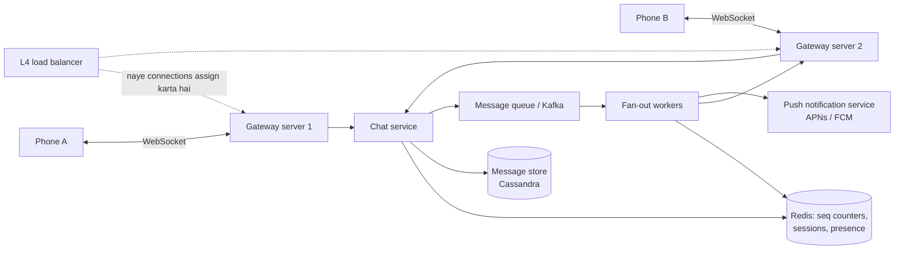

**Ek 1:1 message bhejna, step by step:**

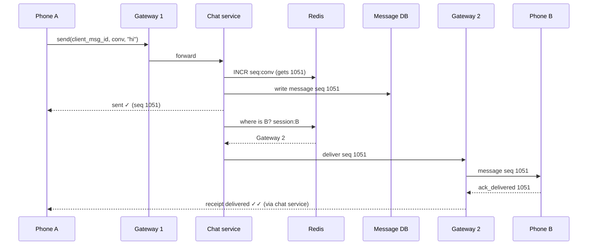

Jo rule isse safe banata hai: **server "sent ✓" tabhi bolta hai jab message durably likh diya gaya ho**. Us pal ke baad message kho nahi sakta. Agar B offline hai, toh message bas database mein intezaar karta hai.

Agar B **offline** hai (Redis mein uska koi session nahi), toh chat service message ko **push notification service** ko de deti hai, jo Apple ke APNs ya Google ke FCM se B ka phone jagaati hai. Jab B app kholta hai, woh reconnect karta hai aur **sync** karta hai.

> 🤔 **Mann mein sawaal:** Push notification hi toh message hai na? Phir sync ki kya zaroorat?
>
> **Jawab:** Nahi. Push notification sirf "ghanti" hai, delivery ki guarantee nahi. APNs/FCM notifications drop kar sakte hain, club kar sakte hain, late bhej sakte hain. Asli source of truth database hai. Notification bas phone ko jagaata hai; phone khulke cursor se sync karta hai aur wahan se pakka data uthata hai.

#### Step 6 · Deep dives

**Deep dive 1: ordering and duplicates (the vault).**

Phones lagataar disconnect hote rehte hain. Teen buri cheezein ho sakti hain: ek message retry hoke do baar store ho jaaye; messages ulte order mein pahunchein; reconnect hota phone kuch messages miss kar de. Ideas ka ek chhota sa set teeno ko fix kar deta hai:

- `client_msg_id` ke saath **idempotent send**: server haal ki IDs yaad rakhta hai aur repeats ko ignore karta hai.
- **Server-assigned per-conversation `seq`**: order wahi hai jo server ne diya, sender ki ghadi nahi (phone clocks toh hamesha galat hoti hain).
- **Sync by cursor**: har device har conversation ke liye yaad rakhta hai ki uske paas aakhri `seq` kaunsa hai. Reconnect pe woh poochta hai "seq N ke baad sab kuch do". Gaps namumkin hain, kyunki cursor exact hai.

Poora idea ek runnable simulation mein:

```python
from collections import defaultdict

class ChatServer:
    """One conversation = one ordered log. Each message gets the next sequence number."""

    def __init__(self):
        self.logs = defaultdict(list)        # conversation_id -> messages ki list
        self.next_seq = defaultdict(int)     # conversation_id -> agla sequence number
        self.seen_client_ids = set()         # idempotent retries ke liye
        self.read_upto = {}                  # (conversation_id, user) -> aakhri padha hua seq

    def send(self, conv, sender, client_msg_id, text):
        if client_msg_id in self.seen_client_ids:      # ye usi message ka retry hai jo hum store kar chuke
            return "duplicate ignored"
        self.seen_client_ids.add(client_msg_id)
        self.next_seq[conv] += 1
        seq = self.next_seq[conv]
        self.logs[conv].append((seq, sender, text))
        return f"stored seq={seq}"

    def sync(self, conv, user, last_seen_seq):
        """A client that reconnects asks: 'give me everything after seq N'."""
        return [m for m in self.logs[conv] if m[0] > last_seen_seq]

    def mark_read(self, conv, user, seq):
        self.read_upto[(conv, user)] = max(seq, self.read_upto.get((conv, user), 0))

    def status(self, conv, seq, members, sender):
        readers = [u for u in members if u != sender and self.read_upto.get((conv, u), 0) >= seq]
        return "read by " + ", ".join(readers) if readers else "delivered"

server = ChatServer()
print(server.send("c1", "asha", "m-001", "hi!"))
print(server.send("c1", "ravi", "m-002", "hey asha"))
print(server.send("c1", "asha", "m-001", "hi!"))          # usi message ka network retry
print(server.send("c1", "asha", "m-003", "lunch?"))
print("ravi was offline after seq 1, syncs:", server.sync("c1", "ravi", 1))
server.mark_read("c1", "ravi", 3)
print("seq 3 status:", server.status("c1", 3, ["asha", "ravi"], "asha"))
```

```text
stored seq=1
stored seq=2
duplicate ignored
stored seq=3
ravi was offline after seq 1, syncs: [(2, 'ravi', 'hey asha'), (3, 'asha', 'lunch?')]
seq 3 status: read by ravi
```

Abhi kya hua, line by line:
- `m-001` ka retry drop ho gaya. Doosra "hi!" nahi bana. Dhyaan do, `seq` counter bhi nahi badha, isliye agle message ko seq 3 mila, 4 nahi. Order mein koi khaali jagah nahi.
- Ravi sirf seq 1 jaanta tha jab woh reconnect hua. Use exactly seqs 2 aur 3 mile. Na ek zyada, na ek kam.
- Read receipts ek number per user ban gaye ("read up to seq 3"). Ye har message pe ek flag store karne se kaafi sasta hai.

> 💡 **Read receipts trick:** har message pe "read" flag mat rakho, ek **high-water mark** rakho (har user ka har conversation ke liye `last_read_seq`). "Read up to 1051" ka matlab hai usse pehle ka sab bhi padh liya gaya. Saikdon writes ki jagah ek write.

> 🇮🇳 **Desi Analogy:** High-water mark bilkul **bookmark** jaisa hai. Tum ek novel ke page 151 pe bookmark rakhte ho. Iska matlab apne aap hai ki page 1 se 150 padh liye. Har page pe alag se "padh liya" likhne ki zaroorat nahi. `last_read_seq` = bookmark, har message = ek page.

**Deep dive 2: connection kaun pakde hue hai, aur use dhoondhein kaise?**

Ek user (har device ke liye) exactly ek gateway server se juda hota hai. Gateways **stateful** hain (woh sockets pakde hue hain), isliye:
- Ek **L4 load balancer** naye connections ko gateways mein baant-ta hai ([Chapter 02](02-scalability-load-balancing.md)).
- Connect hote hi gateway Redis mein `session:{user_id} = gateway_id` likh deta hai (TTL ke saath, jo heartbeats se refresh hota hai).
- Deliver karne ke liye chat service session dekhti hai aur message us gateway ko internal channel se bhejti hai (gRPC, ya per-gateway queue / Redis pub/sub channel).
- Agar koi gateway mar gaya, toh uske users ke sockets toot jaate hain, unke phones doosre gateway se reconnect karte hain, session dobara likhte hain, aur **apne cursor se sync** karte hain. Kuch lost nahi hota, kyunki source of truth database hai.

> 🇮🇳 **Desi Analogy:** Gateway = mohalle ka **post office**, session registry = **pin code directory**. Chat service ko Ravi ka letter mila. Woh directory mein dekhti hai "Ravi abhi kis post office ke area mein hai?", aur letter wahin bhej deti hai. Ravi shift ho gaya (gateway mar gaya, doosre se juda)? Woh naye post office mein naya address register karwata hai, aur purani dak central godown (database) se mangwa leta hai.

**Deep dive 3: group chat fan-out.**

500 logon ke group mein bheja message 500 logon tak pahunchna chahiye. Do options hain:

| Approach | How | Good for |
|---|---|---|
| **Fan-out on write** (har member ke inbox mein copy) | Message ek baar likho, phir har member ke inbox / gateway ko ek pointer push karo | Chhote groups (WhatsApp groups ka size modest pe cap karta hai) |
| **Fan-out on read** (ek shared log) | Group ke log mein ek baar store karo; members apne cursor se pull karein | Bahut bade channels (Slack, Discord, hazaaron members wale Telegram channels) |

Typical answer: message ko group ke log mein **ek hi baar** store karo (`conv_id` se partitioned), phir Kafka pe ek event daalo. Fan-out workers members dekhte hain, pata karte hain kaun online hai (session lookup), unke gateways ko push karte hain, aur offline walon ko push notifications bhejte hain. 100k members wale channels ke liye sabko push mat karo. Bas "new activity" notify karo aur clients ko khud pull karne do.

**Deep dive 4: presence ("online" / "last seen").**

Presence high-churn aur low-importance hai. Agar ye 10 second purana hai, toh kisi ko fark nahi padta. Isliye:
- Client har kuch second mein socket pe ek **heartbeat** bhejta hai.
- Server Redis mein `presence:{user} = now` TTL ke saath likhta hai.
- User "online" hai agar uska aakhri heartbeat haal ka hai. **Kai** heartbeats miss hone pe (sirf ek nahi) use offline maana jaata hai, taaki 2-second ki tunnel uska status flicker na kare.
- Presence changes sirf unhe push karo jo us user ko **abhi dekh rahe hain** (chat screen khuli hai), uske saare contacts ko kabhi nahi. Warna ek banda online aaya aur saikdon messages trigger ho gaye.

> 🇮🇳 **Desi Analogy:** Joint family ka WhatsApp group socho jismein 200 rishtedaar hain. Agar har baar koi online aaye aur sabko notification jaaye "Chachaji online hain", toh poore din phone bajta rahega. Isliye "online" sirf usi ko dikhta hai jo abhi Chachaji ki chat kholke baitha hai. Baaki kisi ko parwah nahi.

```python
HEARTBEAT_EVERY = 5      # client har 5 s mein ping karta hai
TIMEOUT = 3 * HEARTBEAT_EVERY   # lagataar 3 ping miss -> offline (chhote network blips jhel leta hai)

last_seen = {}           # user -> aakhri heartbeat ka time (Redis mein ye TTL wali key hai)

def heartbeat(user, now):
    last_seen[user] = now

def presence(user, now):
    t = last_seen.get(user)
    if t is None:
        return "offline"
    return "online" if now - t < TIMEOUT else f"last seen {now - t}s ago"

heartbeat("asha", 0); heartbeat("ravi", 0)
for t in range(5, 35, 5):
    heartbeat("asha", t)                 # asha app khula rakhti hai
    if t == 5:
        heartbeat("ravi", t)             # t=5 ke baad ravi ka phone tunnel mein chala jaata hai
    print(f"t={t:2}s  asha: {presence('asha', t):8}  ravi: {presence('ravi', t)}")
```

```text
t= 5s  asha: online    ravi: online
t=10s  asha: online    ravi: online
t=15s  asha: online    ravi: online
t=20s  asha: online    ravi: last seen 15s ago
t=25s  asha: online    ravi: last seen 20s ago
t=30s  asha: online    ravi: last seen 25s ago
```

Abhi kya hua: Ravi ka aakhri heartbeat t=5 pe tha. t=10 aur t=15 pe usne sirf ek ya do ping miss kiye hain, isliye hum use abhi bhi online dikhate hain (gap 5 aur 10 second, dono `TIMEOUT = 15` se kam). t=20 pe woh 15 second se chup hai (3 missed pings: t=10, 15, 20), `15 < 15` false hai, isliye woh "last seen" pe flip ho jaata hai.

**Deep dive 5: multiple devices.** Har device ka apna socket aur har conversation ke liye apna cursor hota hai. Session key ban jaati hai `session:{user_id} -> {device_id: gateway_id}`. Delivery har device ko jaati hai; "delivered" tab dikhta hai jab **koi bhi** device ack kare; "read" tab jab koi bhi device padh le.

#### Step 7 · Bottlenecks and trade-offs

- **Sequence counter hot spot**: har conversation ke liye ek akela Redis `INCR` theek hai (ek conversation shayad hi kabhi kuch sau messages/s cross karti hai). Counters ko `conv_id` se shard karo. Alternative: message store ka partition leader hi `seq` assign kare.
- **Hot groups**: hazaaron active writers wala group ek partition pe load jama kar deta hai. Partition key ko time se bucket karna (`(conv_id, bucket)`) partitions ko bounded rakhta hai.
- **Trade-off: availability vs devices ke beech strict ordering.** Hum order **ek conversation ke andar** guarantee karte hain (ek counter), conversations ke beech nahi. Woh kisi ko chahiye bhi nahi.
- **Trade-off: bade groups ke liye push vs pull** (upar dekha).
- **Storage**: purane messages sasti storage mein jaa sakte hain. WhatsApp-style designs toh saare devices tak deliver hone ke baad server se message delete bhi kar dete hain (phone hi archive ban jaata hai). Ye product decision mention karne laayak hai.

#### Follow-up questions

- *"How would you add end-to-end encryption?"* Clients public keys exchange karte hain (Signal protocol); server sirf ciphertext store aur forward karta hai. Nateeja: server messages search nahi kar sakta, previews nahi bana sakta, aur multi-device sync ke liye per-device keys chahiye.
- *"How do you handle a user with 5 devices where one is offline for a month?"* Uska cursor purana hai; reconnect pe woh `after_seq` ke saath 50–200 ke batches mein history page karta hai.
- *"How do typing indicators work?"* Socket pe bheje gaye ephemeral events, kabhi store nahi hote, receiver offline ho toh drop.
- *"What if the Redis session store goes down?"* Gateways dobara register kar sakte hain; tab tak messages store hote rehte hain, aur clients reconnect pe sync karte hain. Delivery late hoti hai, lost nahi, kyunki source of truth database hai.

---
### 3. Social News Feed (Facebook, Instagram, X/Twitter, LinkedIn)

**Kahani:** tum subah Instagram kholte ho. Tum 300 logon ko follow karte ho. Ek second ke andar tumhe unke latest posts, sahi order mein, scroll karne ko mil jaate hain. Sawaal ye hai: ye feed **kab** banti hai? Tumhare kholne pe? Ya pehle se tayyar rakhi hoti hai? Isi ek sawaal ka jawab poora design hai.

#### Step 1 · Requirements

**Functional**
- Users posts banate hain (text, images).
- Users doosre users ko follow karte hain.
- **Home feed** un logon ke posts dikhata hai jinhe tum follow karte ho, newest (ya best-ranked) pehle, infinite scroll ke saath.
- (Park karo: likes/comments counts, ads, stories, search.)

**Non-functional**
- **Fast feed loads**: p99 ~200–300 ms se kam. Ye woh screen hai jo sab sabse pehle kholte hain.
- **Read-heavy**: feeds posts likhe jaane se kahin zyada baar padhe jaate hain.
- **Eventual consistency chalegi**: dost ka post 5 second late dikha, toh kisi ka nuksaan nahi.
- Highly available.

#### Step 2 · Estimates

| Quantity | Assumption | Result |
|---|---|---|
| DAU | 300 million | |
| Feed loads per user per day | 10 | 3 × 10⁹/day ≈ **35,000 reads/s**, peak ≈ **100,000/s** |
| New posts | Har 5 users mein 1 post per day | 60 million/day ≈ **700 posts/s** |
| Average followers | 200 | fan-out = 60M × 200 = 12 × 10⁹ feed inserts/day ≈ **140,000 inserts/s** |
| Feed cache per user | 500 post IDs × 8 bytes | 4 KB/user → 300M × 4 KB ≈ cache cluster mein **1.2 TB** RAM |
| Post storage | 1 KB text + metadata | 60 GB/day text; images object storage + CDN mein |

Numbers kya bolte hain: reads (100k/s) writes (700/s) pe bahut bhaari hain. Ye ek strong hint hai: **kaam write time pe karo taaki reads saste ho jaayein**. Aur 1.2 TB feed cache ek sharded Redis cluster ke saath bilkul possible hai (maan lo 64 GB wale ~20 nodes, replicas alag se).

> 🤔 **Mann mein sawaal:** 700 posts/s se 140,000 inserts/s kaise ho gaye? Writes toh kam the na?
>
> **Jawab:** Yahi toh fan-out ka khel hai. Ek post = ek DB write, lekin agar author ke 200 followers hain toh woh post 200 feeds mein jaata hai. 700 × 200 = 140,000. "Writes kam hain" sirf posts ke liye sach hai, feed inserts ke liye nahi. Yahi number aage celebrity problem ki neenv banega.

#### Step 3 · API

```text
POST /v1/posts                         {"text": "...", "media_ids": ["m1"]}   -> {"post_id": 987}
POST /v1/users/{id}/follow
DELETE /v1/users/{id}/follow
GET  /v1/feed?cursor=<opaque>&limit=20 -> {"posts": [...], "next_cursor": "..."}
```

**Cursor-based pagination** use karo (cursor encode karta hai "aakhri post ID / score jo maine tumhe dikhaya"), `page=7` nahi. Page numbers ke saath, top pe aate naye posts sab kuch neeche khiska dete hain aur scroll karte waqt tumhe duplicates dikhte hain.

> 🇮🇳 **Desi Analogy:** Page number = "line mein 7th position wala aao". Lekin line mein aage naye log ghus rahe hain (naye posts), toh 7th position pe ab koi aur hai, aur jise tum dekh chuke the woh dobara saamne aa gaya (duplicate). Cursor = "Sharma ji ke **baad** wala aao". Aage kitne bhi log ghus jaayein, Sharma ji ke baad wala wahi rahega.

#### Step 4 · Data model

```sql
CREATE TABLE posts (
    post_id    BIGINT PRIMARY KEY,     -- Snowflake ID: lagbhag time-sortable
    author_id  BIGINT NOT NULL,
    body       TEXT,
    media_urls TEXT,
    created_at TIMESTAMP NOT NULL
);
CREATE INDEX idx_posts_author_time ON posts (author_id, created_at DESC);

CREATE TABLE follows (
    follower_id BIGINT,
    followee_id BIGINT,
    created_at  TIMESTAMP,
    PRIMARY KEY (follower_id, followee_id)
);
-- Fan-out ke liye ulti direction (followee -> followers) bhi store karo,
-- jaise ek doosri table ya followee_id se keyed graph store.
```

- **Posts**: `post_id` (ya `author_id`) se sharded, heavily cached.
- **Follow graph**: dono chahiye, "main kise follow karta hoon" aur "mujhe kaun follow karta hai". Do tables (har direction ke liye ek), har ek apne pehle column se sharded.
- **Feed cache** (Redis): `feed:{user_id}` → latest ~500 `post_id`s ka ek sorted set, time (ya rank) se scored. Hum **sirf IDs** store karte hain, poore posts kabhi nahi: ek post hazaaron feeds mein dikhta hai, aur agar body copy ki toh use kabhi saste mein edit ya delete nahi kar paayenge.

#### Step 5 · High-level design

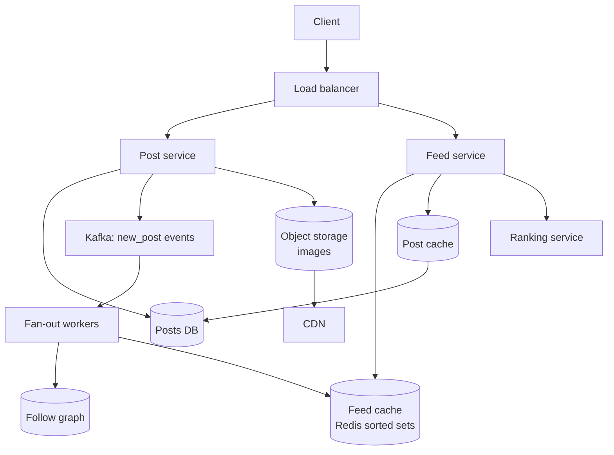

**Write path:** post save karo → Kafka pe `new_post` publish karo → user ko turant "posted" bol do → fan-out workers asynchronously `post_id` ko har follower ki feed cache mein push karte hain.

**Read path:** Redis se `feed:{me}` padho (IDs) → post bodies ek batch mein post cache se lao (`MGET`) → optionally rank karo → 20 posts return karo.

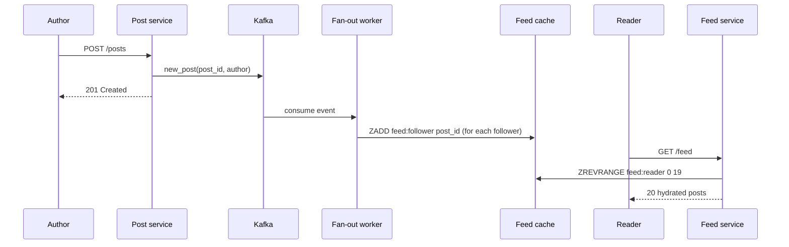

#### Step 6 · Deep dives

**Deep dive 1: fan-out on write vs fan-out on read (the vault).**

> 🇮🇳 **Desi Analogy:** Do tarah ke **akhbaar wale** socho. Pehla (fan-out on write): akhbaar chhapte hi woh har ghar ke darwaaze pe ek copy daal deta hai. Subah tum uthe, akhbaar tayyar hai (fast read). Lekin agar ek akhbaar ke 5 crore subscribers hon, toh baantne mein ghante lagenge, aur jo ghar mahino se band pada hai (inactive user) wahan bhi copy gayi (wasted work). Doosra (fan-out on read): koi delivery nahi, tum khud subah 20 alag stalls pe jaake har akhbaar uthao (slow read). Hybrid: chhote local akhbaar ghar pe aate hain, lekin sabse bada national akhbaar (celebrity) tum naake ke stall se khud utha lete ho. Asli systems yahi karte hain.

- **Fan-out on write (push):** jab tum post karte ho, apna post ID har follower ki feed mein copy kar do. Padhna ek cache lookup ban jaata hai. Keemat: 50 million followers wale ka ek post = 50 million writes, aur use khatam hone mein minutes lagte hain (yahi hai "**celebrity problem**"). Plus un followers ke liye wasted kaam jo kabhi login hi nahi karte.
- **Fan-out on read (pull):** posts sirf author ki timeline mein rakho. Jab tum feed kholte ho, jinhe bhi follow karte ho un sabke latest posts lao aur merge karo (heap se k-way merge, [Chapter 15 of Part 2](../part-2-dsa/15-heaps.md)). Writes bilkul aasaan. Keemat: agar tum 1,000 logon ko follow karte ho, toh har feed load 1,000 lookups karta hai. 100k reads/s pe slow aur mehenga.
- **Hybrid (asli systems yahi karte hain):** normal users ke liye push, **celebrities ke liye pull**. Tumhari feed = tumhari precomputed cache **+** jin gine-chune celebrities ko tum follow karte ho unke recent posts ka fresh fetch, read time pe merge.

| | Fan-out on write | Fan-out on read | Hybrid |
|---|---|---|---|
| Read cost | O(1) cache read | O(people you follow) | O(1) + O(celebrities you follow) |
| Write cost | O(followers) | O(1) | O(followers) sirf normal users ke liye |
| Freshness | Fan-out lag jitna delay | Hamesha fresh | Zyaadatar instant |
| Celebrity post | Disaster | Theek | Theek |
| Inactive users | Wasted work | Koi waste nahi | Inactive users ka fan-out skip |

Hybrid ek chhote se model mein:

```python
import heapq
from collections import defaultdict

CELEBRITY_THRESHOLD = 3          # demo ke liye chhota; asli systems kuch 10k+ followers jaisa use karte hain

followers = {                    # author -> jo log unhe follow karte hain
    "virat": ["asha", "ravi", "meera", "dev"],   # ek "celebrity"
    "asha":  ["ravi"],
    "ravi":  ["asha", "meera"],
}
following = defaultdict(list)    # user -> jin authors ko woh follow karta hai
for author, fans in followers.items():
    for fan in fans:
        following[fan].append(author)

feed_cache = defaultdict(list)   # user -> [(timestamp, author, text)] pehle se bana hua (push)
celebrity_posts = defaultdict(list)  # celebrity -> unke apne posts (read time pe pull hote hain)
writes = 0

def post(author, ts, text):
    global writes
    if len(followers.get(author, [])) >= CELEBRITY_THRESHOLD:
        celebrity_posts[author].append((ts, author, text))     # ek baar store, koi fan-out nahi
        writes += 1
    else:
        for fan in followers.get(author, []):                   # fan-out on write
            feed_cache[fan].append((ts, author, text))
            writes += 1

def read_feed(user, k=3):
    candidates = list(feed_cache[user])                          # push wala hissa
    for author in following[user]:                               # pull wala hissa
        if len(followers.get(author, [])) >= CELEBRITY_THRESHOLD:
            candidates.extend(celebrity_posts[author])
    return [f"{a}: {t}" for ts, a, t in heapq.nlargest(k, candidates)]

post("ravi", 1, "Morning run done")
post("virat", 2, "Match day!")
post("asha", 3, "New blog post")
post("ravi", 4, "Coffee time")

print("feed writes:", writes)
print("asha sees:", read_feed("asha"))
print("ravi sees:", read_feed("ravi"))
print("meera sees:", read_feed("meera"))
```

```text
feed writes: 6
asha sees: ['ravi: Coffee time', 'virat: Match day!', 'ravi: Morning run done']
ravi sees: ['asha: New blog post', 'virat: Match day!']
meera sees: ['ravi: Coffee time', 'virat: Match day!', 'ravi: Morning run done']
```

Abhi kya hua: Virat ke post ki keemat **ek** write thi, chaar nahi, phir bhi uske saare followers use dekh rahe hain, kyunki `read_feed` celebrity posts ko read time pe pull karta hai aur pushed posts ke saath timestamp se merge karta hai. 6 writes ka hisaab: Ravi ke do posts × 2 followers = 4, Asha ka post × 1 follower = 1, Virat = 1. Virat ke followers 50 million kar do, toh har post pe 50 million writes ki bachat.

> 🤔 **Mann mein sawaal:** Ravi ki feed mein sirf 2 posts kyun aaye, jabki `k=3` tha?
>
> **Jawab:** Kyunki Ravi sirf Asha aur Virat ko follow karta hai. Asha ka ek post ("New blog post") aur Virat ka ek ("Match day!"). Ravi ke apne posts uski feed mein nahi aate, kyunki `followers["ravi"]` list mein Ravi khud nahi hai. Total candidates hi 2 the, toh `nlargest(3, ...)` ne 2 hi diye. (Asli app mein "read-your-own-writes" ke liye tumhara apna post tumhari feed mein daala jaata hai, Step 7 dekho.)

**Deep dive 2: ranking.** Sirf time-ordered feed aasaan hai (timestamp se sorted set). Ranked feed do stages mein kaam karti hai:
1. **Candidate generation**: feed cache se ~500 IDs lo (plus celebrity pulls).
2. **Scoring**: ek ranking service har candidate ko features se score karti hai (author ke saath affinity, post ki umar, ab tak ke likes, content type) ek ML model use karke, aur top 20 return karti hai.

Scoring sasti rakho (kuch sau candidates, hazaaron nahi) taaki 200 ms ka budget bana rahe.

**Deep dive 3: caching layers.** Feed cache (har user ke IDs), post cache (ID se post body), user cache (naam, avatar), aur counters (likes) Redis mein, jo batches mein DB mein flush hote hain. Hot posts har feed server pe ek chhoti local in-process cache mein bhi baith sakte hain.

**Deep dive 4: new follow / unfollow / delete.**
- Follow: naye followee ke last kuch posts apni feed cache mein backfill karo (ya bas ab se aane do).
- Unfollow: cache scan karne ki jagah read time pe lazily filter karo (sasta).
- Delete post: posts DB mein use deleted mark karo; read path un IDs ko gira deta hai jinka post missing ya deleted hai. Isiliye hum IDs store karte hain, copies nahi.

#### Step 7 · Bottlenecks and trade-offs

- Spikes ke dauraan **fan-out lag**: Kafka bursts ko sokh leta hai; workers badhao; active users ko priority do.
- **Feed cache memory**: har user ke ~500 IDs pe cap; 30+ din se inactive users ki cache mat banao (jab woh wapas aayein toh pull se on demand rebuild).
- **Trade-off:** freshness aur simplicity (pull) vs read speed (push). Scale pe hybrid jeet-ta hai.
- **Consistency:** eventual. Lekin tumhara apna post **tumhari** feed mein turant dikhna chahiye: use apni cache mein synchronously insert karo ("read-your-own-writes").

#### Follow-up questions

- *"How do you pick the celebrity threshold?"* Follower count aur fan-out cost ke basis pe; metrics dekh ke tune karo. Kuch systems **bahut active followers** ko inactive walon se alag treat bhi karte hain.
- *"How would you show 'X new posts' while the user is scrolling?"* Ek sasta endpoint poll karo (ya long-lived connection use karo) jo cache ki newest ID ko client ki newest ID se compare kare.
- *"How do you handle a viral post getting millions of likes per minute?"* Counter ko shard karo (N sub-counters, read pe sum), writes batch karo; approximate counts dikhao.

---

### 4. Video Streaming Platform (YouTube, Netflix)

**Kahani:** ek creator Mumbai se 3 GB ka 4K video upload karta hai. Ek ghante baad Patna mein ek ladki usi video ko 3G pe phone pe dekh rahi hai, aur Bengaluru mein ek family 4K smart TV pe. Video beech mein kabhi ruka nahi. Bas jab train tunnel mein gayi toh quality thodi der ke liye gir gayi. Ye kaise hota hai?

#### Step 1 · Requirements

**Functional**
- Creators videos **upload** karte hain (kai GB tak).
- Viewers kisi bhi device pe videos **dekhte** hain (3G wala phone, fibre wala smart TV), seeking ke saath.
- Videos kai qualities mein chalte hain aur network badalne pe **automatically switch** karte hain.
- Basic metadata: title, description, view count, thumbnails.
- (Park karo: comments, recommendations, live streaming, monetisation.)

**Non-functional**
- **Smooth playback**: jaldi start ho (~2 s se kam), buffering kabhi-kabhaar hi.
- **Massive read bandwidth**; uploads kam hain par bahut bade.
- Viewing ke liye highly available; upload processing mein minutes lag sakte hain (eventual).
- Durable: upload hua video kabhi lost nahi hona chahiye.

#### Step 2 · Estimates

| Quantity | Assumption | Result |
|---|---|---|
| DAU | 500 million | |
| Views | Har user 5 videos per day | 2.5 × 10⁹ views/day ≈ **29,000 views/s** |
| Average watch time | 5 minutes | ≈ 29,000 × 300 ≈ **8.7 million concurrent streams** |
| Average bitrate | 3 Mbps | 8.7M × 3 Mbps ≈ **26 Tbps** egress |
| Uploads | 1 million videos/day, average 300 MB original | ≈ **300 TB/day** originals |
| Transcoded copies | ~5 renditions, sab milake lagbhag original ke size jitne | ≈ **600 TB/day** total, replication se pehle |

Numbers kya bolte hain: **26 terabits per second** ek data centre se nahi nikal sakta, das se bhi nahi. Video ko edge pe, viewers ke paas, **CDN** se serve karna hi padega ([Chapter 04](04-caching-cdn.md)). Aur roz 600 TB nayi files ka matlab hai **object storage** ([Chapter 10](10-storage-search-ids.md)), database kabhi nahi.

> 🤔 **Mann mein sawaal:** 29,000 views/s se 8.7 million concurrent streams kaise bane?
>
> **Jawab:** **Little's Law** se: ek saath chal rahe streams = (har second kitne naye streams shuru hote hain) × (har stream kitni der chalta hai). Har second 29,000 log video shuru karte hain, aur har koi 300 second (5 minute) dekhta hai. Toh kisi bhi pal 29,000 × 300 = 8.7 million log dekh rahe hote hain. Jaise metro station pe har minute 100 log aate hain aur har koi 10 minute rukta hai, toh platform pe hamesha ~1,000 log milenge.

#### Step 3 · API

```text
POST /v1/videos                          {"title": "...", "size_bytes": 3200000000}
     -> {"video_id": "v123", "upload_id": "...", "part_urls": [pre-signed URLs, one per chunk]}
PUT  <pre-signed part URL>               (client uploads each ~10 MB chunk directly to object storage)
POST /v1/videos/v123/complete            {"parts": [{"n":1,"etag":"..."}, ...]}
GET  /v1/videos/v123                     -> metadata + manifest URL + status (PROCESSING / READY)
GET  https://cdn.example.com/v123/master.m3u8      (player fetches the manifest, then segments)
```

Upload pre-signed URLs aur multipart (chunked) upload use karke **seedha client se object storage** jaata hai. Hamare API servers gigabytes ko chhoote bhi nahi: woh bas permission slips baant-te hain. Fail hua chunk akela retry hota hai; toota connection aakhri complete chunk se resume hota hai.

> 🇮🇳 **Desi Analogy:** Pre-signed URL society ke **gate pass** jaisa hai. Guard (API server) tumhara bhaari saaman khud upar nahi le jaata. Woh bas ek signed parchi deta hai: "flat 1204 tak jaane ki ijaazat, sirf aaj shaam 6 baje tak". Delivery wala (client) seedha lift se upar (object storage) jaata hai. Guard free rehta hai, aur parchi ke bina koi upar nahi jaa sakta. Parchi pe time limit = URL ki expiry, parchi pe flat number = woh exact object path jahan upload allowed hai.

#### Step 4 · Data model

```sql
CREATE TABLE videos (
    video_id     VARCHAR(16) PRIMARY KEY,
    owner_id     BIGINT NOT NULL,
    title        VARCHAR(200),
    description  TEXT,
    status       VARCHAR(12),        -- UPLOADING, PROCESSING, READY, FAILED
    duration_s   INT,
    manifest_url TEXT,               -- jaise s3://videos/v123/master.m3u8
    created_at   TIMESTAMP
);

CREATE TABLE renditions (
    video_id   VARCHAR(16),
    resolution VARCHAR(8),           -- 240p ... 2160p
    codec      VARCHAR(10),          -- h264, vp9, av1
    bitrate_kbps INT,
    playlist_url TEXT,
    PRIMARY KEY (video_id, resolution, codec)
);
```

Video ke **bytes** object storage mein rehte hain, kuch is layout mein: `videos/v123/720p/seg_00042.ts`. **Metadata** ek SQL DB mein (`video_id` se sharded), aage ek cache ke saath. **View counts** ek stream processor mein approximately gine jaate hain aur batches mein likhe jaate hain.

#### Step 5 · High-level design

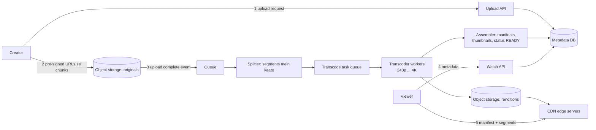

#### Step 6 · Deep dives

**Deep dive 1: the transcoding pipeline.**

Ek raw upload 4K, 3 GB ki `.mov` file ho sakti hai. Phones ko chhoti H.264 files chahiye; TVs ko modern codec mein 4K. **Transcoding** original ko renditions ki ek **ladder** (seedhi) mein badalta hai (240p, 360p, 480p, 720p, 1080p, 4K), har ek 2–10 second ke chhote **segments** mein kata hua.

Ek lamba video ek machine pe transcode karne mein ghante lagenge. Isliye pipeline **tasks ka ek DAG** hai (directed acyclic graph, [Part 2 Chapter 17](../part-2-dsa/17-graphs-advanced.md)):

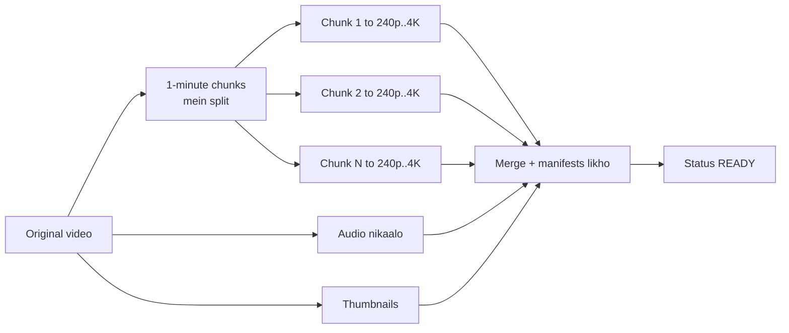

- Chunks saikdon workers pe **parallel** mein transcode hote hain, isliye 1 ghante ka video minutes mein ho jaata hai.
- Tasks ek queue se jaate hain ([Chapter 08](08-queues-events.md)); har task **idempotent** hai ("chunk 7 ko 720p mein transcode karo" dobara chalao toh bas wahi output file overwrite hoti hai), isliye worker crash ke baad retries safe hain.
- Fail hua task kuch baar retry hota hai, phir dead-letter queue mein jaata hai aur video FAILED mark hota hai.
- Safety checks bhi chalao (malware, copyright, content moderation), DAG ki branches ki tarah.

> 🇮🇳 **Desi Analogy:** Transcoding pipeline ek **shaadi ki rasoi** hai. Ek halwai akela 1,000 logon ka khaana banaye toh subah ho jaayegi. Toh kaam baant do: das log alag-alag handiyan bana rahe hain (chunks parallel), ek banda sirf rotiyan (audio), ek sirf salad (thumbnails). Sab tayyar hone pe hi thaali lagti hai (merge + manifest), aur tabhi announcement hota hai "khaana lag gaya" (READY). Kisi ki ek handi jal gayi? Sirf wahi handi dobara banao (idempotent retry), poora khaana nahi.

**Deep dive 2: adaptive bitrate streaming (ABR).**

Player "video file" download **nahi** karta. Woh ek chhota sa **manifest** download karta hai (HLS `.m3u8` ya MPEG-DASH `.mpd`) jismein har rendition aur har segment ka URL likha hota hai. Phir woh plain HTTP GETs se segments ek-ek karke laata hai, aur **har segment se pehle quality choose karta hai**, measured download speed aur buffer mein kitna video pada hai, dono dekh ke.

```text
#EXTM3U                                   (master manifest, simplified)
#EXT-X-STREAM-INF:BANDWIDTH=800000,RESOLUTION=640x360
360p/playlist.m3u8
#EXT-X-STREAM-INF:BANDWIDTH=2800000,RESOLUTION=1280x720
720p/playlist.m3u8
#EXT-X-STREAM-INF:BANDWIDTH=5000000,RESOLUTION=1920x1080
1080p/playlist.m3u8
```

> 🇮🇳 **Desi Analogy:** ABR ek samajhdaar **auto-rickshaw wale bhaiya** jaisa hai. Khaali sadak (fast network)? Top gear mein bhagao (1080p). Aage jam (slow network)? Pehle gear mein dheere chalte raho (240p), lekin **ruko mat**. Har signal pe (har segment) woh decide karte hain ki agla gear kaunsa. Aur agar tank mein petrol kam hai (buffer low), toh aur bhi sambhal ke chalate hain (kam safety margin). Ruk jaana (buffering wheel) sabse bura option hai.

Ek chhota sa ABR simulation:

```python
# Bitrate ladder: (label, kitne kilobits per second chahiye)
LADDER = [("240p", 400), ("360p", 800), ("480p", 1400), ("720p", 2800), ("1080p", 5000)]
SEGMENT_SECONDS = 4

def pick_rendition(measured_kbps, buffer_s):
    """Throughput rule with a safety margin; be more careful when the buffer is low."""
    safety = 0.8 if buffer_s >= 10 else 0.5
    budget = measured_kbps * safety
    choice = LADDER[0]
    for label, kbps in LADDER:
        if kbps <= budget:
            choice = (label, kbps)
    return choice

network = [6000, 6500, 3000, 1200, 900, 4000, 7000, 7000]   # har segment pe measured kbps
buffer_s = 0.0
for i, bw in enumerate(network):
    label, kbps = pick_rendition(bw, buffer_s)
    download_s = kbps * SEGMENT_SECONDS / bw          # ye segment laane mein kitna time
    buffer_s = max(0.0, buffer_s - download_s) + SEGMENT_SECONDS
    print(f"seg {i}: net={bw:>4} kbps -> {label:>5}  buffer={buffer_s:4.1f}s")
```

```text
seg 0: net=6000 kbps ->  720p  buffer= 4.0s
seg 1: net=6500 kbps ->  720p  buffer= 6.3s
seg 2: net=3000 kbps ->  480p  buffer= 8.4s
seg 3: net=1200 kbps ->  240p  buffer=11.1s
seg 4: net= 900 kbps ->  240p  buffer=13.3s
seg 5: net=4000 kbps ->  720p  buffer=14.5s
seg 6: net=7000 kbps -> 1080p  buffer=15.6s
seg 7: net=7000 kbps -> 1080p  buffer=16.8s
```

Abhi kya hua: jab network 1,200 kbps pe gira (train tunnel mein ghusi), player **buffering ke liye rukne ki jagah** 240p pe utar gaya, aur buffer badhta raha. Network theek hua toh woh wapas 1080p tak chadh gaya. Kuch second ki low quality hamesha ghoomte hue loading wheel se behtar hai. (Asli players aur smart rules use karte hain, jaise buffer-based algorithms, par idea wahi hai.)

Ek row ka hisaab haath se karke dekho, seg 1: buffer 4.0 s hai (10 se kam), toh safety 0.5. Budget = 6500 × 0.5 = 3250 kbps, isliye 720p (2800) chuna, 1080p (5000) nahi. Download time = 2800 × 4 / 6500 ≈ 1.7 s. Naya buffer = 4.0 − 1.7 + 4 = **6.3 s**. Har segment buffer mein 4 second video jodta hai, aur download time jitna buffer kharch hota hai. Jab tak download time 4 s se kam hai, buffer badhta rahega.

**Deep dive 3: CDN hi lagbhag saara kaam karta hai.**
- Segments plain, **immutable** files hain jo HTTP pe aati hain, jo CDN caching ke liye perfect hai (inhe lambe time tak cache karo; ye kabhi badalte nahi).
- Popular videos edge locations pe **pehle se push** kiye jaate hain; long tail pehli request pe **origin** se pull hoti hai (object storage, aksar ek origin-shield cache layer ke peeche taaki origin bacha rahe).
- Bade platforms cache servers **ISPs ke network ke andar** rakhte hain (Netflix ka Open Connect famous example hai), taaki traffic internet backbone bhi cross na kare.
- Segment-level caching ka matlab hai video ke pehle 30 second minute 47 se kahin zyada "garam" hain. Edges naturally wahi cache karte hain jo dekha jaata hai.

**Deep dive 4: resumable uploads.** Multipart upload: ~10 MB ke parts mein todo, parallel upload karo, individual parts retry karo, phir ek final "complete" call unhe jod deti hai. Client `upload_id` locally save karta hai taaki app restart ke baad bhi resume kar sake.

#### Step 7 · Bottlenecks and trade-offs

- **Egress cost** sabse bada bill hai. Trade-off: zyada renditions aur behtar codecs (AV1 bandwidth bachata hai) vs zyada transcoding CPU aur storage. Common compromise: popular videos ko mehenge modern codecs mein transcode karo; long tail sirf H.264 mein rakho.
- **Storage growth**: purani, kam dekhi jaane wali renditions ko colder storage mein tier karo; intermediate files delete karo.
- Spikes pe **transcoding backlog**: queue plus autoscaling workers; chhote ya popular uploads ko priority do.
- **View counts**: 29k/s pe exact counting bekaar ki mehnat hai. Stream processor mein aggregate karo, har kuch second mein likho; approximate chalega.

#### Follow-up questions

- *"How would you support live streaming?"* Creator ek stream (RTMP/SRT) ek ingest server ko push karta hai, jo real time mein chhote segments (1–2 s) wali kuch renditions mein transcode karta hai; manifest update hota rehta hai. Latency aur segment size ka trade-off hai.
- *"How do you let users seek to minute 47 instantly?"* Manifest mein har segment ka URL aur time likha hai, toh player seedha 47:00 wala segment maang leta hai.
- *"How do you prevent hotlinking / piracy?"* Expiry wale signed CDN URLs, premium content ke liye DRM (Widevine/FairPlay).

---

### 5. Ride-Hailing / Location Matching (Uber, Ola, Lyft)

**Kahani:** tum MG Road pe khade ho, raat ke 10 baje, baarish ho rahi hai. "Book" dabate ho. Do second mein app bolta hai "Driver 4 minute mein aa raha hai". Us do second mein system ne Bengaluru ke hazaaron chalte-phirte drivers mein se woh ek dhoondha jo sabse paas tha, free tha, aur jise kisi aur rider ko nahi diya gaya. Yahi vault hai.

#### Step 1 · Requirements

**Functional**
- Drivers online rehte hue apni location lagataar bhejte hain.
- Rider point A se ride request karta hai; system **paas ke available drivers** dhoondhta hai aur trip unmein se ek (ya kuch) ko offer karta hai.
- Driver accept karta hai; pickup tak aur trip ke dauraan dono ek doosre ki live location dekhte hain.
- Booking se pehle fare estimate, trip ke baad payment.
- (Park karo: surge pricing ki details, pooling, ratings, scheduled rides.)

**Non-functional**
- **Matching latency**: candidates ek second se kaafi kam mein mil jaayein.
- Location updates ka **high write rate**.
- **Jahan zaroori hai wahan consistency**: ek driver kabhi ek saath do trips pe assign nahi hona chahiye. Location data, iske ulat, kuch second purana chal sakta hai.
- Har shehar mein available, chahe ek region mein dikkat ho.

#### Step 2 · Estimates

| Quantity | Assumption | Result |
|---|---|---|
| Drivers online at peak | 1 million | |
| Location update interval | har 4 seconds | **250,000 location writes/s** |
| Rides | 20 million/day | ≈ 230 ride requests/s average, **≈ 1,000/s peak** |
| Location record | driver_id, lat, lon, timestamp, status ≈ 50 bytes | 1M × 50 B = "har driver ki current location" ke liye **50 MB** |
| Location history (trip replay, analytics ke liye) | 250k/s × 50 B | ≈ 1 TB/day, ek log mein likha jaata hai, hot path pe nahi |

Numbers kya bolte hain: har driver ki **current** location sirf 50 MB hai. Ye ek machine ki RAM mein aa jaata hai! Challenge size nahi hai, challenge hai **250,000 updates per second** plus fast "is point ke paas kaun hai?" queries. Isliye: current locations **memory mein** rakho, geography se partitioned, aur history asynchronously sasti storage mein likho.

> 🤔 **Mann mein sawaal:** Jab 50 MB ek machine mein aa jaata hai, toh sharding kyun? Ek bada Redis kaafi nahi?
>
> **Jawab:** Size ke liye sharding nahi chahiye, **throughput aur blast radius** ke liye chahiye. 250k writes/s plus saari matching queries ek machine pe dabaav hai, aur woh machine giri toh poore desh ki rides band. Shehar ke hisaab se baanto toh har shard chhota, tez, aur alag fail hota hai. Mumbai ka shard gire toh Delhi ko fark nahi padta.

#### Step 3 · API

```text
Driver app  -> PUT  /v1/drivers/me/location   {"lat": 12.97, "lon": 77.59, "ts": ..., "status": "AVAILABLE"}
               (often over a persistent connection instead of one HTTP call every 4 s)
Rider app   -> POST /v1/rides                  {"pickup": {...}, "dropoff": {...}, "idempotency_key": "..."}
               -> {"ride_id": "r55", "status": "MATCHING"}
Driver app  <- push: {"type": "offer", "ride_id": "r55", "expires_in_s": 15}
Driver app  -> POST /v1/rides/r55/accept
Rider app   <- push: {"type": "matched", "driver": {...}, "eta_s": 240}
Both        <- live location of the other party over WebSocket
```

#### Step 4 · Data model

```sql
-- Durable, relational: trips sahi hone chahiye (paisa, disputes, history)
CREATE TABLE rides (
    ride_id     BIGINT PRIMARY KEY,
    rider_id    BIGINT NOT NULL,
    driver_id   BIGINT,
    status      VARCHAR(12),     -- MATCHING, ACCEPTED, ARRIVED, IN_TRIP, COMPLETED, CANCELLED
    pickup_lat  DOUBLE PRECISION, pickup_lon  DOUBLE PRECISION,
    dropoff_lat DOUBLE PRECISION, dropoff_lon DOUBLE PRECISION,
    fare_paise  BIGINT,          -- paisa hamesha integers mein, floats mein kabhi nahi
    created_at  TIMESTAMP
);

CREATE TABLE drivers (
    driver_id   BIGINT PRIMARY KEY,
    status      VARCHAR(12),     -- OFFLINE, AVAILABLE, OFFERED, ON_TRIP
    current_ride BIGINT,
    version     INT              -- trips assign karte waqt compare-and-set ke liye
);
```

Memory mein (location index): `cell_id -> available driver_ids ka set` aur `driver_id -> (lat, lon, ts)`. Redis mein built-in geo commands hain (`GEOADD`, `GEOSEARCH`) jo ye kaam geohash-encoded sorted sets se karte hain; bahut bade scale pe companies region se sharded apni custom in-memory services banati hain.

#### Step 5 · High-level design

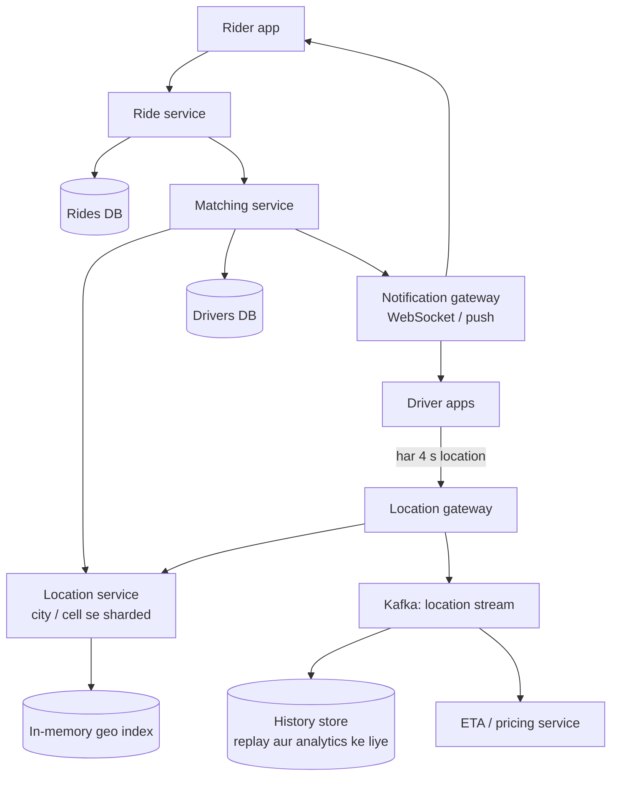

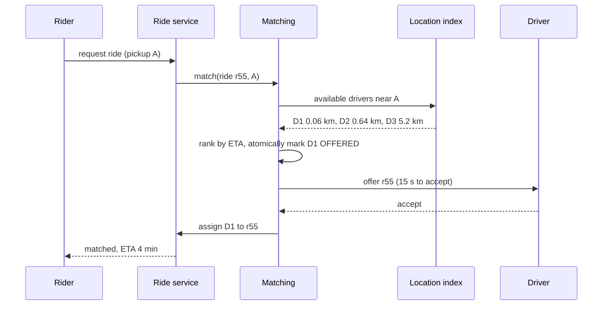

#### Step 6 · Deep dives

**Deep dive 1: paas ke drivers jaldi kaise dhoondhein? (the vault)**

Naive tareeka, "rider se saare 1 million drivers ki distance nikaalo", har request pe O(n) hai. 1,000 requests/s pe ye ek billion distance calculations per second hai. Bilkul nahi.

Trick hai **map ko cells mein kaat do** aur ek dictionary rakho `cell -> us cell ke drivers`. Paas ke drivers dhoondhne ke liye sirf rider ki cell **aur uske padosi cells** mein dekho. Popular cell systems ([Chapter 10](10-storage-search-ids.md) inhe detail mein cover karta hai):
- **Geohash**: longitude aur latitude ko baar-baar aadha karo, bits ko interleave karo (baari-baari jodo), base-32 mein encode karo. Paas ke points aksar ek common prefix share karte hain. 5-character geohash cell lagbhag 4.9 km × 4.9 km hai; 6 characters ≈ 1.2 km × 0.6 km.
- **Quadtree**: jab bhi kisi square mein bahut zyada drivers ho jaayein, use 4 mein tod do. Ghane shehron ko chhoti cells milti hain, registaan ko badi.
- **H3** (Uber ka open-source system): duniya ko kai resolutions pe **hexagons** se tile kiya gaya hai. Hexagon ka har padosi same distance pe hota hai, jisse "mere aas-paas ka ring" wali searches saaf ho jaati hain.

> 🇮🇳 **Desi Analogy:** Geohash bilkul **PIN code** jaisa hai. 560001 aur 560002 dono Bengaluru ke hain, kyunki shuru ke "56" same hain (prefix same = paas paas). Post office poore desh mein letter nahi dhoondhta, woh seedha apne PIN area ke daakiye ko deta hai. Lekin ek dikkat: tumhara ghar agar do PIN codes ki border pe hai, toh sabse paas wala dost border ke us paar, doosre PIN mein, ho sakta hai. Isiliye hum **apni cell + padosi cells** dono dekhte hain. PIN code = cell, PIN ke pehle digits = geohash prefix, border wala dost = neighbour cell wala driver.

```python
import math
from collections import defaultdict

BASE32 = "0123456789bcdefghjkmnpqrstuvwxyz"

def geohash(lat, lon, precision=6):
    """Alternate halving longitude and latitude; every 5 bits become one character."""
    lat_rng, lon_rng = [-90.0, 90.0], [-180.0, 180.0]
    bits, out, even = [], [], True
    while len(out) < precision:
        rng, val = (lon_rng, lon) if even else (lat_rng, lat)
        mid = (rng[0] + rng[1]) / 2
        if val >= mid:
            bits.append(1); rng[0] = mid
        else:
            bits.append(0); rng[1] = mid
        even = not even
        if len(bits) == 5:
            out.append(BASE32[int("".join(map(str, bits)), 2)])
            bits = []
    return "".join(out)

def km_between(a, b):
    """Haversine distance in km."""
    lat1, lon1, lat2, lon2 = map(math.radians, (*a, *b))
    h = math.sin((lat2 - lat1) / 2) ** 2 + math.cos(lat1) * math.cos(lat2) * math.sin((lon2 - lon1) / 2) ** 2
    return 6371 * 2 * math.asin(math.sqrt(h))

drivers = {
    "D1": (12.9716, 77.5946),   # central Bengaluru
    "D2": (12.9750, 77.6000),
    "D3": (12.9352, 77.6245),   # Koramangala
    "D4": (13.1986, 77.7066),   # airport, kaafi door
}
cells = defaultdict(set)        # geohash prefix (5 chars, lagbhag 4.9 km x 4.9 km) -> drivers
for d, (lat, lon) in drivers.items():
    cells[geohash(lat, lon, 5)].add(d)

rider = (12.9720, 77.5950)
cell = geohash(*rider, 5)
print("rider cell:", cell, "| driver cells:", {d: geohash(*p, 5) for d, p in drivers.items()})
nearby = sorted(cells[cell], key=lambda d: km_between(rider, drivers[d]))
for d in nearby:
    print(f"{d} is {km_between(rider, drivers[d]):.2f} km away")
```

```text
rider cell: tdr1v | driver cells: {'D1': 'tdr1v', 'D2': 'tdr1v', 'D3': 'tdr1w', 'D4': 'tdr70'}
D1 is 0.06 km away
D2 is 0.64 km away
```

Abhi kya hua: har driver tak distance naapne ki jagah, humne ek cell dekhi aur sirf uske andar ke drivers ki distance naapi. Dhyaan do, **D3 padosi cell `tdr1w` mein hai**. Agar rider apni cell ke kinaare pe khada hota, toh sabse paas wala driver border ke theek us paar ho sakta tha. Isiliye asli searches hamesha **cell plus uske 8 padosi** check karti hain (ya H3 ke saath hexagons ka ek ring), phir candidates ko actual distance se, ya behtar, **road ETA** se sort karti hain.

> 🤔 **Mann mein sawaal:** Geohash function mein `even` kya kar raha hai, aur 5 bits pe ek character kyun?
>
> **Jawab:** `even` baari-baari batata hai ki is baar longitude aadha karna hai ya latitude. Pehla bit longitude ka, doosra latitude ka, teesra phir longitude ka, aise hi. Har bit ka matlab hai "range ke upar wale aadhe mein ho (1) ya neeche wale mein (0)". Base-32 mein 32 = 2⁵ symbols hote hain, isliye 5 bits milke exactly ek character bante hain. Zyada characters = zyada baar aadha kiya = chhoti cell.

Driver move kare toh **index update karna**: nayi cell nikaalo; agar cell badli hai, toh driver ko purani cell ke set se hatao aur nayi mein daalo. Driver ka aakhri timestamp bhi store karo, aur **jin drivers ka aakhri update ~30 s se purana hai unhe ignore karo** (shayad unka app band ho gaya).

**Deep dive 2: ek driver ko kabhi do baar assign mat karo.**

Do riders ki matching requests ek hi pal mein same nearest driver chun sakti hain. Fix hai driver ki state pe ek **compare-and-set**:

```sql
UPDATE drivers
SET status = 'OFFERED', current_ride = 55, version = version + 1
WHERE driver_id = 1 AND status = 'AVAILABLE' AND version = 12;
-- 1 row updated  -> driver tumhara ho gaya
-- 0 rows updated -> koi aur pehle le gaya; agla candidate try karo
```

Offer ka ek timeout hota hai (maan lo 15 s). Agar driver decline kare ya ignore kare, toh status wapas AVAILABLE ho jaata hai aur matching service agle candidate pe chali jaati hai. Matching khud bhi **per-city single-threaded** ho sakti hai (har region ka ek owner jo requests order mein process karta hai), jisse zyaadatar contention khatam hi ho jaata hai. Dispatch systems mein ye trick kaafi use hoti hai.

> 🇮🇳 **Desi Analogy:** Compare-and-set ek **auto stand ke dispatcher** jaisa hai jiske register mein har auto ke saamne likha hai "khaali" ya "booked". Do sawaari ek saath aayi, dono ne bola "woh peela auto chahiye". Dispatcher register mein ek hi baar likh sakta hai: "khaali hai? toh booked kar do" ek hi jhatke mein. Jo pehle pahuncha, uske liye "khaali" mila aur booked ho gaya. Doosre ke liye register mein ab "booked" hai, toh use agla auto milta hai. Check aur likhna ek hi step mein, beech mein koi ghus nahi sakta.

**Deep dive 3: sharding by geography.** Rides local hoti hain: Mumbai ke rider ko kabhi Delhi ka driver nahi chahiye. Location aur matching services ko **city ya badi cell se shard** karo, taaki har shard chhota, tez aur independent rahe. Cell IDs pe [consistent hashing](05-replication-sharding.md) use karke cells ko servers pe assign karo. Cell boundary cross karne wale drivers shards ke beech move hote hain (ek remove + ek add).

**Deep dive 4: ETA and pricing.** Seedhi line ki distance jhooth bolti hai (nadiyan, one-way sadkein). Candidates ko ek routing service ke road-network ETA se rank karo (graph shortest paths, [Part 2 Chapter 17](../part-2-dsa/17-graphs-advanced.md), precomputation tricks ke saath). Surge pricing har cell ke liye pichhle kuch minute ki demand (requests) aur supply (available drivers) compare karti hai, jo ek stream processor location aur request streams padh ke nikaalta hai.

#### Step 7 · Bottlenecks and trade-offs

- **Location write storm** (250k/s): in-memory index, hot path pe disk nahi; history Kafka → batch storage mein jaati hai.
- **Hot cells** (airport, match ke baad stadium): jahan density zyada hai wahan finer cells (higher resolution) use karo, ya ek quadtree jo ghane areas ko tod de.
- **Trade-off:** location freshness vs battery/bandwidth (har 4 s update vs 1 s). Adaptive: trip pe ho ya tez chal rahe ho toh zyada baar update.
- **Trade-off:** assignment ke liye consistency strict (SQL / CAS), locations ke liye relaxed (in-memory, eventually consistent).

#### Follow-up questions

- *"What if the location service node for Bengaluru dies?"* Har shard ke replicas; drivers waise bhi har 4 s location dobara bhejte hain, toh ek fresh node kuch hi second mein poora index rebuild kar leta hai. Data **self-healing** hai.
- *"How would you do ride pooling?"* Matching routes pe ek optimisation ban jaati hai: aisa driver dhoondho jo pehle se trip pe hai aur jiska tumhe pick karne ke liye detour chhota hai. Kaafi mushkil; requests ko har kuch second mein batch karo aur ek matching problem solve karo.
- *"Why not just use a SQL database with a spatial index?"* PostGIS radius queries ka jawab de sakta hai, lekin on-disk index pe 250k updates/s hi bottleneck hai. Garam "current location" data ke liye memory jeet-ti hai.

---

### 6. Web Crawler (Googlebot, Common Crawl)

**Kahani:** Google ko poora internet "padhna" hai. Koi list nahi hai ki internet pe kaunse pages hain. Bas kuch shuruaati pages (seeds) hain. Unhe padho, unke andar ke links dekho, un links pe jaao, wahan ke links dekho... arbon pages tak. Aur ye sab bina kisi chhoti website ko crash kiye, bina ek hi page ko baar baar padhe, aur bina kisi "agla mahina, agla mahina..." wale calendar mein hamesha ke liye phanse.

#### Step 1 · Requirements

**Functional**
- **Seed URLs** se shuru karo, pages download karo, links nikaalo, unhe follow karo, repeat.
- Page content store karo taaki indexer (search engine) use process kar sake.
- Content fresh rakhne ke liye pages periodically re-crawl karo.

**Non-functional**
- **Scale**: arbon (billions) pages.
- **Politeness**: kabhi kisi website ko overload mat karo; `robots.txt` ki izzat karo.
- **Robustness**: toota-phoota HTML, slow servers, infinite **crawler traps** (calendars jinmein "next month" ke links kabhi khatam nahi hote), duplicate content, sab jhel jaao.
- **Extensibility**: baad mein naye content types (images, PDFs).

#### Step 2 · Estimates

| Quantity | Assumption | Result |
|---|---|---|
| Pages per month | 1 billion | 1 × 10⁹ / (30 × 86,400) ≈ **400 pages/s**, peak ≈ 800/s |
| Average page size | 100 KB (HTML) | 100 TB/month; ≈ **5 saal mein 6 PB** (compressed: kaafi kam) |
| URLs discovered | ~50 links per page | 50 billion URL sightings/month → dedup fast hona chahiye |
| URL-seen set | 10 billion URLs × ~8-byte hash | ≈ 80 GB, ya Bloom filter se uska ek chhota hissa |

Numbers kya bolte hain: 400 fetches/s chhota lagta hai, lekin ek fetch mein kai second lag sakte hain (slow servers), isliye humein kai workers mein **hazaaron concurrent connections** chahiye. Arbon URLs pe dedup ke liye compact structures chahiye (machines mein sharded hash sets, ya Bloom filters, [Chapter 10](10-storage-search-ids.md)).

> 🤔 **Mann mein sawaal:** 400 pages/s ke liye hazaaron connections? Ye toh ulta lagta hai.
>
> **Jawab:** Little's Law phir se. Ek saath chal rahe fetches = (fetches per second) × (har fetch ka time). Agar ek slow server ko jawab dene mein average 5 second lagte hain, toh 400 × 5 = 2,000 fetches ek saath "hawa mein" honge. Peak 800/s aur kuch 10-second wale servers ho toh aur zyada. Isliye concurrency rate se kahin badi hoti hai.

#### Step 3 · API

Crawler zyaadatar ek internal pipeline hai, isliye uska "API" uske components ke interfaces hain:

```text
frontier.add(url, priority)                 -> enqueue if not seen
frontier.next() -> url                      -> respects per-host delays
fetcher.fetch(url) -> (status, headers, body)
parser.extract_links(body, base_url) -> [url]
store.put(url, content_hash, body, fetched_at)
Admin: POST /v1/seeds  {"urls": [...]}       GET /v1/stats
```

#### Step 4 · Data model

```sql
CREATE TABLE url_state (            -- hash(url) se sharded; har known URL ki ek row
    url_hash      BIGINT PRIMARY KEY,
    url           TEXT,
    host          TEXT,
    last_fetched  TIMESTAMP,
    next_fetch_at TIMESTAMP,        -- re-crawl schedule
    status_code   INT,
    content_hash  CHAR(64),
    priority      REAL
);
```

Page bodies **object storage** (ya distributed file system) mein, bade batched files mein, URL hash se keyed jaati hain. `robots.txt` rules har host ke liye memory mein TTL ke saath cached rehte hain. DNS answers bhi cache hote hain (crawl scale pe DNS lookups ek surprise bottleneck hain).

#### Step 5 · High-level design

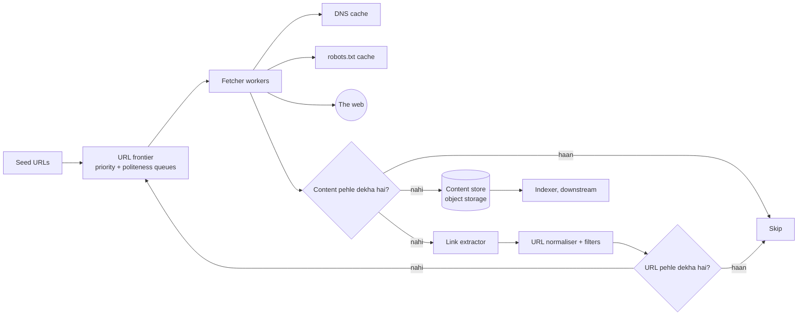

#### Step 6 · Deep dives

**Deep dive 1: dedup aur robots ke saath crawl loop.** Dil se dekho toh crawler **web graph pe BFS** hai ([Part 2 Chapter 16](../part-2-dsa/16-graphs-bfs-dfs.md)), do tarah ke "visited" sets ke saath: ek URLs ke liye (same link do baar queue mat karo) aur ek content ke liye (do alag URLs jo same page serve karte hain).

```python
import hashlib
from collections import deque
from urllib.parse import urlparse

# Ek nakli, in-memory "internet": url -> (page text, bahar jaate links)
WEB = {
    "https://a.com/":      ("welcome to a", ["https://a.com/blog", "https://b.com/", "https://a.com/admin"]),
    "https://a.com/blog":  ("a blog post",  ["https://a.com/", "https://b.com/copy"]),
    "https://a.com/admin": ("secret",       []),
    "https://b.com/":      ("b home",       ["https://b.com/copy", "https://c.com/"]),
    "https://b.com/copy":  ("a blog post",  []),        # a.com/blog jaisa hi content
    "https://c.com/":      ("c home",       ["https://a.com/"]),
}
ROBOTS_DISALLOW = {"a.com": ["/admin"]}

def allowed(url):
    p = urlparse(url)
    return not any(p.path.startswith(rule) for rule in ROBOTS_DISALLOW.get(p.netloc, []))

def crawl(seeds, max_pages=10):
    frontier = deque(seeds)            # fetch karne wale URLs ki BFS queue
    seen_urls = set(seeds)             # URL dedup ("kya maine ise queue kar diya hai?")
    seen_content = set()               # content dedup ("kya maine ye text store kar diya hai?")
    order = []
    while frontier and len(order) < max_pages:
        url = frontier.popleft()
        if not allowed(url):
            order.append(f"SKIP (robots) {url}")
            continue
        text, links = WEB.get(url, ("", []))
        fingerprint = hashlib.sha256(text.encode()).hexdigest()
        if fingerprint in seen_content:
            order.append(f"DUPLICATE     {url}")
            continue
        seen_content.add(fingerprint)
        order.append(f"STORED        {url}")
        for link in links:
            if link not in seen_urls:
                seen_urls.add(link)
                frontier.append(link)
    return order

for line in crawl(["https://a.com/"]):
    print(line)
```

```text
STORED        https://a.com/
STORED        https://a.com/blog
STORED        https://b.com/
SKIP (robots) https://a.com/admin
DUPLICATE     https://b.com/copy
STORED        https://c.com/
```

Abhi kya hua: `c.com` wapas `a.com/` ko link karta hai, lekin woh pehle se `seen_urls` mein tha, toh hum infinite loop mein nahi phanse. `b.com/copy` ka text bilkul `a.com/blog` jaisa tha, toh uska content hash match ho gaya aur humne use dobara store nahi kiya. `/admin` robots rules ne block kar diya. Production mein exact hashes bilkul same pages pakadte hain; **near-duplicates** (same article, alag ads) ke liye **SimHash** jaise similarity fingerprints chahiye.

Order bhi dhyaan se dekho: BFS hai, toh pehle `a.com/` ke teeno links (`blog`, `b.com/`, `admin`) aate hain, phir unke links. Isiliye `a.com/admin` (level 1) `b.com/copy` (level 2) se pehle aaya.

**Deep dive 2: politeness, the URL frontier (the vault).**

Agar tumhare 1,000 workers ek bade queue se agle 1,000 URLs utha lein, aur unmein se 900 `wikipedia.org` ke hon, toh tumne Wikipedia pe hamla kar diya. Classic frontier design (Mercator crawler se) ki do layers hain:
- **Front queues**, **priority** se ordered (PageRank jaisi importance, page kitni baar badalta hai).
- **Back queues**: **har host ki ek queue**. Ek heap har host ka "agla fetch sabse jaldi kab allowed hai" time rakhta hai. Worker us host ko pop karta hai jiska time aa gaya, usse ek URL fetch karta hai, aur host ko `time + delay` ke saath wapas push kar deta hai.

> 🇮🇳 **Desi Analogy:** Ye bilkul **chai tapri pe ek akela chaiwala** hai jise 10 offices mein chai pahunchani hai. Agar woh ek office ki saari 30 cutting chai ek saath le jaaye, toh baaki 9 office wale intezaar karte rahenge, aur woh pehla office ka peon bhi pareshan ki itni chai kahan rakhe. Samajhdaar chaiwala har office ka ek alag thermos (per-host queue) rakhta hai, aur ek diary (heap) mein likhta hai "Office A mein agli baar 2 minute baad jaana hai". Har chakkar mein woh us office jaata hai jiska time ho gaya, ek round deta hai, aur diary mein agla time likh deta hai. Har office ko barabar, aaram se chai milti hai, aur chaiwala kabhi khaali nahi baithta.

```python
import heapq
from collections import deque, defaultdict
from urllib.parse import urlparse

DELAY = 2   # same host pe do requests ke beech kitne seconds rukna hai (simulated clock)

urls = ["https://a.com/1", "https://a.com/2", "https://a.com/3",
        "https://b.com/1", "https://b.com/2", "https://c.com/1"]

host_queues = defaultdict(deque)            # har host ki ek FIFO "back queue"
for u in urls:
    host_queues[urlparse(u).netloc].append(u)

ready = [(0, host) for host in host_queues]  # min-heap: (host ko agli baar kab hit kar sakte hain, host)
heapq.heapify(ready)

while ready:
    t, host = heapq.heappop(ready)
    url = host_queues[host].popleft()
    print(f"t={t}s fetch {url}")
    if host_queues[host]:                    # host ke paas abhi kaam bacha hai: DELAY ke baad wapas aao
        heapq.heappush(ready, (t + DELAY, host))
```

```text
t=0s fetch https://a.com/1
t=0s fetch https://b.com/1
t=0s fetch https://c.com/1
t=2s fetch https://a.com/2
t=2s fetch https://b.com/2
t=4s fetch https://a.com/3
```

Abhi kya hua: teeno `a.com` URLs pehle queue hue the, phir bhi crawler ne hosts ko interleave kiya (baari-baari) aur same host ko 2 second ke andar kabhi do baar hit nahi kiya. Arbon URLs aur crore-on hosts ke paar, ye har worker ko busy rakhta hai aur har site ke saath polite bhi rehta hai.

> 🤔 **Mann mein sawaal:** t=0 pe teen fetches ek saath kaise? Kya woh bhi "impolite" nahi hai?
>
> **Jawab:** Nahi, kyunki teeno **alag hosts** hain (a.com, b.com, c.com). Politeness ka rule per-host hai: "ek host pe 2 second mein ek se zyada nahi". Alag-alag hosts ko ek saath hit karna bilkul theek hai, aur yahi throughput ka raaz hai. Heap mein ties `(0, "a.com")`, `(0, "b.com")`, `(0, "c.com")` host naam se alphabetical tootti hain, isliye a, b, c order.

**Deep dive 3: distributing the crawl.** URLs ko **host se** (hostname ka hash) crawler nodes mein partition karo. Tab har host ki politeness queue exactly ek node pe rehti hai, aur host ko rate-limit karne ke liye koi coordination nahi chahiye. Doosre hosts ke liye mile links unke owner node ko batches mein forward kar diye jaate hain.

**Deep dive 4: traps and freshness.**
- **Traps**: URL length aur path depth pe cap, har crawl mein har host ke pages pe cap, repeat hote path patterns pakdo (`/a/b/a/b/a/b`), URLs normalise karo (host lowercase, `#fragments` hatao, query params sort karo, session IDs hatao).
- **Freshness**: news homepages har minute badalte hain, 2009 ka blog post kabhi nahi. Adaptive intervals se re-crawl karo: agar page pichhli baar se badla hai toh uska interval chhota karo; nahi badla toh lamba. Na badle pages dobara download na karne ke liye HTTP `If-Modified-Since` / `ETag` use karo.

#### Step 7 · Bottlenecks and trade-offs

- **DNS** resolution: aggressively cache karo, apne resolvers chalao.
- 10B entries pe **URL-seen set**: hash se shard karo; Bloom filter ek chhote false-positive rate (kabhi kabhaar ek kabhi-na-dekha URL skip ho jaana) ke badle mein badi memory bachata hai. Crawler ke liye kuch naye URLs skip hona acceptable hai; yahi trade-off zor se bolna hai.
- **Trade-off:** BFS breadth (coverage) vs priority (quality). Priority queues zaroori pages ko pehle jaane deti hain.
- **Trade-off:** politeness vs throughput. Iska fix: **bahut saare hosts parallel mein** crawl karo, ek host ko tez nahi.

#### Follow-up questions

- *"How would you crawl JavaScript-heavy pages?"* Headless browsers ka ek alag, dheema pool un pages ke liye jinhe rendering chahiye; zyaadatar pages ko nahi chahiye.
- *"How do you prioritise what to crawl?"* Link-based importance (PageRank jaisa), domain quality, change rate, aur freshness ki zaroorat.
- *"How do you make the crawler resumable after a crash?"* Frontier persisted hai (disk-backed queues / Kafka), aur `url_state` record karta hai kya fetch hua. Workers stateless hain; restart karo aur aage chalo.

---

### 7. Search Autocomplete / Typeahead (Google search box)

**Kahani:** tum Google pe "i" type karte ho. Turant neeche "instagram", "india"... aa jaata hai. "n" dabaya, list badal gayi. "d" dabaya, phir badli. Har keystroke pe ek nayi request, crore-on logon ki, aur har jawab palak jhapakne se pehle. Yahan tez hona hi feature hai.

#### Step 1 · Requirements

**Functional**
- User type karta jaaye, aur typed prefix se shuru hone wale **top 5–10 suggestions** dikhein.
- Popularity se ranked (log inhe kitni baar search karte hain), shayad personalised aur trending bhi.
- (Park karo: spelling correction, multiple languages.)

**Non-functional**
- **Bahut kam latency**: end-to-end ~100 ms se kam, warna laggy lagta hai. Server ka hissa kuch milliseconds ka hona chahiye.
- **Bahut zyada QPS**: har keystroke pe ek request.
- Highly available; suggestions thode purane chal sakte hain (hourly ya daily update theek hai; trending tez ho sakta hai).

#### Step 2 · Estimates

| Quantity | Assumption | Result |
|---|---|---|
| DAU | 100 million | |
| Searches per user per day | 10 | 10⁹ searches/day |
| Suggestion requests per search | ~6 (debouncing ke saath) | 6 × 10⁹/day ≈ **70,000 QPS**, peak ≈ **150,000 QPS** |
| Index karne wale distinct popular phrases | ~100 million | |
| Data size | 100M phrases × ~30 bytes + counts | phrases ke liye kuch GB; cached top-k wala trie bada hai, lagbhag dasiyon GB |

Numbers kya bolte hain: 150k QPS aur kuch-ms ka budget ka matlab hai **sab kuch memory mein**, results **pehle se computed**, aur bhaari **caching** (browser cache, CDN, server cache: prefix "a" crore-on baar maanga jaata hai).

#### Step 3 · API

```text
GET /v1/suggest?q=ind&limit=5&lang=en
-> {"prefix": "ind", "suggestions": ["india", "indigo flight status", "india vs australia", ...]}
```

Chhote prefixes ke responses sabke liye same hote hain (non-personalised), isliye unhe browser aur CDN pe `Cache-Control: max-age=...` ke saath cache kiya ja sakta hai.

#### Step 4 · Data model

- **Raw data**: search logs (`query, timestamp, user, region`) Kafka pe stream hote hain aur ek data lake mein store hote hain.
- **Aggregated counts**: har time window ke liye `(phrase, count)`, ek batch job se nikaale (jaise weekly decay-weighted counts).
- **Serving structure**: ek **trie** jiska har node apne top-k phrases cache karta hai, serialise karke suggestion servers ki memory mein load kiya jaata hai. Alternative: ~20 length tak ke har prefix ke liye ek key-value store `prefix -> [top-k phrases]`.

#### Step 5 · High-level design

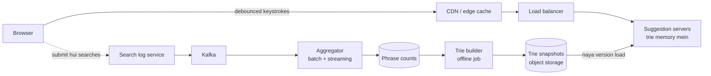

Key split: ek **read path** (read-only, in-memory trie se serve karo) aur ek **write path** (logs → aggregation → naya trie banao → swap kar do). Ye dono kabhi ek doosre ko block nahi karte.

#### Step 6 · Deep dives

**Deep dive 1: the trie with cached top-k (the vault).**

Ek plain trie ([Part 2 Chapter 19](../part-2-dsa/19-tries.md)) prefix node ko O(length of prefix) mein dhoondh leta hai, lekin phir top results ke liye tumhe **poora subtree** ghoomna padega. "a" ke neeche crore-on phrases hain. Bahut slow.

Fix: build time pe **har node pe top-k phrases** store kar do. Tab query bas itni hai: prefix node tak chalo (≤ 20 steps), uski list return karo. **O(prefix length)**, koi subtree search nahi.

> 🇮🇳 **Desi Analogy:** Ek bade **kirana store** ke har aisle ke shuru mein ek board laga hai: "Is aisle ke 3 sabse zyada bikne wale items". Tum "Biscuits" aisle mein ghuse, board pe likha hai: Parle-G, Good Day, Marie. Tumhe poori aisle ghoomni nahi padi. Aur "Biscuits → Cream biscuits" wali chhoti shelf pe bhi apna alag board hai. Har board raat ko dukaan band hone ke baad update hota hai (offline rebuild), din mein nahi. Aisle/shelf = trie node, board = cached top-k, raat ka update = offline build.

```python
class TrieNode:
    __slots__ = ("children", "top")
    def __init__(self):
        self.children = {}
        self.top = []           # is prefix ke liye cached top-k (count, phrase)

class Autocomplete:
    def __init__(self, k=3):
        self.root = TrieNode()
        self.k = k

    def build(self, counts):
        """Offline job: insert every phrase, then cache the top-k at every node."""
        for phrase, count in counts.items():
            node = self.root
            for ch in phrase:
                node = node.children.setdefault(ch, TrieNode())
                node.top.append((count, phrase))
        self._trim(self.root)

    def _trim(self, node):
        node.top = sorted(node.top, key=lambda x: (-x[0], x[1]))[: self.k]
        for child in node.children.values():
            self._trim(child)

    def suggest(self, prefix):
        """Online path: walk len(prefix) nodes, read the cached list. No subtree search."""
        node = self.root
        for ch in prefix:
            node = node.children.get(ch)
            if node is None:
                return []
        return [phrase for _, phrase in node.top]

search_log_counts = {
    "india": 900, "indigo flight status": 700, "india vs australia": 650,
    "indian railways": 500, "instagram": 950, "inshorts": 120, "iphone 16": 800,
}
ac = Autocomplete(k=3)
ac.build(search_log_counts)
for prefix in ["i", "in", "ind", "indi", "ip", "xyz"]:
    print(f"{prefix!r:7} -> {ac.suggest(prefix)}")
```

```text
'i'     -> ['instagram', 'india', 'iphone 16']
'in'    -> ['instagram', 'india', 'indigo flight status']
'ind'   -> ['india', 'indigo flight status', 'india vs australia']
'indi'  -> ['india', 'indigo flight status', 'india vs australia']
'ip'    -> ['iphone 16']
'xyz'   -> []
```

Abhi kya hua: har node ne build time pe apne best 3 jawab yaad kar liye, isliye `suggest("in")` ne ek bhi phrase nahi dekha; usne bas do nodes chale aur ek list padh li. Humne **speed** ke badle **memory** (har node pe top-k ki copy) aur **freshness** (rebuild chahiye) di. Yahi classic autocomplete trade-off hai, aur inhi shabdon mein bolna points dilata hai.

Ek detail dekho: `'i'` ke liye "iphone 16" (800) aaya, "indigo flight status" (700) nahi, kyunki 800 > 700. Lekin `'in'` mein "iphone" ka raasta hi nahi hai ("ip" alag branch hai), toh wahan teesra number "indigo" ka aaya. Har node apni subtree ka hi top-k jaanta hai.

> 🤔 **Mann mein sawaal:** `build` mein har node pe saare phrases append ho rahe hain. Root ke `top` mein toh 100 million entries ho jaayengi! Memory?
>
> **Jawab:** Sahi pakda. Ye demo simple rakhne ke liye hai: pehle sab append, phir `_trim` sab kaat ke k pe le aata hai. Asli builders ye galti nahi karte: woh trie ko bottom-up bharta hai (har node ka top-k = apne bachchon ke top-k lists ka merge, phir k pe kaato), ya insert karte waqt hi ek size-k min-heap rakhta hai. Isse kisi bhi pal har node pe sirf k entries rehti hain. Interview mein ye ek line bolna strong signal hai.

**Deep dive 2: updating the data.** Har search pe live trie update mat karo (150k QPS pe padhe ja rahe structure mein 150k writes/s daalna dard hai). Iski jagah:
1. Searches ko Kafka mein log karo.
2. Counts aggregate karo (daily/weekly batch, time decay ke saath taaki pichhla hafta pichhle saal se zyada count kare).
3. Offline ek fresh trie banao, snapshot store karo, aur servers use **load karke atomically swap** karein (blue/green style).
4. **Trending** queries ke liye ("earthquake" abhi spike kar raha hai), ek chhota streaming job chalao jo pichhle kuch minute gine aur stable results ke upar ek "trending" list merge kare.

**Deep dive 3: scaling and sharding.** Agar trie ek machine mein aa jaata hai (dasiyon GB, haan, ek badi machine mein), toh bas use load balancer ke peeche kai servers pe **replicate** kar do. Agar nahi aata, toh **prefix range** se shard karo (a–f, g–m, ...) lekin skew se bacho ("x" se kahin zyada words "s" se shuru hote hain); alphabet nahi, measured traffic dekh ke shard karo.

**Deep dive 4: client-side tricks** (ye load ko massively kaat-te hain):
- **Debounce**: aakhri keystroke ke baad ~100–150 ms ruko, phir bhejo.
- Browser mein results **cache** karo: "ind" type kiya, mita ke "in" kiya, phir "ind" type kiya, toh nayi request ki zaroorat nahi.
- **Prefetch**: ek response mein agle likely characters ke top results bhi aa sakte hain.
- Naya keystroke aaye toh in-flight requests cancel karo, aur purane responses ignore karo (responses ulte order mein bhi aa sakte hain!).

> 🇮🇳 **Desi Analogy:** Debounce = **lift ka darwaaza**. Darwaaza har aadmi ke ghusne pe band hoke upar nahi jaata. Woh thoda rukta hai, ki koi aur toh nahi aa raha. Jab kuch pal tak koi nahi aaya, tab band hota hai. Waise hi, tum "india vs" tez type kar rahe ho toh har akshar pe request nahi jaati; tum ~120 ms ruke, tab ek request gayi.

#### Step 7 · Bottlenecks and trade-offs

- Har node pe top-k ki memory: k limit karo (5–10), depth limit karo (~20–30 chars se lambe prefixes rare hain), aur popularity threshold se neeche ke phrases hata do.
- **Trade-off:** freshness (rebuild frequency) vs cost/complexity. Hourly ya daily rebuild + streaming trending layer.
- **Personalisation** caching tod deta hai (har user ka jawab alag). Common compromise: cache se global top-20 lo, server pe ek halke personal signal se re-rank karo.
- Filtering: offensive ya khatarnak suggestions build time pe hi hatao (builder ek blocklist lagata hai).

#### Follow-up questions

- *"How do you support typos ('instgram')?"* Ek chhote candidate set pe edit distance ke saath fuzzy matching ([Part 2 Chapter 21](../part-2-dsa/21-dp-2d-advanced.md)), ya ek alag spelling-correction service.
- *"How do you handle multiple languages?"* Har language/region ke liye alag tries; `lang` parameter se route karo.
- *"Why not just use Elasticsearch prefix queries?"* Chhote scale pe chalta hai aur flexible hai, lekin 150k QPS aur kuch-ms budget pe precomputed in-memory top-k structure kahin sasta hai.

---
### 8. E-commerce Checkout with Inventory and Payments (shorter)

Ye scale ke baare mein kam aur **correctness** ke baare mein zyada hai: jo item tumhare paas nahi hai use kabhi mat becho, customer ko kabhi do baar charge mat karo, kabhi koi order mat khoo.

> 🇮🇳 **Desi Analogy:** Big Billion Day sale ki raat yaad karo. Ek phone ke sirf 100 piece hain aur 10 lakh log "Buy" daba rahe hain. Agar 101wa banda bhi "order confirmed" dekh le, toh kal customer care pe hungama. Aur agar UPI ka payment ghoom raha hai aur tumne ghabra ke dobara "Pay" daba diya, toh paise do baar nahi katne chahiye. Checkout ka vault yahi do cheezein hain: **oversell nahi**, **double charge nahi**.

#### Requirements and estimates

- **Functional**: cart → checkout → inventory reserve → pay → order banao → confirm. Cancel/refund.
- **Non-functional**: inventory aur payments ke liye **strong consistency**, charges ke liye exactly-once *effect*, browsing ke liye high availability (jo eventually consistent aur cached ho sakti hai).
- **Estimates**: 10 million orders/day ≈ **120 orders/s** average; flash sale mein gine-chune products pe ye **10,000+/s** tak spike kar sakta hai. Total rate modest hai; khatra hai **kuch hot rows pe contention**.

#### API

```text
POST /v1/checkout        {"cart_id": "c9", "address_id": "a1", "idempotency_key": "7f3e-..."}
  -> {"order_id": "o123", "status": "PENDING_PAYMENT", "payment_url": "..."}
POST /v1/payments/webhook   (from the payment gateway: success / failure, signed)
GET  /v1/orders/o123     -> {"status": "CONFIRMED", ...}
```

#### Data model

```sql
CREATE TABLE inventory (
    sku       VARCHAR(32) PRIMARY KEY,
    available INT NOT NULL CHECK (available >= 0),
    reserved  INT NOT NULL DEFAULT 0,
    version   INT NOT NULL
);

CREATE TABLE orders (
    order_id        BIGINT PRIMARY KEY,
    user_id         BIGINT NOT NULL,
    status          VARCHAR(20),   -- PENDING_PAYMENT, CONFIRMED, CANCELLED, REFUNDED
    total_paise     BIGINT NOT NULL,
    idempotency_key VARCHAR(64) UNIQUE,   -- retry hua checkout wahi purana order dhoondh leta hai
    created_at      TIMESTAMP
);

CREATE TABLE payments (
    payment_id     BIGINT PRIMARY KEY,
    order_id       BIGINT REFERENCES orders(order_id),
    gateway_ref    VARCHAR(64) UNIQUE,    -- gateway ki ID; dobara aaya webhook kuch nahi karta
    status         VARCHAR(12),
    amount_paise   BIGINT
);
```

#### High-level design

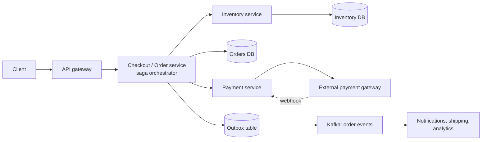

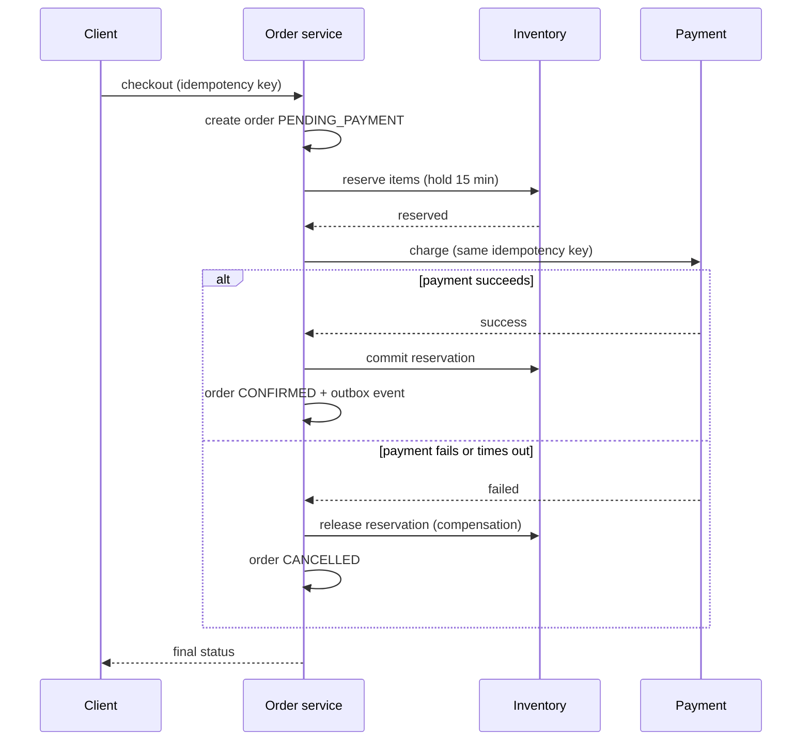

#### Deep dives

**1. Oversell mat karo: optimistic locking.** Do buyers ek hi waqt "1 left" padhte hain. Agar dono phir "0 left" likh dein, toh tumne do items bech diye jo tumhare paas the hi nahi (ye hai **lost update**, [Chapter 03](03-databases.md)). Write ko **conditional** banao:

```python
class Inventory:
    """Optimistic concurrency: every row has a version; an update only wins if the version is unchanged."""

    def __init__(self):
        self.rows = {"sku-42": {"stock": 1, "version": 7}}

    def read(self, sku):
        row = self.rows[sku]
        return row["stock"], row["version"]

    def decrement_if_version(self, sku, expected_version):
        # SQL: UPDATE inventory SET stock = stock - 1, version = version + 1
        #      WHERE sku = ? AND version = ? AND stock > 0
        row = self.rows[sku]
        if row["version"] != expected_version or row["stock"] <= 0:
            return False
        row["stock"] -= 1
        row["version"] += 1
        return True

inv = Inventory()
stock_a, ver_a = inv.read("sku-42")      # buyer A padhta hai: 1 bacha, version 7
stock_b, ver_b = inv.read("sku-42")      # buyer B usi waqt wahi cheez padhta hai
print("A sees", stock_a, "B sees", stock_b)
print("A buys:", inv.decrement_if_version("sku-42", ver_a))
print("B buys:", inv.decrement_if_version("sku-42", ver_b))   # version ab 8 hai, toh B haar gaya
print("final row:", inv.rows["sku-42"])
```

```text
A sees 1 B sees 1
A buys: True
B buys: False
final row: {'stock': 0, 'version': 8}
```

Abhi kya hua: dono buyers ne stock 1 dekha, lekin sirf pehla conditional update `version = 7` se match hua. B ka update zero rows se match hua, toh B ko oversold order ki jagah "sorry, sold out" milta hai. Simple counters ke liye tum version chhod ke seedha `UPDATE ... SET available = available - 1 WHERE sku = ? AND available > 0` likh sakte ho, jo database atomically chalata hai.

> 🇮🇳 **Desi Analogy:** Version number ek **kirana store ke khata register ka page number** jaisa hai. Do bhai ek saath register dekhte hain: "Page 7: 1 kilo cheeni bachi". Dono apni parchi pe likhte hain "page 7 pe hoon, 1 kilo le jaa raha hoon". Pehla bhai counter pe pahuncha, lala ji ne cheeni di aur nayi entry page 8 pe likh di. Doosra bhai pahuncha, parchi pe "page 7" likha hai, lekin register ab page 8 pe hai. Lala ji bolte hain: "beta, tumhari jaankari purani hai, cheeni khatam." Koi lock nahi lagaya, bas likhte waqt check kiya ki tumne jo dekha tha woh abhi bhi sach hai.

> 💡 **Optimistic vs pessimistic.** Optimistic (version check) tab badhiya hai jab conflicts kam hon. Ek **flash sale** mein jahan 10,000 log 100 units ke liye lad rahe hain, zyaadatar attempts fail hoke retry karte hain. Wahan pessimistic row locks (`SELECT ... FOR UPDATE`) use karo, ya behtar, hot counter ko Redis mein atomic `DECR` (ya ek Lua script) ke saath gatekeeper bana ke rakho, aur sirf jeetne walon ko database tak jaane do. Kuch systems buyers ko ek **queue** mein bhi daal dete hain aur order se process karte hain.

**2. Kabhi do baar charge mat karo: idempotency keys.** Client har checkout attempt ke liye ek `idempotency_key` banata hai. Server use UNIQUE constraint ke saath store karta hai. Retry hui request (user ne double-click kiya, network timeout hua) maujooda order dhoondh ke wahi return karti hai, naya nahi banati. Wahi key payment gateway ko bhi pass hoti hai, jo khud bhi deduplicate karta hai. Webhooks `gateway_ref` se deduplicate hote hain.

**3. Kai services, koi distributed transaction nahi: the saga.** Inventory, orders aur payments alag services hain, alag databases ke saath, isliye unke paar ek single ACID transaction available nahi hai (two-phase commit exist karta hai, par slow aur naazuk hai). **Saga** local transactions ka ek sequence hai, jismein har step ka ek **compensating action** hota hai agar baad wala step fail ho: reserve → charge → confirm; agar charge fail hua, toh reservation release karo. Events **outbox pattern** se reliably publish hote hain ([Chapter 08](08-queues-events.md)): order row aur event row ek hi local transaction mein likho, aur ek relay event ko Kafka pe publish karta hai.

> 🇮🇳 **Desi Analogy:** Saga ek **shaadi ki booking** jaisa hai. Pehle hall book kiya (step 1), phir caterer (step 2), phir band-baaja (step 3). Teeno alag vendors, ek saath sabko "lock" karne wala koi jaadu nahi. Agar band wala mana kar de aur shaadi cancel karni pade, toh tum ulte order mein **compensate** karte ho: caterer ka advance wapas maango, hall cancel karo. Har vendor ke saath alag deal (local transaction), aur fail hone pe har ek ka "undo" (compensating action).

**4. Payment timeouts.** Gateway call time out ho gayi: kya charge hua? Tumhe nahi pata! Kabhi assume mat karo. Payment ko `UNKNOWN` mark karo, phir decide karne se pehle idempotency key se **gateway se poochho** (ya webhook ka intezaar karo). Reservations ~15 minute mein expire ho jaati hain taaki atke hue checkouts stock ko hamesha ke liye lock na kar dein.

> 🤔 **Mann mein sawaal:** Timeout aaya matlab fail hua, na? Toh seedha dobara charge kar do.
>
> **Jawab:** Bilkul nahi, yahi sabse mehengi galti hai. Timeout ka matlab sirf itna hai ki **jawab nahi aaya**. Ho sakta hai bank ne paise kaat liye aur "success" wala reply raaste mein kho gaya. UPI mein tumne dekha hoga: "payment pending, 48 ghante mein update hoga". Yahi `UNKNOWN` state hai. Pehle status poochho, phir decide karo.

#### Trade-offs and follow-ups

- **Add-to-cart pe reserve karein ya checkout pe?** Add-to-cart pe reserve karne se un logon ke liye stock lock hota hai jo kabhi khareedte hi nahi. Zyaadatar dukaanein checkout pe chhote expiry ke saath reserve karti hain.
- **Consistency split**: product pages aur stock badges ("only 3 left!") cache ho sakte hain aur thode purane ho sakte hain; final `UPDATE` hi source of truth hai.
- *"How do you handle a flash sale?"* Stock Redis mein pre-load karo, admission control ke liye atomic decrement, aage ek waiting-room queue, har user pe rate limiting, static content CDN pe.

---

### 9. Ticket Booking with Seat Locking (BookMyShow, Ticketmaster) (shorter)

Vault: **do log same millisecond pe seat A2 click karte hain**. Exactly ek ko jeetna chahiye, aur haarne wale ko turant pata chalna chahiye. Upar se, jeetne wale ko pay karne ke liye kuch minute chahiye, bina is darr ke ki koi aur seat le jaaye.

> 🇮🇳 **Desi Analogy:** Ye **IRCTC Tatkal** ki subah 10 baje wali rush hai. Lakhon log ek saath same train ki seats pe toot padte hain. Tumne seat chuni, toh system use tumhare liye kuch minute **hold** karta hai jab tak tum payment karo. Payment time pe nahi kiya? Seat wapas pool mein. Hold = temporary lock, hold ka timer = expiry, "seat not available" = 409 Conflict.

#### Requirements and estimates

- **Functional**: shows browse karo → seat map dekho → seats select karo → unhe ~10 minute ke liye **hold** karo → pay karo → booked. Pay na karo toh holds apne aap expire.
- **Non-functional**: **double booking kabhi nahi** (har seat pe strong consistency), seat map kuch second purana chal sakta hai, hit concert ke "on-sale" spikes jhel jaao.
- **Estimates**: normal load chhota hai (poore desh mein kuch sau bookings/s). Ek blockbuster opening ~50,000 seats ke liye minutes mein **lakhon users** la sakti hai: problem spike hai, plus same seats pe contention.

#### API and data model

```text
GET  /v1/shows/{show_id}/seats                -> seat map with FREE / HELD / BOOKED
POST /v1/shows/{show_id}/holds   {"seats": ["A1","A2"]}  -> {"hold_id": "h7", "expires_at": "..."} or 409 Conflict
POST /v1/holds/h7/confirm        {"payment_token": "...", "idempotency_key": "..."}
DELETE /v1/holds/h7              (user cancels)
```

```sql
CREATE TABLE show_seats (
    show_id     BIGINT,
    seat_id     VARCHAR(8),
    status      VARCHAR(8) NOT NULL,     -- FREE, HELD, BOOKED
    held_by     BIGINT,
    hold_expires_at TIMESTAMP,
    booking_id  BIGINT,
    PRIMARY KEY (show_id, seat_id)
);

-- Seats atomically pakdo: WHERE clause hi lock hai. Saari maangi gayi seats ke liye
-- ek transaction mein chalao; agar maangi gayi se kam rows update hui, toh roll back.
UPDATE show_seats
SET status = 'HELD', held_by = :user, hold_expires_at = NOW() + INTERVAL '10 minutes'
WHERE show_id = :show AND seat_id IN ('A1', 'A2')
  AND (status = 'FREE' OR (status = 'HELD' AND hold_expires_at < NOW()));
```

#### High-level design

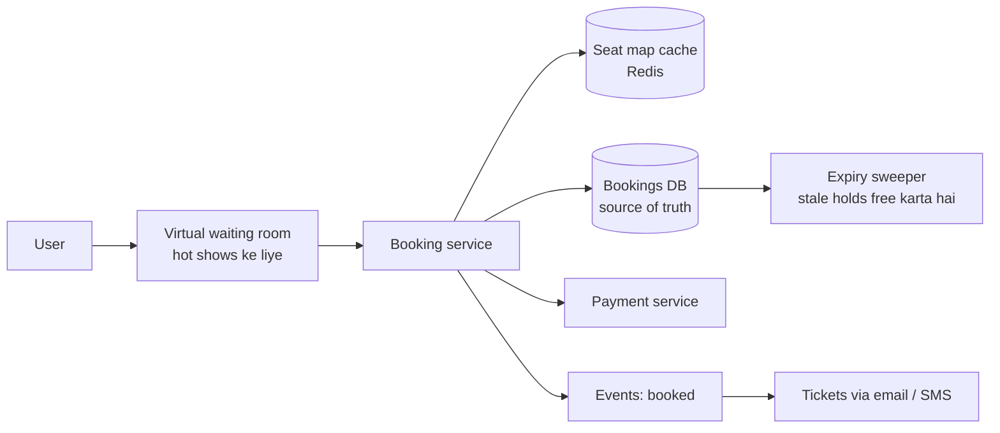

#### Deep dive: holds with expiry

```python
HOLD_SECONDS = 600     # ek seat hold 10 minute chalta hai

class SeatMap:
    """Each seat row behaves like: UPDATE seats SET ... WHERE seat_id=? AND <seat is free>."""

    def __init__(self, seat_ids):
        self.seats = {s: {"state": "FREE", "user": None, "expires": 0} for s in seat_ids}

    def _is_free(self, seat, now):
        return seat["state"] == "FREE" or (seat["state"] == "HELD" and seat["expires"] <= now)

    def hold(self, seat_ids, user, now):
        # All-or-nothing: pehle har seat check karo, phir badlo (asli zindagi mein ek DB transaction)
        if not all(self._is_free(self.seats[s], now) for s in seat_ids):
            return False
        for s in seat_ids:
            self.seats[s] = {"state": "HELD", "user": user, "expires": now + HOLD_SECONDS}
        return True

    def confirm(self, seat_ids, user, now, payment_ok):
        for s in seat_ids:
            seat = self.seats[s]
            if seat["state"] != "HELD" or seat["user"] != user or seat["expires"] <= now:
                return "hold lost, refund if charged"
        if not payment_ok:
            return "payment failed, seats stay held until expiry"
        for s in seat_ids:
            self.seats[s]["state"] = "BOOKED"
        return "booked"

show = SeatMap(["A1", "A2", "A3"])
print("asha holds A1,A2 :", show.hold(["A1", "A2"], "asha", now=0))
print("ravi holds A2,A3 :", show.hold(["A2", "A3"], "ravi", now=5))      # A2 le liya gaya -> poori request fail
print("ravi holds A3    :", show.hold(["A3"], "ravi", now=6))
print("asha confirms    :", show.confirm(["A1", "A2"], "asha", now=120, payment_ok=True))
print("ravi confirms late:", show.confirm(["A3"], "ravi", now=700, payment_ok=True))
print("meera holds A3   :", show.hold(["A3"], "meera", now=701))           # ravi ka hold expire ho gaya
print({s: v["state"] for s, v in show.seats.items()})
```

```text
asha holds A1,A2 : True
ravi holds A2,A3 : False
ravi holds A3    : True
asha confirms    : booked
ravi confirms late: hold lost, refund if charged
meera holds A3   : True
{'A1': 'BOOKED', 'A2': 'BOOKED', 'A3': 'HELD'}
```

Abhi kya hua:
- Ravi ki A2+A3 wali request **poori ki poori** fail hui (all-or-nothing), toh woh ek akeli A3 pakde nahi baitha jo usne alag se maangi hi nahi thi.
- Ravi ka hold t=606 pe expire ho gaya (6 + 600). Jab usne t=700 pe confirm karna chaha, system ne mana kar diya, toh agar uska card charge ho gaya tha toh refund karna padega. Production mein **charge karne se pehle check karo ki hold abhi bhi valid hai**, aur payment chal rahi ho tab hold ko thoda extend karo taaki ye case aaye hi nahi.
- Meera t=701 pe A3 pakad saki, bina kisi cleanup job ke chale, kyunki "expired" ko hold condition ke andar hi **lazily** check kiya jaata hai. Ek background sweeper phir bhi purane holds reset karta hai taaki seat map sahi dikhe.

> 🤔 **Mann mein sawaal:** Agar lazy check se hi kaam chal jaata hai, toh sweeper ki zaroorat kya hai?
>
> **Jawab:** Correctness ke liye zaroorat nahi, **dikhawe** ke liye hai. Lazy check sirf tab chalta hai jab koi us seat ko pakadne ki koshish kare. Tab tak seat map pe woh seat "HELD" (grey) dikhti rahegi, aur log use click hi nahi karenge, sochenge ki booked hai. Sweeper expired holds ko FREE karke map ko sach bolne layak banata hai. Lazy check = safety, sweeper = sahi display.

**Lock kahan rakhein?**

| Option | How | Pros | Cons |
|---|---|---|---|
| DB conditional UPDATE (upar wala) | SQL mein row-level atomicity | Simple, correct, durable | Saara contention DB jhelta hai |
| `SELECT ... FOR UPDATE` | Transaction mein pessimistic row lock | Clear semantics | Slow steps ke dauraan locks pakde rehne se throughput girta hai |
| Redis `SET seat:A2 user NX EX 600` | TTL ke saath atomic "set if not exists" | Bahut tez, auto-expiry | Redis source of truth nahi hai; booking DB mein phir bhi likho |

Common answer: hold ke liye Redis `SET NX EX` ek tez pehla gate, aur confirm time pe DB conditional update final truth.

**Flash-sale spike:** aage ek **virtual waiting room** rakho (ek queue jo users ko controlled rate pe andar aane deti hai), seat map cache se serve karo, aur har user pe rate-limit lagao.

---

## 🔬 Under the Hood · Andar Ki Kahani

### How one server holds 100,000 open WebSockets · Ek server 1 lakh sockets kaise sambhaalta hai

WebSocket bas ek TCP connection hai jo khula rehta hai. Ek idle connection ki keemat hai ek **file descriptor** aur kuch kilobytes kernel aur application buffers, lekin jab kuch ho nahi raha tab **koi CPU nahi**. Isse sasta banane wali trick hai **event-driven I/O** (Linux pe `epoll`, BSD/macOS pe `kqueue`): har connection ke liye ek thread rakhne ki jagah (1,00,000 threads memory aur context switches mein doob jaayenge), ek thread kernel se poochta hai "in 1,00,000 sockets mein se kis pe data aaya hai, bata do", aur sirf unhi ko chhoota hai. Yahi model Python ke `asyncio` ([Part 1 Chapter 18](../part-1-python/18-internals-concurrency.md)), Node.js, Netty aur Go ke network runtime ka hai. Asli limits jo tum hit karte ho: har connection ki memory, OS file-descriptor limits (config mein badhaye jaate hain), aur mass reconnect ke dauraan TLS handshakes ka CPU cost (gateway restart ke baad ek "thundering herd", jise randomised reconnect delays se naram kiya jaata hai).

> 🇮🇳 **Desi Analogy:** Thread-per-connection = restaurant mein har table ke liye ek alag waiter jo table ke paas khada intezaar karta rehta hai, chahe log menu padh rahe hon. 1 lakh tables = 1 lakh waiters, kitchen mein jagah hi nahi. `epoll` = ek manager aur ek **bell system**: jis table ko kuch chahiye, woh bell bajata hai, aur manager ke board pe us table ki light jalti hai. Ek-do waiter sirf jalti lights wali tables pe jaate hain. Khaali baithi tables ka koi kharcha nahi.

### Why video is cut into segments · Video ke tukde kyun

HTTP caches aur CDNs **bahut saari chhoti, immutable files** ke liye bane hain. 2 ghante ki movie ek file mein ho toh use tukdon mein accha cache nahi kar sakte, beech mein quality switch nahi kar sakte, aur ek toota connection ek bahut bada download dobara shuru karwa deta hai. 4-second ke segments mein kaato, toh har file chhoti hai, hamesha ke liye cacheable hai, plain `GET` se aati hai, aur player har segment boundary pe quality badal sakta hai. Segment length ek trade-off hai: chhota = tez quality switching aur kam live latency, lamba = kam requests aur behtar compression.

### Why geohash prefixes mean "nearby" (and when they don't) · Prefix same toh paas paas, lekin hamesha nahi

Geohash longitude aur latitude bits ko interleave karta hai, jo map pe ek **Z-order curve** (ek space-filling curve) banata hai. Jo points pehle k characters share karte hain, woh same cell mein hote hain. Lekin curve jump karti hai: cell border ke do taraf ek metre ki doori pe khade do points ke prefixes poore alag ho sakte hain (Greenwich meridian aur equator sabse bure cases hain). Isiliye har proximity query **cell plus uske padosi** search karti hai. Hexagons (H3) is problem ko kam karte hain kyunki saare chhe padosi ek edge share karte hain aur barabar doori pe hote hain.

> 🤔 **Mann mein sawaal:** Equator pe sabse bura kyun?
>
> **Jawab:** Kyunki geohash ka pehla latitude bit hi poochta hai "equator ke upar ho ya neeche?". Equator ke theek upar khada point "1" se shuru hoga, theek neeche wala "0" se. Pehla hi bit alag, toh poora prefix alag, chahe dono ke beech sirf ek metre ho. Greenwich (longitude 0) pe bilkul yahi longitude bit ke saath hota hai.

### Why a wide-column store fits chat · Chat ke liye wide-column store kyun

Cassandra-style stores mein **partition key** decide karti hai ki data kis node pe rahega, aur **clustering key** partition ke andar rows ko disk pe sorted rakhti hai. `PRIMARY KEY ((conv_id, bucket), seq)` ke saath, ek conversation ke ek mahine ke saare messages saath baithte hain, `seq` se sorted. "Latest 50 messages" ek seek aur ek sequential read ban jaata hai. Writes ek in-memory table mein append-only jaate hain jo sorted files mein flush hoti hai (ek **LSM tree**, [Chapter 03](03-databases.md)), isiliye aise stores lakhon writes per second nigal jaate hain.

### Why idempotency keys make retries safe · Idempotency keys retries ko safe kyun banati hain

Network pe ek request succeed ho sakti hai jabki uska response kho jaaye. Client "fail ho gaya" aur "ho gaya par mujhe jawab nahi mila" mein farq nahi kar sakta, isliye use retry karna hi padta hai. Bina key ke, retry = doosra message, doosra order, doosra charge. UNIQUE constraint ke neeche store ki gayi key ke saath, database khud duplicate ko reject kar deta hai, aur server original result return karta hai. Ye "at-least-once delivery" ko "exactly-once **effect**" mein badal deta hai ([Chapter 08](08-queues-events.md)).

> 🇮🇳 **Desi Analogy:** UPI ka **transaction reference number** socho. Tumne ₹500 bheje, screen atak gayi, tumne dobara "Pay" daba diya. Bank dekhta hai ki dono requests pe same reference ID hai, toh doosri ko "already processed" bol ke wahi pehla result de deta hai. Paise ek hi baar katte hain. Reference ID = idempotency key, bank ka "already processed" = UNIQUE constraint.

---

## 🧩 Pattern Decoder · Pattern Pakdo

### Decision guide: which technique for which "vault"? · Kaunse vault ke liye kaunsi chaabi

| Agar system ko chahiye... | Ye uthao... | Kyunki... |
|---|---|---|
| Server real time mein clients ko data push kare | WebSockets (ya one-way ke liye SSE) + gateway servers + session registry | Scale pe polling requests waste karti hai aur latency badhati hai |
| Flaky networks pe ordered, gap-free messages | Server-assigned per-conversation sequence numbers + cursor sync | Clocks jhooth bolti hain; cursors "maine kya miss kiya?" ko exact banate hain |
| Duplicate-free retries | Client-generated idempotency keys + UNIQUE constraint | Network failures retries ko avoid nahi karne dete |
| Personalised aggregates (feeds) ke fast reads | Write pe precompute (fan-out), sirf IDs cache karo | Reads writes se 100:1 zyada hain |
| ...lekin kuch producers ke crore-on consumers hain | Hybrid: celebrities ke liye pull | Fan-out ki keemat O(followers) hai |
| Crore-on logon ko bahut badi files serve karna | Object storage + CDN + chunking | Bottleneck bandwidth hai, compute nahi |
| Kai device types aur networks | Bitrate ladder mein transcode + adaptive streaming | Client har segment pe quality chunta hai |
| "Mere paas ki cheezein" | Memory mein Geohash / quadtree / H3 cells, cell + neighbours search | O(n) scans ko chhote lookups mein badalta hai |
| Ek resource kabhi do baar assign na ho | Compare-and-set (conditional UPDATE / version) | Check aur write ek hi atomic step mein |
| Resource ko kuch der ke liye pakad ke rakhna | Expiry (TTL) wala hold, lazily checked + sweeper | Chhode hue holds apne aap free ho jaate hain |
| Bade graph ko politely traverse karna | BFS frontier + per-host queues + seen sets | Breadth, dedup aur politeness ek hi structure mein |
| Kuch ms mein prefix queries | Har node pe top-k cached trie, offline rebuild | Query = prefix tak chalo, koi subtree search nahi |
| Services ke paar ek transaction | Compensations ke saath saga + outbox | Services ke paar koi global ACID transaction nahi |

### The reusable skeletons · Teen dhaanche jo baar baar aate hain

Is chapter ke zyaadatar designs teen shapes mein se ek hain:

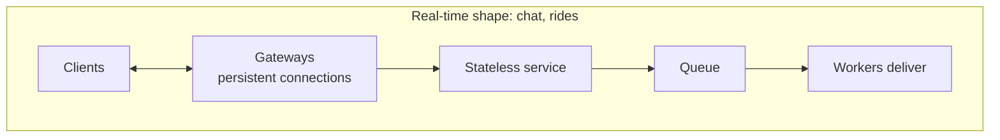

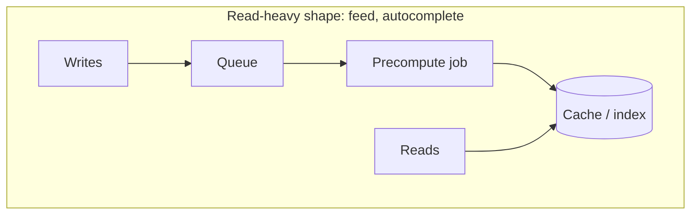

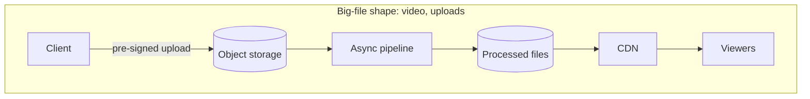

Aur ek chautha, correctness-critical flows ke liye (checkout, booking): **idempotency key → conditional write → saga/outbox**.

### Trade-off table across the case studies · Saare case studies ek nazar mein

| System | Consistency need | Main bottleneck | Main trade-off |
|---|---|---|---|
| Chat | Har conversation mein strong ordering, baaki jagah eventual | Connections, write throughput | Bade groups ke liye push vs pull |
| News feed | Eventual | Read QPS, fan-out writes | Write cost vs read cost (push vs pull) |
| Video | Eventual (metadata) | Egress bandwidth, transcoding CPU | Quality/codecs vs cost |
| Ride-hailing | Assignment ke liye strong, location ke liye eventual | Location writes | Freshness vs battery |
| Crawler | Eventual | Politeness, dedup memory | Coverage vs freshness vs politeness |
| Autocomplete | Eventual | QPS, latency | Freshness vs speed (precomputation) |
| Checkout | Strong | Hot-row contention | Optimistic vs pessimistic locking |
| Ticket booking | Har seat pe strong | On-sale spikes | Hold length vs seat availability |

### When NOT to over-engineer · Kab zyada mat banao

- 500 logon ki company ke chat app ko Cassandra aur Kafka nahi chahiye. Postgres + ek WebSocket server kaafi hai. Interviewers ko ye sunna accha lagta hai: "at this scale, I'd start simple".
- Celebrity hybrid tab tak mat jodo jab tak numbers bahut bade follower counts na dikhayein.
- Agar autocomplete trie ek machine ki memory mein aa jaata hai toh use shard mat karo: replicate karo.

---

## ⚠️ Traps & Common Mistakes · Yahan Sab Phisalte Hain

1. **Boilerplate pe 30 minute kharch karna.** Login, load balancer, "aur hum ek cache jodenge" toh expected hain. Minute ~20 tak vault tak pahunch jaao.
2. **Chat messages ko client timestamps se order karna.** Phone ki ghadiyan drift karti hain aur users unhe khud set kar sakte hain. Har conversation ke server-assigned sequence se order karo.
3. **Message durable hone se pehle "sent ✓" bol dena.** Agar server ack karne ke baad lekin likhne se pehle crash ho gaya, toh message kho gaya jabki sender sochta hai chala gaya. Write ke baad ack karo.
4. **Har feed mein poori post body copy karna.** Edits aur deletes namumkin ho jaate hain aur memory phat jaati hai. IDs store karo, read time pe hydrate karo.
5. **Celebrities ke saath pure fan-out on write.** Ek post → 50 million writes. Hamesha hybrid mention karo.
6. **Apne app servers se video serve karna.** Bandwidth ka hisaab ise turant maar deta hai. CDN + object storage, aur uploads pre-signed URLs se.
7. **Sirf rider ki apni geohash cell search karna.** Sabse paas wala driver border ke us paar ho sakta hai. Padosi cells bhi search karo.
8. Inventory, seats ya drivers ke liye **bina condition ke read-then-write**:

```py
# ❌ galat: do requests dono "available" dekh sakti hain aur dono book kar sakti hain
seat = db.query("SELECT status FROM show_seats WHERE seat_id = 'A2'")
if seat.status == "FREE":
    db.execute("UPDATE show_seats SET status = 'HELD' WHERE seat_id = 'A2'")

# ✅ sahi: check aur write ek hi atomic statement hain
rows = db.execute("""UPDATE show_seats SET status = 'HELD'
                     WHERE seat_id = 'A2' AND status = 'FREE'""")
if rows == 0:
    raise SeatTaken()
```

   Pehle wale mein gadbad kahan hai? Request 1 ne `SELECT` kiya, "FREE" mila. Usi pal Request 2 ne bhi `SELECT` kiya, use bhi "FREE" mila (kyunki 1 ne abhi kuch likha nahi). Ab dono `UPDATE` karte hain, dono khush, aur ek seat do logon ke naam. Isse **check-then-act race** kehte hain. Doosre wale mein check (`AND status = 'FREE'`) aur likhna ek hi statement mein hain, toh database guarantee karta hai ki sirf ek jeetega.

9. **Time out hui payment ko failed maan lena.** Woh succeed bhi ho sakti hai. Naye charge ke saath retry karne se pehle gateway se poochho ya webhook ka intezaar karo.
10. **Ek global queue wala crawler.** Woh ek popular host pe hathoda chalaayega. Delays ke saath per-host back queues rakho.
11. **Har keystroke ya search pe autocomplete trie update karna.** Read path (immutable in-memory snapshot) ko write path (offline rebuild + trending layer) se alag rakho.
12. **Ye bhool jaana ki estimates decisions chalate hain.** "26 Tbps" nikaala aur phir CDN ka naam hi nahi liya, toh number bekaar gaya. Har number ke baad ek "**therefore**" aana chahiye.

---

## 💡 Tips & Tricks · Pro Wale Moves

- Har design ki shuruaat "**the hard part here is...**" se karo. Ye tumhare poore answer ko frame karta hai aur seniority dikhata hai.
- Har system ka ek number yaad rakho: chat → *concurrent connections*; feed → *read:write ratio*; video → *egress Tbps*; rides → *location writes/s*; crawler → *pages/s aur per-host politeness*; autocomplete → *keystroke QPS*.
- Read-heavy systems ke liye **write path** aur **read path** alag-alag draw karo. Interviewers ko unhe decoupled dekhna bahut pasand hai.
- Jahan bhi paisa, seats ya assignment ho, teen shabd bolo: **idempotency, conditional write, saga**.
- Asli product names ko anchor ki tarah use karo ("like WhatsApp's double ticks", "like Uber's H3"), lekin brand nahi, mechanism samjhao.
- Deep dive mein atak jaao toh poochho: "Agar ye component aadhe raaste crash ho jaaye toh kya hoga?" Jawab aksar missing piece dikha deta hai (durability, idempotency, ek cursor).
- Monitoring ka chhota sa zikr karo: message delivery latency (chat), fan-out lag (feed), rebuffering rate (video), match time (rides), crawl rate per host (crawler), p99 latency (autocomplete) ([Chapter 09](09-microservices-reliability.md)).
- Board pe ek "parking lot" list rakho un features ki jo tum jaan-boojh ke skip kar rahe ho. Isse dikhta hai ki tumne unke baare mein socha, bina bhatke.

---

## 🎯 Interview Questions · Interview Mein Yahi Poochenge

### 1. Design WhatsApp. How do you guarantee messages are delivered in order and exactly once? 🔥🔥🔥

<details><summary>Answer dekho 👀</summary>

Clients ek gateway server se WebSocket khula rakhte hain. Bhejte waqt client ek `client_msg_id` (UUID) lagata hai. Chat service:
1. ID ko haal hi mein dekhi gayi IDs se check karti hai (idempotency) aur duplicates gira deti hai.
2. Agla **per-conversation sequence number** assign karti hai (atomic counter).
3. Message ko durably likhti hai (conversation se partitioned wide-column store), **phir** "sent" ka ack deti hai.
4. Session registry mein recipient ka gateway dhoondhti hai aur message push karti hai; offline ho toh push notification bhejti hai.

Receiver seq number ke saath delivery ka ack deta hai. Har device ek **cursor** rakhta hai (har conversation ka aakhri mila seq); reconnect pe cursor ke baad ka sab kuch fetch karta hai. Toh network pe delivery *at-least-once* hai, lekin idempotency ki wajah se *exactly-once in effect* hai, aur order server ke sequence numbers define karte hain, client clocks nahi.

> 🗣️ **Interview mein aise bolo:** "The hard part is ordering and no duplicates over flaky networks. The client attaches a UUID so retries are idempotent, the server assigns a per-conversation sequence number and acks only after a durable write, and every device keeps a cursor of the last sequence it has. On reconnect it asks for everything after that cursor, so delivery is at-least-once on the wire but exactly-once in effect, and order never depends on phone clocks."

</details>

### 2. Fan-out on write vs fan-out on read for a news feed? 🔥🔥🔥

<details><summary>Answer dekho 👀</summary>

- **On write (push)**: user post kare toh post ID har follower ki precomputed feed mein daal do. Reads O(1) cache lookups hain. Writes ki keemat O(followers): celebrities ke liye bhayanak, inactive users ke liye waste.
- **On read (pull)**: posts har author ke paas store karo; read time pe jinhe follow karte ho un sabke recent posts lao aur k-way merge karo. Writes saste; reads ki keemat O(following) aur high QPS pe slow.
- **Hybrid**: normal accounts ke liye push, follower threshold se upar wale accounts ke liye pull, read time pe merge. Lambe samay se inactive users ka fan-out skip karo aur unki feed on demand rebuild karo.

Choose karo read:write ratio dekh ke (feeds read-heavy hain, toh zyaadatar push) aur follower distribution dekh ke (skewed hai, toh hybrid).

> 🗣️ **Interview mein aise bolo:** "Feeds are read roughly a hundred times more than they are written, so I default to fan-out on write: each post ID is pushed into followers' cached feeds and a read is O(1). That breaks for celebrities, where one post means millions of writes, so accounts above a follower threshold are pulled at read time and merged in. I also skip fan-out for inactive users and rebuild their feed on demand."

</details>

### 3. How does YouTube/Netflix handle different devices and network speeds? 🔥🔥🔥

<details><summary>Answer dekho 👀</summary>

Har upload ko resolutions/bitrates aur codecs ki ek ladder mein **transcode** kiya jaata hai, har ek chhote segments (2–10 s) mein kata hua, aur ek manifest (HLS `.m3u8` / DASH `.mpd`) unki list rakhta hai. Player throughput aur buffer level naapta hai aur **har segment pe** rendition chunta hai (adaptive bitrate). Segments immutable HTTP files hain jo users ke paas CDN edges pe cache hote hain, aksar ISPs ke andar. Transcoding parallel hoti hai: video ko chunks mein kaat ke kai workers ek DAG ki tarah process karte hain, idempotent tasks ke saath taaki retries safe rahein.

> 🗣️ **Interview mein aise bolo:** "Every upload is transcoded into a bitrate ladder, say 240p to 4K, and each rendition is cut into short segments listed in an HLS or DASH manifest. The player measures throughput and buffer level and picks the quality per segment, so on a bad network it drops resolution instead of stalling. Segments are immutable files served from CDN edges, and transcoding runs as a parallel DAG of idempotent chunk tasks."

</details>

### 4. How would you find the nearest drivers for a rider? 🔥🔥🔥

<details><summary>Answer dekho 👀</summary>

Available drivers ki current location **memory mein** rakho, spatial cells se indexed (geohash, quadtree ya H3). Driver updates (har ~4 s) driver ko cells ke beech move karte hain. Request aane pe: rider ki cell nikaalo, us cell **aur uske padosiyon** se drivers jama karo (kaafi candidates na milein toh rings badhao), purane updates filter karo, phir road ETA se rank karo. City/region se shard karo kyunki matching local hai. Driver ke status pe compare-and-set se assign karo taaki do riders ko same driver na mile. Location data self-healing hai (drivers dobara bhejte hain), isliye replicas saste hain.

> 🗣️ **Interview mein aise bolo:** "Current driver locations are tiny, about 50 MB, but updated 250,000 times a second, so I keep them in an in-memory geo index keyed by geohash or H3 cells and sharded by city. For a request I search the rider's cell plus its neighbours, drop stale drivers, and rank candidates by road ETA. Assignment is a compare-and-set on the driver's status, so two riders can never get the same driver."

</details>

### 5. Design a web crawler. How do you make it polite and avoid infinite loops? 🔥🔥

<details><summary>Answer dekho 👀</summary>

Seeds se web graph pe BFS. **URL frontier**: priority front queues jo **per-host back queues** ko bharti hain; ek heap har host ka agla allowed fetch time track karta hai taaki kisi host ko ek delay mein ek se zyada request na mile. `robots.txt` ki izzat karo (har host ke liye cached). **Loops/dups**: URLs normalise karo aur ek URL-seen set rakho (sharded hash set ya Bloom filter); duplicate pages skip karne ke liye content fingerprints rakho (near-duplicates ke liye SimHash). **Traps**: depth, URL length aur har host ke pages pe cap. Hostnames ko hash karke crawler nodes pe baanto taaki politeness ek hi node pe local rahe. Crash recovery ke liye frontier persist karo; pages kitni baar badalte hain uske hisaab se adaptively re-crawl karo.

> 🗣️ **Interview mein aise bolo:** "A crawler is BFS over the web graph, and the vault is the URL frontier. Priority front queues feed one back queue per host, and a min-heap of next-allowed-fetch times makes sure no host is hit more than once per delay, while thousands of other hosts are crawled in parallel. A URL-seen set and content fingerprints stop loops and duplicates, and hashing hostnames to nodes keeps politeness local to one machine."

</details>

### 6. Design search autocomplete. How do you return suggestions in under 100 ms? 🔥🔥🔥

<details><summary>Answer dekho 👀</summary>

Ek **in-memory trie se serve karo jiska har node apne precomputed top-k phrases rakhta hai**, taaki query O(prefix length) ho: chalo aur list padho. Trie ko aggregated search logs se (time decay ke saath) offline banao, snapshot lo, aur serving nodes pe hot-swap karo; freshness ke liye ek streaming "trending" layer jodo. Trie ko replicate karo (measured prefix traffic se shard tabhi karo jab woh fit na ho). Load kam karo client debouncing, browser caching, common prefixes ki CDN caching, aur purani requests cancel karke.

> 🗣️ **Interview mein aise bolo:** "I serve suggestions from an in-memory trie where every node already stores its top-k phrases, so a lookup is just walking the prefix, a handful of steps, and returning a list. The trie is built offline from aggregated search logs with time decay and hot-swapped as a snapshot, with a small streaming layer for trending queries. Debouncing, browser caching and CDN caching of short prefixes cut the load before it even reaches the servers."

</details>

### 7. Two users click the same seat at the same time. What happens in your design? 🔥🔥🔥

<details><summary>Answer dekho 👀</summary>

Dono "hold A2" bhejte hain. Database chalata hai `UPDATE show_seats SET status='HELD', held_by=?, hold_expires_at=now()+10min WHERE show_id=? AND seat_id='A2' AND (status='FREE' OR hold_expires_at < now())`. Row-level atomicity ka matlab hai sirf ek update match hoga; doosre ko 0 rows updated dikhega aur use 409 "seat just taken" milega. Multi-seat requests ek transaction mein chalti hain aur tab tak roll back hoti hain jab tak saari seats update na hon. Holds apne aap expire hote hain (lazy check + sweeper). Ek Redis `SET NX EX` gate pehle load sokh sakta hai, lekin source of truth DB hi rehta hai. Confirm karte waqt charge karne se **pehle** check hota hai ki hold abhi valid hai, aur payment idempotency key use karta hai.

> 🗣️ **Interview mein aise bolo:** "The hold is a single conditional UPDATE: set the seat to HELD only where it is free or its hold has expired. Row-level atomicity means exactly one request matches; the other sees zero rows and gets a 409. Multi-seat holds run in one transaction and roll back unless every seat was taken, holds expire via a lazy check plus a sweeper, and I verify the hold is still valid before charging, with an idempotency key on the payment."

</details>

### 8. How do you prevent overselling during a flash sale? 🔥🔥

<details><summary>Answer dekho 👀</summary>

Decrements ko atomic aur conditional banao: `UPDATE inventory SET available = available - 1 WHERE sku=? AND available > 0` (ya optimistic locking ke liye version check). Extreme contention mein optimistic retries thrash karte hain (baar baar fail-retry), isliye Redis mein ek atomic counter (`DECR`, zero se neeche jaaye toh reject) ko admission control bana do, aage ek waiting-room queue, har user pe rate limits, aur sirf jeetne wale DB mein orders banane jaayein. Payment poori na ho toh reservations expire. Redis aur DB ko periodically reconcile karo.

> 🗣️ **Interview mein aise bolo:** "The source of truth is an atomic conditional decrement in the database, so stock can never go below zero. In a flash sale optimistic retries would thrash, so I put an atomic Redis counter in front as admission control, plus a waiting room and per-user rate limits, and only winners go on to create orders. Reservations expire if payment isn't completed, and a periodic job reconciles Redis with the database."

</details>

### 9. How do read receipts and "last seen" work at scale? 🔥🔥

<details><summary>Answer dekho 👀</summary>

Read receipts: har message pe flag nahi, har user ke har conversation ke liye ek **high-water mark** (`last_read_seq`) store karo. Ek receipt event sender ke devices ko jaata hai; groups mein aggregate karo ("read by 12") aur details lazily fetch karo. Presence: clients har kuch second mein heartbeat bhejte hain; Redis `presence:user` ko TTL ke saath rakhta hai; kai heartbeats miss → offline (flicker se bachne ke liye). Presence updates sirf unhe push karo jo abhi us contact ko dekh rahe hain, aur unhe batch/throttle karo. Dono design se hi eventually consistent hain.

</details>

### 10. How would you design the upload flow for large videos? 🔥🔥

<details><summary>Answer dekho 👀</summary>

Client API se upload shuru karne ko kehta hai; API ek metadata row (UPLOADING) banata hai aur ek `upload_id` plus har part ke liye **pre-signed URLs** return karta hai (multipart upload). Client ~5–100 MB ke parts seedha object storage pe, parallel mein, upload karta hai, fail hue parts retry karta hai aur saved `upload_id` se crashes ke baad resume karta hai. Ek final "complete" call object ko jodti hai; ek storage event queue ke through transcoding pipeline trigger karta hai; status PROCESSING aur phir READY hota hai. App servers kabhi video bytes nahi dhote.

</details>

### 11. How do you implement a group chat for 100,000 members (like a Telegram channel)? 🔥

<details><summary>Answer dekho 👀</summary>

100k inboxes mein fan out on write mat karo. Har message channel ke log mein ek baar store karo (channel se partitioned, time se bucketed). Halke notifications sirf un members ko push karo jo online hain aur jinka channel khula hai; baaki ko ek unread badge dikhta hai jo `latest_seq - their_last_read_seq` se nikalta hai, aur woh channel kholne pe messages pull karte hain. Kaun post kar sakta hai uspe rate-limit lagao (aksar sirf admins), aur hot channels ke latest messages cache karo.

</details>

### 12. In checkout, the payment gateway times out. What do you do? 🔥🔥

<details><summary>Answer dekho 👀</summary>

Result ko **unknown** maano, kabhi failed nahi. Order ko PENDING_PAYMENT mein aur stock ko reserved rakho. Same idempotency key se gateway ki status API query karo, ya uske signed webhook ka intezaar karo. Succeed hua toh order confirm karo; fail hua toh reservation release karo (saga compensation). Agar user beech mein retry kare, toh same idempotency key doosra charge rokti hai. Reservation expiry plus ek reconciliation job jo kuch bhi atka hai use saaf karte hain.

> 🗣️ **Interview mein aise bolo:** "A timeout means unknown, not failed, because the charge may have gone through and only the response was lost. I keep the order in PENDING_PAYMENT with stock reserved, then query the gateway with the same idempotency key or wait for its signed webhook before deciding. Success confirms the order, failure triggers the saga compensation to release stock, and any retry by the user reuses the key so it can't double charge."

</details>

---

## 🏋️ Practice · Ab Tumhari Baari

**🟢 1. Estimate it.** Ek chat app ke 50 million DAU hain, har koi roz 30 messages bhejta hai, har message 150 bytes. Average messages/s, peak (×3), aur saal bhar ka storage nikaalo.

<details><summary>Solution dekho 👀</summary>

```python
dau, msgs_per_user, size_bytes = 50_000_000, 30, 150
per_day = dau * msgs_per_user
avg_per_s = per_day / 86_400
print(f"messages/day: {per_day:,}")
print(f"average: {avg_per_s:,.0f}/s, peak: {avg_per_s * 3:,.0f}/s")
print(f"storage/year: {per_day * size_bytes * 365 / 1e12:.0f} TB")
```

```text
messages/day: 1,500,000,000
average: 17,361/s, peak: 52,083/s
storage/year: 82 TB
```

Lagbhag 17k/s average, ~50k/s peak, replication se pehle ~82 TB/year (replication ke saath ×3 ≈ 250 TB).

Mann mein kaise karein (calculator ke bina): 50M × 30 = 1.5 × 10⁹/day. ÷ 10⁵ ≈ 15k/s (asli 17k). Storage: 1.5 × 10⁹ × 150 B = 225 GB/day; × 365 ≈ 82 TB. Interview mein "roughly 15–20k per second, about 80 TB a year" bolna bilkul kaafi hai.

</details>

**🟢 2. Why IDs?** Do sentences mein samjhao ki feed cache poore posts ki jagah post IDs kyun store karti hai.

<details><summary>Solution dekho 👀</summary>

Ek post crore-on feeds mein dikh sakta hai, isliye uski body copy karne se storage kai guna ho jaayega aur har edit ya delete ke liye crore-on updates lagenge. IDs store karne se har feed chhoti rehti hai (~8 bytes per entry) aur post body ek hi jagah rehti hai, jo read time pe fetch (aur cache) hoti hai.

</details>

**🟡 3. Neighbour search.** Geohash wale idea ko aage badhao: ek function likho jo candidate cells ka ek set check karke, phir exact distance se filter karke, rider ke `radius_km` ke andar ke saare drivers return kare. Simple rakhne ke liye geohash ki jagah 0.01° cells ka square grid use karo (lagbhag 1.1 km), aur rider ki cell plus uske aas-paas ki 8 check karo.

<details><summary>Solution dekho 👀</summary>

```python
import math
from collections import defaultdict

CELL = 0.01   # degrees, lagbhag 1.1 km latitude

def cell_of(lat, lon):
    return (math.floor(lat / CELL), math.floor(lon / CELL))

def km_between(a, b):
    lat1, lon1, lat2, lon2 = map(math.radians, (*a, *b))
    h = math.sin((lat2 - lat1) / 2) ** 2 + math.cos(lat1) * math.cos(lat2) * math.sin((lon2 - lon1) / 2) ** 2
    return 6371 * 2 * math.asin(math.sqrt(h))

drivers = {"D1": (12.9716, 77.5946), "D2": (12.9801, 77.6001),
           "D3": (12.9352, 77.6245), "D4": (12.9699, 77.5899)}
grid = defaultdict(list)
for d, pos in drivers.items():
    grid[cell_of(*pos)].append(d)

def nearby(rider, radius_km):
    r, c = cell_of(*rider)
    found = []
    for dr in (-1, 0, 1):
        for dc in (-1, 0, 1):                     # apni cell + 8 padosi
            for d in grid[(r + dr, c + dc)]:
                dist = km_between(rider, drivers[d])
                if dist <= radius_km:
                    found.append((round(dist, 2), d))
    return sorted(found)

print(nearby((12.9720, 77.5950), radius_km=1.5))
```

```text
[(0.06, 'D1'), (0.6, 'D4'), (1.06, 'D2')]
```

D3 (lagbhag 5 km door) ko kabhi dekha bhi nahi gaya. Dhyaan do ki padosiyon ka ek ring sirf ek cell width (~1.1 km) ke andar sab kuch dhoondhne ki guarantee deta hai; bade radius ke liye aur rings badhao.

Yahan D2 rider ki cell `(1297, 7759)` mein nahi, padosi cell `(1298, 7760)` mein hai, phir bhi mil gaya, kyunki humne 8 padosi bhi dekhe. Sirf apni cell dekhte toh D2 chhoot jaata. Trap 7 yahi hai.

</details>

**🟡 4. Read receipts in groups.** Ek group mein har member ka `last_read_seq` diya hai. Ek function likho jo diye gaye message `seq` ke liye batao ki kitne members (sender ko chhod ke) ne use padh liya hai, O(members) mein.

<details><summary>Solution dekho 👀</summary>

```python
def read_count(seq, sender, last_read):
    return sum(1 for user, upto in last_read.items() if user != sender and upto >= seq)

last_read = {"asha": 120, "ravi": 118, "meera": 121, "dev": 90}
print(read_count(118, "asha", last_read))   # ravi, meera
print(read_count(121, "asha", last_read))   # sirf meera
```

```text
2
1
```

Kyunki high-water mark ka matlab hai "yahan tak sab padh liya", har member ke liye ek comparison kaafi hai. Bahut bade groups ke liye marks ko sorted rakho (ya har seq ka ek count), taaki O(log n) mein jawab mile.

</details>

**🟡 5. Design question.** Celebrity-heavy shaam ke baad tumhare news feed ke fan-out workers 20 minute peeche chal rahe hain. Chaar concrete fixes batao.

<details><summary>Solution dekho 👀</summary>

1. Celebrity threshold neeche karo taaki zyada high-follower accounts push ki jagah pull use karein.
2. Inactive users (N din se login nahi) ka fan-out skip karo; unki feed on demand rebuild karo.
3. Prioritise karo: online/haal mein active followers ka fan-out pehle process karo (alag high-priority topic).
4. Kafka consumer lag dekh ke workers autoscale karo, aur topic partitions badhao taaki zyada workers parallel chal sakein. (Bonus: Redis writes ko pipelining se batch karo.)

</details>

**🔴 6. Merge celebrity posts efficiently.** Ek user ki feed cache `(ts, post_id)` ki list hai, newest pehle sorted, aur woh 3 celebrities ko follow karta hai jinki timelines bhi newest pehle sorted hain. Sab kuch jod ke sort kiye bina overall newest `k` posts return karo. (Hint: heap se k-way merge.)

<details><summary>Solution dekho 👀</summary>

```python
import heapq

def merge_feeds(k, *timelines):
    """Each timeline is sorted newest first. Pop the globally newest item k times."""
    heap = []
    for i, tl in enumerate(timelines):
        if tl:
            ts, pid = tl[0]
            heapq.heappush(heap, (-ts, i, 0, pid))    # max-heap ke liye negate karo
    out = []
    while heap and len(out) < k:
        neg_ts, i, j, pid = heapq.heappop(heap)
        out.append(pid)
        if j + 1 < len(timelines[i]):
            ts, nxt = timelines[i][j + 1]
            heapq.heappush(heap, (-ts, i, j + 1, nxt))
    return out

cache = [(100, "p9"), (90, "p7"), (40, "p2")]
celeb_a = [(95, "a3"), (50, "a2")]
celeb_b = [(99, "b8"), (10, "b1")]
celeb_c = []
print(merge_feeds(4, cache, celeb_a, celeb_b, celeb_c))
```

```text
['p9', 'b8', 'a3', 'p7']
```

m timelines ke liye time O(m + k log m) (heap mein har timeline ki zyada se zyada ek entry rehti hai), jabki saare N posts jod ke sort karne mein O(N log N).

Heap ka safar dekho: shuru mein heap mein har timeline ka sabse naya: 100 (p9), 95 (a3), 99 (b8). Pop 100 → p9, cache ka agla 90 (p7) daalo. Pop 99 → b8, celeb_b ka agla 10 daalo. Pop 95 → a3, celeb_a ka agla 50 daalo. Pop 90 → p7. k=4 poore. `-ts` isliye kyunki Python ka `heapq` min-heap hai; negate karne se sabse bada ts sabse upar aata hai. Tuple mein `i` tie-breaker ka kaam bhi karta hai, taaki same ts pe Python strings compare karne na baithe.

</details>

**🔴 7. Full design.** **Google Docs-style collaborative editing** ko high level pe design karo: vault kya hai, aur use kaise khologe? Requirements, key data flow, aur do deep dives likho.

<details><summary>Solution dekho 👀</summary>

- **Vault**: bahut saare log ek hi document ko ek saath edit kar rahe hain; edits aise merge hone chahiye ki sab same text pe converge karein, bina kisi ki typing khoe.
- **Requirements**: real-time co-editing, cursors/presence, version history, offline edits jo baad mein sync hon; kam latency (<100 ms echo), eventual convergence.
- **Flow**: clients ek document session server se WebSocket rakhte hain (ek doc ke saare editors `doc_id` pe consistent hashing se same server pe route hote hain). Har edit ek operation hai (`insert 'x' at 42`). Server har document ke operations ko order karta hai (ek sequence number, chat jaisa), unhe transform karta hai, broadcast karta hai, aur ek operation log mein append karta hai; periodic snapshots loading ko tez banate hain.
- **Deep dive 1: conflict resolution.** **Operational Transformation (OT)**: jab do concurrent ops aayein, ek ko doosre ke against transform karo (agar A position 5 pe insert karta hai aur B position 3 pe delete karta hai, toh A ki position 4 pe shift karo). Ek central ordering server chahiye, jo humare paas hai. Alternative: **CRDTs** (har character ko ek unique, ordered ID milti hai taaki merges commute karein, yaani kisi bhi order mein lagao result same), offline/peer-to-peer ke liye behtar, metadata ki keemat pe.
- **Deep dive 2: durability and history.** `doc_id` se partitioned ek durable store mein op log; har N ops pe snapshot; version history = snapshots + ops replay. Presence aur cursors ephemeral hain (memory mein, kabhi store nahi).

Dekho, ye kuch naya nahi hai: WebSocket gateways (chat se), per-document sequence (chat ka `seq`), consistent hashing (Chapter 05), log + snapshots (chat ka message log). Sirf vault naya hai: OT/CRDT. Yahi is chapter ka poora sabak hai.

</details>

---

## 🧠 Never-Forget Summary · Kabhi Mat Bhoolna

- Har design = **standard crew** (LB, stateless services, cache, DB, queue, CDN) + **ek vault**. Vault ka naam jaldi lo.
- **Chat**: WebSocket gateways + session registry; per-conversation **seq** numbers; idempotency ke liye `client_msg_id`; durable write ke baad ack; reconnect pe **cursor sync**; receipts high-water marks ki tarah; presence heartbeats + TTL se.
- **Feed**: read-heavy → precompute; **normal users ke liye push, celebrities ke liye pull**; **IDs** cache karo, read pe hydrate; cursor pagination.
- **Video**: pre-signed multipart upload → object storage → **parallel transcoding ka DAG** → segments + manifest → **CDN**; player har segment pe **ABR** karta hai.
- **Rides**: current locations **memory mein** geo cells mein (geohash/quadtree/H3); cell **+ neighbours** search; ETA se rank; assign karne ke liye **CAS**; city se shard.
- **Crawler**: BFS + **URL frontier** (priority front queues, **per-host back queues**); URL-seen + content-seen sets; robots.txt; trap limits; hosts ko nodes pe hash karo.
- **Autocomplete**: **har node pe top-k cached** trie, offline rebuild, hot-swap; trending layer; client pe debounce + caching.
- **Checkout**: **idempotency key**, inventory pe **conditional update**, **saga** + outbox; payment timeout = unknown, failed nahi.
- **Booking**: **expiry wale holds**, atomic conditional UPDATE (ya Redis `SET NX EX` + DB truth), all-or-nothing multi-seat, spikes ke liye waiting room.
- Har estimate ka ant "**therefore**..." se hona chahiye.

**Memory hook: "Chat SEQs, Feeds PUSH, Videos CHUNK, Rides CELL, Crawlers QUEUE, Typeahead TRIES, Money LOCKS."**

**🪝 Yaad rakhne ka jugaad:** Ek din ki kahani yaad karo: subah **WhatsApp** pe "good morning" aaya, ticks number se line mein (**SEQ**). Phir **Insta** khola, feed pehle se bichhi hui thi jaise darwaaze pe akhbaar (**PUSH**), bas Virat ka post khud uthaya (pull). Metro mein **YouTube** chalaya, tunnel aayi toh video tukdon mein patla hua par ruka nahi (**CHUNK**). Office ke liye **cab** ki, app ne sirf apne mohalle aur padosi PIN codes mein dhoondha (**CELL**). Raste mein chaiwala har office mein baari-baari chai de raha tha (crawler ki per-host **QUEUE**). Google pe "ind" likha, board pe top 3 pehle se likhe the (**TRIES**). Shaam ko sale mein phone khareeda aur raat ko Tatkal ticket, dono mein ek hi jeeta (**LOCKS**). Ek din, saat apps, saat vaults.

**Ek tasveer:**

| System | Vault | Signature move | Key number |
|---|---|---|---|
| Chat | Real-time, ordered, no dups | WebSocket + seq + cursor sync | Concurrent connections (~250M) |
| News feed | Fast personalised reads | Hybrid fan-out, cache IDs | Read:write ≈ 100:1 |
| Video | Bandwidth, devices | Transcode ladder + ABR + CDN | Egress (~26 Tbps) |
| Ride-hailing | Paas ke chalte points | Geo cells in memory + CAS assign | Location writes (~250k/s) |
| Crawler | Scale + politeness | Per-host frontier + dedup | Pages/s (~400) aur per-host delay |
| Autocomplete | Har keystroke pe latency | Top-k trie, offline build | QPS (~150k) |
| Checkout | No oversell, no double charge | Conditional write + idempotency + saga | Hot-row contention |
| Ticket booking | Same seat, same moment | Hold with TTL + atomic UPDATE | On-sale spike |

> **Agar sirf ek cheez yaad rakho:** sabse pehle woh ek mushkil problem dhoondho ("the vault"), use zor se bolo, aur apna deep-dive time wahin lagao; baaki toh wahi crew hai jo tum pehle se jaante ho.

---
**Aage:** [Chapter 14 · Low-Level Design: SOLID, Patterns & Machine Coding](14-low-level-design.md)  ·  **Wapas** [Contents](../README.md)
