# Chapter 14 · Low-Level Design: SOLID, Patterns & Machine Coding

> High-level design decide karta hai ki ek shehar ko ek hospital, ek metro line aur ek power station chahiye. Low-level design hai *ek* building ka architect wala floor plan: har darwaza, har pipe, har switch kahan lagega. Interview room mein ye woh round hai jahan tumhe 90 minute aur ek khaali editor diya jaata hai, aur bola jaata hai "ek parking lot banao". Ye chapter ensure karta hai ki tum us room mein ek plan ke saath ghuso, ghabraahat ke saath nahi.

**Is chapter mein tum seekhoge:**
- LLD aur machine-coding rounds asal mein kya test karte hain, aur unhe score kaise kiya jaata hai
- OOP ke chaar pillars dobara, ek page mein, plus "composition over inheritance"
- **SOLID**, har letter ke liye ek bad → good Python example ke saath
- Woh 10 design patterns jo lagbhag har LLD interview cover kar dete hain, har ek ka runnable code
- UML-lite: class diagrams jaldi se kaise sketch karein (Mermaid mein)
- Ek 7-step method jo tum *kisi bhi* LLD question pe laga sakte ho
- Saat complete, runnable designs: parking lot, elevator, LRU cache, Splitwise, movie ticket booking, snake and ladder, vending machine
- Designs ko thread-safe kaise banayein, aur concurrency ke baare mein interviewer se kaise baat karein

**Isse pehle padho:** [OOP I: Classes & Objects](../part-1-python/14-oop-classes-objects.md) · [OOP II: Inheritance, Polymorphism & Magic Methods](../part-1-python/15-oop-inheritance-magic.md) · [Python Internals & Concurrency](../part-1-python/18-internals-concurrency.md). Kaam aayenge: [Linked Lists](../part-2-dsa/10-linked-lists.md) aur [Heaps](../part-2-dsa/15-heaps.md), LRU aur Splitwise designs ke liye.

---

## 🧠 The Big Idea · Asli Baat

Socho tum ek restaurant khol rahe ho. Tum ek superhuman nahi rakhte jo khaana bhi banaye, order bhi le, bartan bhi dhoye, cash bhi sambhale aur plumbing bhi theek kare. Tum ek **chef**, ek **waiter**, ek **cashier** rakhte ho. Har ek ka ek saaf kaam hai. Aur tum pehle se tay karte ho ki woh aapas mein baat kaise karenge: waiter chef ko ek *order slip* deta hai. Woh kabhi kitchen mein ghus ke khud cheezein fry karna shuru nahi karta.

Bas yahi low-level design hai, ek tasveer mein:

- **Objects staff hain.** Har ek ka ek kaam hai, aur har ek apne auzaar (data) apne paas private rakhta hai.
- **Interfaces order slips hain.** Log tay kiye hue messages se kaam karte hain, ek doosre ki jeb mein haath daal ke nahi.
- **Design patterns jaane-maane job roles hain.** "Doorman", "manager on duty", "head chef": aise naam jo sab samajhte hain, isliye tumhe unhe dobara invent nahi karna padta.
- **SOLID HR handbook hai** jo restaurant ko chalaata rehta hai jab woh 1 branch se 100 branches tak badhta hai.

> 🇮🇳 **Desi Analogy:** Mumbai ke **dabbawalas** socho. Ek banda ghar se dabba uthata hai, doosra station tak le jaata hai, teesra train mein sort karta hai, chautha office tak deliver karta hai. Koi bhi banda poora kaam nahi karta (yeh hai **Single Responsibility**). Sab ek hi "language" bolte hain: dabbe pe likhe colour codes aur symbols (yeh hai **interface**). Delivery wale ko farak nahi padta ki dabba kis ghar se aaya, woh sirf code padhta hai (yeh hai **code against the contract**). Aur naya area jodna ho toh naya banda aur naya code add hota hai, poora system dobara nahi likha jaata (yeh hai **Open/Closed**). 130 saal se ye system lagbhag zero galti ke saath chal raha hai, kyunki iska "low-level design" accha hai.

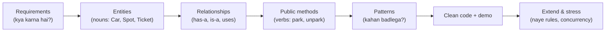

High-level design (is part ke Chapters 01–13) mein **boxes = services** hote hain aur arrows = network calls. Low-level design mein **boxes = classes** hote hain aur arrows = method calls. Soch same hai, bas zoom chhota hai.

| | High-Level Design (HLD) | Low-Level Design (LLD) |
|---|---|---|
| Zoom level | Poora system: services, databases, queues | Ek service ke andar: classes, methods |
| Typical question | "Design WhatsApp" | "Design the classes for a parking lot" |
| Output | Architecture diagram, estimates | Class diagram + working code |
| Main tension | Scale, availability, latency | Readability, extensibility, correctness |
| Failure kaisa dikhta hai | 1M users pe system gir jaata hai | Ek feature add karne ke liye 12 files edit karni padti hain |

> 💡 **Poore LLD ke peeche ek hi sawaal hai:** "Agle mahine jab requirements badlengi, toh mujhe kitni files chhooni padengi?" Accha design us number ko chhota rakhta hai.

> 🤔 **Mann mein sawaal:** Code chal raha hai, output sahi hai. Toh "design" ki itni tension kyun? Ek badi file mein sab likh do na?
>
> **Jawab:** Aaj chal raha hai, haan. Problem kal aati hai. Real companies mein code saalon tak zinda rehta hai aur har hafte naya requirement aata hai: "UPI ke saath ab wallet bhi chahiye", "EV charging spot bhi add karo". Ek badi file mein har change purane, tested code ko chhedta hai, aur kuch aur toot jaata hai. LLD ka poora game yahi hai: **change sasta rahe**. Interviewer bhi isiliye "ab ek naya vehicle type add karo" jaisa follow-up zaroor poochta hai.

---

## 🔨 Building It Up · Zero Se Shuru

### 1. What LLD and machine-coding rounds actually test · Ye round asal mein kya check karta hai

Is round ke do flavours hote hain, aur companies (khaas kar Indian product companies jaise Flipkart, Swiggy, Uber, PhonePe, Razorpay) dono ko bahut pasand karti hain:

| Format | Duration | Tum kya deliver karte ho | Example |
|---|---|---|---|
| **Machine coding** | 60–120 min | Working, runnable code + `main` mein ek demo | "Build Splitwise. Must run." |
| **LLD discussion** | 45–60 min | Class diagram + key methods, thoda code | "Design an elevator system" |
| **Take-home** | 1–3 din | Tests aur README ke saath poora project | "Build a parking lot CLI" |

Interviewer scorecard pe ye likhta hai:

| Woh kya check karte hain | "Accha" kaisa dikhta hai |
|---|---|
| **Requirement gathering** | Coding se pehle tumne 4–6 sharp sawaal poochhe aur scope likh ke rakha |
| **Modelling** | Classes real concepts se match karti hain. Koi 500-line ki `Manager` god class nahi |
| **OOP & SOLID** | Chhoti classes, saaf responsibilities, jahan cheezein badalti hain wahan abstractions |
| **Patterns** | Wahin use kiye jahan woh *madad* karte hain (pricing ke liye Strategy, vending machine ke liye State), dikhawe ke liye chhidke nahi |
| **Working code** | Code chalta hai. Demo main flows chala ke dikhata hai. Edge cases pe crash nahi hota |
| **Extensibility** | "Naya vehicle type add karo" = ek nayi class, har jagah edits nahi |
| **Concurrency awareness** | Tum bata sakte ho ki do users kahan takra sakte hain aur use kaise rokna hai |
| **Communication** | Banate waqt tum trade-offs bol ke samjhate ho |

> ⚠️ Machine coding mein **working beats perfect**. Ek clean design jo chalta hi nahi, us decent design se kam score karta hai jo chalta hai aur edge cases handle karta hai. Pehle happy path chalao, phir refine karo.

> 🇮🇳 **Desi Analogy:** Board exam ka 3 ghante ka paper socho. Jo student pehle ek sawaal ka itna sundar answer likhta hai ki baaki paper chhoot jaata hai, woh us student se kam marks laata hai jo pehle saare sawaal theek-thaak attempt karta hai aur phir bache time mein diagrams sundar banata hai. Machine coding round bilkul aisa hai: pehle poora "paper" (main flow) chalao, phir "presentation" (perfect design) polish karo.

### 2. OOP recap in one page · OOP ek page mein

Ye sab tumne Part 1 ke [Chapter 14](../part-1-python/14-oop-classes-objects.md) aur [Chapter 15](../part-1-python/15-oop-inheritance-magic.md) mein seekha tha. Yahan unhe dobara dekhte hain, LLD ke chashme se:

| Pillar | Seedha matlab | LLD mein use |
|---|---|---|
| **Encapsulation** | Object apna data khud guard karta hai; bahar wale sirf methods call karte hain | `account.withdraw(100)` balance check karta hai; koi `account._balance -= 100` nahi karta |
| **Abstraction** | Dikhao *kya* karta hai, chhupao *kaise* karta hai | `PaymentMethod.pay(amount)` UPI vs card ki details chhupa leta hai |
| **Inheritance** | "is-a": child parent ko reuse aur specialise karta hai | `Car` ek `Vehicle` hai |
| **Polymorphism** | Same call, har object pe alag behaviour | `shape.area()` circle aur rectangle dono pe chalta hai |

Python mein **abstract base class (ABC)** se tum interface likhte ho. Yaani ek aisi class jo kehti hai: "jo bhi khud ko mera type bolega, uske paas ye methods hone hi chahiye".

```python
from abc import ABC, abstractmethod


class Shape(ABC):
    @abstractmethod
    def area(self) -> float:
        """Every concrete shape must implement this."""

    def describe(self) -> str:          # shared behaviour, ek hi baar likha
        return f"{type(self).__name__} with area {self.area():.2f}"


class Circle(Shape):
    def __init__(self, radius: float):
        self._radius = radius           # aage underscore = "convention se private"

    def area(self) -> float:
        return 3.14159 * self._radius ** 2


class Rectangle(Shape):
    def __init__(self, width: float, height: float):
        self._width, self._height = width, height

    def area(self) -> float:
        return self._width * self._height


for shape in [Circle(1), Rectangle(2, 3)]:
    print(shape.describe())             # polymorphism: ek call, do behaviours

try:
    Shape()
except TypeError:
    print("Cannot create a bare Shape: it is abstract")
```

```text
Circle with area 3.14
Rectangle with area 6.00
Cannot create a bare Shape: it is abstract
```

Kya hua yahan: `Shape` ek contract hai. `describe()` ko na pata hai, na farak padta hai ki woh kis shape se baat kar raha hai. Woh bas `area()` call karta hai. Yahi ek idea, **code against the contract, not the concrete class** (yaani concrete class se nahi, contract se baat karo), is chapter ke har pattern ke peeche hai.

Ek chhoti detail jo beginners miss karte hain: `Shape()` banane ki koshish pe Python khud `TypeError` deta hai, kyunki `area()` abstract hai aur usne implement nahi kiya. Matlab contract **compile time pe nahi, object banate waqt** enforce hota hai. Agar `Circle` `area()` likhna bhool jaata, toh `Circle(1)` bhi isi error se fail hota.

**Composition over inheritance.** Inheritance kehta hai "is-a"; composition kehta hai "has-a". Ek `Car` ke paas ek `Engine` *hai*; car khud engine nahi hai. Jab ho sake, composition prefer karo, kyunki:

- Inheritance trees gehre aur naazuk ho jaate hain (parent badlo, 20 children toot jaate hain).
- Parent sirf code likhte waqt badla ja sakta hai, lekin component run time pe swap ho sakta hai (`car.engine = ElectricEngine()`).
- Python mein **duck typing** hai: agar kisi cheez ke paas `.pay()` method hai, toh tum use call kar sakte ho. Family tree ki zaroorat nahi.

Thumb rule: **interface** share karna ho (ek ABC) toh inherit karo. **Behaviour** share karna ho toh compose karo.

> 🇮🇳 **Desi Analogy:** Tumhara phone aur uska charger. Phone "has-a" charger (composition). Charger kharab hua? Naya laga do, phone wahi rehta hai. Ab socho agar phone "is-a" charger hota, yaani charger phone ke andar welded hota (inheritance se behaviour). Charger kharab = poora phone badlo. Composition yahi freedom deta hai: parts ko run time pe badal sakte ho. Aur USB-C port? Woh **interface** hai: jo bhi USB-C bolta hai, lag jaata hai.

> 🤔 **Mann mein sawaal:** Agar composition itna accha hai, toh inheritance kabhi use hi kyun karein?
>
> **Jawab:** Inheritance tab sahi hai jab rishta sach mein "is-a" ho aur tum ek **common contract** share kar rahe ho, jaise `Circle` aur `Rectangle` dono `Shape` hain. Problem tab hoti hai jab log sirf "code reuse" ke liye inherit karte hain, jaise `Stack(list)` banana, aur phir list ke saare methods (`insert`, `sort`) bhi stack mein aa jaate hain jo stack ka rule tod dete hain. Toh: contract ke liye inheritance, code reuse ke liye composition.

### 3. UML-lite: drawing classes fast · Classes jaldi kaise draw karein

UML (Unified Modelling Language) ek bada standard hai, lekin interviews ko uska sirf ek chhota hissa chahiye: classes ke liye boxes aur chheh tarah ke arrows. Is book mein hum unhe Mermaid `classDiagram` se draw karte hain.

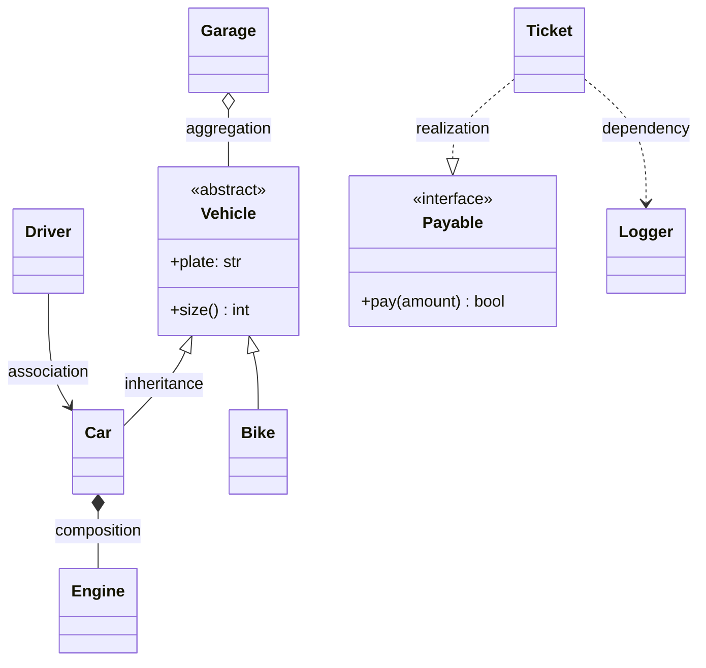

| Arrow | Naam | Matlab | Lifetime | Example |
|---|---|---|---|---|
| `<\|--` | **Inheritance** | "is-a" | n/a | Car ek Vehicle hai |
| `..\|>` | **Realization** | "interface implement karta hai" | n/a | Ticket Payable implement karta hai |
| `*--` | **Composition** | "own karta hai, whole ke saath part bhi mar jaata hai" | Owner jitni hi | Car Engine ko own karti hai |
| `o--` | **Aggregation** | "rakhta hai, lekin parts apne dam pe zinda rehte hain" | Independent | Garage mein Vehicles hain |
| `-->` | **Association** | "jaanta hai / lambe time tak use karta hai" | Independent | Driver Car chalata hai |
| `..>` | **Dependency** | "thodi der ke liye use karta hai, jaise ek parameter" | Temporary | Ticket ek method mein Logger use karta hai |

Composition aur aggregation mein sabse zyada confusion hota hai, toh ek test yaad rakho: **"Whole ko delete karo, kya part bhi chala gaya?"** Car scrap hui toh uska engine bhi gaya (composition, bhara hua diamond `*--`). Garage band hua toh gaadiyan sadak pe chali gayi, zinda hain (aggregation, khaali diamond `o--`).

Member notation: `+` public, `-` private, `#` protected. `+park(vehicle) Ticket` ka matlab hai ek public method `park` jo ek `vehicle` leta hai aur ek `Ticket` return karta hai. Multiplicity quotes mein jaati hai: `ParkingLot "1" *-- "many" Floor`.

> 💡 Interview mein exact arrow pe tension mat lo. **is-a vs has-a** sahi pakadna aur **kaun kisko own karta hai** dikhana hi 90% value hai.

### 4. SOLID: the five rules that keep code changeable · Paanch rules jo code ko badalne laayak rakhte hain

SOLID paanch principles hain jo Robert C. Martin ("Uncle Bob") ne collect kiye. Har ek code ke sadne (rot) ke ek khaas tareeke se ladta hai. Har principle ko hum aise karenge: **bad code → kyun dukhta hai → good code**.

| Letter | Principle | Ek line mein |
|---|---|---|
| **S** | Single Responsibility | Ek class, badalne ki ek wajah |
| **O** | Open/Closed | Naya feature = naya code add karo, purana mat chhedo |
| **L** | Liskov Substitution | Child, parent ki jagah bina surprise ke chal jaaye |
| **I** | Interface Segregation | Chhote, focused interfaces; zabardasti ke methods nahi |
| **D** | Dependency Inversion | High-level code abstraction pe depend kare, concrete class pe nahi |

#### 4.1 S: Single Responsibility Principle (SRP)

> Ek class ke paas **badalne ki sirf ek wajah** honi chahiye. (*A class should have one reason to change.*)

"Badalne ki wajah" ka matlab hai ek *insaan ya team* jo change maang sakti hai. Agar finance team, UI team aur DBA teeno ek hi class mein edits force kar sakte hain, toh us class ke paas teen responsibilities hain.

> 🇮🇳 **Desi Analogy:** Kirana store wale uncle socho jo khud hi saamaan tolte hain, khud hi khata likhte hain, khud hi delivery pe jaate hain. Jab woh delivery pe gaye, dukaan band. Jab khata ka format badalna hai (GST aa gaya!), toh tolne ka kaam bhi ruk jaata hai. Ek insaan, teen bosses (customer, CA, delivery area). SRP bolta hai: taraazu wala alag, khata wala alag, delivery boy alag.

❌ Bad: ek class calculate bhi karti hai, format bhi *aur* save bhi.

```py
class Invoice:
    def __init__(self, items):
        self.items = items

    def total(self):                  # finance ke rules
        return sum(price * qty for _, price, qty in self.items)

    def print_invoice(self):          # presentation ke rules
        print(f"TOTAL: {self.total()}")

    def save_to_db(self):             # persistence (DB) ke rules
        db.execute("INSERT INTO invoices ...")
```

Print format badalna hai? `Invoice` edit karo. MySQL se Postgres pe jaana hai? `Invoice` edit karo. Har edit ke saath maths tootne ka risk hai, jabki maths ka us change se koi lena dena hi nahi tha.

✅ Good: reason-to-change ke hisaab se todo.

```python
class Invoice:
    """Only business data and business rules."""
    def __init__(self, items):
        self.items = items            # (name, price, qty) ki list

    def total(self) -> int:
        return sum(price * qty for _, price, qty in self.items)


class InvoicePrinter:
    """Only presentation."""
    def render(self, invoice: Invoice) -> str:
        lines = [f"{name:<8}{qty} x {price}" for name, price, qty in invoice.items]
        lines.append(f"TOTAL   {invoice.total()}")
        return "\n".join(lines)


class InvoiceRepository:
    """Only persistence (in-memory here; a real one would talk to a DB)."""
    def __init__(self):
        self._rows = []

    def save(self, invoice: Invoice) -> int:
        self._rows.append(invoice)
        return len(self._rows)        # maan lo ye nayi row ki id hai


inv = Invoice([("pen", 10, 3), ("book", 120, 1)])
print(InvoicePrinter().render(inv))
print("saved with id", InvoiceRepository().save(inv))
```

```text
pen     3 x 10
book    1 x 120
TOTAL   150
saved with id 1
```

Kya hua yahan: ab har class ka bilkul ek boss hai. Printer jitna chahe badle, `total()` ko koi risk nahi.

> 🤔 **Mann mein sawaal:** SRP ka matlab "ek class mein ek hi method" hai kya?
>
> **Jawab:** Bilkul nahi. `Invoice` mein kai methods ho sakte hain (`total()`, `add_item()`, `apply_coupon()`), aur ye theek hai kyunki sab ek hi "boss" (business rules / finance) ke liye hain. SRP methods ginta nahi, **badalne ki wajahein** ginta hai. Sawaal ye poocho: "Ye class kaun kaun si teams ki wajah se badlegi?" Jawab ek team hai, toh SRP happy hai.

#### 4.2 O: Open/Closed Principle (OCP)

> Software **extension ke liye open, modification ke liye closed** hona chahiye.

Feature add karne ka matlab hona chahiye naya code *add* karna, tested code ko *edit* karna nahi.

❌ Bad: har naye customer type ke liye ye function edit karna padta hai.

```py
def discount(customer_type, amount):
    if customer_type == "regular":
        return 0
    elif customer_type == "premium":
        return amount * 0.10
    elif customer_type == "employee":     # pichhle mahine add kiya
        return amount * 0.30
    # ... aur agle mahine koi phir se ise edit karega
```

✅ Good: har rule apni class hai; calculator kabhi nahi badalta.

```python
from abc import ABC, abstractmethod


class DiscountPolicy(ABC):
    @abstractmethod
    def discount(self, amount: int) -> int: ...


class NoDiscount(DiscountPolicy):
    def discount(self, amount): return 0


class PremiumDiscount(DiscountPolicy):
    def discount(self, amount): return amount * 10 // 100


class EmployeeDiscount(DiscountPolicy):            # NEW: kuch bhi edit kiye bina add hua
    def discount(self, amount): return amount * 30 // 100


def final_price(amount: int, policy: DiscountPolicy) -> int:
    return amount - policy.discount(amount)        # modification ke liye closed


for policy in [NoDiscount(), PremiumDiscount(), EmployeeDiscount()]:
    print(type(policy).__name__, final_price(1000, policy))
```

```text
NoDiscount 1000
PremiumDiscount 900
EmployeeDiscount 700
```

Kya hua yahan: `final_price` closed hai (dobara kabhi edit nahi hoga) lekin system open hai (nayi policies plug in ho jaati hain). Ye **Strategy pattern** hai, jisse hum formally section 5.4 mein milenge.

Ek chhota detail dekho: discount `amount * 10 // 100` likha hai, `amount * 0.10` nahi. Paison ke saath float avoid karna accha habit hai (`0.1 + 0.2` Python mein `0.30000000000000004` deta hai). Integer paise/rupees mein hisaab rakho.

> 🇮🇳 **Desi Analogy:** Ghar ka electric board socho. Naya appliance laaye (mixer, iron, phone charger)? Bas plug lagao. Tum deewar tod ke wiring dobara nahi karte. Board **modification ke liye closed** hai, **extension ke liye open** (socket = interface). Bad code wo ghar hai jahan har naye appliance ke liye electrician bula ke wiring chhedni padti hai.

#### 4.3 L: Liskov Substitution Principle (LSP)

> Agar `S`, `T` ka subtype hai, toh jahan bhi `T` expected hai wahan tum `S` use kar sako, **bina kisi surprise ke**.

Ye naam Barbara Liskov ke naam pe hai. Child class ko parent ke saare promises nibhaane chahiye. Agar parent promise karta hai "main udd sakta hoon", toh jo child `fly()` pe error phenkta hai, woh har caller ko tod deta hai.

❌ Bad: penguin ek bird hai, toh use `fly()` inherit ho gaya... aur woh phat gaya.

```python
class Bird:
    def fly(self) -> str:
        return f"{type(self).__name__} flies"


class Sparrow(Bird):
    pass


class Penguin(Bird):
    def fly(self) -> str:
        raise NotImplementedError("penguins can't fly")   # parent ka promise tod diya


def migrate(birds):
    for bird in birds:
        try:
            print(bird.fly())
        except NotImplementedError as e:
            print("CRASH:", e)          # ab callers ko special cases chahiye: LSP toot gaya


migrate([Sparrow(), Penguin()])
```

```text
Sparrow flies
CRASH: penguins can't fly
```

✅ Good: asli capability model karo. Sirf udne wale birds udne ka promise karte hain.

```python
class Bird:
    def eat(self) -> str:
        return f"{type(self).__name__} eats"


class FlyingBird(Bird):
    def fly(self) -> str:
        return f"{type(self).__name__} flies"


class Sparrow(FlyingBird):
    pass


class Penguin(Bird):
    def swim(self) -> str:
        return "Penguin swims"


def migrate(birds: list[FlyingBird]):
    for bird in birds:
        print(bird.fly())               # har FlyingBird ye promise nibhata hai


migrate([Sparrow()])
print(Penguin().eat(), "|", Penguin().swim())
```

```text
Sparrow flies
Penguin eats | Penguin swims
```

Quick LSP smell test: kya koi subclass **"not supported" throw** karti hai, kisi method ko **ignore** karti hai, parent se **zyada strict inputs maangti** hai, ya parent se **kamzor results** deti hai? Toh hierarchy galat hai. Famous textbook example hai `Square(Rectangle)`: square ki width set karo toh uski height bhi chupke se badal jaati hai, jo us code ko surprise deta hai jo soch raha hai ki uske haath mein ek rectangle hai.

Square wala example thoda kholke dekho, kyunki interviewers isko bahut poochte hain. Koi function likhta hai: `r.set_width(5); r.set_height(4); assert r.area() == 20`. Rectangle ke liye ye sahi hai. Ab usi function ko ek `Square` do. `set_height(4)` ne width ko bhi 4 kar diya, toh area 16 aaya. Maths mein square ek rectangle hai, lekin **behaviour mein** nahi. LSP maths ka nahi, **promises ka** rule hai.

> 🇮🇳 **Desi Analogy:** Tumne Swiggy se "Paneer Butter Masala" order kiya. Restaurant badal gaya, koi baat nahi, jab tak plate mein paneer butter masala hi aaye. Lekin agar naya restaurant bole "humare yahan paneer nahi milta, aloo bhej diya", toh tumhara pura dinner plan toot gaya. Har restaurant (subclass) ko menu ke promise (parent ka contract) nibhaana hai. Jo nahi nibha sakta, use us menu item ke neeche list hi nahi hona chahiye.

#### 4.4 I: Interface Segregation Principle (ISP)

> Kisi class ko un methods pe depend karne ke liye majboor mat karo jo woh use hi nahi karti. Ek mota interface nahi, **kai chhote interfaces** banao.

❌ Bad: ek "sab kuch karo" wala interface.

```py
class Machine(ABC):
    @abstractmethod
    def print_doc(self, doc): ...
    @abstractmethod
    def scan(self, doc): ...
    @abstractmethod
    def fax(self, doc): ...

class CheapPrinter(Machine):
    def print_doc(self, doc): ...
    def scan(self, doc): raise NotImplementedError   # zabardasti nakli method likhna pada
    def fax(self, doc):  raise NotImplementedError   # (ye LSP violation bhi hai)
```

Dekho kya hua: `CheapPrinter` sirf print kar sakta hai, lekin `Machine` interface ne use zabardasti `scan` aur `fax` likhne pe majboor kiya. Toh usne jhooth bola: method bana diya jo sirf error phenkta hai. Ab koi bhi code jo `Machine` leta hai aur `scan()` call karta hai, woh runtime pe phatega.

✅ Good: chhote role interfaces; classes sirf wahi chunti hain jo woh sach mein support karti hain.

```python
from abc import ABC, abstractmethod


class Printer(ABC):
    @abstractmethod
    def print_doc(self, doc: str) -> str: ...


class Scanner(ABC):
    @abstractmethod
    def scan(self, doc: str) -> str: ...


class CheapPrinter(Printer):
    def print_doc(self, doc): return f"printed {doc}"


class OfficeMachine(Printer, Scanner):        # dono roles khud chune
    def print_doc(self, doc): return f"printed {doc} in colour"
    def scan(self, doc): return f"scanned {doc}"


def print_all(printers: list[Printer], doc: str):
    for p in printers:
        print(p.print_doc(doc))


print_all([CheapPrinter(), OfficeMachine()], "resume.pdf")
print(OfficeMachine().scan("aadhaar.jpg"))
```

```text
printed resume.pdf
printed resume.pdf in colour
scanned aadhaar.jpg
```

Kya hua yahan: `print_all` ko sirf `Printer` chahiye, toh woh sirf `Printer` maangta hai. `CheapPrinter` ko scan ka jhootha method likhna hi nahi pada. Aur `OfficeMachine` ne dono roles khud chune (Python mein multiple inheritance se ek class kai ABCs implement kar sakti hai).

> 🇮🇳 **Desi Analogy:** Shaadi ke liye "all-in-one" contractor socho jiska contract kehta hai: "tent, catering, DJ, mehendi, photography sab karna padega". Ab ek accha halwai sirf catering karta hai, lekin contract sign karne ke liye use jhooth bolna padega ki woh DJ bhi karta hai. ISP kehta hai: alag alag contracts banao (`Caterer`, `DJ`, `Photographer`). Halwai sirf `Caterer` sign kare. Event planner jo sab karta hai, woh teeno sign kar le.

#### 4.5 D: Dependency Inversion Principle (DIP)

> High-level modules low-level modules pe depend nahi karne chahiye. **Dono abstractions pe depend karne chahiye.**

"High-level" = business logic (order place karna). "Low-level" = details (MySQL, SMTP, Razorpay SDK). Agar business logic apne andar hi `MySQLDatabase()` bana leta hai, toh woh hamesha ke liye MySQL se weld ho gaya, aur use unit test karna namumkin hai.

❌ Bad:

```py
class OrderService:
    def __init__(self):
        self.db = MySQLDatabase("prod-host:3306")   # detail andar weld ho gayi

    def place(self, order):
        self.db.insert("orders", order)
```

✅ Good: ek abstraction pe depend karo, aur use **inject** karwao (bahar se pass karwao). Isko **dependency injection** kehte hain.

```python
from abc import ABC, abstractmethod


class OrderRepository(ABC):                       # woh abstraction jis pe dono taraf depend karte hain
    @abstractmethod
    def add(self, order_id: str, amount: int) -> None: ...

    @abstractmethod
    def count(self) -> int: ...


class InMemoryOrderRepository(OrderRepository):   # ek low-level detail (tests ke liye badhiya)
    def __init__(self):
        self._orders = {}

    def add(self, order_id, amount):
        self._orders[order_id] = amount

    def count(self):
        return len(self._orders)


class OrderService:                               # high-level policy (business logic)
    def __init__(self, repo: OrderRepository):    # inject hua, andar bana nahi
        self._repo = repo

    def place(self, order_id: str, amount: int) -> str:
        if amount <= 0:
            return f"{order_id}: rejected"
        self._repo.add(order_id, amount)
        return f"{order_id}: placed"


service = OrderService(InMemoryOrderRepository())
print(service.place("o1", 499))
print(service.place("o2", 0))
```

```text
o1: placed
o2: rejected
```

Kya hua yahan: `OrderService` kahin bhi MySQL ka naam nahi leta. Production mein tum `MySQLOrderRepository` inject karte ho; tests mein in-memory wala. Dependency ka arrow "invert" ho gaya: ab detail us interface pe depend karti hai jo business layer ka hai.

"Inversion" shabd pe atak mat jaana. Pehle arrow aisa tha: `OrderService → MySQLDatabase` (business, detail pe tika hua). Ab aisa hai: `OrderService → OrderRepository ← MySQLOrderRepository`. Detail ka arrow ab ulta, abstraction ki taraf point karta hai. Isi ulte arrow ko "inversion" kehte hain.

> 🇮🇳 **Desi Analogy:** Ghar ki wiring aur socket. Tumhara mixer (high-level kaam: chutney banana) seedha power station ke taar se joda hua nahi hai. Woh ek **standard 3-pin socket** (abstraction) pe depend karta hai. Peeche bijli Tata Power se aaye, Adani se, ya inverter se (low-level details), mixer ko farak nahi padta. Aur testing ke time? Tum mixer ko ek test bench ke socket mein laga do. Yahi dependency injection hai: power ka source bahar se plug hota hai, mixer ke andar welded nahi.

> 🤔 **Mann mein sawaal:** Dependency Inversion aur Dependency Injection same cheez hai kya?
>
> **Jawab:** Nahi, rishtedaar hain. **Dependency Inversion** ek *principle* hai: "business logic abstraction pe depend kare, details pe nahi". **Dependency Injection** ek *technique* hai jisse ye principle implement hota hai: dependency ko constructor (ya method) mein bahar se pass karna, andar `new` karne ke bajaye. Principle = "kya chahiye", technique = "kaise karein".

| Letter | Ek line | Smell ki ye toota hai |
|---|---|---|
| **S** | Badalne ki ek wajah | Class ke naam mein "And" ya "Manager" hai; 1,000 lines |
| **O** | Add karo, edit nahi | Type field pe badhta hua `if/elif` |
| **L** | Subtypes promise nibhaate hain | Child mein `raise NotImplementedError`; callers mein `isinstance` checks |
| **I** | Chhote interfaces | Classes methods ko khaali stubs ki tarah implement kar rahi hain |
| **D** | Abstractions pe depend karo | Business logic ke andar `SomeConcreteThing()` ban raha hai; unit test nahi ho pata |

### 5. Design patterns: a shared vocabulary · Ek common bhasha

Ek **design pattern** ek baar baar aane wali problem ka naam wala, aazmaya hua solution hai. Classic catalogue 1994 ki "Gang of Four" (GoF) book hai, jismein 23 patterns teen families mein hain:

| Family | Kis sawaal ka jawab | Is chapter ke patterns |
|---|---|---|
| **Creational** | Objects *bante* kaise hain? | Singleton, Factory, Builder |
| **Structural** | Objects *aapas mein fit* kaise hote hain? | Decorator, Adapter |
| **Behavioural** | Objects *baat kaise karte hain aur kaam kaise baantte hain*? | Strategy, Observer, State, Command, Chain of Responsibility |

Pattern ki value aadhi code mein hai, aadhi **vocabulary** mein. "Pricing ek Strategy hai, aur machine ke modes States hain" bol ke tum nau shabdon mein interviewer ko poora design bata dete ho.

> 🇮🇳 **Desi Analogy:** Cricket commentary socho. Commentator bolta hai "yorker", "googly", "cover drive". Ek shabd mein poori technique samajh aa jaati hai, lambi explanation ki zaroorat nahi. Design patterns developers ki commentary language hain. "Yahan Observer lagao" bolna utna hi powerful hai jitna "slip mein ek aur fielder lagao".

> ⚠️ Python Java nahi hai. Functions objects hain, modules singletons hain, aur decorators language mein built-in hain. Kai patterns Python mein kuch lines mein simat jaate hain. Classic shape *aur* Pythonic shortcut dono dikhao: interviewers ko ye bahut pasand aata hai.

#### 5.1 Singleton: exactly one instance · Sirf ek hi object

**Problem:** kuch cheezein ek process mein sirf ek baar exist karni chahiye: ek config object, ek connection pool, ek logger, khud `ParkingLot`.

**Analogy:** ek desh ka ek waqt pe ek hi Prime Minister hota hai. Jo bhi poochhe "PM kaun hai?", sabko same insaan milta hai.

> 🇮🇳 **Desi Analogy:** Joint family ka **ek hi fridge**. Mummy doodh rakhe, papa dahi nikaale, chhotu chocolate chhupaye, sab same fridge use karte hain. Agar har koi apna alag fridge khareed le, toh "doodh khatam hai ya nahi?" ka koi ek sahi jawab nahi rahega. Singleton = ek shared instance, taaki state (config, settings) sabke liye ek jaisi rahe. (Aur haan, fridge ka darwaza ek waqt pe do log kheenchein toh jhagda hota hai. Wahi hai thread safety, jiske liye lock chahiye.)

```python
import threading


class AppConfig:
    _instance = None
    _lock = threading.Lock()

    def __new__(cls):
        # Double-checked locking: sasta check, ban jaane ke baad lock skip kar deta hai,
        # lock ke andar doosra check do threads ko dono ke dono banane se rokta hai.
        if cls._instance is None:
            with cls._lock:
                if cls._instance is None:
                    instance = super().__new__(cls)
                    instance.settings = {"currency": "INR"}
                    cls._instance = instance
        return cls._instance


a = AppConfig()
b = AppConfig()
a.settings["theme"] = "dark"
print(a is b, b.settings)

# Threads ke saath prove karo: 8 threads banane ki race lagate hain, sabko same object milta hai.
ids = set()
threads = [threading.Thread(target=lambda: ids.add(id(AppConfig()))) for _ in range(8)]
for t in threads:
    t.start()
for t in threads:
    t.join()
print("distinct instances seen by threads:", len(ids))
```

```text
True {'currency': 'INR', 'theme': 'dark'}
distinct instances seen by threads: 1
```

Kya hua yahan: `__new__` woh method hai jo object ko asal mein *banata* hai (`__init__` usko fill karne se pehle). Hum usse intercept karte hain aur har baar stored instance hi return karte hain. Instance ko hum `__new__` ke andar set up karte hain, `__init__` mein nahi, kyunki `__init__` *har* `AppConfig()` call pe dobara chalta aur settings mita deta.

Double-checked locking ko step by step samjho, kyunki interviewer yahin ghusta hai:
1. **Pehla check (lock ke bina):** instance ban chuka hai? Toh seedha return karo. Lock lene ka kharcha bach gaya. 99.99% calls yahin khatam hoti hain.
2. **Lock lo:** ab sirf ek thread andar aa sakta hai.
3. **Doosra check (lock ke andar):** ho sakta hai do threads ne ek saath pehla check paas kiya ho. Pehla wala lock lekar instance bana ke nikal gaya. Ab doosra lock leta hai, aur agar ye check na hota, toh woh *doosra* instance bana deta. Ye check use rok deta hai.

> 🤔 **Mann mein sawaal:** Python mein toh GIL hai, ek waqt pe ek hi thread chalta hai. Phir lock kyun chahiye?
>
> **Jawab:** GIL sirf ek *bytecode instruction* ko atomic banata hai, poore `if ... : create` ko nahi. Thread A `if cls._instance is None` check karta hai (True), aur bilkul usi waqt OS switch karke Thread B ko chala sakta hai. B bhi check karta hai (abhi bhi True) aur instance bana deta hai. Phir A wapas aata hai aur *doosra* instance banata hai. "Check aur act" ke beech ka gap GIL nahi bharta. Lock bharta hai. (Python 3.13+ ke free-threaded build mein toh GIL hi optional hai, toh ye aur bhi zaroori hai.)

**Pythonic shortcut:** ek module ek hi baar import hota hai aur cache ho jaata hai, toh module-level pe rakha ek simple object *khud hi* singleton hai:

```py
# config.py
settings = {"currency": "INR"}

# kahin bhi aur
from config import settings      # hamesha wahi same dict
```

> ⚠️ **Singleton sabse zyada overuse hone wala pattern hai.** Ye sundar suit pehna hua global state hai: dependencies chhupa deta hai aur tests ek doosre mein leak hone lagte hain (ek test ne config badla, doosra test fail). Interview mein bolo: "Demo ke liye main `ParkingLot` ko singleton bana raha hoon, lekin production mein main startup pe ek instance banake use inject karunga (DIP)."

#### 5.2 Factory: one place that decides *which class* to create · Kaunsi class banegi, ek jagah tay hoga

**Problem:** callers ko pata hai ki unhe *kis tarah* ki cheez chahiye ("email", "sms"), lekin unhe concrete class names ya banane ki details nahi pata honi chahiye.

**Analogy:** tum counter pe "ek large cold coffee" order karte ho. Tum kitchen mein ghus ke machine nahi chunte.

> 🇮🇳 **Desi Analogy:** IRCTC pe tum bas class chunte ho: "Sleeper", "3AC", "2AC". Kaunsa coach, kaunsa berth, kaunsa fare chart lagega, ye system ke andar ek jagah tay hota hai. Tumhe `ThirdACCoach` class ka naam nahi pata. Ab Railways naya "3E (economy)" class laaye? Andar registry mein ek entry judti hai, tumhara booking form waisa hi rehta hai. Yahi Factory hai: string do, sahi object lo.

```python
from abc import ABC, abstractmethod


class Notifier(ABC):
    @abstractmethod
    def send(self, to: str, msg: str) -> str: ...


class EmailNotifier(Notifier):
    def send(self, to, msg): return f"EMAIL to {to}: {msg}"


class SMSNotifier(Notifier):
    def send(self, to, msg): return f"SMS to {to}: {msg[:20]}"   # SMS ki length limit hoti hai


class PushNotifier(Notifier):
    def send(self, to, msg): return f"PUSH to device of {to}: {msg}"


class NotifierFactory:
    _registry = {"email": EmailNotifier, "sms": SMSNotifier, "push": PushNotifier}

    @classmethod
    def register(cls, kind: str, notifier_cls: type) -> None:
        cls._registry[kind] = notifier_cls        # naye types plug in hote hain: Open/Closed

    @classmethod
    def create(cls, kind: str) -> Notifier:
        try:
            return cls._registry[kind]()
        except KeyError:
            raise ValueError(f"unknown notifier: {kind}") from None


for kind in ["email", "sms", "push"]:
    print(NotifierFactory.create(kind).send("asha", "Your order has been shipped!"))

try:
    NotifierFactory.create("pigeon")
except ValueError as e:
    print(e)
```

```text
EMAIL to asha: Your order has been shipped!
SMS to asha: Your order has been 
PUSH to device of asha: Your order has been shipped!
unknown notifier: pigeon
```

Kya hua yahan: type pe `if/elif` ab bilkul ek hi jagah rehta hai (yahan `if/elif` ke bajaye ek dictionary lookup). Baaki code sirf `Notifier` interface jaanta hai. Aur `register()` ki wajah se naya type ("whatsapp") add karne ke liye factory edit karne ki bhi zaroorat nahi: bas `NotifierFactory.register("whatsapp", WhatsAppNotifier)`. Iska ek bada bhai bhi hai, **Abstract Factory**, jo related objects ki *families* banata hai (jaise `DarkThemeFactory` dark buttons *aur* dark menus dono banata hai, taaki galti se dark button ke saath light menu na aa jaaye).

Ek chhoti cheez dekho: `raise ValueError(...) from None`. `from None` andar wala `KeyError` traceback chhupa deta hai, taaki user ko saaf message mile: "unknown notifier: pigeon".

#### 5.3 Builder: construct complex objects step by step · Object ko step by step banao

**Problem:** ek object ke bahut saare optional parts hain, aur 12 parameters wala constructor padhne laayak nahi rehta: `Pizza("L", True, False, None, 2, ...)`. Is `True` ka matlab kya hai?

**Analogy:** Subway sandwich: pehle bread, phir cheese, phir veggies, phir sauce, har step ka naam hai, aur end mein "build".

> 🇮🇳 **Desi Analogy:** Chai tapri pe order: "Bhaiya, ek chai... kam cheeni... adrak daal ke... cutting... aur kadak". Har instruction ek naam wala step hai (`.sugar("kam").add("adrak").size("cutting")`), aur jab tum bolte ho "bas, bana do", tab hi chai banti hai (`.build()`). Agar tum bolo "cutting mein double glass", toh bhaiya wahin rok dega (validation `build()` pe hoti hai, poori picture dekh ke).

```python
class HttpRequest:
    def __init__(self, method, url, headers, body, timeout):
        self.method, self.url, self.headers = method, url, headers
        self.body, self.timeout = body, timeout

    def __repr__(self):
        return (f"{self.method} {self.url} headers={self.headers} "
                f"body={self.body!r} timeout={self.timeout}s")


class HttpRequestBuilder:
    def __init__(self, url: str):
        self._method, self._url = "GET", url
        self._headers, self._body, self._timeout = {}, None, 30

    def method(self, m: str):
        self._method = m
        return self                      # self return karne se chaining hoti hai

    def header(self, key: str, value: str):
        self._headers[key] = value
        return self

    def json_body(self, text: str):
        self._body = text
        return self.header("Content-Type", "application/json")

    def timeout(self, seconds: int):
        self._timeout = seconds
        return self

    def build(self) -> HttpRequest:
        # Validation ek hi baar, end mein, poori picture dekh ke hoti hai.
        if self._method == "GET" and self._body is not None:
            raise ValueError("GET requests must not have a body")
        return HttpRequest(self._method, self._url, dict(self._headers),
                           self._body, self._timeout)


req = (HttpRequestBuilder("https://api.shop.in/orders")
       .method("POST")
       .header("Auth", "token123")
       .json_body('{"item": 42}')
       .timeout(5)
       .build())
print(req)

try:
    HttpRequestBuilder("https://x.in").json_body("{}").build()
except ValueError as e:
    print("invalid:", e)
```

```text
POST https://api.shop.in/orders headers={'Auth': 'token123', 'Content-Type': 'application/json'} body='{"item": 42}' timeout=5s
invalid: GET requests must not have a body
```

Kya hua yahan: har method `self` return karta hai, isliye calls ek chain ki tarah lag jaati hain (`.method(...).header(...)...`). Validation ("GET mein body nahi ho sakti") `build()` mein ek hi baar hoti hai, jab saare fields set ho chuke hain. Agar validation har setter mein hoti, toh order ka chakkar padta: `json_body()` pehle call hua aur `method("POST")` baad mein, toh setter ko galat error dikhta.

**Pythonic shortcut:** default values wale keyword arguments, ya ek `@dataclass`, "`True` ka matlab kya hai" wali problem pehle hi solve kar dete hain: `Pizza(size="L", extra_cheese=True)`. Builder tab nikaalo jab construction mein **steps, multiple fields ke across validation, ya kai representations** hon (jaise SQL query banana ya ek test fixture).

#### 5.4 Strategy: swap an algorithm at run time · Algorithm ko run time pe badlo

**Problem:** ek kaam karne ke kai tareeke hain (pay karna, price lagana, sort karna, route nikaalna), aur kaunsa tareeka chalega ye user, config ya time ke hisaab se badalta hai.

**Analogy:** Google Maps poochta hai "car, bike, walk ya metro?" *Destination* wala logic same hai; sirf routing strategy badalti hai.

> 🇮🇳 **Desi Analogy:** UPI app ka checkout screen. Amount same hai (₹500), "Pay" button same hai, lekin neeche tum chunte ho: UPI, card, net banking ya wallet. Checkout page ko nahi pata ki card pe 2% fee kaise lagti hai ya UPI pin kaise maangta hai. Woh bas `strategy.pay(amount)` bolta hai. Naya method aaya ("BNPL / pay later")? Ek nayi class, checkout page untouched. Payment method **Strategy** hai, checkout **Context** hai.

```python
from abc import ABC, abstractmethod


class PaymentStrategy(ABC):
    @abstractmethod
    def pay(self, amount: int) -> str: ...


class UPIPayment(PaymentStrategy):
    def __init__(self, vpa): self.vpa = vpa
    def pay(self, amount): return f"Paid Rs {amount} via UPI ({self.vpa})"


class CardPayment(PaymentStrategy):
    def __init__(self, last4): self.last4 = last4
    def pay(self, amount):
        fee = amount * 2 // 100                    # yahan cards pe 2% fee lagti hai
        return f"Paid Rs {amount + fee} via card **{self.last4} (incl. fee {fee})"


class Checkout:
    def __init__(self, strategy: PaymentStrategy):
        self.strategy = strategy                   # composition: Checkout ke paas ek strategy HAI

    def complete(self, amount: int) -> str:
        return self.strategy.pay(amount)


cart = Checkout(UPIPayment("asha@okbank"))
print(cart.complete(500))
cart.strategy = CardPayment("4242")                # run time pe swap kiya
print(cart.complete(500))

# Pythonic: strategy ek simple function bhi ho sakti hai.
def sort_by_price(items): return sorted(items, key=lambda x: x[1])
def sort_by_rating(items): return sorted(items, key=lambda x: -x[2])

items = [("phone", 15000, 4.1), ("earbuds", 2000, 4.6), ("watch", 5000, 3.9)]
for strategy in (sort_by_price, sort_by_rating):
    print(strategy.__name__, [name for name, *_ in strategy(items)])
```

```text
Paid Rs 500 via UPI (asha@okbank)
Paid Rs 510 via card **4242 (incl. fee 10)
sort_by_price ['earbuds', 'watch', 'phone']
sort_by_rating ['earbuds', 'phone', 'watch']
```

Kya hua yahan: `Checkout` ke paas ek strategy *hai* (composition), aur `cart.strategy = CardPayment("4242")` se humne usse run time pe swap kar diya, bina `Checkout` ko chhede. Doosra hissa Python ka shortcut dikhata hai: agar strategy ke paas sirf ek method hai, toh poori class ki zaroorat nahi, ek **function** hi strategy hai (Python mein functions first-class objects hain, unhe variable ki tarah pass kar sakte ho).

**Strategy vs State** (log inhe mix kar dete hain): Strategy mein *client* algorithm chunta hai aur woh aamtaur pe fixed rehta hai. State mein *object khud* apna behaviour badalta hai jaise jaise uski andar ki situation badalti hai. Code ka shape same, irada alag.

#### 5.5 Observer: "notify me when something happens" · "Kuch ho toh mujhe batana"

**Problem:** jab ek object badalta hai, kai doosre objects ko react karna padta hai, aur badalne wale object ko pata nahi hona chahiye ki woh kaun hain.

**Analogy:** YouTube subscriptions. Channel bas video upload karta hai; YouTube har subscriber ko notify karta hai. Channel tumhe personally call nahi karta.

> 🇮🇳 **Desi Analogy:** Joint family ka **WhatsApp group**. Mummy ek message daalti hain: "Dinner ready hai". Woh har insaan ko alag se call nahi karti. Group (event bus) message sabko pahuncha deta hai. Chacha ji ne group "mute/leave" kar diya (unsubscribe)? Mummy ko kuch badalna nahi padta. Naya cousin group mein add hua (subscribe)? Mummy ka kaam same. Mummy = **subject/publisher**, family members = **observers**.

```python
from collections import defaultdict


class EventBus:
    def __init__(self):
        self._subscribers = defaultdict(list)     # event ka naam -> callbacks ki list

    def subscribe(self, event: str, callback) -> None:
        self._subscribers[event].append(callback)

    def unsubscribe(self, event: str, callback) -> None:
        self._subscribers[event].remove(callback)

    def publish(self, event: str, data: dict) -> None:
        for callback in list(self._subscribers[event]):   # copy: agar koi callback unsubscribe kare toh bhi safe
            callback(data)


class OrderService:
    def __init__(self, bus: EventBus):
        self.bus = bus

    def place_order(self, order_id: str, user: str, amount: int) -> None:
        print(f"Order {order_id} saved")
        self.bus.publish("order_placed", {"id": order_id, "user": user, "amount": amount})


def send_email(e): print(f"  [email]     Hi {e['user']}, order {e['id']} confirmed")
def add_points(e): print(f"  [loyalty]   +{e['amount'] // 100} points for {e['user']}")
def notify_warehouse(e): print(f"  [warehouse] pack order {e['id']}")

bus = EventBus()
for handler in (send_email, add_points, notify_warehouse):
    bus.subscribe("order_placed", handler)

OrderService(bus).place_order("A17", "ravi", 2450)
bus.unsubscribe("order_placed", add_points)
OrderService(bus).place_order("A18", "meera", 900)
```

```text
Order A17 saved
  [email]     Hi ravi, order A17 confirmed
  [loyalty]   +24 points for ravi
  [warehouse] pack order A17
Order A18 saved
  [email]     Hi meera, order A18 confirmed
  [warehouse] pack order A18
```

Kya hua yahan: `OrderService` ko pata hi nahi ki emails, loyalty points ya warehouse exist karte hain. SMS sender add karna = ek `subscribe` call. Ye [Chapter 08](08-queues-events.md) ke pub/sub systems ka in-process version hai. Classic naam: publisher ko **subject** kehte hain, subscribers ko **observers**.

Do chhoti details jo interview mein point dilaati hain:
- `publish` mein `list(self._subscribers[event])` likha hai, yaani list ki **copy** pe loop. Agar koi callback chalte chalte khud ko unsubscribe kar de, toh original list loop ke beech badal jaati, aur Python items skip kar deta. Copy pe loop karna safe hai.
- Loyalty points `2450 // 100 = 24` aaye, `24.5` nahi, kyunki `//` integer division hai.

#### 5.6 State: behaviour changes with internal state · Andar ki state ke hisaab se behaviour

**Problem:** ek object apne stage ke hisaab se alag behave karta hai, aur `if state == ...` checks har method mein phailte ja rahe hain.

**Analogy:** tumhare phone ka power button. Locked hai: screen jagaata hai. Unlocked hai: lock karta hai. Call chal rahi hai: ringer mute karta hai. Button same, behaviour current state decide karti hai.

> 🇮🇳 **Desi Analogy:** **Traffic signal** socho. Ek hi "next" event hai (timer), lekin Red ke baad Green aata hai, Green ke baad Yellow, Yellow ke baad Red. Aur Red pe "chalo" ka order illegal hai. Har light (state) khud jaanti hai ki usse aage kaunsi light aayegi aur kya allowed hai. Signal controller mein `if light == "red" ... elif light == "green"` ka jungle nahi, bas `current_light.next()`.

```python
from abc import ABC, abstractmethod


class OrderState(ABC):
    name = "?"
    def ship(self, order): print(f"  cannot ship: order is {self.name}")
    def deliver(self, order): print(f"  cannot deliver: order is {self.name}")
    def cancel(self, order): print(f"  cannot cancel: order is {self.name}")


class Placed(OrderState):
    name = "PLACED"
    def ship(self, order): order.state = Shipped()
    def cancel(self, order): order.state = Cancelled()


class Shipped(OrderState):
    name = "SHIPPED"
    def deliver(self, order): order.state = Delivered()


class Delivered(OrderState):
    name = "DELIVERED"


class Cancelled(OrderState):
    name = "CANCELLED"


class Order:
    def __init__(self):
        self.state: OrderState = Placed()

    # Order bas delegate karta hai; har state decide karti hai kya legal hai.
    def ship(self): self.state.ship(self)
    def deliver(self): self.state.deliver(self)
    def cancel(self): self.state.cancel(self)


o = Order()
for action in ["ship", "cancel", "deliver", "ship"]:
    getattr(o, action)()
    print(f"after {action:<8} -> {o.state.name}")
```

```text
after ship     -> SHIPPED
  cannot cancel: order is SHIPPED
after cancel   -> SHIPPED
after deliver  -> DELIVERED
  cannot ship: order is DELIVERED
after ship     -> DELIVERED
```

Kya hua yahan: state pe kahin bhi `if` nahi hai. Har state class sirf wahi transitions list karti hai jo woh allow karti hai; baaki sab base class reject kar deti hai. `Returned` state add karna = ek class add karo aur `Delivered` mein ek transition, aur kuch nahi. Vending machine ke liye hum bilkul yahi shape use karenge.

Ek trick dekho: `getattr(o, action)()`. `getattr(o, "ship")` method `o.ship` ko string se nikaal leta hai, aur `()` use call karta hai. Demo loops mein ye bahut kaam aata hai.

> 🤔 **Mann mein sawaal:** Itni saari classes! Ek `if/elif` likh dete toh 10 lines mein kaam ho jaata na?
>
> **Jawab:** 3 states aur 3 actions ke liye, haan, `if/elif` chal jaayega. Lekin `if/elif` mein har method (`ship`, `deliver`, `cancel`) ke andar har state ka check hota hai: 3 × 4 = 12 jagah logic bikhra hua. Ek state add karo toh har method edit karo (OCP toota). State pattern mein woh logic **state ke hisaab se group** ho jaata hai: "Shipped mein kya allowed hai?" ka jawab ek hi class mein milta hai. Rule of thumb: 3+ states aur transition rules ho, toh State pattern. Interview mein bhi yahi bolo.

#### 5.7 Command: turn a request into an object · Request ko object bana do

**Problem:** tumhe undo/redo chahiye, jobs ki queue chahiye, macros chahiye, ya actions ka ek log chahiye jise replay kiya ja sake.

**Analogy:** restaurant ki order slip. Waiter request ko kaagaz pe likhta hai (ek object), woh queue mein pada reh sakta hai, cancel ho sakta hai, ya dobara banaya ja sakta hai, bina customer ke chef se baat kiye.

> 🇮🇳 **Desi Analogy:** **Kirana store ka khata**. Har entry ek command hai: "Sharma ji, 2 kilo cheeni, ₹90". Entry likhi gayi (execute), galti hui toh kaat di (undo), aur mahine ke end mein poore khaate ko replay karke total nikaal liya (log/replay). Kyunki har transaction ek *likhi hui cheez* (object) hai, isliye undo aur replay possible hai. Agar uncle sirf yaad se kaam karte, toh "pichhla wala hatao" kabhi nahi ho paata.

```python
class TextEditor:
    def __init__(self):
        self.text = ""


class InsertCommand:
    def __init__(self, editor: TextEditor, text: str):
        self.editor, self.text = editor, text

    def execute(self):
        self.editor.text += self.text

    def undo(self):
        self.editor.text = self.editor.text[: -len(self.text)]


class DeleteCommand:
    def __init__(self, editor: TextEditor, count: int):
        self.editor, self.count, self.deleted = editor, count, ""

    def execute(self):
        self.deleted = self.editor.text[-self.count:]    # yaad rakho kya hataya
        self.editor.text = self.editor.text[: -self.count]

    def undo(self):
        self.editor.text += self.deleted


class CommandManager:
    def __init__(self):
        self.undo_stack, self.redo_stack = [], []

    def run(self, cmd):
        cmd.execute()
        self.undo_stack.append(cmd)
        self.redo_stack.clear()          # naya action redo history mita deta hai

    def undo(self):
        if self.undo_stack:
            cmd = self.undo_stack.pop()
            cmd.undo()
            self.redo_stack.append(cmd)

    def redo(self):
        if self.redo_stack:
            cmd = self.redo_stack.pop()
            cmd.execute()
            self.undo_stack.append(cmd)


ed, mgr = TextEditor(), CommandManager()
mgr.run(InsertCommand(ed, "Hello"))
mgr.run(InsertCommand(ed, " World"))
mgr.run(DeleteCommand(ed, 3))
print(repr(ed.text))
mgr.undo(); print(repr(ed.text))
mgr.undo(); print(repr(ed.text))
mgr.redo(); print(repr(ed.text))
```

```text
'Hello Wo'
'Hello World'
'Hello'
'Hello World'
```

Kya hua yahan: har command khud ko **do** aur **undo** karna jaanti hai. Do stacks ([Chapter 11](../part-2-dsa/11-stacks.md) se) undo/redo free mein de dete hain. Yahi idea job queues ke peeche bhi hai: ek command object ko serialise karke baad mein ek worker chala sakta hai.

Output ko step by step trace karo, taaki dono stacks ka khel saaf ho:

| Step | Text | undo_stack | redo_stack |
|---|---|---|---|
| Insert "Hello" | `'Hello'` | [I1] | [] |
| Insert " World" | `'Hello World'` | [I1, I2] | [] |
| Delete 3 | `'Hello Wo'` | [I1, I2, D] | [] |
| undo | `'Hello World'` | [I1, I2] | [D] |
| undo | `'Hello'` | [I1] | [D, I2] |
| redo | `'Hello World'` | [I1, I2] | [D] |

Dhyaan do `DeleteCommand` ne `self.deleted` mein yaad rakha ki kya hataya ("rld"). Bina uske undo ko pata hi nahi chalta ki wapas kya jodna hai. **Har command ko undo ke liye zaroori info khud store karni padti hai.**

#### 5.8 Chain of Responsibility: pass the request along a chain · Request ko chain mein aage badhao

**Problem:** ek request kai handlers mein se kisi ek se handle ho sakti hai, ya baari baari kai handlers se, aur tum nahi chahte ki bhejne wale ko pata ho ki kaunsa handler.

**Analogy:** customer complaint pehle agent ke paas jaati hai, phir supervisor, phir manager. Har koi jo handle kar sakta hai karta hai, baaki upar bhej deta hai. Ya ek ATM jo ₹3,700 dene ke liye pehle ₹2000 ke notes deta hai, phir ₹500, phir ₹100.

> 🇮🇳 **Desi Analogy:** Sarkari office mein **file ka safar**. ₹10,000 tak ka bill clerk sign kar deta hai. Usse zyada? File section officer ke paas. ₹1 lakh se zyada? Director ke paas. Bill dene wale ko nahi pata ki final sign kaun karega, woh bas file clerk ko deta hai. Har level ya toh kaam khatam karta hai ya file aage bhejta hai. Yahi chain hai.

```python
class NoteDispenser:
    def __init__(self, note: int, next_handler=None):
        self.note, self.next = note, next_handler

    def dispense(self, amount: int, out: list) -> int:
        count, remainder = divmod(amount, self.note)
        if count:
            out.append(f"{count} x Rs {self.note}")
        if remainder and self.next:
            return self.next.dispense(remainder, out)   # bacha hua chain mein aage bhejo
        return remainder                                # jo nahi diya ja saka


chain = NoteDispenser(2000, NoteDispenser(500, NoteDispenser(100)))

for amount in [3700, 600, 150]:
    out = []
    left = chain.dispense(amount, out)
    status = "OK" if left == 0 else f"cannot dispense Rs {left}"
    print(amount, "->", ", ".join(out) or "nothing", "|", status)
```

```text
3700 -> 1 x Rs 2000, 3 x Rs 500, 2 x Rs 100 | OK
600 -> 1 x Rs 500, 1 x Rs 100 | OK
150 -> 1 x Rs 100 | cannot dispense Rs 50
```

Kya hua yahan: `divmod(3700, 2000)` deta hai `(1, 1700)`: ek ₹2000 ka note, ₹1700 bacha. Woh ₹500 wale ko gaya: `divmod(1700, 500) = (3, 200)`. Phir ₹100 wale ko: `(2, 0)`. Kaam khatam. ₹150 ke case mein last handler ke baad bhi ₹50 bach gaya aur chain mein aage koi nahi tha, toh woh caller ko wapas mil gaya: "cannot dispense Rs 50".

Real duniya mein ye kahan dikhega: **web middleware** (authentication → rate limit → validation → handler; koi bhi link request rok sakta hai), logging levels, approval workflows (amount < 10k: manager; < 1L: director; warna: CFO), aur khud exception handling (har `except` ko ek mauka milta hai, phir caller ke `except` ko).

#### 5.9 Decorator: add behaviour by wrapping · Lapet ke behaviour jodo

**Problem:** tum kisi object mein features jodna chahte ho (milk, sugar, logging, caching, retries), bina har combination ke liye ek subclass banaye. 5 add-ons ke saath subclassing mein 2⁵ = 32 tak classes ban sakti hain!

**Analogy:** gift wrapping. Andar ka gift wahi rehta hai; wrapping ki har layer kuch jodti hai, aur tum jitni chaaho utni layers chadha sakte ho.

> 🇮🇳 **Desi Analogy:** **Pani puri / chaat wala**. Base papdi chaat ₹40. "Bhaiya, dahi daal do" (+₹10), "sev extra" (+₹5), "meethi chutney double" (+₹5). Har add-on purani plate ko *wrap* karta hai aur price + description mein apna hissa jodta hai. Chaat wale ke paas "DahiSevDoubleChutneyChaat" naam ki alag dish nahi hai; woh layers stack karta hai. 32 alag dishes ke bajaye, 1 base + 5 toppings.

```python
from abc import ABC, abstractmethod


class Beverage(ABC):
    @abstractmethod
    def cost(self) -> int: ...
    @abstractmethod
    def description(self) -> str: ...


class Coffee(Beverage):
    def cost(self): return 100
    def description(self): return "Coffee"


class AddOn(Beverage):                       # decorator ek Beverage HAI aur uske paas ek Beverage bhi HAI
    def __init__(self, inner: Beverage):
        self.inner = inner


class Milk(AddOn):
    def cost(self): return self.inner.cost() + 20
    def description(self): return self.inner.description() + " + Milk"


class Caramel(AddOn):
    def cost(self): return self.inner.cost() + 35
    def description(self): return self.inner.description() + " + Caramel"


drink = Caramel(Milk(Milk(Coffee())))        # kisi bhi order mein, kitni bhi layers
print(drink.description(), "=", drink.cost())
```

```text
Coffee + Milk + Milk + Caramel = 175
```

Kya hua yahan: `Caramel(Milk(Milk(Coffee())))` ek pyaaz ki tarah hai. `drink.cost()` call hua → Caramel ne andar wale (Milk) se poocha → us Milk ne andar wale Milk se → usne Coffee se. Coffee bola 100, phir wapas aate hue +20, +20, +35 = **175**. Har layer sirf apne andar wale ko jaanti hai. Aur decorator khud bhi ek `Beverage` hai (IS-A), isliye use koi bhi doosra decorator wrap kar sakta hai.

Python mein `@` ke saath decorators language mein hi built-in hain ([Part 1 ka Chapter 16](../part-1-python/16-iterators-generators-decorators.md)). Ye wahi idea hai, functions pe lagaya hua: wrap karo, behaviour jodo, interface same rakho.

```python
import functools


def retry(times: int):
    def wrap(func):
        @functools.wraps(func)               # original naam aur docstring bachao
        def inner(*args, **kwargs):
            for attempt in range(1, times + 1):
                try:
                    return func(*args, **kwargs)
                except ConnectionError as e:
                    print(f"  attempt {attempt} failed: {e}")
            raise ConnectionError(f"{func.__name__} failed after {times} attempts")
        return inner
    return wrap


calls = {"n": 0}

@retry(times=3)
def fetch_price(item: str) -> int:
    calls["n"] += 1
    if calls["n"] < 3:                       # do baar fail, phir success (har baar same result)
        raise ConnectionError("timeout")
    return 499


print("price:", fetch_price("book"))
```

```text
  attempt 1 failed: timeout
  attempt 2 failed: timeout
price: 499
```

Teen layers dekho: `retry(times=3)` ek function return karta hai (`wrap`), `wrap` original function leta hai aur `inner` return karta hai, aur `inner` hi asal mein call hota hai. `@functools.wraps(func)` na lagao toh `fetch_price.__name__` "inner" ban jaata, aur error message "inner failed after 3 attempts" bolta. Debug karte waqt woh bada confusing hota hai.

#### 5.10 Adapter: make incompatible interfaces work together · Alag interfaces ko jodo

**Problem:** tumhara code ek interface expect karta hai, lekin ek library ya legacy system alag interface deta hai, aur tum dono mein se kisi ko badal nahi sakte.

**Analogy:** travel plug adapter. Tumhara Indian charger aur UK socket fit nahi hote; adapter beech mein baith jaata hai aur kisi bhi taraf kuch nahi badalta.

> 🇮🇳 **Desi Analogy:** **Dubbing artist / translator**. Ek Tamil film ko Hindi audience ke liye release karna hai. Na film dobara shoot hogi, na audience Tamil seekhegi. Beech mein dubbing (adapter) aati hai: andar jo bola gaya use translate karke bahar deti hai. Code mein bhi: tumhara checkout "rupees" bolta hai, purana bank API "paise in a dict" samajhta hai. Adapter dono taraf translate karta hai.

```python
from abc import ABC, abstractmethod


class PaymentGateway(ABC):                    # jo HUMARA code expect karta hai
    @abstractmethod
    def pay(self, rupees: float, user: str) -> bool: ...


class LegacyBankAPI:                          # third-party: ise badal nahi sakte
    def make_transfer(self, payload: dict) -> dict:
        ok = payload["amt_paise"] > 0
        return {"status": "SUCCESS" if ok else "FAILED", "ref": "TXN" + payload["cust"]}


class LegacyBankAdapter(PaymentGateway):
    def __init__(self, api: LegacyBankAPI):
        self.api = api                        # adapter incompatible object ko WRAP karta hai

    def pay(self, rupees, user):
        payload = {"amt_paise": round(rupees * 100), "cust": user.upper()}  # andar jaate waqt translate
        response = self.api.make_transfer(payload)
        return response["status"] == "SUCCESS"                             # bahar aate waqt translate


def checkout(gateway: PaymentGateway, amount: float, user: str):
    print(f"{user} pays {amount}: {'success' if gateway.pay(amount, user) else 'failed'}")


gateway = LegacyBankAdapter(LegacyBankAPI())
checkout(gateway, 249.50, "neha")
checkout(gateway, 0, "arjun")
```

```text
neha pays 249.5: success
arjun pays 0: failed
```

Kya hua yahan: adapter do translations karta hai. **Andar jaate waqt:** `249.50` rupees ko `24950` paise banaya aur `"neha"` ko `"NEHA"` (bank ka format). **Bahar aate waqt:** bank ka `{"status": "SUCCESS", ...}` dict humare `True/False` mein badla. `checkout()` ko pata bhi nahi ki peeche ek purana bank API hai. Kal naya gateway aaye? Naya adapter likho, `checkout` same.

Ek chhota pro point: `round(rupees * 100)` likha hai, `int(rupees * 100)` nahi. Float mein `19.99 * 100 = 1998.9999999999998`, aur `int()` use `1998` kar deta, ek paisa kha jaata. `round()` sahi `1999` deta hai.

**Decorator vs Adapter vs Proxy**, yaani "wrapper" family: **Decorator** interface same rakhta hai aur behaviour *jodta* hai. **Adapter** interface *badalta* hai taaki fit ho jaaye. **Proxy** interface same rakhta hai aur *access control* karta hai (lazy loading, caching, permission checks).

| Wrapper | Interface | Kaam | Ek line ki misaal |
|---|---|---|---|
| **Decorator** | Same | Behaviour add karo | Coffee pe milk |
| **Adapter** | Badalta hai | Fit karwao | Indian plug → UK socket |
| **Proxy** | Same | Access control karo | Building ka security guard |

### 6. A 7-step method for any LLD question · Kisi bhi LLD sawaal ka 7-step formula

Neeche ke har design pe hum yahi method lagayenge. Timings 90 minute ke machine-coding round ke liye hain; 45 minute ke round mein unhe usi proportion mein chhota kar lo.

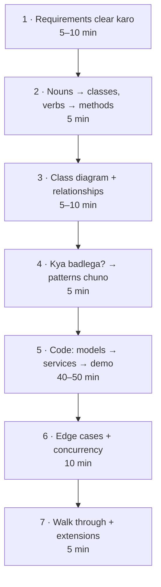

1. **Requirements clear karo.** Sawaal poocho, phir scope *likh do*: functional ("park, unpark, free spots dikhao"), non-functional ("ek saath kai entry gates"), aur saaf saaf **out of scope** ("koi payments UI nahi"). Ye tumhe scope creep (beech mein kaam badhte jaana) se bachata hai.
2. **Nouns classes bante hain, verbs methods.** Requirements padho aur underline karo: "Ek *vehicle* ek *floor* ke ek *spot* mein *park* hota hai aur use ek *ticket* milta hai." Har noun class ka haqdaar nahi: "colour" ek attribute hai, class nahi.
3. **Class diagram banao.** Kaun kisko own karta hai? is-a hai ya has-a? Multiplicities kya hain (1 lot, many floors)?
4. **Poocho "kya badlega?"** Wahi jagah hai jahan abstractions aur patterns jaate hain. Pricing rules badlenge → Strategy. Machine ke modes → State. Ek event pe kai reactions → Observer. Nayi tarah ki cheezein → Factory.
5. **Layers mein code karo.** Pehle enums aur models (`Vehicle`, `Spot`), phir services jo logic rakhti hain (`ParkingLot`), phir ek `main` demo. Jaldi chalao, baar baar chalao.
6. **Edge cases aur concurrency.** Lot full, invalid ticket, ek hi ticket se do baar unpark, do gates ek hi spot pakad rahe hain.
7. **Interviewer ko walk through karao** aur extensions pehle hi bata do: "EV charging spots add karne ke liye main ek enum value aur ek fit rule add karunga."

> 💡 **Fixed sets ke liye enums use karo** (vehicle types, directions, statuses), raw strings nahi. `"COMAPCT"` jaisa typo chupchaap fail hota hai; `SpotType.COMAPCT` zor se fail hota hai (`AttributeError`), turant pata chal jaata hai.

> 🇮🇳 **Desi Analogy:** Ghar banwaane ka process. Pehle family se poochte ho "kitne bedroom, puja ghar chahiye ya nahi, parking?" (requirements). Phir rooms ki list (nouns → classes). Phir naksha (class diagram). Phir socho "beta bada hoga toh upar ek floor jodna padega" (kya badlega → extensibility, isliye strong pillars). Phir construction (code), phir plumbing leak test (edge cases), aur end mein family ko ghar ghumaana (walkthrough). Koi bhi samajhdaar insaan naksha bane bina eetein nahi lagwaata. Machine coding mein seedha code likhna wahi galti hai.

### 7. Design #1: Parking Lot 🅿️

LLD ka sabse zyada poochha jaane wala sawaal. Chalo 7 steps chalaate hain.

**Step 1: Requirements** (jo tum interviewer se confirm karoge)

- Kai floors. Har floor pe teen size ke spots: `SMALL`, `COMPACT`, `LARGE`.
- Vehicles: motorcycle, car, truck. Motorcycle kisi bhi spot mein fit ho jaati hai, car compact ya large mein, truck sirf large mein.
- Entry pe: **sabse suitable spot** do: pehle sabse chhota fitting size (taaki bike truck ka spot waste na kare), phir sabse neeche wala floor, phir sabse chhota spot number. Ticket issue karo.
- Exit pe: fee calculate karo (hourly, vehicle type ke hisaab se, adhoora ghanta poora gina jaayega, minimum 1 ghanta) aur spot free karo.
- Har floor ke free spots dikhao. Kai entry gates ek saath kaam karte hain.
- Out of scope: payment processing, reservations, EV charging (lekin add karna aasaan rakho).

**Step 2: Nouns → classes:** `ParkingLot`, `ParkingFloor`, `ParkingSpot`, `Vehicle`, `Ticket`, `PricingStrategy`. **Verbs → methods:** `park`, `unpark`, `free_spots`, `fee`.

**Step 3: Class diagram**

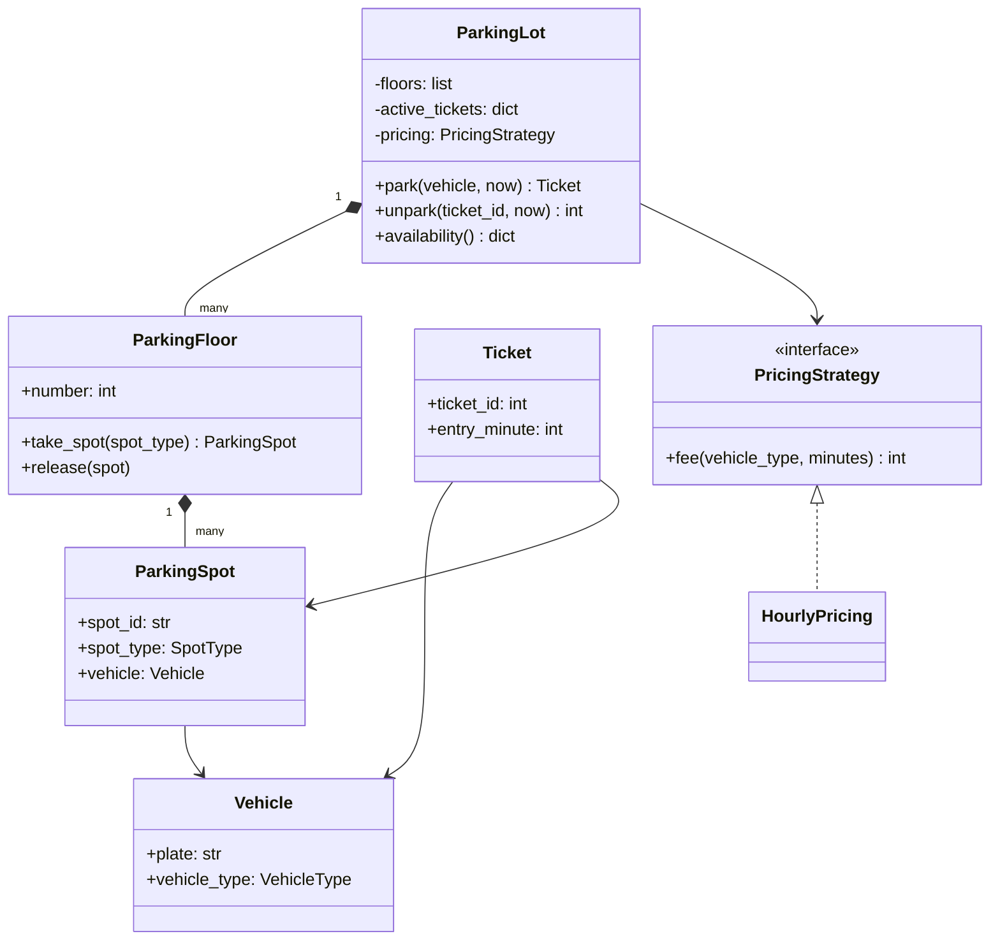

**Step 4: Kya badlega?** Pricing rules (weekend rates, flat fees) → **Strategy**. Vehicle aur spot types → **enums + ek fit table**, taaki naya type sirf ek line ho. Lot ek process mein ek hi hai → Singleton ban sakta tha, lekin hum use inject karte hain.

**Step 5: Code.** Time `now` (minutes) ke roop mein pass kiya jaata hai, clock padhne ke bajaye. Isse demo har baar same output deta hai (deterministic) aur class ko test karna aasaan hota hai. Ye ek pro move hai, interview mein zaroor bolna.

> 🤔 **Mann mein sawaal:** `time.time()` andar hi call kar lete, `now` pass karne ka jhanjhat kyun?
>
> **Jawab:** Socho tumhe test karna hai "3 ghante baad fee ₹150 aani chahiye". Agar class andar `time.time()` padhti hai, toh tumhe test mein sach mein 3 ghante wait karna padega, ya clock ko mock karna padega. `now` bahar se aata hai toh test bas `unpark(t, now=180)` likhta hai. Ye bhi **Dependency Inversion** hi hai: "time" ek dependency hai, use andar weld mat karo, inject karo.

```python
import heapq
import itertools
import math
import threading
from abc import ABC, abstractmethod
from dataclasses import dataclass
from enum import Enum


class VehicleType(Enum):
    MOTORCYCLE = "motorcycle"
    CAR = "car"
    TRUCK = "truck"


class SpotType(Enum):
    SMALL = 1
    COMPACT = 2
    LARGE = 3


# Har vehicle kaun se spot types use kar sakta hai, chhota pehle (bade spots waste mat karo).
FITS = {
    VehicleType.MOTORCYCLE: [SpotType.SMALL, SpotType.COMPACT, SpotType.LARGE],
    VehicleType.CAR: [SpotType.COMPACT, SpotType.LARGE],
    VehicleType.TRUCK: [SpotType.LARGE],
}


@dataclass(frozen=True)
class Vehicle:
    plate: str
    vehicle_type: VehicleType


@dataclass
class ParkingSpot:
    spot_id: str
    floor: int
    order: int                      # chhota = lift ke zyada paas
    spot_type: SpotType
    vehicle: Vehicle | None = None


@dataclass
class Ticket:
    ticket_id: int
    vehicle: Vehicle
    spot: ParkingSpot
    entry_minute: int


class PricingStrategy(ABC):
    @abstractmethod
    def fee(self, vehicle_type: VehicleType, minutes: int) -> int: ...


class HourlyPricing(PricingStrategy):
    RATES = {VehicleType.MOTORCYCLE: 20, VehicleType.CAR: 50, VehicleType.TRUCK: 100}

    def fee(self, vehicle_type, minutes):
        hours = max(1, math.ceil(minutes / 60))       # adhoora ghanta = poora ghanta, minimum 1
        return hours * self.RATES[vehicle_type]


class ParkingFloor:
    def __init__(self, number: int, layout: dict):
        self.number = number
        self.spots: dict[str, ParkingSpot] = {}
        self._free = {t: [] for t in SpotType}        # har spot type ka ek min-heap
        order = 0
        for spot_type, count in layout.items():
            for _ in range(count):
                order += 1
                spot = ParkingSpot(f"F{number}-{order:02d}", number, order, spot_type)
                self.spots[spot.spot_id] = spot
                heapq.heappush(self._free[spot_type], (order, spot.spot_id))

    def take_spot(self, spot_type: SpotType) -> ParkingSpot | None:
        if not self._free[spot_type]:
            return None
        _, spot_id = heapq.heappop(self._free[spot_type])   # sabse paas wala free spot, O(log n)
        return self.spots[spot_id]

    def release(self, spot: ParkingSpot) -> None:
        spot.vehicle = None
        heapq.heappush(self._free[spot.spot_type], (spot.order, spot.spot_id))

    def free_count(self) -> dict:
        return {t.name: len(h) for t, h in self._free.items()}


class ParkingLot:
    def __init__(self, floors: list[ParkingFloor], pricing: PricingStrategy):
        self.floors = floors
        self.pricing = pricing
        self._active: dict[int, Ticket] = {}
        self._plates_inside: set[str] = set()
        self._ticket_ids = itertools.count(1)
        self._lock = threading.Lock()                 # kai gates ek saath park() call karte hain

    def park(self, vehicle: Vehicle, now: int) -> Ticket | None:
        with self._lock:                              # dhoondhna + lena atomic hona chahiye
            if vehicle.plate in self._plates_inside:
                raise ValueError(f"{vehicle.plate} is already parked")
            for spot_type in FITS[vehicle.vehicle_type]:    # sabse chhota fitting size pehle
                for floor in self.floors:                     # phir sabse neeche wala floor
                    spot = floor.take_spot(spot_type)
                    if spot:
                        spot.vehicle = vehicle
                        ticket = Ticket(next(self._ticket_ids), vehicle, spot, now)
                        self._active[ticket.ticket_id] = ticket
                        self._plates_inside.add(vehicle.plate)
                        return ticket
            return None                               # is vehicle type ke liye lot full

    def unpark(self, ticket_id: int, now: int) -> int:
        with self._lock:
            ticket = self._active.pop(ticket_id, None)
            if ticket is None:
                raise KeyError(f"invalid or already used ticket {ticket_id}")
            self.floors[ticket.spot.floor].release(ticket.spot)
            self._plates_inside.discard(ticket.vehicle.plate)
            minutes = now - ticket.entry_minute
            return self.pricing.fee(ticket.vehicle.vehicle_type, minutes)

    def availability(self) -> dict:
        return {f"floor {f.number}": f.free_count() for f in self.floors}


# ---------------- demo ----------------
lot = ParkingLot(
    floors=[
        ParkingFloor(0, {SpotType.SMALL: 1, SpotType.COMPACT: 1, SpotType.LARGE: 1}),
        ParkingFloor(1, {SpotType.COMPACT: 2}),
    ],
    pricing=HourlyPricing(),
)

arrivals = [
    Vehicle("KA01-BIKE", VehicleType.MOTORCYCLE),
    Vehicle("KA02-CAR1", VehicleType.CAR),
    Vehicle("KA03-CAR2", VehicleType.CAR),
    Vehicle("KA04-TRK1", VehicleType.TRUCK),
    Vehicle("KA05-TRK2", VehicleType.TRUCK),
]
tickets = {}
for minute, v in enumerate(arrivals):
    t = lot.park(v, now=minute)
    if t:
        tickets[v.plate] = t
        print(f"{v.plate:<10} -> spot {t.spot.spot_id} ({t.spot.spot_type.name}), ticket #{t.ticket_id}")
    else:
        print(f"{v.plate:<10} -> LOT FULL for {v.vehicle_type.value}")

print(lot.availability())
fee = lot.unpark(tickets["KA02-CAR1"].ticket_id, now=1 + 130)   # 130 minute ruki
print("KA02-CAR1 pays Rs", fee)
try:
    lot.unpark(tickets["KA02-CAR1"].ticket_id, now=200)
except KeyError as e:
    print("error:", e.args[0])
print(lot.availability())
```

```text
KA01-BIKE  -> spot F0-01 (SMALL), ticket #1
KA02-CAR1  -> spot F0-02 (COMPACT), ticket #2
KA03-CAR2  -> spot F1-01 (COMPACT), ticket #3
KA04-TRK1  -> spot F0-03 (LARGE), ticket #4
KA05-TRK2  -> LOT FULL for truck
{'floor 0': {'SMALL': 0, 'COMPACT': 0, 'LARGE': 0}, 'floor 1': {'SMALL': 0, 'COMPACT': 1, 'LARGE': 0}}
KA02-CAR1 pays Rs 150
error: invalid or already used ticket 2
{'floor 0': {'SMALL': 0, 'COMPACT': 1, 'LARGE': 0}, 'floor 1': {'SMALL': 0, 'COMPACT': 1, 'LARGE': 0}}
```

Kya hua yahan, aur interview mein kya bolna hai:

- **Har spot type ke liye ek heap kyun?** "Sabse paas wala free spot" ek min-query hai jo cars aane jaane ke saath badalti rehti hai. Heap se take aur release dono O(log n) mein ho jaate hain, saare spots scan karne ke bajaye ([Chapter 15](../part-2-dsa/15-heaps.md)). Heap mein `(order, spot_id)` tuple daala hai, toh sabse chhota `order` (lift ke sabse paas) sabse upar rehta hai.
- **Lock kyun?** `park` ek **check-then-act** hai: "koi free spot hai?" phir "use le lo". Do gates agar bilkul ek hi pal mein ye karein, toh dono same spot dekh sakte hain. Poore operation ke around ek lock use atomic bana deta hai. Bade scale pe tum per-floor lock lagaoge, ya database ko unique constraint se enforce karne doge.
- **Car 2 floor 1 pe kyun gayi?** Kyunki allocation *sabse chhote fitting size* ko lowest floor se zyada priority deta hai. Agar woh floor 0 ka large spot pakad leti, toh truck 1 ko wapas bhejna padta. Aisi chhoti policy choices hi interviewers khodte hain.
- **Truck 2 ko "LOT FULL" mila** jabki compact spots free hain: fit table mana karti hai. Ye woh edge case hai jisko interviewer handle hota dekhna chahta hai, crash hota nahi.
- **Fee ka hisaab:** KA02-CAR1 minute 1 pe aayi, `now=131` pe gayi, yaani 130 minute. `ceil(130 / 60) = 3` ghante × ₹50 = **₹150**. Aur wahi ticket dobara use kiya toh `KeyError`, kyunki `_active.pop` ne ticket pehle hi hata diya tha (double-unpark se bachaav).
- **Extensions:** EV spots → `SpotType.EV` aur `FITS` mein ek entry. Weekend pricing → ek naya `PricingStrategy`. Spot assignment rule (jaise "exit gate ke sabse paas") → ek `SpotAllocationStrategy` nikaal do. Display boards → park/unpark events pe Observer.

> 🇮🇳 **Desi Analogy:** Mall ki parking mein guard bike waale ko bolta hai "bhaiya, bike side mein lagao, car wali jagah mat lo". Yahi hamara `FITS` table hai, smallest fitting first. Aur entrance pe LED board "Level 1: 12 free" dikhata hai: woh `availability()` hai, aur real system mein woh board Observer ki tarah park/unpark events sunta hai.

### 8. Design #2: Elevator System 🛗

**Requirements:** ek building jismein N floors aur M elevators hain. Log floor pe ek **hall button** dabate hain (external request) ya car ke andar **floor button** (internal request). Har elevator ko stops efficiently serve karne chahiye, zig-zag nahi. Ek **dispatcher** decide karta hai ki hall call ka jawab kaunsa elevator dega. Out of scope: weight limits, door timers, emergency mode (inhe extensions ki tarah mention karo).

**Key algorithm: LOOK ("elevator algorithm" / SCAN ka ek version).** Elevator apni current direction mein tab tak chalta rehta hai jab tak us direction mein aage stops bache hain, phir palat jaata hai. Bilkul disk head ki tarah. Woh do sets rakhta hai: `up_stops` (usse upar wale) aur `down_stops` (usse neeche wale).

> 🇮🇳 **Desi Analogy:** **Mumbai local ki slow train** socho. Churchgate se Virar ja rahi hai toh beech ke har station pe rukti hai jahan log utarne/chadhne wale hain, aur beech mein palat ke wapas Dadar nahi jaati sirf isliye ki wahan kisi ne haath hilaya. Virar pahunch ke (us direction mein aage koi stop nahi bacha) woh palat-ti hai aur wapas aate hue neeche wale stations serve karti hai. Yahi LOOK hai. Agar train har request pe palat-ti (zig-zag), toh koi bhi kahin time pe nahi pahunchta.

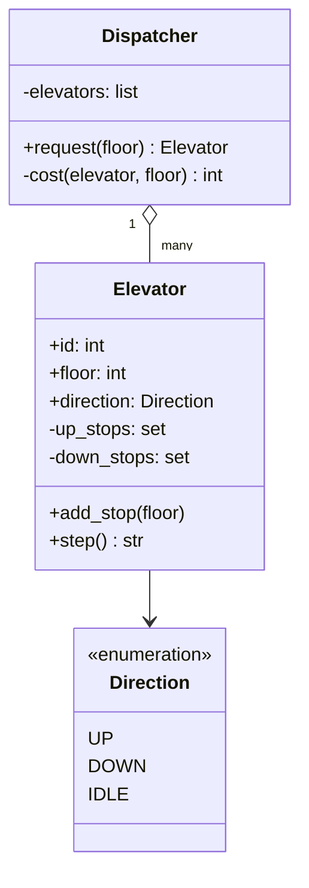

**Dispatcher strategy:** elevator `e` ko floor `f` pe bhejne ki cost distance hai, agar `e` idle hai ya pehle se `f` ki *taraf* ja raha hai; warna use pehle apna current sweep khatam karna padega, isliye hum ek penalty jodte hain (`2 * num_floors`, yaani ek poora chakkar upar-neeche). Sabse sasta elevator jeetta hai. (Real systems isse zyada fancy cost functions use karte hain; ye ek pluggable Strategy hai.)

```python
from enum import Enum


class Direction(Enum):
    UP = 1
    DOWN = -1
    IDLE = 0


class Elevator:
    def __init__(self, eid: int, floor: int = 0):
        self.id, self.floor = eid, floor
        self.direction = Direction.IDLE
        self.up_stops: set[int] = set()       # invariant: sab current floor se upar
        self.down_stops: set[int] = set()     # invariant: sab current floor se neeche

    def add_stop(self, floor: int) -> None:
        if floor > self.floor:
            self.up_stops.add(floor)
        elif floor < self.floor:
            self.down_stops.add(floor)
        # floor == current floor: bas darwaze khulte hain, schedule karne ko kuch nahi

    def _choose_direction(self) -> None:
        if self.direction == Direction.UP and not self.up_stops:
            self.direction = Direction.DOWN if self.down_stops else Direction.IDLE
        elif self.direction == Direction.DOWN and not self.down_stops:
            self.direction = Direction.UP if self.up_stops else Direction.IDLE
        if self.direction == Direction.IDLE:
            if self.up_stops:
                self.direction = Direction.UP
            elif self.down_stops:
                self.direction = Direction.DOWN

    def step(self) -> str | None:
        """Move one floor. Return a message if we stopped somewhere."""
        self._choose_direction()
        if self.direction == Direction.IDLE:
            return None
        self.floor += self.direction.value
        stops = self.up_stops if self.direction == Direction.UP else self.down_stops
        if self.floor in stops:
            stops.discard(self.floor)
            return f"E{self.id} opens doors at floor {self.floor}"
        return None


class Dispatcher:
    def __init__(self, elevators: list[Elevator], num_floors: int):
        self.elevators, self.num_floors = elevators, num_floors

    def _cost(self, e: Elevator, floor: int) -> int:
        distance = abs(e.floor - floor)
        if e.direction == Direction.IDLE:
            return distance
        heading_there = ((e.direction == Direction.UP and floor >= e.floor) or
                         (e.direction == Direction.DOWN and floor <= e.floor))
        return distance if heading_there else distance + 2 * self.num_floors

    def request(self, floor: int) -> Elevator:
        best = min(self.elevators, key=lambda e: (self._cost(e, floor), e.id))
        best.add_stop(floor)
        return best


# ---------------- demo: 10 floors, 2 elevators ----------------
e0, e1 = Elevator(0, floor=0), Elevator(1, floor=8)
dispatcher = Dispatcher([e0, e1], num_floors=10)

# tick -> ("hall", floor) ya ("car", elevator, floor) ki list
script = {
    0: [("hall", 6), ("hall", 2)],
    2: [("car", e0, 5)],          # jo floor 2 pe E0 mein chadha, woh 5 dabata hai
    3: [("hall", 1)],
    4: [("car", e1, 0)],          # jo floor 6 pe E1 mein chadha, woh 0 dabata hai
}
for tick in range(12):
    for action in script.get(tick, []):
        if action[0] == "hall":
            chosen = dispatcher.request(action[1])
            print(f"t={tick:<2} hall call at {action[1]} -> E{chosen.id}")
        else:
            _, elevator, floor = action
            elevator.add_stop(floor)
            print(f"t={tick:<2} inside E{elevator.id}: pressed {floor}")
    for e in (e0, e1):
        msg = e.step()
        if msg:
            print(f"t={tick:<2} {msg}")
print("final:", [(f"E{e.id}", e.floor, e.direction.name) for e in (e0, e1)])
```

```text
t=0  hall call at 6 -> E1
t=0  hall call at 2 -> E0
t=1  E0 opens doors at floor 2
t=1  E1 opens doors at floor 6
t=2  inside E0: pressed 5
t=3  hall call at 1 -> E1
t=4  inside E1: pressed 0
t=4  E0 opens doors at floor 5
t=7  E1 opens doors at floor 1
t=8  E1 opens doors at floor 0
final: [('E0', 5, 'IDLE'), ('E1', 0, 'IDLE')]
```

Kahani trace karo: E1 (floor 8 pe) floor 6 ke sabse paas hai, E0 (floor 0 pe) floor 2 ke sabse paas. E0 floor 2 pe passenger uthata hai, passenger 5 dabata hai. Floor 1 ki hall call t=3 pe aati hai jab E0 *upar* ja raha hai, usse door. Toh E0 (ab floor 3 pe) ko penalty lagti hai: distance 2 + 20 = **22**. E1 floor 6 pe idle ho chuka hai, toh uski cost sirf distance hai, **5**, aur woh jeet jaata hai. Phir E1 ka passenger 0 dabata hai, aur E1 ek hi neeche wale sweep mein 1 aur 0 dono serve kar deta hai. Koi bhi elevator zig-zag nahi karta.

Ek cheez timeline mein dhyaan se dekho: har tick pe pehle requests aati hain, phir har elevator ek floor `step()` karta hai. Isliye t=0 pe floor 2 ki call aayi aur E0 (floor 0 se) t=1 pe floor 2 pe pahuncha: t=0 ke step mein 0→1, t=1 ke step mein 1→2.

> 🤔 **Mann mein sawaal:** `_choose_direction` mein itne `if` kyun? Simple rakho na: jo stop sabse paas hai wahan chalo.
>
> **Jawab:** "Sabse paas wala stop" (Shortest Seek First) sunne mein accha lagta hai, lekin woh **starvation** paida karta hai. Socho elevator floor 5 pe hai aur log baar baar 4 aur 6 dabaate rehte hain. Floor 15 wala insaan hamesha wait karega, kyunki 4 aur 6 hamesha zyada paas hain. LOOK guarantee deta hai ki ek baar direction chuni toh us taraf ke saare stops serve honge, phir palat-na. Isse har request ka wait bounded rehta hai: zyada se zyada ek poora sweep.

**Extensions jo mention karne hain:** hall buttons ki ek direction hoti hai (floor 5 pe *neeche* jaane wala insaan upar jaati car mein nahi chadhna chahiye: `(floor, direction)` requests rakho); door open/close ka **State** machine (`MOVING`, `DOORS_OPEN`, `MAINTENANCE`); weight sensor jo full hone pe stops reject kare; din ke time ke hisaab se dispatcher strategies (subah ka rush: idle cars ko lobby pe khada karo); dispatcher apne alag thread mein chale aur requests ek thread-safe `queue.Queue` se le.

### 9. Design #3: LRU Cache 🧠

**Requirements (LeetCode 146, "LRU Cache"):** ek fixed-capacity key-value cache jismein `get(key)` aur `put(key, value)` dono **O(1)** hon. Full hone pe **least recently used** (sabse lambe time se use nahi hui) key nikaal do (evict karo). `get` aur `put` dono "use" gine jaate hain. Aise caches har jagah databases ke aage baithe hote hain ([Chapter 04](04-caching-cdn.md)).

> 🇮🇳 **Desi Analogy:** Tumhare phone ka **"Recent apps"** screen ya WhatsApp ki chat list. Jis chat mein abhi message aaya ya tumne kholi, woh sabse upar aa jaati hai. Jo chat mahinon se kisi ne nahi chhui, woh neeche khisakti jaati hai. Ab socho list mein sirf 50 chats ki jagah hai: nayi chat aaye toh **sabse neeche wali** (least recently used) hatao. Upar laana = `_push_front`, neeche se hatana = `tail.prev` evict karna. Aur kisi chat ko naam se turant dhoondhna = hash map.

**Design ka insight:** humein ek saath do cheezein chahiye.

- Key ko jaldi dhoondhna → **hash map** (O(1) lookup).
- Usage ka order jaanna aur kisi item ko jaldi "most recent" pe le jaana → **doubly linked list** (O(1) unlink aur insert, agar node pehle se tumhare haath mein hai).

Map `key → node` store karta hai, aur list nodes ko most se least recent order mein rakhti hai.

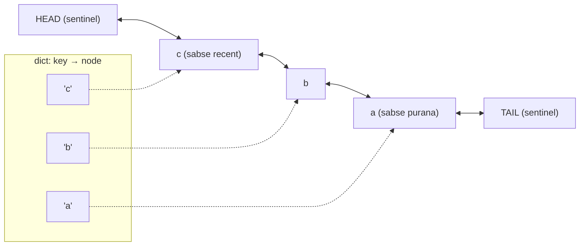

Do **sentinel** (dummy) nodes ka matlab hai ki humein kabhi "list khaali hai?" ya "pehla node hai?" jaise special cases check nahi karne padte: har asli node ke paas hamesha ek `prev` aur ek `next` hota hai.

> 🤔 **Mann mein sawaal:** Singly linked list kyun nahi? Ek pointer kam lagega.
>
> **Jawab:** Kyunki beech se node hataane (`_unlink`) ke liye uske **pichhle** node ka `next` badalna padta hai. Singly linked list mein pichhla node dhoondhne ke liye shuru se chalna padega: O(n). Doubly linked list mein `node.prev` seedha haath mein hai: O(1). Aur hash map humein node toh de deta hai, lekin uska pichhla node nahi. Isliye dono milke hi O(1) bante hain.

```python
class Node:
    __slots__ = ("key", "value", "prev", "next")     # har node ki memory bachata hai

    def __init__(self, key=None, value=None):
        self.key, self.value = key, value
        self.prev = self.next = None


class LRUCache:
    def __init__(self, capacity: int):
        if capacity <= 0:
            raise ValueError("capacity must be positive")
        self.capacity = capacity
        self.map: dict = {}
        self.head, self.tail = Node(), Node()          # sentinels (dummy nodes)
        self.head.next, self.tail.prev = self.tail, self.head

    # --- linked-list helpers, sab O(1) ---
    def _unlink(self, node: Node) -> None:
        node.prev.next, node.next.prev = node.next, node.prev

    def _push_front(self, node: Node) -> None:
        node.prev, node.next = self.head, self.head.next
        self.head.next.prev = node
        self.head.next = node

    # --- public API ---
    def get(self, key):
        node = self.map.get(key)
        if node is None:
            return -1
        self._unlink(node)                              # most recently used mark karo
        self._push_front(node)
        return node.value

    def put(self, key, value) -> None:
        if key in self.map:
            node = self.map[key]
            node.value = value
            self._unlink(node)
            self._push_front(node)
            return
        if len(self.map) == self.capacity:
            lru = self.tail.prev                        # sabse purana peeche rehta hai
            self._unlink(lru)
            del self.map[lru.key]                       # isiliye nodes apni key store karte hain
            print(f"  evict {lru.key!r}")
        node = Node(key, value)
        self.map[key] = node
        self._push_front(node)

    def order(self) -> list:
        out, cur = [], self.head.next
        while cur is not self.tail:
            out.append(cur.key)
            cur = cur.next
        return out


cache = LRUCache(2)
cache.put(1, "one")
cache.put(2, "two")
print("get 1 ->", cache.get(1), "| order:", cache.order())
cache.put(3, "three")                  # 2 evict hoga (1 zyada recently use hua tha)
print("get 2 ->", cache.get(2))
cache.put(4, "four")                   # 1 evict hoga
print("get 1 ->", cache.get(1), "| get 3 ->", cache.get(3), "| get 4 ->", cache.get(4))
print("order:", cache.order())
```

```text
get 1 -> one | order: [1, 2]
  evict 2
get 2 -> -1
  evict 1
get 1 -> -1 | get 3 -> three | get 4 -> four
order: [4, 3]
```

Ek line pe ruko: `del self.map[lru.key]`. Evict karte waqt humare paas sirf node hai (list ke end se), key nahi. Agar node apni key store na karta, toh map se entry hatane ke liye poora map scan karna padta. **Isliye har node apni key bhi rakhta hai**, sirf value nahi. Ye interview mein bahut common follow-up hai.

Demo trace: capacity 2. `put 1`, `put 2` → order [2, 1]. `get 1` → 1 front pe: [1, 2]. `put 3` → full, back wala (2) evict: [3, 1]. `get 2` → -1. `put 4` → back wala (1) evict: [4, 3].

**Pythonic version** `collections.OrderedDict` use karta hai, jo khud andar se ek dict plus doubly linked list hi hai. Jab interviewer data structures dekhna chahe tab manual wala likho; library jaante ho ye dikhane ke liye ye wala mention karo:

```python
from collections import OrderedDict


class LRUCache:
    def __init__(self, capacity: int):
        self.capacity, self.data = capacity, OrderedDict()

    def get(self, key):
        if key not in self.data:
            return -1
        self.data.move_to_end(key)             # O(1): most recent mark karo
        return self.data[key]

    def put(self, key, value):
        self.data[key] = value
        self.data.move_to_end(key)
        if len(self.data) > self.capacity:
            self.data.popitem(last=False)      # O(1): sabse purana hatao


c = LRUCache(2)
c.put("a", 1); c.put("b", 2); c.get("a"); c.put("c", 3)
print(list(c.data))
```

```text
['a', 'c']
```

**Thread safety:** `get` bhi list ko *modify* karta hai (node ko move karta hai), isliye concurrent readers pointers ko corrupt kar sakte hain. Dono methods ko ek hi `threading.Lock` mein wrap karo. Heavy traffic ke liye cache ko N independent **shards** mein baant do (har ek ka apna lock), jo `hash(key) % N` se chune jaate hain, taaki threads ko ek doosre ka wait kam hi karna pade. Follow-ups: **TTL** (har node pe expiry time store karo aur expired entries ko miss maano) aur **LFU** (least *frequently* used evict karo: "LFU Cache", LeetCode 460).

> 🗣️ **Interview mein aise bolo:** "I'll combine a hash map with a doubly linked list. The map gives O(1) lookup from key to node, and the list keeps nodes in recency order, so moving a node to the front or evicting from the tail is O(1). I use sentinel head and tail nodes to avoid edge cases, and each node stores its key so eviction can delete it from the map."

### 10. Design #4: Splitwise (expense sharing) 💸

**Requirements:** users expenses add karte hain ("Asha ne hotel ke ₹1,200 diye, 4 logon mein baanto"). Splits **equal**, **exact** amounts, ya **percentages** mein ho sakte hain. Dikhao kaun kisko kitna dena hai, aur **debts simplify** karo taaki group kam se kam payments mein settle ho jaaye. Out of scope: currencies, groups UI, notifications.

**Kya badlega?** Split ka rule → **Strategy**. Baaki sab bas hisaab-kitaab (bookkeeping) hai.

**Paison ka woh rule jo har senior engineer check karega:** paise kabhi `float` mein store mat karo. Binary floating point mein `0.1 + 0.2 != 0.3`. **Integer paise** store karo (ya `decimal.Decimal` use karo). Aur jab ₹100 teen logon mein baante, toh *kisi ek* ko extra paisa dena padega: kisko, ye saaf saaf decide karo.

**Balance wali trick:** har pair track karne ke bajaye ("A ko B ke ₹50 dene hain, B ko C ke ₹30..."), har insaan ka ek **net balance** rakho. Pay karna tumhara balance badhata hai; tumhara share usse ghatata hai. Positive = group ko tumhe dena hai; negative = tumhe group ko dena hai. Saare balances ka total hamesha zero hota hai.

> 🇮🇳 **Desi Analogy:** **Goa trip ka hisaab**. Har baar "tune mere liye cab di, maine tere liye dinner diya" yaad rakhna paagalpan hai. Samajhdaar dost ek notebook mein har insaan ka ek hi number likhta hai: "Asha +566, Divya −600". Trip ke end mein jo minus mein hai woh paisa daalta hai, jo plus mein hai woh uthaata hai. Kaun kis cheez ke liye de raha hai, ye matter hi nahi karta. Ek group ka total hamesha zero, kyunki jo paisa kisi ne diya, woh kisi ka share tha. Yahi **net balance** hai.

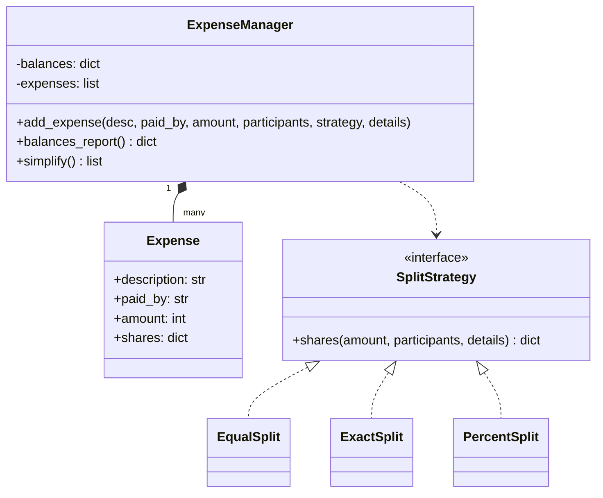

**Debt simplification (greedy):** baar baar us insaan ko jise sabse zyada milna hai, us insaan se match karo jise sabse zyada dena hai. Dono amounts mein jo chhota hai utna settle karo, aur jiska balance abhi bhi bacha hai use wapas daal do. Do heaps se har step O(log n) ho jaata hai. Har step kam se kam ek insaan ko zero kar deta hai, isliye n logon ke liye zyada se zyada **n − 1 payments** hoti hain.

> 🤔 **Mann mein sawaal:** Code mein `creditors` mein `-bal` kyun daala, aur `debtors` mein seedha `bal`?
>
> **Jawab:** Python ka `heapq` sirf **min-heap** hai. Humein sabse bade creditor chahiye (max), toh trick ye hai: number ko negative karke daalo. +566 ban gaya −566, jo sabse chhota hai, toh sabse upar aa gaya. Debtors ke balances pehle se negative hain (−600, −33), aur humein sabse bada debt chahiye, yaani sabse negative number, jo min-heap waise hi upar deta hai. Isliye wahan negate karne ki zaroorat nahi.

```python
import heapq
from abc import ABC, abstractmethod
from collections import defaultdict
from dataclasses import dataclass


def rupees(paise: int) -> str:
    return f"Rs {paise // 100}.{paise % 100:02d}"


class SplitStrategy(ABC):
    @abstractmethod
    def shares(self, amount: int, participants: list[str], details) -> dict[str, int]: ...


class EqualSplit(SplitStrategy):
    def shares(self, amount, participants, details=None):
        base, extra = divmod(amount, len(participants))
        # Pehle `extra` log ek paisa zyada dete hain, taaki total exact rahe.
        return {p: base + (1 if i < extra else 0) for i, p in enumerate(participants)}


class ExactSplit(SplitStrategy):
    def shares(self, amount, participants, details):
        if sum(details.values()) != amount:
            raise ValueError("exact shares must add up to the total")
        return dict(details)


class PercentSplit(SplitStrategy):
    def shares(self, amount, participants, details):
        if sum(details.values()) != 100:
            raise ValueError("percentages must add up to 100")
        result = {p: amount * pct // 100 for p, pct in details.items()}
        leftover = amount - sum(result.values())          # rounding ka bacha hua chura, paise mein
        for p in list(result)[:leftover]:
            result[p] += 1
        return result


@dataclass
class Expense:
    description: str
    paid_by: str
    amount: int
    shares: dict


class ExpenseManager:
    def __init__(self):
        self.balances = defaultdict(int)       # +ve: paisa milna hai, -ve: paisa dena hai
        self.expenses: list[Expense] = []

    def add_expense(self, description, paid_by, amount, participants, strategy, details=None):
        shares = strategy.shares(amount, participants, details)
        self.expenses.append(Expense(description, paid_by, amount, shares))
        self.balances[paid_by] += amount
        for person, share in shares.items():
            self.balances[person] -= share

    def simplify(self) -> list[tuple[str, str, int]]:
        creditors = [(-bal, name) for name, bal in self.balances.items() if bal > 0]  # max-heap (negate karke)
        debtors = [(bal, name) for name, bal in self.balances.items() if bal < 0]     # sabse negative pehle
        heapq.heapify(creditors)
        heapq.heapify(debtors)
        payments = []
        while creditors and debtors:
            credit, creditor = heapq.heappop(creditors)
            debt, debtor = heapq.heappop(debtors)
            amount = min(-credit, -debt)
            payments.append((debtor, creditor, amount))
            if -credit > amount:
                heapq.heappush(creditors, (credit + amount, creditor))
            if -debt > amount:
                heapq.heappush(debtors, (debt + amount, debtor))
        return payments


m = ExpenseManager()
friends = ["Asha", "Bala", "Chetan", "Divya"]
m.add_expense("Hotel", "Asha", 1200_00, friends, EqualSplit())
m.add_expense("Dinner", "Bala", 900_00, ["Asha", "Bala", "Chetan"], ExactSplit(),
              {"Asha": 200_00, "Bala": 300_00, "Chetan": 400_00})
m.add_expense("Cab", "Chetan", 1000_00, friends, PercentSplit(),
              {"Asha": 10, "Bala": 20, "Chetan": 30, "Divya": 40})
m.add_expense("Snacks", "Divya", 100_00, ["Asha", "Bala", "Chetan"], EqualSplit())

print("Net balances:")
for name in friends:
    bal = m.balances[name]
    print(f"  {name:<7} {'gets' if bal >= 0 else 'owes'} {rupees(abs(bal))}")
print("Total of balances:", sum(m.balances.values()))
print("Settle up:")
for debtor, creditor, amount in m.simplify():
    print(f"  {debtor} pays {creditor} {rupees(amount)}")
```

```text
Net balances:
  Asha    gets Rs 566.66
  Bala    gets Rs 66.67
  Chetan  owes Rs 33.33
  Divya   owes Rs 600.00
Total of balances: 0
Settle up:
  Divya pays Asha Rs 566.66
  Divya pays Bala Rs 33.34
  Chetan pays Bala Rs 33.33
```

Kya hua yahan: chaar dosto ke beech chaar expenses mein 12 tak pairwise udhaar ho sakte the; greedy plan sab kuch zyada se zyada 3 payments mein settle kar deta hai. ₹100 ke snacks ka bill teen mein baanta (₹33.34 + ₹33.33 + ₹33.33) aur exact paise tak distribute hua, isiliye balances ka total **exactly 0** hai. Floats ke saath tumhe kabhi na kabhi `-1.1368683772161603e-13` dikhta, aur ek confused user.

Asha ka balance khud nikaal ke dekho, taaki trick pakki ho jaaye (paise mein):

| Expense | Asha ne diya | Asha ka share | Asha pe asar |
|---|---|---|---|
| Hotel (₹1200, 4 mein equal) | +1200.00 | −300.00 | +900.00 |
| Dinner (exact) | 0 | −200.00 | −200.00 |
| Cab (₹1000, 10%) | 0 | −100.00 | −100.00 |
| Snacks (₹100, 3 mein equal, pehle ko extra paisa) | 0 | −33.34 | −33.34 |
| **Total** | | | **+566.66** |

Output se match karta hai: "Asha gets Rs 566.66". Snacks mein `divmod(10000, 3) = (3333, 1)`, toh pehla insaan (Asha) 3334 paise deta hai, baaki do 3333.

> 💡 **Interview gold:** *bilkul minimum* number of payments dhoondhna general case mein NP-hard hai (andar ek subset-sum problem chhupi hai: tumhe aise groups dhoondhne padenge jinke balances aapas mein cancel ho jaayein). Greedy approach hamesha optimal nahi hota, lekin woh zyada se zyada n − 1 payments ki guarantee deta hai aur O(n log n) mein chalta hai. Ye bina poochhe bol doge toh depth dikhti hai. Chhote groups ke liye exact answer LeetCode problem "Optimal Account Balancing" (465) hai, jo backtracking se solve hota hai.

### 11. Design #5: Movie Ticket Booking (BookMyShow) 🎬

Ye asal mein ek **concurrency** question hai jo movie ka costume pehen ke aaya hai. Data model aasaan hai; mazedaar hissa ye hai: *do log bilkul ek hi pal mein seat A1 click karte hain. Kise milegi?*

**Requirements:** shehron mein cinemas hain; cinemas mein screens; ek **show** matlab ek movie, ek screen pe, ek time pe. User seats chunta hai, jo kuch minute ke liye **hold** ho jaati hain jab tak woh pay karta hai. Payment success → **booked**. Payment fail ya timeout → seats release. Kabhi bhi ek seat double-book nahi honi chahiye. Out of scope: search, pricing tiers, refunds.

> 🇮🇳 **Desi Analogy:** **IRCTC Tatkal** subah 10 baje. Lakhon log ek saath same train ki aakhri berths pe click karte hain. Jab tum berth chun ke payment page pe jaate ho, berth tumhare naam pe kuch minute ke liye "block" ho jaati hai (yahi **hold** hai). UPI pin daalne mein der lagaayi? Timer khatam, berth wapas pool mein (yahi **expiry** hai). Aur system ka sabse bada promise: ek berth kabhi do logon ko confirm nahi hogi. Agar ho jaaye, toh train mein ek seat pe do log aur ek bada jhagda. Wahi **double booking** rokna is design ka dil hai.

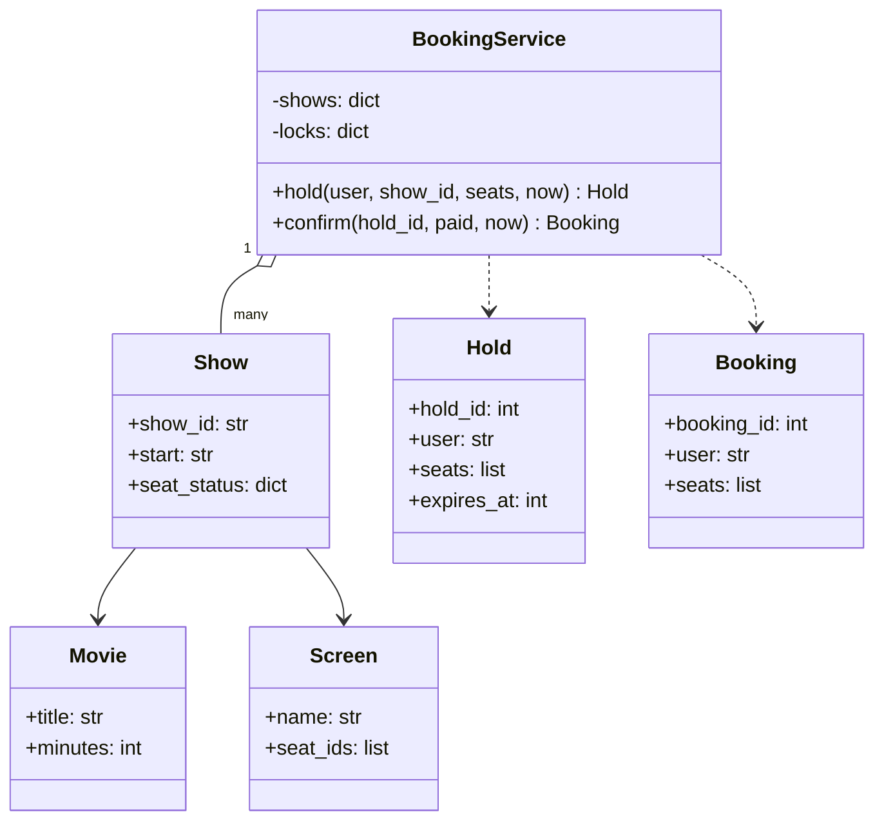

**Seat ka lifecycle:**


```python
import itertools
import threading
from dataclasses import dataclass
from enum import Enum

HOLD_SECONDS = 300


class SeatStatus(Enum):
    AVAILABLE = "available"
    HELD = "held"
    BOOKED = "booked"


@dataclass
class Hold:
    hold_id: int
    user: str
    show_id: str
    seats: list
    expires_at: int


@dataclass
class Booking:
    booking_id: int
    user: str
    show_id: str
    seats: list


class Show:
    def __init__(self, show_id: str, movie: str, seat_ids: list[str]):
        self.show_id, self.movie = show_id, movie
        self.status = {s: SeatStatus.AVAILABLE for s in seat_ids}


class BookingService:
    def __init__(self):
        self.shows: dict[str, Show] = {}
        self.locks: dict[str, threading.Lock] = {}     # HAR SHOW ka ek lock
        self.holds: dict[int, Hold] = {}
        self._ids = itertools.count(1)

    def add_show(self, show: Show) -> None:
        self.shows[show.show_id] = show
        self.locks[show.show_id] = threading.Lock()

    def _expire_holds(self, show_id: str, now: int) -> None:
        for hid, hold in list(self.holds.items()):
            if hold.show_id == show_id and hold.expires_at <= now:
                for seat in hold.seats:
                    self.shows[show_id].status[seat] = SeatStatus.AVAILABLE
                del self.holds[hid]

    def hold(self, user: str, show_id: str, seats: list[str], now: int) -> Hold | None:
        with self.locks[show_id]:          # check-then-act atomic hona chahiye
            self._expire_holds(show_id, now)
            show = self.shows[show_id]
            if any(show.status[s] != SeatStatus.AVAILABLE for s in seats):
                return None                # sab ya kuch nahi: adhoore holds nahi
            for s in seats:
                show.status[s] = SeatStatus.HELD
            hold = Hold(next(self._ids), user, show_id, list(seats), now + HOLD_SECONDS)
            self.holds[hold.hold_id] = hold
            return hold

    def confirm(self, hold_id: int, paid: bool, now: int) -> Booking | str:
        hold = self.holds.get(hold_id)
        if hold is None:
            return "hold not found (expired and cleaned up, or already used)"
        with self.locks[hold.show_id]:
            self._expire_holds(hold.show_id, now)
            if hold_id not in self.holds:
                return "hold expired, seats released"
            del self.holds[hold_id]
            show = self.shows[hold.show_id]
            new_status = SeatStatus.BOOKED if paid else SeatStatus.AVAILABLE
            for s in hold.seats:
                show.status[s] = new_status
            if not paid:
                return "payment failed, seats released"
            return Booking(next(self._ids), hold.user, hold.show_id, hold.seats)


service = BookingService()
service.add_show(Show("S1", "Interstellar", ["A1", "A2", "B1", "B2"]))

# 1) Paanch users ek hi pal mein A1+A2 click karte hain.
start = threading.Barrier(5)                   # saare threads ek saath chhodo
results = {}

def try_hold(user):
    start.wait()
    results[user] = service.hold(user, "S1", ["A1", "A2"], now=0)

threads = [threading.Thread(target=try_hold, args=(f"user{i}",)) for i in range(5)]
for t in threads:
    t.start()
for t in threads:
    t.join()
winners = [h for h in results.values() if h]
print("successful holds:", len(winners), "| rejected:", len(results) - len(winners))
booking = service.confirm(winners[0].hold_id, paid=True, now=60)
print("booked seats:", booking.seats, "| A1 is now", service.shows["S1"].status["A1"].value)

# 2) Ravi B1+B2 hold karta hai par kabhi pay nahi karta. Meera baad mein B2 try karti hai.
ravi = service.hold("ravi", "S1", ["B1", "B2"], now=100)
print("meera at t=200:", service.hold("meera", "S1", ["B2"], now=200))
meera = service.hold("meera", "S1", ["B2"], now=450)       # Ravi ka hold 400 pe expire ho gaya
print("meera at t=450 got:", meera.seats)
print("ravi pays at t=460:", service.confirm(ravi.hold_id, paid=True, now=460))
print({s: st.value for s, st in service.shows["S1"].status.items()})
```

```text
successful holds: 1 | rejected: 4
booked seats: ['A1', 'A2'] | A1 is now booked
meera at t=200: None
meera at t=450 got: ['B2']
ravi pays at t=460: hold not found (expired and cleaned up, or already used)
{'A1': 'booked', 'A2': 'booked', 'B1': 'available', 'B2': 'held'}
```

Kya hua yahan:

- **Paanch threads mein se exactly ek jeeta**, har ek run mein. Lock "check karo saari seats free hain, phir unhe held mark karo" ko ek atoot (indivisible) step bana deta hai. Uske bina, do threads dono check paas kar sakte the, kisi ke likhne se pehle.
- **Har show ka ek lock**, ek global lock nahi: *alag alag* shows book karne wale users kabhi ek doosre ka wait nahi karte. Isko **lock striping** ya fine-grained locking kehte hain.
- **Holds lazily expire hote hain**: jab bhi koi us show ko chhoota hai, hum expired holds saaf kar dete hain, toh koi background timer thread nahi chahiye. Real system ek periodic sweeper bhi chalayega.
- **Ravi ki late payment reject hui**: uska hold t=400 pe expire ho gaya (100 + 300) aur jab Meera ne show chhua (t=450) tab saaf ho gaya. Real life mein payment gateway use automatically refund kar dega.
- **All-or-nothing**: chaar logon ki family ko chaar seats saath mein chahiye, kabhi bhi unmein se sirf do nahi.

`threading.Barrier(5)` pe bhi dhyaan do. Woh paanchon threads ko ek gate pe rok ke rakhta hai, aur jab paanchon pahunch jaate hain tab ek saath chhodta hai. Isse race sach mein "ek hi pal" wali banti hai. Bina barrier ke pehla thread shayad baaki shuru hone se pehle hi khatam ho jaata, aur test kuch prove hi nahi karta.

> 🤔 **Mann mein sawaal:** Final state mein B2 abhi bhi "held" kyun hai, jabki B1 "available" hai?
>
> **Jawab:** Kyunki t=450 pe Meera ne B2 hold kiya (woh ab uske paas hai, 750 tak). B1 Ravi ka tha, uska hold expire hua, toh woh wapas available ho gaya, aur kisi ne use dobara nahi uthaya. Ravi t=460 pe pay karne aaya, lekin uska hold pehle hi saaf ho chuka tha, toh use "hold not found" mila. Matlab system ne sahi kiya: na Ravi ko expired seat mili, na Meera ki seat chheeni gayi.

**Real system mein database referee hota hai**, kyunki kai app servers parallel chalte hain aur in-process lock sirf ek process ko protect karta hai. Options ye hain, aur interview mein tumhe inhe compare karna aana chahiye:

| Approach | Kaise | Kab accha | Dhyaan rakho |
|---|---|---|---|
| **Pessimistic lock** | Transaction ke andar seat rows pe `SELECT ... FOR UPDATE` | High contention (blockbuster ka opening night) | Slow steps ke dauraan locks pakde rahe toh wait badhta hai; deadlock se bachne ke liye rows hamesha ek fixed order mein lock karo |
| **Optimistic lock** | `version` column; `UPDATE ... WHERE version = :v`; 0 rows update hui → kisi ne tumhe hara diya, retry | Low contention | Heavy contention mein bahut saare retries |
| **Unique constraint** | Bookings table pe `UNIQUE (show_id, seat_id)`; doosra insert fail hota hai | Aakhri safety net, hamesha lagao | Error deta hai, queue nahi: use achhe se handle karo |
| **Distributed lock / cache hold** | Redis `SET seat:S1:A1 user NX EX 300` | Automatic expiry wale tez temporary holds | Redis source of truth nahi hai; final confirm DB mein karo |

```sql
-- Optimistic locking: tabhi succeed hoga jab padhne ke baad kisi ne row na badli ho.
UPDATE show_seats
SET    status = 'HELD', held_by = 'user7', hold_expires_at = NOW() + INTERVAL '5 minutes',
       version = version + 1
WHERE  show_id = 'S1' AND seat_id = 'A1'
  AND  status = 'AVAILABLE' AND version = 12;
-- 1 row update hui -> seat tumhari. 0 rows -> kisi aur ko mili; "seat just taken" dikhao.
```

Optimistic lock ka logic ek baar zor se bolo: "Maine row padhi tab version 12 tha. Update sirf tab hoga jab version *abhi bhi* 12 ho aur seat *abhi bhi* AVAILABLE ho." Agar beech mein kisi aur ne update kar diya, version 13 ho gaya, `WHERE` match nahi hoga, 0 rows update hongi, aur tumhe pata chal jaayega ki tum haar gaye. Koi lock pakda hi nahi gaya, isliye ise "optimistic" kehte hain: maan ke chalo ki takkar nahi hogi, aur ho gayi toh pakad lo.

> 🗣️ **Interview mein aise bolo:** "Booking is a check-then-act race, so the check and the write must be atomic. I'd hold seats with an expiry, all-or-nothing, using a conditional update in the database: UPDATE ... WHERE status = 'AVAILABLE' AND version = v. Zero rows updated means someone else won. A unique constraint on (show_id, seat_id) in the bookings table is the final safety net, and expired holds are released lazily or by a sweeper."

### 12. Design #6: Snake and Ladder 🐍🪜

Ye machine-coding ka pasandida sawaal hai, kyunki ye itna chhota hai ki time mein khatam ho jaaye, aur phir bhi modelling, validation aur testability sab dikha deta hai.

**Requirements:** N cells ka board (classically 100), jismein snakes (head → tail, neeche jaate hain) aur ladders (bottom → top, upar jaate hain). Kitne bhi players baari baari se khelte hain; har ek dice roll karta hai aur move karta hai. Snake ke head ya ladder ke bottom pe land kiya toh jump. Aakhri cell pe **exactly** land karna padta hai; aage nikal gaye (overshoot) toh wahin ruk jaao. Jo pehle aakhri cell pe pahunche woh jeeta. Out of scope: UI; "6 aaya toh ek aur turn" (ek accha extension).

**Design decisions jo zor se bolne laayak hain:**

- Snakes aur ladders dono bas **jumps** hain: `start → end`. Ek hi dict dono ko handle karti hai; farak sirf direction ka hai. Kam classes, same behaviour.
- **Board ko banate waqt hi validate karo:** koi jump aakhri cell se shuru na ho, snake aur ladder ek hi start cell share na karein, aur koi jump kisi doosre jump ke start pe land na kare (warna chains ya infinite loops ban jaate hain).
- **Dice ek injected random generator leta hai** (`random.Random(seed)`). Tests aur demos mein hum use seed karte hain; game logic kabhi global `random` ko seedha call nahi karta. Ye phir se Dependency Inversion hai.
- Players ek **deque** mein rehte hain jo circular queue ki tarah use hota hai ([Chapter 12](../part-2-dsa/12-queues-deques.md)): left se nikaalo, right mein daalo.

> 🇮🇳 **Desi Analogy:** Ludo ya saanp-seedhi khelte waqt family mein ek **"dice wala"** hota hai, aur sab dhyaan rakhte hain ki woh dice sahi se phenk raha hai. Ab socho tumhe tournament ka replay chahiye (koi bole "cheating hui!"). Agar dice "fixed seed" wala ho, toh same seed se poora game bilkul waise hi dobara chalega, jaise cricket mein **DRS replay**. Isliye hum `random.Random(7)` inject karte hain: game ka har roll reproducible ho jaata hai, aur test fail ho toh exact replay kar sakte ho.

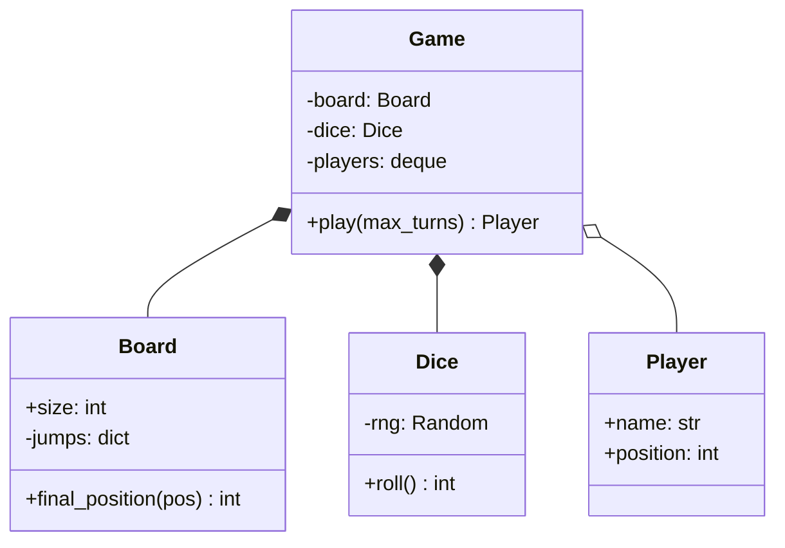

```python
import random
from collections import deque


class Board:
    def __init__(self, size: int, snakes: dict[int, int], ladders: dict[int, int]):
        for head, tail in snakes.items():
            if not 1 <= tail < head < size:
                raise ValueError(f"bad snake {head}->{tail}")
        for bottom, top in ladders.items():
            if not 1 <= bottom < top <= size:
                raise ValueError(f"bad ladder {bottom}->{top}")
        if snakes.keys() & ladders.keys():
            raise ValueError("a cell can't start both a snake and a ladder")
        self.size = size
        self.jumps = {**snakes, **ladders}
        if any(end in self.jumps for end in self.jumps.values()):
            raise ValueError("a jump may not land on another jump's start")
        self.snakes = snakes

    def final_position(self, pos: int) -> int:
        return self.jumps.get(pos, pos)


class Dice:
    def __init__(self, rng: random.Random, count: int = 1):
        self.rng, self.count = rng, count

    def roll(self) -> int:
        return sum(self.rng.randint(1, 6) for _ in range(self.count))


class Player:
    def __init__(self, name: str):
        self.name, self.position = name, 0          # 0 = board ke bahar, cell 1 se pehle


class Game:
    def __init__(self, board: Board, dice: Dice, players: list[Player]):
        if len(players) < 2:
            raise ValueError("need at least two players")
        self.board, self.dice = board, dice
        self.turn_order = deque(players)

    def play(self, max_turns: int = 1000) -> Player | None:
        for turn in range(1, max_turns + 1):
            player = self.turn_order.popleft()
            roll = self.dice.roll()
            target = player.position + roll
            if target > self.board.size:
                note = "overshoots, stays"
            else:
                landed = self.board.final_position(target)
                if landed < target:
                    note = f"snake! {target}->{landed}"
                elif landed > target:
                    note = f"ladder! {target}->{landed}"
                else:
                    note = ""
                player.position = landed
            print(f"{turn:>2}. {player.name:<5} rolls {roll} -> {player.position:>2} {note}".rstrip())
            if player.position == self.board.size:
                return player
            self.turn_order.append(player)
        return None                                  # safety valve: koi game hamesha nahi chalega


board = Board(size=30,
              snakes={27: 1, 21: 9, 17: 4, 19: 7},
              ladders={3: 22, 5: 8, 11: 26, 20: 29})
game = Game(board, Dice(random.Random(7)), [Player("Asha"), Player("Ravi")])
winner = game.play()
print("Winner:", winner.name if winner else "nobody (turn limit)")

try:
    Board(30, snakes={10: 20}, ladders={})
except ValueError as e:
    print("invalid board:", e)
```

```text
 1. Asha  rolls 3 -> 22 ladder! 3->22
 2. Ravi  rolls 2 ->  2
 3. Asha  rolls 4 -> 26
 4. Ravi  rolls 6 ->  8
 5. Asha  rolls 1 ->  1 snake! 27->1
 6. Ravi  rolls 1 ->  9
 7. Asha  rolls 5 ->  6
 8. Ravi  rolls 1 -> 10
 9. Asha  rolls 3 ->  9
10. Ravi  rolls 5 -> 15
11. Asha  rolls 1 -> 10
12. Ravi  rolls 5 -> 29 ladder! 20->29
13. Asha  rolls 2 -> 12
14. Ravi  rolls 1 -> 30
Winner: Ravi
invalid board: bad snake 10->20
```

Kya hua yahan: seeded `Random(7)` poore game ko reproducible bana deta hai, toh agar koi test fail ho toh tum use bilkul waise hi replay kar sakte ho. `max_turns` limit termination ki guarantee deti hai, chahe board kitna bhi ganda ho. **Extensions:** 6 aane pe extra turn (aur lagatar teen 6 turn cancel kar dete hain), multiple dice (`count` se pehle se supported), special cells (ek `Cell` class hierarchy, ya cell → effect function ki dict), aur UI update karne ke liye ek `GameObserver`.

Validation wali lines bhi samjho, kyunki interviewer inhi ko dekh ke "attention to detail" ka score deta hai:
- `1 <= tail < head < size`: snake neeche hi jaana chahiye, aur aakhri cell pe snake nahi ho sakta (warna koi jeet hi nahi paayega). Demo ka `snakes={10: 20}` isi wajah se fail hua: "snake" upar ja raha tha.
- `snakes.keys() & ladders.keys()`: dono dicts ki keys ka **set intersection**. Khaali nahi hai matlab ek cell pe snake bhi aur ladder bhi.
- `any(end in self.jumps ...)`: agar koi ladder 22 pe khatam hoti aur 22 se ek snake shuru hota, toh chain ban jaati. Ise shuru mein hi reject karna simple hai.

> 🤔 **Mann mein sawaal:** `deque` kyun? Normal list mein `players[turn % n]` se bhi baari chal jaati.
>
> **Jawab:** Chal jaati, haan. Lekin socho extension: koi player beech game mein quit kar de, ya "jo jeet gaya woh bahar, baaki khelte raho" rule aaye. Index wale tareeke mein `turn % n` ka hisaab gadbad ho jaata hai. Deque mein jo player abhi khel raha hai woh `popleft()` se haath mein hai, aur use wapas `append()` karna hai ya nahi, ye tumhara faisla hai. Dono operations O(1) hain. Code simple, rules badalna aasaan.

### 13. Design #7: Vending Machine (State pattern) 🥤

Vending machine State pattern ka *sabse* textbook sawaal hai: ek hi button alag alag cheezein karta hai, is baat pe depend karte hue ki ab tak kya hua hai.

**Requirements:** slots mein products, har ek ki price aur quantity. ₹5, ₹10, ₹20, ₹50, ₹100 ke coins/notes accept karti hai. User paise daalta hai, product chunta hai; agar paise aur stock dono kaafi hain, toh machine product deti hai aur change wapas karti hai. User cancel karke refund le sakta hai. Jab sab kuch bik jaaye, toh machine refill hone tak paise lene se mana karti hai.

> 🇮🇳 **Desi Analogy:** Railway station ka **ticket counter** socho. Counter khaali hai (Idle): "pehle paise do" bolega agar tum seedha "Pune ki ticket" maango. Paise de diye (HasMoney): ab woh destination sunega, kam paise hain toh "₹10 aur do" bolega. Tickets khatam (SoldOut): "window band, paise wapas lo". Ek hi request ("Pune ki ticket do"), lekin jawab counter ki **haalat** pe depend karta hai. Har haalat ek State class hai.

**States aur transitions:**

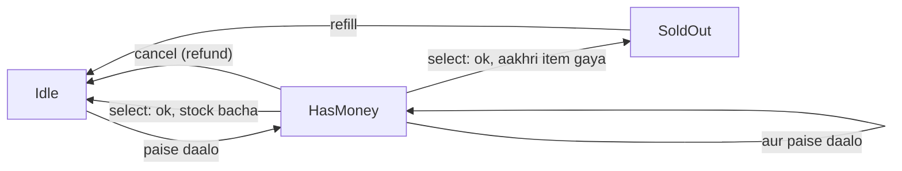

Pattern ke bina har method `if self.state == "IDLE": ... elif self.state == "HAS_MONEY": ...` se shuru hota, aur ek state add karne ka matlab hota har method edit karna. Pattern ke saath, **har state ek class hai jo har user action ka jawab khud deti hai**.

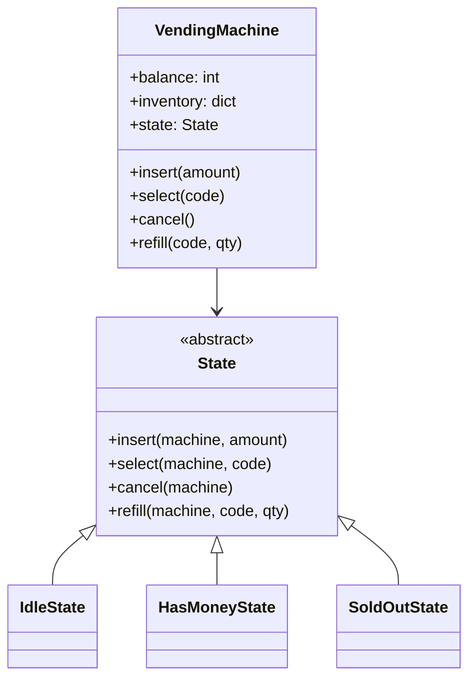

```python
from abc import ABC, abstractmethod
from dataclasses import dataclass

ACCEPTED = {5, 10, 20, 50, 100}


@dataclass
class Product:
    name: str
    price: int
    quantity: int


class State(ABC):
    @abstractmethod
    def insert(self, vm, amount): ...
    @abstractmethod
    def select(self, vm, code): ...
    @abstractmethod
    def cancel(self, vm): ...

    def refill(self, vm, code, qty):                   # har state mein same
        vm.inventory[code].quantity += qty
        print(f"  refilled {vm.inventory[code].name} (+{qty})")
        if isinstance(vm.state, SoldOutState):
            vm.state = IdleState()


class IdleState(State):
    def insert(self, vm, amount):
        vm.balance += amount
        vm.state = HasMoneyState()
        print(f"  balance Rs {vm.balance}")

    def select(self, vm, code):
        print("  please insert money first")

    def cancel(self, vm):
        print("  nothing to refund")


class HasMoneyState(State):
    def insert(self, vm, amount):
        vm.balance += amount
        print(f"  balance Rs {vm.balance}")

    def select(self, vm, code):
        product = vm.inventory.get(code)
        if product is None:
            print(f"  no slot {code}")
        elif product.quantity == 0:
            print(f"  {product.name} sold out, choose another")
        elif vm.balance < product.price:
            print(f"  {product.name} costs Rs {product.price}: insert Rs {product.price - vm.balance} more")
        else:
            product.quantity -= 1
            change, vm.balance = vm.balance - product.price, 0
            print(f"  dispensed {product.name}, change Rs {change} {vm.make_change(change)}")
            vm.state = SoldOutState() if vm.all_sold_out() else IdleState()

    def cancel(self, vm):
        print(f"  refunded Rs {vm.balance} {vm.make_change(vm.balance)}")
        vm.balance = 0
        vm.state = IdleState()


class SoldOutState(State):
    def insert(self, vm, amount):
        print(f"  machine empty: returned your Rs {amount}")

    def select(self, vm, code):
        print("  machine empty")

    def cancel(self, vm):
        print("  nothing to refund")


class VendingMachine:
    def __init__(self, inventory: dict[str, Product]):
        self.inventory, self.balance = inventory, 0
        self.state: State = IdleState() if not self.all_sold_out() else SoldOutState()

    def all_sold_out(self) -> bool:
        return all(p.quantity == 0 for p in self.inventory.values())

    @staticmethod
    def make_change(amount: int) -> list[int]:
        coins = []
        for c in sorted(ACCEPTED, reverse=True):       # is coin set ke liye greedy chalta hai
            while amount >= c:
                coins.append(c)
                amount -= c
        return coins

    # Public API: input validate karo, phir current state ko delegate karo.
    def insert(self, amount):
        if amount not in ACCEPTED:
            print(f"  Rs {amount} not accepted")
            return
        self.state.insert(self, amount)

    def select(self, code): self.state.select(self, code)
    def cancel(self): self.state.cancel(self)
    def refill(self, code, qty): self.state.refill(self, code, qty)


vm = VendingMachine({"A1": Product("Chips", 20, 1), "A2": Product("Cola", 45, 1)})
actions = [("select", "A1"), ("insert", 7), ("insert", 10), ("select", "A1"),
           ("insert", 20), ("select", "A1"), ("insert", 100), ("select", "A1"),
           ("cancel",), ("insert", 50), ("select", "A2"), ("insert", 10),
           ("refill", "A2", 3), ("insert", 50), ("select", "A2")]
for action in actions:
    name, *args = action
    print(f"{name}({', '.join(map(str, args))})  [{type(vm.state).__name__}]")
    getattr(vm, name)(*args)
```

```text
select(A1)  [IdleState]
  please insert money first
insert(7)  [IdleState]
  Rs 7 not accepted
insert(10)  [IdleState]
  balance Rs 10
select(A1)  [HasMoneyState]
  Chips costs Rs 20: insert Rs 10 more
insert(20)  [HasMoneyState]
  balance Rs 30
select(A1)  [HasMoneyState]
  dispensed Chips, change Rs 10 [10]
insert(100)  [IdleState]
  balance Rs 100
select(A1)  [HasMoneyState]
  Chips sold out, choose another
cancel()  [HasMoneyState]
  refunded Rs 100 [100]
insert(50)  [IdleState]
  balance Rs 50
select(A2)  [HasMoneyState]
  dispensed Cola, change Rs 5 [5]
insert(10)  [SoldOutState]
  machine empty: returned your Rs 10
refill(A2, 3)  [SoldOutState]
  refilled Cola (+3)
insert(50)  [IdleState]
  balance Rs 50
select(A2)  [HasMoneyState]
  dispensed Cola, change Rs 5 [5]
```

Kya hua yahan: log ko upar se neeche padho aur brackets mein badalti state dekho. `VendingMachine` class mein state wale `if` **zero** hain. Ek `MaintenanceState` chahiye jo sab kuch reject kare? Ek nayi class. Yahi Open/Closed ka asli action hai.

Log ke kuch interesting moments:
- `insert(7)`: ₹7 accepted set mein nahi hai. Ye check `VendingMachine.insert` mein state ko delegate karne **se pehle** hota hai, kyunki ye rule har state ke liye same hai. Input validation ek jagah, behaviour states mein.
- `select(A1)` jab Chips khatam ho chuke the: machine `HasMoneyState` mein hi rahi (₹100 abhi bhi andar), toh user doosra product chun sakta tha ya cancel kar sakta tha. User ka paisa "phansa" nahi.
- Cola bikne ke baad `all_sold_out()` True hua, toh state `SoldOutState` bani, aur agla ₹10 turant wapas. `refill` ke baad wapas `IdleState`.

> 💡 Greedy change-making (pehle sabse bada coin) ₹5/10/20/50/100 jaise "canonical" coin systems ke liye optimal hai, lekin har coin set ke liye nahi: coins {1, 3, 4} aur amount 6 ho toh greedy 4+1+1 deta hai jabki 3+3 behtar hai. Real machine ke paas coins ka *limited* stock bhi hota hai, jo change-making ko "Coin Change" DP problem bana deta hai ([Chapter 20](../part-2-dsa/20-dp-1d.md)), plus ek rule: agar exact change dena possible nahi, toh sale mana karo aur refund do.

---

## 🔬 Under the Hood · Andar Ki Kahani

### How Python makes interfaces and patterns cheap · Python mein patterns itne saste kyun hain

- **ABCs** (`abc.ABC` + `@abstractmethod`) abstract method names ko `cls.__abstractmethods__` mein record karte hain. Jab tak woh set khaali nahi hai, `object.__new__` instance banane se mana kar deta hai. Isiliye `Shape()` ne `TypeError` diya tha.
- **Duck typing** ka matlab hai ki interpreter kisi attribute ko sirf *tab* check karta hai jab tum use call karte ho. Toh Python mein tum ABC poori tarah skip kar sakte ho aur koi bhi object jiske paas `.pay()` hai, chal jaayega. ABCs ek jaldi wala, zor ka error jodte hain; `typing.Protocol` ek aisa interface deta hai jo sirf type-checker ke liye hai ("structural typing"), bina inheritance ke.
- **Functions first-class objects hain**, isliye Strategy, Command aur Observer aksar simat ke "ek function pass karo" ya "callbacks ki list rakho" ban jaate hain.
- **Method lookup MRO follow karta hai** (method resolution order, `Cls.__mro__`). Isi se child ka `fly()` parent wale ko override karta hai, aur `OfficeMachine(Printer, Scanner)` jaisi multiple inheritance predictable rehti hai.
- **Modules cache hote hain** `sys.modules` mein, pehle import ke baad. Isliye module-level objects natural singletons ban jaate hain.

> 🇮🇳 **Desi Analogy:** Duck typing ko **shaadi ka caterer** samjho. Tumhe certificate nahi chahiye ki banda "Registered Halwai Association" ka member hai (ABC / inheritance). Tumhe bas itna chahiye ki woh **jalebi bana sake** (`.make_jalebi()` method ho). Jo bana de, woh halwai. ABC woh case hai jahan tum pehle hi certificate maang lete ho, taaki shaadi ke din pata na chale ki banda jalebi banana jaanta hi nahi tha (jaldi aur zor se error).

### Thread safety: what actually goes wrong · Asal mein gadbad kahan hoti hai

[Part 1 ke Chapter 18](../part-1-python/18-internals-concurrency.md) mein tum **GIL** (Global Interpreter Lock) se mile the: ek waqt pe sirf ek thread Python bytecode chalata hai. Beginners isse nateeja nikaal lete hain "toh mera code thread-safe hai". **Nahi hai.** GIL bytecodes ke *beech* mein threads switch kar sakta hai, aur zyada tar "single" operations asal mein kai bytecodes hote hain.

`count += 1` asal mein hai: `count` **load** karo, 1 **add** karo, `count` **store** karo. Agar thread A ne 5 load kiya, phir thread B ne bhi 5 load kiya, toh dono 6 store karenge. Ek increment gayab. Isko **race condition** kehte hain: result timing pe depend karta hai.

| Time | Thread A | Thread B | `count` memory mein |
|---|---|---|---|
| 1 | load → 5 | | 5 |
| 2 | | load → 5 | 5 |
| 3 | add → 6 | | 5 |
| 4 | | add → 6 | 5 |
| 5 | store 6 | | 6 |
| 6 | | store 6 | 6 (7 hona chahiye tha!) |

LLD code mein sabse common race hai **check-then-act**:

```py
# ❌ dono threads act karne se pehle check paas kar sakte hain
if spot.is_free():          # check (jaancho)
    spot.assign(vehicle)    # act (karo)

# ✅ check + act ko ek atomic step banao
with floor_lock:
    if spot.is_free():
        spot.assign(vehicle)
```

Ek lock (mutex) ek block ko **critical section** bana deta hai jismein ek waqt pe sirf ek thread ho sakta hai. Yahan woh ek shared counter ko protect kar raha hai, aur result deterministic hai:

```python
import threading


class Counter:
    def __init__(self):
        self.value = 0
        self._lock = threading.Lock()

    def increment(self):
        with self._lock:          # load-add-store ek unit ki tarah hota hai
            self.value += 1


counter = Counter()

def work():
    for _ in range(10_000):
        counter.increment()

threads = [threading.Thread(target=work) for _ in range(4)]
for t in threads:
    t.start()
for t in threads:
    t.join()
print(counter.value)              # lock ke saath hamesha 40000
```

```text
40000
```

> 🇮🇳 **Desi Analogy:** **Train ka ek hi toilet**. Andar jaate hi tum kundi lagaate ho (lock acquire). Jab tak kundi lagi hai, baahar wale wait karte hain. Kaam khatam, kundi kholi (lock release), agla andar. Bina kundi ke? Do log ek saath darwaza kholenge, aur nateeja... kharaab. `with self._lock:` wahi kundi hai, aur `with` ki khoobi ye hai ki exception aaye tab bhi kundi khul jaati hai, koi andar phansa nahi rehta.

LLD rounds ke liye thread-safety toolbox:

| Tool | Kya karta hai | Kahan use |
|---|---|---|
| `threading.Lock` | Ek block mein ek waqt pe ek thread | Seats book karna, parking spots, LRU cache |
| `threading.RLock` | Re-entrant: wahi thread use dobara acquire kar sakta hai | Ek locked method jo doosra locked method call kare |
| Lock per object / shard | Kam waiting: aapas mein na jude kaam ek lock share nahi karte | Per-show lock, per-floor lock, sharded cache |
| `queue.Queue` | Thread-safe FIFO, blocking `get` ke saath | Producer/consumer: elevator requests, job workers |
| `threading.Condition` / `Semaphore` | Kisi condition ka wait / ek saath users ki limit | Bounded pools, rate limits |
| Immutability | Jo objects kabhi badalte nahi, unpe race nahi hoti | `Vehicle`, events, money ke liye `@dataclass(frozen=True)` |
| Atomic DB operations | Conditional `UPDATE`, unique constraints, transactions | Jo bhi cheez multiple servers ke across hai |

**Deadlock** tab hota hai jab thread 1 ke paas lock A hai aur woh B ka wait kar raha hai, jabki thread 2 ke paas B hai aur woh A ka wait kar raha hai. Dono hamesha wait karte rahenge. Standard ilaaj: **locks hamesha ek global order mein acquire karo** (jaise seat IDs sort karo, ya accounts ko chhoti account ID pehle lock karo). Doosre ilaaj: ek waqt pe ek hi lock pakdo, ya `lock.acquire(timeout=...)` use karo aur peeche hato.

> 🤔 **Mann mein sawaal:** "Fixed order mein lock lo" se deadlock kaise ruk jaata hai?
>
> **Jawab:** Deadlock ke liye ek **circle** chahiye: A ke paas X, woh Y maange; B ke paas Y, woh X maange. Ab rule bana do: "hamesha chhoti ID wala lock pehle". Toh A aur B dono pehle X lene ki koshish karenge (agar X < Y). Jo pehle X pakdega, wahi Y tak pahunchega; doosra X pe hi wait karega, Y ko pakde bina. Koi bhi "Y pakad ke X maangne" wali haalat mein nahi aa sakta, toh circle ban hi nahi sakta. Jaise ek single-lane pul pe rule ho "pehle left wali gaadi", toh beech pul pe aamne-saamne kabhi nahi phansoge.

> ⚠️ In-process lock sirf **ek process** ko protect karta hai. Jaise hi tumhare paas do app servers hain, lock kisi shared jagah rehna chahiye: database (row locks, conditional updates) ya ek distributed lock service. Har concurrency discussion mein ye sentence bolo, aur tum senior sunai doge.

### Why these designs have the complexity they do · Har design ki complexity

| Design | Key structure | Core ops |
|---|---|---|
| Parking lot | Har (floor, type) ka free spots ka min-heap | park/unpark O(F·log S), F floors aur har floor pe S spots ke liye |
| Elevator | Har elevator ke do sets; dispatcher M elevators scan karta hai | request O(M); step O(1) |
| LRU cache | Dict + doubly linked list | get/put O(1) |
| Splitwise | Net balance dict + do heaps | add expense O(k), k logon ke liye; simplify O(n log n) |
| Movie booking | Har show ki status dict + har show ka lock | hold O(k), k seats ke liye (+ expiring holds) |
| Snake & ladder | Jump dict + deque | har turn O(1) |
| Vending machine | Products ki dict + state object | har action O(1) |

Parking lot ka **O(F·log S)** samjho: worst case mein har floor pe ek heap check hota hai (F floors), aur jis floor pe spot mila wahan heap pop O(log S) hai. Khaali heap check karna O(1) hai, toh asal mein zyada tar time F floors pe loop mein jaata hai.

---

## 🧩 Pattern Decoder · Pattern Pakdo

### Signals: requirement words → pattern · Requirement ke shabd → pattern

| Requirement mein ye likha hai... | Ye nikaalo | Kyunki |
|---|---|---|
| "different pricing / payment / routing / sorting rules", "configurable algorithm" | **Strategy** | Algorithm badalta hai; caller nahi badalna chahiye |
| "behaves differently in each stage", "status", "mode", "lifecycle", "machine" | **State** | `if state ==` wali spaghetti khatam |
| "notify", "subscribe", "when X happens, also do Y and Z" | **Observer** | Publisher ko apne listeners nahi pata |
| "undo / redo", "queue of tasks", "macro", "audit log of actions" | **Command** | Requests store karne laayak objects ban jaati hain |
| "escalation", "approval levels", "middleware", "filters", "pass along" | **Chain of Responsibility** | Har handler decide karta hai: handle karo ya aage bhejo |
| "create one of several types based on input" | **Factory** | Concrete classes sirf ek jagah jaani jaati hain |
| "many optional parameters", "step-by-step construction", "immutable result" | **Builder** | Padhne laayak, validated construction |
| "exactly one", "global config", "shared pool" | **Singleton** (ya ek module / injected instance) | Har process mein ek instance |
| "add features in combinations", "wrap with logging / caching / retry" | **Decorator** | 2ⁿ subclasses se bachata hai |
| "third-party / legacy API doesn't match our interface" | **Adapter** | Kisi bhi side ko badle bina translate karo |
| "lazy load", "access control", "remote object looks local" | **Proxy** | Same interface, controlled access |

### Decision guides · Faisla kaise lo

- **Agar** kisi class mein ek *type* field pe badhta hua `if/elif` hai, **toh** use polymorphism se replace karo (subclasses + Factory), **kyunki** har naya type ek nayi class honi chahiye, edit nahi (OCP).
- **Agar** badhta hua `if/elif` ek *status* field pe hai jo object ki zindagi mein badalta hai, **toh** State use karo, **kyunki** transitions explicit aur local ho jaate hain.
- **Agar** behaviour *caller ki choice* se badalna hai, **toh** Strategy; agar *object ki apni history* se, **toh** State.
- **Agar** tumhe "is-a" chahiye *aur* child parent ka har promise nibhaata hai, **toh** inheritance theek hai; warna compose karo, **kyunki** toota hua promise ek LSP bug hai jo hone ka intezaar kar raha hai.
- **Agar** koi dependency bahar ki duniya se baat karti hai (DB, network, clock, randomness), **toh** use inject karo, **kyunki** wahi class ko testable aur deterministic banata hai (parking lot ka `now=` aur seeded dice dekho).
- **Agar** shared mutable state ko ek se zyada threads chhoote hain, **toh** check-then-act ko lock se guard karo ya database mein atomic banao, **kyunki** GIL tumhe nahi bachayega.
- **Agar** koi pattern jitne `if` hataata hai usse zyada classes jodta hai, **toh** use skip karo, **kyunki** patterns tools hain, trophies nahi.

### Trade-off tables

**Inheritance vs composition**

| | Inheritance | Composition |
|---|---|---|
| Relationship | is-a | has-a |
| Coupling | Tight: child parent ke internals pe depend karta hai | Loose: ek interface pe depend karta hai |
| Run time pe behaviour badalna | Nahi | Haan (component swap karo) |
| Code reuse | Automatic | Explicit delegation (thoda zyada typing) |
| Best for | Interface share karna; sachchi taxonomies | Behaviour share karna; features mix karna |

**Patterns ki keemat**

| Pattern | Fayda | Keemat / risk |
|---|---|---|
| Singleton | Ek shared instance | Chhupa hua global state; tests leak; mock karna mushkil |
| Factory | Callers concrete classes se decoupled | Ek aur indirection |
| Builder | Padhne laayak, validated construction | Extra class; kwargs/dataclasses ke saath overkill |
| Strategy | Swap hone wale algorithms, OCP | Zyada chhoti classes (ya functions use karo) |
| Observer | Loose coupling, reactions jodna aasaan | "Kaun kis pe react karta hai" trace karna mushkil; observers ke across order aur error handling |
| State | State wale `if` nahi; explicit transitions | Bahut saari chhoti classes; transitions unmein bikhre hue |
| Command | Undo, queues, logs | Har action ko undo chahiye, jo side effects ke liye mushkil hai (bheja hua email wapas nahi hota) |
| Chain of Resp. | Flexible pipelines | Request bina handle hue chain ke end se gir sakti hai |
| Decorator | Features ko freely combine karo | Gehri wrapping debug karna mushkil |
| Adapter | Incompatible code reuse karo | Maintain karne ke liye ek aur layer |

### When NOT to use patterns · Pattern kab NAHI lagana

- **Requirement badalti hi nahi.** Agar hamesha ek hi pricing rule rahega, toh ek function kaafi hai. YAGNI: "You Aren't Gonna Need It" (jiski zaroorat nahi padegi, woh abhi mat banao).
- **Python mein pehle se hai.** Iterator (generators use karo), functions ke liye Decorator (`@` use karo), Singleton (module use karo), Strategy (function pass karo).
- **Machine coding ke pehle 30 minute mein.** Simple classes ke saath happy path chalao, *phir* jo hisse saaf saaf badalte hain unhe patterns mein refactor karo.

> 🇮🇳 **Desi Analogy:** Patterns masaalon jaise hain. Garam masala achha hai, lekin chai mein daaloge toh chai kharab. Har sabzi mein saare 10 masale daalne wala cook accha nahi, confused hai. Accha cook poochta hai "is dish ko kya chahiye?" Waise hi tum poocho "yahan kya badlega?", aur sirf wahi pattern daalo.

---

## ⚠️ Traps & Common Mistakes · Yahan Sab Phisalte Hain

1. **Clarify karne se pehle coding.** Das minute baad pata chala ki trucks bhi hain, ya payments scope mein the. Pehle 5–10 minute requirements pe lagao aur unhe likh lo.
2. **God class.** Ek `ParkingLotManager` jismein 40 methods hain jo allocation, pricing, printing aur persistence sab karte hain. Responsibility ke hisaab se todo (SRP).
3. **Fixed sets ke liye strings.**

```py
# ❌ typo ek chupchaap bug hai
if vehicle.kind == "Truk": ...

# ✅ enums zor se fail hote hain aur autocomplete bhi hote hain
class VehicleType(Enum):
    CAR = "car"
    TRUCK = "truck"
if vehicle.kind is VehicleType.TRUCK: ...
```

4. **Paise float mein.** `0.1 + 0.2 == 0.30000000000000004`. Integer paise ya `Decimal` use karo.
5. Model classes mein **mutable default arguments**:

```py
# ❌ har Order EK hi list share karta hai
class Order:
    def __init__(self, items=[]):
        self.items = items

# ✅
class Order:
    def __init__(self, items=None):
        self.items = list(items) if items else []
```

   Kyun? Default value `[]` function **define hote waqt ek hi baar** banti hai, har call pe nahi. Toh har `Order()` jo items nahi deta, woh *same* list share karta hai. Ek order mein item daalo, sab orders mein dikh jaayega.

6. **Code reuse ke liye inheritance jo LSP tod de** (`Penguin(Bird)` crash hone wale `fly` ke saath, `Square(Rectangle)`). Agar child parent ke promises nahi nibha sakta, toh compose karo.
7. **Internals expose karna.** Andar ki dict return karne se callers state corrupt kar sakte hain (`lot.spots["F0-01"].vehicle = None`). Copies ya read-only views return karo, aur state sirf methods se badlo.
8. **Business logic ke andar clock ya `random` padhna.** Test nahi ho sakta aur non-deterministic hai. `now` aur ek seeded `Random` inject karo.
9. **"GIL thread-safe bana deta hai."** Nahi banata. Check-then-act ko lock chahiye (ya ek atomic DB operation).
10. **Galat jagah locks:** ek global lock (sab wait karte hain) ya alag alag order mein acquire hue locks (deadlock). Per show/floor/shard lock lagao, aur hamesha fixed order mein acquire karo.
11. **Pattern-stuffing.** Parking lot mein saare das patterns ghusa dena impress nahi karta; confuse karta hai. Har pattern ko jawab dena chahiye "yahan kya badalta hai?"
12. **Koi demo nahi.** Machine coding mein jo code kabhi chala nahi, use toota hua maan liya jaata hai. Hamesha ek `main` ke saath khatam karo jo happy paths *aur* edge cases dono chalaye.

---

## 💡 Tips & Tricks · Pro Wale Moves

- **Har LLD answer aise shuru karo: requirements → entities → diagram → code.** Har step ka naam zor se bolo taaki interviewer tumhara process follow kar sake.
- **Pehle enums aur dataclasses likho.** `@dataclass` tumhe `__init__`, `__repr__` aur `__eq__` free mein deta hai, jo machine-coding round mein 10 minute bachata hai.
- **Cheezon ke naam domain se rakho:** `Ticket`, `Show`, `Hold`, na ki `Data`, `Info`, `Helper`.
- **Public API chhota rakho.** `park`, `unpark`, `availability`. Baaki sab `_private`.
- **Services ke andar print karne ke bajaye results return karo**; print sirf demo mein. (Vending machine example chhota rakhne ke liye print karti hai; bolo ki real code mein tum events ya messages return karoge.)
- **Har classic ke liye "kya badlega?" list taiyaar rakho:** parking lot (pricing, allocation), elevator (dispatch strategy, states), vending machine (states, payment), Splitwise (split types), booking (seat locking strategy).
- **Concurrency pehle hi bol do.** Na bhi poochha jaaye, toh bolo: "do gates ek saath park kar sakte hain; main allocation lock kar raha hoon, aur multi-server setup mein DB unique constraint se enforce karega."
- **Language ka faayda uthao.** `collections.deque`, `heapq`, `OrderedDict`, `defaultdict`, IDs ke liye `itertools.count`, `enum.Enum`, `abc.ABC`, `threading.Lock`. Standard library jaanna seniority ka signal hai.
- **Chhote inputs se test karo**: 2-spot lot, 2-capacity cache, 30-cell board. Edge cases turant saamne aa jaate hain.
- **Walkthrough ke liye 5 minute bachao.** Ek flow end to end samjhao aur ek extension. Interviewers ko yahi hissa yaad rehta hai.

---

## 🎯 Interview Questions · Interview Mein Yahi Poochenge

### 1. Explain the SOLID principles with an example of each. 🔥🔥🔥

<details><summary>Answer dekho 👀</summary>

- **S, Single Responsibility:** ek class ke paas badalne ki ek hi wajah honi chahiye. `Invoice` totals calculate karta hai; `InvoicePrinter` format karta hai; `InvoiceRepository` save karta hai. Format badalne se paison wala logic kabhi nahi chhuta.
- **O, Open/Closed:** extension ke liye open, modification ke liye closed. Naye discount types nayi `DiscountPolicy` classes hain; `final_price()` kabhi nahi badalta.
- **L, Liskov Substitution:** subclass ko wahan bina surprise ke use kiya ja sake jahan parent use hota hai. `Penguin(Bird)` jiska `fly()` error phenkta hai, callers ko tod deta hai; `Bird` aur `FlyingBird` mein todo.
- **I, Interface Segregation:** ek mote interface se kai chhote interfaces behtar. Sasta printer `Printer` implement karta hai, na ki ek bada `Machine` jismein `fax()` ke nakli stubs hon.
- **D, Dependency Inversion:** business logic abstractions pe depend karta hai, aur concrete details inject hoti hain. `OrderService(repo: OrderRepository)` production mein MySQL ke saath aur tests mein in-memory repo ke saath chalta hai.

End mein *kyun* bolo: ye sab milke code ko badalna sasta banate hain, aur design ka asli goal yahi hai.

> 🗣️ **Interview mein aise bolo:** "SOLID is five rules that keep code cheap to change. Single Responsibility: one reason to change, so Invoice, InvoicePrinter and InvoiceRepository are separate. Open/Closed: add new behaviour as new classes, like a new DiscountPolicy, without editing tested code. Liskov: subclasses keep the parent's promises, so Penguin shouldn't inherit fly(). Interface Segregation: small role interfaces like Printer and Scanner. Dependency Inversion: business logic depends on an abstraction like OrderRepository, and the concrete database is injected."

</details>

### 2. Composition vs inheritance: when do you use which? 🔥🔥🔥

<details><summary>Answer dekho 👀</summary>

**Inheritance** tab use karo jab rishta sach mein "is-a" ho aur child parent ka *har* promise nibhaaye, aamtaur pe ek interface (ABC) implement karne ke liye. Behaviour reuse karna ho toh **composition** ("has-a") use karo. Default mein composition prefer kiya jaata hai kyunki woh loosely coupled hai (tum ek interface pe depend karte ho, parent ke internals pe nahi), run time pe behaviour swap karne deta hai (`checkout.strategy = CardPayment()`), aur gehri, naazuk hierarchies aur class explosions (`MilkCaramelCoffee`, `DoubleMilkCoffee`, ...) se bachata hai. Strategy, State aur Decorator teeno composition pe based patterns hain.

> 🗣️ **Interview mein aise bolo:** "I use inheritance only for a true is-a relationship where the subclass honours every promise of the parent, typically to implement an interface. For reusing behaviour I prefer composition, because it's loosely coupled, it lets me swap behaviour at run time, and it avoids deep hierarchies and class explosions. Strategy, State and Decorator are all built on composition."

</details>

### 3. What's the difference between Strategy and State? 🔥🔥

<details><summary>Answer dekho 👀</summary>

Dono badalne wale behaviour ko ek interface ke peeche rakhte hain aur use composition se pakadte hain, isliye code ek jaisa dikhta hai. Farak hai **kaun badalta hai aur kyun**:

- **Strategy:** *client* algorithm chunta hai (UPI vs card); strategies aamtaur pe ek doosre ke baare mein nahi jaanti, aur choice aksar us operation ke liye fixed rehti hai.
- **State:** *object khud* events hone pe apna state object badalta hai (`Idle → HasMoney → Idle`); states apne agle states jaanti hain aur transitions encode karti hain.

Rule: "ye kaam kaise hona chahiye?" → Strategy. "Main abhi kya kar sakta hoon?" → State.

> 🗣️ **Interview mein aise bolo:** "Structurally they look the same: behaviour behind an interface, held by composition. The difference is who changes it. With Strategy the client picks the algorithm, like UPI versus card, and the strategies don't know about each other. With State the object switches its own state as events happen, and each state knows which transitions are legal."

</details>

### 4. How do you implement a thread-safe Singleton in Python, and why do many people call Singleton an anti-pattern? 🔥🔥🔥

<details><summary>Answer dekho 👀</summary>

`__new__` ko **double-checked locking** ke saath override karo: `cls._instance is None` check karo, ek class-level `threading.Lock` lo, dobara check karo, phir banao (section 5.1 dekho). Doosra check isliye zaroori hai kyunki do threads dono pehla check paas kar sakte hain, kisi ke bhi lock lene se pehle. Sabse simple Pythonic singleton hai **module-level instance**, kyunki modules ek hi baar import hote hain aur `sys.modules` mein cache ho jaate hain.

Iski aalochana kyun hoti hai: ye **global mutable state** hai. Ye dependencies chhupata hai (ek function chupke se `Config()` use kar raha hai), code ko ek concrete class se jod deta hai, aur tests ko ek doosre mein dakhal dene deta hai kyunki state tests ke beech zinda rehti hai. Behtar tareeka aamtaur pe hai **startup pe ek instance banao aur jahan chahiye wahan inject karo**: tumhe ek hi instance milta hai, bina chhupe hue coupling ke.

> 🗣️ **Interview mein aise bolo:** "I'd override __new__ with double-checked locking: check if the instance exists, take a class-level lock, check again, then create it. The second check stops two threads that both passed the first check from creating two instances. In Python the simplest singleton is just a module-level object. But Singleton is often an anti-pattern because it's hidden global state that makes testing hard, so in production I'd create one instance at startup and inject it."

</details>

### 5. Factory vs Abstract Factory vs Builder. 🔥🔥

<details><summary>Answer dekho 👀</summary>

- **Factory (method):** ek input se decide karta hai ki *kaunsi ek class* instantiate hogi, jaise `NotifierFactory.create("sms")`. Concrete classes chhupata hai.
- **Abstract Factory:** related objects ki *families* banata hai jo aapas mein match honi chahiye, jaise ek `DarkThemeFactory` jo dark button, dark menu aur dark dialog banata hai; factory swap karo, poori family swap ho jaati hai.
- **Builder:** *ek complex object ko step by step* banata hai, aksar end mein validation ke saath (`HttpRequestBuilder(...).method("POST").header(...).build()`). Ye *kaise* jodna hai uske baare mein hai, *kaunsi* class ke baare mein nahi.

</details>

### 6. Design an LRU cache with O(1) get and put. 🔥🔥🔥

<details><summary>Answer dekho 👀</summary>

Ek **hash map** (key → node, O(1) lookup ke liye) ko ek **doubly linked list** ke saath jodo (recency ke order mein, O(1) move-to-front aur remove-from-back ke liye). Edge cases se bachne ke liye head/tail sentinel nodes use karo. `get`: node dhoondho, use unlink karo, front pe push karo. `put`: agar key hai toh update karo aur front pe le jaao; warna, agar full hai, toh `tail.prev` (least recently used) hatao aur uski key map se delete karo (nodes isi wajah se apni key store karte hain), phir front pe insert karo. Poora code section 9 mein. Python mein `OrderedDict.move_to_end` aur `popitem(last=False)` bhi use kar sakte ho.

Follow-ups: thread safety (ek lock, ya N caches mein shard karo, har ek ka apna lock), TTL expiry, aur LFU (LeetCode 460: frequency → keys ka ordered set wala map aur ek `min_freq` pointer).

> 🗣️ **Interview mein aise bolo:** "A hash map alone can't track recency, and a list alone can't find keys in O(1), so I combine them: the map stores key to node, and a doubly linked list keeps nodes from most to least recent. Get and put move the node to the front; when the cache is full I evict the node just before the tail sentinel and delete its key from the map. Every operation is O(1). For concurrency I'd guard it with a lock or shard it."

</details>

### 7. How would you prevent two users from booking the same seat? 🔥🔥🔥

<details><summary>Answer dekho 👀</summary>

"Check karo seat free hai, phir le lo" ko **atomic** banao:

1. **Temporary hold:** jab tak user pay kar raha hai, seats ko ek expiry (jaise 5 minute) ke saath `HELD` mark karo; failure ya timeout pe release karo. Multiple seats ke liye hold all-or-nothing hota hai.
2. **Ek process ke andar:** check + update ke around har show ka ek lock (section 11).
3. **Kai servers ke across (asli jawab):** database ko faisla karne do. Ya toh **optimistic locking** ke saath conditional update (`UPDATE ... WHERE status='AVAILABLE' AND version=:v`; 0 rows → kisi aur ne jeeta), ya **pessimistic locking** (transaction ke andar `SELECT ... FOR UPDATE`, deadlocks se bachne ke liye rows sorted order mein lock karo). Aakhri safety net ki tarah bookings table pe `(show_id, seat_id)` ka **unique constraint** lagao.
4. Optionally, speed ke liye seats ko Redis mein `SET key value NX EX 300` se hold karo, lekin confirmation pe source of truth DB hi rahe.

Trade-offs bolo: low contention mein optimistic badhiya hai; hot shows ke liye pessimistic behtar; aur payment idempotent honi chahiye taaki retry pe double charge na ho.

> 🗣️ **Interview mein aise bolo:** "The core problem is a check-then-act race, so checking that the seat is free and taking it must be one atomic step. I'd put seats on a temporary hold with an expiry, all-or-nothing, while the user pays. Across many app servers the database is the referee: a conditional UPDATE with optimistic locking, or SELECT FOR UPDATE for very hot shows, plus a unique constraint on show and seat as the final safety net. Payment is idempotent so retries never double-charge."

</details>

### 8. Decorator vs Adapter vs Proxy. 🔥🔥

<details><summary>Answer dekho 👀</summary>

Teeno ek object ko **wrap** karte hain. Farak intent aur interface ka hai:

| | Interface | Purpose | Example |
|---|---|---|---|
| Decorator | Wrapped object jaisa hi | Behaviour **jodna**, stack ho sakta hai | `Milk(Coffee())`, retry/logging wrappers |
| Adapter | **Alag**: client jo expect karta hai usmein convert karta hai | Incompatible cheezon ko fit karna | `LegacyBankAdapter` jo `pay(rupees)` ko `make_transfer(payload)` mein badalta hai |
| Proxy | Same | **Access control**: lazy loading, caching, auth, remote calls | Ek image proxy jo file sirf pehle `display()` pe load karta hai |

</details>

### 9. Where is the Observer pattern used in real systems, and what are its pitfalls? 🔥🔥

<details><summary>Answer dekho 👀</summary>

Kahan use hota hai: UI event listeners (button clicks), model-view updates, ek service ke andar domain events ("order placed" → email, loyalty, warehouse), aur system scale pe Kafka jaise message brokers ke upar pub/sub ([Chapter 08](08-queues-events.md)).

Pitfalls: (1) notification ka **order** aamtaur pe tay nahi hota; uspe bharosa mat karo. (2) **Ek fail hota observer** publisher ka loop tod sakta hai; har observer ke liye catch aur log karo, ya asynchronously deliver karo. (3) **Memory leaks**: subject un observers ke references pakde rehta hai jinhe mar jaana chahiye tha; unsubscribe karo, ya `weakref` use karo. (4) Flows **trace karna mushkil** ("ye email kyun gaya?"); events log karo. (5) Synchronous observers publisher ko utna hi slow bana dete hain jitna sabse slow observer; slow walon ko queue pe daalo.

</details>

### 10. Abstract class vs interface: what's the difference, and how do you do each in Python? 🔥🔥

<details><summary>Answer dekho 👀</summary>

**Interface** ek pure contract hai: method signatures, na state, na implementation. **Abstract class** abstract methods ko shared implementation aur state ke saath mix kar sakti hai (jaise `Shape.describe()` jo abstract `area()` call karta hai). Java mein ek class kai interfaces implement kar sakti hai lekin sirf ek class extend kar sakti hai.

Python mein `interface` keyword nahi hai. Tum use karte ho:
- Dono ideas ke liye `abc.ABC` ke saath `@abstractmethod` (sirf abstract methods wala ABC *hi* interface hai). Python multiple inheritance allow karta hai, toh ek class kai ABCs implement kar sakti hai (`OfficeMachine(Printer, Scanner)`).
- **Structural** interfaces ke liye `typing.Protocol`: matching methods wali koi bhi class use satisfy kar deti hai, type checkers check karte hain, inheritance ki zaroorat nahi. Ye duck typing ko explicit banana hai.

</details>

### 11. What is dependency injection and why does it matter? 🔥🔥

<details><summary>Answer dekho 👀</summary>

Dependency injection ka matlab hai ki ek class apni dependencies khud **banane** ke bajaye unhe **receive** karti hai (constructor ya parameter se). Andar `self.repo = MySQLRepo()` ke bajaye `OrderService(repo)`.

Kyun: (1) **testability**: ek in-memory fake, ek fixed clock, ek seeded random generator pass karo; (2) **flexibility**: class edit kiye bina configuration se implementations swap karo; (3) **Dependency Inversion Principle** follow karne ka yahi tareeka hai; (4) dependencies body mein chhupne ke bajaye constructor signature mein dikhti hain. Python mein plain constructor arguments kaafi hain; FastAPI jaise frameworks mein built-in DI bhi hai (`Depends`).

</details>

### 12. You get "Design X" in a 90-minute machine-coding round. Walk me through your approach. 🔥🔥🔥

<details><summary>Answer dekho 👀</summary>

1. **(5–10 min) Clarify karo** functional requirements, constraints, aur kya out of scope hai; inhe file ke top pe comments ki tarah likho.
2. **(5 min) Entities aur actions**: nouns → classes/enums, verbs → methods.
3. **(5–10 min) Class diagram**: relationships aur multiplicities; interviewer ke saath us pe agree karo.
4. **(5 min) Kya badlega?** Strategy/State/Factory/Observer bilkul wahin lagao.
5. **(40–50 min) Code** layers mein: enums aur models, phir services, phir ek demo `main`. Jaldi aur baar baar chalao. Pehle happy path chalao.
6. **(10 min) Edge cases aur concurrency**: invalid input, full capacity, duplicates, races (locks, atomic DB updates).
7. **(5 min) Walkthrough**: demo chalao, ek flow samjhao aur batao ki ek naya feature kaise jodoge.

Poore time zor se socho (think aloud) aur code runnable rakho. Working + clean, perfect + adhoore ko harata hai.

> 🗣️ **Interview mein aise bolo:** "I'll spend the first ten minutes clarifying requirements and writing down what's in and out of scope. Then I'll map nouns to classes and verbs to methods, sketch a class diagram, and identify what's likely to change, because that's where I'll use patterns like Strategy or State. I'll code models first, then services, then a demo, and keep it running throughout. I'll finish with edge cases, concurrency, and a quick walkthrough of how I'd extend it."

</details>

### 13. Design a logger that supports levels (DEBUG, INFO, ERROR) and multiple outputs. Which patterns would you use? 🔥

<details><summary>Answer dekho 👀</summary>

- Logger ke liye **Singleton** (ya ek injected shared instance).
- Level ke hisaab se filtering ke liye **Chain of Responsibility** ya ek simple level threshold.
- Outputs ke liye **Observer / Strategy** (inhe *handlers* ya *sinks* kehte hain: console, file, remote); logger har registered sink ko notify karta hai.
- Timestamps ya formatting jodne ke liye **Decorator**.

```python
from enum import IntEnum


class Level(IntEnum):
    DEBUG = 10
    INFO = 20
    ERROR = 40


class ConsoleSink:
    def write(self, line): print("console:", line)


class MemorySink:
    def __init__(self): self.lines = []
    def write(self, line): self.lines.append(line)


class Logger:
    def __init__(self, min_level: Level):
        self.min_level, self.sinks = min_level, []

    def add_sink(self, sink): self.sinks.append(sink)

    def log(self, level: Level, msg: str):
        if level < self.min_level:
            return                                   # filter ho gaya
        line = f"[{level.name}] {msg}"
        for sink in self.sinks:                      # observers (sinks)
            sink.write(line)


log = Logger(Level.INFO)
memory = MemorySink()
log.add_sink(ConsoleSink())
log.add_sink(memory)
log.log(Level.DEBUG, "cache miss for key 42")
log.log(Level.INFO, "user asha logged in")
log.log(Level.ERROR, "payment gateway timeout")
print("stored:", memory.lines)
```

```text
console: [INFO] user asha logged in
console: [ERROR] payment gateway timeout
stored: ['[INFO] user asha logged in', '[ERROR] payment gateway timeout']
```

Dekho DEBUG wali line kahin nahi chhapi, kyunki `Level.DEBUG (10) < Level.INFO (20)`. `IntEnum` isiliye use kiya: uske members numbers ki tarah compare ho jaate hain. Python ka asli `logging` module bilkul yahi ideas use karta hai: hierarchy mein loggers (ek chain: records parent loggers tak propagate hote hain), levels, aur multiple handlers.

</details>

---

## 🏋️ Practice · Ab Tumhari Baari

**🟢 1. Parking lot ko extend karo** electric-vehicle spots ke saath: EVs pehle `EV` spots use kar sakti hain, phir compact ya large spots; normal cars ko EV spots *nahi* lene chahiye. Exactly batao tum kya kya badloge.

<details><summary>Solution dekho 👀</summary>

1. `VehicleType.ELECTRIC_CAR` aur `SpotType.EV` add karo.
2. Fit table mein ek entry add karo: `VehicleType.ELECTRIC_CAR: [SpotType.EV, SpotType.COMPACT, SpotType.LARGE]`. Normal cars ke paas `[COMPACT, LARGE]` hi rehta hai, toh woh kabhi EV spots nahi lengi.
3. `HourlyPricing.RATES` mein ek rate add karo (ya ek naya pricing strategy jo charging fee jode).
4. Ab floors `{SpotType.EV: 4, ...}` ke saath ban sakte hain.

`ParkingLot.park`, `unpark` aur `ParkingFloor` bilkul nahi badalte. Yahi Open/Closed Principle ka phal hai: **data aur nayi classes, logic mein koi edit nahi**.

Ek bonus check: `ParkingFloor.__init__` mein `self._free = {t: [] for t in SpotType}` likha hai, yaani har `SpotType` ke liye heap apne aap ban jaata hai. Naya enum member `EV` add kiya toh uska heap bhi bina kuch chhede ban gaya. Enums pe loop karne ka yahi fayda hai.

</details>

**🟢 2. Ek `@singleton` class decorator likho** jo kisi bhi class ko thread-safe singleton bana de.

<details><summary>Solution dekho 👀</summary>

```python
import functools
import threading


def singleton(cls):
    instance, lock = None, threading.Lock()

    @functools.wraps(cls)
    def get_instance(*args, **kwargs):
        nonlocal instance
        if instance is None:
            with lock:
                if instance is None:              # double-checked (do baar check)
                    instance = cls(*args, **kwargs)
        return instance
    return get_instance


@singleton
class Database:
    def __init__(self, url):
        self.url = url


a = Database("postgres://main")
b = Database("postgres://other")     # ignore hua: pehle hi ban chuka hai
print(a is b, b.url)
```

```text
True postgres://main
```

Trade-off dhyaan do: `Database` ab ek function hai, toh `isinstance(a, Database)` ab kaam nahi karta. Section 5.1 wala `__new__` approach use ek asli class rakhta hai.

Ek aur cheez: doosri call `Database("postgres://other")` ka argument chupchaap ignore ho gaya (output mein `main` hi aaya). Real code mein ye bug chhupa sakta hai, isliye singleton ko alag arguments ke saath call karna khud ek smell hai.

</details>

**🟡 3. n×n board pe Tic-Tac-Toe** jismein `move(row, col, player)` har move pe **O(1)** mein winner return kare (LeetCode 348, "Design Tic-Tac-Toe").

<details><summary>Solution dekho 👀</summary>

Har row, har column, aur dono diagonals ke liye ek counter rakho. Player 1 +1 jodta hai, player 2 −1. Agar koi counter ±n tak pahunch jaaye, toh us player ne woh line bhar di.

> 🤔 **Mann mein sawaal:** +1 aur −1 kyun? Har player ka alag counter kyun nahi?
>
> **Jawab:** Alag counters bhi chalenge, bas double memory. +1/−1 ki trick ye hai: agar ek row mein dono players ne kuch bhi khela hai, toh counter kabhi ±n tak nahi pahunch sakta, kyunki ek −1 ne ek +1 cancel kar diya. Counter **exactly n** tabhi hoga jab us row ke saare n cells player 1 ke hon. Ek number mein dono baatein: "kisne bhara" aur "poora bhara ya nahi".

```python
class TicTacToe:
    def __init__(self, n: int):
        self.n = n
        self.rows, self.cols = [0] * n, [0] * n
        self.diag = self.anti = 0
        self.taken = set()

    def move(self, row: int, col: int, player: int) -> int:
        if (row, col) in self.taken:
            raise ValueError("cell already taken")
        self.taken.add((row, col))
        delta = 1 if player == 1 else -1
        self.rows[row] += delta
        self.cols[col] += delta
        if row == col:
            self.diag += delta
        if row + col == self.n - 1:
            self.anti += delta
        target = delta * self.n
        if target in (self.rows[row], self.cols[col], self.diag, self.anti):
            return player
        return 0


game = TicTacToe(3)
moves = [(0, 0, 1), (0, 2, 2), (2, 2, 1), (1, 1, 2), (2, 0, 1), (1, 0, 2), (2, 1, 1)]
for r, c, p in moves:
    result = game.move(r, c, p)
print("winner:", result)
```

```text
winner: 1
```

Har move O(1), space O(n). LLD extension: `Player`, `Board`, `Game` classes, ek `WinningStrategy` interface (taaki tum "connect four" rules jod sako), aur Command ke saath ek undo stack.

</details>

**🟡 4. TTL wala LRU cache:** har `put(key, value, ttl, now)` `now` ke `ttl` seconds baad expire hota hai; expired key missing ki tarah behave karti hai. Testability ke liye time bahar se pass kiya jaata hai.

<details><summary>Solution dekho 👀</summary>

```python
from collections import OrderedDict


class TTLCache:
    def __init__(self, capacity: int):
        self.capacity = capacity
        self.data = OrderedDict()            # key -> (value, expiry ka time)

    def get(self, key, now: int):
        item = self.data.get(key)
        if item is None:
            return -1
        value, expires_at = item
        if now >= expires_at:
            del self.data[key]               # padhte waqt lazy expiry
            return -1
        self.data.move_to_end(key)
        return value

    def put(self, key, value, ttl: int, now: int):
        self.data[key] = (value, now + ttl)
        self.data.move_to_end(key)
        if len(self.data) > self.capacity:
            # Pehle expired entry hatao; warna LRU wali.
            expired = next((k for k, (_, exp) in self.data.items() if now >= exp), None)
            if expired is not None:
                del self.data[expired]
            else:
                self.data.popitem(last=False)


c = TTLCache(2)
c.put("otp", 4821, ttl=30, now=0)
c.put("session", "abc", ttl=600, now=0)
print(c.get("otp", now=10), c.get("otp", now=31), c.get("session", now=20))
c.put("a", 1, ttl=100, now=40)
c.put("b", 2, ttl=100, now=41)            # least recently used hatega: "session"
print(c.get("session", now=42), c.get("a", now=42), c.get("b", now=42))
```

```text
4821 -1 abc
-1 1 2
```

Trace: `otp` 0 + 30 = 30 pe expire hota hai. `now=10` pe mila (4821), `now=31` pe expire (−1, aur lazily delete bhi). Phir "a" aur "b" daale: capacity 2, toh teesra item aate hi evict chahiye. Koi expired entry nahi thi ("session" 600 tak valid), toh LRU wala gaya: "session". Isliye `get("session")` ne −1 diya.

Expired entry dhoondhne ke liye scan worst case mein O(n) hai; production caches (jaise Redis) access pe lazy expiry ko periodic random sampling ke saath combine karte hain taaki tez rahein.

</details>

**🟡 5. Undo hone wale transactions ke saath bank account.** Command pattern use karo taaki `deposit`, `withdraw` aur `transfer` undo ho sakein, aur ek failed withdrawal (insufficient funds) kabhi history mein record na ho.

<details><summary>Solution dekho 👀</summary>

```python
class Account:
    def __init__(self, name, balance=0):
        self.name, self.balance = name, balance


class Deposit:
    def __init__(self, acc, amt): self.acc, self.amt = acc, amt
    def execute(self): self.acc.balance += self.amt
    def undo(self): self.acc.balance -= self.amt


class Withdraw:
    def __init__(self, acc, amt): self.acc, self.amt = acc, amt
    def execute(self):
        if self.acc.balance < self.amt:
            raise ValueError(f"insufficient funds in {self.acc.name}")
        self.acc.balance -= self.amt
    def undo(self): self.acc.balance += self.amt


class Transfer:
    """A composite command: both halves succeed, or neither does."""
    def __init__(self, src, dst, amt):
        self.steps = [Withdraw(src, amt), Deposit(dst, amt)]
    def execute(self):
        for step in self.steps:
            step.execute()           # Withdraw pehle error deta hai, kuch bhi badalne se pehle
    def undo(self):
        for step in reversed(self.steps):
            step.undo()


class Bank:
    def __init__(self): self.history = []
    def run(self, cmd):
        try:
            cmd.execute()
            self.history.append(cmd)
        except ValueError as e:
            print("rejected:", e)
    def undo_last(self):
        if self.history:
            self.history.pop().undo()


a, b, bank = Account("A", 100), Account("B", 50), Bank()
bank.run(Deposit(a, 50))
bank.run(Transfer(a, b, 120))
bank.run(Withdraw(b, 500))
print(a.balance, b.balance, len(bank.history))
bank.undo_last()
print(a.balance, b.balance)
```

```text
rejected: insufficient funds in B
30 170 2
150 50
```

Trace: A=100, B=50. Deposit 50 → A=150. Transfer 120 → A=30, B=170. Withdraw B 500 → reject, history mein nahi gaya (isliye history ki length **2** hai, 3 nahi). `undo_last()` ne transfer undo kiya, `reversed` order mein: pehle Deposit ka undo (B=50), phir Withdraw ka undo (A=150).

Dhyaan do `Transfer` ke `execute` mein Withdraw **pehle** hai. Agar Withdraw fail hota, toh exception wahin uthta, Deposit chalta hi nahi, aur kuch bhi aadha-adhoora nahi badalta. Agar order ulta hota (pehle Deposit), toh failure pe B ke paas free ka paisa aa jaata. **Composite command mein jo step fail ho sakta hai, use pehle rakho.**

</details>

**🔴 6. LFU Cache** (LeetCode 460): least *frequently* used key evict karo; tie ho toh least recently used se todo. `get` aur `put` O(1) mein.

<details><summary>Solution dekho 👀</summary>

`key → (value, freq)`, `freq → keys ka OrderedDict` (same frequency ke andar recency order), aur `min_freq` rakho. Access pe key ko bucket `f` se bucket `f+1` mein le jaao; agar bucket `min_freq` khaali ho gaya, toh `min_freq += 1`. Nayi key ki frequency hamesha 1 hoti hai, toh insert ke baad `min_freq = 1`.

> 🇮🇳 **Desi Analogy:** College canteen ka menu board socho jahan sirf 2 items ki jagah hai. LRU kehta hai "jo sabse lambe time se kisi ne nahi khaaya, use hatao". LFU kehta hai "jo **sabse kam baar** order hua, use hatao" (samosa 50 baar bika, naya pasta sirf 1 baar, toh pasta hatega, chahe kal hi bika ho). Aur agar do items barabar baar bike, toh unmein se jo zyada purana hai, woh jaayega. Har "kitni baar bika" ki ek alag list (bucket) hai, aur sabse kam wali bucket ka number `min_freq` hai.

```python
from collections import defaultdict, OrderedDict


class LFUCache:
    def __init__(self, capacity: int):
        self.capacity = capacity
        self.items = {}                                  # key -> [value, freq]
        self.buckets = defaultdict(OrderedDict)          # freq -> keys, LRU order mein
        self.min_freq = 0

    def _touch(self, key):
        value, freq = self.items[key]
        del self.buckets[freq][key]
        if not self.buckets[freq]:
            del self.buckets[freq]
            if self.min_freq == freq:
                self.min_freq += 1
        self.items[key][1] = freq + 1
        self.buckets[freq + 1][key] = None

    def get(self, key):
        if key not in self.items:
            return -1
        self._touch(key)
        return self.items[key][0]

    def put(self, key, value):
        if self.capacity == 0:
            return
        if key in self.items:
            self.items[key][0] = value
            self._touch(key)
            return
        if len(self.items) == self.capacity:
            evict, _ = self.buckets[self.min_freq].popitem(last=False)
            if not self.buckets[self.min_freq]:
                del self.buckets[self.min_freq]
            del self.items[evict]
        self.items[key] = [value, 1]
        self.buckets[1][key] = None
        self.min_freq = 1


c = LFUCache(2)
c.put(1, 1); c.put(2, 2)
out = [c.get(1)]          # ab freq(1)=2
c.put(3, 3)               # 2 hatega (freq 1)
out += [c.get(2), c.get(3)]
c.put(4, 4)               # 1 aur 3 dono freq 2; 1 zyada purana -> 1 hatega
out += [c.get(1), c.get(3), c.get(4)]
print(out)
```

```text
[1, -1, 3, -1, 3, 4]
```

</details>

**🔴 7. Optimal Account Balancing** (LeetCode 465): transactions `[from, to, amount]` diye hain, saare debts settle karne ke liye **minimum** number of transfers return karo. Ye Splitwise greedy ka exact (exponential) version hai.

<details><summary>Solution dekho 👀</summary>

Net balances nikaalo, zeros hatao, phir backtrack karo: `debts[i]` ko har baad wale `debts[j]` ke saath settle karo jiska sign ulta hai, recurse karo, aur undo karo. Pruning: same depth pe duplicate values skip karo, aur perfect cancel (`debts[j] == -debts[i]`) pe jaldi ruk jaao, kyunki us position ke liye woh hamesha optimal hai.

```python
from collections import defaultdict


def min_transfers(transactions):
    net = defaultdict(int)
    for frm, to, amt in transactions:
        net[frm] -= amt
        net[to] += amt
    debts = [v for v in net.values() if v != 0]

    def settle(i):
        while i < len(debts) and debts[i] == 0:
            i += 1
        if i == len(debts):
            return 0
        best, seen = float("inf"), set()
        for j in range(i + 1, len(debts)):
            if debts[i] * debts[j] < 0 and debts[j] not in seen:
                seen.add(debts[j])
                debts[j] += debts[i]
                best = min(best, 1 + settle(i + 1))
                debts[j] -= debts[i]
                if debts[j] + debts[i] == 0:
                    break                    # perfect cancel: yahan isse behtar nahi ho sakta
        return best

    return settle(0)


print(min_transfers([[0, 1, 10], [2, 0, 5]]))
print(min_transfers([[0, 1, 10], [1, 0, 1], [1, 2, 5], [2, 0, 5]]))
```

```text
2
1
```

Doosra example trace karo: person 0 ka net = −10 + 1 + 5 = −4, person 1 = +10 − 1 − 5 = +4, person 2 = +5 − 5 = 0. Zero hata diya, bache `[-4, +4]`: ek hi transfer. Greedy bhi yahan 1 deta, lekin bade cases mein greedy kabhi kabhi ek-do zyada payments deta hai, aur ye exact method sabse kam dhoondhta hai.

Worst case mein exponential, isliye sirf chhote groups ke liye (LeetCode ise lagbhag 8 transactions jitne logon tak limit karta hai). Real app ke liye section 10 ka greedy heap method hi practical choice hai; ye bolna mat bhoolna.

</details>

---

## 🧠 Never-Forget Summary · Kabhi Mat Bhoolna

- **LLD = classes aur unki aapas ki baatcheet.** Goal hai aisa code jise badalna sasta ho.
- **Method:** clarify → nouns/verbs → class diagram → "kya badlega?" → layers mein code → edge cases & concurrency → walkthrough.
- **SOLID:** badalne ki ek wajah; add karo, edit nahi; subtypes promise nibhaate hain; chhote interfaces; abstractions pe depend karo aur unhe inject karo.
- **Composition prefer karo**; interface share karna ho toh inherit karo, behaviour share karna ho toh compose karo.
- **Creational:** Singleton (ek instance; injection behtar), Factory (kaunsi class), Builder (step-by-step construction).
- **Structural:** Decorator (same interface, features jodo), Adapter (interface convert karo), Proxy (access control karo).
- **Behavioural:** Strategy (algorithm swap karo), Observer (subscribers ko notify karo), State (stage ke hisaab se behaviour), Command (requests as objects, undo), Chain of Responsibility (aage badhao).
- **Clock aur randomness inject karo**; fixed sets ke liye enums; paison ke liye integer paise.
- **GIL ≠ thread-safe.** Check-then-act ko lock chahiye; servers ke across, database (conditional updates, unique constraints) referee hai.
- **Classic designs:** parking lot (heaps + fit table + pricing Strategy), elevator (LOOK + dispatcher cost), LRU (dict + doubly linked list), Splitwise (net balances + do heaps), booking (holds + per-show lock + DB constraints), snake & ladder (jump dict + deque + seeded dice), vending machine (State).

**Memory hooks**

- **SOLID** = "**S**ome **O**bjects **L**ove **I**njected **D**ependencies".
- Patterns ek restaurant ki tarah: **Factory** kitchen ka counter hai, **Builder** Subway ki line hai, **Singleton** ek hi head chef hai, **Strategy** hai "cash, card ya UPI?", **Observer** "order ready" wali ghanti hai, **State** order slip hai jo *placed* se *cooking* se *served* tak chalti hai, **Command** khud woh slip hai, **Chain** complaints ka waiter → manager → owner tak jaana hai, **Decorator** extra toppings hai, aur **Adapter** videshi chef ke blender ka plug converter hai.
- "**What varies? Wrap it.**" Jahan bhi requirement mein *different*, *types of*, *rules*, *modes* likha ho: interface wahin jaata hai.

**🪝 Yaad rakhne ka jugaad:**
- **SOLID = "Sabka Ooper Laddoo, Izzat Dabbe mein"**: **S**abka ek kaam (Single Responsibility), **O**oper se naya jodo, purana mat todo (Open/Closed), **L**addoo jo bola wahi do, aloo nahi (Liskov), **I**zzat se chhota menu, zabardasti ke dishes nahi (Interface Segregation), **D**abbe mein bijli bahar se aaye, socket se (Dependency Inversion: inject karo).
- **Concurrency ka mantra:** "**Pehle dekho, phir lo = kundi lagao.**" Jahan bhi "check-then-act" dikhe, train ke toilet ki kundi yaad karo. Aur do servers ho gaye? "**Kundi database ki, app ki nahi.**"
- **Strategy vs State:** "**Strategy = tum chunte ho, State = haalat chunti hai.**" UPI ya card tum chunte ho; traffic light ka agla colour light khud chunti hai.
- **Wrapper family:** "**Decorator sajata hai, Adapter samjhata hai, Proxy rokta hai.**" (topping jodo, bhasha translate karo, guard ki tarah gate pe roko).

**Ek tasveer**

| Problem ki smell | Pattern | Kahan dekha |
|---|---|---|
| Caller algorithm chunta hai | Strategy | Parking pricing, Splitwise splits, payments |
| Behaviour stage pe depend karta hai | State | Vending machine, order lifecycle |
| Ek event, kai reactions | Observer | Order placed → email, points, warehouse |
| Undo / queue / actions ka log | Command | Text editor, bank transactions |
| Request handlers ke beech aage badhao | Chain of Responsibility | ATM notes, middleware, approvals |
| Kaunsi class banani hai | Factory | Notifiers |
| Bahut saare optional parts | Builder | HTTP request |
| Exactly ek | Singleton | Config, lot instance |
| Wrap karke features jodo | Decorator | Coffee add-ons, `@retry` |
| Interface mismatch | Adapter | Legacy bank API |

> **Agar sirf ek cheez yaad rakhni hai:** dhoondho kya badlega, use ek interface ke peeche chhupao, aur baaki sab simple, runnable aur thread-safe rakho.

---
**Aage:** [Chapter 01 · Pattern Recognition Cheatsheet](../part-4-interview-arsenal/01-pattern-recognition.md)  ·  **Wapas** [Contents](../README.md)
