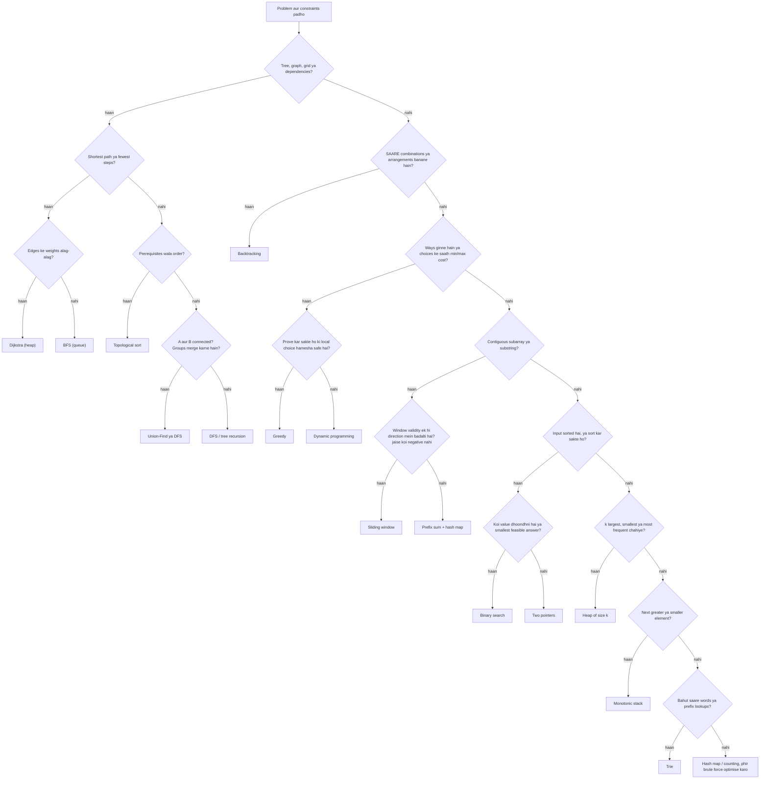

# Chapter 01 · Pattern Recognition Cheatsheet

> Interview mein tum isliye nahi haarte ki tumhe coding nahi aati. Tum isliye haarte ho kyunki ek naye problem ko dus minute tak ghoorte rehte ho, aur samajh nahi aata ki *kaunsa* tool uthana hai. Yeh chapter tumhara decoder ring hai: problem mein clues padho, pattern ka naam lo, template nikaalo, aur bolna shuru karo.

> 🇮🇳 **Desi Analogy:** Ek experienced doctor ko socho. Patient aata hai, bolta hai "bukhaar, badan dard, aankhon ke peeche dard". Doctor saari medical book shuru se nahi padhta. Woh **symptoms** (clues) dekhta hai, turant **diagnosis** (pattern) bolta hai, "dengue ho sakta hai", aur phir **standard treatment** (template) likhta hai. Interview mein tum wahi doctor ho. Problem ki wording = symptoms. Pattern = diagnosis. Template = prescription. Yeh chapter tumhe symptoms padhna sikhata hai.

**Is chapter ko kaise use karo:**
- **Practice se pehle:** decoder table aur flowchart pe ek nazar daal lo, taaki dimaag signals dhoondhna shuru kar de.
- **Practice ke dauraan:** jab atak jao, apne problem ke clues table mein dhoondho, phir uska template kholo.
- **Interview se pehle:** decoder table, constraint table aur interview script dobara padho. Yahi tumhara 20-minute ka warm-up hai.

**Isse pehle padho:** Poora [Part 2](../part-2-dsa/01-big-o-complexity.md). Yahan ka har template ek poore chapter ka compressed version hai. Agar koi template jaadu jaisa lage, toh uske chapter pe wapas jao.

---

## 1. The Signal → Pattern Decoder · Clue Se Pattern Tak

Problem ko ek baar, dheere se padho, aur in clues ko underline karo. Zyaadatar problems mein do ya teen clues hote hain, aur woh milke ek hi pattern ki taraf ishaara karte hain.

> 🤔 **Mann mein sawaal:** Itni badi table ratni padegi kya? 60 rows yaad kaise hongi?
>
> **Jawab:** Ratna nahi hai. Table ko **practice ke saath** use karo. Har problem solve karne ke baad dekho ki uski wording mein kaunsa clue tha, aur table mein woh row dhoondho. 30-40 problems ke baad yeh rows apne aap yaad ho jaati hain, kyunki tumne unhe khud "pakda" hota hai. Aur exam se pehle ki last revision ke liye Section 7 ki chhoti "One picture" table kaafi hai.

### 1.1 Clues in the input and the question · Input aur sawaal mein chhupe clues

| Problem mein tumhe dikhe... | Socho | Chapter |
|---|---|---|
| "sorted array", "find a pair / triplet that sums to X" | Two pointers (opposite ends, dono kinaaron se) | [03](../part-2-dsa/03-two-pointers.md) |
| "palindrome", "reverse", "compare from both ends" | Two pointers (opposite ends) | [03](../part-2-dsa/03-two-pointers.md) |
| "in place", "O(1) extra space", "remove / move elements" | Two pointers (reader / writer) | [03](../part-2-dsa/03-two-pointers.md) |
| "two sorted arrays", "merge", "is subsequence" | Two pointers (har sequence pe ek) | [03](../part-2-dsa/03-two-pointers.md) |
| "contiguous subarray / substring" + "longest / shortest / at most K" | Sliding window (variable) | [04](../part-2-dsa/04-sliding-window.md) |
| "every window of size k", "average of each k-block" | Sliding window (fixed) | [04](../part-2-dsa/04-sliding-window.md) |
| "anagram", "permutation of s1 inside s2" | Fixed window + character counts | [04](../part-2-dsa/04-sliding-window.md) |
| "seen before?", "duplicate", "pair with sum X" ek **unsorted** array mein | Hash set / hash map | [05](../part-2-dsa/05-hashing.md) |
| "group by", "frequency", "most common", "isomorphic" | Hash map / `Counter` | [05](../part-2-dsa/05-hashing.md) |
| "longest consecutive sequence" in O(n) | Hash set, sirf sequence ke starting number se ginti shuru karo | [05](../part-2-dsa/05-hashing.md) |
| "sum of range i..j" baar-baar poocha jaaye | Prefix sum array | [06](../part-2-dsa/06-prefix-sums.md) |
| "number of subarrays with sum = K", negatives allowed | Prefix sum + hash map | [06](../part-2-dsa/06-prefix-sums.md) |
| "add value v to range [l, r]" baar-baar | Difference array | [06](../part-2-dsa/06-prefix-sums.md) |
| "equal number of 0s and 1s" | 0 ko −1 bana do, phir prefix sum + first-seen map | [06](../part-2-dsa/06-prefix-sums.md) |
| "kth smallest", "custom order", "arrange to form largest" | Sorting with a key / comparator | [07](../part-2-dsa/07-sorting.md) |
| "count inversions", "smaller numbers after self" | Merge sort counting (ya Fenwick tree) | [07](../part-2-dsa/07-sorting.md) |
| "sorted" + "find position / first / last" | Binary search (lower bound) | [08](../part-2-dsa/08-binary-search.md) |
| "rotated sorted array" | Binary search, pehle decide karo kaunsa half sorted hai | [08](../part-2-dsa/08-binary-search.md) |
| "minimum capacity / speed / time such that it's possible" | Binary search on the answer | [08](../part-2-dsa/08-binary-search.md) |
| "minimise the maximum" / "maximise the minimum" | Binary search on the answer (ya DP) | [08](../part-2-dsa/08-binary-search.md) |
| "all subsets / permutations / combinations", "generate all" | Backtracking | [09](../part-2-dsa/09-backtracking.md) |
| "place N queens", "solve sudoku", "word search in grid" | Backtracking with pruning | [09](../part-2-dsa/09-backtracking.md) |
| "linked list" + "middle / cycle / kth from end" | Fast & slow pointers | [10](../part-2-dsa/10-linked-lists.md) |
| "reverse a linked list (or part of it)" | Three-pointer reversal (`prev`, `cur`, `nxt`) | [10](../part-2-dsa/10-linked-lists.md) |
| "O(1) get and put with eviction" | Hash map + doubly linked list (LRU) | [10](../part-2-dsa/10-linked-lists.md) |
| "valid parentheses", "nested", "undo", "evaluate expression" | Stack | [11](../part-2-dsa/11-stacks.md) |
| "next greater / smaller element", "days until warmer", "span" | Monotonic stack | [11](../part-2-dsa/11-stacks.md) |
| "largest rectangle", "trapping water" | Monotonic stack (ya two pointers) | [11](../part-2-dsa/11-stacks.md) |
| "max / min of every window of size k" | Monotonic deque | [12](../part-2-dsa/12-queues-deques.md) |
| "tree" + "depth / height / diameter / path sum" | DFS jo har subtree se ek value return kare | [13](../part-2-dsa/13-binary-trees.md) |
| "level by level", "right side view", "zigzag" | BFS with a queue, ek baar mein ek level | [13](../part-2-dsa/13-binary-trees.md) |
| "BST", "kth smallest in BST", "validate BST" | In-order traversal = sorted order; min/max bounds | [14](../part-2-dsa/14-binary-search-trees.md) |
| "k largest / smallest / closest", "top k frequent" | Heap of size k | [15](../part-2-dsa/15-heaps.md) |
| "merge k sorted lists", "smallest range from k lists" | k current heads ka min-heap | [15](../part-2-dsa/15-heaps.md) |
| "running median", "median of a stream" | Two heaps | [15](../part-2-dsa/15-heaps.md) |
| "schedule tasks with cooldown", "always pick the biggest" | Max-heap + greedy | [15](../part-2-dsa/15-heaps.md) |
| "grid", "islands", "connected regions", "flood fill" | Grid pe DFS ya BFS | [16](../part-2-dsa/16-graphs-bfs-dfs.md) |
| "shortest path / minimum steps", saare edges ka cost 1 | BFS | [16](../part-2-dsa/16-graphs-bfs-dfs.md) |
| "spreads from many places at once" (rotting, fire) | Multi-source BFS | [16](../part-2-dsa/16-graphs-bfs-dfs.md) |
| "transform word A into B one letter at a time" | BFS over states | [16](../part-2-dsa/16-graphs-bfs-dfs.md) |
| "prerequisites", "order of tasks", "dependencies", "build order" | Topological sort | [17](../part-2-dsa/17-graphs-advanced.md) |
| "shortest path" + **weighted** non-negative edges | Dijkstra | [17](../part-2-dsa/17-graphs-advanced.md) |
| "at most K stops", negative edges | Bellman-Ford (K rounds) | [17](../part-2-dsa/17-graphs-advanced.md) |
| "connect all points with minimum total cost" | Minimum spanning tree (Prim / Kruskal) | [17](../part-2-dsa/17-graphs-advanced.md) |
| "are A and B connected?", "number of groups", "redundant edge" | Union-Find (DSU) | [18](../part-2-dsa/18-union-find.md) |
| "merge accounts / groups that share something" | Union-Find | [18](../part-2-dsa/18-union-find.md) |
| "prefix", "autocomplete", "starts with", "dictionary of words" | Trie | [19](../part-2-dsa/19-tries.md) |
| "maximum XOR of two numbers" | Bitwise trie | [19](../part-2-dsa/19-tries.md) |
| "number of ways", "can you reach", "min / max cost" + har step pe choices | Dynamic programming | [20](../part-2-dsa/20-dp-1d.md) |
| "can't pick adjacent", "climb 1 or 2 steps" | Index pe 1D DP | [20](../part-2-dsa/20-dp-1d.md) |
| "longest increasing subsequence" | DP O(n²) ya patience sorting O(n log n) | [20](../part-2-dsa/20-dp-1d.md) |
| "two strings" + "common / edit / match" | (i, j) pe 2D DP | [21](../part-2-dsa/21-dp-2d-advanced.md) |
| "grid paths", "min path sum" moving right/down | Grid pe 2D DP | [21](../part-2-dsa/21-dp-2d-advanced.md) |
| "pick items with a weight limit", "subset sums to target" | 0/1 knapsack | [21](../part-2-dsa/21-dp-2d-advanced.md) |
| "unlimited coins", "ways to make amount" | Unbounded knapsack | [21](../part-2-dsa/21-dp-2d-advanced.md) |
| "intervals", "meetings", "overlap", "merge ranges" | Start (ya end) se sort, phir sweep | [22](../part-2-dsa/22-greedy-intervals.md) |
| "minimum rooms / platforms at the same time" | Sort + end times ka min-heap (ya sweep line) | [22](../part-2-dsa/22-greedy-intervals.md) |
| "maximum non-overlapping", "minimum arrows" | Greedy: **end** se sort | [22](../part-2-dsa/22-greedy-intervals.md) |
| "every element appears twice except one" | Sab ka XOR | [23](../part-2-dsa/23-bits-math.md) |
| "count set bits", "power of two", "subsets of n ≤ 20" | Bit tricks / bitmask | [23](../part-2-dsa/23-bits-math.md) |
| "answer modulo 10^9 + 7" | Counting, aksar DP ya combinatorics | [23](../part-2-dsa/23-bits-math.md) |
| "range query" + "point update", baar-baar | Fenwick tree / segment tree | [24](../part-2-dsa/24-advanced-structures.md) |
| "find pattern in text" in O(n + m) | KMP / Z-function / rolling hash | [24](../part-2-dsa/24-advanced-structures.md) |

> 🇮🇳 **Desi Analogy:** Railway station ka enquiry counter socho. Tum bolte ho "Delhi jaana hai, kal subah, sleeper mein". Clerk ke dimaag mein ek table hai: "Delhi + subah + sleeper → 12951 Rajdhani nahi, 12903 Golden Temple Mail". Woh har train ka timetable shuru se nahi padhta. Teen keywords (destination, time, class) milke **ek** train pe point karte hain. Upar wali table bilkul aisi hi hai: "contiguous" + "longest" + "at most K" milke **sliding window** pe point karte hain. Akela ek keyword confuse kar sakta hai, teen milke nahi.

### 1.2 Clues in what the problem asks you to *return* · Return kya karna hai, wahi sabse bada clue

Output ka type aksar sabse strong clue hota hai.

| Sawaal maangta hai... | Aksar matlab |
|---|---|
| **All** solutions (har subset / path / arrangement ki list) | Backtracking. Output hi exponential hai, toh exponential time chalega. |
| **Number of ways** | DP (ya combinatorics). Backtracking bahut slow hogi. |
| Kisi cheez ka **Min / max**, har step pe choices ke saath | DP, ya greedy agar tum prove kar sako ki local choice safe hai. |
| **Min / max** value jahan "kya X kaafi hai?" check karna aasaan ho | Binary search on the answer. |
| **Shortest** path / fewest steps | BFS (unweighted) ya Dijkstra (weighted). |
| **True / False**: pahunch sakte hain? possible hai? | DFS/BFS reachability, DP, ya greedy. |
| **Kth** kuch bhi | Heap, quickselect, ya value pe binary search. |
| Ek **ordering** jo rules follow kare | Topological sort, ya custom key ke saath sorting. |
| Longest contiguous hisse ki **length** | Sliding window, ya prefix sum + map. |
| Longest non-contiguous hisse ki **length** | DP (LIS / LCS family). |

> 🤔 **Mann mein sawaal:** "All solutions" pe backtracking aur "number of ways" pe DP. Dono mein toh saare raaste hi gin rahe hain, phir fark kyun?
>
> **Jawab:** Fark output ke size ka hai. Agar tumhe har solution **likh ke** dena hai, toh jitne solutions hain utna kaam toh karna hi padega. 2ⁿ subsets chahiye toh 2ⁿ likhne padenge, backtracking se bachne ka koi fayda nahi. Lekin agar sirf **ginti** chahiye, toh answer ek number hai. Woh number 10¹⁸ bhi ho sakta hai, aur ek-ek karke ginna impossible hoga. DP chhote sub-problems ke counts ko **jodta** hai, har raasta alag se nahi chalta. Isliye count → DP, list → backtracking.

### 1.3 Clues in the data structure · Data structure khud batata hai

| Input hai ek... | Pehle yeh patterns try karo |
|---|---|
| Sorted array | Binary search, two pointers |
| Unsorted array | Hash map, pehle sort, prefix sums, sliding window |
| String | Sliding window + counts, two pointers, hash map, do strings ho toh DP, bahut saare words ho toh trie |
| Linked list | Fast & slow pointers, dummy head, reversal |
| Binary tree | DFS (pre/in/post-order), level-wise BFS |
| BST | In-order = sorted; BST rule se left ya right jao |
| Grid / matrix | Cells pe BFS/DFS, 2D DP, binary search agar rows aur columns sorted hain |
| Edges / pairs / "A depends on B" | Pehle adjacency list banao, phir BFS/DFS/topo sort/DSU |
| Numbers ka stream | Heap, two heaps, monotonic deque, running hash map |
| Intervals ki list | Sort, phir sweep |

---

## 2. The Decision Flowchart · Raasta Dikhane Wala Chart

Jab table se kuch turant na sujhe, toh is chart ko upar se neeche chalo. Har sawaal patterns ki ek poori family ko hata deta hai.



> 💡 Yeh chart ek starting point hai, kanoon nahi. "Binary search on the answer + greedy check" ya "BFS + bitmask state" jaise combos tumhe harder problems mein milenge. Agar pehla pattern poori tarah fit na ho, toh poocho: "kaunsa *doosra* tool is gap ko bharega?"

> 🤔 **Mann mein sawaal:** Flowchart mein "window validity ek hi direction mein badalti hai" ka matlab kya hai? Negatives se kya farak padta hai?
>
> **Jawab:** Sliding window ka poora bharosa is baat pe hai ki **window badi karne se sum badhta hi hai, aur chhoti karne se ghatta hi hai**. Tab hum confidently bol sakte hain "sum zyada ho gaya, left ko aage badhao". Agar array mein negatives hain, toh ek naya element jodne se sum **ghat** bhi sakta hai. Ab "shrink karo ya expand karo" ka decision hi galat ho sakta hai, aur window sahi answer skip kar degi. Isliye negatives aaye toh prefix sum + hash map pe shift karo.

---

## 3. Constraints Tell You the Complexity · Constraints Hi Complexity Batate Hain

Interviewers aur online judges input size aise chunte hain ki intended solution fit ho jaaye aur slower wale fail ho jaayein. Python roughly **10⁶–10⁷ simple operations per second** karta hai, toh total kaam lagbhag 10⁷ ya usse kam rakhne ka target rakho.

> 🇮🇳 **Desi Analogy:** IRCTC Tatkal booking socho. Window subah 10 baje khulti hai aur seats 2 minute mein khatam. Tumhare paas jitna time hai, wahi decide karta hai ki tum kya kar sakte ho: form pehle se bhar ke rakho (fast approach), ya 10 baje pe baith ke naam type karo (slow approach, seat gayi). Constraints bhi waise hi hain: **n** tumhara "time budget" batata hai. n = 10⁵ dikha, toh O(n²) wala "form type karna" kaam nahi karega, tumhe O(n log n) wala "pre-filled form" chahiye.

| Max n (input size) | Target complexity | Typical patterns |
|---|---|---|
| n ≤ 10 | O(n!) | Permutations, saare orders brute-force |
| n ≤ 20 | O(2ⁿ · n) | Subsets, bitmask DP, backtracking |
| n ≤ 100 | O(n³) ya chhota O(n⁴) | Floyd–Warshall, interval DP |
| n ≤ 1,000 | O(n²) | 2D DP, all pairs, nested loops |
| n ≤ 10⁵ | O(n log n) | Sorting, heaps, binary search, segment trees |
| n ≤ 10⁶ | O(n) | Two pointers, sliding window, hash maps, prefix sums, monotonic stack |
| n 10⁹ ya usse zyada | O(log n) ya O(1) | Binary search on the answer, math formulas, fast exponentiation |

Ek baar khud calculate karke dekho, taaki table pe bharosa ho: n = 10⁵ ho aur tum O(n²) likho, toh 10¹⁰ operations. 10⁷ per second ke hisaab se yeh **1000 seconds** hai, yaani 16 minute. Time limit aksar 1-2 second hoti hai. Wahi n = 10⁵ pe O(n log n) ≈ 10⁵ × 17 ≈ 1.7 × 10⁶ operations, aaram se ek second ke andar.

**Doosre constraint clues:**

| Constraint | Hint |
|---|---|
| Values chhoti hain (jaise 0 ≤ x ≤ 100, sirf lowercase letters) | Sorting ki jagah size 26 / 101 ka counting array |
| "values can be negative" | Sums pe sliding window aksar toot jaata hai: prefix sums use karo |
| "answer modulo 10⁹ + 7" | Count bahut bada hai, toh DP / combinatorics hai, listing nahi |
| "follow-up: O(1) extra space" | Two pointers, in-place marking, ya bit tricks |
| "follow-up: what if it's a stream?" | Heap, running counts, ya deque window |
| Grid up to 500 × 500 | 250,000 cells: BFS/DFS O(R·C) bilkul theek hai |
| k, n ke comparison mein bahut chhota hai | Heap of size k: O(n log k) |

---

## 4. Python Toolbox: Cost of Every Operation · Har Operation Ki Keemat

Sahi pattern chunna aadha kaam hai. Baaki aadha kaam yeh hai ki loop ke andar galti se koi O(n) operation na ghus jaaye.

| Operation | Cost | Note |
|---|---|---|
| `lst.append(x)`, `lst.pop()` | O(1) | amortised |
| `lst.pop(0)`, `lst.insert(0, x)` | **O(n)** | iski jagah `collections.deque` use karo |
| `x in lst` | **O(n)** | baar-baar check karna hai toh `set` use karo |
| `lst[i]`, `lst[i] = x` | O(1) | |
| `lst[a:b]` | O(b − a) | slicing copy banati hai |
| `lst.sort()`, `sorted(lst)` | O(n log n) | stable |
| `x in st`, `st.add(x)` | O(1) average | |
| `d[k]`, `d[k] = v`, `k in d` | O(1) average | |
| `deque.append / appendleft / pop / popleft` | O(1) | |
| `heapq.heappush / heappop` | O(log n) | min-heap; max-heap ke liye values negate karo |
| `heapq.heapify(lst)` | O(n) | |
| `heapq.nlargest(k, it)` | O(n log k) | |
| `bisect.bisect_left(lst, x)` | O(log n) | `insort` O(n) hai kyunki elements shift karne padte hain |
| strings ke liye `s1 + s2` | O(len) | loops mein pehle list banao, phir `"".join(...)` |
| `Counter(iterable)` | O(n) | |

> 🤔 **Mann mein sawaal:** Mera code dekhne mein toh ek hi loop hai, phir bhi TLE (Time Limit Exceeded) kyun aa raha hai?
>
> **Jawab:** Loop ke **andar** dekho. `while queue: queue.pop(0)` dikhne mein ek loop hai, lekin har `pop(0)` poori list shift karta hai, yaani O(n). Total ho gaya O(n²). Same cheez `if x in some_list` ke saath hoti hai. Rule yaad rakho: **loop ka cost = iterations × andar wale har operation ka cost**. Isliye queue ke liye `deque`, membership ke liye `set`.

---

## 5. The Template Library · Templates Ka Khazana

Neeche ka har template ek complete, runnable program hai, ek chhote example ke saath. **Shape** yaad karo, exact code nahi. Comments us line ko mark karte hain jo problem-to-problem badalti hai.

> 🇮🇳 **Desi Analogy:** Template ko maa ke **dal tadka** recipe jaisa samjho. Base hamesha same: ghee garam karo, jeera, pyaaz, tamatar, dal. Badalta sirf ek-do cheez hai: kabhi moong, kabhi arhar, kabhi upar se hing. Interview mein bhi "base" (loop ka structure) same rehta hai, sirf ek line (keep rule, feasibility check, comparison) badalti hai. Jo banda base pakka yaad rakhta hai, woh nayi dal bhi 10 minute mein bana leta hai.

### 5.1 Two pointers (opposite ends and reader/writer)

**Signals:** sorted input, pairs, palindromes, "in place". **Cost:** O(n) time, O(1) space.

```python
def pair_sum_sorted(nums, target):
    left, right = 0, len(nums) - 1
    while left < right:
        total = nums[left] + nums[right]
        if total == target:
            return [left, right]
        if total < target:
            left += 1          # bada sum chahiye: sabse chhote ko hatao
        else:
            right -= 1         # chhota sum chahiye: sabse bade ko hatao
    return []


def remove_value(nums, val):
    write = 0
    for read in range(len(nums)):
        if nums[read] != val:  # "keep" rule: sirf yahi line badalti hai
            nums[write] = nums[read]
            write += 1
    return write               # nums[:write] hi answer hai


print(pair_sum_sorted([1, 3, 4, 6, 8, 11], 10))
arr = [3, 2, 2, 3, 4]
k = remove_value(arr, 3)
print(k, arr[:k])
```

```text
[2, 3]
3 [2, 2, 4]
```

Pehle example ka chhota dry run: `left=0 (1)`, `right=5 (11)`, sum 12 > 10, toh `right` peeche. `1 + 8 = 9 < 10`, toh `left` aage. `3 + 8 = 11 > 10`, `right` peeche. `3 + 6 = 9 < 10`, `left` aage. `4 + 6 = 10`, mil gaya: indexes `[2, 3]`.

**Khud se yeh sawaal poocho:** "Kaunsi side main safely phenk sakta hoon?" Agar iska jawab nahi de pa rahe, toh yeh two pointers nahi hai. Poora chapter: [Two Pointers](../part-2-dsa/03-two-pointers.md).

### 5.2 Sliding window (fixed size)

**Signals:** "each window of size k". **Cost:** O(n) time, O(1) space.

```python
def max_sum_window(nums, k):
    window = sum(nums[:k])
    best = window
    for right in range(k, len(nums)):
        window += nums[right] - nums[right - k]   # naya andar, purana bahar
        best = max(best, window)
    return best


print(max_sum_window([2, 1, 5, 1, 3, 2], 3))
```

```text
9
```

Har baar poora window dobara sum karne ki zaroorat nahi. Window ek step khiski, toh bas ek naya number juda aur ek purana nikla. Windows: `2+1+5=8`, `1+5+1=7`, `5+1+3=9`, `1+3+2=6`. Best = **9**.

### 5.3 Sliding window (variable size)

**Signals:** "longest / shortest contiguous ... such that ...". **Cost:** O(n) time: har index ek baar andar aata hai aur ek baar bahar jaata hai.

Do flavours hain. **Longest valid window:** expand karo, *jab tak invalid hai* shrink karo, phir record karo. **Shortest valid window:** expand karo, phir *jab tak valid hai*, record karo aur shrink karo.

```python
from collections import defaultdict


def longest_with_at_most_k_distinct(s, k):
    count = defaultdict(int)
    left = best = 0
    for right, ch in enumerate(s):
        count[ch] += 1                          # 1. expand: s[right] ko lo
        while len(count) > k:                   # 2. jab tak window INVALID hai, shrink karo
            count[s[left]] -= 1
            if count[s[left]] == 0:
                del count[s[left]]
            left += 1
        best = max(best, right - left + 1)      # 3. window valid hai: record karo
    return best


def min_subarray_len(target, nums):
    left, total, best = 0, 0, float("inf")
    for right, x in enumerate(nums):
        total += x                              # 1. expand
        while total >= target:                  # 2. jab tak VALID hai: record karo, phir shrink
            best = min(best, right - left + 1)
            total -= nums[left]
            left += 1
    return 0 if best == float("inf") else best


print(longest_with_at_most_k_distinct("eceba", 2))
print(min_subarray_len(7, [2, 3, 1, 2, 4, 3]))
```

```text
3
2
```

> 🤔 **Mann mein sawaal:** Record kab karna hai, shrink se pehle ya baad mein? Main hamesha confuse ho jaata hoon.
>
> **Jawab:** Ek line mein: **jo tum chahte ho, wahi record karo.** Longest chahiye? Toh window ko valid banao (invalid rehne tak shrink), *phir* record karo, kyunki ab window valid hai aur jitni badi ho sakti hai utni badi hai. Shortest chahiye? Toh jaise hi window valid ho, *turant* record karo (yeh ab tak ki sabse chhoti valid ho sakti hai), phir shrink karke aur chhoti try karo. Longest = "shrink while invalid, then record". Shortest = "while valid: record, then shrink".

> ⚠️ Sliding window ko **monotonic validity** chahiye: ek element jodne se window sirf "aur invalid" ho sakti hai, aur ek hatane se sirf madad milti hai. Sum wale problem mein negative numbers aaye toh yeh toot jaata hai. Uski jagah prefix sums use karo.

### 5.4 Prefix sum + hash map

**Signals:** "number of subarrays with sum K", negatives allowed, "range sum" queries. **Cost:** O(n) time, O(n) space.

Idea: `sum(i..j) = prefix[j+1] - prefix[i]`. Yahan khatam hone wala koi subarray tabhi K ka sum deta hai jab koi purana prefix `current_prefix - K` ke barabar ho.

Isko ek baar dhyaan se samjho. Maan lo abhi tak ka total (`prefix`) 10 hai aur K = 3. Agar pehle kabhi total 7 tha, toh us point ke baad se yahan tak ke numbers ka sum `10 - 7 = 3` hai. Bas, ek subarray mil gaya. Isliye hum har purane prefix ki ginti ek map mein rakhte hain aur poochte hain: "`prefix - K` kitni baar dekha?"

```python
def range_sum_builder(nums):
    prefix = [0]
    for x in nums:
        prefix.append(prefix[-1] + x)
    return lambda i, j: prefix[j + 1] - prefix[i]   # nums[i..j] ka sum, dono inclusive


def subarray_sum_equals_k(nums, k):
    seen = {0: 1}             # empty prefix (sum 0) ek baar dekha ja chuka hai
    prefix = count = 0
    for x in nums:
        prefix += x
        count += seen.get(prefix - k, 0)          # woh purane prefixes jo k ka sum poora karte hain
        seen[prefix] = seen.get(prefix, 0) + 1
    return count


range_sum = range_sum_builder([3, -1, 4, 1, 5])
print(range_sum(1, 3))
print(subarray_sum_equals_k([1, 1, 1], 2), subarray_sum_equals_k([1, -1, 1, -1], 0))
```

```text
4
2 4
```

**Variations:** **longest** subarray chahiye (Contiguous Array) toh har prefix ka *first index* store karo; "divisible by k" ke liye `prefix % k` store karo. Poora chapter: [Prefix Sums](../part-2-dsa/06-prefix-sums.md).

### 5.5 Binary search (lower bound and "on the answer")

**Signals:** sorted data; ya "minimum X such that it's possible" jahan bada X hamesha utna hi ya zyada possible hota hai. **Cost:** search O(log n); answer pe search ho toh O(log(range) × check ka cost).

Ek template sab pe raaj karta hai: woh **pehli** position dhoondho jahan ek yes/no condition `True` ban jaati hai.

> 🇮🇳 **Desi Analogy:** Ghar mein naya geyser laga hai aur tumhe woh **minimum** temperature setting chahiye jisme nahaana comfortable ho. Setting 1 se 10 tak hai. Tum 5 try karte ho: thanda. Matlab 1 se 5 sab bekaar, unhe phenko. 8 try karo: comfortable. Matlab 8, 9, 10 sab chalenge, lekin shayad 6-7 bhi chalein. 6 try karo: thanda. 7: comfortable. Answer 7. Yahi **binary search on the answer** hai: setting = answer, "comfortable hai?" = `can_finish(mid)` jaisa feasibility check. Kaam tabhi karta hai jab ek baar "comfortable" ho gaya toh usse upar sab comfortable ho. Yeh monotonic property zaroori hai.

```python
def lower_bound(nums, target):
    """First index with nums[i] >= target (len(nums) if none)."""
    lo, hi = 0, len(nums)
    while lo < hi:
        mid = (lo + hi) // 2
        if nums[mid] < target:
            lo = mid + 1        # mid bahut chhota hai: answer right mein hai
        else:
            hi = mid            # mid answer ho sakta hai: usse rakho
    return lo


def min_eating_speed(piles, h):
    """Koko Eating Bananas: smallest speed that finishes within h hours."""
    def can_finish(speed):      # feasibility check: sirf yahi hissa badalta hai
        return sum((p + speed - 1) // speed for p in piles) <= h

    lo, hi = 1, max(piles)      # answer isi range mein kahin hai
    while lo < hi:
        mid = (lo + hi) // 2
        if can_finish(mid):
            hi = mid            # chal gaya: aur chhota try karo
        else:
            lo = mid + 1        # bahut slow: tez khana padega
    return lo


print(lower_bound([1, 3, 3, 5, 8], 3), lower_bound([1, 3, 3, 5, 8], 4), lower_bound([1, 3, 3, 5, 8], 9))
print(min_eating_speed([3, 6, 7, 11], 8), min_eating_speed([30, 11, 23, 4, 20], 5))
```

```text
1 3 5
4 30
```

Chhota sa note: `(p + speed - 1) // speed` ceiling division hai, yaani `ceil(p / speed)`. 7 kele, speed 4: `(7 + 3) // 4 = 2` ghante. Float wale `math.ceil` se bachne ka integer jugaad.

**Checklist:** (1) range `[lo, hi]` kya hai? (2) kya condition monotonic hai (False...False True...True)? (3) `lo < hi`, `hi = mid`, `lo = mid + 1` kabhi infinite loop nahi karta. Poora chapter: [Binary Search](../part-2-dsa/08-binary-search.md).

### 5.6 Monotonic stack

**Signals:** "next greater / smaller", "how many days until", "previous smaller", "largest rectangle". **Cost:** O(n): har index zyada se zyada ek baar push aur ek baar pop hota hai.

```python
def daily_temperatures(temps):
    answer = [0] * len(temps)
    stack = []                          # woh indexes jinka answer abhi pata nahi
    for i, t in enumerate(temps):
        while stack and temps[stack[-1]] < t:   # t unke liye "next warmer day" hai
            j = stack.pop()
            answer[j] = i - j
        stack.append(i)
    return answer


print(daily_temperatures([73, 74, 75, 71, 69, 72, 76, 73]))
```

```text
[1, 1, 4, 2, 1, 1, 0, 0]
```

> 🇮🇳 **Desi Analogy:** Railway platform pe log apne-apne "agle bade station" ki train ka intezaar kar rahe hain, aur stack woh waiting hall hai. Har din ka temperature ek passenger hai jo poochh raha hai "mujhse garam din kab aayega?". Naya din aata hai: waiting hall mein jitne passengers usse **thande** hain, sabko jawab mil gaya ("yahi hai tumhara garam din"), aur woh hall se bahar (pop). Phir naya din khud waiting hall mein baith jaata hai. Har passenger ek baar andar aata hai, ek baar bahar jaata hai, isliye poora kaam O(n).

**Kaunsa comparison?** Next **greater** → pop jab tak `top < current` (stack decreasing rehta hai). Next **smaller** → pop jab tak `top > current` (stack increasing rehta hai). Poora chapter: [Stacks](../part-2-dsa/11-stacks.md).

### 5.7 Monotonic deque

**Signals:** "maximum / minimum of every window of size k", aisa DP jahan pichhli k positions ki best value chahiye. **Cost:** O(n).

```python
from collections import deque


def max_sliding_window(nums, k):
    dq = deque()                        # indexes; inki values decreasing hain
    out = []
    for i, x in enumerate(nums):
        while dq and nums[dq[-1]] <= x:
            dq.pop()                    # chhoti values ab kabhi max nahi ban sakti
        dq.append(i)
        if dq[0] <= i - k:
            dq.popleft()                # front wala index window se bahar khisak gaya
        if i >= k - 1:
            out.append(nums[dq[0]])     # front hamesha window ka max hai
    return out


print(max_sliding_window([1, 3, -1, -3, 5, 3, 6, 7], 3))
```

```text
[3, 3, 5, 5, 6, 7]
```

Deque mein **index** kyun rakhte hain, value kyun nahi? Kyunki humein pata karna hai ki front wala element window se bahar gaya ya nahi (`dq[0] <= i - k`). Value se yeh pata nahi chalta, index se chalta hai. Aur chhoti value ko pop kyun kar dete hain? Kyunki agar ek bada number uske baad aa chuka hai, toh woh bada number window mein zyada der tak rahega aur hamesha usse bada rahega. Chhota wala ab kabhi max nahi ban sakta.

### 5.8 Tree DFS and BFS

**Signals:** koi bhi binary tree. "depth / path / diameter / validate" ke liye DFS; "level / right side view / minimum depth" ke liye BFS. **Cost:** O(n) time, DFS ke liye O(h) stack, BFS ke liye O(width).

DFS mein yeh sawaal poocho: "Agar mere children mujhe apne answers de dein, toh main apna answer kaise banaunga?"

> 🇮🇳 **Desi Analogy:** Joint family ka monthly kharcha. Dadaji ko poore khandaan ka total chahiye. Woh har bete se poochte hain, har beta apne bachchon se poochta hai, aur sabse chhote bachche (leaf) seedha apna kharcha bata dete hain. Har level pe banda bas apne bachchon ke numbers jodta hai, apna jodta hai, aur upar bhej deta hai. Yahi tree DFS hai: **"bachche apna answer do, main apna bana ke upar bhejta hoon."**

```python
from collections import deque


class TreeNode:
    def __init__(self, val, left=None, right=None):
        self.val, self.left, self.right = val, left, right


def max_depth(root):
    if root is None:
        return 0
    return 1 + max(max_depth(root.left), max_depth(root.right))


def diameter(root):
    best = 0

    def height(node):                       # height return karta hai, saath mein best update karta hai
        nonlocal best
        if node is None:
            return 0
        lh, rh = height(node.left), height(node.right)
        best = max(best, lh + rh)           # is node se HOKE jaane wala sabse lamba path
        return 1 + max(lh, rh)              # parent ko yahi chahiye

    height(root)
    return best


def level_order(root):
    if root is None:
        return []
    levels, queue = [], deque([root])
    while queue:
        level = []
        for _ in range(len(queue)):         # har outer loop mein exactly ek level
            node = queue.popleft()
            level.append(node.val)
            if node.left:
                queue.append(node.left)
            if node.right:
                queue.append(node.right)
        levels.append(level)
    return levels


root = TreeNode(3, TreeNode(9), TreeNode(20, TreeNode(15), TreeNode(7)))
print(max_depth(root), diameter(root), level_order(root))
```

```text
3 3 [[3], [9, 20], [15, 7]]
```

**"Global answer" trick** (`diameter` mein): jo value tum parent ko *return* karte ho, woh aksar us value se alag hoti hai jo tum *record* karte ho. Parent ko sirf ek taraf ki height chahiye (kyunki path parent se aage ek hi branch mein ja sakta hai), lekin diameter dono taraf ki height jodta hai. Max path sum, diameter aur longest univalue path sab isi tarah kaam karte hain. Poore chapters: [Binary Trees](../part-2-dsa/13-binary-trees.md), [BSTs](../part-2-dsa/14-binary-search-trees.md).

### 5.9 BFS on a grid (shortest path)

**Signals:** "minimum steps", "shortest path", har move ka cost same. **Cost:** O(R × C).

BFS shortest path kyun deta hai? Kyunki woh paani ki lehar ki tarah failta hai: pehle saare cells jo 1 step door hain, phir saare jo 2 step door hain, aur aise hi. Jab goal pehli baar queue se nikalta hai, toh usse kam steps mein pahunchne ka koi raasta ho hi nahi sakta.

```python
from collections import deque


def shortest_path(grid, start, goal):
    rows, cols = len(grid), len(grid[0])
    queue = deque([(start[0], start[1], 0)])
    seen = {start}
    while queue:
        r, c, dist = queue.popleft()
        if (r, c) == goal:
            return dist
        for dr, dc in ((1, 0), (-1, 0), (0, 1), (0, -1)):
            nr, nc = r + dr, c + dc
            if 0 <= nr < rows and 0 <= nc < cols and grid[nr][nc] == 0 and (nr, nc) not in seen:
                seen.add((nr, nc))          # PUSH karte waqt mark karo, pop karte waqt nahi
                queue.append((nr, nc, dist + 1))
    return -1


grid = [
    [0, 0, 0, 0],
    [1, 1, 0, 1],
    [0, 0, 0, 0],
    [0, 1, 1, 0],
]
print(shortest_path(grid, (0, 0), (3, 3)))
print(shortest_path([[0, 1], [1, 0]], (0, 0), (1, 1)))
```

```text
6
-1
```

> 🤔 **Mann mein sawaal:** Push karte waqt mark karo ya pop karte waqt, kya farak padta hai? Answer toh dono mein sahi aayega na?
>
> **Jawab:** Answer shayad sahi aa jaaye, lekin speed barbaad ho jaayegi. Agar pop karte waqt mark karoge, toh ek hi cell ko uske chaaron padosi alag-alag queue mein daal denge, kyunki jab tak woh pop nahi hota, sabko lagta hai "abhi visited nahi hai". Ek cell queue mein 4 baar, uske padosi 16 baar... grid bada ho toh memory aur time dono uda dega. Push pe mark karne se har cell queue mein **exactly ek baar** aata hai.

**Variations:** *multi-source BFS* (Rotting Oranges, 01 Matrix): shuru karne se pehle **saare** sources ko distance 0 pe queue mein daal do. *BFS over states* (Open the Lock, Word Ladder): "cell" koi bhi state ho sakti hai, aur neighbours woh states hain jo ek move door hain. Poora chapter: [Graphs I](../part-2-dsa/16-graphs-bfs-dfs.md).

### 5.10 DFS (grid flood fill and directed cycle detection)

**Signals:** "count islands / regions", "can I reach", "is there a cycle", sab kuch explore karna. **Cost:** O(V + E), ya grid pe O(R × C).

```python
def num_islands(grid):
    rows, cols = len(grid), len(grid[0])
    seen = set()

    def dfs(r, c):
        if r < 0 or r >= rows or c < 0 or c >= cols:
            return
        if grid[r][c] != "1" or (r, c) in seen:
            return
        seen.add((r, c))
        dfs(r + 1, c)
        dfs(r - 1, c)
        dfs(r, c + 1)
        dfs(r, c - 1)

    islands = 0
    for r in range(rows):
        for c in range(cols):
            if grid[r][c] == "1" and (r, c) not in seen:
                dfs(r, c)                   # poora island "dubo" do
                islands += 1
    return islands


def has_cycle_directed(n, edges):
    graph = [[] for _ in range(n)]
    for a, b in edges:
        graph[a].append(b)
    WHITE, GRAY, BLACK = 0, 1, 2            # unvisited, current path pe, khatam
    color = [WHITE] * n

    def dfs(u):
        color[u] = GRAY
        for v in graph[u]:
            if color[v] == GRAY:            # current path pe wapas edge: cycle
                return True
            if color[v] == WHITE and dfs(v):
                return True
        color[u] = BLACK
        return False

    return any(color[u] == WHITE and dfs(u) for u in range(n))


grid = [
    ["1", "1", "0", "0", "0"],
    ["1", "1", "0", "0", "0"],
    ["0", "0", "1", "0", "0"],
    ["0", "0", "0", "1", "1"],
]
print(num_islands(grid))
print(has_cycle_directed(3, [(0, 1), (1, 2)]), has_cycle_directed(3, [(0, 1), (1, 2), (2, 0)]))
```

```text
3
False True
```

Directed graph mein teen colours kyun, sirf `seen` kyun nahi? Kyunki "pehle kabhi visit kiya" aur "abhi isi path pe hoon" alag baatein hain. Do alag raaston se ek hi node pe pahunchna (diamond shape) cycle nahi hai, woh BLACK node hai. Cycle tabhi hai jab tum apne hi **current path** (GRAY) ke kisi node pe wapas pahunch jao.

> ⚠️ Python ki default recursion limit lagbhag 1000 hai. 300 × 300 ka poora land wala grid 90,000 deep recurse kar sakta hai. Interview mein yeh zaroor mention karo, aur ya toh `sys.setrecursionlimit(...)` badhao ya explicit stack use karo.

### 5.11 Topological sort (Kahn's algorithm)

**Signals:** "prerequisites", "order of courses / builds / tasks", "is it possible to finish all". **Cost:** O(V + E).

> 🇮🇳 **Desi Analogy:** Shaadi ki taiyaari. Mehendi tabhi jab kapde aa jaayein, sangeet tabhi jab hall book ho, pheras tabhi jab pandit ji aur mandap dono ready hon. Har kaam ka **indegree** = kitne kaam abhi bhi uske raaste mein khade hain. Jis kaam ka indegree 0 hai, woh abhi shuru ho sakta hai (queue mein daalo). Ek kaam poora hua, toh uspe depend karne wale har kaam ka ek "blocker" kam ho gaya. Agar kuch kaam kabhi 0 tak pahunche hi nahi, matlab koi circular dependency hai ("mandap tab banega jab pandit aaye, pandit tab aayenge jab mandap bane"), yaani **cycle**.

```python
from collections import deque


def topo_order(n, edges):
    """edges (a, b) mean: a must come before b. Returns [] if there's a cycle."""
    graph = [[] for _ in range(n)]
    indegree = [0] * n
    for a, b in edges:
        graph[a].append(b)
        indegree[b] += 1
    queue = deque(i for i in range(n) if indegree[i] == 0)   # inhe koi nahi rok raha
    order = []
    while queue:
        node = queue.popleft()
        order.append(node)
        for nxt in graph[node]:
            indegree[nxt] -= 1
            if indegree[nxt] == 0:          # aakhri blocker bhi hat gaya
                queue.append(nxt)
    return order if len(order) == n else []


print(topo_order(4, [(0, 1), (0, 2), (1, 3), (2, 3)]))
print(topo_order(2, [(0, 1), (1, 0)]))
```

```text
[0, 1, 2, 3]
[]
```

> ⚠️ LeetCode ke Course Schedule mein `[a, b]` ka matlab hai "a lene ke liye pehle b lena padega", toh edge **b → a** hai. Direction do baar padho.

### 5.12 Dijkstra (weighted shortest path)

**Signals:** shortest / cheapest path, edge weights alag-alag aur **non-negative**. **Cost:** O((V + E) log V).

```python
import heapq


def dijkstra(n, edges, src):
    graph = [[] for _ in range(n)]
    for u, v, w in edges:
        graph[u].append((v, w))
    dist = [float("inf")] * n
    dist[src] = 0
    heap = [(0, src)]                       # (ab tak ki distance, node)
    while heap:
        d, u = heapq.heappop(heap)
        if d > dist[u]:
            continue                        # purani (stale) entry: isse behtar pehle mil chuka
        for v, w in graph[u]:
            if d + w < dist[v]:
                dist[v] = d + w
                heapq.heappush(heap, (dist[v], v))
    return dist


print(dijkstra(4, [(0, 1, 4), (0, 2, 1), (2, 1, 2), (1, 3, 1), (2, 3, 5)], 0))
```

```text
[0, 3, 1, 4]
```

Dhyaan do: node 1 tak seedha raasta 4 ka hai, lekin `0 → 2 → 1` sirf `1 + 2 = 3` ka. Heap hamesha sabse sasta "abhi tak ka" node pehle nikaalta hai, isliye 2 pehle process hota hai aur 1 ki distance 4 se 3 ho jaati hai. Heap mein jo purani `(4, 1)` entry padi reh gayi, woh baad mein nikalegi aur `d > dist[u]` wali line use chupchaap skip kar degi.

> 🤔 **Mann mein sawaal:** Negative weights pe Dijkstra kyun fail hota hai?
>
> **Jawab:** Dijkstra ka bharosa yeh hai: "jo node heap se nikla, uski distance final hai, kyunki aage ka koi bhi raasta sirf mehenga hi hoga". Negative edge yeh promise tod deta hai. Ho sakta hai ek lamba raasta baad mein −5 wala edge le ke sasta ho jaaye, lekin tab tak hum us node ko "final" maan chuke hote hain. Negative edges ho toh Bellman-Ford.

**Variations:** "at most K stops" → K+1 rounds ka Bellman-Ford (ya stops ke hisaab se BFS). "Path pe maximum edge ko minimise karo" (Path With Minimum Effort, Swim in Rising Water) → wahi Dijkstra, bas `d + w` ki jagah `max(d, w)`. Poora chapter: [Graphs II](../part-2-dsa/17-graphs-advanced.md).

### 5.13 Union-Find (Disjoint Set Union)

**Signals:** "connected?", "number of groups", "redundant connection", edges ek-ek karke aa rahe hain. **Cost:** path compression + union by size ke saath har operation lagbhag O(1) (inverse Ackermann).

> 🇮🇳 **Desi Analogy:** College ke WhatsApp groups merge ho rahe hain. Har group ka ek **admin** (root) hai. "Kya Rahul aur Priya ek hi group mein hain?" ka matlab hai "kya dono ka admin same hai?" (`find`). Do groups merge karne ho toh chhote group ka admin bade group ke admin ke neeche aa jaata hai (`union by size`), taaki "admin kaun hai" poochne ki chain chhoti rahe. Aur path compression matlab: ek baar tumne poochha "mera admin kaun?", toh tum seedha top admin ka number save kar lete ho, agli baar beech walon se nahi poochna padega.

```python
class DSU:
    def __init__(self, n):
        self.parent = list(range(n))
        self.size = [1] * n
        self.components = n

    def find(self, x):
        while self.parent[x] != x:
            self.parent[x] = self.parent[self.parent[x]]   # path halving
            x = self.parent[x]
        return x

    def union(self, a, b):
        ra, rb = self.find(a), self.find(b)
        if ra == rb:
            return False                    # pehle se connected: yeh edge cycle banata hai
        if self.size[ra] < self.size[rb]:
            ra, rb = rb, ra                 # chhote tree ko bade ke neeche lagao
        self.parent[rb] = ra
        self.size[ra] += self.size[rb]
        self.components -= 1
        return True


dsu = DSU(5)
for a, b in [(0, 1), (1, 2), (3, 4)]:
    dsu.union(a, b)
print(dsu.components, dsu.union(0, 2), dsu.find(2) == dsu.find(0))
```

```text
2 False True
```

Output samjho: 5 nodes, teen unions ke baad groups hain `{0, 1, 2}` aur `{3, 4}`, toh `components = 2`. `union(0, 2)` False deta hai kyunki 0 aur 2 pehle se ek hi group mein hain (Redundant Connection problem mein yahi edge answer hota). Poora chapter: [Union-Find](../part-2-dsa/18-union-find.md).

### 5.14 Trie

**Signals:** bahut saare words, "starts with", autocomplete, dictionary ke saath word search. **Cost:** har insert / lookup O(L), L = word ki length.

```python
class TrieNode:
    __slots__ = ("children", "is_word")

    def __init__(self):
        self.children = {}
        self.is_word = False


class Trie:
    def __init__(self):
        self.root = TrieNode()

    def insert(self, word):
        node = self.root
        for ch in word:
            node = node.children.setdefault(ch, TrieNode())
        node.is_word = True

    def _walk(self, text):
        node = self.root
        for ch in text:
            if ch not in node.children:
                return None
            node = node.children[ch]
        return node

    def search(self, word):
        node = self._walk(word)
        return node is not None and node.is_word

    def starts_with(self, prefix):
        return self._walk(prefix) is not None


trie = Trie()
for w in ["apple", "app", "bat"]:
    trie.insert(w)
print(trie.search("app"), trie.search("ap"), trie.starts_with("ap"), trie.starts_with("c"))
```

```text
True False True False
```

`search("ap")` False kyun aur `starts_with("ap")` True kyun? Raasta `a → p` trie mein exist karta hai (kyunki "app" aur "apple" usi raaste se guzarte hain), lekin "ap" pe `is_word` flag kabhi True nahi kiya gaya, kyunki "ap" khud koi word insert nahi hua. Yahi `is_word` flag ka poora kaam hai. Poora chapter: [Tries](../part-2-dsa/19-tries.md).

### 5.15 Backtracking (choose → explore → un-choose)

**Signals:** "all", "every", "generate", n chhota hai (≤ 20). **Cost:** exponential, roughly (answers ki ginti) × (ek answer copy karne ka cost).

```python
def subsets(nums):
    result, path = [], []

    def backtrack(start):
        result.append(path[:])              # tree ka har node ek answer hai
        for i in range(start, len(nums)):
            path.append(nums[i])            # choose
            backtrack(i + 1)                # explore
            path.pop()                      # un-choose
    backtrack(0)
    return result


def permutations(nums):
    result, path, used = [], [], [False] * len(nums)

    def backtrack():
        if len(path) == len(nums):          # leaf hi answer hai
            result.append(path[:])
            return
        for i in range(len(nums)):
            if used[i]:
                continue
            used[i] = True
            path.append(nums[i])
            backtrack()
            path.pop()
            used[i] = False
    backtrack()
    return result


def combination_sum(candidates, target):
    result, path = [], []
    candidates = sorted(candidates)

    def backtrack(start, remaining):
        if remaining == 0:
            result.append(path[:])
            return
        for i in range(start, len(candidates)):
            if candidates[i] > remaining:
                break                       # sorted hai, toh aage wale sab bhi bade: prune
            path.append(candidates[i])
            backtrack(i, remaining - candidates[i])   # i, i + 1 nahi: reuse allowed hai
            path.pop()
    backtrack(0, target)
    return result


print(subsets([1, 2, 3]))
print(permutations([1, 2, 3]))
print(combination_sum([2, 3, 6, 7], 7))
```

```text
[[], [1], [1, 2], [1, 2, 3], [1, 3], [2], [2, 3], [3]]
[[1, 2, 3], [1, 3, 2], [2, 1, 3], [2, 3, 1], [3, 1, 2], [3, 2, 1]]
[[2, 2, 3], [7]]
```

> 🤔 **Mann mein sawaal:** `result.append(path)` likhne mein kya galat hai? `path[:]` kyun?
>
> **Jawab:** `path` ek hi list object hai jo poore backtracking mein badalti rehti hai. `append(path)` result mein us **same** list ka reference daalta hai. Backtracking khatam hote-hote saare pops ho jaate hain aur `path` khaali `[]` ho jaati hai, toh tumhara result ban jaata hai `[[], [], [], ...]`. `path[:]` us pal ki ek **copy** (photo) le leta hai jo baad mein nahi badalti.

**Teen dials:** `start` index (combinations: koi reordering nahi) vs `used` array (permutations: koi bhi order); `i + 1` (ek baar use) vs `i` (reuse); sort karne ke baad `if i > start and nums[i] == nums[i - 1]: continue` se **duplicates skip** karo. Poora chapter: [Backtracking](../part-2-dsa/09-backtracking.md).

### 5.16 1D dynamic programming

**Signals:** "number of ways", "max / min", har index pe ek decision jo pichhle decisions pe depend karta hai. **Cost:** O(n × choices).

Recipe: (1) `dp[i]` ko ek English sentence mein define karo, (2) recurrence likho, (3) base cases, (4) bharne ka order, (5) agar sirf pichhli kuch values use hoti hain toh space squeeze karo.

> 🇮🇳 **Desi Analogy:** Diwali pe mohalle ke gharon se chanda ikattha kar rahe ho, lekin rule hai ki do padosi gharon se lagatar nahi le sakte (warna complaint). House Robber yahi hai. Har ghar pe tumhara ek hi sawaal: "is ghar se lun ya chhodun?" Lo, toh pichhle ghar ka chhodna padega (`nums[i] + best(i + 2)`). Chhodo, toh agle se seedha aage badho (`best(i + 1)`). Dono mein se jo zyada, wahi `best(i)`. Aur ek baar kisi ghar ka best nikaal liya, toh woh number diary mein likh lo (memoisation), dobara calculate mat karo.

```python
from bisect import bisect_left
from functools import lru_cache


def rob_top_down(nums):
    @lru_cache(maxsize=None)
    def best(i):                            # ghar i se end tak ka best paisa
        if i >= len(nums):
            return 0
        return max(best(i + 1), nums[i] + best(i + 2))   # chhodo, ya lo
    return best(0)


def rob_bottom_up(nums):
    prev2 = prev1 = 0                       # i-2 tak ka best, i-1 tak ka best
    for x in nums:
        prev2, prev1 = prev1, max(prev1, prev2 + x)
    return prev1


def max_subarray(nums):
    best = cur = nums[0]                    # Kadane: YAHAN khatam hone wala best sum
    for x in nums[1:]:
        cur = max(x, cur + x)               # pichhle ko aage badhao, ya fresh shuru karo
        best = max(best, cur)
    return best


def lis_length(nums):
    tails = []                              # tails[k] = length k+1 wale increasing run ka sabse chhota tail
    for x in nums:
        i = bisect_left(tails, x)
        if i == len(tails):
            tails.append(x)
        else:
            tails[i] = x
    return len(tails)


print(rob_top_down([2, 7, 9, 3, 1]), rob_bottom_up([2, 7, 9, 3, 1]))
print(max_subarray([-2, 1, -3, 4, -1, 2, 1, -5, 4]))
print(lis_length([10, 9, 2, 5, 3, 7, 101, 18]))
```

```text
12 12
6
4
```

Teeno ke answers check karo: House Robber mein `2 + 9 + 1 = 12`. Kadane mein `[4, -1, 2, 1]` ka sum **6**. LIS mein `[2, 3, 7, 18]` (ya `[2, 5, 7, 101]`), length **4**. Dhyaan do: `tails` list khud LIS nahi hai, sirf uski **length** sahi hoti hai.

Poora chapter: [DP I](../part-2-dsa/20-dp-1d.md).

### 5.17 2D dynamic programming (two strings, grids)

**Signals:** do strings / arrays jinhe element by element compare karna hai, grid paths. **Cost:** O(m × n), space aksar O(n) tak kam ho sakta hai.

`dp[i][j]` = `a` ke pehle `i` characters aur `b` ke pehle `j` characters ka answer. Zeros wali extra row aur column empty prefixes ko handle karti hai.

```python
def lcs(a, b):
    m, n = len(a), len(b)
    dp = [[0] * (n + 1) for _ in range(m + 1)]
    for i in range(1, m + 1):
        for j in range(1, n + 1):
            if a[i - 1] == b[j - 1]:
                dp[i][j] = dp[i - 1][j - 1] + 1          # match: diagonal ko aage badhao
            else:
                dp[i][j] = max(dp[i - 1][j], dp[i][j - 1])  # kisi ek se ek char chhod do
    return dp[m][n]


def edit_distance(a, b):
    m, n = len(a), len(b)
    dp = [[0] * (n + 1) for _ in range(m + 1)]
    for i in range(m + 1):
        dp[i][0] = i                        # sab delete karo
    for j in range(n + 1):
        dp[0][j] = j                        # sab insert karo
    for i in range(1, m + 1):
        for j in range(1, n + 1):
            if a[i - 1] == b[j - 1]:
                dp[i][j] = dp[i - 1][j - 1]
            else:
                dp[i][j] = 1 + min(dp[i - 1][j],      # delete
                                   dp[i][j - 1],      # insert
                                   dp[i - 1][j - 1])  # replace
    return dp[m][n]


def unique_paths(rows, cols):
    row = [1] * cols                        # ek rolling row kaafi hai
    for _ in range(1, rows):
        for c in range(1, cols):
            row[c] += row[c - 1]            # upar se (purana row[c]) + left se
    return row[-1]


print(lcs("abcde", "ace"), edit_distance("horse", "ros"), unique_paths(3, 7))
```

```text
3 3 28
```

> 🤔 **Mann mein sawaal:** Code mein `a[i - 1]` kyun likha hai, `a[i]` kyun nahi? Yeh off-by-one bug toh nahi?
>
> **Jawab:** Bug nahi, design hai. `dp[i][j]` ka matlab hai "pehle **i** characters", aur pehle i characters ka aakhri character index `i - 1` pe hota hai. `dp[0][...]` empty string ke liye reserve hai. Isliye dp table ek size badi hai (`m + 1`, `n + 1`) aur string ko `i - 1` se padhte hain. Is extra row/column ki wajah se base cases ke liye alag `if` nahi likhne padte.

Poora chapter: [DP II](../part-2-dsa/21-dp-2d-advanced.md).

### 5.18 Knapsack (0/1 and unbounded)

**Signals:** "choose items under a limit", "subset with sum", "coins". Poora fark loop ki direction ka hai:

| Variant | Capacity pe inner loop | Kyun |
|---|---|---|
| 0/1 (har item ek baar) | **backwards** (ulta) | `dp[c - w]` mein abhi bhi is item ke *bina* wali value hai |
| Unbounded (reuse) | **forwards** (seedha) | `dp[c - w]` mein yeh item pehle se shaamil ho sakta hai, jo allowed hai |
| Count combinations | items **outer**, amount inner | har multiset ek hi baar gina jaata hai |
| Count permutations (orders) | amount **outer**, items inner | alag orders alag-alag gine jaate hain |

> 🇮🇳 **Desi Analogy:** Backwards kyun, isko ek chhote example se dekho. Item ka weight 2, value 3, capacity 4. Agar forwards chaloge: `dp[2] = 3` (item ek baar liya), phir `dp[4] = dp[2] + 3 = 6`, yaani **wahi item dobara** le liya, kyunki `dp[2]` abhi-abhi isi item se update hua tha. Yeh waise hi hai jaise shaadi ke buffet mein ek gulab jamun ka coupon ho, aur tum line mein wapas lag ke usi coupon se doosra le aao. Backwards chaloge toh pehle `dp[4] = dp[2] (abhi 0) + 3 = 3`, phir `dp[2] = 3`. Har item ek hi baar gina gaya. Coins (unbounded) mein toh buffet unlimited hai, wahan forwards hi chahiye.

```python
def knapsack_01(weights, values, capacity):
    dp = [0] * (capacity + 1)               # dp[c] = capacity c ke saath best value
    for w, v in zip(weights, values):
        for c in range(capacity, w - 1, -1):     # backwards: har item ek baar
            dp[c] = max(dp[c], dp[c - w] + v)
    return dp[capacity]


def can_partition(nums):
    total = sum(nums)
    if total % 2:
        return False
    reachable = {0}
    for x in nums:
        reachable |= {s + x for s in reachable if s + x <= total // 2}
    return total // 2 in reachable


def coin_change_min(coins, amount):
    INF = float("inf")
    dp = [0] + [INF] * amount               # dp[a] = a banane ke liye sabse kam coins
    for a in range(1, amount + 1):
        for coin in coins:
            if coin <= a and dp[a - coin] + 1 < dp[a]:
                dp[a] = dp[a - coin] + 1
    return dp[amount] if dp[amount] != INF else -1


def coin_change_ways(coins, amount):
    dp = [1] + [0] * amount                 # 0 banane ka ek tareeka: kuch mat lo
    for coin in coins:                      # coins outer: combinations, orders nahi
        for a in range(coin, amount + 1):   # forwards: unlimited reuse
            dp[a] += dp[a - coin]
    return dp[amount]


print(knapsack_01([1, 3, 4, 5], [1, 4, 5, 7], 7))
print(can_partition([1, 5, 11, 5]), can_partition([1, 2, 3, 5]))
print(coin_change_min([1, 2, 5], 11), coin_change_min([2], 3), coin_change_ways([1, 2, 5], 5))
```

```text
9
True False
3 -1 4
```

`can_partition` mein set wala trick bhi 0/1 knapsack hi hai. Set comprehension pehle **purane** `reachable` se poora naya set banata hai, phir jodta hai, toh ek hi `x` ek round mein do baar use nahi hota. Coin ways ka check: 5 banane ke 4 tareeke `5`, `2+2+1`, `2+1+1+1`, `1+1+1+1+1`.

### 5.19 Intervals (merge, rooms, non-overlap)

**Signals:** `[start, end]` ke pairs. **Cost:** sort ke liye O(n log n), phir O(n) (heap ke saath O(n log n)).

| Goal | Kisse sort karo | Rule |
|---|---|---|
| Overlapping merge karo | start | overlap agar `start <= last_end`; `last_end` ko badhao |
| Max non-overlapping / min removals | **end** | jo interval pehle khatam ho, use rakho |
| Ek saath min rooms | start | end times ka min-heap; room reuse karo agar `earliest_end <= start` |

> 🇮🇳 **Desi Analogy:** Railway station pe platforms (Minimum Platforms problem, meeting rooms ka desi bhai). Trains arrival time ke order mein aati hain. Har nayi train ke aate hi station master dekhta hai: "jo platform sabse **pehle khaali** hone wala hai, kya woh is train ke aane tak khaali ho gaya?" Haan, toh wahi platform de do (`heapreplace`). Nahi, toh naya platform kholo (`heappush`). Min-heap bas "sabse pehle khaali hone wala platform" turant batata hai. Aakhir mein heap ka size = kitne platforms chahiye the.

```python
import heapq


def merge_intervals(intervals):
    merged = []
    for start, end in sorted(intervals):
        if merged and start <= merged[-1][1]:
            merged[-1][1] = max(merged[-1][1], end)   # overlap: pichhle wale ko lamba karo
        else:
            merged.append([start, end])
    return merged


def erase_overlap_intervals(intervals):
    removed, prev_end = 0, float("-inf")
    for start, end in sorted(intervals, key=lambda iv: iv[1]):
        if start >= prev_end:
            prev_end = end                  # rakho: yeh sabse pehle khatam hota hai
        else:
            removed += 1
    return removed


def min_meeting_rooms(intervals):
    ends = []                               # use ho rahe rooms ke end times
    for start, end in sorted(intervals):
        if ends and ends[0] <= start:
            heapq.heapreplace(ends, end)    # sabse pehle khatam hone wala room phir khaali hai
        else:
            heapq.heappush(ends, end)       # naya room kholo
    return len(ends)


print(merge_intervals([[1, 3], [2, 6], [8, 10], [15, 18]]))
print(erase_overlap_intervals([[1, 2], [2, 3], [3, 4], [1, 3]]))
print(min_meeting_rooms([[0, 30], [5, 10], [15, 20]]))
```

```text
[[1, 6], [8, 10], [15, 18]]
1
2
```

End se sort kyun (non-overlap mein)? Jo interval sabse pehle khatam hota hai, woh baaki sab ke liye sabse zyada jagah chhodta hai. `[1, 3]` aur `[1, 2]` mein se `[1, 2]` rakhna hamesha utna hi accha ya behtar hai. Start se sort karoge toh ek lamba interval jaise `[1, 100]` pehle chun liya jaayega aur baaki sabko block kar dega.

Poora chapter: [Greedy & Intervals](../part-2-dsa/22-greedy-intervals.md).

### 5.20 Heap: top-k and two heaps

**Signals:** "k largest / smallest / closest / most frequent", "median of a stream". **Cost:** top-k ke liye O(n log k); median ke liye har insert O(log n).

Trick: k **largest** rakhne ke liye size k ka **min**-heap use karo. Tumhare top k mein se sabse chhota upar baitha hai, bahar phenke jaane ke liye taiyaar.

> 🇮🇳 **Desi Analogy:** IPL ki top-4 playoff table. Sirf 4 jagah hain. Naya team points ke saath aaya toh tum sirf ek sawaal poochte ho: "kya yeh 4th number wale (top-4 ka **sabse kamzor**) se behtar hai?" Haan, toh 4th wala bahar. Isliye humein top-4 ka **minimum** hamesha haath mein chahiye, yaani min-heap. Max-heap rakhoge toh champion upar dikhega, lekin bahar kisko karna hai woh dhoondhna padega.

```python
import heapq
from collections import Counter


def k_largest(nums, k):
    heap = []
    for x in nums:
        heapq.heappush(heap, x)
        if len(heap) > k:
            heapq.heappop(heap)             # k+1 mein se sabse chhote ko nikaalo
    return sorted(heap, reverse=True)


def top_k_frequent(nums, k):
    count = Counter(nums)
    return [x for x, _ in heapq.nlargest(k, count.items(), key=lambda kv: kv[1])]


class MedianFinder:
    def __init__(self):
        self.low = []                       # max-heap (negated): chhota aadha hissa
        self.high = []                      # min-heap: bada aadha hissa

    def add(self, x):
        heapq.heappush(self.low, -x)
        heapq.heappush(self.high, -heapq.heappop(self.low))   # low ka max upar bhejo
        if len(self.high) > len(self.low):
            heapq.heappush(self.low, -heapq.heappop(self.high))  # rebalance

    def median(self):
        if len(self.low) > len(self.high):
            return -self.low[0]
        return (-self.low[0] + self.high[0]) / 2


print(k_largest([3, 2, 1, 5, 6, 4], 2), top_k_frequent([1, 1, 1, 2, 2, 3], 2))
mf = MedianFinder()
medians = []
for x in [5, 15, 1, 3]:
    mf.add(x)
    medians.append(mf.median())
print(medians)
```

```text
[6, 5] [1, 2]
[5, 10.0, 5, 4.0]
```

Two heaps ka picture: numbers ko beech se do hisson mein kaato. `low` chhote aadhe hisse ka max rakhta hai (Python mein sirf min-heap hai, isliye values negate karte hain). `high` bade aadhe hisse ka min rakhta hai. Median hamesha in dono ke **tops** pe baitha hota hai. `add` ka teen-step dance (low mein daalo → low ka max high mein bhejo → zarurat ho toh wapas) yeh guarantee karta hai ki low ka har number high ke har number se chhota rahe aur sizes balanced rahein.

Poora chapter: [Heaps](../part-2-dsa/15-heaps.md).

### 5.21 Fast & slow pointers (and list reversal)

**Signals:** linked list + "middle", "cycle", "where does the cycle start", "kth from end"; saath hi 1..n wale array mein "find the duplicate". **Cost:** O(n) time, O(1) space.

```python
class ListNode:
    def __init__(self, val, next=None):
        self.val, self.next = val, next


def build(values):
    head = None
    for v in reversed(values):
        head = ListNode(v, head)
    return head


def to_list(head):
    out = []
    while head:
        out.append(head.val)
        head = head.next
    return out


def middle(head):
    slow = fast = head
    while fast and fast.next:
        slow, fast = slow.next, fast.next.next   # fast double speed se chalta hai
    return slow                                   # even length mein doosra middle


def cycle_start(head):
    slow = fast = head
    while fast and fast.next:
        slow, fast = slow.next, fast.next.next
        if slow is fast:                          # dono cycle ke andar mil gaye
            slow = head
            while slow is not fast:               # ab dono ko speed 1 se chalao
                slow, fast = slow.next, fast.next
            return slow                           # yeh cycle ke start pe milte hain
    return None


def reverse(head):
    prev = None
    while head:
        head.next, prev, head = prev, head, head.next   # ek baar mein ek arrow palto
    return prev


print(middle(build([1, 2, 3, 4, 5])).val, middle(build([1, 2, 3, 4, 5, 6])).val)
looped = build([1, 2, 3, 4, 5])
tail = looped
while tail.next:
    tail = tail.next
tail.next = looped.next.next                      # 5 -> 3 se cycle banta hai
print(cycle_start(looped).val, cycle_start(build([1, 2])))
print(to_list(reverse(build([1, 2, 3, 4, 5]))))
```

```text
3 4
3 None
[5, 4, 3, 2, 1]
```

> 🇮🇳 **Desi Analogy:** Stadium ke running track pe do dost daud rahe hain, ek dheere (slow), ek double speed se (fast). Agar track seedha hai (koi cycle nahi), fast wala end pe pahunch ke ruk jaayega. Agar track gol hai (cycle), toh fast wala ek din peeche se aa ke slow ko **pakad hi lega**, kyunki har step mein gap ek kam hota hai. Middle dhoondhne mein bhi yahi: jab fast finish line pe, slow theek aadhe raaste pe.

> 💡 Bahut saare linked-list bugs ek **dummy head** se gaayab ho jaate hain: `dummy = ListNode(0, head)`, `dummy` se kaam karo, `dummy.next` return karo. "Head badal gaya" ke liye koi special case nahi likhna padta. Poora chapter: [Linked Lists](../part-2-dsa/10-linked-lists.md).

### 5.22 Bit tricks

**Signals:** "appears twice except one", "without using + or −", "count set bits", n ≤ 20 subsets. **Cost:** har trick O(1), har pass O(n).

| Trick | Code | Kyun kaam karta hai |
|---|---|---|
| Is bit i set? | `(x >> i) & 1` | bit i ko position 0 pe shift karo |
| Set bit i | `x \| (1 << i)` | mask ke saath OR |
| Clear bit i | `x & ~(1 << i)` | bit i ko chhod ke sab ke saath AND |
| Drop the lowest set bit | `x & (x - 1)` | `x - 1` sabse neeche wale 1 aur uske neeche ke zeros ko flip karta hai |
| Lowest set bit alone | `x & -x` | two's complement |
| Power of two? | `x > 0 and x & (x - 1) == 0` | exactly ek bit set hai |
| XOR of a value with itself | `a ^ a == 0`, `a ^ 0 == a` | pairs cancel ho jaate hain |

```python
def single_number(nums):
    result = 0
    for x in nums:
        result ^= x                         # pairs cancel, akela bach jaata hai
    return result


def count_set_bits(x):
    count = 0
    while x:
        x &= x - 1                          # har loop mein ek set bit hatao
        count += 1
    return count


def is_power_of_two(x):
    return x > 0 and x & (x - 1) == 0


items = ["a", "b", "c"]
all_subsets = [[items[i] for i in range(3) if (mask >> i) & 1] for mask in range(1 << 3)]

print(single_number([4, 1, 2, 1, 2]), count_set_bits(11), bin(11))
print(is_power_of_two(16), is_power_of_two(18), 12 & -12)
print(all_subsets)
```

```text
4 3 0b1011
True False 4
[[], ['a'], ['b'], ['a', 'b'], ['c'], ['a', 'c'], ['b', 'c'], ['a', 'b', 'c']]
```

`x & (x - 1)` ko ek baar haath se dekho: `12 = 1100`, `11 = 1011`, AND = `1000 = 8`. Sabse neeche wala 1 gaayab. Aur `12 & -12 = 0100 = 4`, sirf sabse neeche wala 1 bacha. Bitmask subsets mein `mask` 0 se 7 tak chalta hai, aur mask ka har bit batata hai "yeh item lun ya nahi". 3 items, 2³ = 8 subsets.

Poora chapter: [Bits & Math](../part-2-dsa/23-bits-math.md).

### 5.23 Hash map counting (the default tool)

**Signals:** lagbhag kuch bhi jisme "unsorted" aur "fast lookup" ho. Jab koi aur pattern fit na ho, toh poocho: "Main O(1) mein kya look up karna chahunga?"

> 🇮🇳 **Desi Analogy:** Kirana store wale bhaiya ka **khata**. Tum dukaan pe jaake bolte ho "Sharma ji ka hisaab?", aur woh poori diary page-by-page nahi palatte. Unhe pata hai "S" wala page kahan hai, seedha khol dete hain. Hash map yahi hai: key bolo, value turant. Two Sum mein khata yeh hai: "ab tak kaunsa number kis index pe dekha". Har naye number pe bas poochho: "khate mein `target - x` hai kya?"

```python
from collections import Counter, defaultdict


def two_sum(nums, target):
    index_of = {}                           # value -> index, ab tak dekhi gayi values ke liye
    for i, x in enumerate(nums):
        if target - x in index_of:
            return [index_of[target - x], i]
        index_of[x] = i
    return []


def group_anagrams(words):
    groups = defaultdict(list)
    for w in words:
        groups["".join(sorted(w))].append(w)   # same letters -> same key
    return list(groups.values())


print(two_sum([2, 7, 11, 15], 9))
print(group_anagrams(["eat", "tea", "tan", "ate", "nat", "bat"]))
print(Counter("mississippi").most_common(2))
```

```text
[0, 1]
[['eat', 'tea', 'ate'], ['tan', 'nat'], ['bat']]
[('i', 4), ('s', 4)]
```

Poora chapter: [Hashing](../part-2-dsa/05-hashing.md).

---

## 6. How to Approach an Unseen Problem in an Interview · Naya Problem, Bina Ghabraaye

Interviewers chaar cheezein grade karte hain: **problem solving**, **coding**, **communication**, aur **testing**. Ek chup-chaap candidate jo perfect code likhta hai, woh bhi "communication" mein fail ho sakta hai. Jo candidate saaf-saaf bolta hai, accha approach dhoondhta hai aur jiske code mein ek chhota bug hai, woh aksar pass ho jaata hai. Isliye neeche ki script utni hi *tum kya bolte ho* ke baare mein hai, jitni tum kya karte ho ke baare mein.

> 🇮🇳 **Desi Analogy:** Cricket commentary socho. Harsha Bhogle sirf "four" nahi bolte. Woh batate hain ki bowler ne kya socha, batsman ne kaunsa shot kyun khela, field kaise set thi. Interviewer tumhara dimaag nahi padh sakta. Agar tum chup ho, toh unke liye screen pe sirf typing ho rahi hai, match ka koi "commentary" nahi. Apne soch ki commentary khud karo: "main yeh try kar raha hoon kyunki...". Yahi communication ka score hai.

### 6.1 The 45-minute game plan · 45 minute ka plan

| Minutes | Phase | Tumhara goal |
|---|---|---|
| 0–5 | **Understand** | Problem apne shabdon mein bolo, clarify karo, 2–3 examples likho jisme ek edge case ho |
| 5–12 | **Match & plan** | Pehle brute force, phir pattern dhoondho, approach aur complexity pe agree karo |
| 12–30 | **Code** | Clean code, saath-saath bolte raho |
| 30–38 | **Test** | Apne example pe dry run, phir edge cases, bugs shaanti se fix karo |
| 38–45 | **Discuss** | Complexity, trade-offs, follow-ups, tumhare apne sawaal |

### 6.2 Step-by-step script (with things to say out loud) · Kya karna hai aur kya bolna hai

**Step 1 · Problem restate karo.** Apne shabdon mein bolo. Isse galatfehmi 20 minute barbaad karne se pehle hi pakdi jaati hai.

> 🗣️ **Interview mein aise bolo:** "So, just to make sure I've got it: I'm given an unsorted array of integers and a target, and I need to return the indexes of two different elements that add up to the target. Is that right?"

**Step 2 · Clarifying questions poocho.** Acche sawaal maturity dikhate hain. Jo zaroori hain, woh chuno:

- Input size kitna hai? (Isse target complexity pata chalti hai, Section 3 dekho.)
- Values negative ho sakti hain? Zero? Duplicates?
- Input sorted hai? Kya main use modify kar sakta hoon?
- Empty input pe kya return karna hai?
- Kya hamesha exactly ek answer hai? Kai hain toh kaunsa?
- Strings ke liye: sirf lowercase letters? Unicode? Case-sensitive?
- Graphs ke liye: directed? Cycles ho sakte hain? Disconnected parts?

> 🗣️ **Interview mein aise bolo:** "How big can n get? And can the numbers be negative? That changes whether a sliding window works."

> 🤔 **Mann mein sawaal:** Itne saare sawaal poochunga toh interviewer sochega ki mujhe kuch aata nahi?
>
> **Jawab:** Ulta hota hai. Real job mein bhi requirements adhoori aati hain, aur senior engineer pehle sawaal poochta hai, phir code likhta hai. Bas **bekaar** sawaal mat poocho. Har sawaal ke peeche ek reason ho: "negatives ho sakte hain?" isliye ki sliding window chalega ya nahi. Jab tum reason bhi bata dete ho ("that changes whether a sliding window works"), toh interviewer ko dikhta hai ki tum already patterns ke baare mein soch rahe ho. 2-4 sharp sawaal kaafi hain.

**Step 3 · Ek example haath se solve karo.** Ek chhota example aur uska answer likho. Phir ek edge case. Haath se solve karte waqt aksar algorithm khud dikh jaata hai.

> 🗣️ **Interview mein aise bolo:** "Let me try `[2, 7, 11, 15]` with target 9. By hand I'd look at 2 and ask 'is 7 here?'... yes. Interesting, so for each number I'm really asking whether its complement exists."

**Step 4 · Pehle brute force bolo.** Chahe slow ho. Isse saabit hota hai ki tumne problem samjha hai, aur tumhare paas ek fallback bhi rehta hai.

> 🗣️ **Interview mein aise bolo:** "The simplest approach is to check every pair: two nested loops, O(n²) time, O(1) space. That works, but with n up to 10⁵ that's 10¹⁰ operations, too slow. Let me improve it."

**Step 5 · Bottleneck dhoondho aur pattern match karo.** Poocho: *kaunsa kaam baar-baar ho raha hai?* Phir decoder table se guzro.

| Brute force baar-baar karta hai... | Isse optimise karo |
|---|---|
| Ek value ko baar-baar search karna | Hash map / set, ya sort + binary search |
| Ranges ke sums dobara calculate karna | Prefix sums ya sliding window |
| Agla bada element dhoondhne ke liye phir se scan karna | Monotonic stack |
| Same sub-problem dobara calculate karna | Memoisation / DP |
| Max / min ke liye phir se sort karna | Heap |
| Har answer value ek-ek karke try karna | Binary search on the answer |
| Aise raaste explore karna jo saaf-saaf bekaar hain | Pruning (backtracking) |

> 🗣️ **Interview mein aise bolo:** "The inner loop is just searching for `target - x`. If I keep a hash map of values I've already seen, that search becomes O(1), so the whole thing is O(n) time and O(n) space. Does that sound good before I code it?"

**Step 6 · Buy-in lo, phir code karo.** Coding se pehle hamesha poocho. Agar interviewer kuch aur chahta hai (jaise O(1) space), toh tumhe abhi pata chal jaayega, 15 minute baad nahi.

Coding ke dauraan:
- **Saaf naam** use karo (`left`, `right`, `seen`, `best`), `a`, `b`, `x2` nahi.
- Gande hisson ke liye **helper functions** likho (`in_bounds(r, c)`, `neighbours(node)`). Tum bol sakte ho "isko main baad mein bharta hoon".
- **"Kyun" bolo**, har keystroke nahi.

> 🗣️ **Interview mein aise bolo:** "I'm storing the index, not just a boolean, because the problem wants indexes back... I check the complement *before* inserting the current number, so I never pair an element with itself."

**Step 7 · Engineer ki tarah test karo.** "Mujhe lagta hai chal jaayega" mat bolo. Prove karo.

1. Apne example ka line by line **dry run** karo. Variables ko ek chhoti table mein track karo.
2. **Edge cases:** empty input, ek element, saari values same, negatives, already sorted, maximum size.
3. Bugs bol-bol ke fix karo. Bugs normal hain. Shaanti se debug karna ek *positive* signal hai.

> 🗣️ **Interview mein aise bolo:** "Let me trace `[3, 3]`, target 6. At i = 0, 3 isn't in the map, I add `3 → 0`. At i = 1, the complement 3 is in the map, return `[0, 1]`. Good, duplicates work."

**Step 8 · Complexity batao aur discuss karo.** Time *aur* space dono, ek line ke reason ke saath.

> 🗣️ **Interview mein aise bolo:** "Time is O(n) because each element is processed once with O(1) map operations. Space is O(n) for the map in the worst case. If memory mattered more than the original indexes, I could sort and use two pointers for O(1) extra space, but I'd lose the indexes."

Phir follow-ups ke liye taiyaar raho: "What if the input is a stream?", "What if it doesn't fit in memory?", "What if there are many queries?". Inhe Section 3 ki "doosre constraint clues" table se map karo.

### 6.3 When you're stuck (it happens to everyone) · Jab atak jao (sabke saath hota hai)

Chup mat ho jao. Chuppi lagti hai ki tum kho gaye ho. Bol-bol ke sochna lagta hai ki tum problem solve kar rahe ho.

1. **Jo pata hai woh bolo:** "Mujhe pata hai abhi yeh O(n²) hai aur mujhe behtar chahiye. Repeated kaam yeh hai ..."
2. **Ek tiny example lo** (n = 3 ya 4) aur use haath se, dheere-dheere solve karo. Dekho ki *tum khud* kya kar rahe ho.
3. Section 2 ka **flowchart** bol-bol ke chalo.
4. **Problem ko simple karo:** "Agar duplicates na hote toh? Agar k = 1 hota? Agar array sorted hota?" Aasaan version solve karo, phir use badhao.
5. **Ulta socho:** "Agar mere paas pehle n − 1 elements ka answer already hota, toh n ka answer kaise nikaalta?" Yeh DP ya induction hai.
6. **Izzat se hint maango:** "I'm deciding between a heap and sorting here. Is there a constraint I should be thinking about?" Hint lena aur usse aage daudna, atke rehne se kahin zyada score karta hai.

### 6.4 Phrases that make you sound senior · Senior jaisa sound karne wale phrases

Interview English mein hota hai, isliye right column ki lines English mein hi yaad karo.

| Iski jagah... | Yeh bolo... |
|---|---|
| "Umm... I don't know." | "Let me think out loud for a moment. The brute force would be..." |
| "Done." | "Let me test it with the example and a couple of edge cases." |
| "It's fast." | "It's O(n log n) time because of the sort, and O(n) extra space." |
| (chup-chaap approach badal dena) | "I'm going to switch approaches because this one can't handle negatives." |
| "Is this right?" | "I believe this handles X and Y. One case I want to double-check is Z." |

### 6.5 Before you start coding: the 30-second checklist · Code se pehle 30 second

- [ ] Maine problem restate kiya aur interviewer ne haan bola.
- [ ] Mujhe input size pata hai, aur meri complexity usme fit hoti hai.
- [ ] Mere paas ek example aur kam se kam ek edge case likha hua hai.
- [ ] Maine brute force bataya aur yeh bhi ki woh kyun slow hai.
- [ ] Maine pattern ka naam liya aur interviewer plan se agree hua.

---

## 7. Never-Forget Summary · Kabhi Mat Bhoolna

- **Signals** padho: input type, kya maanga hai (all / count / min-max / shortest), aur constraints.
- **Constraints → complexity:** n ≤ 20 exponential, 10³ quadratic, 10⁵ n log n, 10⁶ linear, 10⁹ logarithmic.
- **Contiguous** → sliding window (negatives nahi) ya prefix sum + map (negatives hain).
- **Sorted** → two pointers ya binary search. **"Minimum X that works"** → binary search on the answer.
- **Next greater** → monotonic stack. **Window max** → monotonic deque.
- **Top k** → heap of size k. **Median stream** → two heaps.
- **Graph**: unweighted shortest → BFS; weighted → Dijkstra; dependencies → topo sort; groups → DSU.
- **All solutions** → backtracking. **Count / optimise with choices** → DP.
- **Intervals** → sort, phir sweep ("max non-overlapping" ke liye end se).
- Interview script: **Restate → Clarify → Example → Brute force → Optimise → Agree → Code → Test → Complexity.**

**Memory hook: "SCOPE"**: code likhne se pehle check karo **S**ize (constraints), **C**ontiguous?, **O**utput type, **P**roperties (sorted? negatives? graph?), **E**xample by hand.

**🪝 Yaad rakhne ka jugaad:** "**SCOPE** se dekho, phir **template** pheko." Aur constraints ke liye ek chhota sa rhyme: "**Bees** pe sab try, **hazaar** pe do loop; **laakh** pe sort-heap, **das laakh** pe seedha loop; **arab** dikhe toh binary search ka hook." (bees = 20 → 2ⁿ, hazaar = 10³ → n², laakh = 10⁵ → n log n, das laakh = 10⁶ → n, arab = 10⁹ → log n.)

**Ek picture mein sab:**

| Clue | Pattern | Template |
|---|---|---|
| sorted / pair / palindrome | Two pointers | 5.1 |
| contiguous + longest/shortest | Sliding window | 5.2, 5.3 |
| subarray sum = k, negatives | Prefix sum + map | 5.4 |
| min X that works | Binary search on answer | 5.5 |
| next greater | Monotonic stack | 5.6 |
| window max | Monotonic deque | 5.7 |
| tree | DFS / BFS | 5.8 |
| shortest steps | BFS | 5.9 |
| regions / reachability | DFS | 5.10 |
| prerequisites | Topo sort | 5.11 |
| weighted shortest | Dijkstra | 5.12 |
| groups / connected | DSU | 5.13 |
| prefixes / dictionary | Trie | 5.14 |
| all combinations | Backtracking | 5.15 |
| ways / min / max with choices | DP | 5.16–5.18 |
| intervals | Sort + sweep | 5.19 |
| top k / median | Heap | 5.20 |
| linked list middle / cycle | Fast & slow | 5.21 |
| pairs cancel / subsets of 20 | Bits | 5.22 |
| fast lookup | Hash map | 5.23 |

> **Agar sirf ek cheez yaad rakho:** solution mat dhoondho, **signals** dhoondho. Signals pattern ka naam batate hain, aur pattern tumhe template thama deta hai.

---
**Aage:** [Chapter 02 · Python Interview Questions](02-python-interview-questions.md)  ·  **Wapas** [Contents](../README.md)
