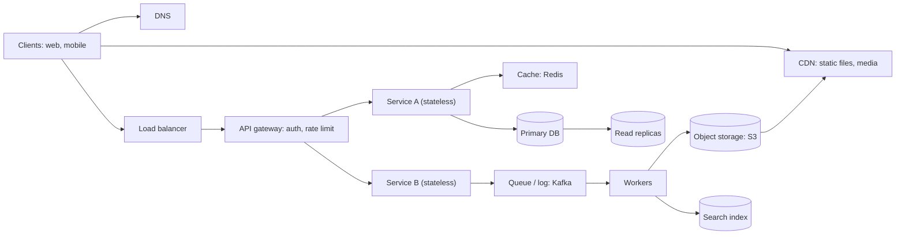

# Chapter 04 · System Design Cheatsheet

> System design round se ek raat pehle tumhe 14 chapters nahi chahiye. Tumhe ek page chahiye jo har number, har building block aur har trade-off yaad dila de, saath mein classic questions ke liye ek skeleton answer. Ye wahi page hai.

**Is chapter ko kaise use karein:**
- Ye ek **revision sheet** hai, pehla lesson nahi. Har section us Part 3 chapter se link karta hai jo use theek se sikhata hai.
- Interview se pehle: Sections 1–3 (numbers) padho, 4–10 (decision guides) pe nazar daalo, phir Section 12 ke 2–3 classic questions timer laga ke **zor se bol ke** practice karo.
- Yahan har trade-off **"use when / costs you"** ki shakal mein likha hai, kyunki interviewer bilkul yahi sentence sunna chahta hai.

**Isse pehle padho:** [Part 3 · System Design](../part-3-system-design/01-foundations-internet.md), khaas kar [Estimation & The Interview Framework](../part-3-system-design/11-estimation-framework.md).

> 🇮🇳 **Desi Analogy:** Board exam se pehle wali raat yaad karo. Tum poori textbook nahi padhte, apne haath se banaye **formula chart** aur last-minute notes padhte ho, jo deewar pe chipke hote the. Ye chapter wahi chart hai. Concepts pehle Part 3 mein seekh lo; yahan sirf yaad taaza karo. Chart se padhai shuru karoge toh ratta lagega, samajh nahi aayegi.

---

## 1. Latency Numbers Every Engineer Should Know · Speed Ka Hisaab

Ye classic order-of-magnitude numbers hain (Jeff Dean aur Peter Norvig ne popular kiye). Modern hardware inme se kuch ko hara deta hai, lekin **ratios** hi asli cheez hain, aur wo ab bhi sahi hain.

| Operation | Time | "Insaani" scale mein (agar 1 ns = 1 s) |
|---|---|---|
| L1 cache reference | 0.5 ns | aadha second |
| Branch mispredict | 5 ns | 5 seconds |
| L2 cache reference | 7 ns | 7 seconds |
| Mutex lock / unlock | 25 ns | 25 seconds |
| Main memory (RAM) reference | 100 ns | 2 minute se kam |
| Compress 1 KB (Snappy jaisa fast compressor) | 3 µs | ek ghante se kam |
| Send 1 KB over a 1 Gbps network | 10 µs | lagbhag 3 ghante |
| Read 4 KB randomly from SSD | 150 µs | 2 din se kam |
| Read 1 MB sequentially from RAM | 250 µs | lagbhag 3 din |
| Round trip within the same data centre | 500 µs | lagbhag 6 din |
| Read 1 MB sequentially from SSD | 1 ms | lagbhag 12 din |
| HDD disk seek | 10 ms | lagbhag 4 mahine |
| Read 1 MB sequentially from HDD | 20 ms | lagbhag 8 mahine |
| Packet round trip California → Netherlands → California | 150 ms | lagbhag 5 saal |

**Kya yaad rakhna hai:**
- **Memory SSD random reads se ~1,000× fast hai, aur SSD disk seek se ~100× fast hai.** Isiliye caches exist karte hain. (100 ns vs 150 µs = ~1,500×; 150 µs vs 10 ms = ~70×. Order of magnitude hi yaad rakhna hai.)
- **Sequential random ko harata hai**, har medium pe. Isiliye logs, Kafka aur LSM trees append karte hain.
- **Data centre ke andar network sasta hai (~0.5 ms); continents ke paar mehnga hai (~150 ms).** Isiliye CDNs aur multi-region deployments exist karte hain.
- **User ~100 ms notice kar leta hai.** Jo page 5 sequential cross-region calls karta hai, wo pehle se hi slow lagta hai (5 × 150 ms = 750 ms).

> 🇮🇳 **Desi Analogy:** Ghar pe chai bana rahe ho. **RAM** = stove ke bagal mein rakhi cheeni ki dibbi. **SSD** = store room ki almari. **HDD seek** = basement mein rakhe purane trunk mein dhoondhna. **Cross-continent call** = cheeni ke liye doosre sheher courier bhejna. Isiliye jo cheez baar baar chahiye, use stove ke paas rakho (cache), aur jo door se aati hai use ek hi trip mein zyada maatra mein mangwao (batching).

---

## 2. Powers of Two, Powers of Ten, and Handy Sizes · Kaam Ke Numbers

| Power of 2 | Exact | Approx | Name |
|---|---|---|---|
| 2¹⁰ | 1,024 | 10³ (thousand) | 1 KB |
| 2²⁰ | 1,048,576 | 10⁶ (million) | 1 MB |
| 2³⁰ | ~1.07 billion | 10⁹ (billion) | 1 GB |
| 2⁴⁰ | ~1.1 trillion | 10¹² (trillion) | 1 TB |
| 2⁵⁰ | | 10¹⁵ | 1 PB |

Indian numbering wale dimaag ke liye: 1 million = 10 lakh, 1 billion = 100 crore. Lekin interview mein **million/billion** hi bolo.

| Time | Seconds | Shortcut |
|---|---|---|
| 1 day | 86,400 | **≈ 10⁵** |
| 1 month | ~2.6 million | ≈ 2.5 × 10⁶ |
| 1 year | ~31.5 million | ≈ 3 × 10⁷ |

| Cheez | Rough size |
|---|---|
| ASCII character | 1 byte (UTF-8: 1–4 bytes) |
| int / int64 / timestamp | 4 / 8 / 8 bytes |
| UUID | 16 bytes (text mein 36 chars) |
| Metadata ke saath ek chhota text post | ~1 KB |
| Ek compressed photo | ~200 KB – 2 MB |
| Ek minute ka compressed HD video | darjanon MB |

| Requests per day | ≈ Average per second |
|---|---|
| 1 million | ~12 |
| 10 million | ~120 |
| 100 million | ~1,200 |
| 1 billion | ~12,000 |

Is table ka shortcut: din ≈ 10⁵ seconds, toh **per day ko 10⁵ se divide karo** (aur thoda upar round karo, kyunki asli 86,400 hai). 1 million / 10⁵ = 10, asli ~12.

### Availability "nines"

| Availability | Downtime per year | Downtime per month (approx.) |
|---|---|---|
| 99% ("two nines") | 3.65 days | 7.3 hours |
| 99.9% | 8.76 hours | 43.8 minutes |
| 99.99% | 52.6 minutes | 4.4 minutes |
| 99.999% | 5.26 minutes | 26 seconds |

Do components **series** mein, har ek 99.9%, dete hain 99.9% × 99.9% ≈ **99.8%**. Do **redundant** copies, har ek 99.9%, dete hain 1 − (0.001)² = **99.9999%**. Redundancy *failure* ke chances ko multiply karti hai, isiliye wo itni powerful hai.

> 🤔 **Mann mein sawaal:** Series mein availability kam kyun hoti hai aur parallel mein badh kyun jaati hai? Dono mein toh do hi components hain.
>
> **Jawab:** Series mein request ko **dono** se guzarna hai, toh *dono* ka up hona zaroori hai: 0.999 × 0.999, jo kisi bhi ek se kam hai. Parallel mein system tabhi girta hai jab **dono ek saath** down hon: 0.001 × 0.001 = 0.000001, yaani lagbhag kabhi nahi. Series mein tum *success* chances multiply karte ho (chhote hote jaate hain), parallel mein *failure* chances multiply karte ho (wo bhi chhote hote jaate hain, aur yahi tumhe chahiye).

---

## 3. Back-of-the-Envelope Formulas · Rough Hisaab Ke Formulas

Poora tareeka: [Estimation & The Interview Framework](../part-3-system-design/11-estimation-framework.md).

| Quantity | Formula |
|---|---|
| Average QPS | `DAU × actions per user per day ÷ 86,400` (10⁵ use karo) |
| Peak QPS | `average × 2 to 3` (flash sales jaise spiky products mein zyada) |
| Read vs write QPS | read:write ratio lagao (social apps aksar 10:1 se 100:1 reads) |
| Storage per day | `new items per day × size per item` |
| Total storage | `storage per day × 365 × years × replication factor (usually 3)` |
| Bandwidth | `QPS × average response size` (ingress aur egress alag alag) |
| Cache memory | `~20% of daily read data` (80/20 rule: 20% items ko 80% reads milte hain) |
| Number of servers | `peak QPS ÷ QPS one server can handle`, phir headroom jodo |

Wo aadat jo interviewers ko impress karti hai: **zor se round karo, assumptions bolo, aur batao ki number ka design ke liye *matlab* kya hai** ("4 TB a year means one database is fine for storage, but 50k reads/s means we need caching").

> 🇮🇳 **Desi Analogy:** Shaadi ka caterer socho. Wo exact nahi ginta ki kaun kitni puri khaayega. Wo bolta hai: "500 mehmaan × 6 puri = 3,000, peak pe sab ek saath aayenge toh 3 counters chahiye, aur 10% extra bana lo." Yahi back-of-the-envelope hai: **mehmaan = DAU, puri = actions per user, counters = servers, 10% extra = headroom.** Aur asli skill aakhri line hai: "isliye 3 counters chahiye", yaani number se design decision nikaalna.

Ye ek chhota calculator hai jise tum apne hisaab se badal sakte ho:

```python
SECONDS_PER_DAY = 86_400


def estimate(dau, writes_per_user, read_write_ratio, bytes_per_write, years, replication=3):
    write_qps = dau * writes_per_user / SECONDS_PER_DAY
    read_qps = write_qps * read_write_ratio
    storage_per_day = dau * writes_per_user * bytes_per_write
    total_storage = storage_per_day * 365 * years * replication
    return write_qps, read_qps, storage_per_day, total_storage


def human_bytes(n):
    for unit in ["B", "KB", "MB", "GB", "TB", "PB"]:
        if n < 1000:
            return f"{n:.1f} {unit}"
        n /= 1000
    return f"{n:.1f} EB"


# Twitter jaisa app: 100M DAU, har user roz 2 posts, har write pe 100 reads, har post 1 KB, 5 saal
w, r, per_day, total = estimate(100_000_000, 2, 100, 1_000, 5)
print(f"writes/s ~ {w:,.0f} (peak ~ {3 * w:,.0f})")
print(f"reads/s  ~ {r:,.0f}")
print(f"storage/day ~ {human_bytes(per_day)}, 5 years x3 replicas ~ {human_bytes(total)}")
```

```text
writes/s ~ 2,315 (peak ~ 6,944)
reads/s  ~ 231,481
storage/day ~ 200.0 GB, 5 years x3 replicas ~ 1.1 PB
```

Numbers kya batate hain: writes thode hi hain, lekin **230k reads/s** ka matlab hai ki read path caches se serve hona chahiye, aur **1 PB** ka matlab hai ki media aur posts ko shard karna padega aur/ya object storage mein rakhna padega.

Haath se check: 100M × 2 = 200M posts/day. 200M ÷ 10⁵ ≈ 2,000 writes/s (asli 2,315). Reads = 100× = ~230k/s. Storage = 200M × 1 KB = 200 GB/day; × 365 × 5 × 3 ≈ 1.1 PB.

---

## 4. The Reference Architecture · Ek Design Jo Har Jagah Kaam Aata Hai

Lagbhag har design isi picture ka ek variation hai. Ise seekh lo, phir har question ke hisaab se boxes jodo ya hatao.



Is picture ko left se right ek request ki tarah padho: client pehle **DNS** se IP leta hai, static files **CDN** se aati hain, baaki sab **load balancer** se hoke **API gateway** (auth, rate limit) tak, phir **stateless services** tak. Services pehle **cache** dekhti hain, phir **primary DB** (writes) ya **read replicas** (reads). Jo kaam user ko turant nahi chahiye (video process karna, search index update), wo **queue** mein jaata hai aur **workers** baad mein karte hain.

---

## 5. Building Blocks: Use When / Costs You · Har Block Ka Faayda Aur Keemat

| Building block | Kab use karo | Keemat / dhyaan rakho | Chapter |
|---|---|---|---|
| **DNS** | Naamon ko IPs mein badalna; simple geo-routing aur failover | Caching (TTL) changes ko dheema karti hai | [01](../part-3-system-design/01-foundations-internet.md) |
| **CDN** | Static files, images, video, users ke paas cache ho sakne wali koi bhi cheez | Cost; invalidation mein der; dynamic content ko kam faayda | [04](../part-3-system-design/04-caching-cdn.md) |
| **Load balancer (L4)** | Connections ko TCP level pe fast baantna | URL/header ke hisaab se route nahi kar sakta | [02](../part-3-system-design/02-scalability-load-balancing.md) |
| **Load balancer (L7)** | Path/header se routing, TLS termination, sticky sessions | L4 se zyada CPU per request | [02](../part-3-system-design/02-scalability-load-balancing.md) |
| **API gateway** | Ek entry point: auth, rate limiting, routing, request shaping | Ek extra hop; bottleneck ya single point of failure ban sakta hai | [07](../part-3-system-design/07-apis-communication.md) |
| **Stateless app servers** | Hamesha: load balancer ke peeche horizontally scale karo | State ko DB/cache/session store mein shift karna padta hai | [02](../part-3-system-design/02-scalability-load-balancing.md) |
| **Cache (Redis / Memcached)** | Read-heavy data, hot keys, sessions, counters, leaderboards | Staleness, invalidation ki complexity, memory ki cost | [04](../part-3-system-design/04-caching-cdn.md) |
| **Relational DB (Postgres / MySQL)** | Structured data, relations, transactions, strong consistency | Writes ko horizontally scale karna mushkil (sharding haath ka kaam hai) | [03](../part-3-system-design/03-databases.md) |
| **Key-value / wide-column NoSQL (DynamoDB / Cassandra)** | Bahut bada scale, key se simple access, write-heavy | Limited queries aur joins; aam taur pe eventual consistency | [03](../part-3-system-design/03-databases.md) |
| **Document DB (MongoDB)** | Flexible JSON jaise records jo poore ek saath padhe jaate hain | Cross-document joins aur transactions kamzor | [03](../part-3-system-design/03-databases.md) |
| **Read replicas** | Reads scale karna, analytics queries ko alag karna | Replication lag: stale reads | [05](../part-3-system-design/05-replication-sharding.md) |
| **Sharding** | Data ya write load ek machine ke liye bahut bada | Cross-shard queries, rebalancing, hot shards | [05](../part-3-system-design/05-replication-sharding.md) |
| **Consistent hashing** | Aate-jaate nodes pe keys baantna | Barabar baantne ke liye virtual nodes chahiye | [05](../part-3-system-design/05-replication-sharding.md) |
| **Message queue (SQS / RabbitMQ)** | Async kaam, spikes ko smooth karna, services ko decouple karna | Processing baad mein hoti hai; retries = duplicates (idempotent raho) | [08](../part-3-system-design/08-queues-events.md) |
| **Event log (Kafka)** | High-throughput streams, bahut saare consumers, replay, event sourcing | Chalane ki complexity; ordering sirf ek partition ke andar | [08](../part-3-system-design/08-queues-events.md) |
| **Object storage (S3)** | Files, images, video, backups: kisi bhi size pe sasta aur durable | Block storage se zyada latency; jagah pe edit nahi hota | [10](../part-3-system-design/10-storage-search-ids.md) |
| **Search index (Elasticsearch)** | Full-text search, fuzzy matching, faceted filters | Data ki doosri copy jise sync rakhna hai; source of truth nahi | [10](../part-3-system-design/10-storage-search-ids.md) |
| **Unique ID generator (Snowflake-style)** | Distributed, time-sortable IDs bina central counter ke | Clock skew sambhaalna; 64-bit layout ki limits | [10](../part-3-system-design/10-storage-search-ids.md) |
| **Rate limiter** | Services ko abuse aur overload se bachaana | Shared counter ke liye fast atomic storage chahiye | [12](../part-3-system-design/12-case-studies-1.md) |
| **WebSocket servers** | Real-time two-way updates (chat, live location) | Stateful connections: balance aur scale karna mushkil | [07](../part-3-system-design/07-apis-communication.md) |
| **Bloom filter** | Bahut kam memory mein "pakka nahi hai" wale checks | False positives ho sakte hain; basic version mein delete nahi | [10](../part-3-system-design/10-storage-search-ids.md) |
| **Coordination service (ZooKeeper / etcd)** | Leader election, config, distributed locks, service discovery | Sirf chhota data; ek poora cluster chalana padta hai | [06](../part-3-system-design/06-cap-consistency.md) |
| **Monitoring / logging / tracing** | Hamesha: jo dikhta nahi, wo theek nahi hota | Storage ki cost; shor machaate alerts | [09](../part-3-system-design/09-microservices-reliability.md) |

---

## 6. Database Choice Guide · Kaunsa Database Kab

Poora chapter: [Databases](../part-3-system-design/03-databases.md).

| Agar tumhe chahiye... | Chuno | Kyunki |
|---|---|---|
| Transactions, joins, constraints (paisa, orders, inventory, users) | **SQL** (PostgreSQL, MySQL) | ACID guarantees aur flexible query language |
| Massive scale pe key se lookups, predictable latency | **Key-value** (DynamoDB, store ki tarah Redis) | Key se partition, horizontally scale hota hai |
| Bahut zyada writes, har key ka time-ordered data (messages, events, IoT) | **Wide-column** (Cassandra, HBase, ScyllaDB) | LSM-tree storage writes ko sasta banata hai; partition + clustering key se fast range reads |
| Alag alag shape ke records jo poore padhe jaate hain (profiles, catalogues) | **Document** (MongoDB, Firestore) | Schema flexibility; ek read mein poora object |
| Gehre relationship queries (friends of friends, recommendations, fraud rings) | **Graph** (Neo4j, Neptune) | Mehnge self-joins ke bina traversals |
| Full-text search, autocomplete, filters | **Search engine** (Elasticsearch, OpenSearch) | Inverted index |
| Metrics aur time-stamped measurements | **Time-series** (Prometheus, InfluxDB, TimescaleDB) | Compression, downsampling, time-range queries |
| Billions of rows pe analytics | **Columnar warehouse** (BigQuery, Redshift, ClickHouse, Snowflake) | Sirf zaroori columns scan karta hai, bhaari compression |
| Files, images, videos, backups | **Object storage** (S3, GCS) | Sasta, durable, practically unlimited |
| Super-fast temporary data (sessions, counters, rankings) | **In-memory** (Redis) | Microsecond access, rich data structures |

**Quick rules:**
- **Default SQL rakho**, jab tak tum wo wajah naam se na bata sako jiski wajah se ye nahi chalega. Zyada tar systems lambe time tak Postgres + caching + read replicas pe theek chalte hain.
- **Polyglot persistence** normal hai: orders ke liye SQL, sessions ke liye Redis, images ke liye S3, search ke liye Elasticsearch.
- **B-tree** storage (zyada tar SQL) read-optimised hai; **LSM-tree** storage (Cassandra, RocksDB) write-optimised hai.
- Jin columns pe filter aur join karte ho unpe **index** lagao; har index reads fast karta hai lekin writes slow karta hai aur jagah leta hai.
- Write correctness ke liye **normalise**; read speed ke liye **denormalise** (aur sync rakhne layak duplicate data accept karo).

**SQL vs NoSQL ek table mein:**

| | SQL | NoSQL |
|---|---|---|
| Schema | fixed, enforced | flexible |
| Scaling | pehle vertical; sharding haath se | design se hi horizontal |
| Consistency | strong (ACID) | aksar eventual / tunable (BASE) |
| Queries | rich ad-hoc SQL, joins | access-pattern ke hisaab se, kam joins |
| Design approach | pehle data model karo, phir query | pehle queries model karo, phir data unke hisaab se rakho |

> 🤔 **Mann mein sawaal:** NoSQL "scale" karta hai aur SQL nahi, toh har naye project mein NoSQL hi kyun na lein?
>
> **Jawab:** Kyunki zyada tar projects ko kabhi wo scale chahiye hi nahi jahan SQL toote, lekin unhe transactions, joins aur flexible queries **pehle din se** chahiye. NoSQL mein tumhe pehle se pata hona chahiye ki data kaise query karoge; baad mein naya sawaal aaya toh redesign. Isliye rule hai: **default SQL, aur NoSQL tabhi jab wajah naam se bata sako** ("200k writes/s chahiye", "sirf key se lookup").

---

## 7. Caching Strategy Guide · Cache Kahan Aur Kaise

Poora chapter: [Caching & CDNs](../part-3-system-design/04-caching-cdn.md).

### Where to cache (closest to the user first)

Browser / app cache → CDN → load balancer ya reverse proxy → application (in-process) → distributed cache (Redis) → database buffer pool.

Jitna user ke paas cache hit hoga, utna kam safar aur utna fast. Browser cache hit = network ki zaroorat hi nahi.

### Read and write patterns

| Pattern | Kaise kaam karta hai | Kab use karo | Keemat |
|---|---|---|---|
| **Cache-aside** (lazy loading) | App cache padhta hai; miss pe DB padhta hai aur cache bhar deta hai | Read-heavy workloads ka default | Pehla read slow; TTL ya invalidation tak stale data |
| **Read-through** | Miss pe cache khud DB se load karta hai | Loading logic ek jagah chahiye | Aisi cache library/provider chahiye jo ye support kare |
| **Write-through** | Cache aur DB mein ek saath, synchronously likho | Write ke turant baad reads ko fresh data dikhna chahiye | Writes slow; aisa data bhi cache hota hai jo shayad kabhi padha na jaaye |
| **Write-behind** (write-back) | Cache mein likho, DB mein baad mein batches mein flush karo | Bahut write-heavy, thoda loss chal sakta hai | Flush se pehle cache mara toh data loss |
| **Write-around** | Sirf DB mein likho; cache baad ke reads pe bharta hai | Data ek baar likha jaata hai, turant kam padha jaata hai | Recent writes cache miss karte hain |

> 🇮🇳 **Desi Analogy:** Kirana dukaan ka counter (cache) aur godaam (DB). **Cache-aside**: customer ne Parle-G maanga, counter pe nahi hai, toh dukaandaar godaam se laata hai aur kuch packet counter pe bhi rakh deta hai. **Write-through**: naya stock aaya toh ek saath counter aur godaam register dono mein entry. **Write-behind**: din bhar counter ki diary mein likho, raat ko godaam register mein ek saath chadha do; diary kho gayi toh hisaab gaya. **Write-around**: naya stock seedha godaam, counter pe tabhi aayega jab koi maangega.

### Eviction policies

| Policy | Kise nikaalta hai | Kahan accha |
|---|---|---|
| **LRU** | least recently used | general purpose (sabse common) |
| **LFU** | least frequently used | stable popularity (kuch items hamesha hot) |
| **TTL** | jo apne time-to-live se purana ho gaya | aisa data jo ek schedule pe stale ho jaata hai |
| **FIFO** | sabse pehle daala gaya | simple, kam hi best hota hai |

### Classic cache problems

| Problem | Kya hota hai | Fix |
|---|---|---|
| **Stale data** | DB badla, cache nahi | Write pe cache key **delete** karo (update nahi), aur safety net ke liye TTL |
| **Cache stampede** (thundering herd) | Ek hot key expire hui, hazaaron requests ek saath DB pe | Lock/single-flight taaki sirf ek request refill kare; pehle hi refresh; TTLs pe random jitter |
| **Cache penetration** | Jo keys exist hi nahi karti unki requests hamesha miss karke DB pe jaati hain | "Not found" ko thodi der cache karo; aage Bloom filter |
| **Cache avalanche** | Bahut saari keys ek hi pal mein expire | TTLs randomise karo; cache warm karo; kai cache layers |
| **Hot key** | Ek key pe itna traffic ki ek cache node sambhaal na sake | Us key ko nodes pe replicate karo; local in-process cache; key ko tod do |

**Kya cache karo:** jo data likhe jaane se kahin zyada padha jaata hai, mehngi computations, sessions, rendered pages, slow third-party calls ke results. **Kya cache mat karo:** tezi se badalne wala data jo exact hona chahiye (payment ke waqt account balance), ya jo kam hi padha jaata hai.

> 🤔 **Mann mein sawaal:** Write pe cache ko naye value se *update* kyun nahi karte? Delete karke dobara load karna toh extra kaam hai.
>
> **Jawab:** Race condition ki wajah se. Do writes lagbhag ek saath aaye: A ne value 5 likhi, B ne 6. DB mein aakhri 6 hai, lekin network ki wajah se cache update ulte order mein pahunche, toh cache mein 5 reh gaya. Ab cache hamesha galat bolega (TTL tak). **Delete** mein ye problem nahi: key hi hat gayi, agla read DB se sahi value laayega. Thoda extra kaam, lekin galat data ka risk bahut kam.

---

## 8. Consistency Guide · Sabko Sahi Data Kab Dikhe

Poora chapter: [CAP, Consistency Models & Consensus](../part-3-system-design/06-cap-consistency.md).

### Models, strongest to weakest

| Model | Wada | Example use |
|---|---|---|
| **Linearizable (strong)** | Har read latest completed write dekhta hai, jaise data ki ek hi copy ho | Bank balance, seat booking, leader election, locks |
| **Sequential** | Sab operations ko same order mein dekhte hain (zaroori nahi real time mein) | Replicated logs |
| **Causal** | Agar A ki wajah se B hua, toh sab A ko B se pehle dekhte hain | Comment replies, chat threads |
| **Read-your-writes** | Tumhe apne updates hamesha dikhte hain | Profile edits, comment post karna |
| **Monotonic reads** | Tum data ko kabhi "time mein peeche" jaata nahi dekhte | Feeds, timelines |
| **Eventual** | Writes ruk jaayein toh saare replicas aakhir mein ek jaise ho jaate hain | Like counts, view counts, DNS, product catalogue |

> 🇮🇳 **Desi Analogy:** Joint family WhatsApp group. **Eventual**: mummy ne group mein "aaj rajma bana hai" bheja, kisi ka net slow hai toh use 10 minute baad dikhega, lekin aakhir mein sabko dikhega. **Causal**: chacha ka reply "wah, rajma!" kisi ko mummy ke message se *pehle* nahi dikhna chahiye, warna bina sawaal ka jawab. **Read-your-writes**: tumne photo bheji toh tumhe khud turant dikhni chahiye, chahe baaki ko der se dikhe. **Strong**: family ke joint bank account ka balance, jo har kisi ko ek hi pal mein ekdum same dikhna chahiye.

### CAP and PACELC in two lines

- **CAP:** network **P**artition ke dauraan tumhe chunna padta hai: **C**onsistency (kuch requests mana karo) ya **A**vailability (jawab do, shayad purane data ke saath). Partitions hongi hi, toh asli choice hai C vs A, *jab wo hon*.
- **PACELC:** agar Partition → A ya C; **E**lse (normal operation) → **L**atency ya **C**onsistency. Failures ke bina bhi, strong consistency ki keemat latency mein chukani padti hai.

| CP chuno jab... | AP chuno jab... |
|---|---|
| Galat jawab ki keemat paisa ya safety ho (payments, inventory, bookings) | Thoda purana data dikhana chalta ho (feeds, likes, recommendations) |
| Examples: Zookeeper/etcd, synchronous replication wala single-leader SQL setup, Spanner | Examples: Cassandra, DynamoDB (default reads), DNS |

### Tools that buy consistency

| Tool | Kya karta hai | Note |
|---|---|---|
| **Quorum** (N replicas, W write acks, R read replies) | `R + W > N` guarantee karta hai ki ek read latest write se overlap kare | N=3, W=2, R=2 classic setting hai |
| **Consensus** (Raft, Paxos) | Har log entry pe majority agree karti hai; ek leader chuna jaata hai | f failures jhelne ke liye 2f + 1 nodes chahiye |
| **Leader-based replication** | Saare writes ek leader se guzarte hain | Simple; leader failover sambhaalna padta hai |
| **Two-phase commit (2PC)** | Kai databases pe atomic commit | Coordinator fail ho toh blocking; slow; services ke beech avoid karo |
| **Saga** | Local transactions ki chain, failure pe compensating actions ke saath | Distributed transactions ka microservices wala jawab; eventually consistent |
| **Idempotency keys** | Request repeat karo toh effect ek baar karne jaisa hi | Retries ko safe banata hai; payments ke liye zaroori |
| **Version numbers / optimistic locking** | Sirf `WHERE version = v` pe update | Lambe locks ke bina lost updates pakadta hai |
| **Vector clocks / CRDTs** | Concurrent updates ko pakadna ya apne aap merge karna | AP stores aur collaborative editing mein use |

`R + W > N` kyun kaam karta hai? N = 3 replicas, W = 2 ne write confirm kiya, R = 2 se padha. 2 + 2 = 4 > 3, toh jin 2 se padha aur jin 2 pe likha, unme kam se kam **ek common** hona hi chahiye (3 mein se 2 aur 2 chuno, overlap pakka). Wahi common replica latest value de dega.

> 💡 Network pe "exactly-once delivery" practically namumkin hai. Asli systems jo banate hain wo hai **at-least-once delivery + idempotent processing = exactly-once *effect***.

---

## 9. Communication Protocol Guide · Services Aapas Mein Kaise Baat Karein

Poora chapter: [APIs & Communication Protocols](../part-3-system-design/07-apis-communication.md).

### API styles

| Style | Kab use karo | Keemat |
|---|---|---|
| **REST** (HTTP + JSON) | Public APIs, resources pe CRUD, browser clients, cacheable GETs | Over/under-fetching; nested data ke liye kai round trips |
| **GraphQL** | Bahut saare client types jinhe data alag shapes mein chahiye; kai services ko jodna | Caching mushkil; mehngi queries pe limits lagaani padti hain |
| **gRPC** (HTTP/2 + Protobuf) | Internal service-to-service calls; low latency; streaming; strict contracts | Browser mein natively nahi chalta; binary payloads debug karna mushkil |

### Real-time options

| Option | Kaise | Kab use karo |
|---|---|---|
| **Short polling** | Client har N seconds pe poochta hai | Updates kam aate hain aur der chalti hai; sabse simple |
| **Long polling** | Server request ko tab tak pakde rakhta hai jab tak data ya timeout na aaye | Near-real-time jahan WebSockets available nahi |
| **Server-Sent Events (SSE)** | Ek lamba HTTP response jo server → client stream karta hai | One-way live updates: notifications, scores, stock tickers, streaming text |
| **WebSocket** | Ek persistent two-way connection | Chat, multiplayer games, collaborative editing, live location |
| **Webhooks** | Event hone pe server *tumhara* URL call karta hai | Server-to-server events (payment succeeded, repo pushed) |

> 🇮🇳 **Desi Analogy:** Cricket score jaanne ke tareeke. **Short polling**: har 5 minute pe dost ko phone karke poochna "score kya hua?". **Long polling**: dost ko phone karo, wo line pe rehta hai aur jaise hi wicket gire tab bolta hai, phir tum dobara call karte ho. **SSE**: radio commentary, ek taraf se lagaataar aata hai, tum wapas kuch nahi bolte. **WebSocket**: stadium mein dost ke saath video call, dono taraf se baat chal rahi hai. **Webhook**: Cricbuzz app ka notification, "Kohli 100*!", jo tabhi aata hai jab event hota hai.

### Transport and HTTP

| Choice | Kab use karo |
|---|---|
| **TCP** | Reliable, ordered delivery chahiye (lagbhag sab kuch: HTTP, databases) |
| **UDP** | Har packet se zyada speed matter karti hai: video calls, gaming, DNS, live streams |
| **HTTP/1.1** | Simple; har connection pe ek baar mein ek request |
| **HTTP/2** | Ek connection pe bahut saari requests multiplexed; header compression |
| **HTTP/3 (QUIC over UDP)** | Tez connection set-up, head-of-line blocking nahi; mobile networks pe accha |

### Sync vs async between services

| | Synchronous call (REST/gRPC) | Asynchronous message (queue/log) |
|---|---|---|
| Caller intezaar karta hai? | haan | nahi |
| Coupling | caller is pe depend hai ki callee up ho | time mein decoupled |
| Kahan accha | reads, wo cheezein jinka user intezaar kar raha hai | emails, video processing, analytics, fan-out |
| Failure handling | timeouts, retries, circuit breakers | retries, dead-letter queues, idempotent consumers |

**Queue vs pub/sub vs log:** **queue** har message *ek* consumer ko deti hai (kaam baantna). **Pub/sub** har message *har* subscriber ko deta hai (broadcast). **Log** (Kafka) messages ko ek retention period tak rakhta hai taaki bahut saare consumer groups apni speed se padh aur replay kar sakein.

Ek line mein: queue = **dabbawala** (har tiffin ek hi aadmi ko), pub/sub = **mandir ka announcement** (sabko ek saath), log = **akhbaar ki raddi** (pichhle din ke akhbaar bhi rakhe hain, jo chahe jab chahe padh le).

---

## 10. Reliability Patterns · System Ko Girne Se Bachao

Poora chapter: [Microservices, Reliability & Observability](../part-3-system-design/09-microservices-reliability.md).

| Pattern | Kya karta hai | Kab use karo |
|---|---|---|
| **Redundancy** (N+1, multi-AZ, multi-region) | Koi single point of failure nahi | Hamesha, kisi bhi zaroori cheez ke liye |
| **Replication + failover** | Primary mare toh standby sambhaal leta hai | Databases, stateful services |
| **Timeouts** | Slow dependency ka intezaar band karo | Har network call, hamesha |
| **Retries with exponential backoff + jitter** | Temporary failures ko retry karo bina stampede ke | Sirf idempotent operations |
| **Circuit breaker** | Baar baar failures ke baad kuch der ke liye fail fast karo, phir dobara test karo | Aisi dependency ko call karna jo down ho sakti hai |
| **Bulkhead** | Har dependency ke liye alag pools (threads, connections) | Ek slow dependency sab kuch khatam na kar de |
| **Rate limiting** | Har client ki requests pe cap | Public APIs, abuse se bachaav |
| **Load shedding** | Overload pe low-priority kaam chhod do | Capacity se bade traffic spikes |
| **Backpressure** | Consumers peeche reh jaayein toh producers ko dheema karo | Streaming pipelines, queues |
| **Graceful degradation** | Kam features wala experience do (cached, recommendations ke bina) | Koi non-critical dependency down hai |
| **Idempotency keys** | Retries ko safe banao | Payments, orders, koi bhi "create" operation |
| **Dead-letter queue (DLQ)** | Baar baar fail hone wale messages ko baad mein dekhne ke liye side mein rakho | Koi bhi queue consumer |
| **Transactional outbox** | DB change aur event ko ek transaction mein likho; outbox table se publish karo | "DB update karo aur event publish karo" bina kisi ko khoye |
| **Health checks + auto-scaling** | Kharab instances hatao, load pe capacity jodo | Load balancer ke peeche har service |
| **Chaos testing** | Kamzoriyan dhoondhne ke liye jaan boojh ke cheezein todo | Mature systems |

> 🇮🇳 **Desi Analogy:** Ghar ki bijli. **Circuit breaker** = MCB: short circuit hua toh trip ho jaata hai, poore ghar ko jalne se bachaata hai, aur thodi der baad tum dobara on karke dekhte ho. **Bulkhead** = har kamre ki alag MCB, taaki kitchen ka short bedroom ki light na udaaye. **Graceful degradation** = inverter: bijli gayi toh AC nahi chalega, lekin pankha aur light chalte rahenge. **Load shedding** = bijli vibhaag ka load shedding, sach mein wahi naam!

**Observability, teen pillars:** **metrics** (time ke saath numbers), **logs** (kya hua), **traces** (services ke paar ek request ka raasta). **Four golden signals** dekho: **latency, traffic, errors, saturation**. **SLIs** define karo (jo naapte ho, jaise p99 latency), **SLOs** (tumhara target, jaise 99.9% minutes mein p99 < 200 ms) aur **SLAs** (customers se wada, penalties ke saath).

### Scaling playbook (in the order you usually apply it)

1. **Vertical scaling** (badi machine): sabse simple, lekin ek chhat hai.
2. **Stateless app tier + load balancer** (horizontal scaling).
3. Hot reads ko **cache** karo; static aur media ke liye **CDN**.
4. Read-heavy databases ke liye **read replicas**.
5. Jis cheez ka user intezaar nahi karta, uske liye queues ke saath **async processing**.
6. Jab writes ya data size ek machine se bada ho jaaye toh database **shard** karo (user ID se, hash se, region se).
7. Jab teams aur deploys ek doosre ke raaste mein aane lagein, toh domain ke hisaab se **services split** karo.
8. Latency aur disaster recovery ke liye **multi-region**.

> 🤔 **Mann mein sawaal:** Interview mein seedha sharding aur microservices bol doon toh zyada senior nahi lagunga?
>
> **Jawab:** Ulta hoga. Senior engineer jaanta hai ki har step ki keemat hai, isliye wo **sabse sasta step pehle** lagata hai aur bataata hai ki agla step *kab* zaroori hoga: "Abhi ek Postgres + cache kaafi hai; jab writes 10k/s cross karenge tab user ID pe shard karenge." Bina wajah ke sharding bolna dikhata hai ki tumne buzzwords ratte hain, trade-offs nahi samjhe.

---

## 11. The 7-Step Interview Framework · Interview Ka Poora Plan

45–60 minute ka round, step by step. Prompts wo sawaal hain jo interviewer se (ya khud se) poochne hain. [Chapter 11](../part-3-system-design/11-estimation-framework.md) ise ek poore example ke saath chalata hai.

| Step | Time (45 min) | Goal |
|---|---|---|
| 1. Requirements (functional + non-functional) | 0–5 min | Ise kya *karna* hai, aur kitna *accha* |
| 2. Estimates | 5–9 min | Problem ka size naapo |
| 3. API design | 9–13 min | Contract |
| 4. Data model | 13–17 min | Kya store hoga aur kahan |
| 5. High-level design | 17–27 min | Main flows ke liye boxes aur arrows |
| 6. Deep dives | 27–40 min | 1–2 sabse mushkil hisse, gehraai se |
| 7. Bottlenecks, trade-offs & wrap-up | 40–45 min | Failures, scaling, aage kya karoge |

**Step 1 · Requirements: functional.** Prompts:
- "Who are the users, and what are the top 3 things they do?"
- "Which features are in scope today? (Let's park X and Y.)"
- "Is this read-heavy or write-heavy?"
- Core features ko board pe ek chhoti numbered list ki tarah likho.

**Step 1 (cont.) · Requirements: non-functional.** Prompts:
- "How many users? Daily active users? Growth?"
- "Latency target for the main action?"
- "Is it OK to show slightly stale data, or must it be strongly consistent?" (Har feature ke liye alag chuno!)
- "Availability target? Any regions or compliance needs?"
- "Durability: can we ever lose data?"

**Step 2 · Estimates.** Prompts:
- QPS (average aur peak), read:write ratio, 5 saal ka storage, bandwidth, cache size.
- **Ek sentence mein batao ki numbers ka matlab kya hai**, us pe khatam karo: "So reads must be cached and storage must be sharded."

**Step 3 · API design.** Prompts:
- Har core feature ke liye ek endpoint: method, path, inputs, outputs.
- "REST is fine for clients; gRPC between services; WebSocket for the real-time part."
- Pagination (cursor-based), auth (token), aur creates ke liye idempotency keys ka zikr karo.

**Step 4 · Data model.** Prompts:
- Main entities aur unke key fields; **access patterns** (hum unhe query kaise karenge?).
- Har ek ke liye SQL ya NoSQL, aur **kyun**. Partition/shard key.

**Step 5 · High-level design.** Prompts:
- Reference architecture (Section 4) draw karo, phir **har core flow** (write path, read path) ko usme trace karo.
- Pehle simple rakho. Pehle sahi banao, phir scale karo.

**Step 6 · Deep dives.** 1–2 sabse mushkil hisse chuno (aksar interviewer chunta hai).
- Caching details, sharding scheme, async pipelines, ID generation, real-time delivery.

**Step 7 · Bottlenecks, trade-offs & wrap-up.** Prompts:
- "What's the bottleneck at 10× load?" (hot keys, celebrity users, DB writes)
- "What happens when X fails?" (har box: redundancy, failover, retries)
- "Where could data become inconsistent, and is that OK?"
- Monitoring aur alerts: kya naapoge?
- **Wrap up:** design ko 30 second mein summarise karo aur batao ki zyada time hota toh kya behtar karte.

> 💡 **Baatcheet ki gaadi tum chalao.** Batao ki tum kya karne wale ho ("Let me first nail down requirements, then estimate, then sketch the design"). Har step pe check karo ("Does this API cover what you had in mind?"). Interviewers dekhna chahte hain ki tum kaise sochte ho, ratta hua diagram nahi.

> 🗣️ **Interview mein aise bolo:** "Before drawing anything, I'd like to spend a few minutes on requirements: the core features in scope, and the non-functional goals like scale, latency, availability and consistency. Then I'll do quick estimates so the numbers drive the design, define the API and data model, and sketch a simple high-level design. After that we can deep-dive into the hardest parts, and I'll finish with bottlenecks, failure handling and trade-offs."

---

## 12. 20 Classic Design Questions: Skeleton Answers · 20 Classic Sawaal, Dhaancha Taiyaar

Har answer ek 5-line skeleton hai: **Requirements → Estimates → API & data → Core design → Scaling & deep dives**, plus wo **key insight** jiska interviewer intezaar kar raha hai. Inhe revise karne ke liye use karo; poore designs linked chapters se seekho.

### 1. URL Shortener (TinyURL / bit.ly) · [Case Studies I](../part-3-system-design/12-case-studies-1.md)

1. **Requirements:** lamba URL shorten karo, fast redirect, optional custom alias aur expiry, click analytics. Bahut read-heavy (~100:1).
2. **Estimates:** 100M naye URLs/mahina ≈ 40 writes/s, ~4,000 redirects/s; 5 saal ≈ 6B URLs × ~500 B ≈ 3 TB.
3. **API & data:** `POST /urls {long_url} → {short_code}`, `GET /{code} → 301/302`. Key-value table `code → long_url, owner, created_at, expires_at`.
4. **Core design:** ID generator (har server ke liye pehle se baante gaye counter ranges, ya Snowflake) → **base62** encode (7 chars ≈ 3.5 trillion codes) → store. Redirect: cache (Redis) → miss pe DB.
5. **Scaling:** hot codes cache karo (traffic bahut skewed hai), code se shard karo, analytics ek async queue se, abuse rokne ke liye creation pe rate-limit.

> 🔑 **Key insight:** codes **bina collisions ya coordination ke** banao (hash-and-retry ki jagah counter ranges + base62), aur **301 vs 302** jaano: 301 browsers cache kar lete hain (kam load), 302 se tum har click gin sakte ho.

> 🗣️ **Interview mein aise bolo:** "This is extremely read-heavy, so redirects are served from a Redis cache in front of a key-value store. To generate short codes without collisions, each app server takes a pre-allocated range of counter values and base62-encodes them, so seven characters give about 3.5 trillion codes with no coordination per request. I'd use a 302 redirect if we need to count every click, or a 301 if reducing load matters more."

### 2. Rate Limiter · [Case Studies I](../part-3-system-design/12-case-studies-1.md)

1. **Requirements:** har user / IP / API key ki requests ko ek time window mein limit karo, bahut saare servers ke paar, bahut kam latency jod ke; retry headers ke saath `429 Too Many Requests` lautao.
2. **Estimates:** har API request pe ek check, toh ye in-memory aur sub-millisecond hona chahiye.
3. **API & data:** `allow(key) → bool`; Redis keys jaise `rate:{user}:{window}` jo TTL ke saath counters ya tokens rakhti hain.
4. **Core design:** API gateway mein middleware. Algorithm choice: **token bucket** (bursts allow karta hai, sabse common), leaky bucket (smooth output), fixed window (simple, boundary pe bursts), sliding window log (exact, memory bhaari), sliding window counter (accha approximation, sasta).
5. **Scaling:** Redis Lua script ya `INCR` + `EXPIRE` se atomic updates; counters ko key se shard karo; Redis down ho toh **fail-open vs fail-closed** decide karo; Redis traffic kam karne ke liye local pre-checks.

> 🔑 **Key insight:** counter **bahut saare servers ke beech shared state** hai, isliye updates ek fast central store mein **atomic** hone chahiye, aur algorithm is se chuna jaata hai ki tum kitna **burst** bardaasht karoge.

> 🇮🇳 **Desi Analogy:** **Token bucket** = metro station ka token counter. Har minute counter mein 10 naye tokens daale jaate hain (refill rate), aur dabbe mein zyada se zyada 50 tokens aa sakte hain (bucket size). Bheed achaanak aaye toh dabbe ke jama 50 tokens turant baant do (burst allowed), lekin uske baad har minute sirf 10 log andar. Dabba khaali? "Ruko bhai, 429."

> 🗣️ **Interview mein aise bolo:** "I'd put the limiter in the API gateway and keep counters in Redis, because the limit must hold across many servers. I'd use a token bucket per user or API key, since it allows short bursts while enforcing an average rate, and I'd update it atomically with a Lua script. Rejected requests get a 429 with a Retry-After header, and I'd decide explicitly whether to fail open or closed if Redis is unavailable."

### 3. Notification System · [Case Studies I](../part-3-system-design/12-case-studies-1.md)

1. **Requirements:** push, SMS aur email bhejo; templates; user preferences aur opt-outs; scheduling; retries; na duplicates, na spam.
2. **Estimates:** jaise 10M push + 1M SMS + 5M emails per day; campaigns ke dauraan bursts.
3. **API & data:** `POST /notify {user_id, template, channel, data}`; device tokens, preferences ke tables, aur status ke saath ek notification log.
4. **Core design:** API → validate + preferences check + rate limit → **har channel ki ek queue** → channel workers → third-party providers (push ke liye APNs/FCM, ek SMS gateway, ek email service).
5. **Scaling:** backoff ke saath retries, dead-letter queue, dedupe ke liye har notification ki **idempotency key**, priority queues (OTP marketing se aage), delivered/opened events track karna.

> 🔑 **Key insight:** **har channel ki alag queue se decouple karo** taaki slow SMS provider push notifications ko na roke, aur **at-least-once + dedupe** se deliver karo.

### 4. Distributed Key-Value Store (Dynamo-style) · [Case Studies I](../part-3-system-design/12-case-studies-1.md)

1. **Requirements:** `get(key)`, `put(key, value)`; highly available; horizontally scale ho; tunable consistency; chhoti values.
2. **Estimates:** bahut saari keys, high QPS, nodes ka fail hona roz ki baat.
3. **API & data:** `get/put`; har node apni key range disk pe ek **LSM tree** mein rakhta hai (write-ahead log + memtable + sorted files + Bloom filters).
4. **Core design:** partition ke liye **virtual nodes ke saath consistent hashing**; har key ko ring pe agle N nodes pe replicate karo; **quorum** reads/writes (lagbhag strong reads ke liye R + W > N).
5. **Deep dives:** conflicts vector clocks ya last-write-wins se; membership aur failure detection ke liye gossip; temporary failures ke liye **hinted handoff**; replicas repair karne ke liye **Merkle-tree anti-entropy**.

> 🔑 **Key insight:** CAP trade-off ek **dial** ban jaata hai (N, R, W), aur har failure mode ka ek naam wala mechanism hai (hinted handoff, read repair, Merkle trees).

### 5. Unique ID Generator · [Storage, Search & Unique IDs](../part-3-system-design/10-storage-search-ids.md)

1. **Requirements:** globally unique, 64-bit, time ke hisaab se lagbhag sortable, bina central bottleneck ke bahut tez rate pe bane.
2. **Estimates:** jaise poore fleet mein 100k IDs/s.
3. **Options:** DB auto-increment (single point of failure), UUIDv4 (128-bit, random, sort nahi hota, B-tree index locality ke liye kharab), ticket server, **Snowflake**.
4. **Core design (Snowflake):** 1 sign bit + **41-bit millisecond timestamp** (lagbhag 69 saal) + **10-bit machine ID** (1,024 machines) + **12-bit sequence** (har machine pe har ms mein 4,096 IDs).
5. **Deep dives:** clock peeche chali jaaye (ruko ya mana karo), machine IDs assign karna (config ya ZooKeeper), ek millisecond mein sequence overflow (agle ms ka intezaar).

> 🔑 **Key insight:** **time ko high bits mein aur machine ID ko beech mein rakho**, aur har node apne aap sortable unique IDs bana sakta hai.

Bits ka hisaab: 1 + 41 + 10 + 12 = 64. ✓ Aur 2⁴¹ ms ≈ 2.2 × 10¹² ms ≈ 69 saal.

### 6. Chat App (WhatsApp / Messenger) · [Case Studies II](../part-3-system-design/13-case-studies-2.md)

1. **Requirements:** 1:1 aur group chat, delivery/read receipts, online presence, message history, offline delivery, multi-device.
2. **Estimates:** jaise 500M DAU × 40 messages/day = 20B messages/day ≈ 230k messages/s; text chhota hai, lekin storage tezi se badhta hai.
3. **API & data:** WebSocket events (`send`, `ack`, `typing`); `messages(conversation_id, message_id, sender, body, ts)` ek wide-column store mein, conversation se partitioned, time-ordered message ID se sorted.
4. **Core design:** clients ek chat server se **WebSocket** pakde rehte hain; ek **session service** (Redis) user → chat server map karti hai; sender ka server message persist karta hai, phir recipient ke server ko forward karta hai, ya recipient offline ho toh **push notification** trigger karta hai.
5. **Scaling:** group messages har member ko fan out hote hain (group size pe cap); TTL ke saath heartbeats se presence; sequence IDs se per-conversation ordering; end-to-end encryption ka matlab server ciphertext store karta hai.

> 🔑 **Key insight:** **stateful connections ko routing lookup chahiye** (kaun kahan connected hai), aur storage **write-heavy, har conversation mein time-ordered** hai, jo wide-column store mein fit baithta hai.

### 7. News Feed (Facebook / Twitter / Instagram) · [Case Studies II](../part-3-system-design/13-case-studies-2.md)

1. **Requirements:** posts publish karo; follow kiye users ke posts ka feed dekho (ranked ya recent); low-latency feed loads.
2. **Estimates:** read-heavy (jaise 100:1); peak pe lakhon feed reads/s.
3. **API & data:** `POST /posts`, `GET /feed?cursor=`; posts table, follow graph, aur post IDs ka ek **per-user feed cache**.
4. **Core design:** **fan-out on write** (naye post ki ID har follower ke feed cache mein push karo) reads ko instant banata hai; **fan-out on read** (read ke waqt pull karke merge karo) bahut bade writes se bachaata hai.
5. **Scaling:** **hybrid**: normal users ke liye push, millions of followers wale celebrities ke liye pull; post IDs ko post aur user caches se hydrate karo; media CDN se; ranking service alag step.

> 🔑 **Key insight:** **celebrity problem**. 100M followers wale accounts ke liye pure push phat jaata hai; pure pull sabke liye slow hai. **Hybrid fan-out** expected answer hai.

> 🇮🇳 **Desi Analogy:** **Fan-out on write** = shaadi ke card har rishtedaar ke ghar pahunchana: bhejne mein mehnat, lekin padhne wale ko kuch nahi karna. **Fan-out on read** = mohalle ke notice board pe ek poster: lagaana aasaan, lekin har koi khud jaake padhe. Aam family card bhejti hai (push). Lekin Amitabh Bachchan ke ghar shaadi ho toh crore fans ko card nahi jaate, news mein aata hai aur log khud padhte hain (pull). Yahi **hybrid**.

> 🗣️ **Interview mein aise bolo:** "For most users I'd fan out on write, pushing each new post ID into followers' cached feeds so reads are instant. That breaks for celebrities with tens of millions of followers, so for those accounts I'd fan out on read and merge their recent posts into the feed at request time. The feed cache stores only post IDs, which are hydrated from post and user caches, and ranking runs as a separate step."

### 8. Video Streaming (YouTube / Netflix) · [Case Studies II](../part-3-system-design/13-case-studies-2.md)

1. **Requirements:** upload, process, kisi bhi device aur network pe smooth stream; search; view counts.
2. **Estimates:** storage pe video haavi hai (har upload ke kai resolutions); egress bandwidth sabse badi cost hai.
3. **API & data:** `POST /videos` ek **pre-signed upload URL** lautata hai; metadata DB (title, owner, status, renditions); raw aur processed files object storage mein.
4. **Core design:** seedha object storage mein upload → queue → **transcoding pipeline** (segments mein todo, kai resolutions aur codecs parallel mein encode karo) → renditions store karo → **CDN**.
5. **Scaling:** **adaptive bitrate streaming** (HLS/DASH: player har kuch second ke segment pe quality badalta hai), popular content ke liye CDN pre-warm, view counts asynchronously aggregate.

> 🔑 **Key insight:** app servers video bytes ko kabhi chhoote hi nahi: **object storage + async parallel transcoding + CDN + adaptive bitrate** bhaari kaam karte hain.

### 9. Ride-Hailing (Uber / Ola) · [Case Studies II](../part-3-system-design/13-case-studies-2.md)

1. **Requirements:** riders ride request karte hain; paas ka driver jaldi match karo; live location tracking; trip lifecycle; payment.
2. **Estimates:** jaise 1M active drivers har 4 s pe location bhejte hain = 250k location writes/s.
3. **API & data:** `POST /rides`, WebSocket pe driver location updates; trips ek SQL database mein (state machine: requested → matched → started → completed).
4. **Core design:** **location service** current driver positions ko **memory mein** ek **geospatial index** (geohash / quadtree / H3) ke saath rakhti hai; matching service paas ke available drivers query karti hai, ride offer karti hai, aur chune gaye driver ko **atomically reserve** karti hai.
5. **Scaling:** location data region se shard karo; sirf latest position matter karti hai (overwrite karo, append nahi); payments aur receipts async; har cell ke supply/demand se surge pricing.

> 🔑 **Key insight:** location **high-volume, kam der jeene wala data** hai, isliye ise main DB ki jagah in-memory geo index mein rakho, aur driver assignment **atomic** banao taaki ek driver ko kabhi do rides na milein.

### 10. Web Crawler · [Case Studies II](../part-3-system-design/13-case-studies-2.md)

1. **Requirements:** billions of pages crawl karo, `robots.txt` aur politeness ka dhyaan rakho, duplicates se bacho, time ke saath pages refresh karo.
2. **Estimates:** 1B pages/mahina ≈ 400 pages/s; ~100 KB/page ≈ 100 TB/mahina raw HTML.
3. **Data:** URL frontier, "seen URL" set, content hashes, object storage mein page store.
4. **Core design:** seed URLs → **URL frontier** (priority queues + **per-host politeness queues**) → fetchers (DNS cache ke saath) → parser → URLs ka **dedupe** (Bloom filter / seen set) aur content ka (hash ya SimHash) → store → links nikaalo → frontier.
5. **Scaling:** frontier ko hostname hash se partition karo taaki ek worker ek host ka maalik ho; spider traps sambhaalo (depth limits, URL length limits); page kitni baar badalta hai uske hisaab se recrawl priority.

> 🔑 **Key insight:** **frontier** dimaag hai: priority decide karti hai *kya* crawl karna hai, per-host queues decide karti hain *kab*, aur dedupe bekaar kaam rokta hai.

### 11. Search Autocomplete (Typeahead) · [Case Studies II](../part-3-system-design/13-case-studies-2.md)

1. **Requirements:** ek prefix ke liye ~100 ms mein top 5–10 suggestions; popularity-based; roz update ho toh chalega.
2. **Estimates:** har keystroke pe ek request: bahut zyada read QPS; data chhota (top queries).
3. **Data:** ek **trie** jiska har node apne prefix ke **top-k completions** cache karta hai.
4. **Core design:** **offline pipeline** query logs aggregate karti hai (har query ka count) aur trie ko periodically dobara banati hai; **online serving** ek memory lookup hai, prefix → pehle se calculate kiya top-k.
5. **Scaling:** prefix range se shard karo; reads ke liye replicate; popular prefixes CDN/browser pe cache; client pe keystrokes debounce karo; offensive terms filter karo.

> 🔑 **Key insight:** **har prefix ka top-k pehle se calculate karo** aur **data-collection pipeline** ko **serving path** se alag rakho. Query ke waqt kabhi ranking calculate mat karo.

### 12. File Sync & Storage (Dropbox / Google Drive) · [Storage, Search & Unique IDs](../part-3-system-design/10-storage-search-ids.md)

1. **Requirements:** upload/download, devices ke beech sync, share, version history, badi files aur atakte networks pe bhi chale.
2. **Estimates:** storage-heavy (PBs); zyada tar files kam hi badalti hain; bandwidth keemti hai.
3. **Data:** files **chunks** mein todi jaati hain (har ek kuch MB), jinhe **content hash** se pehchaana jaata hai; metadata DB (files, versions, chunk lists, permissions) strong consistency ke saath.
4. **Core design:** client file ko chunks mein todta hai, object storage mein **sirf wo chunks upload karta hai jo server ke paas pehle se nahi hain**, phir naya metadata commit karta hai; ek **notification service** (long polling / WebSocket) doosre devices ko changes pull karne ko bolti hai.
5. **Deep dives:** hash se users ke beech dedupe, har chunk ke liye resumable uploads, conflict handling ("conflicted copy" save karo), purane versions ke liye cold storage tiers.

> 🔑 **Key insight:** **chunking + content hashing** ek saath dedupe, delta sync aur resumable uploads deta hai; **metadata** wo hissa hai jo strongly consistent hona chahiye.

### 13. Photo Sharing (Instagram) · [Case Studies II](../part-3-system-design/13-case-studies-2.md)

1. **Requirements:** photos upload, users follow, feed dekhna, like aur comment.
2. **Estimates:** jaise 100M uploads/day × 1 MB ≈ resizing se pehle 100 TB/day; bahut read-heavy.
3. **API & data:** object storage mein pre-signed upload; photo metadata user ID se sharded; likes aur comments alag tables ya stores mein; counters cached.
4. **Core design:** upload → object storage → async workers thumbnails aur kai sizes banate hain → CDN. Feed news-feed design (#7) ko hi reuse karta hai.
5. **Scaling:** saari images ke liye CDN; like counts asynchronously update (approximate chalega); hot-post caching; user ID se shard.

> 🔑 **Key insight:** **media path** (object storage + async processing + CDN) ko **metadata path** (DB + cache) se alag karo, aur feed ki fan-out strategy reuse karo.

### 14. Ticket / Seat Booking (BookMyShow, airline seats) · [Databases](../part-3-system-design/03-databases.md)

1. **Requirements:** shows browse karo, seat map dekho, seats kuch minute ke liye hold karo, pay karo, confirm karo. **Kabhi double-book nahi.**
2. **Estimates:** average load modest, lekin popular shows khulne pe **bahut bade spikes**.
3. **Data:** `seats(show_id, seat_id, status, hold_until, booking_id, version)` ek **SQL** database mein.
4. **Core design:** "hold" = ek conditional update `UPDATE ... SET status='HELD' WHERE status='FREE'` (ya TTL ke saath ek Redis key); idempotency key ke saath payment; transaction mein confirm; expired holds apne aap release.
5. **Scaling:** spikes ke liye virtual waiting room / queue; seat map ko chhote TTLs ke saath cache karo lekin hold pe dobara check karo; show/venue se shard.

> 🔑 **Key insight:** seat inventory ko **strong consistency** chahiye: atomic conditional updates ya row locks, plus **expiry wale holds** taaki chhodi hui checkouts seats ko hamesha ke liye lock na kar dein.

> 🇮🇳 **Desi Analogy:** IRCTC Tatkal pe 10 baje lakhon log ek hi berth pe click karte hain. `WHERE status='FREE'` wali conditional update bilkul aise hai jaise ticket counter pe ek hi register ho aur clerk berth ke aage naam tabhi likhe jab wahan abhi khaali jagah ho. Pehla jo pahuncha, uska naam likha gaya; baaki sabko "already booked". Aur payment page pe tumhe kuch minute milte hain (hold with expiry); time khatam, berth wapas pool mein.

### 15. Payment System · [Message Queues & Event-Driven Architecture](../part-3-system-design/08-queues-events.md)

1. **Requirements:** charge, refund, payouts; kabhi double-charge nahi; auditable; payment providers (PSPs) ke saath integrate.
2. **Estimates:** social apps ke mukaable kam QPS, lekin **correctness sabse upar**.
3. **API & data:** **idempotency key** ke saath `POST /payments`; payment state machine (created → authorised → captured / failed / refunded); **double-entry ledger** (har movement ek debit aur utna hi credit hai).
4. **Core design:** payment service → PSP; PSP results **webhooks** se aate hain (retried, toh handlers idempotent hone chahiye); **outbox pattern** events reliably publish karta hai.
5. **Deep dives:** PSP settlement files ke saath roz **reconciliation**; backoff ke saath retries; timeouts status ko "unknown" chhod dete hain → retry se pehle PSP se poocho; ledger ke liye strong consistency (SQL).

> 🔑 **Key insight:** **exactly-once effect** = idempotency keys + double-entry ledger + reconciliation. Maan ke chalo ki har message do baar aa sakta hai.

> 🗣️ **Interview mein aise bolo:** "Correctness matters more than throughput here, so every payment request carries an idempotency key and moves through an explicit state machine stored in SQL. Money movements are recorded in a double-entry ledger, provider results arrive through idempotent webhook handlers, and events are published with the transactional outbox pattern. If a call to the provider times out, the status is unknown, so we query the provider before retrying, and daily reconciliation against settlement files catches anything that slipped through."

### 16. Leaderboard (gaming, contests) · [Caching & CDNs](../part-3-system-design/04-caching-cdn.md)

1. **Requirements:** real time mein scores update karo, top N dikhao, meri rank dikhao, daily/weekly/all-time boards.
2. **Estimates:** jaise 10M players, har second hazaaron score updates.
3. **Data:** har board ke liye **Redis sorted set** (update ke liye `ZINCRBY`, top N ke liye `ZREVRANGE`, meri rank ke liye `ZREVRANK`, har ek O(log n), aur top N padhne mein + N); scores ki durable copy ek DB mein.
4. **Core design:** score events → service → sorted set; periodic boards expiry ke saath alag keys.
5. **Scaling:** bahut bade boards ke liye user se shard karo aur global top N ke liye **har shard ka top-k merge karo**; top se door users ke liye approximate ranks (score buckets).

> 🔑 **Key insight:** **sorted set** (Redis ke andar skip list + hash map) updates aur rank queries O(log n) mein deta hai; global scale ke liye **har shard ka top-k, phir merge**.

### 17. Distributed Message Queue (Kafka) · [Message Queues & Event-Driven Architecture](../part-3-system-design/08-queues-events.md)

1. **Requirements:** producers publish karein, bahut saare consumers independently padhein, high throughput, durable, replayable, ordered (kam se kam har key ke liye).
2. **Estimates:** poore cluster mein millions of messages/s.
3. **Data:** **topics** **partitions** mein bante hain; har partition disk pe ek **append-only log** hai; consumers apna **offset** track karte hain.
4. **Core design:** producer message key ko hash karta hai → partition (same key, same partition, isliye ordered); har partition ka ek **leader** aur followers (in-sync replicas); consumer groups partitions ko apne members mein baant lete hain.
5. **Deep dives:** durability ke liye `acks=all`; time/size se retention; throughput aata hai **sequential disk writes, OS page cache, batching aur zero-copy** se; delivery semantics (at-most / at-least / exactly-once, idempotent producers aur transactions ke saath).

> 🔑 **Key insight:** ek **partitioned, replicated append-only log**: ordering har partition mein, partitions jod ke scale, offset khiska ke replay.

### 18. Proximity Service (Yelp / "restaurants near me") · [Case Studies II](../part-3-system-design/13-case-studies-2.md)

1. **Requirements:** ek radius ke andar businesses dhoondho, filter aur rank karo; business data kam hi badalta hai.
2. **Estimates:** bahut read-heavy; jaise 200M businesses ek geo index ki tarah memory mein fit ho jaate hain.
3. **Data:** businesses table (SQL, source of truth) + ek **geospatial index**: geohash strings, quadtree, ya H3/S2 cells.
4. **Core design:** user ka geohash radius ke hisaab se precision pe nikaalo, us cell **aur uske 8 padosiyon** ko dekho, exact distance se filter karo, distance/rating se rank karo.
5. **Scaling:** index ke read replicas aur in-memory caches; index roz raat dobara banao; region se shard.

> 🔑 **Key insight:** **2D search ko 1D prefix lookups mein badlo** (geohash: paas ke points ke prefixes same hote hain), aur border ke paas wale points ke liye hamesha **padosi cells** check karo.

> 🇮🇳 **Desi Analogy:** Geohash PIN code jaisa hai. 400001, 400002, 400003 sab Mumbai ke paas paas ke areas hain, kyunki shuru ke digits same hain. "Mere paas" dhoondhna = "mere PIN code ke shuru ke 4 digits wale sab". Lekin tum do PIN codes ki seema pe khade ho toh sabse paas wali dukaan *bagal wale* PIN code mein ho sakti hai. Isliye 8 padosi cells bhi dekhte hain.

### 19. Metrics & Monitoring System (Prometheus / Datadog) · [Microservices, Reliability & Observability](../part-3-system-design/09-microservices-reliability.md)

1. **Requirements:** hazaaron hosts se metrics collect karo, dashboards, alerting, kam resolution pe lambi retention.
2. **Estimates:** jaise 10k hosts × 1,000 metrics har 10 s = 1M data points/s, write-heavy.
3. **Data:** **time-series DB**: series naam + labels se pehchaani jaati hai; points compressed (delta aur XOR encodings).
4. **Core design:** agents push karte hain (ya scraper pull karta hai) → collectors → Kafka buffer → time-series DB; query service → dashboards; **alerting engine** schedule pe rules evaluate karta hai aur alerts route karta hai (dedupe, silencing, escalation).
5. **Scaling:** **downsampling** (10 s data kuch din, 1 h rollups saalon tak), series se shard, label cardinality pe limit, alerting ko independent rakho taaki dashboards na chalein tab bhi wo chale.

> 🔑 **Key insight:** metrics **append-only, time-ordered aur write-heavy** hain: compress karo, purana data downsample karo, aur **alerting path ko alag aur bahut reliable** rakho.

### 20. Collaborative Editor (Google Docs) · [CAP, Consistency Models & Consensus](../part-3-system-design/06-cap-consistency.md)

1. **Requirements:** bahut saare users ek hi document ek saath edit karein aur ek doosre ke changes real time mein dekhein; offline edits; history.
2. **Estimates:** zyada tar docs ke kam hi concurrent editors hote hain; throughput se zyada latency matter karti hai.
3. **Data:** document = periodic **snapshots + ek operation log** (position pe insert/delete, versions ke saath).
4. **Core design:** clients **WebSocket** se us server se judte hain jo document session ka maalik hai; concurrent edits **Operational Transformation** (server operations ko order aur transform karta hai) ya **CRDTs** (aise operations jo kisi bhi order mein merge ho jaayein) se merge hote hain.
5. **Scaling:** ek doc ke saare editors ko same session server pe route karo (doc ID pe consistent hashing); cursors/presence temporary hain; op log ko snapshots mein compact karo.

> 🔑 **Key insight:** concurrent edits har client pe **same document pe converge** hone chahiye: **OT vs CRDT** ka naam lo aur trade-off batao (OT ko central server chahiye; CRDTs peer-to-peer merge hote hain lekin metadata ka bojh le ke chalte hain).

> 💡 Bahut saare interviews mein ek **low-level design** (machine coding) round bhi hota hai: parking lot, elevator, LRU cache, splitwise. Wo alag skill hai: classes, interfaces aur design patterns. Dekho [Low-Level Design](../part-3-system-design/14-low-level-design.md).

---

## 13. Never-Forget Summary · Kabhi Mat Bhoolna

- **Numbers:** RAM 100 ns, SSD read ~150 µs, same-DC round trip 0.5 ms, cross-continent 150 ms. Ek din ≈ 10⁵ seconds.
- **QPS = DAU × actions ÷ 10⁵**, peak ×2–3. Storage = items/day × size × days × 3 replicas.
- **Default stack:** DNS → CDN → LB → stateless services → cache → SQL (+ replicas) → queue → workers → object storage.
- **Reads scale karo** caches, CDNs aur replicas se. **Writes scale karo** sharding aur async queues se.
- **Default SQL**; NoSQL tabhi jab wajah naam se bata sako (key se scale, write volume, flexible shape, graph, search).
- **Cache-aside + TTL + delete-on-write** default caching kahani hai; stampede, penetration, avalanche, hot keys jaano.
- **Har feature ki apni consistency:** paisa aur inventory → strong; feeds aur counters → eventual.
- **Real time:** WebSocket (two-way), SSE (server push), long polling (fallback), webhooks (server-to-server).
- **Reliability:** timeouts, backoff + jitter ke saath retries (sirf idempotent ho toh), circuit breakers, DLQs, outbox.
- **Framework:** requirements → non-functional → estimates → API → data → high-level → deep dives.

**Memory hook: "Really Nice Engineers Always Draw Hard Diagrams"**: **R**equirements, **N**on-functional, **E**stimates, **A**PI, **D**ata model, **H**igh-level design, **D**eep dives.

**🪝 Yaad rakhne ka jugaad:**
- **Framework ke liye: "Ramu Ne Ek Achha Dosa Hotel Dhoondha"**: **R**equirements, **N**on-functional, **E**stimates, **A**PI, **D**ata model, **H**igh-level, **D**eep dives. Aur aakhir mein Ramu bill pe bottlenecks gin ke wrap up karta hai.
- **Scaling ke liye: "Padhne wale ko cache, likhne wale ko shard."** Reads = cache + CDN + replicas. Writes = sharding + queues.
- **Consistency ke liye: "Paisa aur seat, ekdum sahi. Likes aur views, baad mein sahi."**
- **Numbers ke liye: "Din = ek lakh second (10⁵), RAM = sau nano, padosi datacenter = aadha milli, videsh = dedh sau milli."**

**Ek picture:**

| Problem ki shape | Kya uthao |
|---|---|
| Read-heavy | Cache + CDN + read replicas |
| Write-heavy | Sharding + LSM storage + async queues |
| Real-time | WebSocket + pub/sub |
| Huge files | Object storage + chunking + CDN |
| Search | Inverted index (Elasticsearch) |
| Location | Memory mein geohash / quadtree |
| Kabhi galat nahi hona chahiye | SQL transactions + idempotency + ledger |
| Spiky traffic | Queue + autoscaling + rate limiting |
| Celebrity / hot key | Hybrid fan-out, key replication |

> **Agar sirf ek baat yaad rakhni hai:** koi perfect design nahi hota, sirf **trade-offs** hote hain. Batao tumne kya chuna, uski keemat kya hai, aur requirements badal jaayein toh kya chunoge.

---
**Aage:** [Chapter 05 · 12-Week Roadmap & Revision System](05-roadmap-and-revision.md)  ·  **Wapas** [Contents](../README.md)
