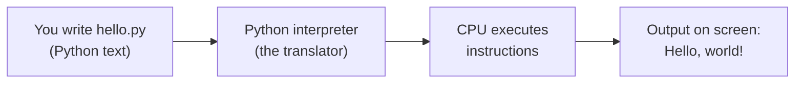
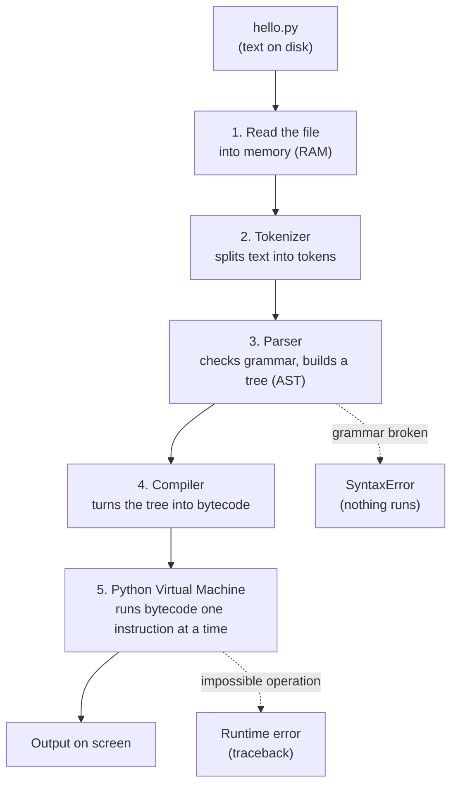
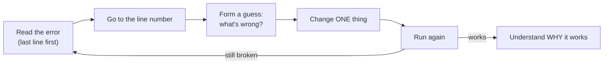

# Chapter 01 · Getting Started: How Computers Run Your Code

> A computer is the fastest, most obedient and most literal-minded worker you will ever meet. It can do billions of things per second, but only if you tell it *exactly* what to do. Programming is simply learning to give it instructions it understands. By the end of this chapter, you'll have written, run, broken and fixed your first real programs.

**You will learn:**
- What a computer, a program and a programming language actually are (no jargon left unexplained)
- How Python turns your text into action: the **interpreter**, bytecode and the Python Virtual Machine
- How to install Python 3.11+ and VS Code on Windows and Mac, including the one checkbox everybody misses
- Two ways to run Python: the **REPL** (try things instantly) and **.py files** (save real programs)
- `print()` in depth, including its secret settings `sep` and `end`
- Comments, the top-to-bottom reading order, and why indentation matters in Python
- The difference between **syntax errors** and **runtime errors**, and how to read a traceback like a detective
- How to practise so the knowledge actually sticks

**Before this:** Nothing! Start here.

---

## 🧠 The Big Idea

Imagine you hire a new cook who is extremely fast but has never been in a kitchen. You can't say "make dinner". You must hand over a recipe:

1. Boil 2 cups of water.
2. Add 1 cup of rice.
3. Wait 15 minutes.
4. Serve.

The cook follows the steps **in order**, **exactly as written**, **one at a time**. If step 2 says "Add 1 cup of rcie", the cook stops and says, "I don't know what rcie is."

That's programming.

| Kitchen | Computer |
|---|---|
| Cook | The **CPU** (the chip that does the work) |
| Recipe | Your **program** |
| The language the recipe is written in | The **programming language** (Python) |
| Kitchen counter (things you're using right now) | **RAM** (fast, temporary memory) |
| Pantry (things stored for later) | **Disk / SSD** (slow, permanent storage) |

There's one problem. The CPU doesn't understand English or Python. It only understands **machine code**: long lists of numbers like `10110000 01100001`. Writing that by hand is miserable. So we write in Python, which reads almost like English, and a helper program called the **Python interpreter** translates it for us.



> 💡 **The core insight:** a program is just a text file of instructions. The interpreter reads that file from top to bottom and carries out each line. Everything else in this book builds on that one picture.

---

## 🔨 Building It Up

### 1. What is a program, really?

A **program** is a list of instructions that tells a computer what to do. A Python program is a plain text file whose name ends in `.py`, like `hello.py`. You could write it in Notepad if you wanted. There's nothing magic in the file itself: the magic is in the interpreter that reads it.

A **programming language** is a set of rules for writing those instructions so that there's no confusion. English is ambiguous ("I saw a man with a telescope": who has the telescope?). Programming languages are designed so that every instruction has exactly one meaning.

Why Python?

- **Readable.** Python code looks like simple English, so you spend your energy on *ideas*, not punctuation.
- **Huge ecosystem.** It runs websites (Instagram's backend), data science, AI and machine learning, automation scripts and more.
- **Interview friendly.** Most companies let you use Python in coding interviews, and its short syntax means you write less and think more.

### 2. Compiled vs interpreted: two kinds of translators

There are two classic ways to translate a program for the CPU.

- A **compiler** is like translating an entire book before anyone reads it. You get a finished translated file (for example `game.exe`) that runs very fast. C and C++ work this way.
- An **interpreter** is like a live translator at a meeting, translating sentence by sentence as people speak. You can start immediately and change things easily, but there's some overhead.

Python is usually called an **interpreted language**, but the honest answer is "a bit of both": Python first *compiles* your code into a simpler form called **bytecode**, then a program called the **Python Virtual Machine (PVM)** *interprets* that bytecode. We'll open the hood on that later in this chapter.

### 3. Installing Python (Windows)

1. Go to [python.org/downloads](https://www.python.org/downloads/) and click the big yellow **Download Python 3.x** button. Any version **3.11 or newer** is perfect for this book.
2. Run the installer.
3. ⚠️ **On the very first screen, tick the box "Add python.exe to PATH".** This is the checkbox everybody misses.
4. Click **Install Now** and wait.
5. Open **Command Prompt** or **PowerShell** (press the Windows key, type `cmd`, press Enter) and type:

```text
python --version
```

You should see something like:

```text
Python 3.12.4
```

**What is PATH and why does it matter?** When you type a command like `python`, your computer searches a list of folders to find a program with that name. That list is called **PATH**. If Python's folder isn't on the list, Windows says `'python' is not recognized as an internal or external command`, or it opens the Microsoft Store instead. Ticking the box adds Python's folder to the list for you.

> ⚠️ **Forgot the checkbox?** Easiest fix: run the installer again, choose **Modify** → **Next**, and tick **"Add Python to environment variables"**. Then close and reopen your terminal. On Windows you can also try `py --version`: the `py` launcher is usually installed even when PATH isn't set.

### 4. Installing Python (Mac and Linux)

**Mac:** Macs may come with an old Python or a stub that asks to install developer tools. Don't rely on it. Download the macOS installer from python.org, run it, then open **Terminal** (Cmd + Space, type "Terminal") and run:

```text
python3 --version
```

On Mac and Linux the command is usually `python3`, not `python`. Throughout this book, when you see `python file.py`, use `python3 file.py` on Mac/Linux.

**Linux:** most distributions already include Python 3. Check with `python3 --version`. If it's older than 3.11, install a newer one using your package manager (for example `sudo apt install python3.12` on recent Ubuntu).

### 5. Installing VS Code (your code editor)

You *can* write code in Notepad, but that's like writing an essay without spell-check. A **code editor** colours your code, spots mistakes as you type and runs programs with one click.

1. Download **Visual Studio Code** from [code.visualstudio.com](https://code.visualstudio.com/) and install it. (On Windows, tick "Add to PATH" there too.)
2. Open VS Code, click the **Extensions** icon on the left sidebar (four little squares), search for **Python**, and install the one published by **Microsoft**.
3. Create a folder for your work, for example `python-practice`, and open it with **File → Open Folder**.
4. Press **Ctrl+Shift+P** (Cmd+Shift+P on Mac), type **Python: Select Interpreter**, and pick the Python 3.11+ you just installed.

You're ready.

### 6. Your first program: hello.py

In VS Code, create a new file named `hello.py` inside your folder and type this (type it, don't paste: your fingers learn too):

```python
print("Hello, world!")
```

```text
Hello, world!
```

Run it in either of two ways:

- Click the **▶ Run** button at the top right of the editor, or
- Open the terminal in VS Code (**Ctrl+`**, that's the backtick key below Esc) and type `python hello.py`.

What just happened:

- `print` is a **function**: a named, ready-made action that Python already knows how to do. "Print" means "show on the screen".
- The round brackets `( )` are how you **call** (use) a function. Whatever you put inside is the information you give it.
- `"Hello, world!"` is a **string**: a piece of text. The quotes tell Python "this is text, not an instruction". You can use double quotes `"..."` or single quotes `'...'`; both work the same.

Printing "Hello, world!" has been the traditional first program since the 1970s. Congratulations, you're officially a programmer.

### 7. The REPL: Python's playground

There's a second way to run Python. In your terminal, just type `python` (or `python3`) and press Enter:

```text
Python 3.12.4 (main, ...) on win32
Type "help", "copyright", "credits" or "license" for more information.
>>>
```

That `>>>` is the **REPL**, short for **Read, Evaluate, Print, Loop**. It *reads* what you type, *evaluates* it, *prints* the result, and *loops* back for more. It's a calculator on steroids:

```text
>>> 2 + 3
5
>>> 7 * 6
42
>>> "ha" * 3
'hahaha'
>>> print("hi")
hi
```

Notice something sneaky: in the REPL, typing `2 + 3` shows `5` even without `print`. The REPL automatically shows the value of whatever you type. **A `.py` file does not do that.** In a file, only `print` puts things on the screen.

To leave the REPL, type `exit()` and press Enter (or press Ctrl+Z then Enter on Windows, Ctrl+D on Mac/Linux).

| Use the REPL when... | Use a .py file when... |
|---|---|
| You want to test one small idea quickly | You're writing a real program |
| You forgot how something behaves | You want to save and re-run your work |
| You're using Python as a calculator | The code is more than a few lines |

> 💡 **Try this:** open the REPL and type `2 ** 10`. What do you think `**` means? (Answer in [Chapter 03](03-operators-expressions.md), but you can probably guess.)

### 8. print() can show many things at once

You can give `print` several things separated by commas. It prints them all on one line with a space between each:

```python
print("I am", 20, "years old")
print("Two plus three is", 2 + 3)
print(10, 20, 30)
print()
print("The line above is empty")
```

```text
I am 20 years old
Two plus three is 5
10 20 30

The line above is empty
```

What just happened:

- Each comma-separated item is called an **argument**.
- Numbers like `20` don't need quotes. Quotes are only for text.
- `2 + 3` was calculated *first*, then its result `5` was printed. Python always works out the value of an expression before handing it to `print`.
- `print()` with nothing inside prints an empty line.

Compare these two lines carefully:

```python
print("2 + 3")
print(2 + 3)
```

```text
2 + 3
5
```

With quotes, it's just text, so Python prints the characters exactly. Without quotes, it's maths, so Python calculates. That difference trips up almost every beginner once.

### 9. print()'s secret settings: sep and end

`print` has two optional settings that you set by name. They're called **keyword arguments**.

- `sep` (separator) is what goes **between** the items. By default it's a single space `" "`.
- `end` is what goes **after** the last item. By default it's a **newline**, written `"\n"`, which means "move to the next line".

```python
print("2026", "10", "31", sep="-")
print("a", "b", "c", sep="")
print("apples", "bananas", "cherries", sep=" | ")
print("Loading", end="")
print("...", end="")
print("done!")
print("one", "two", sep=", ", end=".\n")
```

```text
2026-10-31
abc
apples | bananas | cherries
Loading...done!
one, two.
```

What just happened:

- `sep="-"` glued the date parts together with dashes.
- `sep=""` (an empty string) means "nothing between them", so they're squashed together.
- `end=""` stopped `print` from moving to a new line, so the next `print` continued on the **same** line. That's how `Loading...done!` came out as one line from three `print` calls.
- In the last line, we used both. `"\n"` inside the `end` string is the newline character.

**The newline character `\n`.** A backslash followed by `n` inside a string means "start a new line here". It's one invisible character, and it's how text files and screens know where lines break:

```python
print("Line one\nLine two\nLine three")
```

```text
Line one
Line two
Line three
```

We'll meet other backslash codes like `\t` (tab) in [Chapter 04](04-strings.md).

### 10. Comments: notes for humans

Anything after a `#` on a line is a **comment**. Python ignores it completely. Comments are notes for humans, including future you, who will forget why you wrote something.

```python
# This program prints a greeting.
print("Namaste!")   # a comment can also sit at the end of a line

# print("This line is switched off, so it never runs")
print("Bye!")
```

```text
Namaste!
Bye!
```

What just happened: the commented-out `print` never ran. "Commenting out" a line is a very common trick to temporarily disable code while debugging, without deleting it.

Good comments explain **why**, not **what**:

```py
# ❌ Bad: repeats what the code already says
print(60 * 60 * 24)   # multiply 60 by 60 by 24

# ✅ Good: explains the meaning
print(60 * 60 * 24)   # number of seconds in one day
```

> 💡 In VS Code, select some lines and press **Ctrl+/** (Cmd+/ on Mac) to comment or uncomment all of them at once.

You'll also see text wrapped in triple quotes, `"""like this"""`. That's actually a multi-line string, often used as documentation. We'll cover it properly in [Chapter 04](04-strings.md) and [Chapter 10](10-functions.md).

### 11. Python reads top to bottom, one line at a time

The interpreter starts at line 1 and goes down, executing each line fully before moving to the next. The order you write things is the order they happen.

```python
print("1. Wake up")
print("2. Brush teeth")
print("3. Drink chai")
print("4. Open laptop")
```

```text
1. Wake up
2. Brush teeth
3. Drink chai
4. Open laptop
```

Swap two lines and the output order swaps too. Sounds obvious, but this is the root of a huge class of bugs: using something *before* the line that creates it. Later, **if** statements ([Chapter 05](05-conditionals.md)) let Python skip lines, **loops** ([Chapter 06](06-loops.md)) let it repeat lines, and **functions** ([Chapter 10](10-functions.md)) let it jump to a named block and come back. But the default is always: top to bottom.

Python is also **case-sensitive**: `print` and `Print` are completely different names. Only lowercase `print` exists.

### 12. Indentation is part of the language

**Indentation** means the spaces at the start of a line. In many languages it's only for looks. In Python, **it has meaning**: it shows which lines belong together in a block. You'll see blocks in [Chapter 05](05-conditionals.md); here's a sneak peek:

```python
temperature = 38
if temperature > 35:
    print("It's hot!")       # indented: belongs to the if
    print("Drink water.")    # indented: also belongs to the if
print("Have a nice day.")    # not indented: always runs
```

```text
It's hot!
Drink water.
Have a nice day.
```

For now, the rule is simple: **top-level code starts at the very left edge, with no spaces.** If you put a random space at the start of a line, Python complains:

```py
print("first")
    print("second")   # ❌ IndentationError: unexpected indent
```

The standard is **4 spaces** per level. VS Code inserts 4 spaces automatically when you press Tab in a `.py` file. Never mix tabs and spaces.

### 13. When things go wrong: two kinds of errors

Every programmer, including those with 20 years of experience, sees errors every single day. Errors are not failure; they're Python giving you a clue. There are two main kinds.

**Syntax errors** are grammar mistakes. Python checks the *whole file* for grammar **before running anything**. If the grammar is broken, **not even line 1 runs**.

```py
print("Start")
print("hello"        # ❌ missing closing bracket
print("End")
```

```text
  File "C:\practice\broken.py", line 2
    print("hello"
         ^
SyntaxError: '(' was never closed
```

Notice that "Start" was **not** printed, even though line 1 was fine. Python refused to start because the file wasn't valid Python.

**Runtime errors** (also called **exceptions**) happen *while* the program runs. The grammar was fine, but a line asked for something impossible. Everything *before* that line already ran; the program stops at the bad line.

```py
print("Start")
print("Total:", 10 / 0)   # ❌ dividing by zero is impossible
print("End")
```

```text
Start
Traceback (most recent call last):
  File "C:\practice\broken.py", line 2, in <module>
    print("Total:", 10 / 0)
                    ~~~^~~
ZeroDivisionError: division by zero
```

This time "Start" *was* printed, then the program crashed on line 2, and "End" never ran.

| | Syntax error | Runtime error (exception) |
|---|---|---|
| What's wrong | Grammar of the code | Something impossible happened while running |
| When it's detected | Before anything runs | At the moment the bad line runs |
| Did earlier lines run? | No | Yes |
| Examples | Missing bracket or quote, bad indentation, misspelt keyword | Divide by zero, unknown name, adding text to a number |

There's a third kind that Python can't catch at all: the **logic error** (a "bug"). The program runs without complaint but gives the wrong answer, like `print(2 + 2)` when you meant `2 * 2`. Only testing and careful thinking catch those.

### 14. Reading a traceback like a detective

A **traceback** is Python's crash report. Beginners panic and stare at it. Pros read it in this order: **bottom line first, then the line number.**

```text
Traceback (most recent call last):
  File "C:\practice\greet.py", line 2, in <module>
    print(mesage)
          ^^^^^^
NameError: name 'mesage' is not defined. Did you mean: 'message'?
```

1. **Last line = what went wrong.** The part before the colon is the **error type** (`NameError`), and the rest is the message. Here: Python doesn't know any name called `mesage`. It even suggests `message`. A typo!
2. **`File ..., line 2` = where.** Go to line 2 of `greet.py`.
3. **The code line and the `^^^^` marks** point at the exact part that failed (Python 3.11+ is great at this).
4. **"most recent call last"** means that when there are many `File` lines (once you use functions), the last one is where it actually blew up.

The error types you'll meet most as a beginner:

| Error | Plain-English meaning | Typical cause |
|---|---|---|
| `SyntaxError` | "This isn't valid Python grammar." | Missing `)` or `"`, a missing `:` |
| `IndentationError` | "Your spaces at the start of a line are wrong." | Random indent, mixed tabs/spaces |
| `NameError` | "I've never heard of that name." | Typo, wrong capitalisation (`Print`), using something before creating it |
| `TypeError` | "These kinds of values can't do that together." | `"a" + 5` (text plus number) |
| `ZeroDivisionError` | "You divided by zero." | `10 / 0` |
| `ValueError` | "Right kind of value, but a bad one." | `int("hello")` ([Chapter 02](02-variables-types-memory.md)) |

> 💡 **Superpower habit:** copy the last line of a traceback into a search engine. Someone has had that exact error before. You'll learn to handle errors gracefully in [Chapter 13](13-exceptions-files.md).

### 15. Your first mini program: a birthday card

Let's combine everything into one program. Read it, predict the output, then run it.

```python
# Birthday card generator
# Uses only print, sep, end, comments and arithmetic.

print("*" * 30)                      # a text times a number repeats it
print("*", "HAPPY BIRTHDAY, RIYA!", "*", sep="   ")
print("*" * 30)
print()
print("You are", 21, "years old.")
print("That's about", 21 * 365, "days,")
print("or", 21 * 365 * 24, "hours of being awesome.")
print()
print("Wishes from:", end=" ")
print("Arjun", "Meera", "Kabir", sep=", ", end="!\n")
print("-" * 30)
```

```text
******************************
*   HAPPY BIRTHDAY, RIYA!   *
******************************

You are 21 years old.
That's about 7665 days,
or 183960 hours of being awesome.

Wishes from: Arjun, Meera, Kabir!
------------------------------
```

What just happened:

- `"*" * 30` repeats the text `*` thirty times. (Text arithmetic is covered in [Chapter 04](04-strings.md).)
- `sep="   "` put three spaces between the stars and the message.
- `21 * 365` and `21 * 365 * 24` were calculated before printing.
- `end=" "` kept `Wishes from:` on the same line as the names, and `end="!\n"` finished the line with an exclamation mark.

> 💡 **Try this:** change the name and age. Then try to make the right-hand star line up perfectly with the edge of the border. (Hint: count characters.)

### 16. How to practise (so it actually sticks)

Learning to code is like learning to swim: reading about it helps, but you only learn in the water.

1. **Type every example yourself.** Copy-paste skips the part where your brain notices details.
2. **Predict, then run.** Before pressing Run, say out loud what you think will print. Being wrong is where learning happens.
3. **Break things on purpose.** Remove a bracket. Misspell `print`. Read the error. You're building a mental dictionary of error messages.
4. **Change one thing at a time.** "What if `sep` is `"🔥"`?" Try it.
5. **Keep a practice folder** with one file per idea: `print_tricks.py`, `errors.py`, and so on. It becomes your personal notebook.
6. **20 to 30 minutes daily beats 5 hours on Sunday.** Your brain consolidates during sleep.
7. **Do the Practice section** at the end of every chapter before opening the solutions. Struggle for at least 10 minutes first.

---

## 🔬 Under the Hood

### What happens when you run `python hello.py`

Let's follow your program on its journey from text file to pixels on screen.



1. **Reading.** The operating system loads your file's text from the disk into RAM.
2. **Tokenizing.** Python chops the text into meaningful pieces called **tokens**: `print`, `(`, `"Hello, world!"`, `)`. Like splitting a sentence into words.
3. **Parsing.** The parser checks that the tokens follow Python's grammar and builds a tree called the **Abstract Syntax Tree (AST)**. This is where a **SyntaxError** is raised. Since this happens for the whole file before execution, a single grammar mistake anywhere stops everything. That's exactly why "Start" didn't print in our earlier example.
4. **Compiling to bytecode.** The tree is turned into **bytecode**: a compact list of simple instructions like "load the name `print`", "load the constant `'Hello, world!'`", "call it". Bytecode isn't machine code; it's an in-between language designed for the PVM.
5. **Executing.** The **Python Virtual Machine** is a big loop inside the interpreter that reads one bytecode instruction at a time and performs it. **Runtime errors** happen here, at the moment an impossible instruction runs.

You can actually see the bytecode with the built-in `dis` ("disassemble") module. The exact names vary between Python versions, but it looks roughly like this:

```py
import dis
dis.dis('print("Hello")')
```

```text
  LOAD_NAME                0 (print)
  LOAD_CONST               0 ('Hello')
  CALL                     1
  RETURN_VALUE
```

That's what your one-liner really is to Python: four tiny instructions.

### CPython, .pyc files and __pycache__

The Python you downloaded from python.org is officially called **CPython**, because the interpreter itself is written in the C language. There are other implementations (PyPy, which is faster for long-running code; Jython for Java; MicroPython for tiny devices), but CPython is the standard one and what everyone means by "Python".

When you **import** one Python file from another (we'll do that in [Chapter 17](17-modules-stdlib.md)), CPython saves the bytecode in a folder called `__pycache__` as `.pyc` files. Next time, if the source hasn't changed, it skips steps 2 to 4 and loads the bytecode directly. That folder is safe to delete; Python just rebuilds it.

### Why is Python "slower" than C?

In C, the compiler turns your code into machine code ahead of time, and the CPU runs it directly. In Python, the PVM loop has to look at each bytecode instruction, figure out what types of values are involved, and then do the work. That extra checking makes plain Python loops roughly 10 to 100 times slower than equivalent C for raw number-crunching.

Does it matter? Usually not. Developer time is more expensive than computer time, and heavy-lifting libraries (like NumPy) are written in C under the hood. In interviews, what matters is your algorithm's **Big-O** complexity ([DSA Chapter 01](../part-2-dsa/01-big-o-complexity.md)), not the language's raw speed.

### Where does print() actually send text?

`print` writes text to something called **standard output** (stdout), a stream of characters that, by default, is connected to your terminal window. The terminal then draws those characters as pixels. Because output is a stream, it can be redirected. For example, `python hello.py > out.txt` sends the output into a file instead of the screen. Error messages go to a separate stream called **standard error** (stderr), which is why tracebacks still show up on screen even when stdout is redirected.

---

## 🧩 Pattern Decoder

There's no algorithm in this chapter, but there *are* habits and idioms that strong Python programmers use from day one.

### Pythonic habits to start now

| Habit | Why |
|---|---|
| Use 4 spaces for indentation, never tabs | It's the universal Python standard (**PEP 8**, Python's official style guide) |
| Put spaces around operators: `2 + 3`, not `2+3` | Easier to read; PEP 8 recommends it |
| No space before brackets: `print("hi")`, not `print ("hi")` | PEP 8 style |
| Use `sep` and `end` instead of fighting with spaces | Cleaner than gluing text manually |
| One idea per line | Easier to read and debug |
| Comments explain *why*, not *what* | The code already says what |
| Read tracebacks bottom-up | The last line tells you what went wrong |

### The debugging loop

Whenever something goes wrong, follow this loop. It works for a 3-line program and for a million-line system.



### print() is your first debugging tool

When a program gives a wrong answer, add `print` lines to see what's happening inside. This is called **print debugging**, and senior engineers use it all the time:

```python
print("DEBUG: starting calculation")
print("DEBUG: hours =", 24 * 7)
print("Minutes in a week:", 24 * 7 * 60)
```

```text
DEBUG: starting calculation
DEBUG: hours = 168
Minutes in a week: 10080
```

The skill is to **predict first**: before running, write down what you expect each `DEBUG` line to show. The first line where reality differs from your prediction is where the bug lives. When the program works, delete the debug lines (or comment them out).

### How this shows up in DSA later

- In coding interviews you'll often print intermediate values during a **dry run** to check your logic ([Two Pointers](../part-2-dsa/03-two-pointers.md) has dry-run tables you'll learn to love).
- `print(*items, sep=" ")` style tricks print a whole collection on one line. You'll meet the `*` "unpacking" in [Chapter 07](07-lists.md).
- Competitive programming judges compare your output **character by character**, so an extra space or missing newline means "Wrong Answer". Knowing exactly what `sep` and `end` do saves you there.

---

## ⚠️ Traps & Common Mistakes

1. **Forgetting "Add python.exe to PATH" on Windows.** Symptom: `'python' is not recognized...` or the Microsoft Store pops up. Fix: re-run the installer → Modify → tick "Add Python to environment variables", then reopen the terminal.

2. **Typing Python code into the terminal instead of the REPL (or vice versa).** If your terminal prompt looks like `C:\Users\you>` or `$`, you're in the system shell: type `python hello.py` there. If it shows `>>>`, you're inside Python: type Python code there, not `python hello.py`.

```py
>>> python hello.py      # ❌ SyntaxError: you're already inside Python
C:\> print("hi")         # ❌ the shell doesn't understand Python
```

3. **Capital letters.** `Print("hi")` gives `NameError: name 'Print' is not defined. Did you mean: 'print'?`. Python is case-sensitive.

4. **Mismatched or missing quotes.**

```py
print("Hello)            # ❌ SyntaxError: unterminated string literal
print("Hello')           # ❌ started with " but ended with '
print("Hello")           # ✅
print('It's sunny')      # ❌ the ' inside ends the string early
print("It's sunny")      # ✅ use the other kind of quote outside
```

5. **Missing brackets.** `print "hi"` was valid in the ancient Python 2, but in Python 3 `print` is a function and needs brackets: `print("hi")`.

6. **Expecting a .py file to show values like the REPL does.**

```py
# In a file, this line calculates 5 and then throws it away silently:
2 + 3
# ✅ You must print it:
print(2 + 3)
```

7. **Random indentation.** A space at the start of a top-level line causes `IndentationError: unexpected indent`. Start top-level lines at column 0.

8. **Fancy "smart quotes".** Copying code from Word or some websites gives curly quotes like `“hello”`. Python only accepts straight quotes `"hello"`. Another reason to type code yourself.

9. **Not saving the file.** VS Code shows a white dot on the tab when there are unsaved changes. If your "fix" isn't working, check that you saved (Ctrl+S). Turning on **File → Auto Save** prevents this forever.

10. **Naming your file after a module**, like `print.py`, `random.py` or `math.py`. Later, when you `import random`, Python finds *your* file instead of the real one and things break in confusing ways. Use descriptive names like `dice_game.py`.

---

## 💡 Tips & Tricks

- **Run shortcut:** in VS Code, `Ctrl+F5` runs the current file without the debugger.
- **Up arrow** in the terminal or REPL brings back previous commands. Saves tons of typing.
- **`help(print)`** in the REPL shows the official documentation for `print`. Press `q` to exit if it opens a pager.
- **The REPL's `_`** holds the last result: type `7 * 6`, then `_ + 1` gives `43`.
- **Format on save:** install the Black Formatter or Ruff extension in VS Code to keep your code PEP 8 tidy automatically.
- **`print(..., end="")`** is perfect for progress messages like `Loading...done`.
- **`print("-" * 40)`** is a quick way to draw a separator line in output.
- Keep error messages as friends: read the **last line** first, every time.
- Use **Ctrl+/** to toggle comments on selected lines while debugging.

---

## 🎯 Interview Questions

### 1. Is Python compiled or interpreted? 🔥🔥🔥

<details><summary>Answer</summary>

Both, in stages. CPython first **compiles** source code into **bytecode** (a low-level, platform-independent instruction set). Then the **Python Virtual Machine** **interprets** that bytecode instruction by instruction. It is usually called "interpreted" because there's no separate compile step you run by hand and no machine-code `.exe` is produced. Bytecode for imported modules is cached in `__pycache__/*.pyc`.

A strong answer adds: other implementations differ. **PyPy** uses a **JIT** (just-in-time compiler) that turns hot bytecode into machine code at runtime, which is why it's often faster.

</details>

### 2. What is the difference between a syntax error and an exception? 🔥🔥🔥

<details><summary>Answer</summary>

- A **syntax error** is detected while **parsing**, before the program runs. The code isn't valid Python, so nothing in that file executes. Examples: unclosed bracket, missing colon, bad indentation (`IndentationError` is a kind of `SyntaxError`).
- An **exception** (runtime error) is raised **during execution** when a valid line tries something impossible: `ZeroDivisionError`, `NameError`, `TypeError`, `ValueError`. Lines before it have already run. Exceptions can be caught and handled with `try`/`except` ([Chapter 13](13-exceptions-files.md)); a syntax error in a file can't be caught from inside that same file.

</details>

### 3. What is CPython? How is it different from Python? 🔥🔥

<details><summary>Answer</summary>

**Python** is the language (the rules). **CPython** is the reference *implementation* (the actual program that runs Python code), written in C. When you download from python.org, you get CPython. Alternatives include PyPy (JIT-compiled, fast), Jython (runs on the Java VM), IronPython (.NET) and MicroPython (microcontrollers).

</details>

### 4. What are .pyc files and the __pycache__ folder? 🔥🔥

<details><summary>Answer</summary>

`.pyc` files contain the compiled **bytecode** of imported modules. CPython stores them in `__pycache__` so that on the next run it can skip tokenizing, parsing and compiling if the source file hasn't changed. They make startup faster, not the program itself. The main script you run directly isn't cached this way. Deleting `__pycache__` is always safe.

</details>

### 5. Why is indentation important in Python? 🔥🔥🔥

<details><summary>Answer</summary>

Python uses indentation to define **blocks** of code (the body of an `if`, a loop, a function, a class) instead of curly braces `{ }` like C or Java. So indentation is part of the syntax, not just style. Wrong indentation causes `IndentationError` or, worse, silently changes which lines belong to a block. PEP 8 recommends 4 spaces per level, and Python 3 refuses to run code that mixes tabs and spaces inconsistently (`TabError`).

</details>

### 6. What does print() return? 🔥

<details><summary>Answer</summary>

`print()` returns **`None`**. It does its job as a *side effect* (writing to the screen), not by producing a value. You can verify it:

```python
result = print("hi")
print(result)
```

```text
hi
None
```

This matters later: writing `x = print(5)` doesn't store 5, it stores `None`. (`None` is covered in [Chapter 02](02-variables-types-memory.md).)

</details>

### 7. What do the sep and end parameters of print() do? 🔥🔥

<details><summary>Answer</summary>

`sep` is the string placed **between** arguments (default `" "`), and `end` is the string added **after** the last argument (default `"\n"`).

```python
print(1, 2, 3, sep="-", end=" <- done\n")
print("a", "b", sep="")
```

```text
1-2-3 <- done
ab
```

</details>

### 8. Is Python case-sensitive? 🔥

<details><summary>Answer</summary>

Yes. `name`, `Name` and `NAME` are three different identifiers, and `Print` is not the same as `print`. Keywords like `if`, `for` and `True` must be written exactly that way.

</details>

### 9. What is PEP 8? 🔥🔥

<details><summary>Answer</summary>

**PEP** stands for **Python Enhancement Proposal**: a design document for the Python community. **PEP 8** is the official style guide: 4-space indentation, lines ideally under 80 characters, `snake_case` for variable and function names, `CapWords` for classes, spaces around operators, two blank lines between top-level functions, and so on. Following it makes code look familiar to every Python developer. Tools like Black, Ruff and Flake8 check or apply it automatically.

</details>

### 10. What are the key differences between Python 2 and Python 3? 🔥

<details><summary>Answer</summary>

Python 2 reached end of life on 1 January 2020, so this is mostly asked to check general awareness. The headline differences:

- `print` is a **statement** in 2 (`print "hi"`) but a **function** in 3 (`print("hi")`).
- `5 / 2` is `2` in Python 2 (integer division) but `2.5` in Python 3. Python 3 uses `//` for floor division.
- Strings are **Unicode** by default in Python 3.
- `range` in Python 3 is lazy (like Python 2's `xrange`).

Always use Python 3.

</details>

### 11. What is the REPL? 🔥

<details><summary>Answer</summary>

**Read–Evaluate–Print Loop**: the interactive `>>>` prompt you get by running `python` with no file. It reads one statement, evaluates it, prints the value of expressions automatically, and loops. It's ideal for experiments. Unlike a script, it echoes values without `print`, and the special variable `_` holds the last result.

</details>

---

## 🏋️ Practice

**🟢 1. Your ID card.** Print this exactly, using one `print` per line:

```text
==========================
Name   : Your Name
College: Your College
Goal   : Become an Architect
==========================
```

<details><summary>Solution</summary>

```python
print("=" * 26)
print("Name   : Your Name")
print("College: Your College")
print("Goal   : Become an Architect")
print("=" * 26)
```

```text
==========================
Name   : Your Name
College: Your College
Goal   : Become an Architect
==========================
```

`"=" * 26` is shorter than typing 26 equals signs, and you can't miscount.

</details>

**🟢 2. Date formats.** Using only `sep`, print the numbers `31`, `10`, `2026` as `31/10/2026`, then as `31-10-2026`, then as `31.10.2026`.

<details><summary>Solution</summary>

```python
print(31, 10, 2026, sep="/")
print(31, 10, 2026, sep="-")
print(31, 10, 2026, sep=".")
```

```text
31/10/2026
31-10-2026
31.10.2026
```

</details>

**🟢 3. Predict the output** before running:

```py
print("A", end="")
print("B", end="-")
print("C")
print("D", "E", sep="")
```

<details><summary>Solution</summary>

```python
print("A", end="")
print("B", end="-")
print("C")
print("D", "E", sep="")
```

```text
AB-C
DE
```

`A` has no ending, so `B` sticks to it. `B` ends with `-`, then `C` ends with the default newline. `D` and `E` have no separator.

</details>

**🟡 4. Fix the bugs.** This program has four errors. Find them all *without running it first*, then check.

```py
print("Welcome to the quiz!)
Print("Question 1")
 print("What is 6 x 7?")
print("Answer:" 42)
```

<details><summary>Solution</summary>

1. Line 1: the string isn't closed. Add `"` before `)`.
2. Line 2: `Print` should be `print` (case-sensitive).
3. Line 3: unexpected indent. Remove the leading space.
4. Line 4: missing comma between the two arguments.

```python
print("Welcome to the quiz!")
print("Question 1")
print("What is 6 x 7?")
print("Answer:", 42)
```

```text
Welcome to the quiz!
Question 1
What is 6 x 7?
Answer: 42
```

Note that when you run the broken version, Python only reports the **first** syntax error it finds. You fix one, run again, and it shows the next. That's normal.

</details>

**🟡 5. One print, many lines.** Print this poem using a **single** `print` call:

```text
Roses are red,
Python is neat,
Bugs are annoying,
But fixing them's sweet.
```

<details><summary>Solution</summary>

```python
print("Roses are red,\nPython is neat,\nBugs are annoying,\nBut fixing them's sweet.")
```

```text
Roses are red,
Python is neat,
Bugs are annoying,
But fixing them's sweet.
```

Alternative: `print("Roses are red,", "Python is neat,", ..., sep="\n")`. Both put a newline between the lines.

</details>

**🟡 6. Time calculator.** Without using a calculator, write a program that prints how many seconds are in a week, a (non-leap) year, and a 21-year lifetime (ignore leap days). Make the output read nicely.

<details><summary>Solution</summary>

```python
# 60 seconds * 60 minutes * 24 hours = seconds in one day
print("Seconds in a week:", 60 * 60 * 24 * 7)
print("Seconds in a year:", 60 * 60 * 24 * 365)
print("Seconds in 21 years:", 60 * 60 * 24 * 365 * 21)
```

```text
Seconds in a week: 604800
Seconds in a year: 31536000
Seconds in 21 years: 662256000
```

</details>

**🔴 7. Traceback detective.** For each traceback, say (a) the error type, (b) the line, (c) the fix.

```text
Traceback (most recent call last):
  File "C:\practice\shop.py", line 3, in <module>
    print("Total: " + 250)
          ~~~~~~~~~~^~~~~
TypeError: can only concatenate str (not "int") to str
```

```text
  File "C:\practice\shop.py", line 5
    print("Thanks for shopping"
         ^
SyntaxError: '(' was never closed
```

<details><summary>Solution</summary>

**First:** (a) `TypeError`. (b) Line 3. (c) You can't use `+` to join text and a number. Use a comma instead, `print("Total:", 250)`, or put the number in quotes. Lines 1 and 2 had already run.

**Second:** (a) `SyntaxError`. (b) Line 5. (c) Add the missing `)` at the end. Because it's a syntax error, **no line of the file ran at all**, not even lines 1 to 4.

</details>

**🔴 8. Progress bar.** Using `end` and `sep` cleverly, write a program that prints exactly:

```text
Downloading [#####-----] 50%
Downloading [##########] 100%
Done.
```

Rule: you may not type more than one `#` or `-` character in a row in your code.

<details><summary>Solution</summary>

```python
print("Downloading [", "#" * 5, "-" * 5, "] ", 50, "%", sep="")
print("Downloading [", "#" * 10, "] ", 100, "%", sep="")
print("Done.")
```

```text
Downloading [#####-----] 50%
Downloading [##########] 100%
Done.
```

With `sep=""` you control every single character yourself, which is exactly what competitive programming judges demand.

</details>

---

## 🧠 Never-Forget Summary

- A **program** is a text file of instructions; the **CPU** only understands machine code, so Python translates for you.
- **CPython** compiles your code to **bytecode**, then the **PVM** runs it instruction by instruction.
- Install Python 3.11+ and **tick "Add python.exe to PATH"** on Windows. On Mac/Linux, use `python3`.
- **VS Code + the Microsoft Python extension** is your workshop. **The REPL (`>>>`)** is your playground.
- `print(a, b, sep=" ", end="\n")`: `sep` goes **between**, `end` goes **after**.
- In a `.py` file, nothing appears on screen unless you `print` it.
- `#` starts a comment. Comments explain *why*.
- Python runs **top to bottom**, is **case-sensitive**, and **indentation is grammar**.
- **Syntax errors** stop everything before it starts. **Runtime errors** stop the program at the bad line.
- Read tracebacks **bottom line first**, then go to the line number.

**Memory hooks:**
- **"SEP sits between, END comes at the end."**
- **"Syntax = Spelling test before the exam. Runtime = Tripping during the race."**
- **"Read the traceback like a WhatsApp chat: the latest message is at the bottom."**

**One picture:**

| Thing | What it is | Remember |
|---|---|---|
| `hello.py` | Your recipe | Plain text, ends in `.py` |
| Interpreter | Translator + executor | Source → bytecode → PVM |
| REPL `>>>` | Instant playground | Shows values automatically |
| `print()` | Show output | `sep` between, `end` after, returns `None` |
| `#` | Comment | Ignored by Python |
| Indentation | Grammar | 4 spaces, top level at column 0 |
| SyntaxError | Grammar broken | Nothing runs |
| Exception | Impossible action | Runs until the bad line |

> **If you remember only one thing:** Python reads your file top to bottom and does *exactly* what it says. When it complains, the last line of the error tells you why.

---
**Next:** [Chapter 02 · Variables, Data Types & Memory](02-variables-types-memory.md)  ·  **Back to** [Contents](../README.md)
