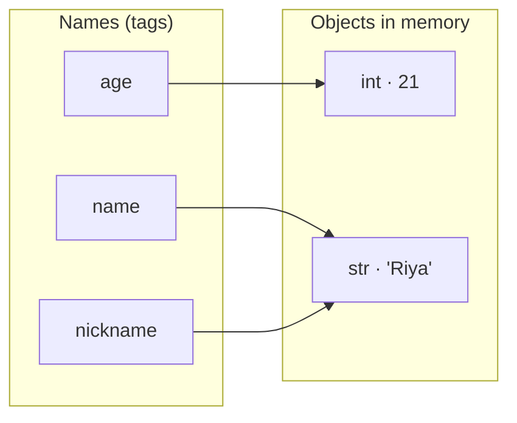
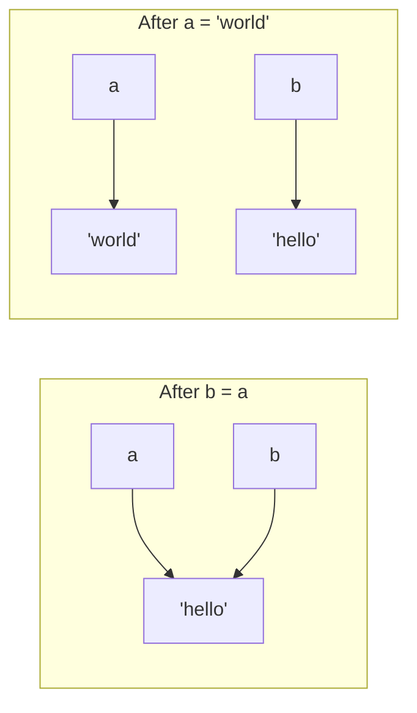
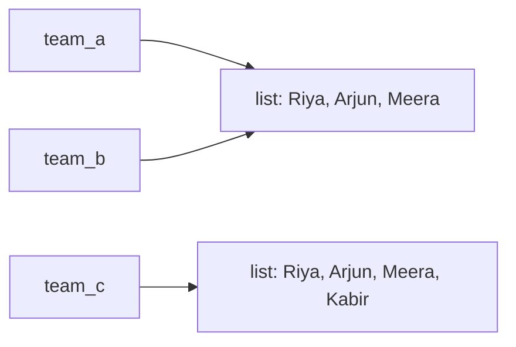
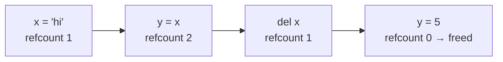

# Chapter 02 · Variables, Data Types & Memory

> Most beginners picture a variable as a box with a value inside. That picture works for a week, then quietly causes the nastiest bugs you'll ever chase. Python variables are not boxes: they're **name tags** stuck onto objects. Learn the right picture today and a whole family of "why did my data change?!" mysteries simply never happens to you.

**You will learn:**
- What a variable really is in Python: a **name** that **refers** to an **object** in memory
- The five basic types: `int`, `float`, `str`, `bool` and `None`, and how to check them with `type()`
- **Dynamic typing**, and why Python is still **strongly typed**
- **Casting** between types (`int()`, `float()`, `str()`, `bool()`) and reading user input with `input()`
- Naming rules, keywords and PEP 8 style
- Multiple assignment, the one-line swap, and constants
- **Mutable vs immutable** objects (the idea that powers half of Python)
- Why `0.1 + 0.2` isn't `0.3`, and why Python integers never overflow

**Before this:** [Chapter 01 · Getting Started](01-getting-started.md)

---

## 🧠 The Big Idea

Picture a huge warehouse (your computer's memory). Every value your program creates, like the number `21` or the text `"Riya"`, is an **object**: a parcel sitting somewhere on a shelf. Each parcel has three things written on it:

1. **An identity**: its unique shelf address (where it lives).
2. **A type**: what kind of thing it is (number, text, ...).
3. **A value**: the actual contents.

A **variable** is just a **name tag** on a string, tied to one parcel. When you write:

```py
age = 21
```

Python does two things: (1) creates (or finds) an `int` object with value `21`, then (2) ties the name tag `age` to it. The `=` does **not** mean "equals" like in maths. Read it as **"make this name refer to"**.



Two name tags can point to the **same** parcel (`name` and `nickname` above). Moving a tag to a different parcel doesn't change any parcel. Keep this picture in your head for the whole chapter.

> 💡 **The core insight:** in Python, **names point to objects**. Assignment never copies data; it just moves a name tag.

---

## 🔨 Building It Up

### 1. Creating and using variables

```python
name = "Riya"
age = 21
height_m = 1.62

print(name, "is", age, "years old and", height_m, "m tall.")
print("Next year she will be", age + 1)
```

```text
Riya is 21 years old and 1.62 m tall.
Next year she will be 22
```

What just happened: each line with `=` is an **assignment statement**. The right-hand side is evaluated first, then the name on the left is attached to the result. When Python later sees `age + 1`, it looks up what `age` refers to (21) and adds 1. Notice `age` itself didn't change: `age + 1` produces a **new** object, 22, which went straight to `print`.

### 2. Reassignment moves the tag

```python
score = 10
print(score)
score = 25          # the tag moves to a new object
print(score)
score = score + 5   # right side first: 25 + 5 = 30, then move the tag
print(score)
```

```text
10
25
30
```

What just happened: `score = score + 5` looks impossible in maths ("x = x + 5"?). In Python it's perfectly sensible: **compute the right side using the current value, then move the name to the result**. The old objects (10, 25) are untouched; if nothing else refers to them, Python eventually cleans them up.

### 3. Identity: id() and the name-tag picture in action

Every object has a unique identity number, which you can see with `id()`. In CPython it's the object's memory address. The actual numbers change every run, so we'll compare them instead of printing them.

```python
a = "hello"
b = a                 # b now points to the SAME object as a
print(id(a) == id(b))
print(a is b)         # 'is' asks: same object? (same as comparing ids)

a = "world"           # move tag a to a different object
print(a, b)           # b still points to "hello"
print(a is b)
```

```text
True
True
world hello
False
```

What just happened: `b = a` did **not** copy the text. It tied a second tag to the same parcel. Then `a = "world"` moved tag `a` elsewhere; tag `b` stayed put. This is why reassigning one variable never changes another.



### 4. The basic data types

Every object has a **type** that decides what you can do with it. These five are the building blocks of everything:

| Type | What it holds | Examples |
|---|---|---|
| `int` | Whole numbers, any size | `0`, `42`, `-7`, `10**100` |
| `float` | Numbers with a decimal point | `3.14`, `-0.5`, `2.0`, `1e6` |
| `str` | Text (a "string" of characters) | `"hi"`, `'Python'`, `""` (empty) |
| `bool` | Truth values | `True`, `False` (capital T and F!) |
| `NoneType` | "Nothing here" | `None` (the only value of this type) |

`type()` tells you an object's type:

```python
print(type(42))
print(type(3.14))
print(type("42"))
print(type(True))
print(type(None))
print(type(2.0), type(2))
```

```text
<class 'int'>
<class 'float'>
<class 'str'>
<class 'bool'>
<class 'NoneType'>
<class 'float'> <class 'int'>
```

What just happened: `"42"` in quotes is text, not a number. `2.0` is a float even though it's a whole number, because the decimal point makes it one. ("class" is Python's word for "type"; we'll build our own classes in [Chapter 14](14-oop-classes-objects.md).)

### 5. Numbers in more detail: int and float

```python
population = 1_400_000_000      # underscores make big numbers readable
print(population)
print(0b1010, 0o17, 0xFF)        # binary, octal, hexadecimal literals
print(1e3, 2.5e-3)               # scientific notation: 1 x 10^3, 2.5 x 10^-3
print(7 / 2, 6 / 2)              # / always gives a float
print(type(6 / 2))
print(int(3.99), int(-3.99))     # int() chops off the decimal part
print(round(3.99), round(3.14159, 2))
```

```text
1400000000
10 15 255
1000.0 0.0025
3.5 3.0
<class 'float'>
3 -3
4 3.14
```

What just happened:

- `1_400_000_000` is just `1400000000`; underscores are ignored, like commas in "1,40,00,00,000".
- `0b` means binary (base 2), `0o` octal (base 8), `0x` hexadecimal (base 16). Same integers, different spelling. You'll use binary a lot in [DSA Chapter 23](../part-2-dsa/23-bits-math.md).
- `1e3` is always a **float**.
- `/` (division) always returns a float, even for `6 / 2`. Operators are covered fully in [Chapter 03](03-operators-expressions.md).
- `int()` **truncates toward zero** (it doesn't round): `int(-3.99)` is `-3`. `round()` rounds to the nearest value.

### 6. Booleans: True and False

A **bool** answers a yes/no question. You get them from comparisons:

```python
is_adult = 21 >= 18
print(is_adult, type(is_adult))
print(5 == 5, 5 == 6, 5 != 6)
print(True + True, True * 10)   # bools are secretly ints: True is 1, False is 0
```

```text
True <class 'bool'>
True False True
2 10
```

What just happened: `==` asks "are these equal?" (one `=` assigns, two `==` compares). In Python, `bool` is a subtype of `int`, so `True` behaves as `1` and `False` as `0` in arithmetic. That's handy for counting: adding up a bunch of `True`s counts them. You'll use booleans constantly with `if` in [Chapter 05](05-conditionals.md).

### 7. None: the value that means "nothing"

`None` represents **no value**, "not set yet", or "nothing to return". It's not `0`, not `""`, not `False`; it's its own thing.

```python
winner = None              # we don't know the winner yet
print(winner)
print(type(winner))
print(winner is None)      # the correct way to test for None
print(print("side effect"))   # print returns None (see Chapter 01)
```

```text
None
<class 'NoneType'>
True
side effect
None
```

What just happened: there's exactly **one** `None` object in a running Python program, so we test for it with `is None`, which checks identity. In the last line, the inner `print` printed `side effect` and returned `None`, which the outer `print` then showed.

### 8. Dynamic typing: tags don't have types, objects do

In languages like Java or C, you declare a variable's type (`int age = 21;`) and it can only ever hold ints. Python is **dynamically typed**: names have **no type**. Only objects do. A name can refer to an int now and a string later.

```python
thing = 42
print(thing, type(thing))
thing = "forty-two"
print(thing, type(thing))
thing = 42.0
print(thing, type(thing))
```

```text
42 <class 'int'>
forty-two <class 'str'>
42.0 <class 'float'>
```

But Python is also **strongly typed**: it won't silently mix types that don't make sense together.

```py
print("Age: " + 21)
# TypeError: can only concatenate str (not "int") to str
```

JavaScript would happily produce `"Age: 21"`. Python refuses and makes you say what you mean (convert with `str(21)`, or use a comma in `print`). Strong typing catches bugs early.

| | Static (Java, C++) | Dynamic (Python, JavaScript) |
|---|---|---|
| Who has the type? | The variable | The object |
| When are types checked? | Before running (compile time) | While running |
| | **Strong** (Python, Java) | **Weak** (JavaScript, C in places) |
| Mixing types | Error unless you convert | Silently converted |

> 💡 Modern Python lets you add optional **type hints** like `age: int = 21`. Python itself ignores them at runtime, but editors and tools like `mypy` use them to catch mistakes. You'll see them in [Chapter 10](10-functions.md).

### 9. Casting: converting between types

**Casting** (or type conversion) means creating a new object of a different type from an existing value.

```python
print(int("42") + 1)          # str -> int
print(float("3.5") * 2)       # str -> float
print(str(99) + " problems")  # int -> str
print(int(7.9), float(7))     # float -> int (truncates), int -> float
print(int("  12  "))          # surrounding spaces are fine
print(int("ff", 16), int("1010", 2))   # parse in another base
```

```text
43
7.0
99 problems
7 7.0
12
255 10
```

Some conversions fail, because the text doesn't look like that kind of number:

```py
int("3.5")     # ❌ ValueError: invalid literal for int() with base 10: '3.5'
int("twelve")  # ❌ ValueError
int("")        # ❌ ValueError
int(float("3.5"))  # ✅ 3 (go through float first)
```

**`bool()` conversion** follows a simple rule: "empty" or "zero" things are `False`, everything else is `True`.

```python
print(bool(0), bool(0.0), bool(""), bool(None))
print(bool(1), bool(-5), bool("hi"), bool(" "), bool("False"))
```

```text
False False False False
True True True True True
```

What just happened: `bool("False")` is `True`! It's a non-empty string, and that's all `bool()` checks. A single space `" "` is also non-empty. This idea, **truthiness**, gets a full section in [Chapter 05](05-conditionals.md).

### 10. Reading input from the user: input()

`input()` pauses the program, shows a prompt, waits for the user to type something and press Enter, and **always returns a string**.

```py
name = input("What's your name? ")
print("Hello,", name)
```

```text
What's your name? Arjun
Hello, Arjun
```

The classic beginner bug: forgetting that input is always text.

```py
age = input("Your age: ")      # user types 20
print(age + 1)                 # ❌ TypeError: can only concatenate str (not "int") to str

age = int(input("Your age: ")) # ✅ convert immediately
print(age + 1)                 # 21
```

Reading several numbers on one line (very common in coding contests):

```py
a, b = input().split()         # user types: 3 7   ->  a = "3", b = "7"
a, b = int(a), int(b)
print(a + b)                   # 10
```

`.split()` breaks a string at spaces; you'll learn it fully in [Chapter 04](04-strings.md).

> ⚠️ In this book, runnable examples never use `input()` (they must run unattended). Instead, we set variables directly, like `age = 20`. When you practise on your own, swap in `input()` freely.

### 11. Naming rules and good style (PEP 8)

**Hard rules** (break them and you get a `SyntaxError`):

- Names may contain letters, digits and underscores `_`.
- They **can't start with a digit**: `2nd_place` ❌, `place_2` ✅.
- No spaces or hyphens: `my name` ❌, `my-name` ❌ (that's "my minus name"), `my_name` ✅.
- They're **case-sensitive**: `Age` and `age` are different.
- They can't be **keywords**, Python's reserved words.

Python's keywords (you'll learn every one of them in this book):

```text
False    None     True     and      as       assert   async    await
break    class    continue def      del      elif     else     except
finally  for      from     global   if       import   in       is
lambda   nonlocal not      or       pass     raise    return   try
while    with     yield
```

(`match`, `case`, `type` and `_` are "soft keywords": special only in certain places.)

**Style conventions (PEP 8)**:

| Kind of name | Style | Example |
|---|---|---|
| Variables, functions | `snake_case` | `total_price`, `user_count` |
| Constants | `UPPER_SNAKE_CASE` | `MAX_USERS`, `PI` |
| Classes | `CapWords` | `BankAccount` |
| "Private" / internal | leading underscore | `_cache` |
| Throwaway value | single underscore | `_` |

Good names describe **meaning**: `price_in_rupees` beats `p`, `x1` or `data`. Short names like `i`, `n`, `x` are fine for tiny scopes like loop counters.

> ⚠️ **Don't shadow built-ins.** Names like `print`, `list`, `str`, `input`, `sum`, `max`, `id`, `type` aren't keywords, so Python lets you reuse them. But then the original disappears:
>
> ```py
> sum = 10 + 20
> sum(...)   # ❌ TypeError: 'int' object is not callable
> ```

### 12. Multiple assignment, chained assignment and the swap

```python
x, y, z = 1, 2, 3            # multiple assignment (unpacking)
print(x, y, z)

a = b = c = 0                # chained: all three names -> the same 0 object
print(a, b, c)

left, right = 10, 20
left, right = right, left    # the famous one-line swap
print(left, right)
```

```text
1 2 3
0 0 0
20 10
```

What just happened with the swap: Python evaluates the **entire right side first**, making a temporary pair `(20, 10)`, and only then assigns: `left` gets 20, `right` gets 10. In most other languages you'd need a temporary variable:

```py
temp = left
left = right
right = temp
```

The number of names on the left must match the number of values on the right, otherwise you get `ValueError: too many values to unpack` (or "not enough").

### 13. Constants: a promise, not a lock

A **constant** is a value that should never change, like π or a maximum limit. Python has **no** true constant keyword. Instead, by convention, you write the name in `UPPER_CASE` and everybody agrees not to reassign it.

```python
GST_RATE = 0.18
MAX_LOGIN_ATTEMPTS = 3

price = 1000
print("Price with GST:", price + price * GST_RATE)
print("Attempts allowed:", MAX_LOGIN_ATTEMPTS)
```

```text
Price with GST: 1180.0
Attempts allowed: 3
```

Constants usually live at the top of a file, so they're easy to find and change in one place. This kills "magic numbers": a bare `0.18` scattered across 20 lines means 20 places to update when the tax rate changes.

### 14. Mutable vs immutable: the most important idea in this chapter

An **immutable** object can **never change** after it's created. A **mutable** object **can** be changed in place.

| Immutable (can't change) | Mutable (can change) |
|---|---|
| `int`, `float`, `bool`, `str`, `None`, `tuple`, `frozenset` | `list`, `dict`, `set`, most objects you create |

All five types in this chapter are immutable. So what does `x = x + 1` do? It doesn't change the 5; it makes a **new** object and moves the tag:

```python
x = 5
before = id(x)
x = x + 1
print(x, id(x) == before)   # a different object now

s = "cat"
t = s.upper()               # string methods return NEW strings
print(s, t)
```

```text
6 False
cat CAT
```

Now meet our first mutable type, the **list** (a sequence of values in square brackets; full details in [Chapter 07](07-lists.md)). With a mutable object, two name tags on the same parcel *see each other's changes*:

```python
team_a = ["Riya", "Arjun"]
team_b = team_a              # same list, two tags
team_b.append("Meera")       # change the list IN PLACE
print(team_a)                # team_a "changed" too!
print(team_a is team_b)

team_c = list(team_a)        # make an actual copy
team_c.append("Kabir")
print(team_a)
print(team_c)
```

```text
['Riya', 'Arjun', 'Meera']
True
['Riya', 'Arjun', 'Meera']
['Riya', 'Arjun', 'Meera', 'Kabir']
```

What just happened: `team_b = team_a` didn't copy anything; it added a second tag to the same list. `.append()` modified that one list, so both names show the change. Only `list(team_a)` created a new, separate list.



> 💡 **Rule of thumb:** with immutable objects, sharing is harmless because nobody can change the parcel. With mutable objects, sharing means **everyone with a tag sees every change**. This single idea explains a whole category of interview questions and bugs (default arguments in [Chapter 10](10-functions.md), copying in [Chapter 07](07-lists.md), 2D grids in DSA).

### 15. Float precision: why 0.1 + 0.2 != 0.3

```python
print(0.1 + 0.2)
print(0.1 + 0.2 == 0.3)
print(round(0.1 + 0.2, 2) == 0.3)
print(abs((0.1 + 0.2) - 0.3) < 1e-9)    # "close enough" comparison
```

```text
0.30000000000000004
False
True
True
```

This isn't a Python bug. It happens in Java, C, JavaScript, everywhere. Computers store floats in **binary** (base 2). Just as 1/3 can't be written exactly in decimal (0.3333...), 0.1 can't be written exactly in binary (0.0001100110011...). The computer stores the closest value it can, and tiny errors appear when you add them.

What to do:

- **Never compare floats with `==`.** Check if they're close: `abs(a - b) < 1e-9`, or use `math.isclose(a, b)` from the `math` module (modules come in [Chapter 17](17-modules-stdlib.md)).
- **For money, don't use floats.** Store paise as integers (`price_paise = 10050` for ₹100.50), or use the `decimal` module.
- `round()` for display is fine.

### 16. Big integers: Python ints never overflow

In C or Java, an `int` has a fixed size (often 32 or 64 bits), and going past the maximum "overflows" into nonsense negative numbers. Python's `int` grows as big as your memory allows.

```python
big = 2 ** 100
print(big)
print(2 ** 64 + 1)
print(len(str(2 ** 1000)), "digits")
```

```text
1267650600228229401496703205376
18446744073709551617
302 digits
```

That's why Python is wonderful for problems like "factorial of 50" or "the 500th Fibonacci number": no special big-number library needed. The cost: operations on huge ints are slower than on small ones, because they're handled as many chunks of digits.

> ⚠️ Floats are different: they **do** have limits. `2.0 ** 10000` raises `OverflowError`, and `float` has only about 15 to 17 significant decimal digits of precision.

### 17. Deleting names with del

`del` removes a **name tag**, not necessarily the object.

```python
a = "data"
b = a
del a                 # remove the tag 'a'
print(b)              # the object survives: b still refers to it
```

```text
data
```

Using a name after deleting it gives `NameError`. The object itself is freed only when **no tags at all** point to it (see Under the Hood).

---

## 🔬 Under the Hood

### Every object is a struct in memory

In CPython, every object is a block of memory (a C struct) that starts with two fields:

- a **reference count**: how many names/places currently point to it,
- a pointer to its **type**,

followed by the actual value. That's why even a tiny number takes more space than you might expect:

```py
import sys
print(sys.getsizeof(1))          # bytes used by the int object 1
print(sys.getsizeof(2 ** 100))   # bigger ints use more memory
print(sys.getsizeof(""))         # an empty string object
```

```text
28
40
41
```

(Exact numbers depend on your Python version and machine; these are from 64-bit CPython 3.13. The point: a small `int` is about 28 bytes, not 4 like in C.)

### Reference counting and garbage collection

Every time a new name is tied to an object, its reference count goes up. When a name is reassigned, deleted, or goes away, the count goes down. When it hits **zero**, CPython frees the memory **immediately**.



There's one gap: if object A refers to B and B refers back to A (a **reference cycle**), their counts never reach zero. So CPython also has a **cycle-detecting garbage collector** (the `gc` module) that periodically finds and frees such islands. You'll see cycles in linked structures in [DSA Chapter 10](../part-2-dsa/10-linked-lists.md).

### Small integer caching and string interning

Creating objects costs time, so CPython keeps a pre-made set of the integers **-5 to 256** (the most commonly used ones). Every `5` in your program is the *same* object:

```python
a = 256
b = 256
print(a is b)                 # same cached object

x = int("1000")
y = int("1000")
print(x == y, x is y)         # equal values, but two different objects
```

```text
True
True False
```

Similarly, CPython **interns** (reuses) many short strings that look like identifiers, such as `"hello"`. These are **implementation details**: they can differ between Python versions or even between running in a file and in the REPL. The lesson is not to memorise the range. The lesson is: **use `==` to compare values. Use `is` only for `None`** (and a few singletons like `True`/`False`).

### Why `is None` and not `== None`?

There is exactly one `None` object. `is` is a single, fast identity check that can't be fooled. `==` asks the object "are you equal to None?", and a custom class ([Chapter 15](15-oop-inheritance-magic.md)) could answer "yes" even when it isn't `None`. PEP 8 says: always `is None` / `is not None`.

### Where do names live?

Names are stored in a **namespace**, which is essentially a dictionary from name strings to objects. At the top level of a file, that's the module's **global** namespace. You can peek at it with `globals()`. Functions get their own **local** namespaces; we'll explore that (and the LEGB rule) in [Chapter 10](10-functions.md). For now: assignment = putting an entry `"age" → <int object 21>` into that dictionary.

### How floats are stored (IEEE 754)

A Python `float` is a 64-bit **IEEE 754 double**: 1 sign bit, 11 exponent bits, 52 fraction bits. Think of scientific notation in binary: `1.fraction × 2^exponent`. 52 bits give about **15–17 significant decimal digits**. Numbers like 0.5, 0.25 and 0.125 (powers of two) are stored exactly; 0.1, 0.2 and 0.3 are not.

```python
print(0.5 + 0.25 == 0.75)     # exact in binary
print(f"{0.1:.20f}")          # show 0.1 to 20 decimal places
```

```text
True
0.10000000000000000555
```

(`f"..."` strings are covered in [Chapter 04](04-strings.md).)

---

## 🧩 Pattern Decoder

### Pythonic idioms from this chapter

| Instead of... | Write | Why |
|---|---|---|
| `temp = a; a = b; b = temp` | `a, b = b, a` | One line, no temp variable |
| `x = 0; y = 0` | `x = y = 0` (immutables only!) | Shorter |
| `if x == None:` | `if x is None:` | Correct and fast |
| `0.1 + 0.2 == 0.3` | `abs(a - b) < 1e-9` or `math.isclose(a, b)` | Floats are inexact |
| `1000000` | `1_000_000` | Readable |
| `type(x) == int` | `isinstance(x, int)` | Also accepts subtypes (more in [Chapter 15](15-oop-inheritance-magic.md)) |
| A bare `0.18` in many places | `GST_RATE = 0.18` at the top | No magic numbers |
| `n = input()` then `n + 1` | `n = int(input())` | `input()` always returns `str` |

`isinstance` takes an object and a type and answers True/False:

```python
print(isinstance(5, int), isinstance(5.0, int), isinstance(True, int))
```

```text
True False True
```

(Yes, `True` is an `int`: remember `bool` is a subtype of `int`.)

### How this shows up in DSA later

- **Infinity as a starting value.** To find a minimum, start with "bigger than anything": `best = float("inf")`. For a maximum, `float("-inf")`. You'll see this in nearly every DSA chapter.

```python
best = float("inf")
print(best > 10 ** 100, -best)
```

```text
True -inf
```

- **The swap** `a[i], a[j] = a[j], a[i]` is the heart of sorting and two-pointer problems ([DSA Chapter 03](../part-2-dsa/03-two-pointers.md)).
- **Mutability and aliasing** cause the famous grid bug: `grid = [[0] * 3] * 3` creates three tags to the **same** row. You'll learn the fix in [Chapter 07](07-lists.md).
- **Big ints** mean you rarely worry about overflow in Python. But interviewers may still ask "what if this were Java?". Mention overflow, and use `mid = lo + (hi - lo) // 2` in binary search for that reason ([DSA Chapter 08](../part-2-dsa/08-binary-search.md)).
- **Modulo 10^9 + 7.** Many problems say "return the answer modulo 1_000_000_007" because in other languages the answer would overflow. In Python, you still must apply it, because the judge expects it. Write it as a constant: `MOD = 10**9 + 7`.
- **Fast input** in contests: reading with `int(input())` is common. For huge inputs, `sys.stdin` is faster ([Chapter 17](17-modules-stdlib.md)).

---

## ⚠️ Traps & Common Mistakes

1. **Thinking `b = a` copies.** It shares. Harmless for immutables, surprising for mutables:

```py
# ❌ both names, one list
backup = scores
scores.append(100)      # backup changed too!
# ✅ real copy
backup = list(scores)   # or scores.copy() / scores[:]
```

2. **Forgetting that `input()` returns a string.** `input()` + arithmetic → `TypeError`, or worse, `"5" * 3` gives `"555"` silently. Convert immediately: `n = int(input())`.

3. **`int()` on a decimal string.** `int("3.5")` is a `ValueError`. Use `int(float("3.5"))` or `float("3.5")`.

4. **Expecting `int()` to round.** `int(2.99)` is `2`, and `int(-2.99)` is `-2` (truncation toward zero). Use `round()` if you want rounding.

5. **Banker's rounding surprise.** `round()` rounds exact halves to the nearest **even** number:

```python
print(round(0.5), round(1.5), round(2.5), round(3.5))
```

```text
0 2 2 4
```

This is called "round half to even" and reduces bias in statistics. If you need "always round .5 up", use the `decimal` module.

6. **Comparing floats with `==`.** `0.1 + 0.2 == 0.3` is `False`. Compare with a tolerance.

7. **Using `is` to compare values.** `x is 1000` might be `False` even when `x == 1000`. Python 3.8+ even warns: `SyntaxWarning: "is" with a literal`. Use `==` for values, `is` only for `None`.

8. **Shadowing built-ins.** `list = [1, 2]`, `str = "hi"`, `max = 5`, `id = 7`... then later `list("abc")` crashes with `TypeError: 'list' object is not callable`. Pick other names: `items`, `text`, `max_value`, `user_id`.

9. **Lowercase `true`, `false`, `none`.** They're `True`, `False`, `None`. Lowercase gives `NameError`.

10. **`a = b = []` for mutables.** Both names share **one** list. For immutables like `0` it's fine because `0` can't be modified.

11. **Mismatched unpacking.** `a, b = 1, 2, 3` → `ValueError: too many values to unpack (expected 2)`.

12. **Using a variable before assigning it.** Python runs top to bottom, so `print(total)` on line 1 and `total = 5` on line 2 gives `NameError`.

---

## 💡 Tips & Tricks

- In the REPL, `type(x)` and `id(x)` are your X-ray glasses. Use them whenever you're unsure.
- `x = y = z = 0` is fine for numbers; for lists, write three separate assignments.
- `float("inf")` and `float("-inf")` are perfect starting values for min/max searches.
- `1e9`, `1e-9` read nicely but are floats. If you need an int, write `10**9`.
- `divmod`, `abs`, `round`, `min`, `max`, `pow` are built-in number helpers; most are in [Chapter 03](03-operators-expressions.md).
- Name booleans like questions: `is_valid`, `has_paid`, `can_vote`. The code then reads like English: `if is_valid:`.
- Use `_` for a value you must receive but don't care about: `_, last = "Riya", "Mehta"`.
- To store money, use integer paise/cents. Floats and money don't mix.
- `help(int)` or `dir(str)` in the REPL lists everything a type can do.

---

## 🎯 Interview Questions

### 1. Is Python statically or dynamically typed? Strongly or weakly? 🔥🔥🔥

<details><summary>Answer</summary>

**Dynamically typed**: names don't have types; objects do, and types are checked at runtime. The same name can refer to an `int` and later a `str`.

**Strongly typed**: Python won't implicitly convert between unrelated types. `"3" + 4` raises `TypeError` instead of guessing. (Contrast JavaScript, which is dynamic and weak: `"3" + 4` gives `"34"`.)

Optional type hints (`x: int = 5`) don't change this; they're for tools like `mypy` and editors.

</details>

### 2. What's the difference between mutable and immutable objects? Give examples. 🔥🔥🔥

<details><summary>Answer</summary>

An **immutable** object's value can't change after creation: `int`, `float`, `bool`, `str`, `tuple`, `frozenset`, `None`, `bytes`. Operations that look like changes (`s.upper()`, `x + 1`) create **new** objects.

A **mutable** object can be modified in place: `list`, `dict`, `set`, `bytearray`, and most user-defined objects.

Why it matters:
- Two names referring to the same mutable object see each other's changes (aliasing).
- Only immutable (more precisely, **hashable**) objects can be dictionary keys or set members ([Chapter 09](09-dictionaries.md)).
- Mutable default arguments are a classic bug ([Chapter 10](10-functions.md)).

```python
a = [1, 2]
b = a
b.append(3)
print(a)           # aliasing: a sees the change

s = "hi"
t = s
t = t + "!"        # creates a new string; s is untouched
print(s, t)
```

```text
[1, 2, 3]
hi hi!
```

</details>

### 3. How are variables stored in Python? Is Python pass-by-value or pass-by-reference? 🔥🔥🔥

<details><summary>Answer</summary>

Variables are **names bound to objects**; the name holds a reference, and the object lives on the heap with its type, value and reference count.

Python is neither classic pass-by-value nor pass-by-reference. It's **pass-by-object-reference** (also called "call by sharing"): a function receives a reference to the same object. If the object is mutable and the function mutates it, the caller sees the change. If the function **reassigns** its parameter name, only the local tag moves; the caller's variable is untouched. Full demo in [Chapter 10](10-functions.md).

</details>

### 4. Why does 0.1 + 0.2 not equal 0.3? How do you compare floats? 🔥🔥🔥

<details><summary>Answer</summary>

Floats are stored as **IEEE 754 binary** doubles. 0.1 and 0.2 have no exact binary representation (just like 1/3 in decimal), so they're stored as the nearest approximations, and the tiny errors add up: `0.1 + 0.2` is `0.30000000000000004`.

Compare with a tolerance: `abs(a - b) < 1e-9` or `math.isclose(a, b)`. For exact decimal arithmetic (money), use integers in the smallest unit or `decimal.Decimal`.

</details>

### 5. What is the output of `a = 256; b = 256; a is b` versus the same with 257? 🔥🔥

<details><summary>Answer</summary>

CPython caches small integers from **-5 to 256**, so `a is b` is `True` for 256: both names point to the single cached object.

For 257, it depends on context. Objects created separately at runtime (like `int("257")`) are different, so `is` is `False`. But when both literals appear in the same compiled block (same file or same REPL line), the compiler may reuse one constant and `is` gives `True`. This inconsistency is exactly the point: **identity of equal immutable values is an implementation detail. Use `==` for value comparison.**

</details>

### 6. What is the maximum value of an int in Python? 🔥🔥

<details><summary>Answer</summary>

There's no fixed maximum: Python 3 integers have **arbitrary precision** and grow until memory runs out. `2 ** 1000` works fine. (`sys.maxsize`, about 9.2 × 10^18 on 64-bit systems, is the largest size of a list/string index, not the largest int.) Floats *are* limited: about 1.8 × 10^308, beyond which you get `inf` or `OverflowError`.

</details>

### 7. How do you swap two variables without a temporary variable? 🔥🔥🔥

<details><summary>Answer</summary>

```python
a, b = 5, 9
a, b = b, a
print(a, b)
```

```text
9 5
```

The right side `b, a` is evaluated first into a temporary tuple `(9, 5)`, which is then unpacked into `a` and `b`. Interviewers sometimes also ask the arithmetic trick (`a = a + b; b = a - b; a = a - b`) or the XOR trick (`a ^= b; b ^= a; a ^= b`, see [DSA Chapter 23](../part-2-dsa/23-bits-math.md)). Mention them, but say the tuple swap is the Pythonic answer.

</details>

### 8. What is None? How is it different from 0, False and ""? 🔥🔥

<details><summary>Answer</summary>

`None` is the single instance of `NoneType` and means "no value". It's what functions return when they don't return anything. `0` is a number, `False` is a boolean and `""` is an empty string: all are real values. They're all **falsy** (`bool()` of each is `False`), but only `None is None`. Always test with `x is None`, never `x == None` or `not x` (because `not x` is also true for `0` and `""`).

</details>

### 9. What's the difference between type() and isinstance()? 🔥🔥

<details><summary>Answer</summary>

`type(x)` returns the exact class of `x`. `isinstance(x, T)` returns True if `x` is an instance of `T` **or any subclass** of `T`, and accepts a tuple of types: `isinstance(x, (int, float))`.

```python
print(type(True) == int, isinstance(True, int))
```

```text
False True
```

Prefer `isinstance` for type checks because it respects inheritance ([Chapter 15](15-oop-inheritance-magic.md)).

</details>

### 10. What does int(-3.7) return? And round(2.5)? 🔥

<details><summary>Answer</summary>

`int(-3.7)` is `-3`: `int()` **truncates toward zero**. `round(2.5)` is `2`: Python uses **round half to even** (banker's rounding), so `round(3.5)` is `4`. To always round down, use `math.floor`; up, `math.ceil` ([Chapter 03](03-operators-expressions.md) also shows `//` for floor division).

</details>

### 11. How does Python manage memory? 🔥🔥

<details><summary>Answer</summary>

CPython uses **reference counting** as its primary mechanism: each object tracks how many references point to it, and is freed immediately when the count reaches zero. A supplementary **generational garbage collector** (`gc` module) detects and frees **reference cycles** that refcounting alone can't. Memory for small objects comes from a specialised allocator (pymalloc) to reduce fragmentation. Programmers don't free memory manually; `del` only removes a name. More in [Chapter 18](18-internals-concurrency.md).

</details>

---

## 🏋️ Practice

**🟢 1. Type detective.** Without running, write down `type()` of each value, then check: `7`, `7.0`, `"7"`, `7 > 3`, `None`, `7 / 7`, `int("7")`, `str(7.5)`.

<details><summary>Solution</summary>

```python
print(type(7).__name__, type(7.0).__name__, type("7").__name__, type(7 > 3).__name__)
print(type(None).__name__, type(7 / 7).__name__, type(int("7")).__name__, type(str(7.5)).__name__)
```

```text
int float str bool
NoneType float int str
```

`.__name__` just gives the type's name without `<class '...'>`. The tricky one: `7 / 7` is `1.0`, a float, because `/` always returns a float.

</details>

**🟢 2. Bill splitter.** Four friends order food for ₹1,275 with 18% GST. Print the total with GST and each person's share, rounded to 2 decimals. Use a constant for the rate.

<details><summary>Solution</summary>

```python
GST_RATE = 0.18
FRIENDS = 4

bill = 1275
total = bill + bill * GST_RATE
share = total / FRIENDS

print("Total:", round(total, 2))
print("Each pays:", round(share, 2))
```

```text
Total: 1504.5
Each pays: 376.12
```

(`376.125` rounds to `376.12`, not `376.13`! The float stored for it is a hair below .125. Yet another reason money uses integers or `decimal` in real systems.)

</details>

**🟢 3. Swap three.** Given `a, b, c = 1, 2, 3`, rotate so that `a` gets b's value, `b` gets c's, and `c` gets a's, in one line.

<details><summary>Solution</summary>

```python
a, b, c = 1, 2, 3
a, b, c = b, c, a
print(a, b, c)
```

```text
2 3 1
```

</details>

**🟡 4. Predict the aliasing.** What does this print? Explain each line using the name-tag picture.

```py
x = 10
y = x
x = x + 5
p = ["a"]
q = p
p.append("b")
print(x, y)
print(p, q)
```

<details><summary>Solution</summary>

```python
x = 10
y = x
x = x + 5
p = ["a"]
q = p
p.append("b")
print(x, y)
print(p, q)
```

```text
15 10
['a', 'b'] ['a', 'b']
```

`x = x + 5` creates a new int 15 and moves only the tag `x`; `y` still points to 10. `p.append` mutates the one list both `p` and `q` point to.

</details>

**🟡 5. Seconds converter.** Given `total_seconds = 100000`, print how many days, hours, minutes and seconds that is. (Hint: use `//` for whole-number division and `%` for remainder; both are explained in [Chapter 03](03-operators-expressions.md).)

<details><summary>Solution</summary>

```python
SECONDS_PER_MINUTE = 60
SECONDS_PER_HOUR = 60 * SECONDS_PER_MINUTE
SECONDS_PER_DAY = 24 * SECONDS_PER_HOUR

total_seconds = 100000
days = total_seconds // SECONDS_PER_DAY
remaining = total_seconds % SECONDS_PER_DAY
hours = remaining // SECONDS_PER_HOUR
remaining = remaining % SECONDS_PER_HOUR
minutes = remaining // SECONDS_PER_MINUTE
seconds = remaining % SECONDS_PER_MINUTE

print(days, "days", hours, "hours", minutes, "minutes", seconds, "seconds")
```

```text
1 days 3 hours 46 minutes 40 seconds
```

</details>

**🟡 6. Casting gauntlet.** For each expression, predict the result or the error type: `int("08")`, `int("8.0")`, `float("8")`, `int(True)`, `str(None)`, `bool("0")`, `bool(0)`, `int(" -5 ")`.

<details><summary>Solution</summary>

```python
print(int("08"), float("8"), int(True), str(None), bool("0"), bool(0), int(" -5 "))
```

```text
8 8.0 1 None True False -5
```

`int("8.0")` is the odd one out: **`ValueError`**, because `int()` won't parse a decimal point in a string. `bool("0")` is `True` because `"0"` is a non-empty string.

</details>

**🔴 7. Float trap hunt.** Show that adding `0.1` ten times does not give exactly `1.0`, then print a correct "is it close enough?" check. No loops allowed (you haven't learned them yet).

<details><summary>Solution</summary>

```python
total = 0.1 + 0.1 + 0.1 + 0.1 + 0.1 + 0.1 + 0.1 + 0.1 + 0.1 + 0.1
print(total)
print(total == 1.0)
print(abs(total - 1.0) < 1e-9)
```

```text
0.9999999999999999
False
True
```

Each addition rounds to the nearest representable double, and the errors accumulate. Always compare floats with a tolerance.

</details>

**🔴 8. Huge number facts.** Without importing anything, print: (a) how many digits `3 ** 500` has, (b) its first 5 digits, (c) its last 5 digits. (Hint: `str()` turns a number into text; `len()` counts characters; `text[:5]` and `text[-5:]` take the first and last 5 characters, see [Chapter 04](04-strings.md).)

<details><summary>Solution</summary>

```python
digits = str(3 ** 500)
print(len(digits))
print(digits[:5])
print(digits[-5:])
```

```text
239
36360
10001
```

Python's arbitrary-precision ints compute the exact value. Converting to `str` is the simplest way to inspect digits (in [Chapter 06](06-loops.md) you'll also do it arithmetically with `% 10` and `// 10`).

</details>

---

## 🧠 Never-Forget Summary

- A variable is a **name tag** pointing at an **object**; `=` means "make this name refer to".
- Every object has an **identity** (`id`), a **type** (`type`) and a **value**.
- Basic types: `int` (unbounded), `float` (64-bit, inexact), `str` (text), `bool` (`True`/`False`, a kind of int), `None` (nothing).
- **Dynamic**: names have no type. **Strong**: no silent mixing (`"a" + 1` is an error).
- Casting: `int()` truncates and rejects `"3.5"`; `bool()` is False only for empty/zero/None.
- `input()` **always returns a string**: convert it.
- `snake_case` for variables, `UPPER_CASE` for constants, never shadow built-ins.
- `a, b = b, a` swaps: the right side is fully evaluated first.
- **Immutable** objects can't change (new object every time); **mutable** ones change in place, and every tag sees it.
- Floats: never `==`; use a tolerance. Money: integers or `decimal`.
- `is` for `None`, `==` for everything else.

**Memory hooks:**
- **"Names are TAGS, not BOXES."**
- **"I-T-V: every object has an Identity, a Type and a Value."**
- **"Input is always a String: Input → int() it!"**
- **"Floats Fib (lie a little); Ints Inflate (grow forever)."**

**One picture:**

| Concept | Picture | Key code |
|---|---|---|
| Variable | Tag on a parcel | `age = 21` |
| Shared reference | Two tags, one parcel | `b = a`, `a is b` |
| Reassignment | Move the tag | `x = x + 1` |
| Immutable | Sealed parcel | `int, float, str, bool, None, tuple` |
| Mutable | Open parcel | `list, dict, set` |
| Type | Label on the parcel | `type(x)`, `isinstance(x, int)` |
| Casting | Make a new parcel of another kind | `int("5")`, `str(5)` |
| Freed memory | Parcel with no tags | refcount → 0 |

> **If you remember only one thing:** Python names are tags pointing at objects. Assignment moves tags; it never copies. Mutable objects shared by two tags change for both.

---
**Next:** [Chapter 03 · Operators & Expressions](03-operators-expressions.md)  ·  **Back to** [Contents](../README.md)
