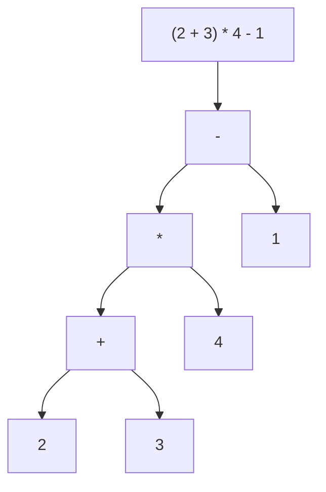
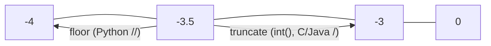
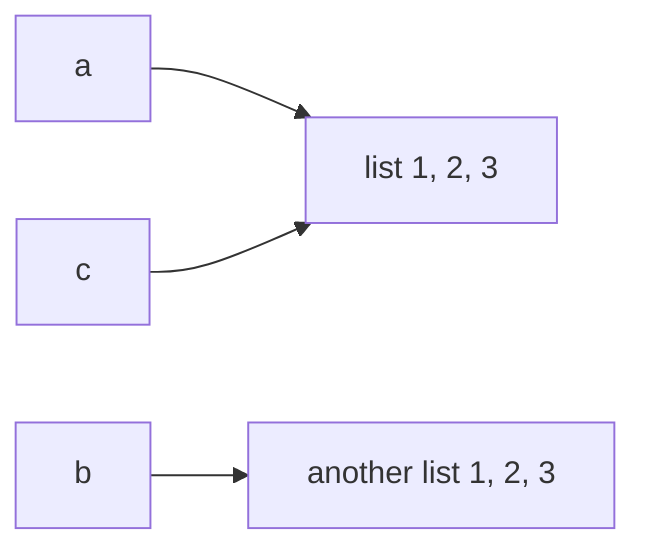

# Chapter 03 · Operators & Expressions

> Operators are the verbs of a programming language: add, compare, combine, test. Most of them behave exactly like school maths, and that's the trap. A handful (`//`, `%` with negatives, `and`/`or` returning strange values, `is` vs `==`) behave in ways that surprise even experienced developers, and interviewers love asking about exactly those.

**You will learn:**
- All arithmetic operators, including the difference between `/`, `//` and `%`, and what happens with **negative numbers**
- `**`, `divmod()`, `abs()`, `pow()` and augmented assignment like `+=`
- Comparison operators and Python's lovely **chained comparisons** (`0 < x < 10`)
- `and`, `or`, `not`, **short-circuiting**, and why `0 or "default"` returns `"default"`
- **Identity** (`is`) vs **equality** (`==`), and **membership** (`in`)
- A first look at **bitwise** operators (`&`, `|`, `^`, `~`, `<<`, `>>`)
- The **precedence** table, so you always know what gets calculated first
- The **walrus operator** `:=` and the digit-extraction tricks that DSA problems use constantly

**Before this:** [Chapter 01 · Getting Started](01-getting-started.md) · [Chapter 02 · Variables, Data Types & Memory](02-variables-types-memory.md)

---

## 🧠 The Big Idea

An **expression** is anything that Python can **evaluate** to produce a value. `2 + 3` is an expression (value: 5). So is `age >= 18` (value: `True` or `False`), and so is a lone `42`.

Think of an expression as a little machine made of **operands** (the values) and **operators** (the actions):



Python evaluates this tree **from the bottom up**: `2 + 3 = 5`, then `5 * 4 = 20`, then `20 - 1 = 19`. **Precedence rules** decide how the tree is built when there are no brackets, just like "BODMAS" (or "PEMDAS") from school.

There are seven families of operators. Learn the families and you've learned them all:

| Family | Operators | Produces |
|---|---|---|
| Arithmetic | `+ - * / // % **` | numbers |
| Assignment | `= += -= *= /= //= %= **=` and `:=` | binds a name |
| Comparison | `== != < > <= >=` | `True` / `False` |
| Logical | `and or not` | one of the operands / bool |
| Identity | `is`, `is not` | `True` / `False` |
| Membership | `in`, `not in` | `True` / `False` |
| Bitwise | `& | ^` | bits | | bind tighter than `==` |\| ^ ~ << >>` | integers |

> 💡 **The core insight:** every expression boils down to one value, and Python computes it in a strictly defined order. If you can draw the tree, you can predict any output.

---

## 🔨 Building It Up

### 1. The basic arithmetic operators

```python
a, b = 17, 5
print(a + b)    # addition
print(a - b)    # subtraction
print(a * b)    # multiplication
print(a / b)    # true division: always a float
print(a // b)   # floor division: rounds DOWN to a whole number
print(a % b)    # modulo: the remainder
print(a ** 2)   # exponent: 17 squared
```

```text
22
12
85
3.4
3
2
289
```

What just happened: the first three are school maths. The interesting ones are the **three kinds of division**:

- `/` gives the exact answer as a float: `17 / 5 = 3.4`.
- `//` gives "how many whole times does 5 fit into 17?" → `3`.
- `%` gives "what's left over?" → `17 - 3*5 = 2`.

Think of sharing 17 laddoos among 5 friends: each gets `17 // 5 = 3`, and `17 % 5 = 2` are left over for you.

They're always connected by this identity, which is worth memorising:

```text
a == (a // b) * b + (a % b)
```

### 2. Mixing ints and floats

If **either** operand is a float, the result is a float. `/` always gives a float, even for ints that divide exactly.

```python
print(3 + 4.0, 10 / 2, 10 // 2, 10.0 // 3, 7 % 2.5)
print(type(10 // 2), type(10.0 // 2))
```

```text
7.0 5.0 5 3.0 2.0
<class 'int'> <class 'float'>
```

What just happened: `10 // 2` stays an `int` (both operands are ints), but `10.0 // 3` is `3.0`, a float. `%` works on floats too.

### 3. Floor division and modulo with negative numbers

This is the single most-asked "trick" about Python operators. `//` rounds **down toward negative infinity** (it's called *floor* for that reason), not toward zero.

```python
print(7 // 2, -7 // 2)
print(7 % 2, -7 % 2)
print(7 % -2, -7 % -2)
print(int(-7 / 2))      # truncation toward zero, for comparison
```

```text
3 -4
1 1
-1 -1
-3
```

What just happened:

- `-7 / 2` is `-3.5`. The floor of `-3.5` is `-4` (down the number line), not `-3`.
- Then `%` must satisfy `a == (a // b) * b + a % b`: `-7 == (-4)*2 + r`, so `r = 1`.
- **Rule:** in Python, the result of `%` always has the **same sign as the divisor** (the right-hand number). So `x % 5` is always in `0..4` when the divisor is positive, even for negative `x`.



| Expression | Python | C / Java |
|---|---|---|
| `-7 // 2` (or `-7 / 2` in C) | `-4` (floor) | `-3` (truncates) |
| `-7 % 2` | `1` | `-1` |

Why is Python's choice nice? Because "wrap around" maths just works. To step back 3 hours from 1 o'clock on a 12-hour clock: `(1 - 3) % 12` is `10`. No negative surprises. This is used constantly in circular arrays in DSA.

```python
hour = 1
print((hour - 3) % 12)        # 3 hours before 1 o'clock
index, n = 0, 5
print((index - 1) % n)        # previous index in a circular array of size 5
```

```text
10
4
```

### 4. Exponents: `**`, pow() and roots

```python
print(2 ** 10)          # 1024
print(2 ** -1)          # negative power -> float
print(9 ** 0.5)         # fractional power -> square root
print(27 ** (1 / 3))    # cube root (float, slightly inexact)
print(pow(2, 10))       # same as 2 ** 10
print(pow(2, 10, 1000)) # (2 ** 10) % 1000, but computed efficiently
print(2 ** 3 ** 2)      # right-to-left: 2 ** (3 ** 2) = 2 ** 9
print(-2 ** 2)          # ** binds tighter than unary minus: -(2 ** 2)
print((-2) ** 2)
```

```text
1024
0.5
3.0
3.0
1024
24
512
-4
4
```

What just happened:

- `**` is **right-associative**: `2 ** 3 ** 2` means `2 ** (3 ** 2) = 2 ** 9 = 512`, not `(2 ** 3) ** 2 = 64`. Towers of powers in maths work the same way.
- `-2 ** 2` is `-4`, because `**` is done before the unary minus. Write `(-2) ** 2` if you mean "negative two, squared".
- `pow(base, exp, mod)` computes `base ** exp % mod` **without** building the giant number first. That's essential in problems that say "return the answer modulo 10^9 + 7".

### 5. divmod() and abs()

`divmod(a, b)` returns both the quotient and the remainder at once, as a pair:

```python
q, r = divmod(17, 5)
print(q, r)
print(divmod(-17, 5))
minutes, seconds = divmod(200, 60)
print(minutes, "min", seconds, "sec")
print(abs(-42), abs(3.5), abs(0))
```

```text
3 2
(-4, 3)
3 min 20 sec
42 3.5 0
```

What just happened: `divmod(a, b)` is exactly `(a // b, a % b)`, so the negative rules from section 3 apply. It's the cleanest way to convert units (seconds to minutes, paise to rupees, an index to a row and column).

### 6. Augmented assignment: +=, -=, and friends

Writing `x = x + 1` is so common that Python has a shortcut:

```python
score = 10
score += 5     # score = score + 5
score -= 3     # score = score - 3
score *= 2     # score = score * 2
score //= 4    # score = score // 4
score **= 2    # score = score ** 2
score %= 7     # score = score % 7
print(score)

greeting = "Hi"
greeting += "!"   # works for strings too
print(greeting)
```

```text
1
Hi!
```

Trace it: 10 → 15 → 12 → 24 → 6 → 36 → `36 % 7 = 1`.

> ⚠️ Python has **no `++` or `--`**. `x++` is a `SyntaxError`, and `++x` is legal but just means `+(+x)`, which does nothing. Use `x += 1`.

For immutable objects (numbers, strings), `x += 1` creates a new object and moves the tag, exactly like `x = x + 1`. For **mutable** objects like lists, `+=` changes the object **in place**, which matters when two names share it:

```python
a = [1, 2]
b = a
a += [3]        # in place: b sees it
print(b)

c = [1, 2]
d = c
c = c + [3]     # builds a NEW list, moves only c
print(d)
```

```text
[1, 2, 3]
[1, 2]
```

(Lists in full: [Chapter 07](07-lists.md).)

### 7. Comparison operators

Comparisons ask a question and answer with a `bool`:

```python
x = 7
print(x == 7, x != 7)
print(x < 10, x > 10, x <= 7, x >= 8)
print("apple" < "banana", "Zebra" < "apple")   # strings compare alphabetically, by code
print(1 == 1.0, True == 1)
```

```text
True False
True False True False
True True
True True
```

What just happened: strings are compared character by character using their Unicode code numbers, and all uppercase letters come **before** all lowercase ones (`"Z"` is 90, `"a"` is 97). That's why `"Zebra" < "apple"`. Details in [Chapter 04](04-strings.md). Also, `1 == 1.0` is `True`: numbers compare by value across types.

Comparing incompatible types with `<` is an error in Python 3:

```py
print(5 < "5")   # ❌ TypeError: '<' not supported between instances of 'int' and 'str'
print(5 == "5")  # ✅ False (== between different types is allowed, just False)
```

### 8. Chained comparisons

In maths you write `0 < x < 10`. Most languages make you write `0 < x && x < 10`. Python lets you write the maths version directly:

```python
x = 7
print(0 < x < 10)
print(1 <= x <= 5)
a = b = c = 3
print(a == b == c)
print(1 < 3 > 2)    # legal but confusing: means 1 < 3 and 3 > 2
```

```text
True
False
True
True
```

What just happened: `a < b < c` means `a < b and b < c`, except `b` is evaluated **only once**. Any comparison operators can chain, but keep it readable: `low <= x < high` is great; `1 < 3 > 2` is a puzzle, not code.

### 9. Logical operators: and, or, not

These combine conditions:

| `A` | `B` | `A and B` | `A or B` | `not A` |
|---|---|---|---|---|
| True | True | True | True | False |
| True | False | False | True | False |
| False | True | False | True | True |
| False | False | False | False | True |

- `and`: True only if **both** are true. ("I'll go if it's sunny **and** I'm free.")
- `or`: True if **at least one** is true.
- `not`: flips it.

```python
age, has_ticket = 20, True
print(age >= 18 and has_ticket)
print(age < 12 or age > 60)
print(not has_ticket)
print(not age >= 18)            # not applies to the whole comparison
```

```text
True
False
False
False
```

### 10. Short-circuiting: Python stops as soon as it knows

Python is lazy in a smart way:

- `A and B`: if `A` is false, the whole thing must be false, so **B is never evaluated**.
- `A or B`: if `A` is true, the whole thing must be true, so **B is never evaluated**.

This is called **short-circuit evaluation**, and it lets you write safe checks:

```python
count = 0
total = 50
print(count != 0 and total / count > 10)   # no ZeroDivisionError!
print(True or 1 / 0)                       # 1 / 0 never runs
```

```text
False
True
```

What just happened: in the first line, `count != 0` is `False`, so Python never computes `total / count`. If you swapped the order, you'd crash. **Put the cheap or protective check first.**

### 11. The secret: and/or return one of their operands

Here's what surprises most people. `and` and `or` don't necessarily return `True` or `False`. They return **one of the operands**, the one that decided the answer.

- `A or B` → returns `A` if `A` is truthy, otherwise returns `B`.
- `A and B` → returns `A` if `A` is falsy, otherwise returns `B`.

("Truthy" means `bool(value)` is `True`; falsy values are `0`, `0.0`, `""`, `None`, `False` and empty collections. See [Chapter 02](02-variables-types-memory.md#9-casting-converting-between-types).)

```python
print(0 or "default")
print("Riya" or "default")
print("" or None or "last")
print(5 and 10)
print(0 and 10)
print(None and print("never runs"))
print(not "hello", not "")
```

```text
default
Riya
last
10
0
None
False True
```

What just happened: `0 or "default"`: 0 is falsy, so `or` returns the second operand. `5 and 10`: 5 is truthy, so `and` has to look at the second one and returns `10`. `not`, unlike the other two, always returns a real `bool`.

The most useful idiom from this is the **default value**:

```python
nickname = ""
display_name = nickname or "Guest"
print("Welcome,", display_name)
```

```text
Welcome, Guest
```

> ⚠️ Careful: `x or default` replaces **every** falsy value, including a perfectly valid `0`. If `0` is a legal value, test `x is None` instead (you'll write that with `if` or the ternary operator in [Chapter 05](05-conditionals.md)).

### 12. Identity (`is`) vs equality (`==`)

You met this idea in [Chapter 02](02-variables-types-memory.md). Now let's nail it:

- `==` asks: **do these have the same value?** (Are these two cakes identical in taste and look?)
- `is` asks: **are these the very same object?** (Is this the *same cake*?)

```python
a = [1, 2, 3]
b = [1, 2, 3]
c = a
print(a == b, a is b)    # same value, different objects
print(a == c, a is c)    # same object
x = None
print(x is None, x is not None)
```

```text
True False
True True
True False
```



Rule: **use `is` only for `None`** (and `True`/`False` in rare cases). Use `==` for everything else. Note the spelling `is not`, which reads naturally: `x is not None`.

### 13. Membership: in and not in

`in` asks "is this inside that?". It works on strings, lists, and every other collection.

```python
print("a" in "banana")
print("nan" in "banana")       # substring check
print("x" not in "banana")
print(3 in [1, 2, 3])
print("Riya" in ["Arjun", "Meera"])
```

```text
True
True
True
True
False
```

What just happened: for strings, `in` checks for a **substring**, not just one character. For lists, it checks each element with `==`. How fast is `in`? For strings and lists it scans one by one, **O(n)**. For sets and dictionaries it's **O(1)** on average, thanks to hashing ([Chapter 09](09-dictionaries.md)). That difference is a classic interview optimisation.

### 14. Bitwise operators: a first look

Computers store integers in **binary** (base 2): `5` is `101`, `3` is `011`. Bitwise operators work on those bits directly, column by column.

| Operator | Name | Rule per bit | `5 op 3` |
|---|---|---|---|
| `&` | AND | 1 if both are 1 | `101 & 011 = 001` → `1` |
| `\|` | OR | 1 if either is 1 | `101 \| 011 = 111` → `7` |
| `^` | XOR | 1 if they differ | `101 ^ 011 = 110` → `6` |
| `~` | NOT | flip all bits | `~5` → `-6` |
| `<<` | left shift | move bits left | `5 << 1 = 1010` → `10` |
| `>>` | right shift | move bits right | `5 >> 1 = 10` → `2` |

```python
print(5 & 3, 5 | 3, 5 ^ 3, ~5)
print(5 << 1, 5 << 3, 40 >> 2)
print(bin(5), bin(10), bin(-6))
print(7 & 1, 8 & 1)     # last bit: 1 means odd, 0 means even
```

```text
1 7 6 -6
10 40 10
0b101 0b1010 -0b110
1 0
```

What just happened:

- `x << k` multiplies by `2^k`; `x >> k` floor-divides by `2^k`.
- `~x` is always `-x - 1` (because of how negative numbers are stored, called **two's complement**).
- `x & 1` tells you if `x` is odd. `bin()` shows the binary text.

These look exotic, but they power some of the slickest interview tricks (find the single non-duplicate number with XOR, check powers of two with `n & (n - 1)`, generate all subsets with bitmasks). The full toolkit is in [DSA Chapter 23 · Bit Manipulation & Math](../part-2-dsa/23-bits-math.md).

> ⚠️ Don't confuse `&` with `and`, or `|` with `or`. `and`/`or` are logical and short-circuit; `&`/`|` are bitwise and always evaluate both sides. `True & False` happens to work (gives `False`), but `5 and 3` is `3` while `5 & 3` is `1`.

### 15. Operator precedence: who goes first?

When there are no brackets, Python uses this order, **highest to lowest**:

| Priority | Operators | Notes |
|---|---|---|
| 1 (highest) | `( )` | brackets always win |
| 2 | `**` | right-to-left |
| 3 | `+x`, `-x`, `~x` | unary |
| 4 | `*`, `/`, `//`, `%` | left-to-right |
| 5 | `+`, `-` | left-to-right |
| 6 | `<<`, `>>` | shifts |
| 7 | `&` | bitwise AND |
| 8 | `^` | bitwise XOR |
| 9 | `\|` | bitwise OR |
| 10 | `==`, `!=`, `<`, `>`, `<=`, `>=`, `is`, `is not`, `in`, `not in` | can chain |
| 11 | `not` | |
| 12 | `and` | |
| 13 | `or` | |
| 14 | `x if c else y` | conditional expression ([Chapter 05](05-conditionals.md)) |
| 15 | `lambda` | ([Chapter 11](11-comprehensions-functional.md)) |
| 16 (lowest) | `:=` | walrus |

```python
print(2 + 3 * 4)          # * before +
print((2 + 3) * 4)
print(10 - 4 - 3)         # left to right: (10 - 4) - 3
print(2 * 3 ** 2)         # ** first: 2 * 9
print(not True or True)   # (not True) or True
print(not (True or True))
print(1 + 2 == 3 and 4 > 5 or 6 < 7)
```

```text
14
20
3
18
True
False
True
```

Trace the last one: arithmetic first (`3 == 3`), then comparisons (`True and False or True`), then `and` (`False or True`), then `or` → `True`.

> 💡 **You don't need to memorise the whole table.** Remember "**PEMDAS, then comparisons, then not, and, or**", and add brackets whenever a reader might hesitate. Brackets cost nothing and prevent bugs.

A sneaky trap where precedence bites: in Python, bitwise operators bind **tighter** than comparisons. (In C and Java it's the other way round, so people carry the wrong habit over.)

```python
x, y = 5, 3
print(x & 1 == 1)          # fine: (x & 1) == 1, because & runs first
print(x > 1 & y < 2)       # surprise! parsed as x > (1 & y) < 2
print((x > 1) & (y < 2))   # what you meant: True & False
```

```text
True
True
False
```

The middle line became the chained comparison `5 > 1 < 2`, which is `True`. Moral: when you mix `&`/`|` with comparisons, bracket every comparison.

### 16. The walrus operator `:=`

Added in Python 3.8, `:=` (it looks like a walrus's eyes and tusks, sideways) **assigns a value and returns it in the same expression**. Normal `=` is a statement and can't be used inside an expression; `:=` can.

```python
print(n := 10)          # assigns 10 to n AND passes 10 to print
print(n * 2)
total = (a := 3) + (b := 4)
print(a, b, total)
```

```text
10
20
3 4 7
```

Its real power shows up with `if` and `while` ([Chapter 05](05-conditionals.md), [Chapter 06](06-loops.md)), where it avoids computing something twice:

```py
# Without walrus: compute len twice, or use an extra line
if len(password) < 8:
    print("Too short:", len(password), "characters")

# With walrus: compute once, use twice
if (length := len(password)) < 8:
    print("Too short:", length, "characters")

# Classic: read input until the user types "quit"
while (command := input("> ")) != "quit":
    print("You typed", command)
```

Rules: the brackets around `(name := value)` are usually required, and you can't use `:=` as a plain statement (`n := 5` alone on a line is a `SyntaxError`; just use `=`). Use it when it makes code **clearer**, not to show off.

### 17. Digit-extraction tricks: `% 10` and `// 10`

Here's where operators meet DSA. In base 10:

- `n % 10` gives the **last digit**.
- `n // 10` **removes** the last digit.
- `n % 100` gives the last two digits; `n // 100` removes them.
- `n % 2` is 0 for even and 1 for odd.

```python
n = 4729
print(n % 10)          # last digit
print(n // 10)         # drop last digit
print(n // 10 % 10)    # second-last digit
print(n // 1000)       # first digit of a 4-digit number
print(n % 1000)        # drop the first digit
```

```text
9
472
2
4
729
```

Let's reverse a 3-digit number using only arithmetic (no strings):

```python
n = 527
ones = n % 10            # 7
tens = n // 10 % 10      # 2
hundreds = n // 100      # 5
reversed_n = ones * 100 + tens * 10 + hundreds
digit_sum = ones + tens + hundreds
print(reversed_n, digit_sum)
```

```text
725 14
```

What just happened: we peeled digits off the right end with `% 10` and `// 10`, then rebuilt the number in reverse with place values. In [Chapter 06](06-loops.md) a loop will repeat "peel the last digit" for numbers of **any** length. This peel-and-rebuild pattern is behind Reverse Integer, Palindrome Number, Happy Number, Add Digits, Armstrong numbers and more.

The same trick works in any base: `n % 2` and `n // 2` peel binary digits; `n % 16` and `n // 16` peel hex digits.

---

## 🔬 Under the Hood

### Operators are method calls

When you write `a + b`, Python actually calls a special method on `a`: `a.__add__(b)`. Every operator maps to one of these "dunder" (double underscore) methods.

```python
print((3).__add__(4))
print("ab".__mul__(3))
print((10).__floordiv__(3), (10).__mod__(3))
```

```text
7
ababab
3 1
```

| Operator | Method | Operator | Method |
|---|---|---|---|
| `+` | `__add__` | `==` | `__eq__` |
| `-` | `__sub__` | `<` | `__lt__` |
| `*` | `__mul__` | `in` | `__contains__` (on the right operand) |
| `/` | `__truediv__` | `&` | `__and__` |
| `//` | `__floordiv__` | `+=` | `__iadd__` (falls back to `__add__`) |
| `%` | `__mod__` | `**` | `__pow__` |

That's why `+` adds numbers but joins strings: each type defines its own `__add__`. If `a.__add__(b)` doesn't know how to handle `b`, Python tries `b.__radd__(a)` (the "reflected" version) before raising `TypeError`. You'll write these methods for your own classes in [Chapter 15](15-oop-inheritance-magic.md).

And `is`? It **can't** be customised. It compares identities (memory addresses) directly. That's why `is None` is completely reliable.

### Why += on a list is different

For a list, `__iadd__` exists and **mutates in place** (like `.extend()`), returning the same object. For an int or str, there's no `__iadd__`, so Python falls back to `__add__`, which creates a new object. Same syntax, different behaviour, explained by one rule: *immutable objects can't be modified, so they get replaced.*

### How short-circuiting compiles

`A and B` doesn't compile to "compute both, then combine". It compiles to a **jump**: evaluate `A`; if it's falsy, jump past `B` and leave `A` as the result. That's why `B` is never touched, and why the result is an operand rather than a `bool`. You can see the jump instructions with `dis` (from [Chapter 01](01-getting-started.md#what-happens-when-you-run-python-hellopy)).

### Why Python's floor division is the "right" choice

Guido van Rossum (Python's creator) chose floor division so that this identity always holds **and** `%` with a positive divisor is never negative:

```text
a == (a // b) * b + (a % b)      and      0 <= a % b < b   (when b > 0)
```

With C's truncation, `-7 % 2` is `-1`, so you'd need `((x % n) + n) % n` to get a valid circular index. Python gives you that for free. If you need C-style behaviour in Python, use `math.fmod(-7, 2)` (gives `-1.0`) or `int(a / b)` for truncating division (careful with huge numbers and floats).

### Big-int arithmetic cost

Small ints are fast. For huge ints, `+` is O(d) in the number of digits d, and `*` uses the **Karatsuba** algorithm, roughly O(d^1.58). Interview answers in Python usually ignore this, but it's why `pow(b, e, m)` (which keeps numbers small by applying `% m` at every step) is dramatically faster than `b ** e % m` for large exponents. `pow` with three arguments uses **fast exponentiation** (repeated squaring), O(log e) multiplications, a technique you'll implement yourself in [DSA Chapter 23](../part-2-dsa/23-bits-math.md).

---

## 🧩 Pattern Decoder

### Pythonic operator idioms

| Goal | Pythonic | Avoid |
|---|---|---|
| Range check | `0 <= i < n` | `i >= 0 and i < n` |
| Default if empty/None-ish | `name = name or "Guest"` | multi-line checks (when 0/"" aren't valid) |
| Safe division check | `count and total / count` | dividing first |
| Even/odd | `n % 2 == 0` (or `n & 1 == 0`) | `n / 2 == int(n / 2)` |
| Quotient + remainder | `q, r = divmod(a, b)` | two separate operations |
| Wrap-around index | `(i + 1) % n`, `(i - 1) % n` | manual "if i == n: i = 0" |
| Big power mod m | `pow(b, e, m)` | `b ** e % m` |
| Ceiling division of positives | `-(-a // b)` or `(a + b - 1) // b` | `int(a / b) + 1` (wrong when exact) |
| Test for None | `x is None` | `x == None` |
| Increment | `x += 1` | `x++` (doesn't exist) |

**Ceiling division** comes up all the time: "how many pages of 10 items for 23 items?" → 3.

```python
items, per_page = 23, 10
print(-(-items // per_page), (items + per_page - 1) // per_page)
print(-(-20 // per_page))     # exactly divisible: still correct
```

```text
3 3
2
```

### Signals: when operators ARE the algorithm

| Problem says... | Reach for |
|---|---|
| "digit", "reverse the number", "sum of digits", "palindrome number" | `% 10` and `// 10` |
| "circular", "wrap around", "rotate", "clock" | `% n` |
| "answer modulo 10^9 + 7" | apply `% MOD` after every `+` and `*`; `pow(b, e, MOD)` |
| "even/odd", "power of two", "appears once while others appear twice" | bitwise: `& 1`, `n & (n - 1)`, `^` |
| "convert seconds/minutes", "row and column from index" | `divmod` |
| "midpoint" | `lo + (hi - lo) // 2` ([Binary Search](../part-2-dsa/08-binary-search.md)) |

### How this shows up in DSA later

- **2D grid ↔ 1D index**: in an `R × C` grid, cell `(r, c)` has index `r * C + c`, and index `i` maps back with `r, c = divmod(i, C)`. Used in binary search on matrices.
- **Modular arithmetic**: counting problems (DP paths, combinations) say "mod 10^9 + 7". Since `(a + b) % m == ((a % m) + (b % m)) % m` (same for `*`), you can reduce at every step to keep numbers small.
- **XOR magic**: `x ^ x == 0` and `x ^ 0 == x`, so XOR-ing all numbers where every value appears twice except one leaves the single one ("Single Number", [DSA Chapter 23](../part-2-dsa/23-bits-math.md)).
- **Short-circuit guards**: `while i < n and nums[i] == target:` relies on `i < n` being checked first, so `nums[i]` never goes out of range. You'll see it in [Two Pointers](../part-2-dsa/03-two-pointers.md).

---

## ⚠️ Traps & Common Mistakes

1. **Assuming `//` truncates.** `-7 // 2` is `-4`, not `-3`. If you need truncation, use `int(a / b)` (fine for normal-size numbers).

2. **Assuming `%` can be negative with a positive divisor.** In Python, `-7 % 3` is `2`. In C/Java it's `-1`. When translating code between languages, this matters.

3. **`-x ** 2` vs `(-x) ** 2`.**

```py
x = 3
print(-x ** 2)    # ❌ -9 : means -(x ** 2)
print((-x) ** 2)  # ✅ 9
```

4. **Using `=` when you meant `==`.** In Python, `if x = 5:` is a `SyntaxError`, which at least protects you. But in an expression like `print(x = 5)` you get a `TypeError` about an unexpected keyword argument.

5. **Using `is` for value comparison.**

```py
a = 1000
b = int("1000")
print(a is b)   # ❌ False: different objects (implementation detail)
print(a == b)   # ✅ True
```

6. **Expecting `and`/`or` to return booleans.** `"a" or "b"` is `"a"`, and `[] and 5` is `[]`. Wrap with `bool()` if you need a real bool.

7. **`x or default` when 0 is valid.** `quantity = user_quantity or 1` turns a legitimate 0 into 1. Use an explicit `is None` check.

8. **Writing `x == 1 or 2`.** This is `(x == 1) or 2`, which is always truthy!

```py
x = 5
print(x == 1 or 2)       # ❌ prints 2 (truthy) even though x isn't 1 or 2
print(x == 1 or x == 2)  # ✅ False
print(x in (1, 2))       # ✅ cleanest: False
```

9. **Precedence of bitwise vs comparison.** `&` binds tighter than `<`, so `a > 1 & b < 2` means `a > (1 & b) < 2`. Bracket each comparison: `(a > 1) & (b < 2)`. (Or just use `and` for logic.)

10. **`x++`**: doesn't exist. `x += 1`.

11. **Float equality after arithmetic.** `0.1 * 3 == 0.3` is `False`. Compare with a tolerance ([Chapter 02](02-variables-types-memory.md)).

12. **Dividing by zero in a guard that runs too early.** `total / count > 10 and count != 0` still crashes; the guard must come **first**: `count != 0 and total / count > 10`.

---

## 💡 Tips & Tricks

- `a == (a // b) * b + a % b` is always true. Use it to double-check any `//`/`%` puzzle.
- `n % 10` = last digit, `n // 10` = drop last digit. Burn it into memory.
- `(i + 1) % n` moves forward around a circle; `(i - 1) % n` moves back, safely, even from 0.
- `divmod(total_seconds, 60)` → `(minutes, seconds)`. Nest it for hours.
- `x * 2 ** k` is `x << k`; but write whichever is clearer (usually `*`).
- `min(max(x, low), high)` clamps `x` into `[low, high]`.
- `bool(x)` or `not not x` turns any value into a real boolean (prefer `bool(x)`).
- When unsure of precedence, add brackets. Readers will thank you.
- In the REPL, check any expression instantly: it's the fastest way to settle "what does `-7 % 3` give?".
- `10**9 + 7` as `MOD = 10**9 + 7` (int) rather than `1e9 + 7` (float!).

---

## 🎯 Interview Questions

### 1. What's the difference between `/`, `//` and `%`? 🔥🔥🔥

<details><summary>Answer</summary>

- `/` is **true division** and always returns a `float`: `7 / 2 == 3.5`, `6 / 2 == 3.0`.
- `//` is **floor division**: the result is rounded **down** (toward negative infinity). With two ints it returns an int: `7 // 2 == 3`, `-7 // 2 == -4`.
- `%` is **modulo**, the remainder, defined so that `a == (a // b) * b + a % b`. Its result takes the sign of the divisor: `-7 % 2 == 1`, `7 % -2 == -1`.

`divmod(a, b)` returns `(a // b, a % b)` in one call.

</details>

### 2. What is the output of `-7 // 2` and `-7 % 2` in Python? How is it different from C or Java? 🔥🔥🔥

<details><summary>Answer</summary>

```python
print(-7 // 2, -7 % 2)
```

```text
-4 1
```

Python floors (`-3.5` → `-4`), so the remainder is `1`. C and Java truncate toward zero (`-3`), giving remainder `-1`. Python's choice means `x % n` is always in `[0, n)` for positive `n`, which makes circular indexing safe.

</details>

### 3. What's the difference between `is` and `==`? 🔥🔥🔥

<details><summary>Answer</summary>

`==` compares **values** (calls `__eq__`, which types can customise). `is` compares **identity**: whether both names refer to the very same object in memory (it can't be customised).

```python
a = [1, 2]
b = [1, 2]
print(a == b, a is b)
```

```text
True False
```

Use `is` for singletons like `None` (`x is None`), and `==` for everything else. Small-int caching and string interning can make `is` *appear* to work for equal values, but that's an implementation detail and unreliable.

</details>

### 4. What do `and` and `or` return? Explain short-circuit evaluation. 🔥🔥🔥

<details><summary>Answer</summary>

They return **one of their operands**, not necessarily a bool:

- `A or B`: returns `A` if `A` is truthy, else `B`.
- `A and B`: returns `A` if `A` is falsy, else `B`.

**Short-circuiting**: the second operand is evaluated only if needed. `False and f()` never calls `f`; `True or f()` never calls `f`.

```python
print([] or "empty", 3 and 0, "x" and "y", None or 0)
```

```text
empty 0 y 0
```

Uses: default values (`name or "Guest"`) and guards (`n != 0 and total / n`). `not` always returns a bool.

</details>

### 5. What is the result of `2 ** 3 ** 2`? And `-2 ** 2`? 🔥🔥

<details><summary>Answer</summary>

`2 ** 3 ** 2` is `512` because `**` is **right-associative**: `2 ** (3 ** 2) = 2 ** 9`. `-2 ** 2` is `-4` because `**` has higher precedence than unary minus: `-(2 ** 2)`. Use `(-2) ** 2` for `4`.

</details>

### 6. Does Python support `++` and `--`? 🔥🔥

<details><summary>Answer</summary>

No. `x++` is a `SyntaxError`. `++x` is valid syntax but means `+(+x)`, which leaves `x` unchanged (a sneaky no-op). Python uses `x += 1` and `x -= 1`, which keeps the language simpler and avoids the pre/post-increment confusion of C.

</details>

### 7. What are chained comparisons? How is `a < b < c` evaluated? 🔥🔥

<details><summary>Answer</summary>

`a < b < c` is equivalent to `a < b and b < c`, except `b` is evaluated only once, and it short-circuits (if `a < b` is false, `c` isn't even looked at). Any comparison operators can chain: `a == b == c`, `0 <= i < n`. Note `(1 < 2) < 3` is different: `True < 3` → `1 < 3` → `True`, by accident. And `3 > 2 > 1` is `True` in Python but would be `False` in C-like languages where it means `(3 > 2) > 1` → `1 > 1`.

</details>

### 8. What's the difference between `and` and `&`? 🔥🔥

<details><summary>Answer</summary>

`and` is a **logical** operator: it works on truthiness, short-circuits, and returns an operand. `&` is a **bitwise** operator: it ANDs the binary digits of two integers and always evaluates both sides.

```python
print(5 and 3, 5 & 3)
print(6 and 0, 6 & 0)
```

```text
3 1
0 0
```

`&` also has higher precedence than comparisons, so `a > 1 & b < 2` means `a > (1 & b) < 2`; bracket each comparison. (In libraries like NumPy and pandas, `&` and `|` are used for element-wise logic, which is why you see brackets around each condition there.)

</details>

### 9. What is the walrus operator? Give a real use case. 🔥🔥

<details><summary>Answer</summary>

`:=` (the **assignment expression**, Python 3.8+) assigns a value to a name **and** evaluates to that value, so you can use it inside expressions such as `if` or `while` conditions and comprehensions.

```py
# compute once, use twice
if (n := len(data)) > 10:
    print(f"List is too long ({n} elements, expected <= 10)")

# loop until a sentinel
while (line := input()) != "END":
    process(line)
```

It avoids repeated computation or an extra line before a loop. It can't be used as a bare statement at the top level (`x := 5` is a `SyntaxError`) and usually needs brackets.

</details>

### 10. How do you check if a number is even using bitwise operators? Is it a power of two? 🔥🔥

<details><summary>Answer</summary>

The last binary digit of an even number is 0, so `(n & 1) == 0` means even. A positive power of two has exactly one `1` bit; subtracting 1 flips that bit and turns all lower bits on, so `n & (n - 1)` is 0 only for powers of two.

```python
n, m = 12, 16
print((n & 1) == 0, (m & 1) == 0)
print(n > 0 and (n & (n - 1)) == 0, m > 0 and (m & (m - 1)) == 0)
```

```text
True True
False True
```

More in [DSA Chapter 23](../part-2-dsa/23-bits-math.md).

</details>

### 11. Why does `x == 1 or 2` always seem true? 🔥

<details><summary>Answer</summary>

Precedence: `==` binds tighter than `or`, so it's `(x == 1) or 2`. If `x != 1`, the expression evaluates to `2`, which is truthy. Write `x == 1 or x == 2`, or better, `x in (1, 2)`.

</details>

### 12. What does `a += b` do differently for lists versus ints? 🔥🔥

<details><summary>Answer</summary>

For a list, `+=` calls `__iadd__`, which **extends the same list in place**; every other name referring to that list sees the change. For an int (immutable), there's no in-place version, so `a += b` computes `a + b` as a new object and rebinds `a`. So `a += [3]` and `a = a + [3]` are **not** the same for lists: the second creates a new list and leaves aliases untouched.

</details>

---

## 🏋️ Practice

**🟢 1. Predict, then run.** Write down all outputs first:

```py
print(15 // 4, 15 % 4, 15 / 4)
print(-15 // 4, -15 % 4)
print(2 ** 2 ** 3, (2 ** 2) ** 3)
print(10 - 2 * 3 ** 2)
```

<details><summary>Solution</summary>

```python
print(15 // 4, 15 % 4, 15 / 4)
print(-15 // 4, -15 % 4)
print(2 ** 2 ** 3, (2 ** 2) ** 3)
print(10 - 2 * 3 ** 2)
```

```text
3 3 3.75
-4 1
256 64
-8
```

`-15 / 4 = -3.75`, floored to `-4`; then `-15 - (-4 * 4) = 1`. `2 ** 2 ** 3 = 2 ** 8`. Last: `3 ** 2 = 9`, `2 * 9 = 18`, `10 - 18 = -8`.

</details>

**🟢 2. Rupees and paise.** A price is stored as `price_paise = 74525`. Print it as `Rs 745.25` using only integer operators (`divmod`), not floats.

<details><summary>Solution</summary>

```python
price_paise = 74525
rupees, paise = divmod(price_paise, 100)
print("Rs", str(rupees) + "." + str(paise))
```

```text
Rs 745.25
```

(For a value like 74505, this would print `745.5` instead of `745.05`. The fix is a format spec, `f"{paise:02d}"`, which you'll learn in [Chapter 04](04-strings.md).)

</details>

**🟢 3. Even or odd, three ways.** For `n = 37`, print three booleans that each answer "is n odd?" using `%`, `&` and `divmod`.

<details><summary>Solution</summary>

```python
n = 37
print(n % 2 == 1, (n & 1) == 1, divmod(n, 2)[1] == 1)
```

```text
True True True
```

`divmod(n, 2)[1]` picks the second item of the pair (the remainder). Indexing with `[1]` is covered in [Chapter 04](04-strings.md) and [Chapter 07](07-lists.md).

</details>

**🟡 4. Leap year in one expression.** A year is a leap year if it's divisible by 4 **and** not by 100, **or** it's divisible by 400. Write one boolean expression and test it on 2024, 1900, 2000 and 2023.

<details><summary>Solution</summary>

```python
year = 2024
print(year, (year % 4 == 0 and year % 100 != 0) or year % 400 == 0)
year = 1900
print(year, (year % 4 == 0 and year % 100 != 0) or year % 400 == 0)
year = 2000
print(year, (year % 4 == 0 and year % 100 != 0) or year % 400 == 0)
year = 2023
print(year, (year % 4 == 0 and year % 100 != 0) or year % 400 == 0)
```

```text
2024 True
1900 False
2000 True
2023 False
```

The brackets aren't strictly needed (`and` binds tighter than `or`), but they make the intent obvious. Repeating code like this is boring: [Chapter 10](10-functions.md) teaches functions so you write it once.

</details>

**🟡 5. Clock maths.** It's 22:00 now. What time will it be in 30 hours? What time was it 50 hours ago? Use `%`.

<details><summary>Solution</summary>

```python
now = 22
print((now + 30) % 24)
print((now - 50) % 24)
```

```text
4
20
```

`(22 + 30) % 24 = 52 % 24 = 4`. `(22 - 50) % 24 = -28 % 24 = 20`. Python's modulo handles the negative case correctly with no extra work.

</details>

**🟡 6. Four-digit number surgery.** For `n = 8351`, print (a) the sum of its digits, (b) the number reversed, (c) whether it's a palindrome number, all with arithmetic only.

<details><summary>Solution</summary>

```python
n = 8351
d1 = n // 1000          # 8
d2 = n // 100 % 10      # 3
d3 = n // 10 % 10       # 5
d4 = n % 10             # 1
reversed_n = d4 * 1000 + d3 * 100 + d2 * 10 + d1
print(d1 + d2 + d3 + d4)
print(reversed_n)
print(n == reversed_n)
```

```text
17
1538
False
```

Pattern: `n // 10**k % 10` extracts the digit at position `k` (counting from 0 at the right).

</details>

**🟡 7. Pages needed.** You have 101 students and buses that each hold 40. How many buses do you need? Do it with integer ceiling division (no `math` import, no `if`).

<details><summary>Solution</summary>

```python
students, capacity = 101, 40
print(-(-students // capacity))
print((students + capacity - 1) // capacity)
```

```text
3
3
```

`-(-101 // 40)`: `-101 // 40` floors `-2.525` to `-3`, and negating gives `3`. The second form adds "capacity minus 1" so that any remainder pushes the quotient up by one.

</details>

**🔴 8. Short-circuit reasoning.** Without running, predict each line's output. Then explain which sub-expressions were never evaluated.

```py
a, b = 0, 5
print(a and b / a)
print(b or 1 / 0)
print(a or b and "yes")
print(not a and not b or "fallback")
```

<details><summary>Solution</summary>

```python
a, b = 0, 5
print(a and b / a)
print(b or 1 / 0)
print(a or b and "yes")
print(not a and not b or "fallback")
```

```text
0
5
yes
fallback
```

1. `a` is falsy, so `and` returns `0`; `b / a` never runs (no crash).
2. `b` is truthy, so `or` returns `5`; `1 / 0` never runs.
3. `and` binds tighter: `a or (b and "yes")`. `a` is falsy, so evaluate `b and "yes"` → `"yes"`.
4. `(not a and not b) or "fallback"`: `not a` is `True`, `not b` is `False`, so `True and False` → `False`, and `False or "fallback"` → `"fallback"`.

</details>

**🔴 9. Fast modular power.** Compute `7 ** 1000000 % 13` instantly. Then explain why `pow` with three arguments is so much faster than `7 ** 1000000 % 13`.

<details><summary>Solution</summary>

```python
print(pow(7, 1_000_000, 13))
print(pow(7, 12, 13))     # Fermat's little theorem: a^(p-1) % p == 1 for prime p
```

```text
9
1
```

`7 ** 1000000` would first build an integer with about 845,000 digits, then divide it. `pow(7, 1000000, 13)` uses **repeated squaring** and takes `% 13` at every step, so numbers never exceed 13² and it needs only about 2 × log₂(1,000,000) ≈ 40 multiplications. (The second line shows why the answer cycles: since 7¹² ≡ 1 mod 13, 7¹⁰⁰⁰⁰⁰⁰ ≡ 7^(1000000 % 12) = 7⁴ = 2401 ≡ 9.)

</details>

---

## 🧠 Never-Forget Summary

- `/` → always float. `//` → **floor** (toward −∞). `%` → remainder with the **divisor's sign**.
- `a == (a // b) * b + a % b`, always. `divmod(a, b)` gives both.
- `**` is right-associative and beats unary minus: `-2 ** 2 == -4`.
- `pow(b, e, m)` for big modular powers. No `++`; use `+= 1`.
- Comparisons chain: `0 <= i < n`.
- `and`/`or` **short-circuit** and **return an operand**: `x or default`, `n and total / n`.
- `is` = same object (use for `None`); `==` = same value.
- `in` = membership/substring; O(n) for lists/strings, O(1) average for sets/dicts.
- Bitwise: `& | ^ ~ << >>`; `n & 1` is odd-check; `~x == -x - 1`. They bind tighter than comparisons: bracket comparisons around them.
- Precedence: brackets > `**` > unary > `* / // %` > `+ -` > bitwise > comparisons > `not` > `and` > `or`.
- `:=` assigns inside an expression.
- `n % 10` = last digit, `n // 10` = drop it.

**Memory hooks:**
- **"Floor goes to the Floor"**: `//` always rounds down, even below zero.
- **"Mod Matches the Divisor's sign."**
- **"OR finds the first truthy, AND finds the first falsy"** (or else returns the last).
- **"IS checks the ID, == checks the content."**
- **"Peel with %, Drop with //."**

**One picture:**

| Operator | `17, 5` | `-17, 5` | Remember |
|---|---|---|---|
| `/` | `3.4` | `-3.4` | always float |
| `//` | `3` | `-4` | floor |
| `%` | `2` | `3` | sign of divisor |
| `divmod` | `(3, 2)` | `(-4, 3)` | both at once |
| `**` | `1419857` | `-1419857` | right-assoc |
| `and` / `or` | returns an operand | | short-circuit |
| `is` / `==` | identity / value | | `is` only for None |
| `& \| ^` | bits | | bind tighter than `==` |

> **If you remember only one thing:** Python's `//` floors and `%` follows the divisor, while `and`/`or` return operands and stop early. Those four facts answer most operator interview questions.

---
**Next:** [Chapter 04 · Strings Deep Dive](04-strings.md)  ·  **Back to** [Contents](../README.md)
