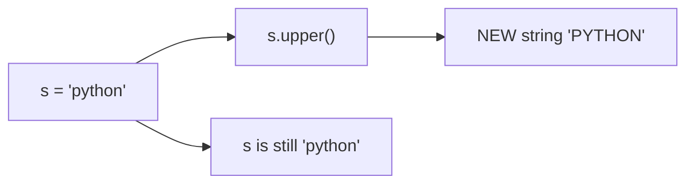

# Chapter 04 · Strings Deep Dive

> Every username, password, chat message, URL, JSON response and search query you'll ever touch is a string. Strings are the most used data type in real programs, and string problems (palindromes, anagrams, reversing words) are the most common warm-up questions in coding interviews. Master them once, properly, here.

**You will learn:**
- What a string really is: an **immutable sequence of characters**
- **Indexing**, **negative indexes** and **slicing** with `[start:stop:step]` (including the famous `[::-1]`)
- Every string method you'll actually use, grouped so you can remember them
- `split()` and `join()`, the two most important string tools
- **f-strings** and the format-spec mini-language (`{x:>10}`, `{price:,.2f}`, `{n:08b}`)
- Escape characters, **raw strings** and multi-line strings
- **Unicode**: `ord()`, `chr()`, and why `len("😀")` is 1
- Why building strings with `+=` can be slow and why `"".join()` is the fix
- The classic interview problems: palindrome, anagram, reverse words, vowel count, character frequency

**Before this:** [Chapter 02 · Variables, Data Types & Memory](02-variables-types-memory.md) · [Chapter 03 · Operators & Expressions](03-operators-expressions.md)

---

## 🧠 The Big Idea

Picture a **train**. Each carriage holds exactly one character, and the carriages are numbered from the front starting at **0**. They're also numbered from the back, starting at **-1**.

```text
 carriage:    P    Y    T    H    O    N
 from front:  0    1    2    3    4    5
 from back:  -6   -5   -4   -3   -2   -1
```

Three ideas explain almost everything about strings:

1. **It's a sequence.** You can ask for carriage number 3 (**indexing**), or a run of carriages from 1 up to 4 (**slicing**), or walk through all of them in order (**iteration**, in [Chapter 06](06-loops.md)).
2. **It's immutable.** The train is welded shut. You can't swap a carriage. Every "change" builds a **brand-new train**. `s.upper()` doesn't change `s`; it returns a new string.
3. **Each carriage holds a Unicode character**, which is really a number (a **code point**). `"A"` is 65, `"a"` is 97, `"😀"` is 128512. Comparing strings means comparing those numbers.



> 💡 **The core insight:** a string is a numbered, read-only row of characters. Indexing reads one, slicing copies a range, and every method hands you back a **new** string.

---

## 🔨 Building It Up

### 1. Creating strings

```python
single = 'Hello'
double = "Hello"
print(single == double)               # same thing, two spellings

quote_inside = "It's Riya's laptop"   # use " outside when ' is inside
speech = 'She said "wow"'             # and vice versa
empty = ""
print(quote_inside)
print(speech)
print(len(empty), len("Hello"), len("Hi there!"))
print(str(42) + str(3.5) + str(True))
```

```text
True
It's Riya's laptop
She said "wow"
0 5 9
423.5True
```

What just happened: single and double quotes are identical in Python; pick whichever avoids clashing with quotes inside the text. `len()` counts characters, including spaces and punctuation. `str()` converts any value into its text form.

### 2. Indexing: one character at a time

```python
word = "PYTHON"
print(word[0])      # first
print(word[3])      # fourth
print(word[-1])     # last
print(word[-2])     # second-last
print(word[len(word) - 1])   # also last, the long way
```

```text
P
H
N
O
N
```

What just happened: `word[i]` returns the character at position `i` (as a new one-character string; Python has no separate "char" type). Negative indexes count from the end: `word[-1]` is the last character, and in general `word[-k]` is the same as `word[len(word) - k]`.

Asking for a carriage that doesn't exist is an error:

```py
word = "PYTHON"
print(word[6])   # ❌ IndexError: string index out of range
                 # valid indexes are 0..5 and -6..-1
```

### 3. Slicing: copying a range

A **slice** `s[start:stop]` gives you the characters from index `start` **up to but not including** `stop`.

```python
s = "PYTHONISTA"
print(s[0:6])     # indexes 0,1,2,3,4,5
print(s[6:10])
print(s[:6])      # start omitted -> from the beginning
print(s[6:])      # stop omitted -> to the end
print(s[:])       # everything (a full copy, conceptually)
print(s[-4:])     # the last 4 characters
print(s[:-4])     # everything except the last 4
print(s[3:3])     # empty: start == stop
print(s[2:100])   # slices never raise IndexError; they just clip
```

```text
PYTHON
ISTA
PYTHON
ISTA
PYTHONISTA
ISTA
PYTHON

THONISTA
```

**Why is `stop` excluded?** It makes the maths beautiful:

- `s[:k] + s[k:] == s` for any `k`: the two halves fit together perfectly, no overlap, no gap.
- `len(s[a:b]) == b - a` (when both are in range).
- `s[:k]` is "the first k characters", and `s[-k:]` is "the last k".

Think of indexes as pointing at the **gaps between** carriages, like ruler marks:

```text
  | P | Y | T | H | O | N |
  0   1   2   3   4   5   6
 -6  -5  -4  -3  -2  -1
```

`s[1:4]` means "cut at mark 1 and mark 4" → `YTH`.

### 4. Slicing with a step (and reversing)

The full slice is `s[start:stop:step]`. The **step** says how many positions to jump each time (default 1).

```python
s = "0123456789"
print(s[::2])      # every 2nd character
print(s[1::2])     # every 2nd, starting at index 1
print(s[::3])
print(s[::-1])     # step -1: walk backwards -> reversed!
print(s[7:2:-1])   # from 7 down to (not including) 2
print(s[-1:-4:-1]) # last three, backwards
print("racecar"[::-1])
```

```text
02468
13579
0369
9876543210
76543
987
racecar
```

What just happened: with a **negative step**, Python walks from right to left, so `start` should be to the right of `stop`. When both are omitted with step -1 (`[::-1]`), it starts at the end and walks to the beginning: the classic one-line string reversal.

> 💡 Read `s[::-1]` as "the whole string, walking backwards". It's the most Pythonic way to reverse a string, and interviewers know it. Be ready to also explain how you'd reverse without slicing (two pointers, see [DSA Chapter 03](../part-2-dsa/03-two-pointers.md)).

### 5. Strings are immutable

```py
name = "Riya"
name[0] = "P"   # ❌ TypeError: 'str' object does not support item assignment
```

You can't change a character in place. You build a new string instead and (optionally) move the name tag:

```python
name = "Riya"
name = "P" + name[1:]   # new string from pieces
print(name)

title = "hello world"
shout = title.upper()   # methods return new strings
print(title)            # unchanged
print(shout)
```

```text
Piya
hello world
HELLO WORLD
```

> ⚠️ **The #1 string bug:** calling a method and ignoring the result. `title.upper()` on its own line does **nothing useful**: it creates `"HELLO WORLD"` and throws it away. Write `title = title.upper()`.

Why immutable? Strings get used as dictionary keys, shared between many variables, and passed all over a program. If anyone could change them, a key could silently change while sitting in a dictionary. Immutability makes strings safe to share and lets Python **hash** them (more in [Chapter 09](09-dictionaries.md)).

### 6. Joining strings: +, *, and implicit concatenation

```python
first, last = "Arjun", "Mehta"
full = first + " " + last
print(full)
print("-" * 20)
print("ab" * 3)
print("na" * 8 + " Batman!")
greeting = ("Hello, "
            "world")           # adjacent literals are glued at compile time
print(greeting)
```

```text
Arjun Mehta
--------------------
ababab
nananananananana Batman!
Hello, world
```

`+` only joins strings with strings. `"Age: " + 21` is a `TypeError`; convert first (`"Age: " + str(21)`) or, much better, use an f-string (section 12).

### 7. Changing case

```py
s = "pYthon is FUN"
print(s.upper())
print(s.lower())
print(s.title())        # first letter of every word upper
print(s.capitalize())   # only the very first letter upper, rest lower
print(s.swapcase())
print("Straße".lower(), "Straße".casefold())   # casefold is "extra aggressive" lowercase
```

```text
PYTHON IS FUN
python is fun
Python Is Fun
Python is fun
PyTHON IS fun
straße strasse
```

What just happened: `.casefold()` is like `.lower()` but also handles special cases (German `ß` becomes `ss`). For case-insensitive comparison of user input, `a.casefold() == b.casefold()` is the most correct choice; `.lower()` is fine for plain English.

### 8. Searching inside strings

```python
s = "banana bandana"
print("nan" in s)            # membership (Chapter 03)
print(s.find("ban"))         # index of the first match
print(s.find("ban", 1))      # start searching from index 1
print(s.rfind("an"))         # index of the LAST match
print(s.find("xyz"))         # not found -> -1
print(s.index("dan"))        # like find, but...
print(s.count("an"))         # non-overlapping occurrences
print(s.count("a"))
print(s.startswith("ban"), s.endswith("na"))
print(s.startswith(("cat", "ban")))   # any of several prefixes
```

```text
True
0
7
11
-1
10
4
6
True True
True
```

What just happened:

- `.find(sub)` returns the index of the first occurrence, or **-1** if missing.
- `.index(sub)` does the same, but **raises `ValueError`** if missing. Use `find` when "not found" is normal, `index` when it would be a bug.
- `.count(sub)` counts **non-overlapping** matches: `"aaaa".count("aa")` is 2, not 3.
- `startswith`/`endswith` accept a tuple of options (tuples are in [Chapter 08](08-tuples-sets.md)).

### 9. Cleaning: strip, replace, remove prefixes

User input is messy. These methods tidy it.

```python
raw = "   hello world  \n"
print("[" + raw.strip() + "]")    # both ends
print("[" + raw.lstrip() + "]")   # left only
print("[" + raw.rstrip() + "]")   # right only
print("xxhixx".strip("x"))        # strip specific characters
print("www.example.com".strip("w.moc"))   # strips any of these chars from the ends!

msg = "I like cats. cats are great."
print(msg.replace("cats", "dogs"))
print(msg.replace("cats", "dogs", 1))     # only the first occurrence
print(msg.replace(" ", ""))               # delete all spaces

print("report_final.pdf".removesuffix(".pdf"))
print("Mr. Sharma".removeprefix("Mr. "))
```

```text
[hello world]
[hello world  
]
[   hello world]
hi
example
I like dogs. dogs are great.
I like dogs. cats are great.
Ilikecats.catsaregreat.
report_final
Sharma
```

What just happened: with no argument, `strip()` removes **whitespace** (spaces, tabs `\t`, newlines `\n`) from the ends, never from the middle. With an argument, it treats it as a **set of characters** to remove from the ends, not a word; that's why `"www.example.com".strip("w.moc")` ate `.com` and `www.`. If you want to remove an exact prefix or suffix, use `removeprefix()` / `removesuffix()` (Python 3.9+).

### 10. Testing what a string contains

These all return `True`/`False`, and they return `False` for an empty string.

```python
print("12345".isdigit(), "12.5".isdigit(), "-3".isdigit())
print("Hello".isalpha(), "Hello123".isalpha())
print("Hello123".isalnum(), "Hello 123".isalnum())
print("   \t\n".isspace(), "".isspace())
print("HELLO".isupper(), "hello".islower(), "Hello World".istitle())
print("abc".isidentifier(), "2abc".isidentifier())   # valid variable name?
```

```text
True False False
True False
True False
True False
True True True
True False
```

What just happened: `isdigit()` is `False` for `"12.5"` and `"-3"`, because `.` and `-` aren't digits. So it's **not** a "is this a number?" check. To validate numbers properly, try converting with `int()`/`float()` and handle the error ([Chapter 13](13-exceptions-files.md)).

**isdecimal vs isdigit vs isnumeric** (a favourite trivia question):

| Method | `"123"` | `"²"` (superscript 2) | `"½"` | `"٣"` (Arabic-Indic 3) |
|---|---|---|---|---|
| `isdecimal()` | True | False | False | True |
| `isdigit()` | True | True | False | True |
| `isnumeric()` | True | True | True | True |

Each is broader than the one above it. For everyday "only 0-9 digits" checks, `isdecimal()` is the strictest built-in, and `s.isascii() and s.isdecimal()` locks it to plain ASCII 0-9.

### 11. Splitting and joining: the power pair

`split()` breaks a string into a **list** of pieces. `join()` glues a list of strings back together. (Lists get their own chapter, [Chapter 07](07-lists.md); for now, a list is a sequence of items in `[ ]`.)

```python
sentence = "  the quick   brown fox  "
print(sentence.split())          # no argument: split on ANY whitespace, drop empties
print("a,b,,c".split(","))       # with an argument: split on exactly that, keep empties
print("a b  c".split(" "))       # careful: two spaces -> an empty piece
print("k1=v1=v2".split("=", 1))  # maxsplit: split at most once
print("one\ntwo\nthree".splitlines())

words = ["Python", "is", "fun"]
print(" ".join(words))
print("-".join(words))
print("".join(["a", "b", "c"]))
print(", ".join("ABC"))           # a string is a sequence of characters too
```

```text
['the', 'quick', 'brown', 'fox']
['a', 'b', '', 'c']
['a', 'b', '', 'c']
['k1', 'v1=v2']
['one', 'two', 'three']
Python is fun
Python-is-fun
abc
A, B, C
```

What just happened:

- `split()` with **no** argument is smart: any run of whitespace counts as one separator, and leading/trailing whitespace is ignored. `split(" ")` is literal and creates empty strings for double spaces. In interviews, almost always use plain `split()`.
- `join` is called **on the separator**: `" ".join(words)` reads as "join these words with a space". Every item must be a string; `" ".join([1, 2])` is a `TypeError`.

**`partition`** splits at the first occurrence into exactly three parts, which is handy for "key=value" text:

```python
key, sep, value = "name=Riya=Mehta".partition("=")
print(key, "|", sep, "|", value)
print("no-equals".partition("="))
```

```text
name | = | Riya=Mehta
('no-equals', '', '')
```

### 12. f-strings: the modern way to build text

An **f-string** starts with `f` before the quote. Anything inside `{ }` is a Python expression, evaluated and inserted.

```python
name, age, cgpa = "Riya", 21, 8.4567
print(f"{name} is {age} years old.")
print(f"Next year: {age + 1}")
print(f"Shout: {name.upper()}!")
print(f"CGPA: {cgpa:.2f}")          # 2 decimal places
print(f"{age=}, {cgpa=:.1f}")       # '=' shows the expression too (debugging)
print(f"Braces: {{literal}}")       # doubled braces print a brace
```

```text
Riya is 21 years old.
Next year: 22
Shout: RIYA!
CGPA: 8.46
age=21, cgpa=8.5
Braces: {literal}
```

### 13. The format-spec mini-language

After a colon inside the braces, you can control exactly how the value looks:

```text
{value:[fill][align][sign][width][,][.precision][type]}
```

```python
n, pi, big, ratio = 42, 3.14159265, 12345678.9, 0.4567
print(f"[{n:5}]")        # width 5 (numbers align right by default)
print(f"[{n:<5}]")       # left
print(f"[{n:^5}]")       # centre
print(f"[{n:*^9}]")      # fill with *, centred, width 9
print(f"[{n:05}]")       # zero-pad
print(f"[{'hi':>6}]")    # strings align left by default; force right
print(f"{pi:.3f}")       # 3 decimals
print(f"{big:,.2f}")     # thousands separators
print(f"{ratio:.1%}")    # percentage
print(f"{n:+}")          # always show sign
print(f"{n:b} {n:o} {n:x} {n:X}")   # binary, octal, hex
print(f"{5:08b}")        # 8-bit binary with leading zeros
print(f"{big:.2e}")      # scientific
```

```text
[   42]
[42   ]
[ 42  ]
[***42****]
[00042]
[    hi]
3.142
12,345,678.90
45.7%
+42
101010 52 2a 2A
00000101
1.23e+07
```

A neat receipt using widths:

```python
print(f"{'Item':<10}{'Qty':>5}{'Price':>10}")
print(f"{'Chai':<10}{2:>5}{40.0:>10.2f}")
print(f"{'Samosa':<10}{3:>5}{45.5:>10.2f}")
print("-" * 25)
print(f"{'Total':<10}{'':>5}{40.0 + 45.5:>10.2f}")
```

```text
Item        Qty     Price
Chai          2     40.00
Samosa        3     45.50
-------------------------
Total               85.50
```

**Older styles you'll see in existing code:**

```python
name, score = "Arjun", 93.456
print("%s scored %.1f" % (name, score))          # printf-style (oldest)
print("{} scored {:.1f}".format(name, score))    # str.format (Python 2.6+)
print(f"{name} scored {score:.1f}")              # f-string (3.6+): preferred
```

```text
Arjun scored 93.5
Arjun scored 93.5
Arjun scored 93.5
```

f-strings are the fastest and the most readable. Use them in new code.

### 14. Escape characters

A backslash `\` inside a string starts an **escape sequence**: a way to write characters you can't easily type.

| Escape | Meaning |
|---|---|
| `\n` | newline |
| `\t` | tab |
| `\\` | a literal backslash |
| `\'` / `\"` | a quote inside the same kind of quotes |
| `\u20b9` | a Unicode character by code (here ₹) |
| `\r` | carriage return (Windows line endings are `\r\n`) |

```py
print("Name:\tRiya\nCity:\tPune")
print("She said \"hi\" and left")
print('It\'s fine')
print("C:\\Users\\riya")
print("Price: \u20b9500")
print(len("a\nb"))      # \n is ONE character
```

```text
Name:	Riya
City:	Pune
She said "hi" and left
It's fine
C:\Users\riya
Price: ₹500
3
```

### 15. Raw strings: backslashes taken literally

Put `r` before the quote, and backslashes lose their special meaning. Perfect for Windows paths and **regular expressions** ([Chapter 17](17-modules-stdlib.md)).

```python
print("C:\new\table")      # \n and \t are escapes: broken!
print(r"C:\new\table")     # raw string: exactly what you typed
print(len(r"\n"), len("\n"))
```

```text
C:
ew	able
C:\new\table
2 1
```

> ⚠️ A raw string **can't end with an odd number of backslashes**: `r"C:\folder\"` is a `SyntaxError` (the last `\"` still escapes the quote for the parser). Use `"C:\\folder\\"` or `r"C:\folder" + "\\"`. Or just use forward slashes: Windows accepts `"C:/folder/"`.

### 16. Multi-line strings

Triple quotes (`"""` or `'''`) let a string span several lines; the newlines are kept.

```python
poem = """Roses are red,
Violets are blue,
Strings are immutable,
And so are you."""
print(poem)
print(poem.count("\n"), "newlines")
```

```text
Roses are red,
Violets are blue,
Strings are immutable,
And so are you.
3 newlines
```

Triple-quoted strings are also used as **docstrings**, documentation placed as the first line of a function or class ([Chapter 10](10-functions.md)).

### 17. Unicode, ord() and chr()

Every character is stored as a number called its **code point**. `ord()` gives the number for a character; `chr()` gives the character for a number.

```py
print(ord("A"), ord("Z"), ord("a"), ord("z"), ord("0"))
print(chr(65), chr(97), chr(8377), chr(128512))
print(ord("c") - ord("a"))          # position in the alphabet (0-based)
print(chr(ord("a") + 2))            # shift a letter by 2
print("apple" < "banana", "Zoo" < "apple", "10" < "9")
print(len("😀"), len("😀".encode("utf-8")))   # 1 character, 4 bytes in UTF-8
```

```text
65 90 97 122 48
A a ₹ 😀
2
c
True True True
1 4
```

What just happened:

- Uppercase `A`–`Z` are 65–90, lowercase `a`–`z` are 97–122, digits `0`–`9` are 48–57. That's why all capitals sort before all lowercase letters.
- `ord(c) - ord("a")` turns a letter into 0–25. This trick is everywhere in DSA: e.g. a 26-slot counting array for anagram problems.
- `"10" < "9"` is `True`: strings compare **character by character**, and `"1"` (49) < `"9"` (57). Numbers stored as text don't sort numerically!
- A string counts **characters** (code points), not bytes. `.encode("utf-8")` converts text into **bytes** for storage or the network; `😀` takes 4 bytes. `.decode("utf-8")` turns bytes back into a string.

### 18. Alignment helpers and zfill

```python
print("[" + "hi".center(10) + "]")
print("[" + "hi".ljust(6, ".") + "]")
print("[" + "hi".rjust(6, ".") + "]")
print("7".zfill(3), "-7".zfill(4), "42".zfill(1))
```

```text
[    hi    ]
[hi....]
[....hi]
007 -007 42
```

`zfill` pads with zeros on the left and is sign-aware. Useful for IDs like `"007"`.

### 19. Building strings efficiently: join vs +=

Since strings are immutable, `s += "x"` can't add to `s`; it builds a whole **new** string, copying all of `s` plus the new part. Do that inside a loop n times and you copy 1 + 2 + 3 + ... + n characters: **O(n²)** total.

`"".join(pieces)` first measures the total length, allocates once, and copies each piece once: **O(n)**.

Here's a sneak peek using a loop ([Chapter 06](06-loops.md)) and a list ([Chapter 07](07-lists.md)):

```python
# Slow pattern (conceptually O(n^2)):
result = ""
for i in range(5):
    result += str(i)
print(result)

# Fast pattern (O(n)): collect pieces, join once
pieces = []
for i in range(5):
    pieces.append(str(i))
print("".join(pieces))
```

```text
01234
01234
```

> 💡 CPython has a special optimisation that sometimes makes `+=` on strings fast (when nothing else references the string, it can resize in place). But it's an implementation detail that doesn't apply everywhere (e.g. PyPy, or when another name refers to the string). **Interview answer: collect pieces in a list and `"".join()` them, O(n).**

---

## 🔬 Under the Hood

### How CPython stores a string

A `str` object holds its length, a cached **hash**, some flags, and then the characters in a compact array. Since Python 3.3 (**PEP 393**, "flexible string representation"), CPython picks the **smallest** width that fits the widest character in the string:

| Widest character in the string | Bytes per character |
|---|---|
| All ASCII / Latin-1 (code point < 256) | 1 |
| Up to U+FFFF (most scripts, including Hindi) | 2 |
| Beyond (emoji, rare scripts) | 4 |

So `"hello"` uses 1 byte per character, but adding a single emoji makes the whole string use 4 bytes per character. Because every character in a given string has the same width, **indexing `s[i]` is O(1)**: jump straight to `start + i × width`. (Languages that store UTF-8 internally, like Go or Rust, can't index characters in O(1).)

### Complexity of common string operations

| Operation | Time | Why |
|---|---|---|
| `len(s)` | O(1) | length is stored |
| `s[i]` | O(1) | fixed-width array |
| `s[a:b]` | O(b − a) | copies the slice into a new string |
| `s + t` | O(len(s) + len(t)) | builds a new string |
| `s == t` | O(n) worst case | compares character by character (stops early at the first difference or if lengths differ) |
| `sub in s`, `s.find(sub)` | about O(n) typically | optimised search (see below) |
| `s.count`, `s.replace`, `s.split`, `s.upper`, `s.strip` | O(n) | must scan the string |
| `"".join(parts)` | O(total length) | one allocation, one copy per piece |
| `s[::-1]` | O(n) | new reversed copy |
| `hash(s)` | O(n) first time, then O(1) | the hash is cached in the object |

The substring search behind `in`/`find` uses a tuned "fastsearch" algorithm that skips ahead cleverly; since Python 3.10, long needles use the **Two-Way** algorithm, which guarantees linear time. For interviews, say "O(n·m) worst case for naive search, but Python's built-in is highly optimised"; and if asked to implement substring search yourself, see KMP in [DSA Chapter 24](../part-2-dsa/24-advanced-structures.md).

### Why slicing copies

`s[1:]` creates a new string object. That means a loop that repeatedly does `s = s[1:]` is O(n²). In DSA, prefer moving an **index** over slicing repeatedly. This is exactly why two-pointer solutions pass indexes around instead of substrings.

### Interning

CPython automatically **interns** (stores one shared copy of) many short strings that look like identifiers, and every name in your code. That makes dictionary lookups on attribute names fast, because comparing two interned strings can short-circuit on identity. It's why `"hello" is "hello"` often prints `True`, but `is` on strings remains unreliable. Use `==` ([Chapter 03](03-operators-expressions.md)).

### What f-strings compile to

An f-string isn't parsed at runtime. The compiler turns `f"{a} and {b:.2f}"` into bytecode that evaluates `a`, formats it, evaluates `b`, formats it with spec `.2f` (by calling `format(b, ".2f")`, which calls `b.__format__(".2f")`), and builds the result in one go. No method lookups for `.format`, no tuple building: that's why f-strings are the fastest formatting option.

---

## 🧩 Pattern Decoder

### Pythonic string idioms

| Goal | Pythonic | Avoid |
|---|---|---|
| Reverse | `s[::-1]` | manual loop building with `+=` |
| Is palindrome | `s == s[::-1]` | |
| Words of a sentence | `s.split()` | `s.split(" ")` (breaks on double spaces) |
| Rebuild from parts | `" ".join(parts)` | `+=` in a loop |
| Normalise user input | `s.strip().lower()` (or `.casefold()`) | |
| Case-insensitive equal | `a.casefold() == b.casefold()` | `a.upper() == b.upper()` misses edge cases |
| Check prefix | `s.startswith("http")` | `s[:4] == "http"` |
| Remove a suffix | `s.removesuffix(".txt")` | `s.strip(".txt")` (strips characters!) |
| Insert values | `f"{name} is {age}"` | `name + " is " + str(age)` |
| Padding numbers | `f"{n:03}"` or `str(n).zfill(3)` | manual zero-adding |
| Last k characters | `s[-k:]` | `s[len(s)-k:]` |
| Letter index 0–25 | `ord(c) - ord("a")` | a lookup string with `.index` |

### Signals: string problems and the tool to reach for

| Problem says... | Reach for |
|---|---|
| "palindrome" | `s == s[::-1]`, or two pointers for O(1) space ([DSA 03](../part-2-dsa/03-two-pointers.md)) |
| "anagram", "same letters" | `sorted(a) == sorted(b)` or a frequency count ([DSA 05](../part-2-dsa/05-hashing.md)) |
| "reverse words" | `" ".join(s.split()[::-1])` |
| "count characters / frequency" | a dictionary or `collections.Counter` ([Chapter 09](09-dictionaries.md)) |
| "longest substring without ..." | sliding window ([DSA 04](../part-2-dsa/04-sliding-window.md)) |
| "is rotation of" | `len(a) == len(b) and b in a + a` |
| "only lowercase letters" | 26-slot array using `ord(c) - ord("a")` |
| "build a big output string" | collect pieces, `"".join()` |

### Worked interview classics

These preview tools from upcoming chapters (`for` loops in [Chapter 06](06-loops.md), lists in [Chapter 07](07-lists.md), dictionaries in [Chapter 09](09-dictionaries.md)). Read them now for the idea; they'll feel fully natural soon.

**1. Valid palindrome (ignoring case and non-letters).**

```python
text = "A man, a plan, a canal: Panama"
cleaned = "".join(ch.lower() for ch in text if ch.isalnum())
print(cleaned)
print(cleaned == cleaned[::-1])
```

```text
amanaplanacanalpanama
True
```

Idea: keep only letters/digits, lowercase them, compare with the reverse. O(n) time, O(n) space.

**2. Anagram check.** Two words are **anagrams** if they use exactly the same letters the same number of times (`listen` / `silent`).

```python
a, b = "listen", "silent"
print(sorted(a))
print(sorted(a) == sorted(b))
print(sorted("rat") == sorted("car"))
```

```text
['e', 'i', 'l', 'n', 's', 't']
True
False
```

`sorted()` returns a list of characters in order; equal lists mean equal letters. O(n log n). The O(n) version counts letters instead ([DSA Chapter 05](../part-2-dsa/05-hashing.md)).

**3. Reverse the words in a sentence.**

```python
s = "  the sky   is blue "
print(" ".join(s.split()[::-1]))
```

```text
blue is sky the
```

`split()` handles messy spacing, `[::-1]` reverses the list of words, and `join` puts single spaces back.

**4. Count vowels.**

```python
s = "Programming in Python"
lower = s.lower()
print(lower.count("a") + lower.count("e") + lower.count("i") + lower.count("o") + lower.count("u"))
print(sum(1 for ch in lower if ch in "aeiou"))   # the loop version you'll write in Ch 06
```

```text
5
5
```

**5. Character frequency.**

```python
s = "mississippi"
freq = {}
for ch in s:
    freq[ch] = freq.get(ch, 0) + 1
print(freq)
```

```text
{'m': 1, 'i': 4, 's': 4, 'p': 2}
```

A dictionary maps each character to its count. This "frequency map" pattern is one of the most important tools in all of DSA.

### Dry run: reversing words

For `s = "  hi  there you "`:

| Step | Expression | Value |
|---|---|---|
| 1 | `s.split()` | `['hi', 'there', 'you']` |
| 2 | `...[::-1]` | `['you', 'there', 'hi']` |
| 3 | `" ".join(...)` | `'you there hi'` |

### When NOT to reach for string tricks

- **Huge repeated edits** (inserting/deleting characters in the middle many times): convert to a list of characters, edit, then `join` once. Strings are immutable, so each edit copies everything.
- **Pattern matching with rules** (emails, phone numbers): use **regular expressions** (`re` module, [Chapter 17](17-modules-stdlib.md)) rather than chains of `find` and slicing.
- **Parsing structured formats** (CSV, JSON, HTML): use the proper library (`csv`, `json`), never `split(",")` (quoted commas will break you).

---

## ⚠️ Traps & Common Mistakes

1. **Ignoring the returned string.**

```py
name = "  riya "
name.strip()          # ❌ result thrown away; name unchanged
name = name.strip()   # ✅
```

2. **Trying to modify a character.** `s[0] = "X"` → `TypeError`. Build a new string: `s = "X" + s[1:]`.

3. **Off-by-one in slices.** `s[2:5]` has 3 characters (indexes 2, 3, 4), not 4. The stop index is excluded.

4. **`strip("abc")` removing a word.** It removes any of the characters `a`, `b`, `c` from both ends. Use `removeprefix`/`removesuffix` for exact text.

5. **`split(" ")` vs `split()`.** `"a  b".split(" ")` is `['a', '', 'b']`. Use `split()` for words.

6. **`join` on non-strings.** `",".join([1, 2, 3])` → `TypeError: sequence item 0: expected str instance, int found`. Convert first: `",".join(map(str, nums))` (`map` in [Chapter 11](11-comprehensions-functional.md)).

7. **Comparing numbers stored as text.** `"10" < "9"` is `True`. Convert to `int` before comparing or sorting.

8. **Case-sensitive comparisons by accident.** `"Python" == "python"` is `False`. Normalise both sides.

9. **`isdigit()` as a number validator.** It rejects `"-5"` and `"3.14"` and accepts `"²"`. Try `int()`/`float()` instead.

10. **Windows paths with escapes.** `"C:\new"` contains a newline! Use `r"C:\new"` or `"C:/new"`.

11. **`+=` in a loop for big strings.** O(n²) in the worst case. Collect and `join`.

12. **Using `is` to compare strings.** Works sometimes thanks to interning, fails other times. Always `==`.

---

## 💡 Tips & Tricks

- `s[::-1]` reverses, `s[::2]` takes every other character, `s[-k:]` takes the last k.
- `s[:k] + s[k:] == s`, always. Great for "rotate by k": `s[k:] + s[:k]`.
- `b in a + a` (with equal lengths) checks if `b` is a rotation of `a`.
- `" ".join(s.split())` collapses all runs of whitespace into single spaces.
- `f"{x=}"` prints `x=value`: the fastest debug print.
- `f"{n:,}"` gives `1,000,000`; `f"{n:_}"` gives `1_000_000`.
- `f"{n:08b}"` gives fixed-width binary, perfect for bit-manipulation debugging.
- `str.maketrans` + `translate` replaces/deletes many characters in one pass: `"hello".translate(str.maketrans("", "", "aeiou"))` → `"hll"`.
- `dir(str)` in the REPL lists every string method; `help(str.split)` explains one.
- In interviews, say the complexity of your string operations out loud: "slicing is O(k), so I'll use indexes instead."

---

## 🎯 Interview Questions

### 1. Are strings mutable in Python? Why or why not? 🔥🔥🔥

<details><summary>Answer</summary>

No, strings are **immutable**. Any "modification" (`upper()`, `replace()`, `+`, slicing) returns a **new** string; `s[0] = "x"` raises `TypeError`.

Benefits: strings can be **hashed** and used as dictionary keys and set members; they can be safely shared between variables and threads; CPython can **intern** and cache them; and the hash can be computed once and cached. The cost: repeated concatenation creates many temporary strings, so use `"".join()` for building.

</details>

### 2. How do you reverse a string in Python? 🔥🔥🔥

<details><summary>Answer</summary>

The idiomatic way is slicing with step -1. Alternatives: `"".join(reversed(s))`, or a two-pointer swap on a list of characters (what you'd do in a language with mutable strings).

```python
s = "interview"
print(s[::-1])
print("".join(reversed(s)))

chars = list(s)
left, right = 0, len(chars) - 1
while left < right:
    chars[left], chars[right] = chars[right], chars[left]
    left += 1
    right -= 1
print("".join(chars))
```

```text
weivretni
weivretni
weivretni
```

All are O(n) time and O(n) space (Python must create a new string either way).

</details>

### 3. Check if a string is a palindrome. 🔥🔥🔥

<details><summary>Answer</summary>

Simple version: `s == s[::-1]`. Interview version ("Valid Palindrome"): ignore case and non-alphanumeric characters.

```python
s = "Was it a car or a cat I saw?"
cleaned = "".join(ch.lower() for ch in s if ch.isalnum())
print(cleaned == cleaned[::-1])
```

```text
True
```

O(n) time, O(n) space. For O(1) extra space, use two pointers that skip non-alphanumeric characters (see [DSA Chapter 03](../part-2-dsa/03-two-pointers.md)).

</details>

### 4. Check if two strings are anagrams. 🔥🔥🔥

<details><summary>Answer</summary>

**Approach 1:** sort both, compare. O(n log n).

**Approach 2:** count characters. For lowercase English letters, a 26-slot array indexed by `ord(c) - ord("a")` gives O(n) time and O(1) space.

```python
a, b = "anagram", "nagaram"
print(sorted(a) == sorted(b))

counts = [0] * 26
for ch in a:
    counts[ord(ch) - ord("a")] += 1
for ch in b:
    counts[ord(ch) - ord("a")] -= 1
print(len(a) == len(b) and counts == [0] * 26)
```

```text
True
True
```

Mention `collections.Counter(a) == Counter(b)` as the one-liner ([Chapter 17](17-modules-stdlib.md)).

</details>

### 5. What's the difference between `find()` and `index()`? 🔥🔥

<details><summary>Answer</summary>

Both return the lowest index where the substring occurs. When it's **not found**, `find()` returns `-1` while `index()` raises `ValueError`. Use `find` when absence is a normal case you'll check; use `index` when absence is a bug that should crash loudly. Beware: `-1` is also a valid index in Python, so `s[s.find(x)]` silently gives the last character if `x` is missing.

</details>

### 6. Why is `"".join(list)` preferred over `+=` in a loop? 🔥🔥🔥

<details><summary>Answer</summary>

Strings are immutable, so each `+=` allocates a new string and copies everything so far: building an n-character result one piece at a time costs 1 + 2 + ... + n = **O(n²)** character copies. `join` computes the total size, allocates **once**, and copies each piece **once**: **O(n)**. CPython sometimes optimises `+=` when the string has no other references, but that's an implementation detail you shouldn't rely on.

</details>

### 7. What's the difference between `split()` and `split(" ")`? 🔥🔥

<details><summary>Answer</summary>

`split()` with no argument splits on **runs of any whitespace** (spaces, tabs, newlines) and discards leading/trailing whitespace, so you never get empty strings. `split(" ")` splits on **each single space**, producing empty strings for consecutive spaces and at the edges.

```python
s = " a  b "
print(s.split())
print(s.split(" "))
```

```text
['a', 'b']
['', 'a', '', 'b', '']
```

</details>

### 8. Reverse the words in a string ("Reverse Words in a String"). 🔥🔥🔥

<details><summary>Answer</summary>

```python
s = "  hello   world  python "
print(" ".join(reversed(s.split())))
```

```text
python world hello
```

`split()` removes extra spaces, `reversed` flips the word order, `join` rebuilds with single spaces. O(n) time and space. Follow-up "reverse in place with O(1) extra space" (for a mutable char array): reverse the whole array, then reverse each word.

</details>

### 9. What is a raw string? When would you use one? 🔥🔥

<details><summary>Answer</summary>

A string literal prefixed with `r`, in which backslashes are **not** treated as escape characters: `r"\n"` is two characters, `\` and `n`. Use them for **regular expressions** (`r"\d+\.\d+"`) and **Windows paths** (`r"C:\new\data"`). Gotcha: a raw string can't end with a single backslash.

</details>

### 10. Compare f-strings, `str.format()` and `%` formatting. 🔥🔥

<details><summary>Answer</summary>

- `%` (`"%s is %d" % (name, age)`): oldest, C-style, still seen in logging.
- `str.format()` (`"{} is {}".format(name, age)`): flexible, Python 2.6+.
- **f-strings** (`f"{name} is {age}"`): Python 3.6+, most **readable**, and **fastest** because they compile to direct formatting bytecode. Support arbitrary expressions, format specs (`{x:.2f}`), and the debug form `{x=}` (3.8+).

All three use the same format-spec mini-language after the colon.

</details>

### 11. Count the frequency of each character in a string. 🔥🔥🔥

<details><summary>Answer</summary>

Use a dictionary as a frequency map (or `collections.Counter`).

```python
s = "hello world"
freq = {}
for ch in s:
    if ch != " ":
        freq[ch] = freq.get(ch, 0) + 1
print(freq)
```

```text
{'h': 1, 'e': 1, 'l': 3, 'o': 2, 'w': 1, 'r': 1, 'd': 1}
```

O(n) time, O(k) space for k distinct characters. Follow-ups: "first non-repeating character" (LeetCode *First Unique Character in a String*): build the map, then scan the string again and return the first index whose count is 1.

</details>

### 12. What's the difference between `isdigit()`, `isdecimal()` and `isnumeric()`? 🔥

<details><summary>Answer</summary>

They're increasingly permissive: `isdecimal()` accepts only characters usable to write base-10 numbers (0–9 in any script). `isdigit()` additionally accepts digits like superscripts (`"²"`). `isnumeric()` additionally accepts numeric characters like fractions (`"½"`) and Roman numerals. None accepts `-`, `.` or spaces, so none of them checks "is this a valid number"; for that, try `int()`/`float()`.

</details>

### 13. How would you check if one string is a rotation of another? 🔥🔥

<details><summary>Answer</summary>

If `b` is a rotation of `a`, then `b` must appear inside `a + a` (every rotation is a window of the doubled string), and their lengths must match.

```python
a, b, c = "waterbottle", "erbottlewat", "bottlewater!"
print(len(a) == len(b) and b in a + a)
print(len(a) == len(c) and c in a + a)
```

```text
True
False
```

O(n) space for the doubled string; the search is roughly linear with Python's optimised `in`.

</details>

---

## 🏋️ Practice

**🟢 1. Initials.** For `full_name = "  sachin ramesh tendulkar "`, print `S.R.T.`

<details><summary>Solution</summary>

```python
full_name = "  sachin ramesh tendulkar "
parts = full_name.split()
print(parts[0][0].upper() + "." + parts[1][0].upper() + "." + parts[2][0].upper() + ".")
```

```text
S.R.T.
```

`parts[0][0]` means "the first character of the first word". With a loop ([Chapter 06](06-loops.md)) this works for any number of names: `"".join(p[0].upper() + "." for p in parts)`.

</details>

**🟢 2. Mask a card number.** For `card = "4111222233334444"`, print `************4444`.

<details><summary>Solution</summary>

```python
card = "4111222233334444"
print("*" * (len(card) - 4) + card[-4:])
print(card[-4:].rjust(len(card), "*"))
```

```text
************4444
************4444
```

</details>

**🟢 3. Slicing drill.** For `s = "ABCDEFGHIJ"`, print with one slice each: `ACEGI`, `JIHGF`, `DEF`, `JHFDB`, `ABCDE` reversed.

<details><summary>Solution</summary>

```python
s = "ABCDEFGHIJ"
print(s[::2])
print(s[:4:-1])
print(s[3:6])
print(s[::-2])
print(s[4::-1])
```

```text
ACEGI
JIHGF
DEF
JHFDB
EDCBA
```

`s[:4:-1]` walks backwards from the end and stops before index 4. `s[4::-1]` starts at index 4 and walks back to the beginning.

</details>

**🟡 4. Clean and title.** Users typed `"   hELLO    wORLD from   PYTHON  "`. Produce `"Hello World From Python"` (single spaces, title case) in one expression.

<details><summary>Solution</summary>

```python
raw = "   hELLO    wORLD from   PYTHON  "
print(" ".join(raw.split()).title())
```

```text
Hello World From Python
```

</details>

**🟡 5. Email parts.** For `email = "Riya.Mehta@ScalerAI.com"`, print the username in lowercase, the domain in lowercase, and whether it ends with `.com`.

<details><summary>Solution</summary>

```python
email = "Riya.Mehta@ScalerAI.com"
user, _, domain = email.partition("@")
print(user.lower())
print(domain.lower())
print(domain.lower().endswith(".com"))
```

```text
riya.mehta
scalerai.com
True
```

`partition` is safer than `split("@")` when you want exactly three parts.

</details>

**🟡 6. Receipt formatter.** Using f-strings, print this exactly, with a 10-wide left-aligned name column, then the price right-aligned in an 11-wide column with commas and 2 decimals:

```text
Laptop      54,999.00
Mouse          499.50
```

<details><summary>Solution</summary>

```python
print(f"{'Laptop':<10}{54999:>11,.2f}")
print(f"{'Mouse':<10}{499.5:>11,.2f}")
```

```text
Laptop      54,999.00
Mouse          499.50
```

The name column is 10 wide (left-aligned) and the price column 11 wide (right-aligned, with `,` separators and 2 decimals). Tweak the widths until your output matches any target exactly: that's the whole skill.

</details>

**🟡 7. Caesar shift one letter.** Without loops, shift the lowercase letter `c = "y"` forward by 3 positions, wrapping around the alphabet (`y` → `b`).

<details><summary>Solution</summary>

```python
c, shift = "y", 3
position = ord(c) - ord("a")              # 0..25
new_position = (position + shift) % 26    # wrap with % (Chapter 03)
print(chr(ord("a") + new_position))
```

```text
b
```

Convert to 0–25, shift, wrap with `% 26`, convert back. Do this for each letter (with a loop in [Chapter 06](06-loops.md)) and you have the full Caesar cipher.

</details>

**🔴 8. Compress a string (peek at loops).** Turn `"aaabccdddd"` into `"a3b1c2d4"`. This needs a `for` loop and `if` ([Chapter 05](05-conditionals.md), [Chapter 06](06-loops.md)); try it after those chapters, or read the solution now.

<details><summary>Solution</summary>

```python
s = "aaabccdddd"
pieces = []
count = 1
for i in range(1, len(s) + 1):
    if i < len(s) and s[i] == s[i - 1]:
        count += 1
    else:
        pieces.append(s[i - 1] + str(count))
        count = 1
print("".join(pieces))
```

```text
a3b1c2d4
```

We close a "run" whenever the next character differs (or we've run off the end). Using a list and `join` keeps it O(n). (This is the core of LeetCode's *String Compression*.)

</details>

**🔴 9. Rotation and palindrome combo.** For `s = "aab"`, is any rotation of it a palindrome? Check all three rotations using slicing (no loop needed for length 3).

<details><summary>Solution</summary>

```python
s = "aab"
r0 = s
r1 = s[1:] + s[:1]
r2 = s[2:] + s[:2]
print(r0, r0 == r0[::-1])
print(r1, r1 == r1[::-1])
print(r2, r2 == r2[::-1])
```

```text
aab False
aba True
baa False
```

`s[k:] + s[:k]` rotates left by k. With a loop over `k in range(len(s))`, this generalises to any length.

</details>

---

## 🧠 Never-Forget Summary

- A string is an **immutable sequence** of Unicode characters. Every "change" returns a new string.
- `s[i]` indexes (negative counts from the end); `s[start:stop:step]` slices, **stop excluded**, never raises.
- `s[::-1]` reverses. `s[:k] + s[k:] == s`.
- Methods to know cold: `upper lower title strip split join replace find index count startswith endswith isdigit isalpha isalnum`.
- `split()` (no arg) for words; `sep.join(list)` to rebuild.
- f-strings: `f"{x:>10,.2f}"` = fill/align/width/comma/precision/type.
- `\n`, `\t`, `\\` are escapes; `r"..."` disables them.
- `ord("a") == 97`, `chr(97) == "a"`, `ord(c) - ord("a")` → 0–25.
- Strings compare by code points: uppercase before lowercase, `"10" < "9"`.
- Build big strings with a list + `"".join()` (O(n)), not `+=` (O(n²)).
- Indexing is O(1); slicing, searching and most methods are O(n).

**Memory hooks:**
- **"Strings are a Sealed Train"**: numbered carriages, can't swap one, build a new train instead.
- **"Start IN, Stop OUT"**: `s[start:stop]` includes start, excludes stop.
- **"SPLIT to break, JOIN to make."**
- **"Strip eats Characters, not Words."**
- **"Fill, Align, Width, Comma, .Precision, Type"** → "**F**ast **A**nts **W**alk **C**arefully **P**ast **T**rees".

**One picture:**

| Task | Tool | Cost |
|---|---|---|
| Read one char | `s[i]` | O(1) |
| Range / reverse | `s[a:b]`, `s[::-1]` | O(k) / O(n) |
| Find / count / test | `in`, `find`, `count`, `startswith` | O(n) |
| Clean | `strip`, `replace`, `lower` | O(n), new string |
| Break / rebuild | `split()`, `"sep".join()` | O(n) |
| Present | `f"{v:fmt}"` | fastest formatting |
| Char ↔ number | `ord`, `chr` | O(1) |
| Build in a loop | list + `join` | O(n) total |

> **If you remember only one thing:** strings never change; every operation gives you a new one. So save the result, slice with "start in, stop out", and build big strings with `join`.

---
**Next:** [Chapter 05 · Conditionals & Truthiness](05-conditionals.md)  ·  **Back to** [Contents](../README.md)
