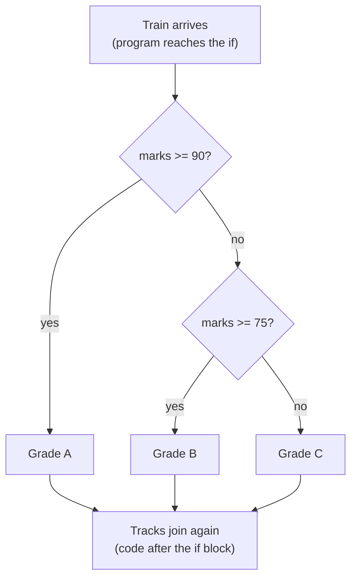

# Chapter 05 · Conditionals & Truthiness

> Until now, your programs have been trains on a single straight track: every line runs, in order, every time. Real programs need **junctions**. "If the password is wrong, show an error. Otherwise, log in." That one word, *if*, is what turns a script into something that can make decisions. Every app, game and algorithm you'll ever write is built on it.

**You will learn:**
- How `if`, `elif` and `else` work, and why the colon and indentation matter
- How to order conditions so the right branch wins
- **Nesting** vs flat conditions, and **guard clauses** that keep code readable
- **Truthiness**: which values count as true or false, and how to use it cleanly
- The one-line **conditional expression** (Python's "ternary operator")
- **Structural pattern matching** with `match`/`case` (Python 3.10+)
- Classic logic problems interviewers love: leap year, grades, max of three, triangle validity and more

**Before this:** [Chapter 02 · Variables, Data Types & Memory](02-variables-types-memory.md) · [Chapter 03 · Operators & Expressions](03-operators-expressions.md) · [Chapter 04 · Strings Deep Dive](04-strings.md)

---

## 🧠 The Big Idea

Think of a railway junction with a signal operator. A train arrives, the operator checks a condition ("Is this the Mumbai express?"), and switches the track. The train goes down **exactly one** path, and the tracks join again afterwards.



That's all a conditional is:

1. **Ask a yes/no question** (any expression; Python will judge it as true or false).
2. **Run one block** of code depending on the answer.
3. **Continue** with the rest of the program.

The "yes/no question" doesn't have to be a comparison. Python can judge *any* value as true-ish or false-ish. An empty string, zero and `None` count as "no"; almost everything else counts as "yes". This idea, called **truthiness**, makes Python conditions short and expressive.

> 💡 **The core insight:** an `if` chain picks **at most one** branch, checking conditions **top to bottom** and stopping at the first one that's true. Order is logic.

---

## 🔨 Building It Up

### 1. The if statement

```python
temperature = 39

if temperature > 35:
    print("Heatwave alert!")
    print("Stay hydrated.")

print("Weather report done.")
```

```text
Heatwave alert!
Stay hydrated.
Weather report done.
```

The anatomy:

```text
if <condition>:          <- keyword, condition, COLON
    <statement>          <- indented block (4 spaces): runs only if condition is true
    <statement>
<next statement>         <- back at the original indentation: always runs
```

What just happened: `temperature > 35` evaluated to `True`, so both indented lines ran. The un-indented `print` is outside the `if` and runs no matter what. Change `temperature` to `30` and only the last line prints.

The **indentation is the block**. There are no curly braces in Python: every line indented under the `if` belongs to it, and the first line back at the outer level ends it.

### 2. if / else: two roads

```python
age = 16

if age >= 18:
    print("You can vote.")
else:
    print("You can vote in", 18 - age, "years.")
```

```text
You can vote in 2 years.
```

`else` has no condition: it catches **everything** the `if` didn't. Exactly one of the two blocks runs, never both, never neither.

### 3. elif: many roads

`elif` ("else if") lets you test several conditions in order:

```python
marks = 82

if marks >= 90:
    grade = "A"
elif marks >= 75:
    grade = "B"
elif marks >= 60:
    grade = "C"
elif marks >= 40:
    grade = "D"
else:
    grade = "F"

print("Marks:", marks, "Grade:", grade)
```

```text
Marks: 82 Grade: B
```

What just happened: Python checked `82 >= 90` (no), then `82 >= 75` (yes!), set `grade = "B"`, and **skipped all the remaining branches**. It never even looked at `marks >= 60`, even though that's also true. That's why we don't need to write `elif marks >= 75 and marks < 90`: reaching the second branch already *means* the first was false.

### 4. Order matters

Watch what happens if we put the conditions in the wrong order:

```python
marks = 95

if marks >= 40:
    grade = "D"        # catches EVERYTHING >= 40 first!
elif marks >= 60:
    grade = "C"
elif marks >= 90:
    grade = "A"
else:
    grade = "F"

print(grade)
```

```text
D
```

A 95 got a D! The first true condition wins, so with "at least" thresholds, check from the **most specific (highest) to the least**. Rule of thumb: when conditions overlap, put the **narrowest** one first.

### 5. elif chain vs separate ifs

These look similar but behave differently:

```python
n = 15

print("elif chain:")
if n % 3 == 0:
    print("  divisible by 3")
elif n % 5 == 0:
    print("  divisible by 5")

print("separate ifs:")
if n % 3 == 0:
    print("  divisible by 3")
if n % 5 == 0:
    print("  divisible by 5")
```

```text
elif chain:
  divisible by 3
separate ifs:
  divisible by 3
  divisible by 5
```

- **`if/elif/elif`**: mutually exclusive, at most **one** branch runs.
- **separate `if`s**: independent questions, **any number** of them can run.

Ask yourself: "Can more than one of these be true *and* should more than one run?" If yes, use separate `if`s.

### 6. Combining conditions with and, or, not

From [Chapter 03](03-operators-expressions.md), you can build complex questions:

```python
age, has_id, is_vip = 25, False, True

if age >= 18 and has_id:
    print("Welcome in.")
elif is_vip:
    print("VIP, come right in.")
else:
    print("Sorry, no entry.")

day = "Sunday"
if day == "Saturday" or day == "Sunday":
    print("Weekend!")
if day in ("Saturday", "Sunday"):        # cleaner
    print("Still the weekend!")
if not (0 <= age <= 12):
    print("Not a child.")
```

```text
VIP, come right in.
Weekend!
Still the weekend!
Not a child.
```

> ⚠️ `if day == "Saturday" or "Sunday":` is a classic bug. It means `(day == "Saturday") or "Sunday"`, and the non-empty string `"Sunday"` is always truthy, so the condition is **always** true. Use `day in ("Saturday", "Sunday")`.

### 7. Nested conditions

You can put an `if` inside another `if`. Each level adds 4 spaces:

```python
has_ticket = True
age = 15

if has_ticket:
    if age >= 18:
        print("Enjoy the movie!")
    else:
        print("Need an adult with you.")
else:
    print("Buy a ticket first.")
```

```text
Need an adult with you.
```

Nesting is fine for two levels. Beyond that, code drifts to the right and becomes hard to read; programmers call this the **arrow anti-pattern** (the code's shape looks like `>`).

```py
# ❌ Arrow code: hard to follow
if user is not None:
    if user_is_active:
        if has_permission:
            if not is_banned:
                print("Access granted")
```

### 8. Flattening: guard clauses and combined conditions

There are two ways to flatten nested code.

**(a) Combine conditions** when there's only one "happy" outcome:

```python
user = "riya"
user_is_active, has_permission, is_banned = True, True, False

if user is not None and user_is_active and has_permission and not is_banned:
    print("Access granted")
```

```text
Access granted
```

**(b) Guard clauses: handle the bad cases first.** Check each failure on its own, report it, and let the "everything is fine" case fall through at the end. In a script, an `if/elif` chain does it:

```python
balance, amount = 500, 800
account_locked = False

if account_locked:
    print("Error: account locked")
elif amount <= 0:
    print("Error: amount must be positive")
elif amount > balance:
    print("Error: insufficient balance, short by", amount - balance)
else:
    balance -= amount
    print("Withdrawn. New balance:", balance)
```

```text
Error: insufficient balance, short by 300
```

Each problem gets its own clear message, and the main logic sits at the bottom, un-nested. Inside **functions** ([Chapter 10](10-functions.md)), guard clauses become even cleaner because each one can simply `return` early:

```py
def withdraw(balance, amount):
    if amount <= 0:
        return "amount must be positive"     # guard
    if amount > balance:
        return "insufficient balance"        # guard
    return balance - amount                  # happy path, no nesting
```

### 9. Truthiness: every value is true or false

An `if` doesn't need `True` or `False`. It calls `bool()` on whatever you give it. These are the **falsy** values (everything else is **truthy**):

| Falsy value | Type |
|---|---|
| `False` | bool |
| `None` | NoneType |
| `0`, `0.0`, `0j` | numbers equal to zero |
| `""` | empty string |
| `[]`, `()`, `{}`, `set()`, `range(0)` | empty collections |

```python
name = ""
items = []
count = 0
message = "hi"

if name:
    print("name is truthy")
else:
    print("name is empty")

if not items:
    print("no items")

if count:
    print("count is non-zero")
else:
    print("count is zero")

if message:
    print("message:", message)

print(bool("False"), bool("0"), bool(" "), bool([0]), bool(0.0))
```

```text
name is empty
no items
count is zero
message: hi
True True True True False
```

What just happened: `"False"`, `"0"` and `" "` are non-empty strings, so they're truthy. `[0]` is a list with one item, so it's truthy (even though the item is zero). Only **empty** or **zero** things are falsy.

**Pythonic style** uses truthiness directly:

| Instead of | Write |
|---|---|
| `if len(items) > 0:` | `if items:` |
| `if len(name) == 0:` | `if not name:` |
| `if is_valid == True:` | `if is_valid:` |
| `if is_valid == False:` | `if not is_valid:` |
| `if x != None:` | `if x is not None:` |

### 10. The None-vs-falsy trap

Truthiness is convenient, but `if not x` can't tell `None` apart from `0` or `""`. When 0 is a **valid** value, check for `None` explicitly:

```python
discount = 0            # a real value: "no discount"

if not discount:
    print("Truthiness says: discount missing!")      # wrong conclusion

if discount is None:
    print("discount was never set")
else:
    print("discount is set to", discount)            # correct
```

```text
Truthiness says: discount missing!
discount is set to 0
```

Rule: use `if x:` when "empty" and "missing" mean the same thing (like an empty list of results). Use `if x is None:` when zero, empty string or `False` are legitimate values.

### 11. The conditional expression (ternary)

When you just want to **pick one of two values**, a full `if/else` block is heavy. Python's **conditional expression** does it in one line:

```text
value_if_true if condition else value_if_false
```

```python
age = 20
status = "adult" if age >= 18 else "minor"
print(status)

n = -7
print(abs_n := n if n >= 0 else -n)
print("even" if n % 2 == 0 else "odd")

items = 3
print(f"{items} item{'s' if items != 1 else ''} in cart")
```

```text
adult
7
odd
3 items in cart
```

What just happened: it reads like English, "adult if age >= 18, else minor". Unlike C's `cond ? a : b`, the condition sits in the **middle**. It's an **expression**, so it produces a value you can assign, print or put inside an f-string. Only the chosen side is evaluated (short-circuit again).

You *can* chain them, but readability drops fast:

```python
marks = 67
grade = "A" if marks >= 90 else "B" if marks >= 75 else "C" if marks >= 60 else "F"
print(grade)
```

```text
C
```

> 💡 One condition: ternary is great. Two: think twice. Three or more: use `if/elif/else`. Code is read far more often than it's written.

### 12. The pass statement

A block can't be empty. If you need a placeholder (for code you'll write later), use `pass`, which does nothing:

```python
score = 50
if score > 100:
    pass        # TODO: handle bonus levels later
else:
    print("Normal level")
```

```text
Normal level
```

Without `pass`, an empty block is a `SyntaxError` (`IndentationError: expected an indented block`).

### 13. match-case: structural pattern matching (Python 3.10+)

Many languages have a `switch` statement. Python 3.10 added something more powerful: **`match`**. It compares a value against a series of **patterns**, and runs the block of the first one that fits.

**Literal patterns** (the switch-like use):

```python
command = "stop"

match command:
    case "start":
        print("Starting engine")
    case "stop" | "halt":            # | means "or"
        print("Stopping")
    case "pause":
        print("Pausing")
    case _:                          # _ is the wildcard: matches anything
        print("Unknown command:", command)
```

```text
Stopping
```

**Guards and capture.** A name in a pattern **captures** the value; `if` adds an extra condition (a **guard**):

```python
temperature = -3

match temperature:
    case 0:
        print("Exactly freezing")
    case t if t < 0:
        print(f"Below freezing by {-t} degrees")
    case t if t > 40:
        print("Scorching")
    case _:
        print("Normal")
```

```text
Below freezing by 3 degrees
```

**Sequence patterns** match by *shape*: how many items and what's in them. This is where `match` beats any `if` chain. (Lists and tuples are covered in [Chapter 07](07-lists.md) and [Chapter 08](08-tuples-sets.md).)

```python
command = "move north 3"

match command.split():
    case ["quit"]:
        print("Bye!")
    case ["look"]:
        print("You see a dark room.")
    case ["move", direction]:
        print("Moving", direction, "by 1 step")
    case ["move", direction, steps]:
        print("Moving", direction, "by", steps, "steps")
    case _:
        print("I don't understand.")
```

```text
Moving north by 3 steps
```

What just happened: `command.split()` gives `["move", "north", "3"]`. The first two patterns need exactly one item, so they fail. `["move", direction]` needs exactly two, so it fails. `["move", direction, steps]` fits: the literal `"move"` matches, and the names `direction` and `steps` **capture** `"north"` and `"3"`.

**Mapping patterns** match dictionaries by keys ([Chapter 09](09-dictionaries.md)), perfect for JSON-like data:

```python
event = {"type": "click", "x": 120, "y": 45}

match event:
    case {"type": "click", "x": x, "y": y}:
        print(f"Clicked at ({x}, {y})")
    case {"type": "keypress", "key": key}:
        print("Pressed", key)
    case _:
        print("Unknown event")
```

```text
Clicked at (120, 45)
```

> ⚠️ **The famous match trap:** a bare name in a `case` **captures**, it doesn't compare.
>
> ```py
> STOP = "stop"
> match command:
>     case STOP:          # ❌ captures ANY value into a new name STOP
>         ...
>     case "go":          # SyntaxError: name capture 'STOP' makes remaining patterns unreachable
>         ...
> ```
>
> To compare against a constant, use a **dotted name** (like `Command.STOP` from an Enum or class, [Chapter 17](17-modules-stdlib.md)), a literal, or a guard: `case c if c == STOP:`.

**if/elif vs match**: use `match` when you're checking **one subject** against many **shapes** or **literal values**. Use `if/elif` for ranges and unrelated conditions (`marks >= 90`, `is_vip and age > 60`).

---

## 🔬 Under the Hood

### How if compiles: conditional jumps

The CPU doesn't "skip blocks". It **jumps**. Python compiles an `if` into bytecode that evaluates the condition, then performs a conditional jump past the block if the result is falsy:

```py
import dis
dis.dis("if x > 5:\n    y = 1\nelse:\n    y = 2")
```

Simplified, the bytecode looks like this (exact names vary by version):

```text
LOAD_NAME          x
LOAD_CONST         5
COMPARE_OP         >
POP_JUMP_IF_FALSE  -> else_part
LOAD_CONST         1
STORE_NAME         y
JUMP_FORWARD       -> end
else_part:
LOAD_CONST         2
STORE_NAME         y
end:
```

So an `if/elif/elif/else` chain with k branches is just k tests and jumps in sequence. Checking costs O(k) in the worst case, which is why putting the **most common** case first can matter in very hot code.

### How truthiness is decided

When Python needs `bool(x)`:

1. If `x` is `True`, `False` or `None`, the answer is immediate.
2. Otherwise, if `x`'s type defines `__bool__`, call it.
3. Otherwise, if it defines `__len__`, the object is truthy when `len(x) != 0`.
4. Otherwise, it's **truthy** (any object without these is considered "something").

That's why empty collections are falsy (their length is 0) and why your own classes can define their truthiness ([Chapter 15](15-oop-inheritance-magic.md)). Checking `if items:` calls `len` internally, which is O(1) for built-in collections.

### match is not a jump table

In C, a `switch` on integers can compile into a **jump table** that goes straight to the right case in O(1). Python's `match` does **not** do that: it tries each `case` **top to bottom**, like an `if/elif` chain, and runs the first that matches. Its power is in **destructuring** (pulling values out of sequences and mappings while checking their shape), not in speed. If you need O(1) dispatch on many keys, use a **dictionary** mapping keys to values or functions ([Chapter 09](09-dictionaries.md)):

```python
prices = {"chai": 20, "coffee": 40, "lassi": 50}
order = "coffee"
print(prices.get(order, "not on menu"))
print(prices.get("pizza", "not on menu"))
```

```text
40
not on menu
```

### The ternary is lazy

`a if cond else b` evaluates `cond` first, then **only one** of `a` or `b`. So `x / y if y != 0 else 0` is safe: the division never happens when `y` is 0.

---

## 🧩 Pattern Decoder

### Pythonic conditional idioms

| Situation | Pythonic | Avoid |
|---|---|---|
| Empty check | `if not items:` | `if len(items) == 0:` |
| Boolean flag | `if is_ready:` | `if is_ready == True:` |
| None check | `if x is None:` | `if x == None:` |
| One of several values | `if day in ("Sat", "Sun"):` | `if day == "Sat" or "Sun":` |
| Range check | `if 0 <= i < n:` | `if i >= 0 and i < n:` |
| Choose a value | `x = a if cond else b` | 4-line if/else just to assign |
| Return a boolean | `is_even = n % 2 == 0` | `if n % 2 == 0: is_even = True else: ...` |
| Many fixed options | `match cmd:` or a dict lookup | 10-branch `elif ==` chain |
| Default value | `name = name or "Guest"` (if "" means missing) | |
| Failure cases | handle first, happy path last | deep nesting |

That "return a boolean" row deserves a demo. Beginners write:

```py
if age >= 18:
    can_vote = True
else:
    can_vote = False
```

The comparison **already is** a boolean:

```python
age = 20
can_vote = age >= 18
print(can_vote)
```

```text
True
```

### How conditionals show up in DSA

- **Bounds checks** in grids: `if 0 <= r < rows and 0 <= c < cols and grid[r][c] == 1:`. Short-circuiting means `grid[r][c]` is only read when the indexes are valid ([DSA Chapter 16](../part-2-dsa/16-graphs-bfs-dfs.md)).
- **Three-way comparisons** in binary search: `if nums[mid] == target ... elif nums[mid] < target ... else ...` ([DSA Chapter 08](../part-2-dsa/08-binary-search.md)).
- **Base cases** in recursion: `if n <= 1: return n` ([Chapter 12](12-recursion.md)).
- **Pointer decisions** in two pointers: "if the sum is too big, move right; else move left" ([DSA Chapter 03](../part-2-dsa/03-two-pointers.md)).
- **Updating a best answer**: `if current > best: best = current` (or `best = max(best, current)`).
- **Edge cases first**: `if not nums: return 0` is the very first line of most interview solutions. Interviewers watch for it.

### Decoding classic logic problems

**Leap year.** Divisible by 4, except centuries, except centuries divisible by 400.

```python
year = 1900

if year % 400 == 0:
    is_leap = True
elif year % 100 == 0:
    is_leap = False
elif year % 4 == 0:
    is_leap = True
else:
    is_leap = False

print(year, "leap" if is_leap else "not leap")
print((year % 4 == 0 and year % 100 != 0) or year % 400 == 0)   # one-line version
```

```text
1900 not leap
False
```

Notice the order: the **most specific** rule (÷400) first, then ÷100, then ÷4. Reverse it and 1900 would wrongly count as a leap year.

**Max of three (without `max()`).**

```python
a, b, c = 12, 45, 27

if a >= b and a >= c:
    largest = a
elif b >= c:            # here we already know a isn't the largest
    largest = b
else:
    largest = c

print(largest)
print(max(a, b, c))     # the built-in, for real code
```

```text
45
45
```

Using `>=` (not `>`) handles ties correctly. An alternative that scales: start with `largest = a`, then `if b > largest: largest = b`, then `if c > largest: largest = c`. That "running best" pattern becomes a loop in [Chapter 06](06-loops.md).

**Triangle validity and type.** Three sides form a triangle only if **each side is smaller than the sum of the other two** (the triangle inequality), and all are positive.

```python
a, b, c = 5, 5, 8

if a <= 0 or b <= 0 or c <= 0:
    print("Sides must be positive")
elif a + b <= c or a + c <= b or b + c <= a:
    print("Not a valid triangle")
elif a == b == c:
    print("Equilateral")
elif a == b or b == c or a == c:
    print("Isosceles")
else:
    print("Scalene")
```

```text
Isosceles
```

Guards first (invalid input), then the most specific valid type (equilateral, since an equilateral triangle is technically also isosceles), then the general cases.

### Dry run: grade calculator for marks = 74

| Check | Condition | Result | Action |
|---|---|---|---|
| 1 | `74 >= 90` | False | next |
| 2 | `74 >= 75` | False | next |
| 3 | `74 >= 60` | True | `grade = "C"`, skip the rest |

### When NOT to use a long if/elif chain

- **Mapping a key to a value** (`if code == "IN": ... elif code == "US": ...`) → use a dictionary.
- **Checking the same condition for many items** → a loop with `any()`/`all()` ([Chapter 06](06-loops.md), [Chapter 11](11-comprehensions-functional.md)).
- **Behaviour that varies by type of object** → polymorphism ([Chapter 15](15-oop-inheritance-magic.md)).

---

## ⚠️ Traps & Common Mistakes

1. **Forgetting the colon.** `if x > 5` → `SyntaxError: expected ':'`.

2. **Using `=` instead of `==`.** `if x = 5:` → `SyntaxError: invalid syntax. Maybe you meant '==' or ':=' instead of '='?`. Python catches it, at least.

3. **Inconsistent indentation.**

```py
if ready:
    print("one")
      print("two")     # ❌ IndentationError: unexpected indent
```

4. **`x == a or b`** instead of `x == a or x == b`.

```py
if colour == "red" or "blue":       # ❌ always True
if colour in ("red", "blue"):       # ✅
```

5. **Wrong branch order** with overlapping conditions: `>= 40` before `>= 90` gives everyone a D. Narrowest first.

6. **`if not x` when 0 is valid.** Use `if x is None`.

7. **Comparing with `== True`.** `if flag == True:` fails for truthy non-bool values like `2` or `"yes"` in ways you didn't intend (`1 == True` is `True`, but `2 == True` and `"yes" == True` are both `False`), and it's just noise. Write `if flag:`.

8. **Comparing floats with `==` in conditions.** `if 0.1 + 0.2 == 0.3:` is `False`. Use `abs(a - b) < 1e-9`.

9. **Case-sensitive string checks.** `if answer == "yes":` fails for `"Yes"`. Normalise: `if answer.strip().lower() == "yes":`.

10. **Overusing nested ternaries.** `a if x else b if y else c if z else d` is legal and unreadable. Use `if/elif`.

11. **`case NAME:` in match** captures instead of comparing. Use literals, dotted names, or guards.

12. **Variables defined only in one branch.**

```py
if score > 50:
    result = "pass"
print(result)     # ❌ NameError when score <= 50: result was never created
```

Fix: give it a value in every branch (add an `else`), or set a default before the `if`.

---

## 💡 Tips & Tricks

- Write the **edge cases first**: empty input, zero, negative numbers, equal values. Interviewers love candidates who say "first, let me handle the empty case".
- A comparison is already a boolean: `is_adult = age >= 18`.
- `x in {"a", "b", "c"}` (a set) is O(1) for big option lists ([Chapter 08](08-tuples-sets.md)).
- `min(max(value, low), high)` clamps a value into a range without any `if`.
- For "sign of a number": `(n > 0) - (n < 0)` gives 1, 0 or -1 (bools are ints!).
- Ternaries shine inside f-strings: `f"{n} file{'s' if n != 1 else ''}"`.
- When a chain grows past 4–5 `elif ==` branches on one variable, reach for a dict or `match`.
- Test every branch: pick inputs that hit each path at least once, plus the boundaries (exactly 90, 89, 75...). Boundary values catch most bugs (`>` vs `>=`).

---

## 🎯 Interview Questions

### 1. What values are considered falsy in Python? 🔥🔥🔥

<details><summary>Answer</summary>

`False`, `None`, numeric zeros (`0`, `0.0`, `0j`, `Decimal(0)`, `Fraction(0, 1)`), and empty collections/sequences (`""`, `[]`, `()`, `{}`, `set()`, `range(0)`, `b""`). Everything else is truthy by default, including `"0"`, `"False"`, `" "` and `[0]`.

For custom objects, Python calls `__bool__`, falling back to `__len__`; if neither exists, the object is truthy.

</details>

### 2. What is the ternary operator in Python? 🔥🔥🔥

<details><summary>Answer</summary>

Python's **conditional expression**: `value_if_true if condition else value_if_false`. It evaluates the condition first and then only the selected branch.

```python
n = 7
parity = "even" if n % 2 == 0 else "odd"
print(parity)
```

```text
odd
```

Unlike C's `cond ? a : b`, the condition is in the middle. It's an expression (produces a value), not a statement, so it can go inside function calls, f-strings and comprehensions.

</details>

### 3. Does Python have a switch statement? 🔥🔥

<details><summary>Answer</summary>

Not a classic one. Before 3.10, the idioms were `if/elif` chains or **dictionary dispatch** (`handlers.get(key, default)`). Python **3.10** added `match`/`case` (**structural pattern matching**, PEP 634), which can do everything a switch does (literal values, `|` alternatives, `_` default) plus destructuring of sequences, mappings and objects, captures and guards. Unlike C's switch, there's no fall-through between cases and no `break` needed, and cases are tried top to bottom (not a jump table).

</details>

### 4. What's the difference between `if x:` and `if x is not None:`? 🔥🔥🔥

<details><summary>Answer</summary>

`if x:` tests **truthiness**, so it's false for `None` **and** for `0`, `""`, `[]`, `False`, etc. `if x is not None:` is false **only** for `None`. Use the explicit form when zero/empty are valid values (a price of 0, an empty string the user deliberately entered, an empty list that's different from "not loaded yet"). Mixing them up is a classic production bug.

</details>

### 5. What's the difference between multiple if statements and an if/elif chain? 🔥🔥

<details><summary>Answer</summary>

In an `if/elif/else` chain, conditions are checked in order and **at most one** block runs: the first whose condition is true; later conditions aren't even evaluated. With separate `if` statements, **every** condition is evaluated and **each** true one runs its block. Use `elif` for mutually exclusive categories (grades), separate `if`s for independent checks (validation messages that can all apply).

</details>

### 6. Write a program to check if a year is a leap year. 🔥🔥🔥

<details><summary>Answer</summary>

Rules: divisible by 400 → leap; else divisible by 100 → not leap; else divisible by 4 → leap; else not.

```python
year = 2024
is_leap = year % 4 == 0 and (year % 100 != 0 or year % 400 == 0)
print(is_leap)
year = 2100
print(year % 4 == 0 and (year % 100 != 0 or year % 400 == 0))
```

```text
True
False
```

In real code, `calendar.isleap(year)` from the standard library does this ([Chapter 17](17-modules-stdlib.md)).

</details>

### 7. Find the largest of three numbers without using max(). 🔥🔥

<details><summary>Answer</summary>

```python
a, b, c = 8, 21, 21
largest = a
if b > largest:
    largest = b
if c > largest:
    largest = c
print(largest)
```

```text
21
```

The "running best" approach is cleaner than comparing every pair and naturally extends to a loop over n numbers. Mention edge cases: ties (handled, since we just need the value) and mixed int/float (fine).

</details>

### 8. What does `pass` do? How is it different from `continue` and `break`? 🔥🔥

<details><summary>Answer</summary>

`pass` does **nothing**; it's a placeholder where Python syntax requires a statement (an empty `if` block, function or class). `continue` skips the rest of the current loop iteration, and `break` exits the loop entirely ([Chapter 06](06-loops.md)). `pass` has no effect on control flow.

</details>

### 9. Why does `if x == 1 or 2:` always run? 🔥🔥

<details><summary>Answer</summary>

Precedence: it's `(x == 1) or 2`. When `x != 1`, the expression evaluates to `2`, which is truthy, so the block always runs. Write `x == 1 or x == 2` or `x in (1, 2)`.

</details>

### 10. In a match statement, why does `case SOME_CONSTANT:` behave strangely? 🔥

<details><summary>Answer</summary>

A bare (undotted) name in a pattern is a **capture pattern**: it matches **anything** and binds the value to that name, overwriting your constant. Python even raises `SyntaxError` if such an irrefutable pattern isn't last. To compare against a constant, use a **dotted name** (`case Color.RED:` or `case config.STOP:`), a literal, or a guard (`case x if x == STOP:`).

</details>

### 11. How do you check whether a list or string is empty? 🔥🔥

<details><summary>Answer</summary>

Use truthiness: `if not items:` (empty) and `if items:` (non-empty). This is the PEP 8 recommended style; it's shorter and works for any collection type. `len(items) == 0` works too but is less idiomatic. If `items` might be `None`, `if not items:` treats `None` and empty the same; use `if items is None:` if you need to distinguish them.

</details>

### 12. Can you use `and`/`or` instead of if/else? What's the risk? 🔥

<details><summary>Answer</summary>

The old trick `cond and a or b` mimics a ternary, but **fails when `a` is falsy**: `True and 0 or 5` gives `5`, not `0`. Since Python 2.5, use the real conditional expression `a if cond else b`, which has no such trap. `x or default` is still a fine idiom for defaults when every falsy value should be replaced.

</details>

---

## 🏋️ Practice

**🟢 1. Sign of a number.** For `n = -12`, print `positive`, `negative` or `zero`. Test with `0` and `5` too.

<details><summary>Solution</summary>

```python
n = -12
if n > 0:
    print("positive")
elif n < 0:
    print("negative")
else:
    print("zero")
```

```text
negative
```

</details>

**🟢 2. Vowel or consonant.** For a single character `ch = "E"`, print whether it's a vowel, a consonant, or not a letter.

<details><summary>Solution</summary>

```python
ch = "E"
if not ch.isalpha():
    print("not a letter")
elif ch.lower() in "aeiou":
    print("vowel")
else:
    print("consonant")
```

```text
vowel
```

The guard (not a letter) comes first; `.lower()` makes the check case-insensitive.

</details>

**🟢 3. Ternary drill.** Using conditional expressions only, print `"pass"`/`"fail"` for `score = 39` (pass mark 40), and the larger of `x = 4, y = 9`.

<details><summary>Solution</summary>

```python
score = 39
print("pass" if score >= 40 else "fail")
x, y = 4, 9
print(x if x > y else y)
```

```text
fail
9
```

</details>

**🟡 4. Electricity bill.** Units are charged in slabs: first 100 units at ₹5, next 100 (101–200) at ₹7, everything above 200 at ₹10. Compute the bill for `units = 250`.

<details><summary>Solution</summary>

```python
units = 250

if units <= 100:
    bill = units * 5
elif units <= 200:
    bill = 100 * 5 + (units - 100) * 7
else:
    bill = 100 * 5 + 100 * 7 + (units - 200) * 10

print("Bill: Rs", bill)
```

```text
Bill: Rs 1700
```

500 + 700 + 50 × 10 = 1700. Slab problems are a favourite in campus tests; always check the boundary values (100, 101, 200, 201).

</details>

**🟡 5. Quadrant finder.** For a point `(x, y) = (-3, 4)`, print which quadrant it's in, or whether it's on an axis or at the origin. Try it with `if/elif` and with `match`.

<details><summary>Solution</summary>

```python
x, y = -3, 4

if x == 0 and y == 0:
    print("origin")
elif x == 0:
    print("on the y-axis")
elif y == 0:
    print("on the x-axis")
elif x > 0 and y > 0:
    print("quadrant I")
elif x < 0 and y > 0:
    print("quadrant II")
elif x < 0 and y < 0:
    print("quadrant III")
else:
    print("quadrant IV")

match (x > 0) - (x < 0), (y > 0) - (y < 0):      # signs: -1, 0 or 1
    case 0, 0:
        print("origin")
    case 0, _:
        print("on the y-axis")
    case _, 0:
        print("on the x-axis")
    case 1, 1:
        print("quadrant I")
    case -1, 1:
        print("quadrant II")
    case -1, -1:
        print("quadrant III")
    case _:
        print("quadrant IV")
```

```text
quadrant II
quadrant II
```

The `match` version first turns each coordinate into its sign (`(n > 0) - (n < 0)` gives -1, 0 or 1), then matches the pair. It reads like a table.

</details>

**🟡 6. Triangle by angles.** Given three angles `a, b, c = 90, 45, 45`, check they form a valid triangle (all positive, sum 180), then classify as right, obtuse or acute.

<details><summary>Solution</summary>

```python
a, b, c = 90, 45, 45

if a <= 0 or b <= 0 or c <= 0 or a + b + c != 180:
    print("invalid triangle")
elif a == 90 or b == 90 or c == 90:
    print("right triangle")
elif a > 90 or b > 90 or c > 90:
    print("obtuse triangle")
else:
    print("acute triangle")
```

```text
right triangle
```

</details>

**🟡 7. Calculator with match.** Given `a, op, b = 17, "/", 4`, use `match` on `op` to compute `+ - * / // % **`. Handle division by zero and unknown operators.

<details><summary>Solution</summary>

```python
a, op, b = 17, "/", 4

match op:
    case "+":
        print(a + b)
    case "-":
        print(a - b)
    case "*":
        print(a * b)
    case "/" | "//" | "%" if b == 0:
        print("Error: division by zero")
    case "/":
        print(a / b)
    case "//":
        print(a // b)
    case "%":
        print(a % b)
    case "**":
        print(a ** b)
    case _:
        print("Unknown operator", op)
```

```text
4.25
```

The guard case `"/" | "//" | "%" if b == 0` sits *before* the normal division cases, so it catches the dangerous inputs first.

</details>

**🔴 8. Valid date checker.** Given `day, month, year = 29, 2, 2023`, print whether it's a valid calendar date. Account for months with 30/31 days and leap years.

<details><summary>Solution</summary>

```python
day, month, year = 29, 2, 2023

is_leap = year % 4 == 0 and (year % 100 != 0 or year % 400 == 0)

if month in (1, 3, 5, 7, 8, 10, 12):
    days_in_month = 31
elif month in (4, 6, 9, 11):
    days_in_month = 30
elif month == 2:
    days_in_month = 29 if is_leap else 28
else:
    days_in_month = 0          # invalid month: no day can be valid

valid = year >= 1 and 1 <= day <= days_in_month
print(f"{day:02}/{month:02}/{year}:", "valid" if valid else "invalid")
```

```text
29/02/2023: invalid
```

Setting `days_in_month = 0` for a bad month is a neat trick: the final range check `1 <= day <= 0` is automatically false, so no extra branch is needed.

</details>

**🔴 9. Rock, paper, scissors judge.** Given `p1, p2 = "rock", "scissors"`, print who wins, or `draw`, or `invalid move`. Use `match` on the **pair** of moves.

<details><summary>Solution</summary>

```python
p1, p2 = "rock", "scissors"
VALID = ("rock", "paper", "scissors")

if p1 not in VALID or p2 not in VALID:
    print("invalid move")
elif p1 == p2:
    print("draw")
else:
    match p1, p2:
        case ("rock", "scissors") | ("scissors", "paper") | ("paper", "rock"):
            print("player 1 wins")
        case _:
            print("player 2 wins")
```

```text
player 1 wins
```

Guards first (invalid, draw), then only three winning pairs need listing: if player 1 didn't win and it's not a draw, player 2 did. Thinking "what's the smallest set of cases?" is a core interview skill.

</details>

---

## 🧠 Never-Forget Summary

- `if cond:` + an **indented block**. `elif` for more options, `else` for "everything else".
- An `if/elif/else` chain runs **at most one** branch: the **first** true one, top to bottom.
- Overlapping conditions → **narrowest first**.
- Separate `if`s = independent checks; `elif` = mutually exclusive.
- **Falsy:** `False`, `None`, `0`, `0.0`, `""`, and empty collections. Everything else is truthy (even `"0"` and `"False"`).
- `if items:` / `if not items:` for emptiness; `if x is None:` when 0/"" are valid.
- **Guard clauses**: handle failure cases first, keep the happy path flat.
- Ternary: `a if cond else b`. One level only, please.
- `match`/`case` (3.10+): literals, `|`, `_`, captures, guards, sequence and mapping shapes. Bare names **capture**, they don't compare.
- `pass` is a do-nothing placeholder.
- A comparison already is a bool: `is_adult = age >= 18`.

**Memory hooks:**
- **"First True Wins."**
- **"Narrow before Wide"** (90 before 75 before 60).
- **"Zero, None, Nothing, Nada"**: zeros, `None`, and empty things are falsy.
- **"Bouncer at the door"**: guard clauses reject bad cases at the entrance, so the party inside stays simple.
- **"Bare names grab, dotted names check"** in `match`.

**One picture:**

| Tool | Shape | Use it for |
|---|---|---|
| `if` | one optional block | "do this only when..." |
| `if/else` | exactly one of two | yes/no decisions |
| `if/elif/else` | first true of many | categories, ranges, grades |
| separate `if`s | any number | independent checks |
| `a if c else b` | value | choosing a value inline |
| `match/case` | first matching pattern | commands, shapes, fixed options |
| dict lookup | O(1) key → value | many fixed key mappings |
| truthiness | `if x:` | empty/zero/None checks |

> **If you remember only one thing:** an `if/elif` chain checks from the top and runs only the first true branch, so put the most specific conditions first and handle the bad cases before the good ones.

---
**Next:** [Chapter 06 · Loops & Iteration](06-loops.md)  ·  **Back to** [Contents](../README.md)
