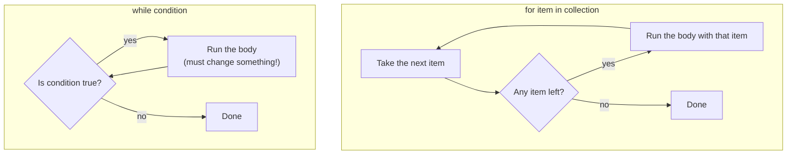

# Chapter 06 · Loops & Iteration

> Ask a human to write "I will practise coding" 500 times and they'll quit at 30. Ask a computer and it's done before you blink. **Loops** are where programming gets its superpower: describe the work once, let the machine repeat it a million times without getting bored or making a typo. Every algorithm in this book, from sorting to graph search, is loops all the way down.

**You will learn:**
- `for` loops over strings, ranges and other **iterables**, and `range()` in full depth
- `while` loops, and how to choose between `for` and `while`
- `break`, `continue`, `pass`, and the misunderstood **loop `else`**
- `enumerate()` and `zip()`, the two helpers that make loops Pythonic
- **Nested loops**, and how to *decode* any star/number pattern into a row/column formula
- Loop-based maths: digits, reversing numbers, primes, GCD, Fibonacci, factorial, Armstrong and perfect numbers
- Infinite loops: when you want one, and how to avoid the ones you don't

**Before this:** [Chapter 03 · Operators & Expressions](03-operators-expressions.md) · [Chapter 04 · Strings Deep Dive](04-strings.md) · [Chapter 05 · Conditionals & Truthiness](05-conditionals.md)

---

## 🧠 The Big Idea

There are two kinds of repetition in everyday life:

1. **"For each..."**: "For each student in the class, mark attendance." You know the **collection** up front, and you go through it item by item. That's a **`for` loop**.
2. **"While..."**: "While the chai isn't hot enough, keep heating." You don't know how many times; you repeat until a **condition** changes. That's a **`while` loop**.



Each pass through the body is called an **iteration**. A `for` loop stops on its own when the items run out. A `while` loop stops only when its condition becomes false, so the body **must** eventually make that happen, or you've built an **infinite loop**.

> 💡 **The core insight:** use `for` when you're walking through **things**, use `while` when you're waiting for a **condition**. Almost every loop bug comes from a wrong start, a wrong stop, or a condition that never changes.

---

## 🔨 Building It Up

### 1. Your first for loop

```python
for letter in "CODE":
    print(letter)

print("Loop finished")
```

```text
C
O
D
E
Loop finished
```

What just happened: the string `"CODE"` is a sequence of characters. On each iteration, Python takes the next character, ties the name `letter` to it, and runs the indented body. After the last character, the loop ends and the program continues below.

Anatomy:

```text
for <name> in <iterable>:     <- the name is (re)assigned each iteration; colon!
    <body>                    <- indented: runs once per item
```

An **iterable** is anything you can loop over: strings, ranges, lists, tuples, sets, dictionaries, files and more.

### 2. range(): counting loops

To repeat something a fixed number of times, or to walk through numbers, use `range()`:

```python
for i in range(5):
    print("Push-up number", i)
```

```text
Push-up number 0
Push-up number 1
Push-up number 2
Push-up number 3
Push-up number 4
```

`range(5)` produces `0, 1, 2, 3, 4`: **five** numbers, starting at 0, **stopping before 5**. Same rule as slicing: start in, stop out.

### 3. range() in depth

`range` has three forms:

| Form | Produces | Example | Values |
|---|---|---|---|
| `range(stop)` | 0 up to stop−1 | `range(4)` | 0 1 2 3 |
| `range(start, stop)` | start up to stop−1 | `range(2, 6)` | 2 3 4 5 |
| `range(start, stop, step)` | jump by step | `range(1, 10, 3)` | 1 4 7 |
| negative step | count down | `range(5, 0, -1)` | 5 4 3 2 1 |

```python
print(list(range(4)))
print(list(range(2, 6)))
print(list(range(0, 20, 5)))
print(list(range(10, 0, -2)))
print(list(range(5, 0)))         # start > stop with positive step: empty!
print(list(range(-3, 3)))
r = range(0, 100, 7)
print(len(r), r[3], r[-1], 49 in r, 50 in r)
```

```text
[0, 1, 2, 3]
[2, 3, 4, 5]
[0, 5, 10, 15]
[10, 8, 6, 4, 2]
[]
[-3, -2, -1, 0, 1, 2]
15 21 98 True False
```

What just happened:

- `list(range(...))` shows all the numbers at once (lists are covered in [Chapter 07](07-lists.md)).
- To count **down**, you need a negative step **and** start > stop. `range(5, 0)` is empty because the default step +1 can never get from 5 to 0.
- To include the end value, add 1 to stop: `range(1, n + 1)` gives 1..n.
- A `range` object supports `len()`, indexing and `in`. All three are **O(1)**: Python computes the answer with arithmetic instead of generating the numbers.

**range is lazy.** `range(1_000_000_000)` doesn't create a billion numbers. It stores just start, stop and step, and produces each number when asked. Constant memory, no matter how big.

### 4. The accumulator pattern

The most common loop of all: start with an initial value, update it with each item.

```python
total = 0                 # 1. initialise
for n in range(1, 11):    # 2. loop
    total += n            # 3. update
print("Sum of 1..10:", total)

product = 1               # for products, start at 1, not 0!
for n in range(1, 6):
    product *= n
print("5! =", product)

count = 0
for ch in "mississippi":
    if ch == "s":
        count += 1
print("count of s:", count)
```

```text
Sum of 1..10: 55
5! = 120
count of s: 4
```

Three steps, every time: **initialise** before the loop, **update** inside, **use** after. The initial value is the "identity": 0 for sums and counts, 1 for products, `""` for strings, and `float("-inf")`/`float("inf")` for max/min.

```python
best = float("-inf")
for n in (4, 19, -2, 11):          # a tuple of numbers (Chapter 08)
    if n > best:
        best = n
print("max:", best)
```

```text
max: 19
```

### 5. while loops

A `while` loop repeats **as long as** its condition is true:

```python
countdown = 5
while countdown > 0:
    print(countdown, end=" ")
    countdown -= 1           # the line that makes the loop end
print("Liftoff!")
```

```text
5 4 3 2 1 Liftoff!
```

The condition is checked **before** every iteration, including the first. If it's false from the start, the body runs zero times.

`while` shines when you **don't know** the number of iterations in advance:

```python
balance = 1000
years = 0
while balance < 2000:        # how long until my money doubles at 8%?
    balance *= 1.08
    years += 1
print("Doubled after", years, "years:", round(balance, 2))
```

```text
Doubled after 10 years: 2158.92
```

**for vs while: how to choose.**

| Use `for` when... | Use `while` when... |
|---|---|
| You have a collection to walk through | You're waiting for a condition to change |
| You know the count (`range(n)`) | The number of steps depends on the data |
| e.g. each character, each number 1..n | e.g. digits of a number, user retries, binary search |

If a `for` loop can do it, prefer it: it can't accidentally become infinite.

### 6. break: leave the loop now

`break` exits the innermost loop immediately, skipping any remaining iterations:

```python
for n in range(2, 100):
    if n % 7 == 0 and n % 5 == 0:
        print("First number divisible by both 5 and 7:", n)
        break
print("Search over")
```

```text
First number divisible by both 5 and 7: 35
Search over
```

Without `break`, the loop would keep checking up to 99 for no reason. **Stop as soon as you have the answer.**

### 7. continue: skip to the next iteration

`continue` abandons the **current** iteration and jumps to the next one:

```python
for n in range(1, 11):
    if n % 3 == 0:
        continue             # skip multiples of 3
    print(n, end=" ")
print()
```

```text
1 2 4 5 7 8 10 
```

`continue` is a guard clause for loops: "if this item isn't interesting, skip it", which keeps the main body un-nested.

> ⚠️ In a `while` loop, make sure the update happens **before** `continue`, or you'll skip the update and loop forever:
>
> ```py
> i = 0
> while i < 10:
>     if i % 2 == 0:
>         continue     # ❌ i never increases: infinite loop!
>     i += 1
> ```

### 8. pass: do nothing

`pass` is a placeholder for an empty block (from [Chapter 05](05-conditionals.md)). It does **not** affect the loop:

```python
for n in range(3):
    pass                 # TODO: fill in later
print("pass did nothing; n ended at", n)
```

```text
pass did nothing; n ended at 2
```

| Statement | Effect |
|---|---|
| `break` | exit the loop entirely |
| `continue` | skip the rest of this iteration, go to the next |
| `pass` | nothing at all (syntax placeholder) |

Also notice: the loop variable `n` **still exists after the loop**, holding its last value. Python loops don't create a new scope.

### 9. The loop else clause

Python has an unusual feature: an `else` attached to a loop. The `else` block runs **only if the loop finished without hitting `break`**.

Think of it as "**no break**" (some people wish it had been named `nobreak`):

```python
n = 29
for d in range(2, n):
    if n % d == 0:
        print(n, "is divisible by", d)
        break
else:
    print(n, "is prime")       # runs only if no divisor was found

target = "z"
for ch in "python":
    if ch == target:
        print("found", target)
        break
else:
    print(target, "not found")
```

```text
29 is prime
z not found
```

What just happened: for 29, no divisor triggered `break`, so the loop ran to completion and `else` ran. It replaces the classic "flag variable" approach:

```py
found = False                  # the old way, with a flag
for ch in "python":
    if ch == target:
        found = True
        break
if not found:
    print("not found")
```

`while` loops can have an `else` too, with the same rule.

### 10. enumerate(): index and value together

Often you need both the position and the item. Beginners write `for i in range(len(s))` and then `s[i]`. The Pythonic way is `enumerate`:

```python
word = "loop"
for i, ch in enumerate(word):
    print(i, ch)

for rank, name in enumerate(("Riya", "Arjun", "Meera"), start=1):
    print(f"#{rank}: {name}")
```

```text
0 l
1 o
2 o
3 p
#1: Riya
#2: Arjun
#3: Meera
```

`enumerate` gives pairs `(index, item)`, which we unpack into two names (like `a, b = 1, 2` from [Chapter 02](02-variables-types-memory.md)). `start=1` makes it count from 1, perfect for human-friendly numbering.

### 11. zip(): walk several sequences in step

`zip` pairs up items from two or more iterables, position by position:

```python
names = ("Riya", "Arjun", "Meera")
marks = (91, 78, 85)
for name, mark in zip(names, marks):
    print(f"{name:<6} {mark}")

for a, b, c in zip("abc", "xyz", range(3)):
    print(a, b, c)

for x, y in zip("abcdef", range(3)):     # stops at the SHORTEST
    print(x, y, end=" | ")
print()
```

```text
Riya   91
Arjun  78
Meera  85
a x 0
b y 1
c z 2
a 0 | b 1 | c 2 | 
```

What just happened: `zip` stops as soon as **any** input runs out, silently ignoring the rest. In Python 3.10+, `zip(a, b, strict=True)` raises an error if the lengths differ, which catches bugs early.

A neat zip trick: compare each character with the next one.

```python
s = "aabccc"
for current, nxt in zip(s, s[1:]):
    print(current + nxt, "same" if current == nxt else "diff")
```

```text
aa same
ab diff
bc diff
cc same
cc same
```

`s[1:]` is `"abccc"`, the same string shifted by one. Zipping the two gives each character with its right-hand neighbour: five pairs from a six-character string, because `zip` stopped when `s[1:]` ran out.

### 12. reversed() and looping backwards

```python
for ch in reversed("abc"):
    print(ch, end=" ")
print()
for i in range(4, -1, -1):       # 4 down to 0: stop is -1 to include 0
    print(i, end=" ")
print()
```

```text
c b a 
4 3 2 1 0 
```

`range(n - 1, -1, -1)` is the classic "indexes from last to first". `reversed(range(n))` does the same and is easier to read.

### 13. Nested loops

A loop inside a loop: for **each** iteration of the outer loop, the inner loop runs **completely**.

```python
for row in range(1, 4):
    for col in range(1, 6):
        print(f"{row * col:3}", end="")
    print()                          # newline after each row
```

```text
  1  2  3  4  5
  2  4  6  8 10
  3  6  9 12 15
```

What just happened: the outer loop picked `row = 1`, then the inner loop ran `col = 1..5`, printing on one line. Then `print()` ended the line, and the outer loop moved to `row = 2`. Total body executions: 3 × 5 = 15.

**Cost:** an outer loop of n and inner loop of m runs the body **n × m** times. Two nested loops over the same n items is **O(n²)**: fine for n = 1,000 (a million steps), painful for n = 100,000 (ten billion). Much of DSA is about replacing nested loops with something smarter ([DSA Chapter 01](../part-2-dsa/01-big-o-complexity.md)).

`break` only exits the **innermost** loop:

```python
for i in range(3):
    for j in range(3):
        if j == 1:
            break                    # leaves the j-loop only
        print(i, j)
```

```text
0 0
1 0
2 0
```

To escape both loops, use a flag, or put the loops in a function and `return` ([Chapter 10](10-functions.md)).

### 14. Pattern printing: decode the row/column formula

Pattern questions ("print this pyramid") are a staple of campus placement tests. Don't memorise patterns; **decode** them with one method:

1. The **outer loop** is the **row** number `i` (usually 1..n).
2. For each row, ask: **how many** of each character, and **which** characters? Write it as a formula in `i` and `n`.
3. The inner loop(s) print exactly that; then `print()` ends the row.

Let's practise with `n = 4`.

**Pattern A: square.** Row i has n stars.

```python
n = 4
for i in range(1, n + 1):
    for j in range(1, n + 1):
        print("*", end=" ")
    print()
```

```text
* * * * 
* * * * 
* * * * 
* * * * 
```

**Pattern B: right triangle.** Row i has **i** stars.

```python
n = 4
for i in range(1, n + 1):
    print("* " * i)
```

```text
* 
* * 
* * * 
* * * * 
```

(String repetition from [Chapter 04](04-strings.md) replaces the inner loop. Both are fine; interviewers sometimes ask for explicit loops.)

**Pattern C: inverted triangle.** Row i has **n − i + 1** stars.

```python
n = 4
for i in range(1, n + 1):
    print("* " * (n - i + 1))
```

```text
* * * * 
* * * 
* * 
* 
```

**Pattern D: number triangles.** What's printed depends on `i` and `j`:

```python
n = 4
for i in range(1, n + 1):
    for j in range(1, i + 1):
        print(j, end=" ")          # column number
    print()
print()
for i in range(1, n + 1):
    for j in range(1, i + 1):
        print(i, end=" ")          # row number
    print()
```

```text
1 
1 2 
1 2 3 
1 2 3 4 

1 
2 2 
3 3 3 
4 4 4 4 
```

**Pattern E: Floyd's triangle.** A counter that keeps going across rows.

```python
n = 4
num = 1
for i in range(1, n + 1):
    for j in range(i):
        print(f"{num:3}", end="")
        num += 1
    print()
```

```text
  1
  2  3
  4  5  6
  7  8  9 10
```

**Pattern F: pyramid.** Now each row has **spaces** then **stars**. Decode it with a table:

```text
   *        row 1: 3 spaces, 1 star
  ***       row 2: 2 spaces, 3 stars
 *****      row 3: 1 space,  5 stars
*******     row 4: 0 spaces, 7 stars
```

| Row `i` | Spaces | Stars |
|---|---|---|
| 1 | 3 | 1 |
| 2 | 2 | 3 |
| 3 | 1 | 5 |
| 4 | 0 | 7 |
| formula | **n − i** | **2i − 1** |

Spaces go down by 1 per row (n − i); stars go up by 2 per row, starting at 1 (2i − 1).

```python
n = 4
for i in range(1, n + 1):
    print(" " * (n - i) + "*" * (2 * i - 1))
```

```text
   *
  ***
 *****
*******
```

**Pattern G: diamond.** A pyramid, then an upside-down pyramid without repeating the middle row:

```python
n = 4
for i in range(1, n + 1):
    print(" " * (n - i) + "*" * (2 * i - 1))
for i in range(n - 1, 0, -1):
    print(" " * (n - i) + "*" * (2 * i - 1))
```

```text
   *
  ***
 *****
*******
 *****
  ***
   *
```

**Pattern H: hollow square.** Print a star only on the border: first/last row or first/last column.

```python
n = 5
for i in range(n):
    for j in range(n):
        if i == 0 or i == n - 1 or j == 0 or j == n - 1:
            print("*", end=" ")
        else:
            print(" ", end=" ")
    print()
```

```text
* * * * * 
*       * 
*       * 
*       * 
* * * * * 
```

**Pattern I: alphabet triangle and 0-1 triangle.** The character can be computed from `i` and `j` too:

```python
n = 4
for i in range(n):
    for j in range(i + 1):
        print(chr(ord("A") + j), end=" ")
    print()
for i in range(1, n + 1):
    for j in range(1, i + 1):
        print((i + j) % 2, end=" ")     # alternates like a checkerboard
    print()
```

```text
A 
A B 
A B C 
A B C D 
0 
1 0 
0 1 0 
1 0 1 0 
```

> 💡 **The decoding recipe in one line:** for each row `i`, write down "how many spaces, how many symbols, which symbol at column `j`" as formulas, check them against two rows, and code it. Every pattern question (butterfly, hourglass, Pascal's triangle, number pyramids) yields to it.

### 15. Loop-based maths: the digit loop

From [Chapter 03](03-operators-expressions.md): `n % 10` is the last digit, `n // 10` drops it. Put that in a `while` loop and you can process numbers of **any** length:

```python
n = 98042
original = n
digit_sum = 0
digit_count = 0
reversed_n = 0
while n > 0:
    digit = n % 10                       # peel off the last digit
    digit_sum += digit
    digit_count += 1
    reversed_n = reversed_n * 10 + digit # push it onto the reversed number
    n //= 10                             # drop the last digit
print(original, "sum:", digit_sum, "count:", digit_count, "reversed:", reversed_n)
```

```text
98042 sum: 23 count: 5 reversed: 24089
```

**Dry run** of the reverse for `n = 123`:

| Iteration | `n` | `digit = n % 10` | `reversed_n * 10 + digit` | `n //= 10` |
|---|---|---|---|---|
| 1 | 123 | 3 | 0 × 10 + 3 = **3** | 12 |
| 2 | 12 | 2 | 3 × 10 + 2 = **32** | 1 |
| 3 | 1 | 1 | 32 × 10 + 1 = **321** | 0 → stop |

Notes: for `n = 0`, the loop runs zero times (digit count would be 0, so handle 0 separately if needed). For negatives, work on `abs(n)` and restore the sign.

**Palindrome number** (reads the same backwards): compare the number with its reverse.

```python
n = 12321
temp, rev = n, 0
while temp > 0:
    rev = rev * 10 + temp % 10
    temp //= 10
print(n, "palindrome" if rev == n else "not palindrome")
```

```text
12321 palindrome
```

### 16. Primes

A **prime** is a number greater than 1 whose only divisors are 1 and itself. The key optimisation: you only need to test divisors up to **√n**, because if `n = a × b`, one of `a` or `b` must be ≤ √n.

```python
n = 97
is_prime = n > 1
d = 2
while d * d <= n:            # same as d <= sqrt(n), without floats
    if n % d == 0:
        is_prime = False
        break
    d += 1
print(n, "is prime" if is_prime else "is not prime")

print("Primes below 50:", end=" ")
for num in range(2, 50):
    for d in range(2, int(num ** 0.5) + 1):
        if num % d == 0:
            break
    else:                    # loop else: no divisor found
        print(num, end=" ")
print()
```

```text
97 is prime
Primes below 50: 2 3 5 7 11 13 17 19 23 29 31 37 41 43 47 
```

Checking one number this way is **O(√n)** instead of O(n): for n = 10^12, that's a million steps instead of a trillion. For listing **all** primes up to n, the **Sieve of Eratosthenes** is far faster ([DSA Chapter 23](../part-2-dsa/23-bits-math.md)).

### 17. GCD and LCM: Euclid's algorithm

The **GCD** (greatest common divisor) of two numbers is the largest number dividing both. Euclid noticed, over 2,000 years ago, that `gcd(a, b) == gcd(b, a % b)`, and `gcd(a, 0) == a`:

```python
a, b = 84, 36
x, y = a, b
while y:                     # until the remainder is 0
    x, y = y, x % y
gcd = x
lcm = a * b // gcd
print("gcd:", gcd, "lcm:", lcm)
```

```text
gcd: 12 lcm: 252
```

| Step | x | y | x % y |
|---|---|---|---|
| 1 | 84 | 36 | 12 |
| 2 | 36 | 12 | 0 |
| 3 | 12 | 0 | stop: gcd = 12 |

Euclid's algorithm takes **O(log(min(a, b)))** steps: the numbers shrink at least by half every two steps. `math.gcd` and `math.lcm` exist in the standard library ([Chapter 17](17-modules-stdlib.md)).

### 18. Fibonacci and factorial

**Fibonacci**: each number is the sum of the previous two: 0, 1, 1, 2, 3, 5, 8, ...

```python
n = 10
a, b = 0, 1
for _ in range(n):           # _ : we don't need the loop counter
    print(a, end=" ")
    a, b = b, a + b          # simultaneous update: no temp variable needed
print()
```

```text
0 1 1 2 3 5 8 13 21 34 
```

The line `a, b = b, a + b` is the heart of it. The right side uses the **old** `a` and `b` before either is updated (tuple assignment from [Chapter 02](02-variables-types-memory.md)). Writing `a = b` then `b = a + b` on separate lines would be a bug.

**Factorial**: `n! = 1 × 2 × ... × n`, and `0! = 1`.

```python
n = 20
fact = 1
for k in range(2, n + 1):
    fact *= k
print(f"{n}! = {fact}")
```

```text
20! = 2432902008176640000
```

Python's big integers ([Chapter 02](02-variables-types-memory.md)) mean `100!` (158 digits) just works.

### 19. Armstrong and perfect numbers

An **Armstrong number** (narcissistic number) equals the sum of its digits, each raised to the power of the number of digits: `153 = 1³ + 5³ + 3³`.

```python
print("Armstrong numbers below 10000:", end=" ")
for num in range(1, 10000):
    power = len(str(num))
    total, temp = 0, num
    while temp > 0:
        total += (temp % 10) ** power
        temp //= 10
    if total == num:
        print(num, end=" ")
print()
```

```text
Armstrong numbers below 10000: 1 2 3 4 5 6 7 8 9 153 370 371 407 1634 8208 9474 
```

A **perfect number** equals the sum of its proper divisors (divisors except itself): `28 = 1 + 2 + 4 + 7 + 14`. Divisors come in pairs `(d, n // d)`, so again we only loop to √n:

```python
print("Perfect numbers below 10000:", end=" ")
for n in range(2, 10000):
    total = 1                        # 1 divides everything
    d = 2
    while d * d <= n:
        if n % d == 0:
            total += d
            if d != n // d:          # don't add a square root twice
                total += n // d
        d += 1
    if total == n:
        print(n, end=" ")
print()
```

```text
Perfect numbers below 10000: 6 28 496 8128 
```

### 20. Infinite loops: wanted and unwanted

**Unwanted** infinite loops happen when the condition never becomes false:

```py
i = 0
while i < 5:
    print(i)       # ❌ forgot i += 1: prints 0 forever

n = 10
while n != 0:
    n -= 3         # ❌ 10, 7, 4, 1, -2, ... skips 0 forever. Use n > 0.
```

If your program hangs, press **Ctrl+C** in the terminal to stop it (it raises `KeyboardInterrupt`).

**Wanted** infinite loops: `while True:` with a `break` inside. This is the right shape when the exit condition is naturally checked in the **middle** of the body, like menus, games and servers:

```python
attempts = ["1234", "letmein", "s3cret", "hunter2"]   # pretend user inputs
PASSWORD = "s3cret"
i = 0
while True:
    guess = attempts[i]
    i += 1
    if guess == PASSWORD:
        print("Access granted after", i, "attempts")
        break
    print("Wrong:", guess)
```

```text
Wrong: 1234
Wrong: letmein
Access granted after 3 attempts
```

**Checklist to avoid infinite loops:**

1. Does every path through the body move toward the exit (increment, decrement, shrink)?
2. Is the condition `<` / `>` rather than `!=` when stepping by more than 1?
3. In a `while` with `continue`, does the update happen before the `continue`?
4. In `while True`, is there a reachable `break` (or a cap on attempts)?

> ⚠️ **Never modify the collection you're looping over** (adding or removing items from a list mid-loop). It causes skipped items or endless growth. Loop over a copy, or build a new collection ([Chapter 07](07-lists.md)).

---

## 🔬 Under the Hood

### The iteration protocol: how `for` really works

A `for` loop is a polite wrapper around two built-in functions:

1. `iter(obj)` asks the iterable for an **iterator**: an object that remembers "where we are".
2. `next(iterator)` returns the next item, or raises a special `StopIteration` signal when there are none left.

```python
it = iter("hi")
print(next(it))
print(next(it))
print(next(it, "no more items"))     # default value instead of StopIteration
```

```text
h
i
no more items
```

So this:

```py
for ch in "hi":
    print(ch)
```

is effectively this:

```py
it = iter("hi")
while True:
    try:
        ch = next(it)
    except StopIteration:   # try/except is covered in Chapter 13
        break
    print(ch)
```

That's why `for` works on anything iterable (strings, ranges, files, dictionaries, your own classes) and why it can never index out of range. You'll build your own iterators and generators in [Chapter 16](16-iterators-generators-decorators.md).

### Why changing the loop variable doesn't change the loop

```python
for i in range(5):
    print(i, end=" ")
    i = 100          # rebinds the name only; the iterator doesn't care
print()
```

```text
0 1 2 3 4 
```

Each iteration, the loop **re-assigns** `i` from the iterator. Your `i = 100` just moves the name tag until the next `next()` call moves it back. If you need to skip ahead, use a `while` loop with your own index.

### range is a tiny object

A `range` stores only `start`, `stop` and `step`. `len(range(...))` is computed as roughly `(stop - start) / step` rounded up; `x in range(...)` checks bounds and `(x - start) % step == 0`. That's why both are O(1), and why `range(10**18)` costs the same memory as `range(10)`. (In Python 2, `range` built a real list; `xrange` was the lazy one. Python 3's `range` is the old `xrange`.)

### How fast are Python loops?

Each iteration of a Python loop runs several bytecode instructions (`FOR_ITER`, store the name, the body, jump back). A simple loop does on the order of **10 to 50 million** iterations per second on a modern machine. Rough interview budget: about **10^7 simple operations per second** in Python. So:

| n | O(n) | O(n²) |
|---|---|---|
| 10³ | instant | ~instant (10^6) |
| 10⁵ | instant | ~10^10: way too slow |
| 10⁶ | under a second | impossible |

Built-ins like `sum()`, `max()`, `"".join()` and `str.count()` loop in C and are often 10× faster than an equivalent Python loop. Use them when they fit.

### Why √n is enough for primes (and divisor pairs)

If `n = a × b` with `a ≤ b`, then `a × a ≤ a × b = n`, so `a ≤ √n`. Every factor pair has its smaller member at or below √n. Finding none there proves there are none at all. The same argument lets the perfect-number loop collect both `d` and `n // d` in one step.

### Why Euclid's algorithm works

Any number dividing both `a` and `b` also divides `a - b`, and therefore `a % b` (which is `a` minus some multiple of `b`). So the **set of common divisors** of `(a, b)` equals that of `(b, a % b)`, and their greatest member is unchanged. The numbers keep shrinking until the remainder is 0, and `gcd(x, 0) = x`.

---

## 🧩 Pattern Decoder

### Which loop shape?

| You need... | Shape |
|---|---|
| Each item | `for x in items:` |
| Each index and item | `for i, x in enumerate(items):` |
| Two sequences side by side | `for a, b in zip(xs, ys):` |
| A number range | `for i in range(start, stop, step):` |
| Backwards | `for x in reversed(items):` or `range(n - 1, -1, -1)` |
| Repeat k times, counter unused | `for _ in range(k):` |
| Until a condition | `while condition:` |
| Exit decided mid-body | `while True:` ... `if done: break` |
| Search with "not found" handling | `for ... : if match: break` + `else:` |
| Neighbouring pairs | `for a, b in zip(s, s[1:]):` |

### Reusable templates

**Accumulator:**

```py
result = IDENTITY            # 0 for sum/count, 1 for product, float("-inf") for max
for x in items:
    if keep(x):              # optional filter
        result = combine(result, x)
```

**Digit loop:**

```py
n = abs(number)
while n > 0:
    digit = n % 10
    # ... use digit ...
    n //= 10
```

**Search with loop-else:**

```py
for x in items:
    if is_match(x):
        handle(x)
        break
else:
    handle_not_found()
```

**Pattern printing:**

```py
for i in range(1, n + 1):                 # rows
    print(" " * spaces(i, n) + symbols(i, n))
```

### Common pattern formulas (row i from 1 to n)

| Pattern | Spaces | Symbols |
|---|---|---|
| Right triangle | 0 | i |
| Inverted right triangle | 0 | n − i + 1 |
| Right-aligned triangle | n − i | i |
| Pyramid | n − i | 2i − 1 |
| Inverted pyramid | i − 1 | 2(n − i) + 1 |
| Number row "1 2 ... i" | 0 | `j` for j in 1..i |
| Hollow shape | | star if on border (`i`/`j` at first or last) else space |

### Pythonic loop idioms

| Avoid | Prefer |
|---|---|
| `for i in range(len(s)): print(s[i])` | `for ch in s: print(ch)` |
| `i = 0` ... `i += 1` alongside a for | `enumerate` |
| `for i in range(len(a)): a[i], b[i]` | `zip(a, b)` |
| flag variable for "found" | loop `else` |
| manual sum/max loop over numbers | `sum(...)`, `max(...)` |
| `s += piece` in a loop | collect pieces, `"".join()` |
| `while True` with no clear exit | a `for` loop or an explicit condition |

### How loops show up in DSA

- **Every** array algorithm is a loop; the question is how many and how nested. One pass = O(n), nested = O(n²).
- **Two pointers** ([DSA Chapter 03](../part-2-dsa/03-two-pointers.md)) is a `while left < right` loop.
- **Sliding window** ([DSA Chapter 04](../part-2-dsa/04-sliding-window.md)) is a `for` loop with an inner `while` that shrinks the window: still O(n) overall, because each element enters and leaves once.
- **Binary search** ([DSA Chapter 08](../part-2-dsa/08-binary-search.md)) is a `while lo <= hi` loop that halves the range: O(log n).
- **BFS** ([DSA Chapter 16](../part-2-dsa/16-graphs-bfs-dfs.md)) is `while queue:`.
- **Digit loops** solve Reverse Integer, Palindrome Number, Happy Number, Add Digits.
- **Euclid's GCD** and **√n prime checks** come up in maths-flavoured problems ([DSA Chapter 23](../part-2-dsa/23-bits-math.md)).

---

## ⚠️ Traps & Common Mistakes

1. **Off-by-one in range.** `range(1, 10)` stops at 9. For 1..n inclusive, write `range(1, n + 1)`.

2. **Counting down without a negative step.** `range(10, 0)` is empty. Use `range(10, 0, -1)`, and `range(10, -1, -1)` to include 0.

3. **Forgetting the update in `while`.** Infinite loop. Make the update the first thing you write after the condition.

4. **Using `!=` as a loop condition with uneven steps.** `while n != 0: n -= 3` can jump over 0. Use `while n > 0`.

5. **Sequential updates where simultaneous ones are needed.**

```py
a = b          # ❌ old a is lost
b = a + b
a, b = b, a + b   # ✅ right side uses old values
```

6. **Product accumulator starting at 0.** `product = 0` makes everything 0. Start at 1.

7. **Expecting `break` to exit all nested loops.** It exits only the innermost loop.

8. **Misreading loop `else`.** It doesn't mean "if the loop didn't run". It means "if the loop **didn't break**". An empty loop (zero iterations) also runs the `else`.

9. **Modifying a list while looping over it.** Items get skipped. Loop over a copy (`for x in items[:]`) or build a new list ([Chapter 07](07-lists.md)).

10. **`print` inside a pattern loop without `end=""`.** Every symbol lands on its own line. Use `end=""` (or `end=" "`) in the inner loop and a bare `print()` after it.

11. **Reusing a loop variable name** that you needed later. After `for i in ...`, `i` holds the last value and overwrites any earlier `i`.

12. **Nested loops where one would do.** If you're checking "does any pair satisfy X?", there's often an O(n) approach with a set or two pointers. Interviewers expect you to look for it.

---

## 💡 Tips & Tricks

- Use `_` as the loop variable when you don't need it: `for _ in range(3):`.
- `for i, x in enumerate(items, start=1)` gives human-friendly numbering.
- `zip(s, s[1:])` pairs each element with the next.
- `sum(1 for ch in s if ch in "aeiou")` counts with a **generator expression** ([Chapter 11](11-comprehensions-functional.md)).
- `any(...)` and `all(...)` replace many search loops: `any(n % d == 0 for d in range(2, n))`.
- `while d * d <= n` avoids float square roots and their rounding errors.
- For patterns, make a little table of row → spaces → symbols before coding. It turns 20 minutes of trial and error into 2.
- Add a temporary `print(i, j, total)` inside a loop to see what's happening; delete it once you understand.
- Test loops with **0, 1 and 2** iterations. Most loop bugs live at the edges.
- If a loop is getting long, the body probably wants to become a function ([Chapter 10](10-functions.md)).

---

## 🎯 Interview Questions

### 1. What's the difference between a for loop and a while loop? 🔥🔥🔥

<details><summary>Answer</summary>

A `for` loop iterates over the items of an iterable (definite iteration): it ends automatically when the items run out, and it uses the iterator protocol (`iter`/`next`). A `while` loop repeats while a condition is true (indefinite iteration): you manage the state and must ensure the condition eventually becomes false. Prefer `for` when walking through a collection or a known range; use `while` when the number of iterations depends on data (digit loops, binary search, convergence, retry loops).

</details>

### 2. What's the difference between break, continue and pass? 🔥🔥🔥

<details><summary>Answer</summary>

- `break` exits the innermost loop immediately (and skips the loop's `else`).
- `continue` skips the rest of the current iteration and moves to the next one.
- `pass` does nothing; it's a syntactic placeholder.

```python
for n in range(6):
    if n == 1:
        pass          # no effect
    if n == 2:
        continue      # skip printing 2
    if n == 4:
        break         # stop entirely
    print(n, end=" ")
print()
```

```text
0 1 3 
```

</details>

### 3. When does the else block of a loop execute? 🔥🔥

<details><summary>Answer</summary>

When the loop terminates **normally**: the iterable is exhausted (for) or the condition becomes false (while), **without** a `break`. If `break` runs, `else` is skipped. It's perfect for searches: `for ... if found: break` + `else: not found`, replacing a flag variable. A loop with zero iterations also runs its `else`.

</details>

### 4. How does range() work in Python 3? Is it a list? 🔥🔥

<details><summary>Answer</summary>

No. `range` is a lazy, immutable **sequence object** that stores only `start`, `stop` and `step`. It produces numbers on demand, so it uses O(1) memory regardless of size. It supports `len()`, indexing, slicing and `in` in O(1). `list(range(n))` materialises it if you need a real list. (Python 2's `range` returned a list; Python 3's `range` behaves like Python 2's `xrange`.)

</details>

### 5. Write FizzBuzz. 🔥🔥🔥

Print 1 to 15; for multiples of 3 print "Fizz", of 5 "Buzz", of both "FizzBuzz".

<details><summary>Answer</summary>

Check the most specific case (divisible by 15) first, or build the string:

```python
for n in range(1, 16):
    word = ""
    if n % 3 == 0:
        word += "Fizz"
    if n % 5 == 0:
        word += "Buzz"
    print(word or n, end=" ")
print()
```

```text
1 2 Fizz 4 Buzz Fizz 7 8 Fizz Buzz 11 Fizz 13 14 FizzBuzz 
```

The string-building version scales cleanly if a new rule (e.g. 7 → "Bazz") is added. `word or n` prints the number when `word` is empty (truthiness from [Chapter 05](05-conditionals.md)).

</details>

### 6. Check whether a number is prime. What's the time complexity? 🔥🔥🔥

<details><summary>Answer</summary>

Numbers below 2 aren't prime. Then test divisors from 2 while `d * d <= n`; any factor pair has one member ≤ √n. Optional speed-up: handle 2 separately and test only odd divisors.

```python
n = 221
is_prime = n >= 2
if n > 2 and n % 2 == 0:
    is_prime = False
d = 3
while is_prime and d * d <= n:
    if n % d == 0:
        is_prime = False
    d += 2
print(n, is_prime)
```

```text
221 False
```

(221 = 13 × 17.) Time **O(√n)**, space O(1). For many queries or all primes up to N, use the Sieve of Eratosthenes, O(N log log N).

</details>

### 7. Reverse an integer. 🔥🔥🔥

<details><summary>Answer</summary>

Peel digits with `% 10`, push them with `rev * 10 + digit`, handle the sign separately:

```python
x = -4210
sign = -1 if x < 0 else 1
n, rev = abs(x), 0
while n > 0:
    rev = rev * 10 + n % 10
    n //= 10
print(sign * rev)
```

```text
-124
```

O(d) where d is the number of digits (O(log₁₀ n)). LeetCode's *Reverse Integer* adds: return 0 if the result leaves the 32-bit signed range `[-2**31, 2**31 - 1]`. Python won't overflow, so you must check explicitly. Shortcut answer: `int(str(abs(x))[::-1]) * sign`, but interviewers usually want the arithmetic version.

</details>

### 8. Print the first n Fibonacci numbers. 🔥🔥🔥

<details><summary>Answer</summary>

Keep only the last two values and update them simultaneously:

```python
n = 12
a, b = 0, 1
for _ in range(n):
    print(a, end=" ")
    a, b = b, a + b
print()
```

```text
0 1 1 2 3 5 8 13 21 34 55 89 
```

O(n) time, O(1) space. The naive recursive version is O(2ⁿ); you'll see why and fix it with memoisation in [Chapter 12](12-recursion.md) and [DSA Chapter 20](../part-2-dsa/20-dp-1d.md).

</details>

### 9. Check if a number is a palindrome without converting it to a string. 🔥🔥

<details><summary>Answer</summary>

Negative numbers aren't palindromes (the `-` sign). Reverse the number arithmetically and compare:

```python
x = 1221
if x < 0:
    print(False)
else:
    original, rev = x, 0
    while x > 0:
        rev = rev * 10 + x % 10
        x //= 10
    print(original == rev)
```

```text
True
```

Optimised version (LeetCode *Palindrome Number*): reverse only **half** the digits and compare halves, avoiding overflow in fixed-width languages. O(log n).

</details>

### 10. Find the GCD of two numbers. 🔥🔥

<details><summary>Answer</summary>

Euclid's algorithm: replace `(a, b)` with `(b, a % b)` until `b` is 0.

```python
a, b = 1071, 462
while b:
    a, b = b, a % b
print(a)
```

```text
21
```

O(log(min(a, b))). LCM = `a * b // gcd(a, b)`. Python also has `math.gcd`.

</details>

### 11. Check whether a number is an Armstrong number. 🔥🔥

<details><summary>Answer</summary>

Sum each digit raised to the power of the number of digits; compare with the original.

```python
num = 9474
k = len(str(num))
total, temp = 0, num
while temp:
    total += (temp % 10) ** k
    temp //= 10
print(num, total == num)
```

```text
9474 True
```

9⁴ + 4⁴ + 7⁴ + 4⁴ = 6561 + 256 + 2401 + 256 = 9474. O(d) time for d digits.

</details>

### 12. Print a pyramid of n rows. 🔥🔥🔥

<details><summary>Answer</summary>

Decode row i: **n − i** spaces and **2i − 1** stars.

```python
n = 5
for i in range(1, n + 1):
    print(" " * (n - i) + "*" * (2 * i - 1))
```

```text
    *
   ***
  *****
 *******
*********
```

If asked to avoid string multiplication, use two inner loops (one for spaces, one for stars) with `end=""`.

</details>

### 13. Why does changing the loop variable inside a for loop not affect the iteration? 🔥

<details><summary>Answer</summary>

`for` gets each value from an **iterator** via `next()` and rebinds the loop variable at the start of every iteration. Assigning to the variable inside the body only rebinds the name temporarily; the iterator's internal position is untouched. To control the index manually (skip ahead, step back), use a `while` loop with your own counter.

</details>

### 14. Sum the digits of a number repeatedly until a single digit remains ("Add Digits"). 🔥🔥

<details><summary>Answer</summary>

Loop version, then the O(1) maths trick (the **digital root**):

```python
num = 38
n = num
while n >= 10:
    total = 0
    while n:
        total += n % 10
        n //= 10
    n = total
print(n)
print(0 if num == 0 else 1 + (num - 1) % 9)
```

```text
2
2
```

38 → 3 + 8 = 11 → 1 + 1 = 2. The formula works because a number and its digit sum leave the same remainder when divided by 9.

</details>

---

## 🏋️ Practice

**🟢 1. Multiplication table.** Print the table of 7 from 7 × 1 to 7 × 10, formatted like `7 x 3 = 21` with aligned columns.

<details><summary>Solution</summary>

```python
n = 7
for i in range(1, 11):
    print(f"{n} x {i:>2} = {n * i:>2}")
```

```text
7 x  1 =  7
7 x  2 = 14
7 x  3 = 21
7 x  4 = 28
7 x  5 = 35
7 x  6 = 42
7 x  7 = 49
7 x  8 = 56
7 x  9 = 63
7 x 10 = 70
```

</details>

**🟢 2. Sum of evens and odds.** For numbers 1 to 100, print the sum of the even numbers and the sum of the odd numbers. Do it with one loop, then with two `range`s using a step.

<details><summary>Solution</summary>

```python
even_total = odd_total = 0
for n in range(1, 101):
    if n % 2 == 0:
        even_total += n
    else:
        odd_total += n
print(even_total, odd_total)
print(sum(range(2, 101, 2)), sum(range(1, 101, 2)))
```

```text
2550 2500
2550 2500
```

</details>

**🟢 3. Count vowels and consonants** in `"Loops Are Fun To Learn"`.

<details><summary>Solution</summary>

```python
text = "Loops Are Fun To Learn"
vowels = consonants = 0
for ch in text.lower():
    if not ch.isalpha():
        continue
    if ch in "aeiou":
        vowels += 1
    else:
        consonants += 1
print("vowels:", vowels, "consonants:", consonants)
```

```text
vowels: 8 consonants: 10
```

</details>

**🟡 4. Number pyramid.** For `n = 4`, print:

```text
   1
  121
 12321
1234321
```

<details><summary>Solution</summary>

Row i: `n − i` spaces, then 1 up to i, then i − 1 down to 1.

```python
n = 4
for i in range(1, n + 1):
    print(" " * (n - i), end="")
    for j in range(1, i + 1):
        print(j, end="")
    for j in range(i - 1, 0, -1):
        print(j, end="")
    print()
```

```text
   1
  121
 12321
1234321
```

</details>

**🟡 5. Primes in a range.** Print all primes between 50 and 100 and how many there are, using a loop `else`.

<details><summary>Solution</summary>

```python
count = 0
for num in range(50, 101):
    for d in range(2, int(num ** 0.5) + 1):
        if num % d == 0:
            break
    else:
        print(num, end=" ")
        count += 1
print()
print("count:", count)
```

```text
53 59 61 67 71 73 79 83 89 97 
count: 10
```

</details>

**🟡 6. Collatz steps.** Start with `n = 27`. If n is even, halve it; if odd, make it `3n + 1`. Count the steps to reach 1, and the highest value reached.

<details><summary>Solution</summary>

```python
n = 27
steps, peak = 0, n
while n != 1:
    n = n // 2 if n % 2 == 0 else 3 * n + 1
    steps += 1
    peak = max(peak, n)
print("steps:", steps, "peak:", peak)
```

```text
steps: 111 peak: 9232
```

(`while n != 1` is safe here because the sequence always passes through 1 exactly; nobody has ever found a starting number where it doesn't, though it's still an unproven conjecture!)

</details>

**🟡 7. Strong numbers.** A strong number equals the sum of the factorials of its digits (`145 = 1! + 4! + 5!`). Find all strong numbers below 100,000.

<details><summary>Solution</summary>

Precompute digit factorials 0!..9! once, so each digit costs O(1).

```python
fact = [1] * 10                 # fact[d] = d!
for d in range(1, 10):
    fact[d] = fact[d - 1] * d

for num in range(1, 100000):
    total, temp = 0, num
    while temp:
        total += fact[temp % 10]
        temp //= 10
    if total == num:
        print(num, end=" ")
print()
```

```text
1 2 145 40585 
```

Precomputing small tables to avoid repeated work is a real optimisation habit (and a peek at lists from [Chapter 07](07-lists.md)).

</details>

**🔴 8. Hollow diamond.** For `n = 4`, print:

```text
   *
  * *
 *   *
*     *
 *   *
  * *
   *
```

<details><summary>Solution</summary>

Row with "width index" i (1..n then n−1..1): `n − i` leading spaces, a star, then if i > 1, `2i − 3` inner spaces and another star.

```python
n = 4
for i in list(range(1, n + 1)) + list(range(n - 1, 0, -1)):
    line = " " * (n - i) + "*"
    if i > 1:
        line += " " * (2 * i - 3) + "*"
    print(line)
```

```text
   *
  * *
 *   *
*     *
 *   *
  * *
   *
```

The trick: describe each row with one number `i`, then build the up-and-down sequence of `i` values and reuse the same formula.

</details>

**🔴 9. Pascal's triangle.** Print the first 6 rows, centred, without storing previous rows. (Hint: in row i, the next value is `value * (i - k) // (k + 1)`.)

<details><summary>Solution</summary>

```python
n = 6
for i in range(n):
    print(" " * (n - i - 1), end="")
    value = 1
    for k in range(i + 1):
        print(value, end=" ")
        value = value * (i - k) // (k + 1)
    print()
```

```text
     1 
    1 1 
   1 2 1 
  1 3 3 1 
 1 4 6 4 1 
1 5 10 10 5 1 
```

Each entry is the binomial coefficient C(i, k), and C(i, k+1) = C(i, k) × (i − k) / (k + 1). The division is always exact, so `//` is safe. (The centring drifts once numbers get two digits wide; fixing it with fixed-width f-strings is a nice extra challenge.)

</details>

**🔴 10. Happy number.** Replace a number by the sum of the squares of its digits, repeatedly. If it reaches 1, it's **happy**; otherwise it loops forever in a cycle. Every unhappy number eventually hits 4. Check 19 and 20.

<details><summary>Solution</summary>

```python
for start in (19, 20):
    n = start
    while n != 1 and n != 4:
        total = 0
        while n:
            total += (n % 10) ** 2
            n //= 10
        n = total
    print(start, "happy" if n == 1 else "not happy")
```

```text
19 happy
20 not happy
```

19 → 82 → 68 → 100 → 1. The interview version (LeetCode *Happy Number*) expects you **not** to know the "4" fact: detect the cycle with a set of seen numbers ([Chapter 08](08-tuples-sets.md)) or with fast/slow pointers ([DSA Chapter 10](../part-2-dsa/10-linked-lists.md)).

</details>

---

## 🧠 Never-Forget Summary

- `for x in iterable:` walks items; `while cond:` repeats until the condition is false.
- `range(start, stop, step)`: stop excluded, lazy, O(1) `len`/`in`. Count down with a negative step.
- Accumulator: **initialise** (0, 1, `""`, ±inf) → **update** in the loop → **use** after.
- `break` exits the innermost loop; `continue` skips to the next iteration; `pass` does nothing.
- Loop `else` runs only when the loop **didn't break**.
- `enumerate(items, start=1)` for index + item; `zip(a, b)` for side by side (stops at the shortest).
- Nested loops multiply: n × m iterations; same-size nesting is O(n²).
- Patterns: per row `i`, write formulas for spaces and symbols (pyramid: `n − i` and `2i − 1`).
- Digit loop: `d = n % 10`, `n //= 10`; reverse with `rev = rev * 10 + d`.
- Primes: test divisors while `d * d <= n`. GCD: `a, b = b, a % b` until `b == 0`.
- Fibonacci: `a, b = b, a + b`, a simultaneous update.
- Every `while` needs progress toward its exit; `while True` needs a reachable `break`.

**Memory hooks:**
- **"FOR the things, WHILE the wait."**
- **"Start in, stop out"**: same rule as slicing.
- **"Loop ELSE = NO BREAK."**
- **"Break leaves, Continue skips, Pass sleeps."**
- **"Peel % 10, Drop // 10, Push * 10 +."**
- **"Spaces shrink, stars grow by two"** for pyramids.

**One picture:**

| Tool | Shape | Classic use |
|---|---|---|
| `for x in s` | each item | counting, accumulating |
| `range(a, b, k)` | numbers, lazy | fixed repeats, indexes |
| `while cond` | until a condition | digits, GCD, retries |
| `while True` + `break` | exit mid-body | menus, input loops |
| `break` / `continue` | exit / skip | early stop / filtering |
| `for ... else` | "no break" | search not found, prime test |
| `enumerate` / `zip` | index+item / pairs | rankings, parallel data |
| nested loops | rows × columns | tables, patterns, O(n²) |

> **If you remember only one thing:** every loop needs a clear start, a clear stop and guaranteed progress between them. Get those three right and loops never surprise you.

---
**Next:** [Chapter 07 · Lists](07-lists.md)  ·  **Back to** [Contents](../README.md)
