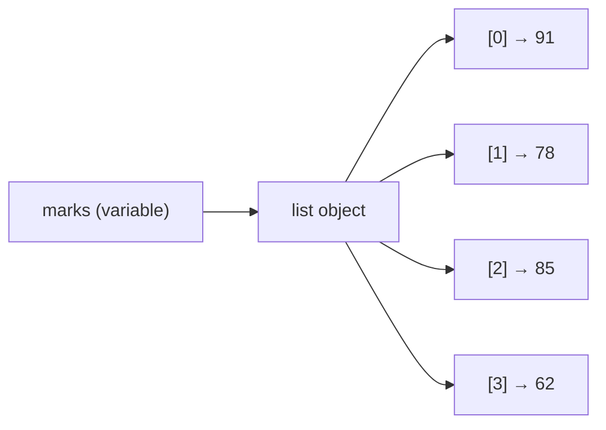
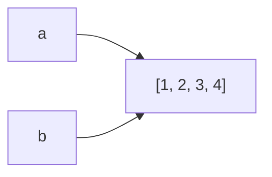
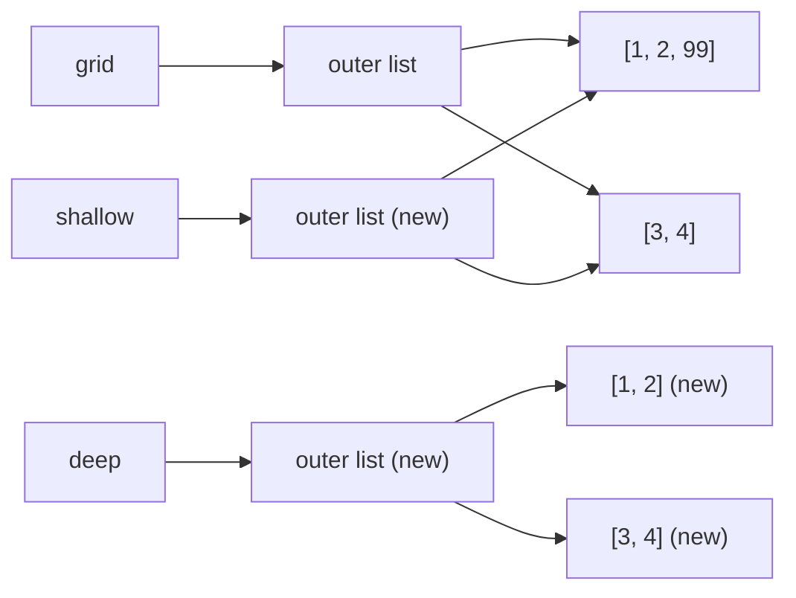
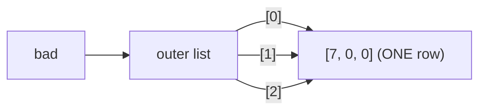
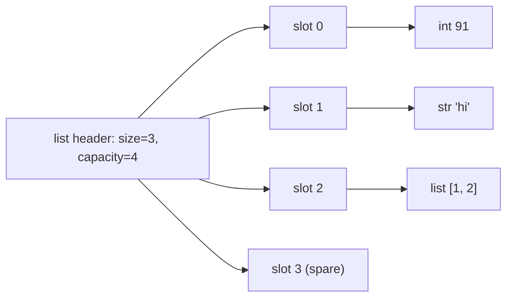

# Chapter 07 · Lists

> Your phone's contacts, your Spotify queue, the marks of 60 students in a class: real programs are full of *collections*. The list is Python's workhorse collection, and it's secretly the same thing as the "array" in every DSA problem you will ever solve. Master it here and half of DSA becomes easier.

**You will learn:**
- How to create, read, change and slice lists, with every method and its Big-O cost
- How a list really works in memory: a **dynamic array** that over-allocates, and why `append` is "amortized O(1)"
- The difference between **aliasing**, **shallow copies** and **deep copies** (a top interview topic)
- 2D lists (grids) and the infamous `[[0] * n] * m` trap
- Iteration patterns, sorting (`sort` vs `sorted`, `key`, stability) and using a list as a stack
- Classic list interview problems: second largest, rotate, remove duplicates, missing number, reverse, maximum subarray

**Before this:** [Variables, Data Types & Memory](02-variables-types-memory.md) · [Strings](04-strings.md) · [Loops & Iteration](06-loops.md)

---

## 🧠 The Big Idea

Picture a train. Each compartment has a number painted on it, starting from **0**. Inside each compartment sits one passenger. You can:

- walk straight to compartment 7 without passing through 0 to 6 (that's **indexing**, and it's instant),
- add a new compartment at the end (that's **append**, and it's cheap),
- squeeze a new compartment in at the front (that's **insert at 0**, and it's expensive, because every compartment behind it has to be renumbered).

That's a list: an **ordered** collection of items, where each item has a numbered position called its **index**.



Three facts to tattoo on your brain:

1. Lists are **ordered**: items stay in the order you put them.
2. Lists are **mutable**: you can change them after creating them (unlike strings, from [Chapter 04](04-strings.md)).
3. Lists hold **references** to objects, not the objects themselves. This one fact explains every "weird" list bug you'll ever meet.

> 💡 In DSA books and in other languages, this structure is called an **array**. When an interview problem says "given an array `nums`", in Python that's a list.

---

## 🔨 Building It Up

### 1. Creating lists

Square brackets, items separated by commas.

```python
empty = []
marks = [91, 78, 85, 62]
names = ["Asha", "Ravi", "Meera"]
mixed = [1, "two", 3.0, True, None]     # allowed, but usually a bad idea
nested = [[1, 2], [3, 4]]               # a list of lists

from_string = list("hello")             # any iterable -> list
from_range = list(range(5))
zeros = [0] * 5                         # repeat

print(empty, len(empty))
print(marks, len(marks))
print(mixed)
print(from_string)
print(from_range)
print(zeros)
```

```text
[] 0
[91, 78, 85, 62] 4
[1, 'two', 3.0, True, None]
['h', 'e', 'l', 'l', 'o']
[0, 1, 2, 3, 4]
[0, 0, 0, 0, 0]
```

What just happened: `list(...)` takes anything you can loop over (a string, a `range`) and collects its items into a new list. `len()` gives the number of items. `[0] * 5` repeats the list five times, which is the standard way to make a list of a fixed size.

### 2. Indexing: getting one item

Indexes start at **0**. Negative indexes count from the end: `-1` is the last item, `-2` the second last.

```text
item:      'a'   'b'   'c'   'd'   'e'
index:      0     1     2     3     4
negative:  -5    -4    -3    -2    -1
```

```python
letters = ["a", "b", "c", "d", "e"]
print(letters[0])      # first
print(letters[2])      # third
print(letters[-1])     # last
print(letters[-2])     # second last
print(letters[len(letters) - 1])   # last, the long way
```

```text
a
c
e
d
e
```

Asking for an index that doesn't exist is an error:

```py
letters = ["a", "b", "c"]
print(letters[3])
# IndexError: list index out of range
```

> 💡 For a list of length n, valid indexes are `0` to `n - 1` and `-n` to `-1`. Off-by-one errors live right at those edges.

### 3. Slicing: getting a piece

Slicing works exactly like string slicing from [Chapter 04](04-strings.md): `lst[start:stop:step]`. `start` is included, `stop` is **excluded**, and each part has a sensible default.

```python
nums = [10, 20, 30, 40, 50, 60]
print(nums[1:4])     # index 1, 2, 3
print(nums[:3])      # first three
print(nums[3:])      # from index 3 to the end
print(nums[-2:])     # last two
print(nums[::2])     # every second item
print(nums[::-1])    # reversed copy
print(nums[4:100])   # slices never raise IndexError
print(nums[5:2])     # empty when start is after stop
```

```text
[20, 30, 40]
[10, 20, 30]
[40, 50, 60]
[50, 60]
[10, 30, 50]
[60, 50, 40, 30, 20, 10]
[50, 60]
[]
```

What just happened: every slice builds a **brand new list**. That's why `nums[::-1]` gives a reversed copy and leaves `nums` alone. It also means slicing a list of k items costs O(k) time and memory, which matters inside loops.

> 💡 Memory trick: `nums[:k]` is "the first k", and `nums[k:]` is "everything after the first k". Together they split the list into two halves with no overlap.

### 4. Changing items (lists are mutable)

You can assign to an index, or even to a whole slice.

```python
colors = ["red", "green", "blue"]
colors[1] = "yellow"            # replace one item
print(colors)

nums = [1, 2, 3, 4, 5]
nums[1:3] = [20, 30]            # replace a slice with same length
print(nums)
nums[1:3] = [7, 7, 7, 7]        # slice assignment can change the length!
print(nums)
nums[:] = [0]                   # replace everything, same list object
print(nums)
```

```text
['red', 'yellow', 'blue']
[1, 20, 30, 4, 5]
[1, 7, 7, 7, 7, 4, 5]
[0]
```

Compare with strings: `"cat"[0] = "b"` is a `TypeError` because strings are immutable. Lists don't mind.

### 5. Adding items: append, extend, insert, +, *

```python
stack = [1, 2]
stack.append(3)            # add ONE item at the end
print(stack)

stack.append([4, 5])       # the whole list becomes ONE item
print(stack)

nums = [1, 2]
nums.extend([3, 4, 5])     # add EACH item of an iterable
print(nums)

nums.insert(0, 0)          # insert(index, value): put 0 at the front
nums.insert(3, 99)         # put 99 at index 3, shift the rest right
print(nums)

a = [1, 2]
b = a + [3]                # + builds a NEW list
print(a, b)
print([7, 8] * 3)          # * repeats
```

```text
[1, 2, 3]
[1, 2, 3, [4, 5]]
[1, 2, 3, 4, 5]
[0, 1, 2, 99, 3, 4, 5]
[1, 2] [1, 2, 3]
[7, 8, 7, 8, 7, 8]
```

What just happened: `append(x)` always adds exactly one item, even if `x` is a list. `extend(iterable)` opens the box and adds each item. `insert(i, x)` squeezes `x` in at position `i` and shifts everyone after it one step right, so it's O(n).

> ⚠️ `append` vs `extend` is a classic slip. Think: **append adds a passenger; extend adds a whole train of passengers, one by one.**

### 6. Removing items: pop, remove, del, clear

```python
nums = [10, 20, 30, 40, 50]

last = nums.pop()          # remove and RETURN the last item
print(last, nums)

first = nums.pop(0)        # remove and return the item at index 0
print(first, nums)

nums.remove(30)            # remove the first item EQUAL to 30 (returns None)
print(nums)

del nums[0]                # delete by index (a statement, not a method)
print(nums)

data = [1, 2, 3, 4, 5, 6]
del data[1:4]              # delete a whole slice
print(data)

data.clear()               # empty the list
print(data)
```

```text
50 [10, 20, 30, 40]
10 [20, 30, 40]
[20, 40]
[40]
[1, 5, 6]
[]
```

| Want to... | Use | Returns | If missing |
|---|---|---|---|
| remove by **position**, and get the item | `pop(i)` (default last) | the item | `IndexError` |
| remove by **value** | `remove(x)` | `None` | `ValueError` |
| remove by position or slice, don't need it | `del lst[i]` / `del lst[a:b]` | nothing | `IndexError` |
| remove everything | `clear()` | `None` | never fails |

```py
nums = [1, 2, 3]
nums.remove(99)     # ValueError: list.remove(x): x not in list
[].pop()            # IndexError: pop from empty list
```

### 7. Searching and counting

```python
nums = [4, 8, 15, 16, 23, 42, 8]

print(15 in nums, 99 in nums)     # membership test: True / False
print(nums.index(8))              # index of FIRST 8
print(nums.index(8, 2))           # search starting from index 2
print(nums.count(8))              # how many 8s
print(len(nums), min(nums), max(nums), sum(nums))
```

```text
True False
1
6
2
7 4 42 116
```

What just happened: `in`, `index` and `count` all walk through the list from the start, comparing each item. That's **O(n)**. If you test membership many times on a big collection, a set is much faster (O(1)). That's [Chapter 08](08-tuples-sets.md).

`index` raises `ValueError` if the value isn't there, so check with `in` first, or catch the error (exceptions are [Chapter 13](13-exceptions-files.md)).

### 8. Every list operation and its cost

Here `n` is the length of the list and `k` is the size of the other thing involved.

| Operation | Example | Time | Why |
|---|---|---|---|
| Index read / write | `a[i]`, `a[i] = x` | **O(1)** | address arithmetic (see Under the Hood) |
| Length | `len(a)` | O(1) | the length is stored, not counted |
| Append | `a.append(x)` | **O(1) amortized** | spare capacity at the end |
| Pop last | `a.pop()` | O(1) | nothing to shift |
| Pop from index i | `a.pop(i)` | O(n − i) | shifts everything after i left |
| Pop first | `a.pop(0)` | **O(n)** | shifts everything |
| Insert | `a.insert(i, x)` | O(n − i) | shifts everything after i right |
| Remove by value | `a.remove(x)` | O(n) | search + shift |
| Delete by index | `del a[i]` | O(n − i) | shift |
| Membership | `x in a` | O(n) | linear scan |
| Find index | `a.index(x)` | O(n) | linear scan |
| Count | `a.count(x)` | O(n) | scans everything |
| Slice | `a[i:j]` | O(j − i) | copies the items |
| Copy | `a.copy()`, `a[:]`, `list(a)` | O(n) | copies every reference |
| Extend / `+=` | `a.extend(b)` | O(k) amortized | appends k items |
| Concatenate | `a + b` | O(n + k) | builds a brand new list |
| Repeat | `a * k` | O(n·k) | builds a brand new list |
| Reverse in place | `a.reverse()` | O(n) | swaps pairs |
| Sort | `a.sort()`, `sorted(a)` | O(n log n) | Timsort |
| min / max / sum | `max(a)` | O(n) | looks at everything |
| Clear | `a.clear()` | O(n) | releases each reference |
| Equality | `a == b` | O(n) | compares item by item |

> 💡 The two-line summary: **the end of a list is cheap, the front is expensive. Reading by index is instant, searching by value is slow.**

### 9. Iteration patterns

You learned loops in [Chapter 06](06-loops.md). Here are the five ways you'll loop over lists forever.

```python
fruits = ["apple", "banana", "cherry"]
prices = [120, 40, 300]

# 1. Just the items (the default; use this when you don't need positions)
for fruit in fruits:
    print(fruit, end=" ")
print()

# 2. Index AND item: enumerate
for i, fruit in enumerate(fruits):
    print(i, fruit, end=" | ")
print()

# 3. Index only (when you need to look at neighbours or write back)
for i in range(1, len(prices)):
    print(prices[i] - prices[i - 1], end=" ")
print()

# 4. Two lists in parallel: zip
for fruit, price in zip(fruits, prices):
    print(f"{fruit}={price}", end=" ")
print()

# 5. Backwards without copying: reversed
for fruit in reversed(fruits):
    print(fruit, end=" ")
print()
```

```text
apple banana cherry 
0 apple | 1 banana | 2 cherry | 
-80 260 
apple=120 banana=40 cherry=300 
cherry banana apple 
```

What just happened: `enumerate` hands you `(index, item)` pairs, `zip` hands you one item from each list at a time (and stops at the shorter one), and `reversed` walks backwards without building a copy. We'll go deeper on `zip` and `enumerate` in [Chapter 11](11-comprehensions-functional.md).

**Building a new list with a loop** is the most common pattern of all: start empty, append as you go.

```python
marks = [91, 34, 78, 25, 66]
passed = []
for m in marks:
    if m >= 40:
        passed.append(m)
print(passed)
```

```text
[91, 78, 66]
```

> 💡 In [Chapter 11](11-comprehensions-functional.md) you'll write that in one line as `[m for m in marks if m >= 40]`. Same idea, shorter syntax.

**Never change a list's length while looping over it.** The loop uses an internal index, and removing an item shifts everything left, so the loop skips the item that slid into the gap:

```python
nums = [1, 2, 2, 3, 2, 4]
for x in nums:            # BUG: removing while iterating
    if x == 2:
        nums.remove(x)
print(nums)               # one 2 survived!

nums = [1, 2, 2, 3, 2, 4]
kept = []
for x in nums:            # FIX: build a new list
    if x != 2:
        kept.append(x)
print(kept)
```

```text
[1, 3, 2, 4]
[1, 3, 4]
```

### 10. Sorting: sort vs sorted

There are two tools, and the difference is a favourite interview question.

| | `lst.sort()` | `sorted(iterable)` |
|---|---|---|
| What it is | list **method** | built-in **function** |
| Changes the original? | **Yes**, in place | No |
| Returns | `None` | a **new** sorted list |
| Works on | lists only | any iterable (string, tuple, set, dict...) |

```python
nums = [5, 2, 9, 1]
result = nums.sort()
print(nums, result)            # sorted in place, returns None

scores = [70, 95, 60]
ranked = sorted(scores, reverse=True)
print(scores, ranked)          # original untouched

print(sorted("python"))        # works on any iterable
```

```text
[1, 2, 5, 9] None
[70, 95, 60] [95, 70, 60]
['h', 'n', 'o', 'p', 't', 'y']
```

**The `key` parameter** says *what to sort by*. You give it a function, Python calls it once on every item, and sorts by the results. Functions are [Chapter 10](10-functions.md); for now just know you can pass a function's name without calling it.

```python
words = ["banana", "Apple", "kiwi", "cherry"]
print(sorted(words))                  # uppercase letters come before lowercase!
print(sorted(words, key=str.lower))   # case-insensitive
print(sorted(words, key=len))         # by length
print(sorted(words, key=len, reverse=True))
```

```text
['Apple', 'banana', 'cherry', 'kiwi']
['Apple', 'banana', 'cherry', 'kiwi']
['kiwi', 'Apple', 'banana', 'cherry']
['banana', 'cherry', 'Apple', 'kiwi']
```

What just happened: by default strings compare by character codes, and `'A'` (65) is smaller than `'b'` (98). With `key=len`, Python compares the lengths 6, 5, 4, 6 instead. Look at `'banana'` and `'cherry'`: both have length 6, and they stay in their **original order**. That's stability.

**Stability** means: items that compare equal keep their original relative order. Python's sort is always stable, which lets you sort by several things in steps:

```python
students = [["Ravi", 85], ["Asha", 92], ["Meera", 85], ["Kabir", 92]]
# Proper multi-key sorting comes in Chapter 11. For now, a stable two-step:
step1 = sorted(students, key=lambda row: row[0])                 # by name
step2 = sorted(step1, key=lambda row: row[1], reverse=True)      # then by marks
for name, mark in step2:
    print(name, mark)
```

```text
Asha 92
Kabir 92
Meera 85
Ravi 85
```

What just happened: we sorted by name first, then by marks. Because the second sort is stable, students with equal marks stay in name order. `lambda row: row[1]` is a tiny unnamed function that returns the marks; you'll meet `lambda` properly in [Chapter 10](10-functions.md).

**Reversing**, three ways:

```python
a = [1, 2, 3]
a.reverse()              # in place, returns None
print(a)
print(a[::-1])           # new reversed list
print(list(reversed(a))) # new list from a reverse iterator
```

```text
[3, 2, 1]
[1, 2, 3]
[1, 2, 3]
```

> ⚠️ You can't sort a list that mixes types that can't be compared: `sorted([3, "a"])` raises `TypeError: '<' not supported between instances of 'str' and 'int'`.

### 11. Aliasing vs copying

This is the most important section in the chapter. Remember from [Chapter 02](02-variables-types-memory.md) that a variable is a **name tag** stuck on an object. So:

```python
a = [1, 2, 3]
b = a            # NOT a copy! b is a second name tag on the SAME list
b.append(4)
print(a)         # a changed too
print(a is b)    # same object?
```

```text
[1, 2, 3, 4]
True
```



Two names pointing at one object is called **aliasing**. It's not a bug; it's how Python works. It becomes a bug when you *thought* you had two separate lists.

**`==` vs `is`:** `==` asks "do they hold equal values?" and `is` asks "are they literally the same object?"

```python
x = [1, 2]
y = [1, 2]
print(x == y, x is y)    # equal values, different objects
```

```text
True False
```

**Shallow copy**: a new outer list, but the items inside are the **same** objects. Four ways to make one:

```python
import copy

original = [1, 2, 3]
c1 = original.copy()
c2 = original[:]
c3 = list(original)
c4 = copy.copy(original)

c1.append(99)
print(original, c1)
print(c1 is original, c2 is original, c3 is original, c4 is original)
```

```text
[1, 2, 3] [1, 2, 3, 99]
False False False False
```

For a list of numbers or strings, a shallow copy is all you need, because numbers and strings are immutable: nobody can change them in place. But with a list of lists:

```python
import copy

grid = [[1, 2], [3, 4]]
shallow = grid.copy()
deep = copy.deepcopy(grid)

shallow[0].append(99)     # changes the inner list that BOTH share
print(grid)
print(shallow)
print(deep)               # deep copy has its own inner lists

print(shallow[0] is grid[0], deep[0] is grid[0])
```

```text
[[1, 2, 99], [3, 4]]
[[1, 2, 99], [3, 4]]
[[1, 2], [3, 4]]
True False
```



What just happened: a shallow copy copies **one level**: the outer list is new, but its slots point to the same inner lists. `copy.deepcopy` walks down recursively and copies everything, so nothing is shared.

| | `b = a` | shallow copy | deep copy |
|---|---|---|---|
| New outer list? | ❌ | ✅ | ✅ |
| New inner objects? | ❌ | ❌ | ✅ |
| Cost | O(1) | O(n) | O(total size) |
| Safe for flat lists of numbers/strings? | ❌ | ✅ | ✅ (overkill) |
| Safe for nested lists? | ❌ | ❌ | ✅ |

**Functions receive aliases too.** When you pass a list into a function, the function gets a name tag on the same list, so it can change your list. (More in [Chapter 10](10-functions.md).)

```python
def add_bonus(marks):
    for i in range(len(marks)):
        marks[i] += 5

scores = [70, 80]
add_bonus(scores)
print(scores)
```

```text
[75, 85]
```

### 12. 2D lists (grids, matrices) and the `[[0] * n] * m` trap

A **2D list** is a list whose items are lists: rows of columns. Board games, images, maps, DP tables: all grids.

```python
grid = [
    [1, 2, 3],
    [4, 5, 6],
]
rows, cols = len(grid), len(grid[0])
print(rows, cols)
print(grid[1][2])           # row 1, column 2

for r in range(rows):
    for c in range(cols):
        print(grid[r][c], end=" ")
    print()

for row in grid:            # the Pythonic way when you don't need indexes
    print(sum(row))
```

```text
2 3
6
1 2 3 
4 5 6 
6
15
```

Read `grid[r][c]` as: first pick the row list `grid[r]`, then pick item `c` from it.

**Now the trap.** You want a 3×3 grid of zeros, so you write the "obvious" thing:

```python
bad = [[0] * 3] * 3
bad[0][0] = 7
print(bad)
print(bad[0] is bad[1])
```

```text
[[7, 0, 0], [7, 0, 0], [7, 0, 0]]
True
```

Every row changed! `[0] * 3` builds **one** row, and `* 3` copies the **reference** to that row three times. You have three name tags on one row.



Why does `[0] * 3` work fine, then? It also copies the reference to the same `0` three times, but `0` is immutable. Writing `row[0] = 7` doesn't change the `0` object; it points slot 0 at a different object. A row, though, is mutable, and `bad[0][0] = 7` changes the shared row itself.

**The fix:** build a separate row for each line.

```python
rows, cols = 3, 3
good = []
for _ in range(rows):
    good.append([0] * cols)       # a NEW row each time
good[0][0] = 7
print(good)

# The one-line version you'll use daily (comprehensions: Chapter 11)
also_good = [[0] * cols for _ in range(rows)]
also_good[1][1] = 5
print(also_good)
```

```text
[[7, 0, 0], [0, 0, 0], [0, 0, 0]]
[[0, 0, 0], [0, 5, 0], [0, 0, 0]]
```

**Grid essentials:** transposing (rows become columns) and walking the four neighbours of a cell, which you'll do constantly in [Graphs](../part-2-dsa/16-graphs-bfs-dfs.md).

```python
matrix = [[1, 2, 3],
          [4, 5, 6]]

transposed = []
for c in range(len(matrix[0])):
    new_row = []
    for r in range(len(matrix)):
        new_row.append(matrix[r][c])
    transposed.append(new_row)
print(transposed)
print([list(col) for col in zip(*matrix)])   # the pro version (Chapter 08 explains *)

# The 4 neighbours of cell (r, c), staying inside the grid
r, c = 0, 1
for dr, dc in [(-1, 0), (1, 0), (0, -1), (0, 1)]:
    nr, nc = r + dr, c + dc
    if 0 <= nr < len(matrix) and 0 <= nc < len(matrix[0]):
        print((nr, nc), matrix[nr][nc])
```

```text
[[1, 4], [2, 5], [3, 6]]
[[1, 4], [2, 5], [3, 6]]
(1, 1) 5
(0, 0) 1
(0, 2) 3
```

### 13. A list as a stack

A **stack** is a pile of plates: you add on top and take from the top. Last In, First Out (**LIFO**). The end of a Python list is the top: `append` pushes, `pop` pops, `[-1]` peeks. All O(1).

```python
history = []
history.append("google.com")      # push
history.append("youtube.com")
history.append("github.com")
print("peek:", history[-1])
print("back to:", history.pop())  # pop
print("back to:", history.pop())
print("left:", history)
print("empty?", not history)
```

```text
peek: github.com
back to: github.com
back to: youtube.com
left: ['google.com']
empty? False
```

A **queue** (first in, first out, like a ticket line) is a different story. `pop(0)` is O(n) because every remaining item shifts left. For queues use `collections.deque`, whose `popleft()` is O(1). Queues and deques get their own chapter: [Chapter 12 of DSA](../part-2-dsa/12-queues-deques.md). Stacks get [Chapter 11 of DSA](../part-2-dsa/11-stacks.md).

```python
from collections import deque

line = deque(["Asha", "Ravi"])
line.append("Meera")          # join at the back
print(line.popleft())         # leave from the front, O(1)
print(list(line))
```

```text
Asha
['Ravi', 'Meera']
```

### 14. Handy built-ins and tricks for lists

```python
nums = [3, 1, 4, 1, 5, 9, 2, 6]

print(sum(nums) / len(nums))          # average
print(max(nums), nums.index(max(nums)))   # biggest value and where it is
print(sorted(nums)[-2])               # second largest (with duplicates allowed)
print(nums[-3:])                      # last three
first, *middle, last = nums           # star unpacking (more in Chapter 08)
print(first, last, len(middle))
print(", ".join(str(x) for x in nums[:3]))   # list of numbers -> string
print("a,b,c".split(","))                    # string -> list
```

```text
3.875
9 5
6
[9, 2, 6]
3 6 6
3, 1, 4
['a', 'b', 'c']
```

---

## 🔬 Under the Hood

### A list is an array of pointers

In memory, CPython stores a list as a small header plus a separate **contiguous block** of memory slots. Each slot is 8 bytes (on a 64-bit machine) and holds a **pointer** (a memory address) to an object somewhere else.



This explains three things at once:

1. **Why indexing is O(1).** The slots are side by side and all the same size. To find slot `i`, the CPU computes `start_address + i × 8`. One multiplication and one addition, whether the list has 10 items or 10 million.
2. **Why a list can hold mixed types.** Every slot is just an address, and an address is 8 bytes no matter what it points to.
3. **Why aliasing and shallow copies behave as they do.** Copying a list copies the *addresses*, not the objects.

### Dynamic array: why append is cheap

A plain array has a fixed size. So how can a list grow forever? The trick is **over-allocation**: when a list runs out of slots, Python allocates a bigger block, copies the old pointers over, and keeps some **spare capacity** so the next few appends need no copying.

- **size** = how many items you have (`len`)
- **capacity** = how many slots are reserved

You can watch the capacity jump with `sys.getsizeof` (bytes used by the list object itself, not its items):

```python
import sys

a = []
last = sys.getsizeof(a)
print(f"len={len(a):2}  bytes={last}")
for i in range(26):
    a.append(i)
    size = sys.getsizeof(a)
    if size != last:                     # capacity grew
        print(f"len={len(a):2}  bytes={size}")
        last = size
```

```text
len= 0  bytes=56
len= 1  bytes=88
len= 5  bytes=120
len= 9  bytes=184
len=17  bytes=248
len=25  bytes=312
```

What just happened (numbers from 64-bit CPython 3.11+; other builds may differ slightly): the empty list is 56 bytes. On the first append it reserves room for 4 pointers (56 + 4×8 = 88). Appends 2, 3, 4 cost nothing extra. At the 5th it grows to 8 slots, then 16, 24, 32... CPython grows by roughly 1.125× plus a small constant; many other languages double. Either way, the growth is **proportional to the current size**, and that's the key.

### Amortized O(1), explained like a phone bill

One unlucky append that triggers a resize costs O(n) (copy all n pointers). So why do we call append O(1)?

Imagine doubling for simplicity. To reach n items you resize at sizes 1, 2, 4, 8, ..., n. Total copying work = 1 + 2 + 4 + ... + n < **2n**. Spread over n appends, that's less than **2 copies per append**: a constant. That's what **amortized** means: "averaged over a long sequence of operations, the cost per operation is constant", even though a single operation is occasionally expensive. It's like a monthly phone plan: one big payment, but per day it's cheap.

Growing by a constant amount (say +10 slots each time) would **not** work: you'd resize n/10 times, copying 10 + 20 + 30 + ... ≈ n²/20 items, which is O(n) per append. Growing **proportionally** is what makes the maths work.

### Why the front is expensive

`insert(0, x)` and `pop(0)` must shift every pointer one slot to keep the block contiguous. That's n moves: O(n). Do it inside a loop of n iterations and you've written an accidental O(n²) program. That's why queues use `deque` (a different structure built from linked blocks) instead.

### Shrinking

When you pop many items, CPython also shrinks the allocation if the list falls below half its capacity, so memory isn't wasted forever. `clear()` releases the whole block.

### How sorting works

`list.sort()` and `sorted()` use **Timsort**, a hybrid of merge sort and insertion sort designed by Tim Peters for Python in 2002. It finds already-sorted "runs" in your data and merges them, so it's O(n log n) in the worst case, **O(n)** on already-sorted data, and always **stable**. You'll build merge sort yourself in [Sorting Algorithms](../part-2-dsa/07-sorting.md).

---

## 🧩 Pattern Decoder

### Pythonic list idioms

| Instead of... | Write | Why |
|---|---|---|
| `lst[len(lst) - 1]` | `lst[-1]` | shorter, same meaning |
| `for i in range(len(lst)): print(lst[i])` | `for x in lst:` | no index noise |
| manual counter + loop | `for i, x in enumerate(lst):` | index and value together |
| `if len(lst) == 0:` | `if not lst:` | empty lists are falsy ([Chapter 05](05-conditionals.md)) |
| `temp = a[i]; a[i] = a[j]; a[j] = temp` | `a[i], a[j] = a[j], a[i]` | one-line swap |
| copying with a loop | `b = a.copy()` or `a[:]` | clearer, faster |
| `result = result + [x]` in a loop | `result.append(x)` | `+` builds a new list each time: O(n²) total |
| `pop(0)` in a loop | `collections.deque.popleft()` | O(1) instead of O(n) |
| `x = x.sort()` | `x.sort()` or `x = sorted(x)` | `sort()` returns `None` |

### The four list "shapes" you'll use in DSA

**1. Running answer** (scan once, keep the best so far): max, min, second largest, best profit.

```python
def best_time_to_buy_and_sell(prices):
    lowest = prices[0]
    best = 0
    for p in prices:
        lowest = min(lowest, p)          # best day to buy so far
        best = max(best, p - lowest)     # best profit if we sell today
    return best

print(best_time_to_buy_and_sell([7, 1, 5, 3, 6, 4]))
```

```text
5
```

**2. Build a new list** (filter or transform): start with `[]`, `append` what you keep.

**3. Reader/writer in place** (filter with O(1) extra memory): see [Two Pointers](../part-2-dsa/03-two-pointers.md).

**4. Stack** (`append`/`pop`): matching brackets, undo, "next greater element" in [Stacks](../part-2-dsa/11-stacks.md).

```python
def is_balanced(text):
    pairs = {")": "(", "]": "[", "}": "{"}     # a dict: Chapter 09
    stack = []
    for ch in text:
        if ch in "([{":
            stack.append(ch)
        elif ch in pairs:
            if not stack or stack.pop() != pairs[ch]:
                return False
    return not stack

print(is_balanced("{[()()]}"), is_balanced("([)]"), is_balanced("(("))
```

```text
True False False
```

### How lists show up later

| Later topic | What the list does there |
|---|---|
| [Arrays & Strings](../part-2-dsa/02-arrays-strings.md) | the "array" in every problem |
| [Two Pointers](../part-2-dsa/03-two-pointers.md), [Sliding Window](../part-2-dsa/04-sliding-window.md) | indexes moving over a list |
| [Prefix Sums](../part-2-dsa/06-prefix-sums.md) | a second list of running totals |
| [Stacks](../part-2-dsa/11-stacks.md) | `append` / `pop` |
| [Heaps](../part-2-dsa/15-heaps.md) | `heapq` stores a heap inside a plain list |
| [Graphs](../part-2-dsa/16-graphs-bfs-dfs.md) | grids and adjacency lists (`list` of `list`) |
| [Dynamic Programming](../part-2-dsa/20-dp-1d.md) | `dp = [0] * (n + 1)` tables |

---

## ⚠️ Traps & Common Mistakes

1. **Thinking `b = a` copies.** It creates an alias. Use `a.copy()` for flat lists and `copy.deepcopy(a)` for nested ones.

2. **The grid trap.** `[[0] * n] * m` makes m references to one row.

```py
grid = [[0] * 3] * 3                 # ❌ one shared row
grid = [[0] * 3 for _ in range(3)]   # ✅ three separate rows
```

3. **Assigning the result of `sort()`.** It returns `None`.

```py
nums = nums.sort()      # ❌ nums is now None
nums.sort()             # ✅ in place
nums = sorted(nums)     # ✅ new list
```

The same is true of `append`, `extend`, `insert`, `remove`, `reverse`, `clear`: methods that change the list return `None`.

4. **`append` when you meant `extend`.** `a.append([4, 5])` adds one item (a list). `a.extend([4, 5])` adds two items.

5. **Removing items while iterating.** Elements get skipped. Build a new list, iterate over a copy (`for x in nums[:]`), or use reader/writer.

6. **`remove` only removes the first match**, and raises `ValueError` if there's none. To remove all, filter into a new list.

7. **Using `pop(0)` or `insert(0, x)` in a loop.** Each is O(n), so the loop becomes O(n²). Use `deque`.

8. **`+=` on an alias changes the shared list, but `= a + ...` doesn't.** `a += [1]` mutates `a` in place (like `extend`), so every alias sees it. `a = a + [1]` builds a new list and moves only the name `a`.

```python
a = [1, 2]
b = a
a += [3]          # in place: b sees it
print(b)
a = a + [4]       # new list: b does NOT see it
print(a, b)
```

```text
[1, 2, 3]
[1, 2, 3, 4] [1, 2, 3]
```

9. **Off-by-one with `range(len(lst))`.** Comparing `lst[i]` with `lst[i + 1]`? Loop to `len(lst) - 1`, or you'll get `IndexError` on the last step.

10. **Shadowing the built-in.** Naming a variable `list = [1, 2]` hides the `list()` function for the rest of the program. Use `nums`, `items`, `values`.

---

## 💡 Tips & Tricks

- `lst[-1]` is the last item, `lst[-k:]` the last k, `lst[:k]` the first k. Slices never crash on out-of-range bounds.
- Need a fixed-size list? `[0] * n`, `[None] * n`, or `[False] * n`. Fine for immutable fillers; never for lists.
- `if not lst:` is the idiomatic empty check.
- `sorted(x, key=..., reverse=True)` works on any iterable and leaves the original alone. Use `.sort()` when you don't need the original and want to save memory.
- `min(lst)` and `max(lst)` crash on an empty list. Pass `default=`: `max(lst, default=0)`.
- To swap two items: `a[i], a[j] = a[j], a[i]`.
- To rotate right by k: `a[-k:] + a[:-k]` (with `k %= len(a)` first).
- To remove duplicates while keeping order: `list(dict.fromkeys(a))` (why it works: [Chapter 09](09-dictionaries.md)).
- To flatten one level: loop and `extend`, or `[x for row in grid for x in row]` ([Chapter 11](11-comprehensions-functional.md)).
- In interviews, say the cost out loud: "`pop(0)` is O(n), so I'll use a deque."

---

## 🎯 Interview Questions

### 1. What's the difference between a list and an array? Between a list and a tuple? 🔥🔥🔥

<details><summary>Answer</summary>

- A **Python list** is a *dynamic array of references*: it can grow, and it can hold mixed types because every slot is a pointer.
- A classic **array** (C, Java `int[]`, Python's `array` module, NumPy) stores the raw values of **one type** side by side, often with a fixed size. It uses less memory and is faster for number-crunching.
- A **tuple** is like a list but **immutable**: you can't add, remove or replace items after creation. That makes it hashable (usable as a dict key) when its items are hashable. Details in [Chapter 08](08-tuples-sets.md).

</details>

### 2. Why is `append` O(1) when the list sometimes has to be copied? 🔥🔥🔥

<details><summary>Answer</summary>

Lists over-allocate. When full, CPython allocates a block proportionally larger (about 1.125× + a constant) and copies the pointers. The copy is O(n), but it happens rarely: with proportional growth the total copying for n appends is O(n), so the **amortized** cost per append is O(1). If growth were by a fixed amount, total copying would be O(n²) and append would be O(n) amortized.

</details>

### 3. What does this print? 🔥🔥🔥

```py
grid = [[0] * 2] * 2
grid[0][0] = 1
print(grid)
```

<details><summary>Answer</summary>

`[[1, 0], [1, 0]]`. The outer `* 2` copies the reference to the same inner list. Fix: `[[0] * 2 for _ in range(2)]`.

</details>

### 4. Shallow copy vs deep copy? 🔥🔥🔥

<details><summary>Answer</summary>

A **shallow copy** (`a.copy()`, `a[:]`, `list(a)`, `copy.copy(a)`) creates a new outer list whose slots point to the **same** inner objects. A **deep copy** (`copy.deepcopy(a)`) recursively copies inner objects too. For a flat list of immutable items they behave the same. For nested mutable items, changing an inner list through a shallow copy affects the original; with a deep copy it doesn't.

</details>

### 5. `sort()` vs `sorted()`? Is Python's sort stable? 🔥🔥

<details><summary>Answer</summary>

`lst.sort()` sorts in place and returns `None`; it only exists on lists. `sorted(iterable)` returns a new list and works on any iterable. Both accept `key=` and `reverse=`, both use Timsort, O(n log n) worst case, O(n) on already-sorted input, and both are **stable**: equal items keep their original relative order.

</details>

### 6. `remove` vs `pop` vs `del`? 🔥🔥

<details><summary>Answer</summary>

`remove(x)` deletes the first item **equal to x** (ValueError if missing), returns `None`. `pop(i)` deletes the item at **index i** (default last) and **returns it**. `del lst[i]` / `del lst[a:b]` is a statement that deletes by index or slice and returns nothing. Costs: `pop()` is O(1); `pop(i)`, `del lst[i]` and `remove` are O(n) in general because of shifting (and searching, for `remove`).

</details>

### 7. Find the second largest element 🔥🔥🔥

Return the second largest **distinct** value, or `None` if it doesn't exist. Do it in one pass.

<details><summary>Answer</summary>

Keep two variables. When you see a new maximum, the old maximum becomes second.

```python
def second_largest(nums):
    first = second = None
    for x in nums:
        if first is None or x > first:
            first, second = x, first
        elif x != first and (second is None or x > second):
            second = x
    return second

print(second_largest([12, 35, 1, 10, 34, 1]))
print(second_largest([10, 10, 10]))
print(second_largest([5, 9]))
```

```text
34
None
5
```

Time O(n), space O(1). Sorting (`sorted(set(nums))[-2]`) also works but is O(n log n); mention it as the quick version.

</details>

### 8. Rotate Array (LeetCode 189) 🔥🔥🔥

Rotate `nums` to the right by `k` steps, in place. `[1,2,3,4,5,6,7]`, k=3 → `[5,6,7,1,2,3,4]`.

<details><summary>Answer</summary>

**Reversal trick:** reverse the whole list, then reverse the first k, then reverse the rest. Remember `k %= n` (rotating by n changes nothing).

```python
def rotate(nums, k):
    n = len(nums)
    k %= n

    def reverse(lo, hi):
        while lo < hi:
            nums[lo], nums[hi] = nums[hi], nums[lo]
            lo += 1
            hi -= 1

    reverse(0, n - 1)     # [7,6,5,4,3,2,1]
    reverse(0, k - 1)     # [5,6,7,4,3,2,1]
    reverse(k, n - 1)     # [5,6,7,1,2,3,4]
    return nums

print(rotate([1, 2, 3, 4, 5, 6, 7], 3))
print(rotate([-1, -100, 3, 99], 6))
```

```text
[5, 6, 7, 1, 2, 3, 4]
[3, 99, -1, -100]
```

Time O(n), space O(1). The slicing version `nums[:] = nums[-k:] + nums[:-k]` is O(n) time but O(n) extra space. (Note `nums[:] =` writes into the same list, so callers see the change; `nums = ...` would not.)

</details>

### 9. Remove duplicates from an unsorted list, keeping order 🔥🔥

`[3, 1, 3, 2, 1]` → `[3, 1, 2]`.

<details><summary>Answer</summary>

Track what you've seen in a set (O(1) membership, [Chapter 08](08-tuples-sets.md)).

```python
def dedupe(nums):
    seen = set()
    out = []
    for x in nums:
        if x not in seen:
            seen.add(x)
            out.append(x)
    return out

print(dedupe([3, 1, 3, 2, 1]))
print(list(dict.fromkeys([3, 1, 3, 2, 1])))   # one-liner, same result
```

```text
[3, 1, 2]
[3, 1, 2]
```

Time O(n), space O(n). For a **sorted** list in place, use reader/writer ([Two Pointers](../part-2-dsa/03-two-pointers.md)). Avoid `if x not in out` (that's O(n) per check, O(n²) total).

</details>

### 10. Missing Number (LeetCode 268) 🔥🔥🔥

`nums` holds n distinct numbers from `0..n`. One is missing. Find it.

<details><summary>Answer</summary>

The sum of `0..n` is `n(n+1)/2`. Subtract the actual sum.

```python
def missing_number(nums):
    n = len(nums)
    return n * (n + 1) // 2 - sum(nums)

print(missing_number([3, 0, 1]))
print(missing_number([9, 6, 4, 2, 3, 5, 7, 0, 1]))
```

```text
2
8
```

Time O(n), space O(1). In languages with fixed-size integers, interviewers like the XOR version (`x ^ x = 0`), which avoids overflow: XOR every index and every value; the leftover is the answer. Python ints never overflow, but mention it ([Bit Manipulation](../part-2-dsa/23-bits-math.md)).

</details>

### 11. Reverse a list in place without slicing or `reverse()` 🔥🔥

<details><summary>Answer</summary>

Two pointers from both ends, swapping.

```python
def reverse_in_place(a):
    left, right = 0, len(a) - 1
    while left < right:
        a[left], a[right] = a[right], a[left]
        left += 1
        right -= 1
    return a

print(reverse_in_place([1, 2, 3, 4, 5]))
print(reverse_in_place([]))
```

```text
[5, 4, 3, 2, 1]
[]
```

O(n) time, O(1) space.

</details>

### 12. Maximum Subarray (LeetCode 53), preview of Kadane's algorithm 🔥🔥🔥

Find the largest sum of a **contiguous** non-empty subarray. `[-2,1,-3,4,-1,2,1,-5,4]` → 6 (`[4,-1,2,1]`).

<details><summary>Answer</summary>

Walk left to right, keeping `current` = best sum of a subarray **ending here**. At each number, either extend the previous subarray or start fresh: `current = max(x, current + x)`. If the running sum went negative, it can only hurt what comes next, so drop it.

```python
def max_subarray(nums):
    current = best = nums[0]
    for x in nums[1:]:
        current = max(x, current + x)
        best = max(best, current)
    return best

print(max_subarray([-2, 1, -3, 4, -1, 2, 1, -5, 4]))
print(max_subarray([-3, -1, -2]))
```

```text
6
-1
```

Time O(n), space O(1). The brute force tries all O(n²) subarrays. Kadane's algorithm is secretly dynamic programming; you'll see why in [DP I](../part-2-dsa/20-dp-1d.md).

</details>

### 13. `a = a + [x]` vs `a += [x]`: what's the difference? 🔥

<details><summary>Answer</summary>

`a += [x]` calls the list's in-place add (like `extend`): same object, aliases see the change, amortized O(k). `a = a + [x]` builds a **new** list (O(n)) and rebinds `a`; aliases still see the old list. Doing `a = a + [x]` inside a loop is O(n²) in total.

</details>

---

## 🏋️ Practice

**🟢 1. Running sum.** Given `[1, 2, 3, 4]`, return `[1, 3, 6, 10]` (each item is the sum of everything up to it).

<details><summary>Solution</summary>

```python
def running_sum(nums):
    out = []
    total = 0
    for x in nums:
        total += x
        out.append(total)
    return out

print(running_sum([1, 2, 3, 4]))
print(running_sum([3, 1, 2, 10, 1]))
```

```text
[1, 3, 6, 10]
[3, 4, 6, 16, 17]
```

This is a **prefix sum**, one of the most useful tricks in DSA ([Chapter 06](../part-2-dsa/06-prefix-sums.md)).

</details>

**🟢 2. Count evens and odds** in a list, returning both counts.

<details><summary>Solution</summary>

```python
def count_even_odd(nums):
    even = 0
    for x in nums:
        if x % 2 == 0:
            even += 1
    return even, len(nums) - even

print(count_even_odd([1, 2, 3, 4, 5, 6, 7]))
```

```text
(3, 4)
```

</details>

**🟢 3. Is it sorted?** Return True if the list is in non-decreasing order, without sorting it.

<details><summary>Solution</summary>

```python
def is_sorted(nums):
    for i in range(len(nums) - 1):        # stop one early: we look at i + 1
        if nums[i] > nums[i + 1]:
            return False
    return True

print(is_sorted([1, 2, 2, 5]), is_sorted([3, 1, 2]), is_sorted([]))
```

```text
True False True
```

O(n) instead of O(n log n) for `nums == sorted(nums)`.

</details>

**🟡 4. Move zeroes** to the end in place, keeping the order of the other items.

<details><summary>Solution</summary>

```python
def move_zeroes(nums):
    write = 0
    for x in nums:
        if x != 0:
            nums[write] = x
            write += 1
    for i in range(write, len(nums)):
        nums[i] = 0
    return nums

print(move_zeroes([0, 1, 0, 3, 12]))
```

```text
[1, 3, 12, 0, 0]
```

O(n) time, O(1) space.

</details>

**🟡 5. Rotate a matrix 90° clockwise** (n × n), returning a new matrix.

<details><summary>Solution</summary>

Rotating clockwise = transpose, then reverse each row.

```python
def rotate_matrix(m):
    n = len(m)
    out = [[0] * n for _ in range(n)]
    for r in range(n):
        for c in range(n):
            out[c][n - 1 - r] = m[r][c]
    return out

for row in rotate_matrix([[1, 2, 3], [4, 5, 6], [7, 8, 9]]):
    print(row)
```

```text
[7, 4, 1]
[8, 5, 2]
[9, 6, 3]
```

Cell `(r, c)` moves to `(c, n-1-r)`. O(n²) time. The in-place version (LeetCode 48, Rotate Image) transposes in place then reverses each row.

</details>

**🟡 6. Merge two sorted lists** into one sorted list without calling `sort`.

<details><summary>Solution</summary>

```python
def merge(a, b):
    i = j = 0
    out = []
    while i < len(a) and j < len(b):
        if a[i] <= b[j]:
            out.append(a[i])
            i += 1
        else:
            out.append(b[j])
            j += 1
    out.extend(a[i:])
    out.extend(b[j:])
    return out

print(merge([1, 4, 9], [2, 3, 10, 12]))
```

```text
[1, 2, 3, 4, 9, 10, 12]
```

O(n + m). This is the heart of merge sort.

</details>

**🔴 7. Spiral order.** Return the items of an m × n matrix in clockwise spiral order (LeetCode 54).

<details><summary>Solution</summary>

Keep four walls (`top`, `bottom`, `left`, `right`) and peel one layer at a time.

```python
def spiral_order(matrix):
    out = []
    top, bottom = 0, len(matrix) - 1
    left, right = 0, len(matrix[0]) - 1
    while top <= bottom and left <= right:
        for c in range(left, right + 1):
            out.append(matrix[top][c])
        top += 1
        for r in range(top, bottom + 1):
            out.append(matrix[r][right])
        right -= 1
        if top <= bottom:
            for c in range(right, left - 1, -1):
                out.append(matrix[bottom][c])
            bottom -= 1
        if left <= right:
            for r in range(bottom, top - 1, -1):
                out.append(matrix[r][left])
            left += 1
    return out

print(spiral_order([[1, 2, 3], [4, 5, 6], [7, 8, 9]]))
print(spiral_order([[1, 2, 3, 4], [5, 6, 7, 8], [9, 10, 11, 12]]))
```

```text
[1, 2, 3, 6, 9, 8, 7, 4, 5]
[1, 2, 3, 4, 8, 12, 11, 10, 9, 5, 6, 7]
```

The two `if` checks stop the bottom row / left column from being added twice when only one row or column is left. O(m·n).

</details>

**🔴 8. Product of Array Except Self** (LeetCode 238): return a list where `out[i]` is the product of every item except `nums[i]`, without division, in O(n).

<details><summary>Solution</summary>

`out[i]` = (product of everything left of i) × (product of everything right of i). Fill the left products in one pass, then multiply in the right products in a backward pass.

```python
def product_except_self(nums):
    n = len(nums)
    out = [1] * n
    left = 1
    for i in range(n):
        out[i] = left
        left *= nums[i]
    right = 1
    for i in range(n - 1, -1, -1):
        out[i] *= right
        right *= nums[i]
    return out

print(product_except_self([1, 2, 3, 4]))
print(product_except_self([-1, 1, 0, -3, 3]))
```

```text
[24, 12, 8, 6]
[0, 0, 9, 0, 0]
```

O(n) time, O(1) extra space besides the output.

</details>

---

## 🧠 Never-Forget Summary

- A list is an **ordered, mutable** sequence; indexes run `0..n-1` and `-n..-1`.
- Slices `a[start:stop:step]` include start, exclude stop, never crash, and always make a **new** list.
- Inside, a list is a **dynamic array of pointers**: O(1) indexing, mixed types allowed.
- **Over-allocation** makes `append` **amortized O(1)**. The end is cheap; the front (`insert(0)`, `pop(0)`) is O(n).
- `in`, `index`, `count`, `remove` are O(n) scans. For fast membership use a set.
- `b = a` is an **alias**. `a.copy()` / `a[:]` is a **shallow copy**. `copy.deepcopy(a)` copies all levels.
- `[[0] * n] * m` shares one row. Use `[[0] * n for _ in range(m)]`.
- `sort()` changes in place and returns `None`; `sorted()` returns a new list. Both are stable Timsort, O(n log n), with `key=` and `reverse=`.
- Don't change a list's length while looping over it.
- A list is a perfect **stack** (`append`/`pop`); for a **queue** use `deque`.

**Memory hooks:**
- **"Back is cheap, front is steep."** (append/pop at the end vs insert/pop at index 0)
- **"Equals is twins, `is` is the same person."** (`==` compares values, `is` compares identity)
- **"Times-star grid? Shared row, big cry."** (`[[0]*n]*m`)
- **"sort() says nothing."** (returns `None`)

**One picture:**

| You want to... | Use | Cost |
|---|---|---|
| read/write position i | `a[i]` | O(1) |
| add at end / remove from end | `append` / `pop()` | O(1)* |
| add/remove at front or middle | `insert` / `pop(i)` / `del` | O(n) |
| find by value | `in`, `index`, `count`, `remove` | O(n) |
| piece of the list | `a[i:j]` | O(j−i) |
| independent copy | `copy()` (flat) / `deepcopy` (nested) | O(n) |
| order it | `sort()` / `sorted()` | O(n log n) |
| stack / queue | list / `deque` | O(1) |

\*amortized

> **If you remember only one thing:** a list stores *references* in a growable array, so the end is fast, the front is slow, and copying a list never copies what's inside it unless you ask for a deep copy.

---
**Next:** [Chapter 08 · Tuples & Sets](08-tuples-sets.md)  ·  **Back to** [Contents](../README.md)
