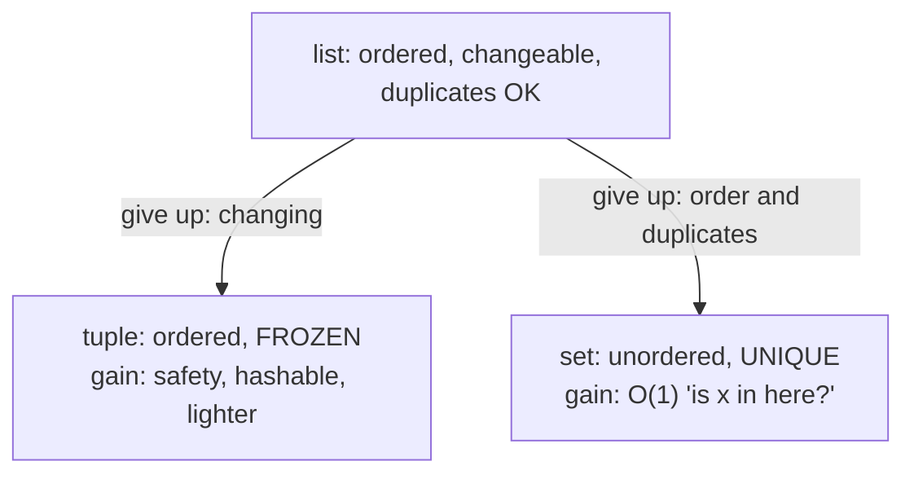
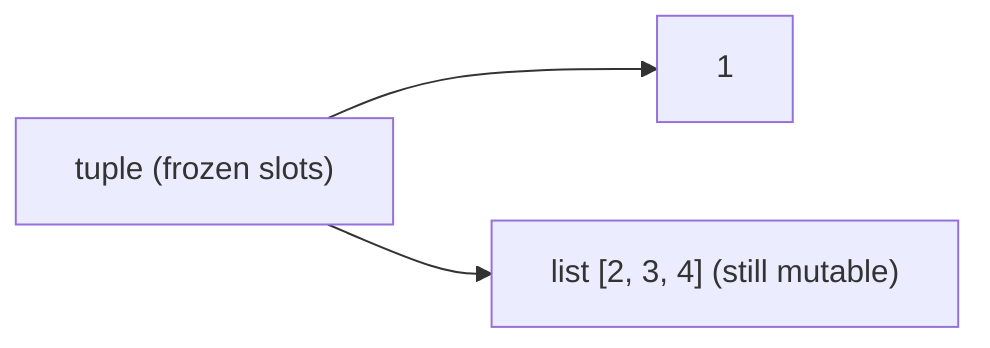
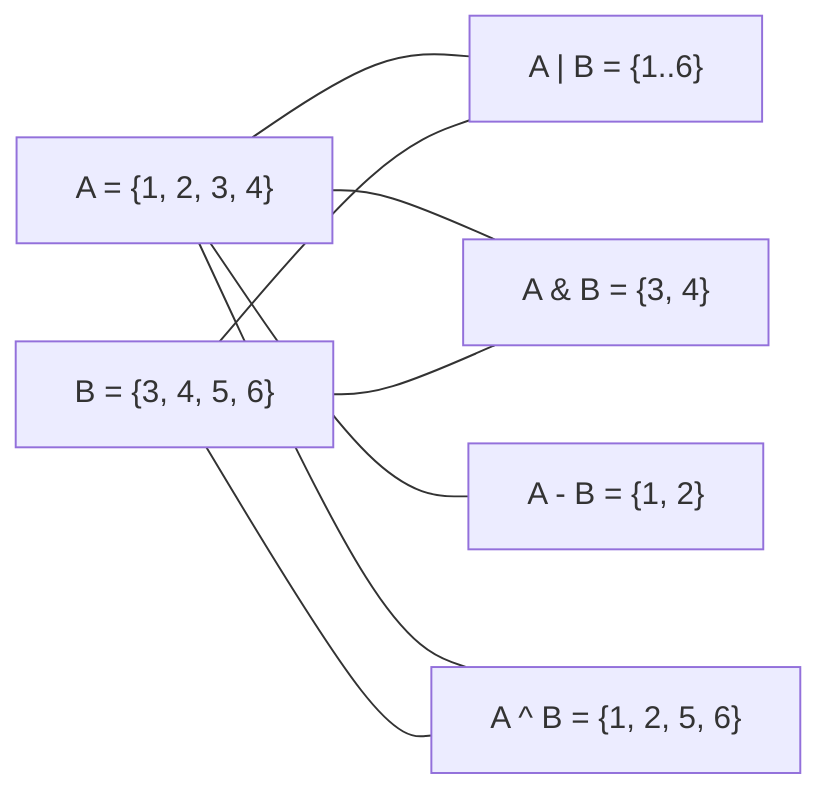
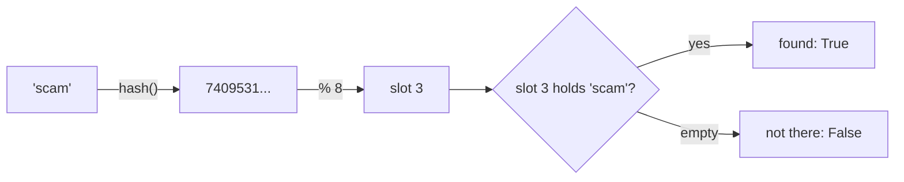

# Chapter 08 · Tuples & Sets

> A list is a notebook: you scribble, erase and add pages. But sometimes you want a **sealed envelope** that nobody can tamper with (a tuple), and sometimes you want a **guest list with a bouncer** who instantly knows whether a name is on it and never lets anyone in twice (a set). Picking the right one is the difference between code that runs in 1 second and code that runs in 1 hour.

**You will learn:**
- Tuples: creating them, why they're immutable, and when that's a superpower
- Packing and unpacking, including `*star` unpacking, swapping and returning several values
- `namedtuple`: tuples with readable field names
- What **hashable** means and why tuples can be dict keys but lists can't
- Sets: O(1) membership, adding/removing, and the maths operations (union, intersection, difference...)
- `frozenset`, set comprehensions, and the exact cost of every operation
- How to choose between list, tuple, set and dict, plus classic set interview problems

**Before this:** [Variables, Data Types & Memory](02-variables-types-memory.md) · [Loops](06-loops.md) · [Lists](07-lists.md)

---

## 🧠 The Big Idea

You already know lists. Tuples and sets are their two cousins, each giving up something to gain something:



- A **tuple** is a fixed record: a date `(2026, 10, 31)`, a point `(3, 4)`, a row from a database. Once made, it never changes. Because it never changes, Python can trust it as a dictionary key or a set member.
- A **set** is a bag of **unique** items with no order. Its superpower: answering "is x in here?" in **O(1)** time on average, whether it holds 10 items or 10 million. A list has to check one by one: O(n).

Imagine a club bouncer. With a **list** of 10,000 guests he reads the whole list for every person at the door. With a **set**, he has a magic book that opens directly to the right page from the person's name. That magic is called **hashing**, and you'll see exactly how it works in [Chapter 09](09-dictionaries.md).

---

## 🔨 Building It Up

**Part A: Tuples**

### 1. Creating tuples

A tuple is written with commas, usually inside parentheses.

```python
point = (3, 4)
date = (2026, 10, 31)
mixed = ("Asha", 21, True)
empty = ()
single = (5,)              # the comma makes it a tuple!
not_a_tuple = (5)          # just the number 5 in brackets
no_parens = 1, 2, 3        # the comma is what really makes a tuple
from_list = tuple([1, 2, 3])
from_string = tuple("abc")

print(point, type(point))
print(single, type(single))
print(not_a_tuple, type(not_a_tuple))
print(no_parens)
print(from_list, from_string, empty)
```

```text
(3, 4) <class 'tuple'>
(5,) <class 'tuple'>
5 <class 'int'>
(1, 2, 3)
(1, 2, 3) ('a', 'b', 'c') ()
```

What just happened: the **comma** creates a tuple; the parentheses just group it. `(5)` is maths brackets around 5. For a one-item tuple you need the trailing comma: `(5,)`.

### 2. Reading a tuple: same as a list

Indexing, slicing, `len`, `in`, looping, `+` and `*` all work exactly like lists. There are only two methods: `count` and `index`.

```python
t = (10, 20, 30, 20, 40)
print(t[0], t[-1])
print(t[1:4])
print(len(t), 30 in t)
print(t.count(20), t.index(30))
print(t + (50,))           # builds a NEW tuple
print((0,) * 3)
for x in t[:2]:
    print(x)
```

```text
10 40
(20, 30, 20)
5 True
2 2
(10, 20, 30, 20, 40, 50)
(0, 0, 0)
10
20
```

### 3. Immutability: you can't change a tuple

No `append`, no `remove`, no item assignment.

```py
t = (1, 2, 3)
t[0] = 99
# TypeError: 'tuple' object does not support item assignment
t.append(4)
# AttributeError: 'tuple' object has no attribute 'append'
```

To "change" a tuple you build a new one:

```python
t = (1, 2, 3)
t = (99,) + t[1:]       # new tuple, the name t now points to it
print(t)
```

```text
(99, 2, 3)
```

**Careful:** a tuple is immutable, but the objects *inside* it might not be. A tuple holds references (just like a list). The references can't change, but if one of them points to a list, that list can still be changed.

```python
t = (1, [2, 3])
t[1].append(4)          # allowed: we're changing the list, not the tuple
print(t)
```

```text
(1, [2, 3, 4])
```



> 💡 "Immutable" means **the slots are frozen**, not "everything reachable is frozen". This is a favourite trick question.

**Why would you want something you can't change?**
1. **Safety.** Pass a tuple to any function and you know it comes back unchanged. No aliasing surprises from [Chapter 07](07-lists.md).
2. **Hashable.** Only (fully) immutable things can be dict keys or set members. More in section 6.
3. **Lighter and slightly faster.** A tuple doesn't need spare capacity, so it uses less memory than an equal list.
4. **Meaning.** A tuple says "this is one record with a fixed shape". A list says "this is a collection of similar things that may grow".

### 4. Packing and unpacking

**Packing**: putting several values into one tuple. **Unpacking**: pulling them out into separate variables in one line.

```python
student = ("Ravi", 20, "CSE")        # packing
name, age, branch = student          # unpacking
print(name, age, branch)

x, y = 1, 2                          # pack on the right, unpack on the left
x, y = y, x                          # the famous swap, no temp variable
print(x, y)

def min_max(nums):
    return min(nums), max(nums)      # returning "two values" = returning one tuple

lo, hi = min_max([4, 9, 1, 7])
print(lo, hi)
print(min_max([4, 9, 1, 7]))
```

```text
Ravi 20 CSE
2 1
1 9
(1, 9)
```

What just happened: in `x, y = y, x`, Python first builds the tuple `(y, x)` on the right (with the *old* values), then unpacks it into `x` and `y`. That's why the swap works without a temporary variable.

The number of names must match the number of items:

```py
a, b = (1, 2, 3)
# ValueError: too many values to unpack (expected 2)
a, b, c = (1, 2)
# ValueError: not enough values to unpack (expected 3, got 2)
```

**Star unpacking**: one name with `*` scoops up "everything else" into a **list**.

```python
first, *rest = [1, 2, 3, 4, 5]
print(first, rest)

*init, last = [1, 2, 3, 4, 5]
print(init, last)

head, *middle, tail = "python"
print(head, middle, tail)

a, *b = [1]                  # star can capture nothing
print(a, b)

name, _, marks = ("Meera", "ignored", 88)   # _ means "I don't care about this one"
print(name, marks)
```

```text
1 [2, 3, 4, 5]
[1, 2, 3, 4] 5
p ['y', 't', 'h', 'o'] n
1 []
Meera 88
```

**Unpacking in loops** is everywhere: with `enumerate`, `zip`, and lists of pairs.

```python
points = [(1, 2), (3, 4), (5, 6)]
for x, y in points:
    print(x + y, end=" ")
print()

pairs = [("a", (1, 2)), ("b", (3, 4))]
for label, (x, y) in pairs:          # nested unpacking
    print(label, x * y)
```

```text
3 7 11 
a 2
b 12
```

**Star in a call** spreads a list or tuple into separate arguments:

```python
nums = [3, 1, 2]
print(*nums)             # same as print(3, 1, 2)
print(*nums, sep="-")
merged = [*nums, 9, *"ab"]   # spread inside a list literal
print(merged)
```

```text
3 1 2
3-1-2
[3, 1, 2, 9, 'a', 'b']
```

### 5. namedtuple: tuples with names

`point[0]` and `point[1]` are cryptic. `point.x` and `point.y` are not. `collections.namedtuple` builds a tuple type whose fields have names.

```python
from collections import namedtuple

Point = namedtuple("Point", ["x", "y"])
p = Point(3, 4)
print(p)
print(p.x, p.y)          # by name
print(p[0], p[1])        # still a tuple: indexing works
x, y = p                 # and unpacking works
print(x + y)

Student = namedtuple("Student", "name age branch")   # space-separated also OK
s = Student("Asha", 21, "ECE")
s2 = s._replace(age=22)  # immutable, so "changing" makes a new one
print(s.age, s2.age)
print(s2._asdict())
```

```text
Point(x=3, y=4)
3 4
3 4
7
21 22
{'name': 'Asha', 'age': 22, 'branch': 'ECE'}
```

What just happened: `namedtuple` gives you readability **and** all tuple properties (immutable, hashable, light). It's perfect for small records. When you need methods and mutable fields, you'll use classes ([Chapter 14](14-oop-classes-objects.md)) or dataclasses.

### 6. Tuples as dictionary keys and set members (hashable)

An object is **hashable** if Python can compute a fixed number for it, its **hash**, that never changes during its lifetime. Sets and dicts use that number to decide where to store the item. Immutable built-ins (ints, floats, strings, tuples of hashable things) are hashable. Mutable ones (lists, sets, dicts) are not.

```python
print(hash((1, 2)) == hash((1, 2)))    # same value -> same hash, always

visited = set()
visited.add((0, 0))                    # grid cell as a tuple
visited.add((0, 1))
print((0, 1) in visited, (5, 5) in visited)

distance = {("Delhi", "Agra"): 233, ("Mumbai", "Pune"): 148}   # dict: Chapter 09
print(distance[("Delhi", "Agra")])
```

```text
True
True False
233
```

```py
bad = {[1, 2]: "nope"}
# TypeError: unhashable type: 'list'
s = {(1, [2])}
# TypeError: unhashable type: 'list'   (a tuple is only hashable if ALL its items are)
```

**Why must keys be immutable?** A set files each item under its hash, like a library shelving a book by its title. If you could change the book's title after shelving it, the library would look on the wrong shelf and never find it again. So Python simply refuses to hash mutable objects. The full story is in [Chapter 09](09-dictionaries.md).

### 7. Comparing tuples (lexicographic order)

Tuples compare item by item, left to right, like words in a dictionary. The first difference decides.

```python
print((1, 2, 3) < (1, 3, 0))      # 2 < 3 decides it
print((1, 2) < (1, 2, 0))         # a prefix is smaller
print(("Asha", 90) == ("Asha", 90))

# This makes sorting by several keys trivial:
students = [("Ravi", 85), ("Asha", 92), ("Meera", 85)]
print(sorted(students, key=lambda s: (-s[1], s[0])))   # marks desc, then name asc
```

```text
True
True
True
[('Asha', 92), ('Meera', 85), ('Ravi', 85)]
```

What just happened: the key returns a tuple `(-marks, name)`. Negating the marks flips that part to descending while the name stays ascending. This trick is in every serious Python codebase; [Chapter 11](11-comprehensions-functional.md) covers it in depth.

**Part B: Sets**

### 8. Creating sets

Curly braces with items, or `set(iterable)`. Duplicates vanish automatically.

```python
primes = {2, 3, 5, 7}
from_list = set([3, 1, 3, 2, 1])
letters = set("banana")
empty_set = set()          # NOT {} -- that's an empty dict
empty_dict = {}

print(primes, len(primes))
print(from_list)
print(sorted(letters))     # sorted() for a predictable display order
print(type(empty_set), type(empty_dict))
```

```text
{2, 3, 5, 7} 4
{1, 2, 3}
['a', 'b', 'n']
<class 'set'> <class 'dict'>
```

> ⚠️ **Sets have no order.** Don't rely on the order a set prints in. Small integers often *look* sorted (because of how their hashes work) but strings come out in a different order on every run of Python, on purpose (a security feature called hash randomisation). Use `sorted(s)` whenever you display a set. That's why this book prints sets of strings through `sorted()`.

Because there's no order, there's no indexing:

```py
s = {1, 2, 3}
s[0]
# TypeError: 'set' object is not subscriptable
```

### 9. Adding and removing

```python
s = {1, 2}
s.add(3)               # add one item
s.add(2)               # already there: nothing happens, no error
print(s)

s.update([4, 5, 5])    # add many (any iterable)
print(s)

s.remove(5)            # remove; KeyError if missing
s.discard(99)          # remove if present; silent if missing
print(s)

x = s.pop()            # remove and return SOME item (which one isn't guaranteed)
print(len(s))

s.clear()
print(s)
```

```text
{1, 2, 3}
{1, 2, 3, 4, 5}
{1, 2, 3, 4}
3
set()
```

What just happened: `add` ignores duplicates silently, which is exactly why sets are great for "collect unique things". `remove` vs `discard` is like `[]` vs `.get()` on a dict: one shouts if the item is missing, the other doesn't. Note how an empty set prints as `set()`, because `{}` already means "empty dict".

### 10. Membership: the reason sets exist

```python
banned = {"spam", "scam", "fake"}
for word in ["hello", "scam", "world"]:
    if word in banned:          # O(1) on average
        print("blocked:", word)
```

```text
blocked: scam
```

`x in some_list` checks items one by one: O(n). `x in some_set` jumps straight to where `x` would be: O(1) on average. Inside a loop, that's the difference between O(n²) and O(n).

```python
def has_common_slow(a, b):
    for x in a:              # n iterations
        if x in b:           # b is a list: O(m) each
            return True
    return False             # total O(n * m)

def has_common_fast(a, b):
    b_set = set(b)           # O(m) once
    for x in a:
        if x in b_set:       # O(1) each
            return True
    return False             # total O(n + m)

print(has_common_slow([1, 2, 3], [7, 8, 3]), has_common_fast([1, 2, 3], [7, 8, 9]))
```

```text
True False
```

> 💡 **The #1 performance trick in Python interviews:** "I'll put these in a set so lookups are O(1)."

### 11. Set operations: the Venn diagram toolkit



```python
a = {1, 2, 3, 4}
b = {3, 4, 5, 6}

print(a | b)    # union: in a OR b
print(a & b)    # intersection: in a AND b
print(a - b)    # difference: in a but NOT b
print(b - a)    # order matters for difference
print(a ^ b)    # symmetric difference: in exactly one of them

# Method versions accept ANY iterable, not just sets
print(a.union([7, 8]), a.intersection(range(3)))
```

```text
{1, 2, 3, 4, 5, 6}
{3, 4}
{1, 2}
{5, 6}
{1, 2, 5, 6}
{1, 2, 3, 4, 7, 8} {1, 2}
```

**Comparisons** between sets ask "is one inside the other?"

```python
small = {1, 2}
big = {1, 2, 3}
print(small <= big, small.issubset(big))     # subset
print(big >= small, big.issuperset(small))   # superset
print(small < big, big < big)                # proper subset (strictly smaller)
print({1, 2}.isdisjoint({3, 4}))             # no common items?
print({1, 2, 3} == {3, 2, 1})                # order never matters
```

```text
True True
True True
True False
True
True
```

**In-place versions** change the left set instead of building a new one: `|=`, `&=`, `-=`, `^=` (methods: `update`, `intersection_update`, `difference_update`, `symmetric_difference_update`).

```python
skills = {"python", "sql"}
skills |= {"git", "python"}
skills -= {"sql"}
print(sorted(skills))
```

```text
['git', 'python']
```

### 12. What can go in a set?

Only hashable items: numbers, strings, tuples (of hashable things), `frozenset`s, `None`, booleans. Not lists, dicts or sets.

```python
ok = {1, 2.5, "hi", (1, 2), None}
print(len(ok))
print({1, 1.0, True})      # 1 == 1.0 == True, so they count as ONE item
```

```text
5
{1}
```

What just happened: `1`, `1.0` and `True` are equal (`True == 1` in Python) and have the same hash, so the set keeps only the first one. A cute trap for quizzes.

### 13. frozenset: the immutable set

A `frozenset` is to a `set` what a tuple is to a list: same reading abilities, no changing, and therefore hashable.

```python
vowels = frozenset("aeiou")
print("e" in vowels, len(vowels))
print(sorted(vowels | {"y"}))          # operations return new frozensets

groups = {frozenset({"a", "b"}): "team 1"}    # usable as a dict key
print(groups[frozenset({"b", "a"})])          # order doesn't matter

sets_of_sets = {frozenset({1, 2}), frozenset({2, 1}), frozenset({3})}
print(len(sets_of_sets))
```

```text
True 5
['a', 'e', 'i', 'o', 'u', 'y']
team 1
2
```

```py
vowels.add("y")
# AttributeError: 'frozenset' object has no attribute 'add'
```

### 14. Set comprehensions (a preview)

Like the list-building loop from [Chapter 07](07-lists.md), but collecting into a set. Full treatment in [Chapter 11](11-comprehensions-functional.md).

```python
words = ["Apple", "avocado", "Banana", "blueberry", "cherry"]
first_letters = {w[0].lower() for w in words}
print(sorted(first_letters))

squares_mod_10 = {(n * n) % 10 for n in range(100)}
print(sorted(squares_mod_10))    # a perfect square can only end in these digits
```

```text
['a', 'b', 'c']
[0, 1, 4, 5, 6, 9]
```

### 15. When to use what

| Need | Use | Why |
|---|---|---|
| Ordered items you'll add/remove/change | **list** | mutable, ordered, indexable |
| Fixed record: point, date, RGB, DB row | **tuple** | immutable, light, unpackable |
| Several return values from a function | **tuple** | `return a, b` |
| A composite dict key or set member | **tuple** | hashable |
| Record with readable field names | **namedtuple** | `p.x` instead of `p[0]` |
| Unique items, fast "is it there?" | **set** | O(1) membership |
| Remove duplicates (order doesn't matter) | **set** | `set(lst)` |
| Compare groups: common, missing, extra | **set** | `&`, `-`, `^` |
| A set inside a set, or set as a key | **frozenset** | hashable |
| Look something up by a key | **dict** | [Chapter 09](09-dictionaries.md) |

| Property | list | tuple | set | frozenset |
|---|---|---|---|---|
| Ordered | ✅ | ✅ | ❌ | ❌ |
| Mutable | ✅ | ❌ | ✅ | ❌ |
| Duplicates | ✅ | ✅ | ❌ | ❌ |
| Indexing `x[0]` | ✅ | ✅ | ❌ | ❌ |
| Hashable | ❌ | ✅* | ❌ | ✅ |
| `x in c` | O(n) | O(n) | O(1) avg | O(1) avg |
| Literal | `[1, 2]` | `(1, 2)` | `{1, 2}` | `frozenset({1, 2})` |

\*if all its items are hashable

---

## 🔬 Under the Hood

### Tuples are lighter than lists

A list keeps spare capacity so it can grow ([Chapter 07](07-lists.md)); a tuple knows its exact size forever, so it stores exactly n pointers and nothing more.

```python
import sys

t = (1, 2, 3)
l = [1, 2, 3]
print(sys.getsizeof(t) < sys.getsizeof(l))
print(sys.getsizeof(()), "bytes for an empty tuple vs", sys.getsizeof([]), "for an empty list")
```

```text
True
40 bytes for an empty tuple vs 56 for an empty list
```

(Exact byte counts are for 64-bit CPython and can vary by version.) CPython also **caches** tiny tuples and treats tuple literals made of constants as constants at compile time, so `(1, 2, 3)` inside a loop isn't rebuilt every iteration.

### How a tuple's hash is computed

`hash((a, b, c))` combines `hash(a)`, `hash(b)` and `hash(c)` with a mixing formula. So equal tuples get equal hashes, and if any item is unhashable (like a list), the whole tuple is unhashable. That's why `(1, [2])` can't go into a set.

### A set is a hash table

Inside, a set is an array of slots (a **hash table**). To add `x`:

1. Compute `hash(x)`, a big integer.
2. Turn it into a slot number, roughly `hash(x) % number_of_slots`.
3. If the slot is free, store `x` there. If it's taken by a different item (a **collision**), probe another slot by a fixed rule until a free one is found.

To check `x in s`, repeat steps 1–2 and look in that slot (probing if needed). You look at one or a few slots, not all n items. That's the **O(1) average**.



The table is kept at most about 60% full; when it gets fuller, Python allocates a bigger table and re-inserts everything (like a list's resize, this is rare, so `add` is **amortized O(1)**). If a terrible hash function sent everything to the same slot, every lookup would probe through all items: **O(n) worst case**. Python's hashes make this extremely unlikely in practice.

This is exactly the same machinery a dictionary uses, and [Chapter 09](09-dictionaries.md) builds a tiny hash table from scratch so you can see every step.

### Why sets lose order

Items live wherever their hash sends them, not in insertion order. That's the price of instant lookup. (Dictionaries add an extra trick to remember insertion order; sets don't bother.)

### Set operation costs

Here `len(s) = n` and `len(t) = m`.

| Operation | Example | Average time |
|---|---|---|
| Membership | `x in s` | **O(1)** |
| Add / remove / discard | `s.add(x)` | O(1) (add is amortized) |
| Build from iterable | `set(lst)` | O(n) |
| Union | `s \| t` | O(n + m) |
| Intersection | `s & t` | **O(min(n, m))** (it loops over the smaller one) |
| Difference | `s - t` | O(n) |
| Symmetric difference | `s ^ t` | O(n + m) |
| Subset test | `s <= t` | O(n) |
| Equality | `s == t` | O(min(n, m)) |
| Length | `len(s)` | O(1) |
| Iterate | `for x in s` | O(capacity), about O(n) |
| Copy | `s.copy()` | O(n) |

Worst case for the hash-based ones is O(n) per lookup, but you should quote the average in interviews and mention the worst case if asked.

---

## 🧩 Pattern Decoder

### Pythonic idioms

| Task | Idiom |
|---|---|
| Swap two variables | `a, b = b, a` |
| Return several values | `return total, count` then `t, c = f()` |
| First / last / rest | `first, *rest = items` · `*rest, last = items` |
| Ignore a value | `_, value = pair` |
| Loop over pairs | `for key, value in pairs:` |
| Remove duplicates (order not needed) | `set(items)` |
| Remove duplicates keeping order | `list(dict.fromkeys(items))` |
| Fast repeated lookups | `allowed = set(big_list)` then `x in allowed` |
| Common items | `set(a) & set(b)` |
| Items in a but not b | `set(a) - set(b)` |
| Are all items unique? | `len(set(items)) == len(items)` |
| Grid cell as a key | `visited.add((r, c))` |
| Multi-key sort | `sorted(rows, key=lambda r: (-r.score, r.name))` |

### The "seen set" template

The single most common set pattern in DSA: walk through data once, remembering what you've seen.

```py
seen = set()
for x in items:
    if x in seen:          # O(1)
        ...                # found a repeat / a cycle / a pair
    seen.add(x)
```

Worked example, **Happy Number** (LeetCode 202): replace a number by the sum of the squares of its digits, repeatedly. If it reaches 1, it's happy. If it loops forever, it isn't. How do we detect "forever"? A **seen set**: if a number comes back, we're in a cycle.

```python
def is_happy(n):
    seen = set()
    while n != 1 and n not in seen:
        seen.add(n)
        n = sum(int(d) ** 2 for d in str(n))   # generator expression: Chapter 11
    return n == 1

print(is_happy(19), is_happy(2))
```

```text
True False
```

Trace for 19: 19 → 1² + 9² = 82 → 64 + 4 = 68 → 36 + 64 = 100 → 1. Happy!

| step | n | in seen? | seen after |
|---|---|---|---|
| 1 | 19 | no | {19} |
| 2 | 82 | no | {19, 82} |
| 3 | 68 | no | {19, 82, 68} |
| 4 | 100 | no | {19, 82, 68, 100} |
| 5 | 1 | loop stops | answer True |

### The "visited set" in graphs and grids

Every BFS/DFS you'll write in [Graphs](../part-2-dsa/16-graphs-bfs-dfs.md) keeps a `visited` set of nodes or `(row, col)` tuples so it never processes the same place twice. Tuples make perfect grid keys because they're hashable.

### How this shows up in DSA

| Problem family | Tool |
|---|---|
| Contains Duplicate, Happy Number, cycle detection | seen set |
| Intersection of Two Arrays, missing/extra items | set operations |
| Longest Consecutive Sequence | set for O(1) "does x+1 exist?" |
| BFS / DFS on graphs and grids | visited set of tuples |
| DP memo keys with two parameters | tuple keys `(i, j)` in a dict |
| Heaps with priorities | tuples `(priority, item)` compare lexicographically |

### When NOT to use a set

- You need **order** or **position** → list.
- You need **duplicates or counts** → list or `Counter` ([Chapter 09](09-dictionaries.md)).
- Items are **unhashable** (lists, dicts) → convert them to tuples first, or rethink.
- The collection is tiny and you check it once → a list is fine; building a set costs O(n) itself.

---

## ⚠️ Traps & Common Mistakes

1. **`(5)` is not a tuple.** Use `(5,)`. Likewise `x = 5,` silently makes a tuple.

2. **`{}` is an empty dict, not an empty set.** Use `set()`.

3. **Relying on set order.** Never index a set or assume it prints sorted. Use `sorted(s)` for display.

4. **`remove` on a missing item raises `KeyError`.** Use `discard` if "maybe missing" is normal.

5. **Putting a list in a set or as a dict key.** `TypeError: unhashable type: 'list'`. Convert with `tuple(lst)`.

6. **Thinking a tuple's contents can't change.** `t = (1, [2])` lets `t[1].append(3)`. And it gets weirder:

```py
t = (1, [2])
t[1] += [3]
# TypeError: 'tuple' object does not support item assignment
print(t)        # (1, [2, 3])  <- the list WAS changed anyway!
```

`+=` first extends the list in place (succeeds), then tries to store the result back into `t[1]` (fails). Both steps happen, so you get the error *and* the change.

7. **`set("hello")` gives letters, not the word.** For a set containing the word, write `{"hello"}`.

8. **`1`, `1.0` and `True` collide.** `{1, True}` has one item. Mixing bools and ints as set members or dict keys causes surprises.

9. **Unpacking count mismatches.** `a, b = [1, 2, 3]` crashes. Use `a, b, *_ = ...` if you only need the first two.

10. **Converting to a set to dedupe, then expecting the original order back.** Use `list(dict.fromkeys(items))` instead.

---

## 💡 Tips & Tricks

- Use tuples for **heterogeneous** fixed records (`("Asha", 21, "CSE")`), lists for **homogeneous** growing collections (`[85, 90, 72]`).
- `return a, b` + `x, y = f()` is the clean way to return several values.
- `for i, (x, y) in enumerate(points):` combines enumerate with nested unpacking.
- `len(set(nums)) != len(nums)` is the one-liner duplicate check.
- Convert a list to a set **once, outside** the loop, never inside it.
- `s1 & s2` iterates over the smaller set, so intersecting a huge set with a tiny one is fast.
- Want a sorted unique list? `sorted(set(items))`.
- Tuples with `-value` in a sort key flip that part to descending: `key=lambda r: (-r[1], r[0])`.
- `print(*items)` prints a list's items separated by spaces, no brackets.

---

## 🎯 Interview Questions

### 1. List vs tuple: what are the differences and when do you use each? 🔥🔥🔥

<details><summary>Answer</summary>

| | list | tuple |
|---|---|---|
| Mutable | yes | no |
| Hashable | no | yes, if all items are |
| Memory | more (over-allocates) | less (exact size) |
| Methods | many (`append`, `sort`...) | `count`, `index` |
| Typical use | a growing collection of similar items | a fixed record, multiple return values, dict keys |

Tuples are slightly faster to create and iterate, and CPython can treat constant tuples as compile-time constants. Choose by **meaning**: if it shouldn't change, make it a tuple.

</details>

### 2. Can a tuple be a dictionary key? What about a tuple containing a list? 🔥🔥🔥

<details><summary>Answer</summary>

A tuple is a valid key if **all** its items are hashable: `{(1, 2): "a"}` works. `(1, [2])` is not hashable because its hash would be computed from the list, which can change. `hash((1, [2]))` raises `TypeError: unhashable type: 'list'`.

</details>

### 3. Is a tuple truly immutable? What does `t[1] += [3]` do for `t = (1, [2])`? 🔥🔥

<details><summary>Answer</summary>

The tuple's slots are immutable; the objects they refer to might not be. `t[1] += [3]` does two things: (1) calls the list's in-place add, which succeeds and makes the list `[2, 3]`; (2) tries `t[1] = <result>`, which raises `TypeError`. So you get an error **and** `t` becomes `(1, [2, 3])`.

</details>

### 4. How does a set check membership in O(1)? What's the worst case? 🔥🔥🔥

<details><summary>Answer</summary>

A set is a hash table. It computes `hash(x)`, maps it to a slot index, and looks there (probing a few nearby slots on collisions). The number of probes doesn't depend on n, so lookups are O(1) on average. The table resizes before it gets too full to keep collisions rare. Worst case, if many items collide, a lookup can degrade to **O(n)**.

</details>

### 5. set vs frozenset? 🔥🔥

<details><summary>Answer</summary>

Both are hash-based unordered collections of unique hashable items. `set` is mutable (`add`, `remove`, `|=`...) and therefore unhashable. `frozenset` is immutable and hashable, so it can be a dict key or an element of another set. Use `frozenset` for constant lookup tables or "set of sets".

</details>

### 6. Contains Duplicate (LeetCode 217) 🔥🔥🔥

Return True if any value appears at least twice.

<details><summary>Answer</summary>

```python
def contains_duplicate(nums):
    seen = set()
    for x in nums:
        if x in seen:
            return True       # early exit as soon as we find one
        seen.add(x)
    return False

print(contains_duplicate([1, 2, 3, 1]), contains_duplicate([1, 2, 3, 4]))
print(len(set([1, 2, 3, 1])) != 4)    # one-liner version
```

```text
True False
True
```

O(n) time, O(n) space. The loop version can stop early; the one-liner always builds the full set. Alternative: sort and compare neighbours, O(n log n) time, O(1) extra space.

</details>

### 7. Intersection of Two Arrays (LeetCode 349) 🔥🔥🔥

Return the unique elements present in both arrays.

<details><summary>Answer</summary>

```python
def intersection(nums1, nums2):
    return sorted(set(nums1) & set(nums2))   # sorted only to make the output predictable

print(intersection([1, 2, 2, 1], [2, 2]))
print(intersection([4, 9, 5], [9, 4, 9, 8, 4]))
```

```text
[2]
[4, 9]
```

O(n + m) time. If the arrays are already sorted and memory is tight, use two pointers ([Two Pointers](../part-2-dsa/03-two-pointers.md)). If duplicates must be kept (LeetCode 350), you need counts: `Counter` in [Chapter 09](09-dictionaries.md).

</details>

### 8. Longest Consecutive Sequence (LeetCode 128) 🔥🔥🔥

Unsorted array; find the length of the longest run of consecutive integers, in O(n). `[100, 4, 200, 1, 3, 2]` → 4 (`1,2,3,4`).

<details><summary>Answer</summary>

Put everything in a set. A number starts a run only if `x - 1` is **not** in the set. From each start, count upward while `x + 1` exists.

```python
def longest_consecutive(nums):
    num_set = set(nums)
    best = 0
    for x in num_set:
        if x - 1 not in num_set:          # x is the start of a run
            length = 1
            while x + length in num_set:
                length += 1
            best = max(best, length)
    return best

print(longest_consecutive([100, 4, 200, 1, 3, 2]))
print(longest_consecutive([0, 3, 7, 2, 5, 8, 4, 6, 0, 1]))
```

```text
4
9
```

Why O(n) despite the inner `while`? Each number is counted in the inner loop only by the single run that contains it, and only starts begin a count. So total inner steps ≤ n. Sorting would be O(n log n).

</details>

### 9. Jewels and Stones (LeetCode 771) 🔥🔥

`jewels = "aA"`, `stones = "aAAbbbb"`: how many stones are jewels? → 3.

<details><summary>Answer</summary>

```python
def num_jewels(jewels, stones):
    jewel_set = set(jewels)
    count = 0
    for s in stones:
        if s in jewel_set:
            count += 1
    return count

print(num_jewels("aA", "aAAbbbb"), num_jewels("z", "ZZ"))
```

```text
3 0
```

O(j + s) instead of O(j × s) with `in jewels` on a string.

</details>

### 10. How do you remove duplicates from a list? Does it keep order? 🔥🔥

<details><summary>Answer</summary>

`list(set(items))` removes duplicates but **loses order**. To keep the first-seen order: `list(dict.fromkeys(items))` (dicts remember insertion order, [Chapter 09](09-dictionaries.md)), or a loop with a seen set. All are O(n).

</details>

### 11. What is `{}`? What is `type((1))`? What does `a, *b = "x"` give? 🔥

<details><summary>Answer</summary>

`{}` is an empty **dict**. `(1)` is the int 1 (no comma, no tuple). `a, *b = "x"` gives `a = "x"` and `b = []` (the star captures zero items as an empty list).

</details>

### 12. Why does `{1, True, 1.0}` have only one element? 🔥

<details><summary>Answer</summary>

Sets treat items as duplicates when they are equal (`==`) and have the same hash. `1 == True == 1.0` and `hash(1) == hash(True) == hash(1.0) == 1`, so the set keeps the first one inserted, `1`.

</details>

---

## 🏋️ Practice

**🟢 1. Swap and stats.** Write `stats(nums)` that returns `(min, max, average)` as a tuple, then unpack it into three variables.

<details><summary>Solution</summary>

```python
def stats(nums):
    return min(nums), max(nums), sum(nums) / len(nums)

lo, hi, avg = stats([4, 8, 15, 16, 23, 42])
print(lo, hi, avg)
```

```text
4 42 18.0
```

</details>

**🟢 2. Unique count.** How many distinct words are in `"the cat and the hat and the bat"`?

<details><summary>Solution</summary>

```python
sentence = "the cat and the hat and the bat"
unique = set(sentence.split())
print(len(unique), sorted(unique))
```

```text
5 ['and', 'bat', 'cat', 'hat', 'the']
```

</details>

**🟢 3. Pangram.** Is a sentence a pangram (uses every letter a–z at least once)?

<details><summary>Solution</summary>

```python
import string

def is_pangram(sentence):
    letters = set(sentence.lower())
    return set(string.ascii_lowercase) <= letters     # subset test

print(is_pangram("The quick brown fox jumps over the lazy dog"))
print(is_pangram("Hello world"))
```

```text
True
False
```

</details>

**🟡 4. Find the Difference of Two Arrays** (LeetCode 2215): return `[items only in a, items only in b]`, each unique and sorted.

<details><summary>Solution</summary>

```python
def find_difference(a, b):
    sa, sb = set(a), set(b)
    return [sorted(sa - sb), sorted(sb - sa)]

print(find_difference([1, 2, 3], [2, 4, 6]))
print(find_difference([1, 2, 3, 3], [1, 1, 2, 2]))
```

```text
[[1, 3], [4, 6]]
[[3], []]
```

</details>

**🟡 5. Pair with a given sum (unsorted).** Return True if any two **different** items add up to `target`, in O(n).

<details><summary>Solution</summary>

For each `x`, the partner we need is `target - x`. Check if we've already seen it.

```python
def has_pair_sum(nums, target):
    seen = set()
    for x in nums:
        if target - x in seen:
            return True
        seen.add(x)
    return False

print(has_pair_sum([8, 3, 5, 1], 9), has_pair_sum([5], 10), has_pair_sum([5, 5], 10))
```

```text
True False True
```

Adding `x` **after** checking stops an item from pairing with itself. Returning the *indexes* is the famous Two Sum, solved with a dict in [Chapter 09](09-dictionaries.md).

</details>

**🟡 6. Count distinct grid cells visited.** A robot starts at `(0, 0)` and follows moves `"UURDDL"` (U = up, etc.). How many distinct cells does it visit, including the start?

<details><summary>Solution</summary>

```python
def distinct_cells(moves):
    step = {"U": (0, 1), "D": (0, -1), "L": (-1, 0), "R": (1, 0)}
    x, y = 0, 0
    visited = {(x, y)}
    for m in moves:
        dx, dy = step[m]
        x, y = x + dx, y + dy
        visited.add((x, y))
    return len(visited)

print(distinct_cells("UURDDL"), distinct_cells("UDUD"))
```

```text
6 2
```

Tuples are the natural hashable "coordinate" type.

</details>

**🔴 7. Group words that are the same set of letters.** Given `["abc", "cab", "aab", "ab", "ba", "bca"]`, how many distinct groups are there, where two words are in the same group if they use exactly the same set of letters (ignoring counts)?

<details><summary>Solution</summary>

A word's group is identified by `frozenset(word)`, which is hashable, so we can put those into a set.

```python
def count_letter_groups(words):
    return len({frozenset(w) for w in words})

print(count_letter_groups(["abc", "cab", "aab", "ab", "ba", "bca"]))
```

```text
2
```

Groups: `{a, b, c}` (abc, cab, bca) and `{a, b}` (aab, ab, ba). O(total characters).

</details>

**🔴 8. First repeated character.** Return the first character that appears a second time while reading left to right, or `None`. `"abcbad"` → `"b"`.

<details><summary>Solution</summary>

```python
def first_repeated(s):
    seen = set()
    for ch in s:
        if ch in seen:
            return ch
        seen.add(ch)
    return None

print(first_repeated("abcbad"), first_repeated("abc"))
```

```text
b None
```

O(n) time. Note this differs from "the character whose first occurrence is earliest among repeated ones" (that would be `a`): read problem statements carefully.

</details>

---

## 🧠 Never-Forget Summary

- **Tuple** = ordered, **immutable**, light. The **comma** makes it: `(5,)`.
- Immutable means the **slots** are frozen; a list inside a tuple can still change.
- **Packing/unpacking**: `a, b = b, a`, `return x, y`, `first, *rest = items`, `_` for ignored values.
- `namedtuple` gives tuples readable field names: `p.x`.
- **Hashable** = has a hash that never changes. Immutable built-ins are hashable; lists, sets, dicts are not. Only hashables can be set members or dict keys.
- Tuples compare **lexicographically**, which powers multi-key sorting.
- **Set** = unordered, **unique**, hash table inside, **O(1) average** membership.
- `add`/`update`, `remove` (shouts) / `discard` (silent), `|` `&` `-` `^`, `<=` `>=`.
- `{}` is a dict; `set()` is an empty set. `frozenset` is the hashable set.
- Never rely on set order; print with `sorted()`.

**Memory hooks:**
- **"Comma makes the tuple, brackets just hug it."**
- **"Tuple = sealed envelope. Set = bouncer with a magic book."**
- **"If it can change, it can't be a key."**
- **"Pipe joins, ampersand shares, minus removes, caret = one or the other but not both."**

**One picture:**

| | list `[ ]` | tuple `( , )` | set `{ }` | frozenset |
|---|---|---|---|---|
| Ordered | ✅ | ✅ | ❌ | ❌ |
| Changeable | ✅ | ❌ | ✅ | ❌ |
| Duplicates | ✅ | ✅ | ❌ | ❌ |
| Hashable (key-able) | ❌ | ✅ | ❌ | ✅ |
| `in` cost | O(n) | O(n) | O(1) | O(1) |
| Think of it as | notebook | sealed envelope | guest list | laminated guest list |

> **If you remember only one thing:** when you hear "have I seen this before?", reach for a **set**, and when you need a fixed bundle of values (or a key made of several parts), reach for a **tuple**.

---
**Next:** [Chapter 09 · Dictionaries & Hashing](09-dictionaries.md)  ·  **Back to** [Contents](../README.md)
