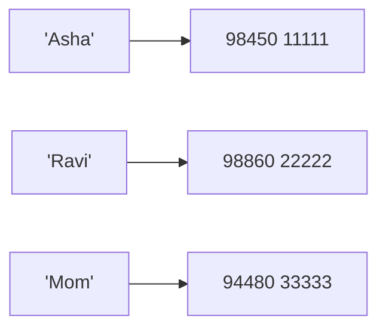
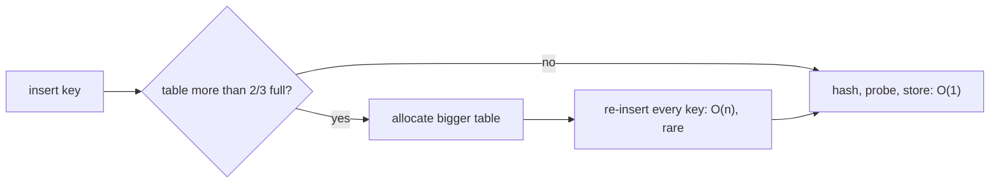

# Chapter 09 · Dictionaries & Hashing

> Your phone doesn't make you scroll through 800 contacts to find "Mom". You type the name and the number appears instantly. A Python dictionary does exactly that for any data you have: give it a key, get the value back in O(1). It's the single most useful data structure in interviews: a huge share of "make this faster" answers start with "I'll use a hash map".

**You will learn:**
- What a dictionary is (key → value) and every way to create, read, update and delete
- How a **hash table** works from scratch: hash functions, slots, collisions, load factor, resizing
- Why keys must be immutable, and why dicts remember insertion order
- `get`, `setdefault`, views, iteration, dict comprehensions, and every method with its Big-O
- `Counter`, `defaultdict` and `OrderedDict` from `collections`
- The four patterns that power DSA: **counting, grouping, index lookup, memoization**
- Nested dicts and JSON, plus the classic interview problems (Two Sum, Group Anagrams...)

**Before this:** [Lists](07-lists.md) · [Tuples & Sets](08-tuples-sets.md)

---

## 🧠 The Big Idea

A list answers "what's at **position** 3?" But real questions sound like "what's Asha's phone number?" or "how many times did the word *the* appear?" You want to look things up by a **name**, not a position.

A **dictionary** (dict) stores **key → value** pairs. You hand it a key, it hands back the value.



The magic: finding a value takes the same tiny amount of time whether the dict has 5 pairs or 50 million. How? The dict turns the key into a number with a **hash function**, and that number says exactly which drawer to open. No searching. That trick is called **hashing**, and by the end of this chapter you'll be able to build it yourself.

> 💡 Other names for the same idea: **hash map** (Java, interviews), **hash table** (textbooks), **associative array**, **map**. In Python it's `dict`.

---

## 🔨 Building It Up

### 1. Creating dictionaries

```python
empty = {}
phone = {"Asha": "98450", "Ravi": "98860"}
ages = dict(asha=21, ravi=22)                 # keyword style: keys become strings
pairs = dict([("x", 1), ("y", 2)])            # from (key, value) pairs
zipped = dict(zip(["a", "b", "c"], [1, 2, 3]))
defaults = dict.fromkeys(["math", "physics"], 0)

print(phone)
print(ages)
print(pairs)
print(zipped)
print(defaults)
print(len(phone), type(empty))
```

```text
{'Asha': '98450', 'Ravi': '98860'}
{'asha': 21, 'ravi': 22}
{'x': 1, 'y': 2}
{'a': 1, 'b': 2, 'c': 3}
{'math': 0, 'physics': 0}
2 <class 'dict'>
```

What just happened: a dict literal is `{key: value, ...}`. `dict(zip(keys, values))` is the standard way to pair up two lists. `len` counts **pairs**.

**Rules for keys and values:**
- **Keys** must be **hashable** (immutable built-ins: str, int, float, tuple of hashables, frozenset, bool, None). Keys are **unique**: assigning to an existing key replaces its value.
- **Values** can be anything at all: lists, other dicts, functions...

```python
d = {"a": 1, "a": 2}          # duplicate key: the last one wins
print(d)
grid_costs = {(0, 0): 5, (0, 1): 3}   # tuples make great composite keys
print(grid_costs[(0, 1)])
```

```text
{'a': 2}
3
```

### 2. Reading values: `[]`, `get`, `in`

```python
stock = {"apple": 10, "banana": 0}

print(stock["apple"])               # direct lookup
print(stock.get("mango"))           # missing -> None, no crash
print(stock.get("mango", 0))        # missing -> your default
print("banana" in stock)            # 'in' checks KEYS
print(10 in stock)                  # 10 is a value, not a key
print(10 in stock.values())         # search values explicitly (O(n))
```

```text
10
None
0
True
False
True
```

```py
stock["mango"]
# KeyError: 'mango'
```

| You want | Use |
|---|---|
| The key **must** exist (a missing key is a bug) | `d[key]` (crash loudly) |
| The key may be missing; a default is fine | `d.get(key, default)` |
| Just check existence | `key in d` |

### 3. Adding, updating and merging

```python
marks = {"math": 80}
marks["physics"] = 75          # add a new key
marks["math"] = 90             # update an existing key
print(marks)

marks.update({"chem": 88, "math": 95})   # add/overwrite many at once
print(marks)

extra = {"bio": 70}
merged = marks | extra         # Python 3.9+: new merged dict
marks |= {"cs": 99}            # in-place merge
print(merged)
print(marks)
print({**extra, "eng": 60})    # ** unpacking also merges (older style)
```

```text
{'math': 90, 'physics': 75}
{'math': 95, 'physics': 75, 'chem': 88}
{'math': 95, 'physics': 75, 'chem': 88, 'bio': 70}
{'math': 95, 'physics': 75, 'chem': 88, 'cs': 99}
{'bio': 70, 'eng': 60}
```

What just happened: `d[k] = v` is "add or replace". When merging, if both sides have the same key, the **right-hand** side wins.

### 4. Removing

```python
d = {"a": 1, "b": 2, "c": 3, "d": 4}

del d["a"]                 # remove a key (KeyError if missing)
print(d)

val = d.pop("b")           # remove and return the value
print(val, d)

print(d.pop("zzz", None))  # with a default: no error if missing

last = d.popitem()         # remove and return the LAST inserted pair
print(last, d)

d.clear()
print(d)
```

```text
{'b': 2, 'c': 3, 'd': 4}
2 {'c': 3, 'd': 4}
None
('d', 4) {'c': 3}
{}
```

### 5. Iterating: keys, values, items

```python
prices = {"tea": 15, "coffee": 40, "samosa": 20}

for item in prices:                    # looping a dict gives KEYS
    print(item, end=" ")
print()

for price in prices.values():
    print(price, end=" ")
print()

for item, price in prices.items():     # the one you'll use most
    print(f"{item}: Rs {price}")

print(list(prices.keys()))
print(list(prices.items()))
```

```text
tea coffee samosa 
15 40 20 
tea: Rs 15
coffee: Rs 40
samosa: Rs 20
['tea', 'coffee', 'samosa']
[('tea', 15), ('coffee', 40), ('samosa', 20)]
```

`keys()`, `values()` and `items()` return **views**: live windows onto the dict, not copies. If the dict changes, the view shows it.

```python
d = {"a": 1}
keys = d.keys()
d["b"] = 2
print(keys)                 # the view updated itself
print(keys & {"b", "z"})    # key views support set operations!
```

```text
dict_keys(['a', 'b'])
{'b'}
```

> ⚠️ **Don't add or remove keys while looping over a dict.** Python raises `RuntimeError: dictionary changed size during iteration`. Loop over a copy (`for k in list(d):`) or build a new dict. Changing the **values** of existing keys while looping is fine.

```python
scores = {"a": 50, "b": 20, "c": 70}
for name in list(scores):        # list(...) snapshot of the keys
    if scores[name] < 40:
        del scores[name]
print(scores)
```

```text
{'a': 50, 'c': 70}
```

### 6. Order: dicts remember insertion order

Since Python 3.7, dicts are **guaranteed** to keep keys in the order they were first inserted. Updating an existing key does not move it. Deleting and re-adding moves it to the end.

```python
d = {}
d["z"] = 1
d["a"] = 2
d["m"] = 3
d["z"] = 99          # update: keeps its position
print(d)
del d["a"]
d["a"] = 2           # re-insert: goes to the end
print(d)
```

```text
{'z': 99, 'a': 2, 'm': 3}
{'z': 99, 'm': 3, 'a': 2}
```

**Sorting a dict** means building a new one in the order you want:

```python
marks = {"Ravi": 72, "Asha": 95, "Meera": 88}
by_name = dict(sorted(marks.items()))
by_marks_desc = dict(sorted(marks.items(), key=lambda kv: kv[1], reverse=True))
print(by_name)
print(by_marks_desc)
print(max(marks, key=marks.get))      # key with the largest value
```

```text
{'Asha': 95, 'Meera': 88, 'Ravi': 72}
{'Asha': 95, 'Meera': 88, 'Ravi': 72}
Asha
```

What just happened: `dict(sorted(d.items()))` sorts the `(key, value)` pairs (tuples compare by key first) and rebuilds a dict in that order. `max(marks, key=marks.get)` loops over the keys but compares them by `marks.get(key)`, i.e. by their values, so it returns the key with the highest value.

### 7. `get` and `setdefault`: the two workhorses

**Counting with `get`:**

```python
votes = ["red", "blue", "red", "green", "red", "blue"]
count = {}
for v in votes:
    count[v] = count.get(v, 0) + 1     # 0 if first time, then +1
print(count)
```

```text
{'red': 3, 'blue': 2, 'green': 1}
```

**Grouping with `setdefault`:** `d.setdefault(key, default)` returns `d[key]` if it exists; otherwise it inserts `default` and returns it. Perfect for "append to a list that may not exist yet".

```python
words = ["apple", "avocado", "banana", "blueberry", "cherry"]
by_letter = {}
for w in words:
    by_letter.setdefault(w[0], []).append(w)
print(by_letter)
```

```text
{'a': ['apple', 'avocado'], 'b': ['banana', 'blueberry'], 'c': ['cherry']}
```

What just happened: the first time we see `'a'`, `setdefault` creates `[]` under `'a'` and returns that list, and we append to it. Next time it returns the existing list. One line instead of an `if key not in d: d[key] = []` dance.

### 8. Dict comprehensions (a preview)

A one-line way to build a dict. Full coverage in [Chapter 11](11-comprehensions-functional.md).

```python
squares = {n: n * n for n in range(1, 6)}
print(squares)

prices = {"tea": 15, "coffee": 40, "samosa": 20}
cheap = {k: v for k, v in prices.items() if v < 30}
inverted = {v: k for k, v in prices.items()}       # swap keys and values
print(cheap)
print(inverted)
```

```text
{1: 1, 2: 4, 3: 9, 4: 16, 5: 25}
{'tea': 15, 'samosa': 20}
{15: 'tea', 40: 'coffee', 20: 'samosa'}
```

> ⚠️ Inverting only works cleanly if the values are unique and hashable. Duplicate values collapse into one key (the last one wins).

### 9. Every dict operation and its cost

Average case; `n` = number of keys.

| Operation | Example | Time |
|---|---|---|
| Lookup | `d[k]`, `d.get(k)` | **O(1)** |
| Insert / update | `d[k] = v` | **O(1)** amortized |
| Delete | `del d[k]`, `d.pop(k)` | O(1) |
| Membership (keys) | `k in d` | **O(1)** |
| Membership (values) | `v in d.values()` | O(n) |
| Length | `len(d)` | O(1) |
| `setdefault` | `d.setdefault(k, [])` | O(1) |
| `popitem` | `d.popitem()` | O(1) amortized |
| Iterate | `for k, v in d.items()` | O(n) |
| Copy | `d.copy()`, `dict(d)` | O(n) |
| Update / merge | `d.update(e)`, `d \| e` | O(len(e)) / O(n + len(e)) |
| Build from pairs | `dict(pairs)` | O(n) |
| Clear | `d.clear()` | O(n) |
| Equality | `d == e` | O(n) |

Worst case for lookup/insert/delete is O(n) if keys collide badly. In practice, quote O(1) average.

Method reference: `get`, `setdefault`, `pop`, `popitem`, `update`, `keys`, `values`, `items`, `copy`, `clear`, `fromkeys` (class method).

### 10. `collections`: Counter, defaultdict, OrderedDict

The standard library has three dict upgrades you'll use constantly. (Importing modules is covered fully in [Chapter 17](17-modules-stdlib.md); for now, `from collections import X` just makes `X` available.)

**`Counter`**: a dict built for counting.

```python
from collections import Counter

c = Counter("mississippi")
print(c)
print(c["s"], c["z"])               # missing keys count as 0, no KeyError
print(c.most_common(2))             # top 2, highest first

words = "the cat and the hat and the bat".split()
wc = Counter(words)
print(wc.most_common(1))

a, b = Counter("aab"), Counter("abc")
print(a + b)                        # add counts
print(a - b)                        # subtract, dropping zero/negative counts
print(Counter("listen") == Counter("silent"))   # anagram check
```

```text
Counter({'i': 4, 's': 4, 'p': 2, 'm': 1})
4 0
[('i', 4), ('s', 4)]
[('the', 3)]
Counter({'a': 3, 'b': 2, 'c': 1})
Counter({'a': 1})
True
```

**`defaultdict`**: a dict that builds a default value for missing keys automatically. You give it a **factory**: something it can call to create the default (`int` gives 0, `list` gives `[]`, `set` gives `set()`).

```python
from collections import defaultdict

counts = defaultdict(int)
for ch in "banana":
    counts[ch] += 1           # no KeyError: missing keys start at int() == 0
print(dict(counts))

graph = defaultdict(list)
for u, v in [(1, 2), (1, 3), (2, 3)]:
    graph[u].append(v)        # missing keys start at list() == []
print(dict(graph))
print(graph[99])              # careful: just LOOKING creates the key!
print(len(graph))
```

```text
{'b': 1, 'a': 3, 'n': 2}
{1: [2, 3], 2: [3]}
[]
3
```

**`OrderedDict`**: before 3.7 this was how you got ordering. Today plain dicts are ordered, but `OrderedDict` still has two tricks: `move_to_end(key)` and `popitem(last=False)` (remove the **oldest**). Those two make it the classic building block for an **LRU cache** ([Caching](../part-3-system-design/04-caching-cdn.md)).

```python
from collections import OrderedDict

recent = OrderedDict()
for page in ["home", "about", "blog"]:
    recent[page] = True
recent.move_to_end("home")          # "home" was just used again
print(list(recent))
oldest = recent.popitem(last=False)  # evict the least recently used
print(oldest, list(recent))
```

```text
['about', 'blog', 'home']
('about', True) ['blog', 'home']
```

| Tool | Use it when | Missing key |
|---|---|---|
| `dict` | general key → value | `KeyError` (or `get` default) |
| `Counter` | counting things | returns 0 (doesn't insert) |
| `defaultdict(factory)` | grouping / building lists, sets, counts | inserts `factory()` |
| `OrderedDict` | need `move_to_end` / pop oldest (LRU) | `KeyError` |

### 11. Nested dicts and JSON-like data

Real-world data (API responses, configs) is dicts inside lists inside dicts. This shape is called **JSON** (JavaScript Object Notation), and Python's `json` module converts between JSON text and dicts/lists.

```python
import json

user = {
    "name": "Asha",
    "skills": ["python", "sql"],
    "address": {"city": "Pune", "pin": "411001"},
    "projects": [
        {"title": "Chatbot", "stars": 42},
        {"title": "Tracker", "stars": 7},
    ],
}

print(user["address"]["city"])                # chain the lookups
print(user["projects"][0]["title"])
print(user.get("phone", {}).get("mobile", "N/A"))   # safe chain for missing parts

total_stars = 0
for p in user["projects"]:
    total_stars += p["stars"]
print(total_stars)

text = json.dumps(user["address"])             # dict -> JSON string
print(text, type(text))
back = json.loads('{"ok": true, "items": [1, 2], "none": null}')   # JSON -> dict
print(back)
```

```text
Pune
Chatbot
N/A
49
{"city": "Pune", "pin": "411001"} <class 'str'>
{'ok': True, 'items': [1, 2], 'none': None}
```

What just happened: you read nested data by chaining `[...]`. `json.dumps` turns Python data into a string (note double quotes); `json.loads` parses a string back (JSON's `true`/`null` become `True`/`None`). Reading JSON **files** comes in [Chapter 13](13-exceptions-files.md).

> ⚠️ `d.copy()` is **shallow**: nested lists/dicts are shared, exactly like [list copies](07-lists.md). Use `copy.deepcopy` for nested data you'll modify.

---

## 🔬 Under the Hood

This is the section that turns "I use dicts" into "I understand hash tables", which is what interviewers actually test.

### Step 1: The problem

We want to store pairs and find them by key in O(1). A list gives O(1) access **by integer index**. So if we could turn any key into a small integer index, we'd get O(1) lookup by key. That conversion is the whole idea.

### Step 2: The hash function

A **hash function** turns a key into an integer. Requirements:
1. **Deterministic**: the same key always gives the same number (during one program run).
2. **Equal keys give equal hashes**: if `a == b` then `hash(a) == hash(b)`.
3. **Spreads keys out**: different keys usually give different numbers.

```python
print(hash(42))           # small ints hash to themselves
print(hash(-1))           # except -1, because -1 is reserved for errors inside CPython
print(hash(1) == hash(1.0) == hash(True))
print(hash("abc") == hash("abc"))          # stable within one run
print(hash((1, 2)) == hash((1, 2)))
```

```text
42
-2
True
True
True
```

(String hashes change between program runs on purpose, which is why we only compare them here instead of printing them.)

### Step 3: From hash to slot

The table is an array of `m` **slots** (also called **buckets**). The slot for a key is `hash(key) % m`. Let's build a toy hash table with a tiny made-up hash function so you can see every step. We'll use **chaining**: each slot holds a small list of `(key, value)` pairs.

```python
def toy_hash(key):
    # A simple, deterministic string hash (real ones mix bits much better).
    h = 0
    for ch in key:
        h = h * 31 + ord(ch)
    return h

def make_table(m):
    return [[] for _ in range(m)]      # m empty buckets

def put(table, key, value):
    bucket = table[toy_hash(key) % len(table)]
    for i, (k, _) in enumerate(bucket):
        if k == key:                    # key already there: replace
            bucket[i] = (key, value)
            return
    bucket.append((key, value))         # new key (maybe a collision)

def get(table, key):
    bucket = table[toy_hash(key) % len(table)]
    for k, v in bucket:                 # usually 0 or 1 items to check
        if k == key:
            return v
    return None

table = make_table(4)
for name, num in [("Asha", 1), ("Ravi", 2), ("Mom", 3), ("Dev", 4), ("Kai", 5)]:
    put(table, name, num)

for i, bucket in enumerate(table):
    print(i, bucket)
print(get(table, "Mom"), get(table, "Zoe"))
```

```text
0 []
1 [('Dev', 4)]
2 [('Ravi', 2)]
3 [('Asha', 1), ('Mom', 3), ('Kai', 5)]
3 None
```

What just happened: 5 keys, 4 buckets, so collisions were guaranteed, and our weak toy hash made it worse: "Asha", "Mom" and "Kai" all landed in bucket 3 while bucket 0 sits empty. A good hash function spreads keys evenly; a bad one piles them up. Lookup computes the bucket, then compares keys with `==` inside that one small bucket. As long as buckets stay short, it's O(1).

### Step 4: Collisions, two ways to handle them

| Strategy | Idea | Used by |
|---|---|---|
| **Separate chaining** | each slot holds a list of entries; collisions append | Java `HashMap`, our toy |
| **Open addressing** | every slot holds at most one entry; on collision, **probe** other slots in a fixed sequence until a free one | **CPython** dict and set |

CPython uses open addressing with a clever probe sequence that mixes in the higher bits of the hash ("perturbation"), so keys that collide once don't keep colliding. When you delete a key, CPython leaves a **dummy marker** in that slot so that later probes know to keep going past it.

### Step 5: Load factor and resizing

The **load factor** is `items / slots`. As it rises, collisions rise and lookups slow down. CPython keeps a dict at most about **2/3 full**. When an insert would exceed that, it allocates a bigger table (growing proportionally) and **rehashes** every key into it. Just like a list's resize ([Chapter 07](07-lists.md)), this is O(n) but rare, so insert is **amortized O(1)**.



### Step 6: Why keys must be immutable

Suppose you could use a list as a key. You store `[1, 2]`; it goes to the slot for `hash([1, 2])`. Then you append to that list: it's now `[1, 2, 3]`, whose hash points to a different slot. The entry sits in the old slot, but every lookup now searches the new slot. The value is **lost forever**, sitting in the table but unreachable. Python prevents this by making mutable built-ins unhashable.

The rule behind it: **if `a == b`, then `hash(a)` must equal `hash(b)`, and an object's hash must never change while it's a key.** You'll write your own `__hash__` and `__eq__` for classes in [Chapter 15](15-oop-inheritance-magic.md), and you must respect this rule.

### Step 7: How a dict remembers order (the compact layout)

Since Python 3.6, CPython stores a dict as **two arrays**:

- a dense **entries** array of `(hash, key, value)` rows, appended in insertion order;
- a sparse **indices** array (the actual hash table) whose slots hold small integers pointing into entries.

```text
indices (hash table, 8 slots):  [ -, 1, -, -, 0, -, 2, - ]
entries (insertion order):
   0: (hash('tea'),    'tea',    15)
   1: (hash('coffee'), 'coffee', 40)
   2: (hash('samosa'), 'samosa', 20)
```

Lookup: hash → slot in indices → entry number → compare key → value. Iteration just walks the entries array top to bottom, which is why order is preserved, and why iteration is fast. This layout also saves memory, since the big rows aren't spread across a mostly-empty table.

### Step 8: `==` happens too

Finding the slot isn't enough: two different keys can land in the same place. So after matching the hash, Python confirms with `==`. (It first checks `is`, which is why looking up the very same string object is extra fast.) That's why the hash/eq rule above matters.

---

## 🧩 Pattern Decoder

Most interview problems that a hash map solves are one of four patterns. Learn to recognise them and half of [Hashing Patterns](../part-2-dsa/05-hashing.md) is already done.

### Signals

| You see... | Pattern |
|---|---|
| "how many times", "frequency", "most common", "anagram", "majority" | **Counting** |
| "group", "categorise", "bucket by", "all words with the same..." | **Grouping** |
| "find a pair / complement", "return indexes", "have we seen x before, and where?" | **Index lookup** |
| "the same sub-question gets recomputed" | **Memoization** |
| "O(1) lookup", "in O(n) instead of O(n²)" | any of the above |

### Pattern 1: Counting

```py
counts = {}
for x in items:
    counts[x] = counts.get(x, 0) + 1      # or: Counter(items)
```

**Example: Valid Anagram (LeetCode 242).** Two strings are anagrams if every character appears the same number of times.

```python
from collections import Counter

def is_anagram(s, t):
    if len(s) != len(t):
        return False
    counts = {}
    for ch in s:
        counts[ch] = counts.get(ch, 0) + 1
    for ch in t:
        counts[ch] = counts.get(ch, 0) - 1
        if counts[ch] < 0:                 # t has more of ch than s
            return False
    return True

print(is_anagram("anagram", "nagaram"), is_anagram("rat", "car"))
print(Counter("anagram") == Counter("nagaram"))
```

```text
True False
True
```

O(n) time, O(k) space for k distinct characters.

### Pattern 2: Grouping

```py
groups = defaultdict(list)
for x in items:
    groups[signature(x)].append(x)        # same signature -> same group
```

The art is choosing the **signature** (the key). For anagrams, it's the sorted letters. For "same first letter", it's `w[0]`. For "same length", `len(w)`.

### Pattern 3: Index lookup (complement / seen-with-position)

```py
seen = {}                                 # value -> index where we saw it
for i, x in enumerate(items):
    need = target - x                     # what would complete the answer?
    if need in seen:
        return seen[need], i
    seen[x] = i
```

**Two Sum dry run** for `nums = [2, 7, 11, 15]`, target 9:

| i | x | need = 9 − x | need in seen? | seen after |
|---|---|---|---|---|
| 0 | 2 | 7 | no | {2: 0} |
| 1 | 7 | 2 | **yes, at 0** | return (0, 1) |

### Pattern 4: Memoization (remember answers)

If a function gets called again and again with the same input, store the answer in a dict the first time and reuse it. That's **memoization**, and it's the doorway to dynamic programming. Functions are [Chapter 10](10-functions.md) and recursion is [Chapter 12](12-recursion.md), so here's just the shape:

```python
memo = {}

def slow_square(n):
    if n in memo:                 # already computed? O(1) lookup
        return memo[n]
    result = n * n                # imagine this was very expensive
    memo[n] = result
    return result

print(slow_square(12), slow_square(12), memo)
```

```text
144 144 {12: 144}
```

You'll see this pattern turn an exponential Fibonacci into a linear one in [Recursion](12-recursion.md) and [DP I](../part-2-dsa/20-dp-1d.md).

### Pythonic dict idioms

| Task | Idiom |
|---|---|
| Count | `Counter(items)` or `d[x] = d.get(x, 0) + 1` |
| Group | `defaultdict(list)` + `append` |
| Key with max value | `max(d, key=d.get)` |
| Sort by value | `sorted(d.items(), key=lambda kv: kv[1])` |
| Invert | `{v: k for k, v in d.items()}` |
| Pair two lists | `dict(zip(keys, values))` |
| Dedupe keeping order | `list(dict.fromkeys(items))` |
| Merge | `a \| b` (right wins) |
| Safe nested read | `d.get("a", {}).get("b")` |
| Remove if present | `d.pop(k, None)` |

### When NOT to use a dict

- Keys are small consecutive integers `0..n-1` → a **list** is simpler and faster.
- You need things **sorted by key** at all times with range queries → a sorted list + binary search or a balanced tree ([BST](../part-2-dsa/14-binary-search-trees.md)).
- You only need membership, no values → a **set**.

---

## ⚠️ Traps & Common Mistakes

1. **`d[key]` on a missing key raises `KeyError`.** Use `get`, `in`, or a `defaultdict`.

2. **Changing a dict's size while iterating.** `RuntimeError`. Loop over `list(d)` instead.

3. **Unhashable keys.** Lists, sets and dicts can't be keys. Use `tuple(lst)` or `frozenset(s)`.

```py
d = {}
d[[1, 2]] = "x"        # ❌ TypeError: unhashable type: 'list'
d[(1, 2)] = "x"        # ✅
```

4. **`defaultdict` creates keys on read.** `if dd[k]:` silently inserts `k`. Use `k in dd` to test.

5. **`in` checks keys, not values.** `"Asha" in phone` is O(1); `"98450" in phone` is False even if it's a value.

6. **`dict.fromkeys(keys, [])` shares ONE list.** Same trap as `[[]] * n`:

```python
bad = dict.fromkeys(["a", "b"], [])
bad["a"].append(1)
print(bad)
good = {k: [] for k in ["a", "b"]}
good["a"].append(1)
print(good)
```

```text
{'a': [1], 'b': [1]}
{'a': [1], 'b': []}
```

7. **Shallow copies of nested dicts.** `d.copy()` shares inner lists/dicts. Use `copy.deepcopy`.

8. **`1`, `1.0` and `True` are the same key.** `{1: "a", True: "b"}` is `{1: 'b'}`.

9. **Using `{}` for an empty set.** That's an empty dict. Use `set()`.

10. **Searching values in a loop.** `if v in d.values()` inside a loop is O(n) each time. Keep a reverse dict if you need fast value lookups.

---

## 💡 Tips & Tricks

- Default reflex in interviews: "Can a hash map turn this O(n²) into O(n)?"
- `for k, v in d.items():` always, rather than `for k in d: v = d[k]`.
- `Counter(x).most_common(k)` answers "top k" questions in one line.
- `defaultdict(list)` for grouping, `defaultdict(int)` for counting, `defaultdict(set)` for unique neighbours.
- Use **tuples** for composite keys: `memo[(i, j)]`, `visited[(r, c)]`.
- `max(d, key=d.get)` → key with the largest value. `min` likewise.
- `d.pop(k, None)` deletes without risk.
- Print a big nested dict nicely with `json.dumps(d, indent=2)`.
- Need the keys sorted? `sorted(d)` returns a sorted list of keys.

---

## 🎯 Interview Questions

### 1. How does a Python dict work internally? 🔥🔥🔥

<details><summary>Answer</summary>

It's a **hash table** with open addressing. To store `key`, Python computes `hash(key)`, maps it to a slot in an indices array, and probes other slots (with a perturbation scheme) on collisions. The slot holds an index into a dense entries array of `(hash, key, value)` rows kept in insertion order. Lookups repeat the hash and probe, comparing stored hashes and then keys with `==`. The table is resized (about 2/3 full max) by allocating a bigger one and re-inserting everything, giving amortized O(1) inserts. Average lookup/insert/delete is O(1); worst case O(n) with heavy collisions.

</details>

### 2. Why must dictionary keys be immutable (hashable)? 🔥🔥🔥

<details><summary>Answer</summary>

The slot is chosen from the key's hash at insertion time. If the key could change, its hash would change, and later lookups would search the wrong slot: the entry becomes unreachable. So keys must have a hash that never changes, and equal keys must have equal hashes. Mutable built-ins (list, dict, set) are deliberately unhashable; tuples are hashable only if all their items are.

</details>

### 3. Are dictionaries ordered? 🔥🔥

<details><summary>Answer</summary>

Yes. Since Python 3.7 the language **guarantees** insertion order (it was a CPython implementation detail in 3.6). Updating a value keeps the key's position; deleting and re-inserting moves it to the end. `OrderedDict` adds `move_to_end` and `popitem(last=False)` and its equality check is order-sensitive.

</details>

### 4. `get()` vs `[]`, and `setdefault()` vs `defaultdict`? 🔥🔥

<details><summary>Answer</summary>

`d[k]` raises `KeyError` if missing; `d.get(k, default)` returns the default (None if not given) and doesn't insert. `d.setdefault(k, default)` returns `d[k]` if present, otherwise **inserts** `default` and returns it, per call. `defaultdict(factory)` does that automatically for every missing key on access, calling `factory()`. Note that `setdefault(k, [])` builds a new empty list on every call even when the key exists; `defaultdict` only builds one when needed.

</details>

### 5. Two Sum (LeetCode 1) 🔥🔥🔥

Return indexes of two numbers that add up to `target`. Exactly one solution exists; you can't use the same element twice.

<details><summary>Answer</summary>

Index-lookup pattern: remember each value's index; for each `x` check whether `target - x` was seen.

```python
def two_sum(nums, target):
    seen = {}                          # value -> index
    for i, x in enumerate(nums):
        need = target - x
        if need in seen:
            return [seen[need], i]
        seen[x] = i                    # store AFTER checking: no self-pairing
    return []

print(two_sum([2, 7, 11, 15], 9))
print(two_sum([3, 2, 4], 6))
print(two_sum([3, 3], 6))
```

```text
[0, 1]
[1, 2]
[0, 1]
```

O(n) time, O(n) space, versus O(n²) brute force. If the array were sorted, two pointers would give O(1) space ([Two Pointers](../part-2-dsa/03-two-pointers.md)).

</details>

### 6. First Unique Character in a String (LeetCode 387) 🔥🔥🔥

Return the index of the first non-repeating character, or -1.

<details><summary>Answer</summary>

Two passes: count everything, then find the first character with count 1.

```python
from collections import Counter

def first_uniq_char(s):
    counts = Counter(s)
    for i, ch in enumerate(s):
        if counts[ch] == 1:
            return i
    return -1

print(first_uniq_char("leetcode"), first_uniq_char("loveleetcode"), first_uniq_char("aabb"))
```

```text
0 2 -1
```

O(n) time, O(1) space for a fixed alphabet (at most 26 keys for lowercase letters).

</details>

### 7. Group Anagrams (LeetCode 49) 🔥🔥🔥

Group words that are anagrams of each other.

<details><summary>Answer</summary>

Grouping pattern. Signature = the sorted letters as a tuple (or string), which is identical for all anagrams.

```python
from collections import defaultdict

def group_anagrams(words):
    groups = defaultdict(list)
    for w in words:
        groups[tuple(sorted(w))].append(w)
    return list(groups.values())

print(group_anagrams(["eat", "tea", "tan", "ate", "nat", "bat"]))
```

```text
[['eat', 'tea', 'ate'], ['tan', 'nat'], ['bat']]
```

O(n · k log k) for n words of length up to k. Faster signature: a tuple of 26 letter counts, giving O(n · k). The key must be hashable, hence `tuple`, not `list`.

</details>

### 8. Word frequency / Top K Frequent Elements (LeetCode 347) 🔥🔥🔥

Return the k most frequent elements.

<details><summary>Answer</summary>

Count, then pick the top k. `Counter.most_common(k)` uses a heap internally: O(n log k).

```python
from collections import Counter

def top_k_frequent(nums, k):
    return [x for x, _ in Counter(nums).most_common(k)]

print(top_k_frequent([1, 1, 1, 2, 2, 3], 2))

text = "the quick brown fox jumps over the lazy dog the end"
print(Counter(text.split()).most_common(2))
```

```text
[1, 2]
[('the', 3), ('quick', 1)]
```

O(n) bucket-sort solution: make `buckets[f]` = list of numbers with frequency f (f ≤ n), then walk from the highest bucket down until you have k numbers. Heaps are in [Chapter 15](../part-2-dsa/15-heaps.md).

</details>

### 9. Ransom Note (LeetCode 383) 🔥🔥

Can `ransom_note` be built from the letters of `magazine` (each letter used once)?

<details><summary>Answer</summary>

```python
from collections import Counter

def can_construct(ransom_note, magazine):
    have = Counter(magazine)
    for ch in ransom_note:
        if have[ch] == 0:
            return False
        have[ch] -= 1
    return True

print(can_construct("aa", "aab"), can_construct("aa", "ab"))
print(not (Counter("aa") - Counter("aab")))    # one-liner: nothing left over
```

```text
True False
True
```

O(n + m).

</details>

### 10. Isomorphic Strings (LeetCode 205) 🔥🔥

`"egg"` and `"add"` are isomorphic (e→a, g→d). `"foo"` and `"bar"` aren't.

<details><summary>Answer</summary>

Keep **two** maps so the mapping is one-to-one in both directions.

```python
def is_isomorphic(s, t):
    s_to_t, t_to_s = {}, {}
    for a, b in zip(s, t):
        if s_to_t.get(a, b) != b or t_to_s.get(b, a) != a:
            return False
        s_to_t[a] = b
        t_to_s[b] = a
    return True

print(is_isomorphic("egg", "add"), is_isomorphic("foo", "bar"), is_isomorphic("badc", "baba"))
```

```text
True False False
```

The `"badc"`/`"baba"` case is why one map isn't enough: b→b and d→b would both be allowed. O(n).

</details>

### 11. Subarray Sum Equals K (LeetCode 560), preview 🔥🔥🔥

Count contiguous subarrays summing to k (numbers can be negative).

<details><summary>Answer</summary>

Counting + prefix sums: if the running sum is `s` now, any earlier prefix sum equal to `s - k` marks the start of a subarray summing to k. Count how many times each prefix sum has occurred.

```python
def subarray_sum(nums, k):
    seen = {0: 1}            # the empty prefix
    running = count = 0
    for x in nums:
        running += x
        count += seen.get(running - k, 0)
        seen[running] = seen.get(running, 0) + 1
    return count

print(subarray_sum([1, 1, 1], 2), subarray_sum([1, 2, 3], 3), subarray_sum([1, -1, 0], 0))
```

```text
2 2 3
```

O(n). Fully explained in [Prefix Sums](../part-2-dsa/06-prefix-sums.md).

</details>

---

## 🏋️ Practice

**🟢 1. Character frequency.** Print each character of `"hello world"` (ignoring spaces) with its count, in first-seen order, without `Counter`.

<details><summary>Solution</summary>

```python
freq = {}
for ch in "hello world":
    if ch != " ":
        freq[ch] = freq.get(ch, 0) + 1
for ch, n in freq.items():
    print(ch, n)
```

```text
h 1
e 1
l 3
o 2
w 1
r 1
d 1
```

</details>

**🟢 2. Invert a phone book** `{"Asha": "111", "Ravi": "222"}` so you can look up names by number.

<details><summary>Solution</summary>

```python
book = {"Asha": "111", "Ravi": "222"}
by_number = {num: name for name, num in book.items()}
print(by_number["222"])
```

```text
Ravi
```

</details>

**🟢 3. Majority element.** Return the element that appears more than n/2 times in `[2, 2, 1, 1, 1, 2, 2]`.

<details><summary>Solution</summary>

```python
from collections import Counter

def majority(nums):
    value, freq = Counter(nums).most_common(1)[0]
    return value

print(majority([2, 2, 1, 1, 1, 2, 2]))
```

```text
2
```

O(n) time, O(n) space. The O(1)-space trick is the Boyer–Moore voting algorithm (keep a candidate and a counter; +1 for a match, −1 otherwise, switch candidate at 0).

</details>

**🟡 4. Group students by grade.** Given `[("Asha", "A"), ("Ravi", "B"), ("Meera", "A"), ("Kabir", "C")]`, build `{"A": ["Asha", "Meera"], ...}`.

<details><summary>Solution</summary>

```python
from collections import defaultdict

records = [("Asha", "A"), ("Ravi", "B"), ("Meera", "A"), ("Kabir", "C")]
by_grade = defaultdict(list)
for name, grade in records:
    by_grade[grade].append(name)
print(dict(by_grade))
```

```text
{'A': ['Asha', 'Meera'], 'B': ['Ravi'], 'C': ['Kabir']}
```

</details>

**🟡 5. Word Pattern** (LeetCode 290): does `"dog cat cat dog"` follow pattern `"abba"`?

<details><summary>Solution</summary>

Same two-map idea as Isomorphic Strings, but with words.

```python
def word_pattern(pattern, s):
    words = s.split()
    if len(words) != len(pattern):
        return False
    p_to_w, w_to_p = {}, {}
    for p, w in zip(pattern, words):
        if p_to_w.setdefault(p, w) != w or w_to_p.setdefault(w, p) != p:
            return False
    return True

print(word_pattern("abba", "dog cat cat dog"), word_pattern("abba", "dog dog dog dog"))
```

```text
True False
```

</details>

**🟡 6. Nested totals.** Given an orders dict `{"Asha": [{"item": "pen", "qty": 2, "price": 10}, ...], ...}`, compute each customer's total spend.

<details><summary>Solution</summary>

```python
orders = {
    "Asha": [{"item": "pen", "qty": 2, "price": 10}, {"item": "book", "qty": 1, "price": 250}],
    "Ravi": [{"item": "bag", "qty": 1, "price": 900}],
    "Meera": [],
}
totals = {}
for customer, items in orders.items():
    total = 0
    for line in items:
        total += line["qty"] * line["price"]
    totals[customer] = total
print(totals)
print(max(totals, key=totals.get))
```

```text
{'Asha': 270, 'Ravi': 900, 'Meera': 0}
Ravi
```

</details>

**🔴 7. Longest Substring Without Repeating Characters** (LeetCode 3): length of the longest substring with all distinct characters. `"abcabcbb"` → 3.

<details><summary>Solution</summary>

Keep a dict of each character's **last index**. When you meet a character already inside the current window, jump the window's start past its last occurrence. (This is the sliding-window pattern, [Chapter 04](../part-2-dsa/04-sliding-window.md).)

```python
def length_of_longest_substring(s):
    last = {}
    start = best = 0
    for i, ch in enumerate(s):
        if ch in last and last[ch] >= start:
            start = last[ch] + 1
        last[ch] = i
        best = max(best, i - start + 1)
    return best

print(length_of_longest_substring("abcabcbb"), length_of_longest_substring("bbbbb"),
      length_of_longest_substring("pwwkew"), length_of_longest_substring(""))
```

```text
3 1 3 0
```

O(n) time.

</details>

**🔴 8. Build your own hash map** with chaining that **resizes** (doubles its buckets) when the load factor exceeds 0.75. Use only lists and functions. Store the table in a dict `{"buckets": [...], "size": 0}`.

<details><summary>Solution</summary>

```python
def new_map(capacity=2):
    return {"buckets": [[] for _ in range(capacity)], "size": 0}

def _index(m, key):
    return hash(key) % len(m["buckets"])

def _resize(m):
    old = m["buckets"]
    m["buckets"] = [[] for _ in range(len(old) * 2)]
    for bucket in old:
        for k, v in bucket:
            m["buckets"][_index(m, k)].append((k, v))   # rehash into the new table

def put(m, key, value):
    bucket = m["buckets"][_index(m, key)]
    for i, (k, _) in enumerate(bucket):
        if k == key:
            bucket[i] = (key, value)
            return
    bucket.append((key, value))
    m["size"] += 1
    if m["size"] / len(m["buckets"]) > 0.75:
        _resize(m)

def get(m, key, default=None):
    for k, v in m["buckets"][_index(m, key)]:
        if k == key:
            return v
    return default

m = new_map()
for i in range(10):
    put(m, i, i * i)
put(m, 3, "three")
print(get(m, 3), get(m, 9), get(m, 42, "missing"))
print(m["size"], len(m["buckets"]))
```

```text
three 81 missing
10 16
```

Each resize doubles the buckets, so total rehash work stays O(n) and `put` is amortized O(1). (Integer keys are used so the output is deterministic; string hashes change between runs.)

</details>

---

## 🧠 Never-Forget Summary

- A dict maps **unique, hashable keys** to any values. `d[k]` reads/writes, `k in d` checks keys.
- `d[k]` crashes on missing keys; `d.get(k, default)` doesn't. `setdefault` inserts if missing.
- Iterate with `items()`. Views are live. Don't change the size while iterating.
- Dicts keep **insertion order** (guaranteed since 3.7).
- Inside: a **hash table**. `hash(key) % slots` picks the slot; collisions are resolved by probing (CPython) or chaining.
- Kept ≤ ~2/3 full; resizing rehashes everything but is rare, so inserts are **amortized O(1)**.
- Lookup/insert/delete: **O(1) average**, O(n) worst.
- Keys must be immutable because a changed hash would point to the wrong slot.
- `Counter` counts, `defaultdict` auto-creates, `OrderedDict` can move-to-end and pop-oldest.
- The four DSA patterns: **counting, grouping, index lookup, memoization**.

**Memory hooks:**
- **"Hash it, mod it, find it."** (how every lookup works)
- **"Keys are frozen, values are free."**
- **"Count, Group, Find, Remember"** → the four hash map patterns (**CGFR**: "Can Good Friends Remember?")
- **"get is gentle, brackets are brutal."**

**One picture:**

| Pattern | Key | Value | Classic problems |
|---|---|---|---|
| Counting | item | how many | Valid Anagram, Top K Frequent, First Unique Char |
| Grouping | signature | list of items | Group Anagrams, group by grade |
| Index lookup | value seen | where/when seen | Two Sum, Longest Substring w/o Repeats |
| Memoization | input | computed answer | Fibonacci, DP |

> **If you remember only one thing:** a dict turns "search through everything" into "jump straight there" by converting the key into a slot number. Whenever you're about to write a nested loop to find something, ask whether a dict could remember it for you.

---
**Next:** [Chapter 10 · Functions](10-functions.md)  ·  **Back to** [Contents](../README.md)
