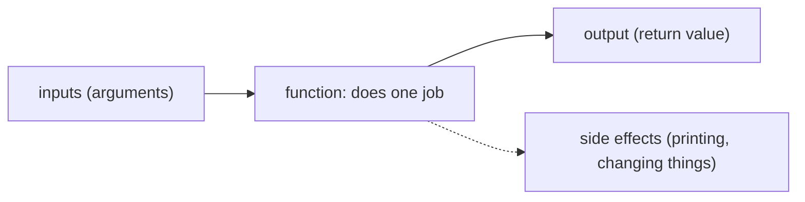
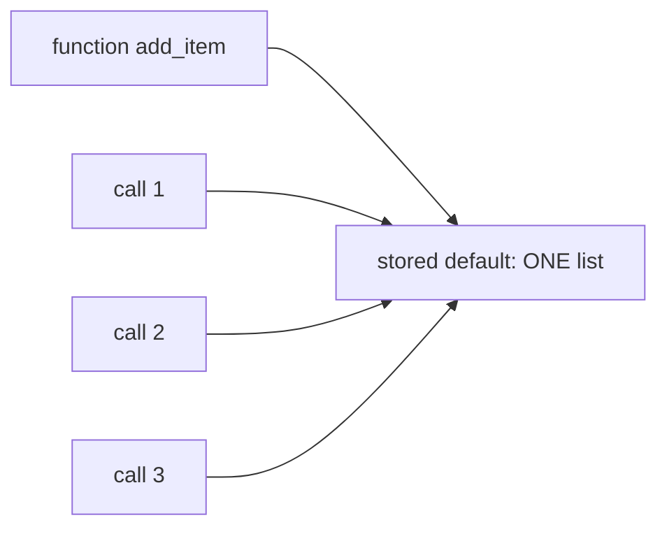
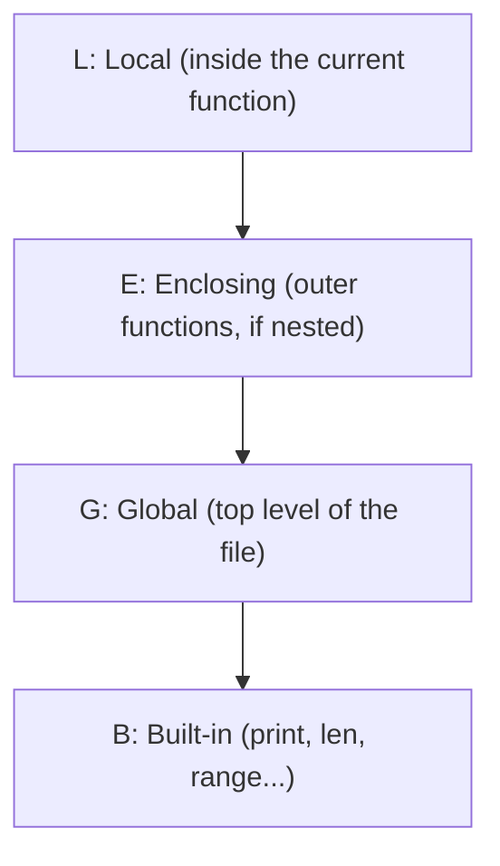
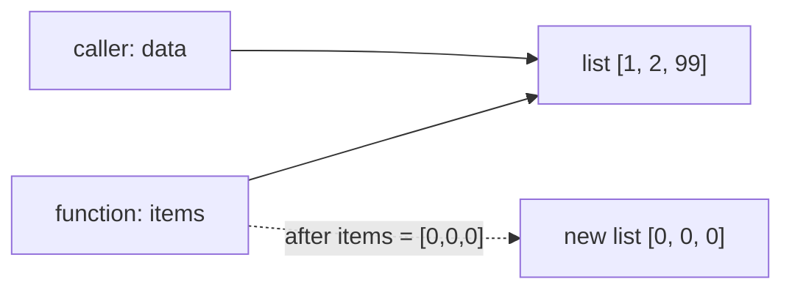
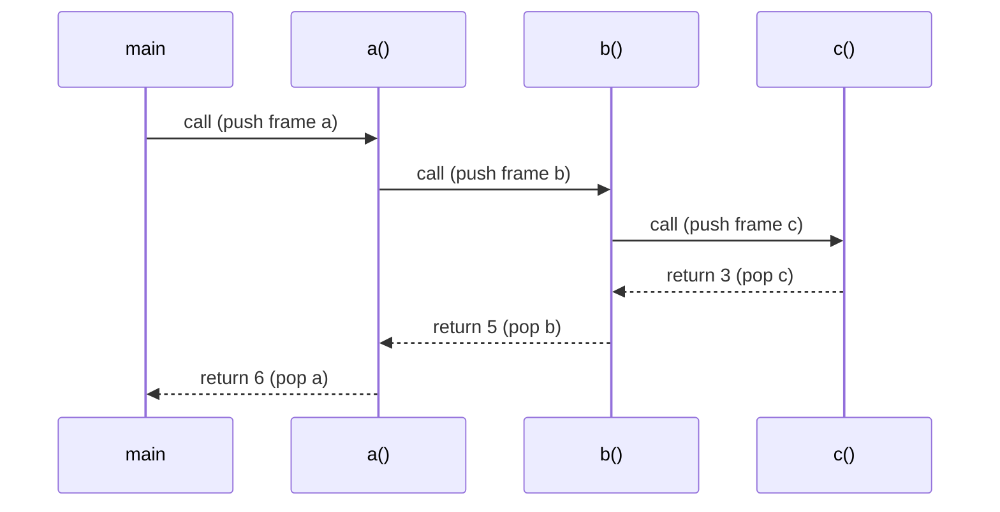

# Chapter 10 · Functions

> Every app you love is built from thousands of small machines, each doing one job: "calculate the GST", "check if the password is strong", "find the shortest route". In Python, those machines are **functions**. Write them well and big programs become a stack of LEGO bricks. Write them badly and you get spaghetti nobody can debug.

**You will learn:**
- How to define and call functions, and the real difference between `return` and `print`
- Parameters vs arguments; positional, keyword and default arguments
- `*args`, `**kwargs`, keyword-only (`*`) and positional-only (`/`) parameters
- The **mutable default argument trap** and exactly why it happens
- Scope (**LEGB**), `global` and `nonlocal`
- Functions as objects, **closures**, `lambda`, docstrings and type hints
- Pure functions vs side effects, how arguments are passed, and the call stack
- How to design functions that are easy to read, test and reuse

**Before this:** [Variables & Memory](02-variables-types-memory.md) · [Loops](06-loops.md) · [Lists](07-lists.md) · [Dictionaries](09-dictionaries.md)

---

## 🧠 The Big Idea

A function is a **vending machine**. You put something in (coins and a button choice), it does some work inside that you don't need to see, and something comes out (a snack).



Three reasons functions exist:

1. **Don't Repeat Yourself (DRY).** Write the logic once, use it 100 times. Fix a bug once, it's fixed everywhere.
2. **Name an idea.** `is_prime(n)` reads like English. Twenty lines of loop doesn't.
3. **Hide details.** You can use `sorted()` without knowing Timsort. Others can use your function without reading it.

> 💡 The best functions are like good vending machines: one clear job, clear inputs, a predictable output, and no surprises like secretly emptying your wallet.

---

## 🔨 Building It Up

### 1. Defining and calling

```python
def greet(name):
    message = f"Hello, {name}!"
    return message

result = greet("Asha")
print(result)
print(greet("Ravi"))
```

```text
Hello, Asha!
Hello, Ravi!
```

Anatomy:
- `def` starts a definition. `greet` is the name. `(name)` is the **parameter** list. The colon and the indented block form the **body**.
- Defining a function does **not** run its body. It just creates the function and gives it a name.
- `greet("Asha")` **calls** it: Python runs the body with `name = "Asha"` and hands back whatever `return` gives.

### 2. `return` vs `print`

This confuses almost every beginner, so let's settle it forever.

- `print` **shows** something on the screen. The program can't use it afterwards.
- `return` **hands a value back** to whoever called the function, so the program can store it, compute with it, pass it on.

```python
def add_print(a, b):
    print(a + b)          # shows 5, returns nothing

def add_return(a, b):
    return a + b          # gives 5 back

x = add_print(2, 3)
y = add_return(2, 3)
print("x =", x)
print("y =", y)
print(add_return(2, 3) * 10)   # we can USE a returned value
```

```text
5
x = None
y = 5
50
```

What just happened: a function without a `return` (or with a bare `return`) gives back **`None`**. So `x` is `None`, and `x * 10` would crash. A calculator that prints the answer on a screen is fine for a human, but another program can't read that screen. Return values are for programs.

**`return` ends the function immediately.** This lets you exit early:

```python
def find_first_negative(nums):
    for i, x in enumerate(nums):
        if x < 0:
            return i          # stop right here
    return -1                 # only reached if the loop found nothing

print(find_first_negative([3, 8, -2, 5, -9]), find_first_negative([1, 2]))
```

```text
2 -1
```

**Returning several values** really returns one tuple ([Chapter 08](08-tuples-sets.md)), which you unpack:

```python
def divide(a, b):
    return a // b, a % b

q, r = divide(17, 5)
print(q, r, divide(17, 5))
```

```text
3 2 (3, 2)
```

### 3. Parameters vs arguments

- A **parameter** is the name in the definition: `def area(width, height)`. It's the empty slot.
- An **argument** is the actual value you pass in the call: `area(3, 4)`. It's what fills the slot.

Memory hook: **P**arameter = **P**laceholder, **A**rgument = **A**ctual value.

### 4. Positional, keyword and default arguments

```python
def make_profile(name, age, city="Bengaluru"):
    return f"{name}, {age}, {city}"

print(make_profile("Asha", 21))                    # positional; city uses default
print(make_profile("Ravi", 22, "Pune"))            # positional, override default
print(make_profile(age=23, name="Meera"))          # keyword: order doesn't matter
print(make_profile("Kabir", city="Delhi", age=20)) # mix: positional first, then keyword
```

```text
Asha, 21, Bengaluru
Ravi, 22, Pune
Meera, 23, Bengaluru
Kabir, 20, Delhi
```

Rules:
- **Positional** arguments match parameters by position.
- **Keyword** arguments match by name (`age=23`) and make calls self-explaining.
- In a call, positional arguments must come **before** keyword arguments.
- In a definition, parameters **with** defaults must come **after** those without.

```py
make_profile(name="Asha", 21)
# SyntaxError: positional argument follows keyword argument

def bad(city="Pune", name):
# SyntaxError: non-default argument follows default argument (wording varies by version)

make_profile("Asha")
# TypeError: make_profile() missing 1 required positional argument: 'age'

make_profile("Asha", 21, name="X")
# TypeError: make_profile() got multiple values for argument 'name'
```

### 5. The mutable default argument trap

Here's the most famous Python gotcha. Watch:

```python
def add_item(item, basket=[]):
    basket.append(item)
    return basket

print(add_item("apple"))
print(add_item("banana"))      # expected ['banana'] ...
print(add_item("cherry"))
```

```text
['apple']
['apple', 'banana']
['apple', 'banana', 'cherry']
```

Why? **Default values are evaluated once, when the `def` line runs**, not every time you call the function. There is exactly **one** list object stored inside the function, and every call that uses the default appends to that same list.



**The fix:** use `None` as the default and create a fresh object inside.

```python
def add_item(item, basket=None):
    if basket is None:
        basket = []            # a NEW list on every call
    basket.append(item)
    return basket

print(add_item("apple"))
print(add_item("banana"))
my_basket = ["mango"]
print(add_item("kiwi", my_basket))
```

```text
['apple']
['banana']
['mango', 'kiwi']
```

> ⚠️ Rule: **never use a mutable object (list, dict, set) as a default value.** Immutable defaults (`0`, `""`, `None`, tuples) are perfectly safe.

### 6. `*args` and `**kwargs`: any number of arguments

Sometimes you don't know how many arguments will come. `print()` takes any number, for example.

- `*args` collects **extra positional** arguments into a **tuple**.
- `**kwargs` collects **extra keyword** arguments into a **dict**.

(The names `args` and `kwargs` are just conventions; the `*` and `**` are what matter.)

```python
def total(*numbers):
    print("got:", numbers)
    s = 0
    for n in numbers:
        s += n
    return s

print(total())
print(total(1, 2, 3))

def describe(name, **details):
    print(name, details)

describe("Asha", age=21, city="Pune")
describe("Ravi")
```

```text
got: ()
0
got: (1, 2, 3)
6
Asha {'age': 21, 'city': 'Pune'}
Ravi {}
```

**At the call site, `*` and `**` do the reverse: they spread.**

```python
def area(width, height):
    return width * height

dims = [3, 4]
opts = {"width": 5, "height": 6}
print(area(*dims))       # area(3, 4)
print(area(**opts))      # area(width=5, height=6)

def log(level, *messages, **context):
    print(level, "|", " ".join(messages), "|", context)

log("INFO", "user", "logged", "in", user_id=42)
```

```text
12
30
INFO | user logged in | {'user_id': 42}
```

A common real use is a **wrapper** that passes everything through to another function: `def wrapper(*args, **kwargs): return original(*args, **kwargs)`. You'll use exactly this to build decorators in [Chapter 16](16-iterators-generators-decorators.md).

### 7. Keyword-only (`*`) and positional-only (`/`) parameters

You can force callers to use names (or forbid names) for clarity and safety.

- Parameters **after a bare `*`** are **keyword-only**: they must be passed by name.
- Parameters **before a `/`** are **positional-only**: they can't be passed by name (Python 3.8+).

```python
def transfer(amount, *, to_account, dry_run=False):
    return f"send {amount} to {to_account} (dry_run={dry_run})"

print(transfer(500, to_account="ACC-9"))

def power(base, exp, /):
    return base ** exp

print(power(2, 10))
```

```text
send 500 to ACC-9 (dry_run=False)
1024
```

```py
transfer(500, "ACC-9")
# TypeError: transfer() takes 1 positional argument but 2 were given
power(base=2, exp=10)
# TypeError: power() got some positional-only arguments passed as keyword arguments: 'base, exp'
```

Why bother? `transfer(500, "ACC-9", True)` is unreadable: what's `True`? Keyword-only forces `dry_run=True`, which documents itself. Positional-only lets library authors rename parameters later without breaking anyone's code (many built-ins, like `len(obj, /)`, are positional-only).

**The full order of a signature:**

```py
def f(pos_only, /, normal, *args, kw_only, **kwargs):
    ...
```

| Section | Passed as | Example |
|---|---|---|
| before `/` | position only | `pos_only` |
| between `/` and `*` | position or keyword | `normal` |
| `*args` | extra positionals → tuple | |
| after `*` or `*args` | keyword only | `kw_only` |
| `**kwargs` | extra keywords → dict | |

```python
def f(a, /, b, *args, c, d=4, **kwargs):
    return a, b, args, c, d, kwargs

print(f(1, 2, 3, 4, c=5))
print(f(1, b=2, c=3, e=99))
```

```text
(1, 2, (3, 4), 5, 4, {})
(1, 2, (), 3, 4, {'e': 99})
```

### 8. Scope: where a name lives (LEGB)

A variable created inside a function is **local**: it exists only while the function runs and is invisible outside.

```python
def make_tea():
    sugar = 2            # local to make_tea
    return sugar

make_tea()
print("sugar" in globals())   # does a global named sugar exist?
```

```text
False
```

When Python sees a name, it searches four places in order: **LEGB**.



```python
x = "global"

def outer():
    x = "enclosing"
    def inner():
        x = "local"
        print("inner sees:", x)
    inner()
    print("outer sees:", x)

outer()
print("module sees:", x)
print(len("abc"))        # 'len' is found in Built-ins
```

```text
inner sees: local
outer sees: enclosing
module sees: global
3
```

**Reading** an outer variable is fine. **Assigning** to a name inside a function makes it local for the **whole** function, which causes this classic error:

```py
count = 0

def increment():
    count = count + 1     # 'count' is local here (we assign to it) ...
    return count          # ... but we read it before it has a value

increment()
# UnboundLocalError: cannot access local variable 'count' where it is not associated with a value
```

### 9. `global` and `nonlocal`

`global name` says "when I assign `name`, I mean the module-level one". `nonlocal name` says "I mean the one in the enclosing function".

```python
count = 0

def increment():
    global count
    count += 1

increment()
increment()
print(count)

def counter_demo():
    total = 0
    def add(n):
        nonlocal total       # the 'total' of counter_demo, not a new local
        total += n
    add(5)
    add(10)
    return total

print(counter_demo())
```

```text
2
15
```

> 💡 `global` is usually a code smell: hidden shared state makes bugs hard to find. Prefer passing values in and returning results out. `nonlocal`, on the other hand, is common and clean inside nested helper functions, especially in DSA (you'll see it in DFS solutions).

Note that you **don't** need `global` or `nonlocal` to **mutate** an outer list or dict; you only need them to **rebind** the name.

```python
seen = []

def remember(x):
    seen.append(x)    # mutating the list, not reassigning 'seen': no keyword needed

remember(1)
remember(2)
print(seen)
```

```text
[1, 2]
```

### 10. Functions are objects (first-class functions)

In Python, a function is a value like any other. You can store it in a variable, put it in a list or dict, pass it to another function, and return it from a function. Note the difference: `shout` is the function itself; `shout("hi")` **calls** it.

```python
def shout(text):
    return text.upper() + "!"

def whisper(text):
    return text.lower() + "..."

speak = shout                    # no parentheses: we're passing the function itself
print(speak("hello"))
print(shout.__name__, type(shout).__name__)

def apply_twice(func, value):    # a function that takes a function
    return func(func(value))

print(apply_twice(shout, "hey"))

def add_one(n):
    return n + 1

print(apply_twice(add_one, 5))

styles = {"loud": shout, "soft": whisper}    # a "dispatch table"
for mood in ["soft", "loud"]:
    print(styles[mood]("Good morning"))
```

```text
HELLO!
shout function
HEY!!
7
good morning...
GOOD MORNING!
```

A function that takes or returns another function is called a **higher-order function**. You've already used one: `sorted(words, key=len)` passes the function `len` to `sorted`. The dispatch table (a dict of functions) is a clean replacement for long `if/elif` chains.

### 11. Closures: functions that remember

A function defined inside another function can **remember** the outer function's variables even after the outer function has finished. That remembered environment is a **closure**.

```python
def make_multiplier(factor):
    def multiply(n):
        return n * factor        # 'factor' comes from the enclosing scope
    return multiply              # return the inner function itself

double = make_multiplier(2)
triple = make_multiplier(3)
print(double(10), triple(10))

def make_counter():
    count = 0
    def tick():
        nonlocal count
        count += 1
        return count
    return tick

c1 = make_counter()
c2 = make_counter()
print(c1(), c1(), c1(), c2())     # each counter has its own private 'count'
```

```text
20 30
1 2 3 1
```

What just happened: `make_multiplier(2)` finished running, but the `multiply` it returned still remembers `factor = 2`. Each call to `make_counter` creates a fresh `count`, so `c1` and `c2` don't interfere. Closures give you private state without classes, and they're the engine behind decorators ([Chapter 16](16-iterators-generators-decorators.md)).

### 12. `lambda`: tiny anonymous functions

`lambda params: expression` creates a small function in one line, with no name and no `return` keyword (the expression's value is returned automatically).

```python
square = lambda x: x * x
print(square(7))

pairs = [("Ravi", 72), ("Asha", 95), ("Meera", 88)]
print(sorted(pairs, key=lambda p: p[1]))           # sort by marks
print(max(pairs, key=lambda p: p[1])[0])           # name of the topper

add = lambda a, b=10: a + b                        # defaults work too
print(add(1), add(1, 2))
```

```text
49
[('Ravi', 72), ('Meera', 88), ('Asha', 95)]
Asha
11 3
```

Use `lambda` for **short throwaway functions** passed to another function (`key=`, `map`, `filter`, [Chapter 11](11-comprehensions-functional.md)). If it needs a name, a statement, or more than one simple expression, use `def`. (Assigning a lambda to a name, like `square` above, works but style guides prefer `def` for that.)

### 13. Docstrings

A **docstring** is a string literal as the first statement of a function. It documents what the function does, and tools (`help()`, editors) show it.

```python
def bmi(weight_kg, height_m):
    """Return the Body Mass Index.

    weight_kg: weight in kilograms (must be positive)
    height_m:  height in metres (must be positive)
    """
    return weight_kg / height_m ** 2

print(round(bmi(70, 1.75), 1))
print(bmi.__doc__.splitlines()[0])
```

```text
22.9
Return the Body Mass Index.
```

Good docstrings say **what** the function returns, what the parameters mean, and any surprises (errors raised, side effects). They don't repeat the code line by line.

### 14. Type hints

**Type hints** annotate what types a function expects and returns. Python does **not** enforce them at runtime; they're for humans, editors and checkers like `mypy`.

```python
def average(marks: list[float]) -> float:
    return sum(marks) / len(marks)

def find_user(users: dict[str, int], name: str) -> int | None:
    return users.get(name)

def greet(name: str, times: int = 1) -> str:
    return ("Hi " + name + "! ") * times

print(average([80.0, 90.0]))
print(find_user({"asha": 1}, "ravi"))
print(greet("Asha", 2))
print(average.__annotations__)
print(average((1, 2)))      # a tuple of ints, not list[float]: runs anyway, hints aren't enforced
```

```text
85.0
None
Hi Asha! Hi Asha! 
{'marks': list[float], 'return': <class 'float'>}
1.5
```

Common hints: `int`, `str`, `list[int]`, `dict[str, int]`, `tuple[int, int]`, `set[str]`, `X | None` (may be `None`, Python 3.10+), and `Callable[[int], int]` from `typing` for "a function taking an int and returning an int". Interviewers and teams love type-hinted code because it reads like documentation.

### 15. How arguments are passed: "pass by object reference"

Is Python "pass by value" or "pass by reference"? Neither, exactly. The function's parameter becomes **a new name tag on the same object** you passed in ([Chapter 02](02-variables-types-memory.md)). Then:

- If the function **mutates** that object (e.g. `lst.append`), the caller sees the change.
- If the function **rebinds** the parameter (`lst = [...]`, `n = n + 1`), it only moves its own name tag; the caller sees nothing.

```python
def mutate(items):
    items.append(99)          # changes the shared object

def rebind(items):
    items = [0, 0, 0]         # moves the local name only

def bump(n):
    n += 1                    # ints are immutable: this rebinds
    return n

data = [1, 2]
mutate(data)
print(data)
rebind(data)
print(data)

x = 5
print(bump(x), x)
```

```text
[1, 2, 99]
[1, 2, 99]
6 5
```



### 16. Pure functions vs side effects

A **pure function**:
1. returns the same output for the same input, always, and
2. changes nothing outside itself (no printing, no modifying arguments or globals, no files).

Anything else a function does to the outside world is a **side effect**.

```python
def pure_add_tax(prices, rate):
    return [round(p * (1 + rate), 2) for p in prices]   # builds a NEW list (list comprehension: Chapter 11)

def impure_add_tax(prices, rate):
    for i in range(len(prices)):
        prices[i] = round(prices[i] * (1 + rate), 2)    # modifies the caller's list

original = [100, 250]
print(pure_add_tax(original, 0.18), original)
impure_add_tax(original, 0.18)
print(original)
```

```text
[118.0, 295.0] [100, 250]
[118.0, 295.0]
```

Pure functions are easy to test (input → expected output), easy to reason about, and safe to cache (memoization only works for pure functions!). Side effects are necessary (a program that never prints or saves anything is useless), but **keep them at the edges**: compute with pure functions, then print/save in one place. If a function does mutate its input, say so in its name or docstring (like `list.sort()` vs `sorted()`).

### 17. The call stack

When a function calls another function, Python must remember where to come back to. It uses the **call stack**: each call pushes a **frame** (holding that call's local variables and the line it's on), and each `return` pops it.

```python
def c():
    print("  in c: doing the work")
    return 3

def b():
    print(" in b: calling c")
    return c() + 2

def a():
    print("in a: calling b")
    return b() + 1

print("result:", a())
```

```text
in a: calling b
 in b: calling c
  in c: doing the work
result: 6
```



Stack at the deepest point (top is the running function):

```text
| c  (no locals)   |  <- running
| b  (waiting on c)|
| a  (waiting on b)|
| main module      |
```

When an error happens, the **traceback** Python prints is literally this stack, from the outermost call down to the line that failed. Read tracebacks from the **bottom up**: the last line is the error, the line above it is where it happened. The call stack is the key to understanding [Recursion](12-recursion.md), where a function calls itself and the stack grows deep.

### 18. Designing good functions

| Principle | Means | Smell if broken |
|---|---|---|
| **One job** | does one thing you can describe in one sentence without "and" | `load_and_clean_and_plot()` |
| **Good name** | verb for actions (`send_email`), `is_`/`has_` for booleans | `do_stuff`, `process2` |
| **Small** | fits on one screen, usually under ~20 lines | scrolling to read it |
| **Few parameters** | ideally ≤ 3–4; group the rest into a dict/object | 9 positional arguments |
| **Return, don't print** | let the caller decide what to display | can't reuse the result |
| **No hidden state** | inputs in, outputs out; avoid `global` | works only if run in a certain order |
| **Guard clauses** | handle bad/edge cases first and return early | deeply nested `if`s |
| **Documented** | docstring + type hints | "what does this return?" |

```python
def letter_grade(marks: int) -> str:
    """Convert 0-100 marks to a letter grade."""
    if not 0 <= marks <= 100:          # guard clause: reject bad input first
        return "invalid"
    if marks >= 90:
        return "A"
    if marks >= 75:
        return "B"
    if marks >= 50:
        return "C"
    return "F"

for m in [95, 80, 51, 12, 150]:
    print(m, letter_grade(m))
```

```text
95 A
80 B
51 C
12 F
150 invalid
```

---

## 🔬 Under the Hood

### `def` is a statement that runs

When Python executes a `def` line, it builds a **function object** and binds it to the name. That object holds:

- `__code__`: the compiled bytecode of the body (made once, when the file is compiled),
- `__defaults__`: the **already-evaluated** default values,
- `__name__`, `__doc__`, `__annotations__`,
- `__closure__`: the "cells" holding captured variables, for closures.

You can see the mutable-default trap with your own eyes:

```python
def add_item(item, basket=[]):
    basket.append(item)
    return basket

print(add_item.__defaults__)
add_item("apple")
add_item("pear")
print(add_item.__defaults__)      # the stored default object itself changed
```

```text
([],)
(['apple', 'pear'],)
```

And a closure's captured variable:

```python
def make_multiplier(factor):
    def multiply(n):
        return n * factor
    return multiply

triple = make_multiplier(3)
print(triple.__code__.co_freevars)            # names captured from outside
print(triple.__closure__[0].cell_contents)    # the remembered value
```

```text
('factor',)
3
```

### Frames and fast locals

Each call creates a **frame object**: a small record with the function's local variables, a pointer to the current bytecode instruction, and a pointer back to the caller's frame. That linked chain of frames **is** the call stack.

CPython decides at **compile time** which names are local (any name assigned in the function). Locals are stored in a fixed-size array inside the frame and accessed by position, which is fast. Globals and built-ins are looked up in dictionaries ([Chapter 09](09-dictionaries.md)), which is a bit slower. This compile-time decision is why `UnboundLocalError` happens: the compiler saw `count = ...`, marked `count` as local for the whole function, so reading it before assignment fails, even though a global `count` exists.

### Late binding in closures

Closures capture **variables**, not values. The value is looked up when the inner function **runs**:

```python
funcs = []
for i in range(3):
    funcs.append(lambda: i)       # all three capture the same variable i
print([f() for f in funcs])       # i is 2 by the time they run

funcs = []
for i in range(3):
    funcs.append(lambda i=i: i)   # default argument snapshots the current value
print([f() for f in funcs])
```

```text
[2, 2, 2]
[0, 1, 2]
```

The `i=i` trick works precisely *because* defaults are evaluated once at definition time, the same fact behind the mutable-default trap.

### Call overhead

Calling a Python function isn't free: creating a frame, binding arguments and returning costs roughly tens of nanoseconds or more. It almost never matters, and readable code wins. Python 3.11 made calls noticeably cheaper by reusing frame memory and inlining pure-Python calls in the interpreter. The default **recursion limit** (about 1000 nested calls) exists so a runaway chain of calls raises a clean `RecursionError` instead of crashing the process. More in [Chapter 12](12-recursion.md).

---

## 🧩 Pattern Decoder

### Pythonic function idioms

| Situation | Idiom |
|---|---|
| Optional mutable parameter | `def f(x, items=None): if items is None: items = []` |
| Return several results | `return total, count` |
| Exit early on edge cases | guard clauses at the top |
| Many `if/elif` choosing behaviour | dict of functions (dispatch table) |
| Small throwaway function for `key=` | `lambda` |
| Flag arguments | make them keyword-only: `def f(x, *, verbose=False)` |
| Forward all arguments | `def wrapper(*args, **kwargs): return f(*args, **kwargs)` |
| Private state without a class | closure + `nonlocal` |
| Helper used by one function only | define it inside (nested function) |

### How functions show up in DSA

Almost every recursive or graph solution in interviews uses a **nested helper with `nonlocal`** or a closure over the input:

```python
def count_islands(grid):
    rows, cols = len(grid), len(grid[0])
    seen = set()

    def explore(r, c):                       # nested helper: sees grid, seen
        if not (0 <= r < rows and 0 <= c < cols):
            return
        if grid[r][c] != "1" or (r, c) in seen:
            return
        seen.add((r, c))
        explore(r + 1, c)
        explore(r - 1, c)
        explore(r, c + 1)
        explore(r, c - 1)

    islands = 0
    for r in range(rows):
        for c in range(cols):
            if grid[r][c] == "1" and (r, c) not in seen:
                explore(r, c)
                islands += 1
    return islands

grid = ["11000",
        "11000",
        "00100",
        "00011"]
print(count_islands(grid))
```

```text
3
```

Don't worry about the recursion yet ([Chapter 12](12-recursion.md) and [Graphs](../part-2-dsa/16-graphs-bfs-dfs.md) cover it). Notice the **shape**: the outer function sets up shared data; the inner helper uses it without passing it around; `seen` is mutated (so no `nonlocal` needed). If the helper had to **reassign** a counter, it would declare `nonlocal`.

Other places functions matter in DSA:
- **`key=` functions** for sorting and heaps ([Chapter 11](11-comprehensions-functional.md)).
- **Pure functions + memoization** for DP ([Chapter 12](12-recursion.md), [DP I](../part-2-dsa/20-dp-1d.md)).
- **Helper functions** to keep interview code readable: `is_valid(r, c)`, `neighbors(node)`.

---

## ⚠️ Traps & Common Mistakes

1. **Mutable default arguments.** `def f(x, acc=[])` shares one list across calls. Use `None`.

2. **Printing instead of returning.** The caller gets `None`.

```py
def square(n):
    print(n * n)      # ❌ caller can't use the result
def square(n):
    return n * n      # ✅
```

3. **Forgetting `return` on some path.** One branch returns a value, another falls off the end and returns `None`.

4. **Referencing instead of calling, or calling instead of referencing.** `sorted(words, key=len())` is wrong (calls `len` with no arguments); `key=len` is right. `if is_ready:` (always truthy, it's a function!) vs `if is_ready():`.

5. **`UnboundLocalError`** from assigning to a global name inside a function without `global`. Better: pass it in and return the new value.

6. **Late-binding closures in loops.** `lambda: i` in a loop sees the final `i`. Use `lambda i=i: i`.

7. **Mutating arguments by surprise.** A function that sorts or clears the caller's list without saying so. Copy first (`items = list(items)`) or document it.

8. **Shadowing built-ins.** Parameters named `list`, `dict`, `str`, `sum`, `max`, `input`, `id` hide the built-ins inside the function.

9. **Too many responsibilities or parameters.** If the name needs "and", split it. If it takes 8 positional arguments, nobody will call it correctly.

10. **Thinking type hints are enforced.** `def f(x: int)` happily accepts `"hello"`. Use a type checker to catch these, or validate explicitly.

---

## 💡 Tips & Tricks

- Write the **call** you wish existed first (`total = cart_total(items, coupon="NEW10")`), then implement it. You'll get better names and signatures.
- Use keyword arguments at call sites for booleans and numbers: `connect(timeout=5, retry=True)`.
- `help(func)` prints the signature and docstring. In VS Code, hover over the name.
- Prefer returning a value over modifying a global. Prefer returning a new list over mutating the input, unless memory matters.
- `*` in a signature with nothing after it, like `def f(a, *, b)`, is a cheap way to make code self-documenting.
- To quickly test a function, call it with an edge case: empty list, zero, negative, one item.
- In interviews, define small helpers (`in_bounds(r, c)`), it makes your solution readable and shows good engineering.
- `functools.partial(f, x)` pre-fills arguments ([Chapter 11](11-comprehensions-functional.md)).

---

## 🎯 Interview Questions

### 1. What are `*args` and `**kwargs`? 🔥🔥🔥

<details><summary>Answer</summary>

In a definition, `*args` collects any extra positional arguments into a tuple and `**kwargs` collects any extra keyword arguments into a dict. In a call, `*seq` spreads a sequence into positional arguments and `**mapping` spreads a dict into keyword arguments. They're used for flexible APIs and for wrappers/decorators that forward arguments: `def wrapper(*args, **kwargs): return f(*args, **kwargs)`.

</details>

### 2. What's wrong with `def f(x, items=[])`? 🔥🔥🔥

<details><summary>Answer</summary>

Default values are evaluated **once**, when the `def` statement runs, and stored on the function (`f.__defaults__`). Every call that relies on the default gets the same list object, so appends from earlier calls leak into later ones. Fix: `items=None` and `if items is None: items = []` inside the body.

</details>

### 3. Is Python pass-by-value or pass-by-reference? 🔥🔥🔥

<details><summary>Answer</summary>

Neither: it's **pass by object reference** (also called "call by sharing"). The parameter is bound to the same object as the argument. Mutating that object (e.g. `lst.append`) is visible to the caller; rebinding the parameter (`lst = [...]`) is not. With immutable objects (ints, strings, tuples) you can't mutate, so it *looks* like pass-by-value.

</details>

### 4. Explain the LEGB rule. What are `global` and `nonlocal`? 🔥🔥🔥

<details><summary>Answer</summary>

Name lookup order: **L**ocal → **E**nclosing function scopes → **G**lobal (module) → **B**uilt-in. Assigning to a name inside a function makes it local for the whole function. `global x` makes assignments target the module-level `x`; `nonlocal x` makes them target `x` in the nearest enclosing function scope (it must already exist there). Neither keyword is needed to mutate an object, only to rebind the name.

</details>

### 5. What is a closure? Give an example. 🔥🔥

<details><summary>Answer</summary>

A closure is an inner function that remembers variables from its enclosing scope after the outer function has returned. Example:

```python
def make_adder(n):
    def add(x):
        return x + n
    return add

add5 = make_adder(5)
print(add5(10))
```

```text
15
```

`add5` carries `n = 5` in its `__closure__`. Closures provide private state and power decorators. Gotcha: they capture variables, not values (late binding).

</details>

### 6. `lambda` vs `def`? 🔥🔥

<details><summary>Answer</summary>

Both create function objects. `lambda` is an **expression** limited to a single expression body, has no name (`__name__` is `'<lambda>'`), and can't contain statements (no `return`, loops or assignments, apart from the `:=` operator). It's for short throwaway functions passed inline, like `key=lambda p: p[1]`. Use `def` for anything reusable, multi-line, or worth documenting and naming.

</details>

### 7. What does a function return if it has no `return` statement? 🔥🔥

<details><summary>Answer</summary>

`None`. The same goes for a bare `return` or falling off the end of any branch.

</details>

### 8. What does this print? 🔥🔥

```py
funcs = [lambda: i for i in range(3)]
print([f() for f in funcs])
```

<details><summary>Answer</summary>

`[2, 2, 2]`. Each lambda looks up `i` when called, and by then the loop has finished with `i = 2`. Fix: `lambda i=i: i` to capture the current value as a default, giving `[0, 1, 2]`.

</details>

### 9. What are positional-only and keyword-only parameters? 🔥

<details><summary>Answer</summary>

Parameters before `/` are positional-only: callers can't pass them by name (lets authors rename them freely; many built-ins use this). Parameters after `*` (or after `*args`) are keyword-only: callers must pass them by name (improves readability for flags and options). Full order: `def f(pos_only, /, normal, *args, kw_only, **kwargs)`.

</details>

### 10. What does "functions are first-class objects" mean? 🔥🔥

<details><summary>Answer</summary>

Functions are ordinary objects: they can be assigned to variables, stored in data structures, passed as arguments, returned from other functions, and have attributes (`__name__`, `__doc__`). This enables higher-order functions (`sorted(key=...)`, `map`), dispatch tables, closures and decorators.

</details>

### 11. What is a pure function and why do we like them? 🔥

<details><summary>Answer</summary>

A pure function's output depends only on its inputs and it has no side effects (no mutation of arguments or globals, no I/O). Benefits: easy to test, easy to reason about, safe to run in parallel, and safe to memoize/cache because the same input always yields the same output.

</details>

### 12. What is the call stack? What causes a `RecursionError`? 🔥🔥

<details><summary>Answer</summary>

The call stack is the stack of frames for the currently active function calls; each call pushes a frame with its locals and return position, each return pops one. A traceback shows this stack. `RecursionError` is raised when nested calls exceed Python's recursion limit (default 1000, see `sys.getrecursionlimit()`), usually because a recursive function lacks a reachable base case. See [Chapter 12](12-recursion.md).

</details>

---

## 🏋️ Practice

**🟢 1. Temperature converter.** Write `c_to_f(c)` and `f_to_c(f)` that **return** values; show that `f_to_c(c_to_f(37))` gives 37 back.

<details><summary>Solution</summary>

```python
def c_to_f(c: float) -> float:
    return c * 9 / 5 + 32

def f_to_c(f: float) -> float:
    return (f - 32) * 5 / 9

print(c_to_f(37), f_to_c(c_to_f(37)))
```

```text
98.6 37.0
```

</details>

**🟢 2. `is_prime(n)`** with guard clauses for n < 2, checking divisors only up to √n.

<details><summary>Solution</summary>

```python
def is_prime(n: int) -> bool:
    if n < 2:
        return False
    d = 2
    while d * d <= n:          # a factor larger than sqrt(n) pairs with one smaller
        if n % d == 0:
            return False
        d += 1
    return True

print([n for n in range(20) if is_prime(n)])
```

```text
[2, 3, 5, 7, 11, 13, 17, 19]
```

O(√n) per call.

</details>

**🟢 3. Flexible average.** `average(*nums)` returns the mean of any number of arguments, or `None` if there are none.

<details><summary>Solution</summary>

```python
def average(*nums):
    if not nums:
        return None
    return sum(nums) / len(nums)

print(average(1, 2, 3, 4), average())
```

```text
2.5 None
```

</details>

**🟡 4. Calculator with a dispatch table.** `calculate(a, op, b)` supports `+ - * /` using a dict of functions instead of `if/elif`, and returns `"unknown op"` for anything else.

<details><summary>Solution</summary>

```python
def calculate(a, op, b):
    ops = {
        "+": lambda x, y: x + y,
        "-": lambda x, y: x - y,
        "*": lambda x, y: x * y,
        "/": lambda x, y: x / y if y != 0 else "division by zero",
    }
    func = ops.get(op)
    if func is None:
        return "unknown op"
    return func(a, b)

print(calculate(6, "*", 7), calculate(1, "/", 0), calculate(2, "^", 3))
```

```text
42 division by zero unknown op
```

</details>

**🟡 5. Bank account with closures.** `make_account(balance)` returns two functions, `deposit(x)` and `withdraw(x)`, sharing a private balance. Withdrawals that would go negative are refused.

<details><summary>Solution</summary>

```python
def make_account(balance):
    def deposit(amount):
        nonlocal balance
        balance += amount
        return balance

    def withdraw(amount):
        nonlocal balance
        if amount > balance:
            return "insufficient funds"
        balance -= amount
        return balance

    return deposit, withdraw

deposit, withdraw = make_account(100)
print(deposit(50), withdraw(30), withdraw(500))
```

```text
150 120 insufficient funds
```

Nobody outside can touch `balance` directly: that's encapsulation without a class (classes in [Chapter 14](14-oop-classes-objects.md)).

</details>

**🟡 6. Fix the bugs.** This function is supposed to return a new list with each name capitalised, and record every name it has ever seen in `history`. Find both bugs and fix them.

```py
def tidy(names, history=[]):
    for n in names:
        history.append(n)
        n = n.capitalize()
    return names
```

<details><summary>Solution</summary>

Bug 1: `n = n.capitalize()` rebinds the loop variable; `names` never changes, and the function returns the original list. Bug 2: `history=[]` is a mutable default shared across calls (it "works" by accident but leaks state between unrelated callers and can't be reset). Fix:

```python
def tidy(names, history=None):
    if history is None:
        history = []
    result = []
    for n in names:
        history.append(n)
        result.append(n.capitalize())
    return result, history

print(tidy(["asha", "RAVI"]))
print(tidy(["meera"]))
```

```text
(['Asha', 'Ravi'], ['asha', 'RAVI'])
(['Meera'], ['meera'])
```

</details>

**🔴 7. Memoize any one-argument function.** Write `memoize(func)` that returns a new function which caches results in a dict. Show that a slow function is only really called once per distinct input.

<details><summary>Solution</summary>

```python
def memoize(func):
    cache = {}
    def wrapper(x):
        if x not in cache:
            cache[x] = func(x)
        return cache[x]
    return wrapper

calls = 0
def slow_square(n):
    global calls
    calls += 1
    return n * n

fast_square = memoize(slow_square)
print(fast_square(9), fast_square(9), fast_square(4), fast_square(9))
print("real calls:", calls)
```

```text
81 81 16 81
real calls: 2
```

This is a closure over `cache`, and it's exactly what a **decorator** is ([Chapter 16](16-iterators-generators-decorators.md)). Python ships a production version: `functools.lru_cache` ([Chapter 12](12-recursion.md)). Memoizing only makes sense for pure functions.

</details>

**🔴 8. `compose(*funcs)`.** Return a function that applies the given functions right-to-left: `compose(f, g, h)(x) == f(g(h(x)))`. With no functions, it should return its input unchanged.

<details><summary>Solution</summary>

```python
def compose(*funcs):
    def composed(x):
        for f in reversed(funcs):
            x = f(x)
        return x
    return composed

def add_one(n):
    return n + 1

def double(n):
    return n * 2

print(compose(add_one, double)(5))    # add_one(double(5))
print(compose(double, add_one)(5))    # double(add_one(5))
print(compose()(5))
```

```text
11
12
5
```

</details>

---

## 🧠 Never-Forget Summary

- `def` creates a function object; calling it runs the body. `return` hands back a value and exits; no `return` means `None`.
- **Parameters** are placeholders, **arguments** are actual values.
- Positional → keyword in calls; non-default → default in definitions.
- **Defaults are evaluated once.** Never use a mutable default; use `None`.
- `*args` → tuple, `**kwargs` → dict; at call sites `*`/`**` spread.
- `/` = positional-only before it, `*` = keyword-only after it.
- **LEGB** lookup; assigning makes a name local; `global`/`nonlocal` to rebind outer names.
- Functions are objects: pass them, return them, store them. **Closures** remember enclosing variables (late binding!).
- `lambda` = one-expression anonymous function, for `key=` and friends.
- Arguments are passed **by object reference**: mutation is visible, rebinding isn't.
- Prefer **pure** functions; keep side effects at the edges.
- Each call pushes a **frame** on the call stack; return pops it.

**Memory hooks:**
- **"Print shows, return gives."**
- **"Defaults are baked once, so never bake a basket."** (mutable default trap)
- **"Look Every Good Book."** (Local, Enclosing, Global, Built-in)
- **"Star packs in a def, star unpacks in a call."**
- **"Slash before = position only. Star after = names only."**

**One picture:**

```py
def f(a, /, b, c=0, *args, d, e=1, **kwargs) -> int:
#     │     │  │      │      │  │      └─ extra keywords → dict
#     │     │  │      │      └──┴─ keyword-only (after *)
#     │     │  │      └─ extra positionals → tuple
#     │     │  └─ default (evaluated ONCE at def time)
#     │     └─ positional or keyword
#     └─ positional-only (before /)
    """Docstring: what it returns."""
    ...
```

| Concept | One-line meaning |
|---|---|
| return vs print | give a value back vs show it |
| mutable default | one shared object across calls |
| LEGB | where names are looked up |
| closure | inner function + remembered variables |
| lambda | anonymous one-expression function |
| pass by object reference | mutate = visible, rebind = invisible |
| pure function | same input → same output, no side effects |
| call stack | frames pushed on call, popped on return |

> **If you remember only one thing:** a good function takes inputs, **returns** an output, does one job, and surprises nobody, and in Python, the arguments it receives are the caller's actual objects, not copies.

---
**Next:** [Chapter 11 · Comprehensions & Functional Tools](11-comprehensions-functional.md)  ·  **Back to** [Contents](../README.md)
