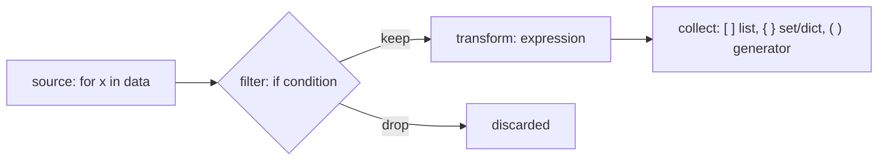
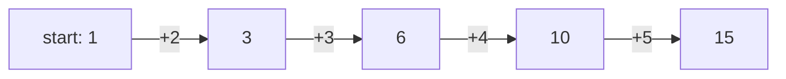

# Chapter 11 · Comprehensions & Functional Tools

> Five lines of "make an empty list, loop, check, append" become one readable line. Sorting students by marks, then by name, becomes one `key=`. This chapter is where your Python stops looking like translated C and starts looking like Python. Interviewers notice.

**You will learn:**
- List, dict and set comprehensions, including conditions, `if/else` and nested loops
- Generator expressions: comprehensions that don't build the whole list (a preview)
- `map`, `filter` and `functools.reduce`, and when a comprehension is better
- `sorted`, `min`, `max` with `key=`, including **multi-key** sorts in mixed directions
- `any` / `all`, `zip` / `enumerate`, `operator.itemgetter`, `functools.partial`, `cmp_to_key`
- Readability rules: when a comprehension is too clever
- Performance: why comprehensions are fast, and when generators save memory

**Before this:** [Lists](07-lists.md) · [Tuples & Sets](08-tuples-sets.md) · [Dictionaries](09-dictionaries.md) · [Functions](10-functions.md)

---

## 🧠 The Big Idea

Picture a factory conveyor belt. Raw items roll in from a **source**. A **quality checker** throws some away. A **machine** transforms the rest. At the end, a **box** collects the results.



A comprehension is that whole factory written in one line, read almost like English:

```py
[x * x   for x in nums   if x % 2 == 0]
#  ^ transform   ^ source      ^ filter
# "the square of x, for each x in nums, if x is even"
```

The functional tools (`map`, `filter`, `sorted(key=...)`, `any`, `zip`...) follow the same philosophy: describe **what** you want, not **how** to loop for it. That's called **declarative** style, and it's shorter, clearer and usually faster.

---

## 🔨 Building It Up

### 1. Your first list comprehension

The loop you've written a hundred times since [Chapter 07](07-lists.md):

```python
nums = [1, 2, 3, 4, 5]

squares = []
for n in nums:
    squares.append(n * n)
print(squares)

squares = [n * n for n in nums]     # the same thing
print(squares)

print([ch.upper() for ch in "hey"])
print([len(w) for w in "the quick brown fox".split()])
print([0 for _ in range(4)])        # _ = "I don't use the loop variable"
```

```text
[1, 4, 9, 16, 25]
[1, 4, 9, 16, 25]
['H', 'E', 'Y']
[3, 5, 5, 3]
[0, 0, 0, 0]
```

**The translation rule:** take the loop, move the thing you `append` to the front, and drop the `append`.

```text
result = []
for ITEM in SOURCE:          ──►   [ EXPR  for ITEM in SOURCE ]
    result.append(EXPR)
```

### 2. Filtering with `if`

Add an `if` at the **end** to keep only some items.

```python
nums = [5, 12, 7, 20, 3, 18]
print([n for n in nums if n > 10])
print([n * 2 for n in nums if n % 2 == 1])

words = ["Apple", "bat", "Cat", "dog"]
print([w for w in words if w[0].isupper()])
```

```text
[12, 20, 18]
[10, 14, 6]
['Apple', 'Cat']
```

### 3. Choosing a value with `if/else`

To **transform every item** one of two ways, put a conditional expression (`A if cond else B`, from [Chapter 05](05-conditionals.md)) at the **front**.

```python
nums = [5, 12, 7, 20]
print(["big" if n > 10 else "small" for n in nums])
print([n if n >= 0 else 0 for n in [3, -1, 4, -5]])    # clamp negatives to 0
```

```text
['small', 'big', 'small', 'big']
[3, 0, 4, 0]
```

> 💡 **Where does the `if` go?**
> - `if` at the **end** = a **filter**: some items disappear. No `else` allowed there.
> - `if ... else` at the **front** = a **choice**: every item survives, in one of two forms.
>
> You can use both: `[x if x > 0 else 0 for x in nums if x != 99]`.

```py
[n for n in nums if n > 10 else 0]
# SyntaxError: invalid syntax  (else isn't allowed in the filter position)
```

### 4. Nested loops in a comprehension

Several `for` clauses run like nested loops, **in the same order you'd write them as loops**: outer first.

```python
pairs = [(x, y) for x in [1, 2, 3] for y in "ab"]
print(pairs)

# Same as:
pairs2 = []
for x in [1, 2, 3]:          # outer
    for y in "ab":           # inner
        pairs2.append((x, y))
print(pairs == pairs2)

grid = [[1, 2, 3], [4, 5, 6], [7, 8, 9]]
flat = [x for row in grid for x in row]          # flatten: "for row ... for x in row"
print(flat)

print([(i, j) for i in range(4) for j in range(i + 1, 4)])   # all pairs i < j
```

```text
[(1, 'a'), (1, 'b'), (2, 'a'), (2, 'b'), (3, 'a'), (3, 'b')]
True
[1, 2, 3, 4, 5, 6, 7, 8, 9]
[(0, 1), (0, 2), (0, 3), (1, 2), (1, 3), (2, 3)]
```

Memory trick for flattening: read it as **"x, for each row in grid, for each x in row."** If you get the order backwards (`for x in row for row in grid`), Python complains that `row` isn't defined yet.

**A comprehension inside a comprehension** builds a 2D structure (a list of lists). This is the correct way to make a grid ([Chapter 07](07-lists.md) explained why `[[0] * n] * m` is broken):

```python
rows, cols = 3, 4
grid = [[0] * cols for _ in range(rows)]      # a NEW row each time
grid[0][0] = 1
print(grid)

table = [[r * c for c in range(1, 4)] for r in range(1, 4)]   # times table
for row in table:
    print(row)

matrix = [[1, 2, 3], [4, 5, 6]]
transposed = [[row[c] for row in matrix] for c in range(len(matrix[0]))]
print(transposed)
```

```text
[[1, 0, 0, 0], [0, 0, 0, 0], [0, 0, 0, 0]]
[1, 2, 3]
[2, 4, 6]
[3, 6, 9]
[[1, 4], [2, 5], [3, 6]]
```

Notice the difference: `[x for row in grid for x in row]` (two `for`s in one comprehension) makes a **flat** list; `[[... for c ...] for r ...]` (a comprehension as the expression) makes a **nested** list.

### 5. Dict and set comprehensions

Same idea with curly braces. A **dict comprehension** has `key: value` at the front.

```python
words = ["apple", "banana", "cherry"]
lengths = {w: len(w) for w in words}
print(lengths)

prices = {"tea": 15, "coffee": 40, "samosa": 20}
discounted = {item: p * 0.9 for item, p in prices.items() if p > 18}
print(discounted)

swapped = {v: k for k, v in prices.items()}
print(swapped)

index_of = {ch: i for i, ch in enumerate("hello")}   # later duplicates overwrite
print(index_of)

remainders = {n % 3 for n in range(10)}              # set comprehension
print(remainders)
```

```text
{'apple': 5, 'banana': 6, 'cherry': 6}
{'coffee': 36.0, 'samosa': 18.0}
{15: 'tea', 40: 'coffee', 20: 'samosa'}
{'h': 0, 'e': 1, 'l': 3, 'o': 4}
{0, 1, 2}
```

> ⚠️ `{x for x in ...}` is a **set**; `{k: v for ...}` is a **dict**. There's no "tuple comprehension": `(x for x in ...)` is a generator expression (next section). Use `tuple(x for x in ...)` if you need a tuple.

### 6. Generator expressions (a preview)

Swap the square brackets for **parentheses** and you get a **generator expression**. It doesn't build a list. It produces items **one at a time, on demand**, which is called **lazy** evaluation.

```python
nums = [1, 2, 3, 4]
gen = (n * n for n in nums)
print(type(gen).__name__)
print(next(gen), next(gen))     # pull items one at a time
print(list(gen))                # the REST of the items
print(list(gen))                # exhausted: generators are single-use!

print(sum(n * n for n in range(1, 101)))   # no extra brackets needed as the only argument
print(max(len(w) for w in ["hi", "hello", "hey"]))
```

```text
generator
1 4
[9, 16]
[]
338350
5
```

What just happened: the generator remembers where it stopped. `next()` asks for one more item. Once it has given everything, it's empty forever. When a generator expression is the only argument to a function like `sum`, `max`, `any`, you can drop its own parentheses.

**Why bother?** Memory. A list of a million squares stores a million numbers. A generator stores only "where I am in the loop".

```python
import sys

as_list = [n * n for n in range(1_000_000)]
as_gen = (n * n for n in range(1_000_000))
print(sys.getsizeof(as_list) > 1_000_000)   # megabytes of pointers
print(sys.getsizeof(as_gen) < 1_000)        # a couple of hundred bytes, whatever the size
print(sum(as_gen) == sum(as_list))
```

```text
True
True
True
```

Rule of thumb: if you'll loop over the result **once** (feed it to `sum`, `max`, `any`, `"".join`, a `for` loop), use a generator expression. If you need to index it, loop over it twice or check its length, use a list. Generators get their full chapter in [Chapter 16](16-iterators-generators-decorators.md).

### 7. `map` and `filter`

These are the older, functional-programming way to transform and filter.

- `map(func, iterable)` calls `func` on every item.
- `filter(func, iterable)` keeps items where `func(item)` is truthy.

Both are **lazy**, like generators: they return an iterator, so wrap them in `list()` to see the values.

```python
nums = ["4", "8", "15"]
ints = list(map(int, nums))           # call int() on each string
print(ints)

print(list(map(lambda x: x * 10, ints)))
print(list(filter(lambda x: x % 2 == 0, ints)))
print(list(filter(None, [0, 1, "", "hi", None, [], [3]])))   # None = keep truthy items

print(list(map(pow, [2, 3, 4], [5, 2, 1])))   # map with 2 iterables: pow(2,5), pow(3,2), pow(4,1)

line = "3 9 27"
a, b, c = map(int, line.split())      # classic competitive-programming input parsing
print(a + b + c)
```

```text
[4, 8, 15]
[40, 80, 150]
[4, 8]
[1, 'hi', [3]]
[32, 9, 4]
39
```

**map/filter vs comprehension:**

| | comprehension | `map` / `filter` |
|---|---|---|
| With an existing named function | `[int(x) for x in s]` | `map(int, s)` ✅ shorter |
| With a lambda | `[x * 2 for x in s]` ✅ clearer | `map(lambda x: x * 2, s)` |
| Transform + filter together | `[f(x) for x in s if g(x)]` ✅ | `map(f, filter(g, s))` |
| Result | a list right away | a lazy iterator |

Most Python style guides prefer comprehensions, except `map` with a built-in or named function, which reads nicely.

### 8. `functools.reduce`

`reduce(func, iterable, initial)` **folds** a sequence into one value by repeatedly applying a two-argument function: `func(func(func(initial, a), b), c)`.

```python
from functools import reduce
import operator

nums = [1, 2, 3, 4, 5]
print(reduce(lambda acc, x: acc + x, nums))       # ((((1+2)+3)+4)+5)
print(reduce(operator.mul, nums, 1))              # product, with initial value 1
print(reduce(lambda a, b: a if a > b else b, nums))   # max, the long way
print(reduce(operator.add, [], 0))                # empty input is fine WITH an initial value
```

```text
15
120
5
0
```



For common folds, prefer the dedicated built-ins: `sum`, `max`, `min`, `any`, `all`, `math.prod`, `"".join`. Use `reduce` when there's no built-in for your fold. Without an initial value, `reduce` on an empty list raises `TypeError`.

### 9. Sorting with `key`: single and multi-key

You met `sorted(..., key=...)` in [Chapter 07](07-lists.md). The key function turns each item into the **thing to compare**.

```python
students = [("Ravi", 85, 20), ("Asha", 92, 21), ("Meera", 85, 19), ("Kabir", 92, 22)]

print(sorted(students, key=lambda s: s[1]))                 # by marks ascending
print(sorted(students, key=lambda s: s[1], reverse=True))   # by marks descending
```

```text
[('Ravi', 85, 20), ('Meera', 85, 19), ('Asha', 92, 21), ('Kabir', 92, 22)]
[('Asha', 92, 21), ('Kabir', 92, 22), ('Ravi', 85, 20), ('Meera', 85, 19)]
```

**Multi-key sort:** return a **tuple** from the key. Tuples compare element by element ([Chapter 08](08-tuples-sets.md)), so the first element decides, the second breaks ties, and so on.

```python
students = [("Ravi", 85, 20), ("Asha", 92, 21), ("Meera", 85, 19), ("Kabir", 92, 22)]

# marks DESCENDING, then name ASCENDING: negate the number to flip its direction
for s in sorted(students, key=lambda s: (-s[1], s[0])):
    print(s)
```

```text
('Asha', 92, 21)
('Kabir', 92, 22)
('Meera', 85, 19)
('Ravi', 85, 20)
```

You can't negate a string. To sort strings **descending** while another key goes ascending, use two **stable** sorts: sort by the **secondary** key first, then by the **primary** key.

```python
students = [("Ravi", 85), ("Asha", 92), ("Meera", 85), ("Kabir", 92)]
step1 = sorted(students, key=lambda s: s[0], reverse=True)   # secondary: name Z->A
step2 = sorted(step1, key=lambda s: s[1])                    # primary: marks ascending
print(step2)
```

```text
[('Ravi', 85), ('Meera', 85), ('Kabir', 92), ('Asha', 92)]
```

What just happened: stability means the second sort keeps the name order from the first sort among students with equal marks. "Sort by the least important key first" feels backwards, but that's how stable multi-pass sorting works.

**Custom comparison with `cmp_to_key`:** sometimes "which comes first" can't be expressed as a key, only as a comparison of two items. `functools.cmp_to_key` adapts an old-style compare function returning negative / zero / positive.

```python
from functools import cmp_to_key

def compare(a, b):
    # a should come first if a+b makes a bigger number than b+a
    if a + b > b + a:
        return -1
    if a + b < b + a:
        return 1
    return 0

nums = [3, 30, 34, 5, 9]
parts = sorted(map(str, nums), key=cmp_to_key(compare))
print("".join(parts))
```

```text
9534330
```

That's the classic **Largest Number** problem (LeetCode 179).

### 10. `min` and `max` with `key` (and `default`)

`min`/`max` take the same `key=` as `sorted`, and return the **item**, not the key value.

```python
words = ["kiwi", "banana", "fig", "cherry"]
print(max(words, key=len))             # first longest wins ties
print(min(words, key=len))

points = [(3, 4), (1, 1), (-2, 2)]
print(min(points, key=lambda p: p[0] ** 2 + p[1] ** 2))   # closest to origin

scores = {"Asha": 92, "Ravi": 85}
print(max(scores, key=scores.get))      # key with the largest value

print(max([], default=0))               # no crash on empty input
print(max(3, 9, 4))                     # also works with separate arguments
```

```text
banana
fig
(1, 1)
Asha
0
9
```

Finding the max is O(n); sorting just to take `[-1]` is O(n log n). Prefer `max`.

### 11. `any` and `all`

- `any(iterable)`: True if **at least one** item is truthy.
- `all(iterable)`: True if **every** item is truthy.

Both **short-circuit**: they stop the moment the answer is known. Feed them generator expressions.

```python
marks = [72, 45, 90, 38]
print(any(m < 40 for m in marks))       # did anyone fail?
print(all(m >= 35 for m in marks))      # did everyone pass the grace mark?

password = "Secr3t!x"
checks = [
    len(password) >= 8,
    any(c.isdigit() for c in password),
    any(c.isupper() for c in password),
    any(not c.isalnum() for c in password),
]
print(all(checks))

print(any([]), all([]))                 # the empty-input edge case
```

```text
True
True
True
False True
```

`all([])` is `True` ("every item in an empty list is fine": there's nothing to complain about). This is called **vacuous truth** and it's a classic interview trick question.

### 12. `zip` and `enumerate`, properly

```python
names = ["Asha", "Ravi", "Meera"]
marks = [92, 85, 88]
cities = ["Pune", "Delhi"]

print(list(zip(names, marks)))
print(list(zip(names, marks, cities)))       # stops at the SHORTEST input
print(dict(zip(names, marks)))               # build a dict from two lists

for rank, name in enumerate(names, start=1): # start counting from 1
    print(rank, name)

pairs = [("a", 1), ("b", 2), ("c", 3)]
letters, numbers = zip(*pairs)               # "unzip": zip of the unpacked pairs
print(letters, numbers)

nums = [3, 5, 9, 10]
print([b - a for a, b in zip(nums, nums[1:])])   # differences between neighbours
```

```text
[('Asha', 92), ('Ravi', 85), ('Meera', 88)]
[('Asha', 92, 'Pune'), ('Ravi', 85, 'Delhi')]
{'Asha': 92, 'Ravi': 85, 'Meera': 88}
1 Asha
2 Ravi
3 Meera
('a', 'b', 'c') (1, 2, 3)
[2, 4, 1]
```

What just happened: `zip(*pairs)` spreads the list into `zip(("a", 1), ("b", 2), ("c", 3))`, which groups the first elements together and the second elements together: transposing. The same trick transposes a matrix: `[list(col) for col in zip(*matrix)]`. And `zip(nums, nums[1:])` pairs each element with its next neighbour, a pattern you'll use constantly.

> ⚠️ `zip` silently drops the leftovers of longer inputs. In Python 3.10+ you can write `zip(a, b, strict=True)` to get a `ValueError` if the lengths differ.

### 13. `operator.itemgetter` and friends

The `operator` module offers ready-made functions for common lambdas. They're a bit faster and often clearer.

```python
from operator import itemgetter, attrgetter, add, mul
from collections import namedtuple

rows = [("Ravi", 85), ("Asha", 92), ("Meera", 85)]
print(sorted(rows, key=itemgetter(1)))          # same as key=lambda r: r[1]
print(sorted(rows, key=itemgetter(1, 0)))       # multi-key: (r[1], r[0])

get_name = itemgetter(0)
print(get_name(("Asha", 92)))

records = [{"name": "Zed", "age": 30}, {"name": "Amy", "age": 25}]
print([r["name"] for r in sorted(records, key=itemgetter("age"))])   # works on dicts too

Point = namedtuple("Point", "x y")
pts = [Point(3, 1), Point(1, 2)]
print(min(pts, key=attrgetter("x")))            # by attribute (more in OOP chapters)

print(list(map(add, [1, 2], [10, 20])), list(map(mul, [1, 2], [10, 20])))
```

```text
[('Ravi', 85), ('Meera', 85), ('Asha', 92)]
[('Meera', 85), ('Ravi', 85), ('Asha', 92)]
Asha
['Amy', 'Zed']
Point(x=1, y=2)
[11, 22] [10, 40]
```

### 14. `functools.partial`: pre-filling arguments

`partial(func, *some_args, **some_kwargs)` returns a new function with some arguments already filled in.

```python
from functools import partial

def power(base, exponent):
    return base ** exponent

square = partial(power, exponent=2)
cube = partial(power, exponent=3)
print(square(5), cube(2))

to_int_from_binary = partial(int, base=2)
print(to_int_from_binary("1011"))

print(list(map(partial(power, 2), range(6))))   # 2**0 ... 2**5 (base fixed to 2)
```

```text
25 8
11
[1, 2, 4, 8, 16, 32]
```

It's the same idea as the closure `make_multiplier` from [Chapter 10](10-functions.md), but ready-made. Handy for callbacks and for `map` when a function needs an extra fixed argument.

### 15. Readability rules

Comprehensions are great until they aren't. Guidelines strong teams follow:

1. **One loop and one condition is the sweet spot.** Two loops is OK. Three, or nested comprehensions with conditions, belong in a regular loop.
2. **If it doesn't fit on one line (or two, nicely broken), use a loop.**
3. **Never use a comprehension just for side effects.** `[print(x) for x in items]` builds a useless list of `None`s. Write a `for` loop.
4. **Name the pieces.** Pull a complicated condition into a well-named function: `[u for u in users if is_active(u)]`.
5. **Don't nest `if/else` inside `if/else` inside a comprehension.**

```python
data = [3, -1, 8, 0, -7, 12]

# ❌ Clever but hard to read
labels = ["pos" if x > 0 else "zero" if x == 0 else "neg" for x in data]

# ✅ A small named function makes it obvious
def sign_label(x):
    if x > 0:
        return "pos"
    if x == 0:
        return "zero"
    return "neg"

labels2 = [sign_label(x) for x in data]
print(labels == labels2, labels2)
```

```text
True ['pos', 'neg', 'pos', 'zero', 'neg', 'pos']
```

---

## 🔬 Under the Hood

### A comprehension has its own scope

The loop variable of a comprehension does **not** leak into the surrounding code (unlike a normal `for` loop, whose variable survives after the loop).

```python
x = "before"
squares = [x * x for x in range(3)]
print(x)                 # untouched: the comprehension's x was separate

for y in range(3):
    pass
print(y)                 # a normal for-loop variable survives
```

```text
before
2
```

Up to Python 3.11, CPython implemented this by compiling each comprehension into a tiny hidden function and calling it. Python 3.12 (PEP 709) "inlines" list, dict and set comprehensions for speed, but keeps the same isolation of the loop variable. Generator expressions are still separate function-like objects.

### Why comprehensions are faster than append loops

In a loop, every `result.append(x)` must look up the `append` attribute on the list and then make a method call. A comprehension compiles to a special bytecode instruction (`LIST_APPEND`) that adds the item directly, with no attribute lookup and no call. The work per item is the same in Big-O terms (both O(n)), but the constant factor is smaller: comprehensions are commonly measurably faster for simple bodies. If the body does heavy work, the difference disappears.

`map` with a **built-in** function (`map(int, strings)`) can be the fastest of all, because the per-item call happens in C. `map` with a **lambda** pays for a Python function call per item and is usually no faster than a comprehension.

### Laziness: iterators

`map`, `filter`, `zip`, `enumerate`, `reversed` and generator expressions all return **iterators**: objects that produce the next value when asked (`next()`), and remember their position. They compute nothing up front, use O(1) memory regardless of input size, and can only be walked **once**.

```python
squares = map(lambda n: n * n, [1, 2, 3])
print(list(squares))
print(list(squares))    # already consumed

z = zip("ab", [1, 2])
print(next(z), next(z))
```

```text
[1, 4, 9]
[]
('a', 1) ('b', 2)
```

The `for` loop itself works by calling `iter()` and then `next()` repeatedly until the iterator signals it's finished. You'll build your own iterators in [Chapter 16](16-iterators-generators-decorators.md).

### Complexity cheat sheet

| Tool | Time | Extra memory |
|---|---|---|
| list/set/dict comprehension over n items | O(n) × cost of the expression | O(n) for the result |
| generator expression | O(1) to create, O(n) to consume | O(1) |
| `map` / `filter` / `zip` / `enumerate` | O(1) to create, O(n) to consume | O(1) |
| `sorted(key=f)` | O(n log n) (key computed **once per item**) | O(n) |
| `min` / `max(key=f)` | O(n) | O(1) |
| `any` / `all` | O(n) worst, stops early | O(1) with a generator |
| `reduce` | O(n) × cost of func | O(1) |

Note: `sorted` calls the key function exactly n times (it caches the keys), not O(n log n) times. So an expensive key is fine.

---

## 🧩 Pattern Decoder

### Translation table: loop → idiom

| Loop pattern | Pythonic version |
|---|---|
| build a list by appending | `[f(x) for x in xs]` |
| append only some items | `[x for x in xs if cond(x)]` |
| two shapes of output | `[a if cond(x) else b for x in xs]` |
| total of something | `sum(f(x) for x in xs)` |
| count matches | `sum(1 for x in xs if cond(x))` or `sum(cond(x) for x in xs)` |
| "is there any…?" | `any(cond(x) for x in xs)` |
| "are all…?" | `all(cond(x) for x in xs)` |
| best item by some measure | `max(xs, key=measure)` |
| build a lookup dict | `{key(x): x for x in xs}` |
| unique values | `{f(x) for x in xs}` |
| parallel lists | `for a, b in zip(as_, bs):` |
| neighbours | `zip(xs, xs[1:])` |
| flatten | `[x for row in grid for x in row]` |
| transpose | `list(zip(*matrix))` |
| parse numbers from a line | `list(map(int, line.split()))` |
| join strings | `", ".join(str(x) for x in xs)` |

`sum(cond(x) for x in xs)` works because `True` counts as 1 and `False` as 0.

### How this shows up in DSA

```python
from collections import defaultdict

# 1. Grids and DP tables
n, m = 3, 4
dp = [[0] * m for _ in range(n)]

# 2. Adjacency list from an edge list (graphs chapter)
edges = [(0, 1), (0, 2), (1, 2)]
graph = defaultdict(list)
for u, v in edges:
    graph[u].append(v)
    graph[v].append(u)
print(dict(graph))

# 3. Sort intervals by start, the first step of Merge Intervals
intervals = [[8, 10], [1, 3], [2, 6]]
intervals.sort(key=lambda iv: iv[0])
print(intervals)

# 4. Validation in one line
board_row = ["5", "3", ".", "7"]
digits = [c for c in board_row if c != "."]
print(len(digits) == len(set(digits)))     # no repeated digits?

# 5. Neighbour comparisons
nums = [1, 3, 5, 4]
print(all(a < b for a, b in zip(nums, nums[1:])))   # strictly increasing?
```

```text
{0: [1, 2], 1: [0, 2], 2: [0, 1]}
[[1, 3], [2, 6], [8, 10]]
True
False
```

You'll also use `key=` with heaps ([Heaps](../part-2-dsa/15-heaps.md), by pushing tuples), `sorted(..., key=...)` in greedy problems ([Greedy & Intervals](../part-2-dsa/22-greedy-intervals.md)), and generator expressions inside `sum`/`max` everywhere.

### When NOT to use these tools

- The logic needs `try/except`, multiple statements, or `break` → write a loop.
- You need side effects (printing, writing to a database) → write a loop.
- You're nesting comprehensions three deep → write a loop with good variable names.
- You'll iterate a lazy object twice → convert it to a list first.

---

## ⚠️ Traps & Common Mistakes

1. **`else` in the filter position.** `[x for x in xs if c else y]` is a SyntaxError. Use `[x if c else y for x in xs]`.

2. **Wrong order of nested `for`s.** It's outer loop first: `[x for row in grid for x in row]`.

3. **Reusing an exhausted iterator.** `map`, `filter`, `zip` and generators work only once.

```py
evens = filter(lambda x: x % 2 == 0, range(10))
print(len(list(evens)))   # 5
print(len(list(evens)))   # 0   <- it was already used up
```

4. **Comprehensions for side effects.** `[print(x) for x in xs]` builds a list of `None`s. Use a `for` loop.

5. **Forgetting `list()` around `map`/`filter`.** `print(map(int, ["1"]))` shows `<map object at 0x...>`, not the values.

6. **`zip` silently truncates.** Mismatched lengths lose data without warning. Use `strict=True` (3.10+) when they must match.

7. **`max()` / `min()` / `reduce()` on empty input** raise errors. Pass `default=` (or an initial value to `reduce`).

8. **The grid trap again.** `[[0] * m] * n` shares rows; `[[0] * m for _ in range(n)]` doesn't.

9. **Lambda late binding inside comprehensions.** `[lambda: i for i in range(3)]` → all return 2. Use `lambda i=i: i` ([Chapter 10](10-functions.md)).

10. **Sorting with a key that returns mixed types.** `key=lambda r: r[1]` where some values are `None` raises `TypeError` in comparison. Clean the data or use a tuple key like `(r[1] is None, r[1] or 0)`.

11. **`sort(key=...)` returns `None`.** Same as [Chapter 07](07-lists.md): don't assign it.

---

## 💡 Tips & Tricks

- When in doubt, write the plain loop first, then translate it with the rule: "move the appended thing to the front".
- `sum(1 for x in xs if cond)` counts without building a list.
- Multi-key sort: numbers flip with `-`, everything else flips with a separate stable pass.
- `itemgetter(1, 0)` is the cleanest multi-key key for tuples and lists.
- `dict(zip(keys, values))` and `{v: k for k, v in d.items()}` cover most dict-building needs.
- `zip(*matrix)` transposes; `zip(xs, xs[1:])` pairs neighbours; `enumerate(xs, 1)` counts from 1.
- `any`/`all` + a generator expression is a readable, short-circuiting validation check.
- `"".join(reversed(s))` or `s[::-1]` to reverse a string; `" ".join(map(str, nums))` to print numbers.
- A generator expression inside `sum`/`max`/`min` saves memory and needs no extra brackets.

---

## 🎯 Interview Questions

### 1. List comprehension vs generator expression? 🔥🔥🔥

<details><summary>Answer</summary>

`[ ... ]` builds the full list immediately: O(n) memory, can be indexed, measured with `len`, and iterated many times. `( ... )` creates a lazy generator: items are produced on demand, memory is O(1), it can be iterated only once and has no `len` or indexing. Use a generator when you consume the result once (e.g. `sum(x*x for x in xs)`), especially for large or infinite data; use a list when you need to reuse or index it.

</details>

### 2. `map`/`filter` vs comprehensions: which is better? 🔥🔥

<details><summary>Answer</summary>

They do the same job. Comprehensions are generally more readable, especially when combining transform + filter or when the function would be a lambda. `map` with an existing (especially built-in) function is concise and can be slightly faster (`map(int, parts)`). Note `map`/`filter` return lazy iterators in Python 3; a list comprehension returns a list immediately.

</details>

### 3. How do you sort by multiple keys, one ascending and one descending? 🔥🔥🔥

<details><summary>Answer</summary>

If the descending key is numeric, return a tuple with it negated: `sorted(rows, key=lambda r: (-r.score, r.name))`. Otherwise, rely on stability and sort twice, least important key first: `rows.sort(key=lambda r: r.name, reverse=True)` then `rows.sort(key=lambda r: r.score)`. For comparisons that can't be expressed as a key, use `functools.cmp_to_key`.

</details>

### 4. What do `any([])` and `all([])` return? 🔥🔥

<details><summary>Answer</summary>

`any([])` is `False` (there is no truthy item). `all([])` is `True` (there is no falsy item; "vacuous truth"). Both short-circuit: `any` stops at the first truthy item, `all` at the first falsy one.

</details>

### 5. How do you flatten a list of lists? Transpose a matrix? 🔥🔥

<details><summary>Answer</summary>

```python
import itertools

grid = [[1, 2, 3], [4, 5, 6]]
print([x for row in grid for x in row])
print(list(itertools.chain.from_iterable(grid)))
print([list(col) for col in zip(*grid)])
```

```text
[1, 2, 3, 4, 5, 6]
[1, 2, 3, 4, 5, 6]
[[1, 4], [2, 5], [3, 6]]
```

Avoid `sum(grid, [])`: it works but is O(n²) because it builds a new list at every step.

</details>

### 6. Does a comprehension's loop variable leak? 🔥

<details><summary>Answer</summary>

No (in Python 3). Comprehensions have their own scope, so `[x for x in range(3)]` doesn't change an outer `x`. A regular `for` loop's variable does persist after the loop. (In Python 2, list comprehensions did leak, a common old trivia point.)

</details>

### 7. What does `reduce` do? Give an example. 🔥

<details><summary>Answer</summary>

`functools.reduce(f, iterable, initial)` folds the iterable into one value by applying `f(accumulator, item)` left to right. Example: `reduce(operator.mul, [1, 2, 3, 4], 1)` → 24. Without `initial` it starts with the first item and raises `TypeError` on an empty iterable. Prefer built-ins (`sum`, `max`, `math.prod`) when they exist.

</details>

### 8. K Closest Points to Origin (LeetCode 973) 🔥🔥🔥

Return the k points closest to `(0, 0)`.

<details><summary>Answer</summary>

Sort by squared distance (no need for a square root: it doesn't change the order).

```python
def k_closest(points, k):
    return sorted(points, key=lambda p: p[0] ** 2 + p[1] ** 2)[:k]

print(k_closest([[1, 3], [-2, 2]], 1))
print(k_closest([[3, 3], [5, -1], [-2, 4]], 2))
```

```text
[[-2, 2]]
[[3, 3], [-2, 4]]
```

O(n log n). A heap gives O(n log k) ([Heaps](../part-2-dsa/15-heaps.md)): `heapq.nsmallest(k, points, key=...)`.

</details>

### 9. Sort Array by Increasing Frequency (LeetCode 1636) 🔥🔥

Sort by frequency ascending; ties by value **descending**. `[1,1,2,2,2,3]` → `[3,1,1,2,2,2]`.

<details><summary>Answer</summary>

Multi-key with a negated number for the descending part.

```python
from collections import Counter

def frequency_sort(nums):
    freq = Counter(nums)
    return sorted(nums, key=lambda x: (freq[x], -x))

print(frequency_sort([1, 1, 2, 2, 2, 3]))
print(frequency_sort([2, 3, 1, 3, 2]))
```

```text
[3, 1, 1, 2, 2, 2]
[1, 3, 3, 2, 2]
```

O(n log n).

</details>

### 10. Largest Number (LeetCode 179) 🔥🔥

Arrange non-negative integers to form the largest number (as a string).

<details><summary>Answer</summary>

Order isn't by a simple key: `a` should come before `b` if `a + b > b + a` as strings. Use `cmp_to_key`. Edge case: all zeros should give `"0"`, not `"000"`.

```python
from functools import cmp_to_key

def largest_number(nums):
    strs = [str(n) for n in nums]
    strs.sort(key=cmp_to_key(lambda a, b: (b + a > a + b) - (b + a < a + b)))
    result = "".join(strs)
    return "0" if result[0] == "0" else result

print(largest_number([10, 2]), largest_number([3, 30, 34, 5, 9]), largest_number([0, 0]))
```

```text
210 9534330 0
```

The expression `(x > y) - (x < y)` is a compact way to produce -1, 0 or 1. O(n log n · k) for k-digit numbers.

</details>

### 11. What will this print? 🔥

```py
nums = [1, 2, 3]
it = map(lambda x: x * 2, nums)
nums.append(4)
print(list(it))
```

<details><summary>Answer</summary>

`[2, 4, 6, 8]`. `map` is lazy: nothing is computed until `list(it)` runs, by which time `nums` already contains 4. (Iterating a list while it's being changed is still a bad idea; this example just shows laziness.)

</details>

---

## 🏋️ Practice

**🟢 1. One-liners.** Using comprehensions: (a) cubes of 1–5, (b) the vowels in `"programming"`, (c) words longer than 3 letters in `"a big brown fox jumped"`.

<details><summary>Solution</summary>

```python
print([n ** 3 for n in range(1, 6)])
print([ch for ch in "programming" if ch in "aeiou"])
print([w for w in "a big brown fox jumped".split() if len(w) > 3])
```

```text
[1, 8, 27, 64, 125]
['o', 'a', 'i']
['brown', 'jumped']
```

</details>

**🟢 2. FizzBuzz in one comprehension** for 1–15 (a string for each number).

<details><summary>Solution</summary>

```python
def fizzbuzz(n):
    if n % 15 == 0:
        return "FizzBuzz"
    if n % 3 == 0:
        return "Fizz"
    if n % 5 == 0:
        return "Buzz"
    return str(n)

print(" ".join(fizzbuzz(n) for n in range(1, 16)))
```

```text
1 2 Fizz 4 Buzz Fizz 7 8 Fizz Buzz 11 Fizz 13 14 FizzBuzz
```

A named function keeps the comprehension readable (rule 4).

</details>

**🟢 3. Word lengths dict.** Build `{word: length}` for words in a sentence, but only for words of length ≥ 4, lowercased.

<details><summary>Solution</summary>

```python
sentence = "Python Makes Hard Things Feel Easy"
print({w.lower(): len(w) for w in sentence.split() if len(w) >= 4})
```

```text
{'python': 6, 'makes': 5, 'hard': 4, 'things': 6, 'feel': 4, 'easy': 4}
```

</details>

**🟡 4. Leaderboard.** Given `(name, score, time_seconds)` tuples, rank by score descending, then time ascending, then name ascending. Print ranks starting at 1.

<details><summary>Solution</summary>

```python
results = [("Ravi", 90, 300), ("Asha", 95, 280), ("Meera", 90, 250), ("Kabir", 90, 250)]
ranked = sorted(results, key=lambda r: (-r[1], r[2], r[0]))
for rank, (name, score, t) in enumerate(ranked, start=1):
    print(rank, name, score, t)
```

```text
1 Asha 95 280
2 Kabir 90 250
3 Meera 90 250
4 Ravi 90 300
```

</details>

**🟡 5. Matrix tools.** Write one-liners for: the diagonal of a square matrix, the sum of each column, and the matrix with every element doubled.

<details><summary>Solution</summary>

```python
m = [[1, 2, 3],
     [4, 5, 6],
     [7, 8, 9]]
print([m[i][i] for i in range(len(m))])
print([sum(col) for col in zip(*m)])
print([[x * 2 for x in row] for row in m])
```

```text
[1, 5, 9]
[12, 15, 18]
[[2, 4, 6], [8, 10, 12], [14, 16, 18]]
```

</details>

**🟡 6. Parse and validate.** Given `"10,20,abc,30,,40"`, extract the valid integers, then report whether all of them are multiples of 10 and their total.

<details><summary>Solution</summary>

```python
raw = "10,20,abc,30,,40"
nums = [int(p) for p in raw.split(",") if p.isdigit()]
print(nums, all(n % 10 == 0 for n in nums), sum(nums))
```

```text
[10, 20, 30, 40] True 100
```

</details>

**🔴 7. Pascal's triangle** (LeetCode 118): return the first n rows, building each row from the previous one with `zip`.

<details><summary>Solution</summary>

Each inner number is the sum of the two above it. Pad the previous row with a 0 on each side and add neighbours pairwise.

```python
def pascal(n):
    rows = [[1]]
    for _ in range(n - 1):
        prev = rows[-1]
        rows.append([a + b for a, b in zip([0] + prev, prev + [0])])
    return rows[:n]

for row in pascal(5):
    print(row)
```

```text
[1]
[1, 1]
[1, 2, 1]
[1, 3, 3, 1]
[1, 4, 6, 4, 1]
```

O(n²) total.

</details>

**🔴 8. Top word per first letter.** Given a sentence, for each first letter, find the most frequent word starting with it (ties: alphabetically first). Output a dict sorted by letter.

<details><summary>Solution</summary>

```python
from collections import Counter

text = "the tiger ate the apple and the ant ate another apple"
counts = Counter(text.split())
letters = sorted({w[0] for w in counts})
best = {
    letter: min((w for w in counts if w[0] == letter), key=lambda w: (-counts[w], w))
    for letter in letters
}
print(best)
```

```text
{'a': 'apple', 't': 'the'}
```

`min` with key `(-count, word)` picks the highest count and, among ties, the alphabetically smallest word (`apple` and `ate` both appear twice; `apple` wins). This is O(L × W) for L letters and W distinct words, which is fine for small inputs. For big ones, group words by letter first ([Chapter 09](09-dictionaries.md)).

</details>

---

## 🧠 Never-Forget Summary

- `[expr for x in src if cond]`: **transform** at the front, **source** in the middle, **filter** at the end.
- `A if c else B` at the front **chooses**; `if c` at the end **filters**.
- Multiple `for`s run outer-to-inner, the same order as nested loops. A comprehension *inside* one builds a 2D list.
- `{k: v ...}` dict, `{x ...}` set, `(x ...)` **generator**: lazy, O(1) memory, single-use.
- `map`/`filter`/`zip`/`enumerate` are lazy iterators; wrap in `list()` to see them.
- `reduce` folds a sequence into one value; prefer `sum`/`max`/`math.prod` when available.
- `sorted`/`min`/`max` + `key=` decide what to compare. Tuple keys = multi-key; `-x` flips numbers; stable two-pass for strings; `cmp_to_key` for pairwise rules.
- `any`/`all` short-circuit; `all([])` is True.
- `zip(*m)` transposes; `zip(xs, xs[1:])` pairs neighbours; `enumerate(xs, 1)` ranks.
- `itemgetter` replaces `lambda r: r[i]`; `partial` pre-fills arguments.
- Readable beats clever: one loop + one condition is the sweet spot; never use comprehensions for side effects.

**Memory hooks:**
- **"What, From where, Only if"** → `[WHAT for x in FROM_WHERE if ONLY_IF]`
- **"Else lives up front."**
- **"Square brackets store, round brackets stream."**
- **"Minus flips numbers, stability flips the rest."**

**One picture:**

| Goal | Tool |
|---|---|
| transform each | `[f(x) for x in xs]` / `map(f, xs)` |
| keep some | `[x for x in xs if p(x)]` / `filter(p, xs)` |
| fold to one value | `sum`, `max`, `reduce` |
| order by something | `sorted(xs, key=...)` |
| best by something | `max(xs, key=...)`, `min(xs, key=...)` |
| any / every | `any(...)`, `all(...)` |
| walk together | `zip`, `enumerate` |
| huge or once-only data | generator expression `( ... )` |
| ready-made key / pre-filled function | `itemgetter`, `partial` |

> **If you remember only one thing:** say what you want, not how to loop for it. `[transform for item in source if condition]` and `key=` will replace most of the loops you write, and your code will read like the problem statement.

---
**Next:** [Chapter 12 · Recursion](12-recursion.md)  ·  **Back to** [Contents](../README.md)
