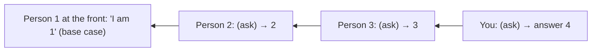
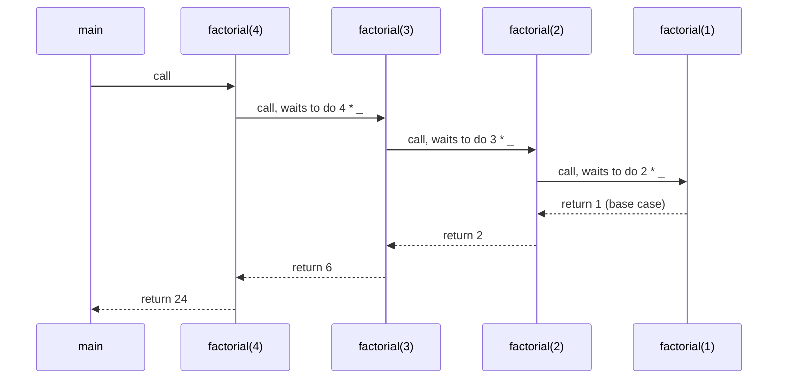
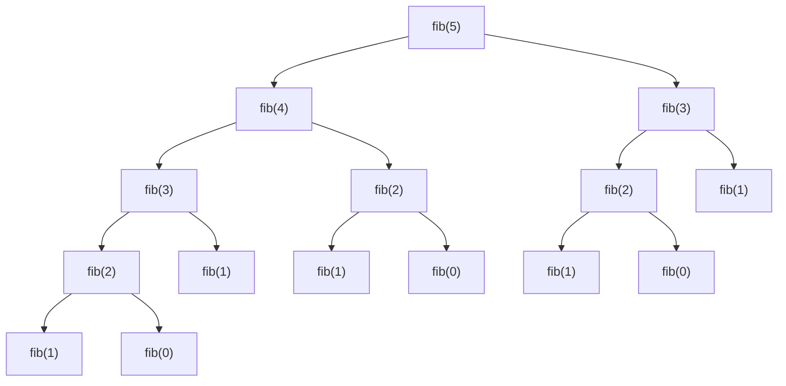
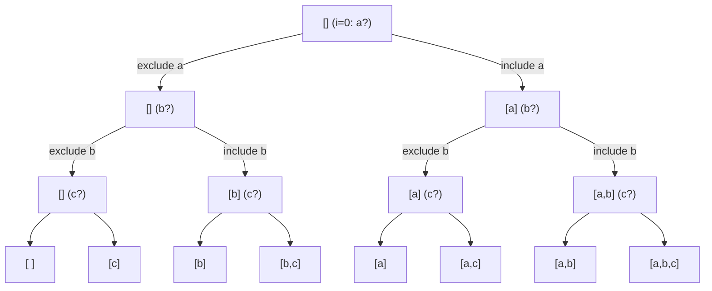
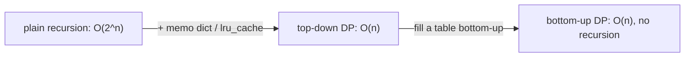

# Chapter 12 · Recursion

> You're in a long queue at a movie theatre and want to know your position. You can't see the front. So you ask the person ahead, "What number are you?" They don't know either, so they ask the person ahead of them... until the person at the very front says "I'm number 1". The answers travel back: 2, 3, 4... and finally you know. You just ran a recursive algorithm, with humans.

**You will learn:**
- What recursion is: a function that solves a problem by calling itself on a **smaller** version of it
- The two parts every recursive function needs: **base case** and **recursive case**
- How the **call stack** grows and shrinks during recursion (with pictures), and how to trace it
- The **leap of faith**: the mindset that makes writing recursion easy
- Classic problems: factorial, Fibonacci, fast power, digits, reverse, palindrome, binary search, Tower of Hanoi, subsets
- Recursion trees, the complexity of recursive functions, and **memoization** with `lru_cache`
- Recursion vs iteration, the recursion limit, and why Python doesn't optimise tail recursion

**Before this:** [Functions](10-functions.md) (especially the call stack) · [Lists](07-lists.md) · [Dictionaries](09-dictionaries.md)

---

## 🧠 The Big Idea

**Recursion** means solving a problem by reducing it to a **smaller copy of the same problem**, until the copy is so small the answer is obvious.

The theatre queue in a picture:



The questions travel **forward** (that's the recursive calls going deeper). The answers travel **back** (that's the returns), and each person adds 1 on the way. Two ingredients made it work:

1. **Base case:** someone who knows the answer **without asking** (the person at the front).
2. **Recursive case:** everyone else asks a **smaller** version of the question (the person ahead is one step closer to the front) and does a tiny bit of work with the answer (+1).

Russian nesting dolls are the same idea: open a doll, find a smaller doll, repeat until the tiny solid one that doesn't open.

> 💡 Recursion isn't magic and it isn't a loop. It's just **a function calling a function**, which you already understand from the call stack in [Chapter 10](10-functions.md). The called function just happens to have the same name.

---

## 🔨 Building It Up

### 1. Your first recursive function

```python
def countdown(n):
    if n == 0:                 # base case: stop
        print("Liftoff!")
        return
    print(n)
    countdown(n - 1)           # recursive case: a smaller problem

countdown(3)
```

```text
3
2
1
Liftoff!
```

What just happened: `countdown(3)` prints 3 and calls `countdown(2)`, which prints 2 and calls `countdown(1)`, which prints 1 and calls `countdown(0)`, which hits the base case and stops. Each call is a **separate** call with its own `n`.

### 2. The three laws of recursion

Every correct recursive function obeys these:

1. **It has a base case**: an input it answers directly, without recursing.
2. **It moves toward the base case**: every recursive call uses a "smaller" input (smaller n, shorter list, smaller range).
3. **It calls itself** (and uses the result).

Break law 1 or 2 and the function calls itself forever, until Python stops it:

```py
def forever(n):
    return forever(n - 1)      # no base case!

forever(5)
# RecursionError: maximum recursion depth exceeded
```

### 3. Returning values: factorial

The **factorial** of n is `n! = n × (n-1) × ... × 1`, with `0! = 1`. Notice that `5! = 5 × 4!`. The problem contains a smaller copy of itself. That's the recursive case.

```python
def factorial(n):
    if n <= 1:                     # base case: 0! = 1! = 1
        return 1
    return n * factorial(n - 1)    # recursive case

print(factorial(5))
print([factorial(i) for i in range(7)])
```

```text
120
[1, 1, 2, 6, 24, 120, 720]
```

Let's watch it **wind down** and **unwind up** by printing with indentation:

```python
def factorial(n, depth=0):
    pad = "    " * depth
    print(f"{pad}factorial({n}) called")
    if n <= 1:
        print(f"{pad}base case -> 1")
        return 1
    result = n * factorial(n - 1, depth + 1)
    print(f"{pad}factorial({n}) returns {result}")
    return result

factorial(4)
```

```text
factorial(4) called
    factorial(3) called
        factorial(2) called
            factorial(1) called
            base case -> 1
        factorial(2) returns 2
    factorial(3) returns 6
factorial(4) returns 24
```

### 4. The call stack, visualised

Each call gets its own **frame** on the call stack ([Chapter 10](10-functions.md)), holding its own `n`, and it **waits** at the multiplication until the call below it returns.



The stack at its deepest moment:

```text
┌──────────────────────────┐
│ factorial(1)  n=1        │  ← running: returns 1
├──────────────────────────┤
│ factorial(2)  n=2  2 * ? │  ← waiting
├──────────────────────────┤
│ factorial(3)  n=3  3 * ? │  ← waiting
├──────────────────────────┤
│ factorial(4)  n=4  4 * ? │  ← waiting
├──────────────────────────┤
│ main                     │
└──────────────────────────┘
```

Two phases:
- **Winding** (going down): calls are pushed. Code written **before** the recursive call runs now, in order 4, 3, 2, 1.
- **Unwinding** (coming back up): calls return and are popped. Code written **after** the recursive call runs now, in reverse order 1, 2, 3, 4.

```python
def show(n):
    if n == 0:
        return
    print("going down", n)    # before the call: runs while winding
    show(n - 1)
    print("coming up", n)     # after the call: runs while unwinding

show(3)
```

```text
going down 3
going down 2
going down 1
coming up 1
coming up 2
coming up 3
```

This one example explains how recursion can print things in reverse "for free", and it's the key to tree traversals (pre-order vs post-order) in [Binary Trees](../part-2-dsa/13-binary-trees.md).

### 5. The leap of faith

Here's the secret that makes recursion **easy to write**: **don't trace it in your head**. Instead:

1. **Define** exactly what your function returns, in one sentence. ("`total(nums)` returns the sum of the list `nums`.")
2. **Handle the base case** (the smallest input).
3. **Trust** that the recursive call on a smaller input already works correctly, as promised by your sentence. Ask only: "If I had the answer for the smaller problem, how do I build the answer for this one?"

```python
def total(nums):
    """Return the sum of the list nums."""
    if not nums:                    # base case: the sum of an empty list is 0
        return 0
    # Leap of faith: total(nums[1:]) correctly sums everything after the first item.
    return nums[0] + total(nums[1:])

print(total([4, 8, 15, 16, 23, 42]), total([]))
```

```text
108 0
```

You didn't need to imagine six nested calls. You trusted `total(nums[1:])` and added one number. That's the leap of faith, and it's how experienced engineers think about trees, graphs and divide-and-conquer.

> 💡 The proof that this works is the same as mathematical induction: the base case is correct, and *if* the smaller case is correct then the bigger case is correct, so every case is correct.

### 6. Warm-up classics: digits, reverse, palindrome

**Sum of digits:** the last digit is `n % 10`; the rest is `n // 10`.

```python
def digit_sum(n):
    if n < 10:                       # a single digit is its own sum
        return n
    return n % 10 + digit_sum(n // 10)

print(digit_sum(9875), digit_sum(7))
```

```text
29 7
```

**Reverse a string:** reverse of `"hello"` = reverse of `"ello"` + `"h"`.

```python
def reverse(s):
    if len(s) <= 1:
        return s
    return reverse(s[1:]) + s[0]

print(reverse("hello"), reverse(""), reverse("a"))
```

```text
olleh  a
```

(The middle value is the empty string, so you see two spaces.)

**Palindrome:** a string is a palindrome if its first and last characters match **and** the middle is a palindrome.

```python
def is_palindrome(s):
    if len(s) <= 1:
        return True
    if s[0] != s[-1]:
        return False
    return is_palindrome(s[1:-1])

print(is_palindrome("racecar"), is_palindrome("abca"), is_palindrome(""))
```

```text
True False True
```

### 7. Avoiding slicing cost: pass indexes

`s[1:]` copies the string, which costs O(n) **every call**. That makes `reverse` and `is_palindrome` above O(n²) in total. The fix: keep the original and pass **indexes** that shrink the range. A **helper function** with extra parameters is the standard way.

```python
def is_palindrome(s):
    def check(left, right):
        if left >= right:               # 0 or 1 characters left
            return True
        if s[left] != s[right]:
            return False
        return check(left + 1, right - 1)
    return check(0, len(s) - 1)

def total(nums, i=0):
    if i == len(nums):                  # base case: no items left
        return 0
    return nums[i] + total(nums, i + 1)

print(is_palindrome("level"), is_palindrome("levels"))
print(total([1, 2, 3, 4]))
```

```text
True False
10
```

Now each call does O(1) work: O(n) total time.

### 8. Power: slow and fast

**Slow power:** `x^n = x × x^(n-1)`. That's n calls: O(n).

**Fast power** (exponentiation by squaring): `x^n = (x^(n/2))²` when n is even, and `x × x^(n-1)` when n is odd. Each step halves n: **O(log n)**.

```python
def power_slow(x, n):
    if n == 0:
        return 1
    return x * power_slow(x, n - 1)

def power_fast(x, n):
    if n == 0:
        return 1
    if n < 0:
        return 1 / power_fast(x, -n)
    half = power_fast(x, n // 2)        # compute the half ONCE
    if n % 2 == 0:
        return half * half
    return half * half * x

print(power_slow(2, 10), power_fast(2, 10), power_fast(3, 13), power_fast(2, -2))
```

```text
1024 1024 1594323 0.25
```

**Dry run** of `power_fast(3, 13)`:

| call | n | n // 2 | half (from the call below) | returns |
|---|---|---|---|---|
| 1 | 13 (odd) | 6 | 729 | 729 × 729 × 3 = 1,594,323 |
| 2 | 6 (even) | 3 | 27 | 27 × 27 = 729 |
| 3 | 3 (odd) | 1 | 3 | 3 × 3 × 3 = 27 |
| 4 | 1 (odd) | 0 | 1 | 1 × 1 × 3 = 3 |
| 5 | 0 | | | 1 (base case) |

5 calls instead of 13. For n = 1,000,000,000 it's about 31 calls instead of a billion.

> ⚠️ Writing `power_fast(x, n // 2) * power_fast(x, n // 2)` (two calls instead of storing `half`) silently turns O(log n) back into O(n). Compute once, reuse.

### 9. Fibonacci and the recursion tree

The Fibonacci sequence: `0, 1, 1, 2, 3, 5, 8, 13...`, where `fib(n) = fib(n-1) + fib(n-2)`, with `fib(0) = 0` and `fib(1) = 1`. A function that calls itself **twice** draws a **recursion tree**:

```python
def fib(n):
    if n < 2:
        return n
    return fib(n - 1) + fib(n - 2)

print([fib(i) for i in range(10)])
```

```text
[0, 1, 1, 2, 3, 5, 8, 13, 21, 34]
```



Look at the tree: `fib(3)` is computed **twice**, `fib(2)` **three times**. The tree roughly doubles at each level, so the number of calls grows like **O(2ⁿ)** (more precisely about 1.618ⁿ). Let's count:

```python
calls = 0

def fib(n):
    global calls
    calls += 1
    if n < 2:
        return n
    return fib(n - 1) + fib(n - 2)

for n in [10, 20, 25]:
    calls = 0
    fib(n)
    print(f"fib({n}) needed {calls:,} calls")
```

```text
fib(10) needed 177 calls
fib(20) needed 21,891 calls
fib(25) needed 242,785 calls
```

`fib(50)` would need over 40 billion calls. Hours. Section 13 fixes this.

### 10. Recursive binary search

**Binary search** finds a value in a **sorted** list by checking the middle and throwing away the half that can't contain it. Each call halves the range: O(log n). (Full chapter: [Binary Search](../part-2-dsa/08-binary-search.md).)

```python
def binary_search(nums, target, lo=0, hi=None):
    if hi is None:
        hi = len(nums) - 1
    if lo > hi:                          # base case: empty range, not found
        return -1
    mid = (lo + hi) // 2
    if nums[mid] == target:              # base case: found
        return mid
    if nums[mid] < target:
        return binary_search(nums, target, mid + 1, hi)   # search the right half
    return binary_search(nums, target, lo, mid - 1)       # search the left half

data = [2, 5, 8, 12, 16, 23, 38, 56, 72, 91]
print(binary_search(data, 23), binary_search(data, 2), binary_search(data, 7))
```

```text
5 0 -1
```

Notice `return binary_search(...)`. Forgetting that `return` is the #1 recursion bug: the deep call finds the answer but the outer calls throw it away and return `None`.

### 11. Tower of Hanoi

Three pegs: A, B, C. A has n disks, largest at the bottom. Move them all to C. Rules: move one disk at a time, and never put a larger disk on a smaller one.

It looks impossible to plan, but with the leap of faith it's three lines. To move n disks from A to C:
1. Move the top n−1 disks from A to **B** (trust recursion; C is the helper).
2. Move the biggest disk from A to C.
3. Move the n−1 disks from B to C (trust recursion again; A is the helper).

```python
def hanoi(n, source, target, helper, moves):
    if n == 0:
        return
    hanoi(n - 1, source, helper, target, moves)
    moves.append(f"disk {n}: {source} -> {target}")
    hanoi(n - 1, helper, target, source, moves)

moves = []
hanoi(3, "A", "C", "B", moves)
for m in moves:
    print(m)
print(len(moves), "moves")

for n in [1, 2, 3, 10, 20]:
    moves = []
    hanoi(n, "A", "C", "B", moves)
    print(n, "disks:", len(moves), "moves")
```

```text
disk 1: A -> C
disk 2: A -> B
disk 1: C -> B
disk 3: A -> C
disk 1: B -> A
disk 2: B -> C
disk 1: A -> C
7 moves
1 disks: 1 moves
2 disks: 3 moves
3 disks: 7 moves
10 disks: 1023 moves
20 disks: 1048575 moves
```

The number of moves is `2ⁿ − 1`, because `moves(n) = 2 × moves(n−1) + 1`. Time: **O(2ⁿ)**, and no algorithm can do better, since that many moves are required.

### 12. Print all subsets (a preview of backtracking)

For each item you have exactly two choices: **include** it or **exclude** it. Recursion explores both, building a tree with 2ⁿ leaves, one per subset.

```python
def subsets(items):
    result = []

    def explore(i, current):
        if i == len(items):              # decided for every item: record a subset
            result.append(current[:])    # copy! current keeps changing
            return
        explore(i + 1, current)          # choice 1: exclude items[i]
        current.append(items[i])         # choice 2: include items[i]
        explore(i + 1, current)
        current.pop()                    # undo the choice (backtrack)

    explore(0, [])
    return result

print(subsets(["a", "b", "c"]))
```

```text
[[], ['c'], ['b'], ['b', 'c'], ['a'], ['a', 'c'], ['a', 'b'], ['a', 'b', 'c']]
```



The pattern "choose, explore, un-choose" is **backtracking**, the engine behind permutations, combinations, N-Queens and Sudoku solvers. It gets a full chapter: [Recursion & Backtracking](../part-2-dsa/09-backtracking.md).

### 13. Memoization: remember, don't recompute

Fibonacci is slow only because it solves the same sub-problems again and again. Store each answer the first time ([Chapter 09](09-dictionaries.md)'s memo pattern) and every sub-problem is solved **once**.

```python
def fib_memo(n, memo=None):
    if memo is None:
        memo = {}
    if n < 2:
        return n
    if n in memo:
        return memo[n]
    memo[n] = fib_memo(n - 1, memo) + fib_memo(n - 2, memo)
    return memo[n]

print(fib_memo(50))
print(fib_memo(100))
```

```text
12586269025
354224848179261915075
```

Python has this built in. The `@lru_cache` line above a function is a **decorator** (explained in [Chapter 16](16-iterators-generators-decorators.md)); for now, read it as "remember every result of this function".

```python
from functools import lru_cache

@lru_cache(maxsize=None)        # unlimited cache; functools.cache is the same thing (3.9+)
def fib(n):
    if n < 2:
        return n
    return fib(n - 1) + fib(n - 2)

print(fib(80))
print(fib.cache_info())
```

```text
23416728348467685
CacheInfo(hits=78, misses=81, maxsize=None, currsize=81)
```

What just happened: 81 distinct sub-problems (`fib(0)` to `fib(80)`) were each computed once ("misses"), and 78 repeated requests were answered instantly from the cache ("hits"). From ~10¹⁶ calls down to 159. Time went from O(2ⁿ) to **O(n)**.



That arrow is literally how **dynamic programming** is born. You'll master it in [DP I: The Framework & 1D DP](../part-2-dsa/20-dp-1d.md). Two rules for memoization: the function must be **pure** ([Chapter 10](10-functions.md)), and its arguments must be **hashable** (they become dict keys, so pass tuples, not lists).

### 14. Recursion vs iteration

Anything recursive can be written with a loop (plus, if needed, your own stack), and vice versa.

```python
def factorial_iter(n):
    result = 1
    for k in range(2, n + 1):
        result *= k
    return result

def fib_iter(n):
    a, b = 0, 1
    for _ in range(n):
        a, b = b, a + b
    return a

print(factorial_iter(5), fib_iter(10), fib_iter(80))
```

```text
120 55 23416728348467685
```

Some problems are **naturally recursive** because the data itself is recursive (a structure that contains smaller structures of the same kind): nested lists, folders inside folders, trees, JSON. Iterating over them with plain loops is painful; recursion is natural:

```python
def flatten(nested):
    flat = []
    for item in nested:
        if isinstance(item, list):        # a smaller copy of the same problem
            flat.extend(flatten(item))
        else:
            flat.append(item)
    return flat

def depth(nested):
    if not isinstance(nested, list):
        return 0
    return 1 + max((depth(x) for x in nested), default=0)

data = [1, [2, [3, 4], 5], [[6]], 7]
print(flatten(data))
print(depth(data))
```

```text
[1, 2, 3, 4, 5, 6, 7]
3
```

| | Recursion | Iteration |
|---|---|---|
| Best for | trees, graphs, nested data, divide & conquer, backtracking | linear scans, simple counting, very deep processes |
| Readability | often shorter, mirrors the definition | explicit state, no hidden stack |
| Memory | O(depth) stack frames | usually O(1) extra |
| Speed in Python | function-call overhead per step | faster per step |
| Risk | `RecursionError` beyond ~1000 levels | infinite loop if you mess up the condition |

Rule of thumb: in Python, if the depth can be large (like n = 100,000 for a linked list or a simple count), use a loop. If the depth is small (like log n for binary search, or the height of a balanced tree), recursion is perfect.

### 15. The recursion limit

Python caps the call-stack depth (default **1000**) so a runaway recursion raises a clean error instead of crashing the whole interpreter.

```python
import sys

print(sys.getrecursionlimit())

depth = 0

def dive():
    global depth
    depth += 1
    dive()

try:
    dive()
except RecursionError:
    print("RecursionError after about", depth // 100 * 100, "calls")
```

```text
1000
RecursionError after about 900 calls
```

(The exact number is a little below 1000 because some frames are already in use. Catching errors with `try/except` is [Chapter 13](13-exceptions-files.md).)

You *can* raise it with `sys.setrecursionlimit(10_000)`, but this is a band-aid: very deep recursion can still exhaust the real C-level stack and crash Python outright. If you need depth in the tens of thousands, convert to iteration.

### 16. Tail recursion (and why Python doesn't care)

A call is a **tail call** if it's the very **last** thing a function does, with nothing left to do after it returns. A function whose recursive call is a tail call is **tail recursive**.

```python
def factorial_tail(n, acc=1):
    if n <= 1:
        return acc
    return factorial_tail(n - 1, acc * n)    # tail call: nothing to do afterwards

def factorial_not_tail(n):
    if n <= 1:
        return 1
    return n * factorial_not_tail(n - 1)     # NOT a tail call: must multiply after

print(factorial_tail(10), factorial_not_tail(10))
```

```text
3628800 3628800
```

The accumulator `acc` carries the partial result **down** instead of building it on the way **up**. In languages like Scheme (and often in C compilers), a tail call can **reuse** the current frame instead of pushing a new one ("tail call optimisation", TCO), so tail recursion uses O(1) stack, just like a loop.

**Python does not do TCO.** `factorial_tail(5000)` still raises `RecursionError`. Python's creator chose this deliberately: TCO would erase frames from tracebacks and make debugging harder, and Python prefers loops for iteration. So in Python, if you've written a tail-recursive function, you've basically written a loop; just write the loop:

```python
def factorial_loop(n):
    acc = 1
    while n > 1:          # the tail call "factorial_tail(n - 1, acc * n)" becomes:
        acc *= n          #   update the parameters...
        n -= 1            #   ...and go round again
    return acc

print(factorial_loop(10))
```

```text
3628800
```

---

## 🔬 Under the Hood

### What each recursive call costs

Every call creates a new **frame** object (locals, arguments, the current instruction pointer, a link to the caller). In CPython each Python-level frame takes on the order of a hundred bytes or more, plus whatever its local variables reference. So:

- **Space complexity** of a recursive function = **maximum depth of the stack** × space per frame. `factorial(n)` is O(n) space even though it creates no lists. Binary search recursion is O(log n) space. The loop versions are O(1).
- **Time** includes the overhead of each call, which is why loops are often faster in Python for simple linear recursion.

### How to find the complexity of a recursive function

**Time = (number of calls) × (work done inside one call, excluding the recursive calls).** Draw the recursion tree and count. The common shapes, written as **recurrences** (T(n) = time for input size n):

| Recurrence | Example | Calls | Time | Stack space |
|---|---|---|---|---|
| T(n) = T(n−1) + O(1) | factorial, sum of list with index | n | **O(n)** | O(n) |
| T(n) = T(n−1) + O(n) | sum/reverse with slicing `nums[1:]` | n | **O(n²)** | O(n) (+ the slices) |
| T(n) = T(n/2) + O(1) | binary search, fast power | log n | **O(log n)** | O(log n) |
| T(n) = 2T(n/2) + O(n) | merge sort | ~2n | **O(n log n)** | O(log n) frames (+ O(n) for merging) |
| T(n) = 2T(n−1) + O(1) | Hanoi, subsets, naive tree of 2 choices | 2ⁿ | **O(2ⁿ)** | O(n) |
| T(n) = T(n−1) + T(n−2) + O(1) | naive Fibonacci | ~1.6ⁿ | **O(φⁿ) ⊂ O(2ⁿ)** | O(n) |
| memoized fib | `@lru_cache` fib | 2n | **O(n)** | O(n) |

Key insight: **stack space is the depth (the longest path from root to leaf), not the total number of calls.** Naive `fib(30)` makes over a million calls but the stack is never deeper than 30, because each branch finishes and pops before the next starts.

For divide-and-conquer recurrences like T(n) = aT(n/b) + f(n), there's a general formula called the **Master Theorem**; it's covered in [Big-O](../part-2-dsa/01-big-o-complexity.md) and [Sorting](../part-2-dsa/07-sorting.md).

### Why the limit exists

CPython runs Python function calls using the C stack in many situations, and the C stack has a fixed size set by the operating system (often around 1–8 MB). Overflowing it would be a hard crash (a "segmentation fault"). The recursion limit is a safety fence well before that cliff. Python 3.11+ avoids using the C stack for most pure-Python-to-Python calls, but the limit stays as a guard against infinite recursion.

### Turning recursion into iteration with your own stack

Every recursive algorithm can be made iterative by managing an explicit stack (a list) yourself, since that's all Python is doing for you. This is how you'd write deep DFS on a graph with 1,000,000 nodes without `RecursionError`:

```python
def flatten_iterative(nested):
    stack = [iter(nested)]           # our own "call stack" of iterators
    flat = []
    while stack:
        for item in stack[-1]:
            if isinstance(item, list):
                stack.append(iter(item))   # "recursive call": go deeper
                break
            flat.append(item)
        else:
            stack.pop()                    # this level is finished: "return"
    return flat

print(flatten_iterative([1, [2, [3, 4], 5], [[6]], 7]))
```

```text
[1, 2, 3, 4, 5, 6, 7]
```

(The `for ... else` runs the `else` only if the loop wasn't stopped by `break`; you met it in [Chapter 06](06-loops.md).)

---

## 🧩 Pattern Decoder

### Signals: when to think recursively

| You see... | Think |
|---|---|
| "tree", "nested", "hierarchy", "folders", "JSON" | recursion follows the structure |
| a definition that uses itself: "n! = n × (n−1)!", "fib = fib + fib" | direct translation |
| "all subsets / permutations / combinations / ways" | backtracking: include/exclude recursion |
| "split in half", "divide and conquer", "merge sort", "binary search" | recurse on halves |
| "number of ways to reach...", "min cost to..." with overlapping sub-problems | recursion + memo → DP |
| "flood fill", "connected region", "islands" | DFS recursion on neighbours |

### The template

```py
def solve(problem):
    # 1. BASE CASE(S): the smallest inputs, answered directly
    if is_small(problem):
        return direct_answer(problem)

    # 2. SHRINK: make one or more strictly smaller sub-problems
    smaller = shrink(problem)

    # 3. LEAP OF FAITH: assume solve() works on them
    sub_answer = solve(smaller)

    # 4. COMBINE: build this answer from the sub-answer(s)
    return combine(problem, sub_answer)
```

### The five shapes of recursion

**1. Linear (one call, size − 1):** factorial, sum, reverse, linked-list traversal. O(n) time, O(n) stack.

**2. Halving (one call, size / 2):** binary search, fast power. O(log n).

**3. Divide & conquer (two calls on halves, then combine):** merge sort.

```python
def merge_sort(nums):
    if len(nums) <= 1:
        return nums
    mid = len(nums) // 2
    left = merge_sort(nums[:mid])       # leap of faith: the halves come back sorted
    right = merge_sort(nums[mid:])
    merged, i, j = [], 0, 0             # combine: merge two sorted lists
    while i < len(left) and j < len(right):
        if left[i] <= right[j]:
            merged.append(left[i]); i += 1
        else:
            merged.append(right[j]); j += 1
    return merged + left[i:] + right[j:]

print(merge_sort([38, 27, 43, 3, 9, 82, 10]))
```

```text
[3, 9, 10, 27, 38, 43, 82]
```

O(n log n) time. Full treatment in [Sorting](../part-2-dsa/07-sorting.md).

**4. Multiple branches (tree recursion):** Fibonacci, subsets, Hanoi. Exponential unless sub-problems overlap and you memoize.

**5. Recursion + memo (top-down DP):** add `@lru_cache` when the same arguments repeat.

**Worked example: Climbing Stairs (LeetCode 70).** You climb 1 or 2 steps at a time. How many distinct ways to reach step n?

*Idea:* the last move to step n was either from step n−1 (a 1-step) or from step n−2 (a 2-step). So `ways(n) = ways(n−1) + ways(n−2)`, with `ways(0) = 1` (one way: do nothing) and `ways(1) = 1`. It's Fibonacci in disguise, and it needs a memo.

```python
from functools import lru_cache

@lru_cache(maxsize=None)
def climb_stairs(n):
    if n <= 1:
        return 1
    return climb_stairs(n - 1) + climb_stairs(n - 2)

print([climb_stairs(n) for n in range(1, 8)], climb_stairs(45))
```

```text
[1, 2, 3, 5, 8, 13, 21] 1836311903
```

O(n) time and space with the memo; O(2ⁿ) without it.

### When NOT to use recursion (in Python)

- **Depth could exceed ~1000** (a loop over n = 10⁵ items, a long linked list, DFS on a huge path-like graph) → iterate or use an explicit stack.
- **A simple loop is just as clear** (sum of a list, counting) → use the loop.
- **Branching recursion without overlapping sub-problems that's still exponential** → look for a smarter algorithm, not just a cache.

---

## ⚠️ Traps & Common Mistakes

1. **No base case, or a base case that's never reached.** `def f(n): return f(n - 2)` with odd n skips past 0 if the base case is `n == 0`. Use `n <= 0` or check both.

2. **Not moving toward the base case.** `return f(n)` instead of `f(n - 1)`. Infinite recursion.

3. **Forgetting to `return` the recursive call's result.**

```py
def search(nums, t, lo, hi):
    ...
    search(nums, t, mid + 1, hi)          # ❌ result discarded: function returns None
    return search(nums, t, mid + 1, hi)   # ✅
```

4. **Calling the same sub-problem twice when once would do.** `power(x, n//2) * power(x, n//2)` is O(n), not O(log n). Store the result.

5. **Slicing in every call.** `f(nums[1:])` copies O(n) each time, turning O(n) into O(n²). Pass an index.

6. **Recomputing overlapping sub-problems.** Naive Fibonacci is exponential. Memoize.

7. **Mutable default accumulators.** `def collect(node, acc=[])` leaks between calls ([Chapter 10](10-functions.md)). Use `acc=None`.

8. **Forgetting to copy when recording a path.** In subsets, `result.append(current)` stores a reference to the list you keep modifying; at the end all entries are the same (empty) list. Use `current[:]`.

9. **Forgetting to undo a choice in backtracking.** After `current.append(x)` and the recursive call, `current.pop()` restores state for the next branch.

10. **Wrong base case for edge inputs.** Test with `n = 0`, `n = 1`, empty list, empty string, single element.

11. **Expecting tail-call optimisation.** Python doesn't do it. Deep tail recursion still crashes; convert it to a loop.

---

## 💡 Tips & Tricks

- Before coding, write the **one-sentence contract**: "`f(x)` returns ...". Then base case, then combine. Never trace more than two levels in your head.
- Add a `depth` parameter and print with `"  " * depth` to debug any recursion. The indentation shows the tree.
- Start from the **smallest inputs**: compute f(0), f(1), f(2) by hand. The pattern and the base case jump out.
- Use a nested **helper** to hide extra parameters (indexes, accumulators, memo) from the caller.
- `@lru_cache(maxsize=None)` (or `@functools.cache`) is the fastest way to memoize in interviews. Arguments must be hashable.
- Space complexity = maximum depth. Say it out loud in interviews: "O(n) time and O(n) stack space."
- If the interviewer asks "can you avoid recursion?", the answer is an explicit stack (for DFS) or a bottom-up loop (for DP).
- `2ⁿ − 1` moves for Hanoi, `2ⁿ` subsets, `n!` permutations: memorise these counts.

---

## 🎯 Interview Questions

### 1. What is recursion? What is a base case and why is it needed? 🔥🔥🔥

<details><summary>Answer</summary>

Recursion is when a function solves a problem by calling itself on smaller instances of the same problem. The **base case** is an input handled directly without further recursion; it stops the chain of calls. Without a reachable base case, the calls never end and Python raises `RecursionError` once the stack depth exceeds the recursion limit.

</details>

### 2. Recursion vs iteration: pros and cons? 🔥🔥🔥

<details><summary>Answer</summary>

Recursion is often shorter and mirrors recursive definitions and data (trees, nested structures, divide and conquer, backtracking). Costs: function-call overhead, O(depth) stack memory, and a depth limit (~1000 by default in Python). Iteration uses explicit loops/state, typically O(1) extra space and no depth limit, but can be clumsy for tree-shaped problems. Any recursion can be converted to iteration with an explicit stack.

</details>

### 3. Does Python support tail call optimisation? 🔥🔥

<details><summary>Answer</summary>

No. Even when the recursive call is the last operation, CPython creates a new frame for it, so deep tail recursion still hits `RecursionError`. This is a deliberate design choice (keeps full tracebacks; Python favours loops). Convert tail recursion into a `while` loop that updates the parameters.

</details>

### 4. What are the time and space complexities of naive recursive Fibonacci? How do you improve it? 🔥🔥🔥

<details><summary>Answer</summary>

Time is exponential, O(φⁿ) ≈ O(1.618ⁿ), commonly quoted as O(2ⁿ), because each call branches into two and sub-problems are recomputed. Space is O(n), the maximum stack depth. Memoization (`@lru_cache` or a dict) makes it O(n) time and O(n) space. Bottom-up iteration with two variables makes it O(n) time and O(1) space. (Matrix exponentiation or fast doubling gives O(log n).)

</details>

### 5. Pow(x, n) (LeetCode 50) 🔥🔥🔥

Implement `x` raised to the power `n` (n may be negative), faster than O(n).

<details><summary>Answer</summary>

Exponentiation by squaring: compute `half = pow(x, n // 2)` once; return `half * half` for even n and `half * half * x` for odd n. Negative n: `1 / pow(x, -n)`.

```python
def my_pow(x, n):
    if n < 0:
        return 1 / my_pow(x, -n)
    if n == 0:
        return 1.0
    half = my_pow(x, n // 2)
    return half * half if n % 2 == 0 else half * half * x

print(my_pow(2.0, 10), my_pow(2.1, 3), my_pow(2.0, -2))
```

```text
1024.0 9.261000000000001 0.25
```

O(log n) time and O(log n) stack. (The `9.2610...01` is normal floating-point rounding, see [Chapter 02](02-variables-types-memory.md).)

</details>

### 6. Fibonacci Number (LeetCode 509) and Climbing Stairs (LeetCode 70) 🔥🔥🔥

<details><summary>Answer</summary>

Both satisfy `f(n) = f(n−1) + f(n−2)`. Show the progression an interviewer wants to hear: naive recursion O(2ⁿ) → memoized recursion O(n) time/space → bottom-up with two variables O(n) time, O(1) space.

```python
def climb_stairs(n):
    a, b = 1, 1          # ways to reach step 0 and step 1
    for _ in range(n - 1):
        a, b = b, a + b
    return b

print(climb_stairs(2), climb_stairs(3), climb_stairs(5))
```

```text
2 3 8
```

</details>

### 7. Reverse String (LeetCode 344), recursively, in place 🔥🔥

<details><summary>Answer</summary>

Swap the ends, then recurse on the inside range.

```python
def reverse_string(chars):
    def helper(left, right):
        if left >= right:
            return
        chars[left], chars[right] = chars[right], chars[left]
        helper(left + 1, right - 1)
    helper(0, len(chars) - 1)
    return chars

print(reverse_string(list("hello")))
```

```text
['o', 'l', 'l', 'e', 'h']
```

O(n) time, O(n) stack. The iterative two-pointer version is O(1) space ([Two Pointers](../part-2-dsa/03-two-pointers.md)), which is what you'd use in production.

</details>

### 8. Subsets (LeetCode 78) 🔥🔥🔥

Return all subsets of a list of distinct integers.

<details><summary>Answer</summary>

Include/exclude recursion (section 12). There are 2ⁿ subsets, each up to n long, so O(n · 2ⁿ) time and output size; O(n) recursion depth.

```python
def subsets(nums):
    result, current = [], []
    def backtrack(i):
        if i == len(nums):
            result.append(current[:])
            return
        current.append(nums[i])      # include
        backtrack(i + 1)
        current.pop()                # undo
        backtrack(i + 1)             # exclude
    backtrack(0)
    return result

print(subsets([1, 2, 3]))
```

```text
[[1, 2, 3], [1, 2], [1, 3], [1], [2, 3], [2], [3], []]
```

Full pattern: [Recursion & Backtracking](../part-2-dsa/09-backtracking.md).

</details>

### 9. How many moves does the Tower of Hanoi take for n disks? Why? 🔥🔥

<details><summary>Answer</summary>

`2ⁿ − 1`. Moving n disks requires moving n−1 disks off the largest, moving the largest, then moving n−1 back on top: `M(n) = 2M(n−1) + 1`, `M(1) = 1`, which solves to `2ⁿ − 1`. Time O(2ⁿ), stack depth O(n). It's also provably the minimum.

</details>

### 10. What happens in memory when a recursive function runs? What's a stack overflow? 🔥🔥

<details><summary>Answer</summary>

Each call pushes a new frame (its own locals and return position) onto the call stack; each return pops it. Pending computations (like `n * ...`) wait in their frames until the deeper calls return. If recursion is too deep, the stack runs out of space: in most languages this is a **stack overflow** crash; Python guards it with a recursion limit (`sys.getrecursionlimit()`, default 1000) and raises `RecursionError` first.

</details>

### 11. Power of Two (LeetCode 231), recursively 🔥

<details><summary>Answer</summary>

`n` is a power of two if `n == 1`, or if `n` is even and `n / 2` is a power of two.

```python
def is_power_of_two(n):
    if n == 1:
        return True
    if n <= 0 or n % 2 == 1:
        return False
    return is_power_of_two(n // 2)

print(is_power_of_two(1), is_power_of_two(16), is_power_of_two(18), is_power_of_two(0))
```

```text
True True False False
```

O(log n). The O(1) bit trick: `n > 0 and n & (n - 1) == 0` ([Bit Manipulation](../part-2-dsa/23-bits-math.md)).

</details>

### 12. How do you find the time complexity of a recursive function? 🔥🔥

<details><summary>Answer</summary>

Total time = number of calls × work per call (excluding the recursive calls). Write a recurrence and/or draw the recursion tree: one call of size n−1 → O(n); one call of size n/2 → O(log n); two calls of size n/2 plus O(n) merging → O(n log n); two calls of size n−1 → O(2ⁿ). Space = maximum recursion depth × per-frame space (plus any data you allocate).

</details>

---

## 🏋️ Practice

**🟢 1. Sum 1 to n** recursively. Then say its time and space complexity.

<details><summary>Solution</summary>

```python
def sum_to(n):
    if n <= 0:
        return 0
    return n + sum_to(n - 1)

print(sum_to(100), sum_to(0))
```

```text
5050 0
```

O(n) time, O(n) stack space. (The formula `n * (n + 1) // 2` is O(1): recursion isn't always the best tool!)

</details>

**🟢 2. Count occurrences** of a character in a string recursively, using an index (no slicing).

<details><summary>Solution</summary>

```python
def count_char(s, ch, i=0):
    if i == len(s):
        return 0
    return (1 if s[i] == ch else 0) + count_char(s, ch, i + 1)

print(count_char("mississippi", "s"), count_char("", "a"))
```

```text
4 0
```

</details>

**🟢 3. GCD (Euclid's algorithm).** `gcd(a, b) = gcd(b, a % b)`, and `gcd(a, 0) = a`.

<details><summary>Solution</summary>

```python
def gcd(a, b):
    if b == 0:
        return a
    return gcd(b, a % b)

print(gcd(48, 18), gcd(17, 5), gcd(10, 0))
```

```text
6 1 10
```

O(log(min(a, b))) calls: the numbers shrink at least as fast as Fibonacci numbers in reverse.

</details>

**🟡 4. Decimal to binary** as a string, recursively. `13` → `"1101"`.

<details><summary>Solution</summary>

The last binary digit is `n % 2`; the rest is the binary of `n // 2`.

```python
def to_binary(n):
    if n < 2:
        return str(n)
    return to_binary(n // 2) + str(n % 2)

print(to_binary(13), to_binary(0), to_binary(255), bin(13)[2:])
```

```text
1101 0 11111111 1101
```

</details>

**🟡 5. Sum of a nested list** of any depth: `[1, [2, [3, [4]]], 5]` → 15.

<details><summary>Solution</summary>

```python
def nested_sum(data):
    total = 0
    for item in data:
        if isinstance(item, list):
            total += nested_sum(item)      # leap of faith on the inner list
        else:
            total += item
    return total

print(nested_sum([1, [2, [3, [4]]], 5]), nested_sum([]))
```

```text
15 0
```

</details>

**🟡 6. Unique paths in a grid** (LeetCode 62): a robot at the top-left of an m × n grid moves only right or down. How many paths reach the bottom-right? Use recursion + `lru_cache`.

<details><summary>Solution</summary>

`paths(r, c) = paths(r − 1, c) + paths(r, c − 1)` (you arrived from above or from the left); any cell in the first row or column has exactly 1 path.

```python
from functools import lru_cache

def unique_paths(m, n):
    @lru_cache(maxsize=None)
    def paths(r, c):
        if r == 0 or c == 0:
            return 1
        return paths(r - 1, c) + paths(r, c - 1)
    return paths(m - 1, n - 1)

print(unique_paths(3, 7), unique_paths(3, 2), unique_paths(10, 10))
```

```text
28 3 48620
```

O(m · n) time and space with memo; exponential without. This is 2D DP ([DP II](../part-2-dsa/21-dp-2d-advanced.md)).

</details>

**🔴 7. All permutations** of a string with distinct characters. `"abc"` → 6 permutations.

<details><summary>Solution</summary>

Pick each character as the first, then permute the rest (leap of faith).

```python
def permutations(s):
    if len(s) <= 1:
        return [s]
    result = []
    for i, ch in enumerate(s):
        rest = s[:i] + s[i + 1:]
        for p in permutations(rest):
            result.append(ch + p)
    return result

print(permutations("abc"))
print(len(permutations("abcde")))
```

```text
['abc', 'acb', 'bac', 'bca', 'cab', 'cba']
120
```

There are n! permutations, so O(n · n!) time. The backtracking version with a `used` array is in [Recursion & Backtracking](../part-2-dsa/09-backtracking.md).

</details>

**🔴 8. Generate all valid parentheses** (LeetCode 22) for n pairs. n = 3 → 5 strings.

<details><summary>Solution</summary>

Build the string character by character. You may add `(` if you've used fewer than n; you may add `)` only if it wouldn't close more than you've opened. Those two rules prune every invalid branch.

```python
def generate_parentheses(n):
    result = []

    def build(current, opened, closed):
        if len(current) == 2 * n:
            result.append(current)
            return
        if opened < n:
            build(current + "(", opened + 1, closed)
        if closed < opened:
            build(current + ")", opened, closed + 1)

    build("", 0, 0)
    return result

print(generate_parentheses(3))
print(len(generate_parentheses(4)))
```

```text
['((()))', '(()())', '(())()', '()(())', '()()()']
14
```

The counts 1, 2, 5, 14, 42... are the **Catalan numbers**. Because strings are immutable, `current + "("` creates a new string per branch, so no "undo" step is needed.

</details>

---

## 🧠 Never-Forget Summary

- Recursion = solve a problem using the answer to a **smaller copy** of itself.
- Every recursive function needs a **base case** and must **move toward** it.
- Each call gets its own **frame**; the stack **winds** down (code before the call) and **unwinds** up (code after the call).
- **Leap of faith:** define what the function returns, handle the base case, trust the smaller call, combine.
- Always `return` the recursive result. Pass indexes instead of slicing.
- **Time = calls × work per call. Space = maximum depth.**
- Halving → O(log n); size − 1 → O(n); two branches of size − 1 → O(2ⁿ); halves + merge → O(n log n).
- Overlapping sub-problems → **memoize** (`dict` or `@lru_cache`) → that's dynamic programming.
- Python's recursion limit is ~1000; Python has **no tail-call optimisation**. Deep → use a loop or an explicit stack.
- Classic set: factorial, fib, fast power, digits, reverse, palindrome, binary search, Hanoi (2ⁿ − 1), subsets (2ⁿ), permutations (n!).

**Memory hooks:**
- **"Base, Shrink, Trust, Combine."**
- **"Down the stairs you ask, up the stairs you answer."** (winding vs unwinding)
- **"Depth is space, calls are time."**
- **"Same question twice? Write it down once."** (memoization)
- **"Python won't eat its tail."** (no TCO)

**One picture:**

| Shape | Calls per level | Example | Time | Stack |
|---|---|---|---|---|
| Linear | 1, size − 1 | factorial, sum | O(n) | O(n) |
| Halving | 1, size / 2 | binary search, fast pow | O(log n) | O(log n) |
| Divide & conquer | 2, size / 2 + merge | merge sort | O(n log n) | O(log n) |
| Branching | 2, size − 1 | fib, Hanoi, subsets | O(2ⁿ) | O(n) |
| Branching + memo | distinct sub-problems only | fib, stairs, grid paths | O(#states) | O(depth) |

> **If you remember only one thing:** write the base case first, make every call smaller, and *trust* the recursive call to do its job. Then ask "does it repeat work?" and if yes, memoize.

---
**Next:** [Chapter 13 · Errors, Exceptions & Files](13-exceptions-files.md)  ·  **Back to** [Contents](../README.md)
