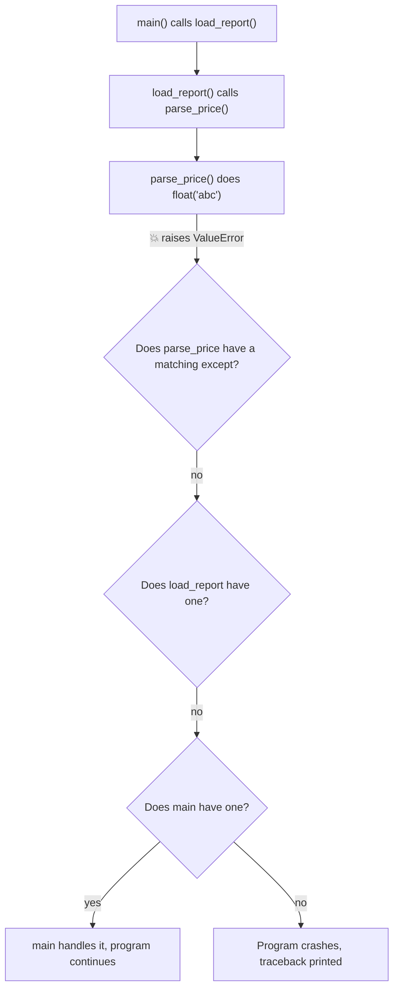
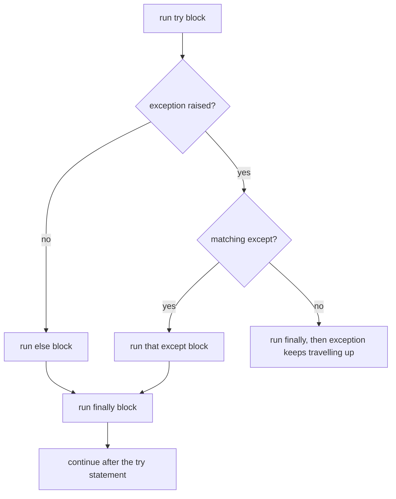
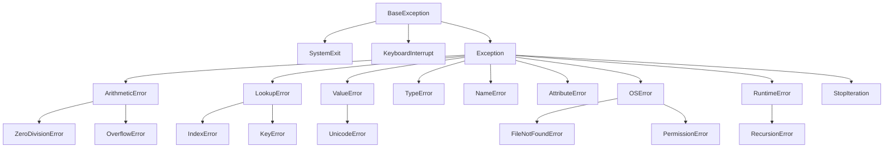
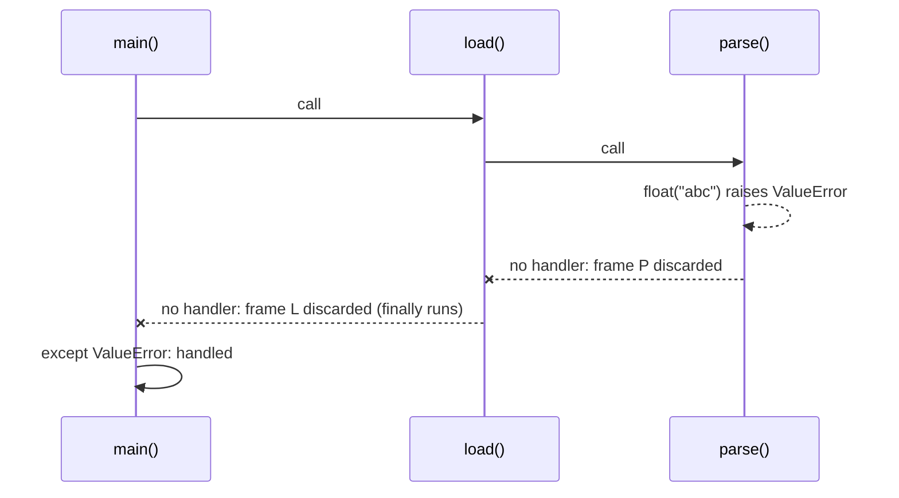
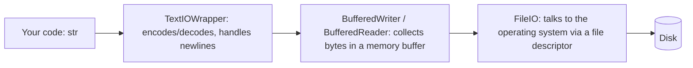

# Chapter 13 · Errors, Exceptions & Files

> Every program you have written so far lives in a perfect world: the user types a number, the dictionary has the key, the file exists. Real programs live in the messy world. This chapter teaches your code to fail loudly when it should, recover gracefully when it can, and remember things after it stops running.

**You will learn:**
- The difference between a **syntax error** and an **exception**, and how to read a traceback like a detective
- `try` / `except` / `else` / `finally`: exactly which block runs when
- The exception family tree, and why you should catch the *narrowest* exception you can
- `raise`, re-raising, custom exceptions and exception chaining (`raise ... from ...`)
- `assert`, and the two philosophies: **EAFP** vs **LBYL**
- Reading and writing files safely with `with`, `pathlib` and the right **encoding**
- Saving structured data with `json` and `csv`, and replacing `print` debugging with `logging`

**Before this:** [Functions](10-functions.md) · [Dictionaries & Hashing](09-dictionaries.md) · [Strings Deep Dive](04-strings.md)

---

## 🧠 The Big Idea

Think of a big hotel. Something goes wrong in room 412: a small kitchen fire. The guest in 412 can handle it (fire extinguisher), or they can pull the **fire alarm**. The alarm goes to the floor manager. If the floor manager can't handle it, it goes to the hotel manager. If nobody handles it, the whole hotel is evacuated.

Python works exactly like this:

- An **exception** is the fire alarm. It's an *object* that says "something went wrong, here are the details."
- **Raising** an exception means pulling the alarm.
- The alarm travels **up the chain of function calls** (room → floor → hotel) looking for someone who says "I can handle this kind of problem." That someone is an `except` block.
- If nobody handles it, the program stops and prints a **traceback**: the full report of where the fire started and which rooms it passed through.



The second half of the chapter is about **files**: the way your program remembers things after it finishes. Files and exceptions belong together because files are where things go wrong most often: the file is missing, you don't have permission, the disk is full, the text is in a weird encoding. Learn both and you can write programs that touch the real world without falling over.

---

## 🔨 Building It Up

### 1. Two kinds of "it broke": syntax errors vs exceptions

A **syntax error** means Python can't even *understand* your code. It's like a sentence with no verb. Python finds it **before running a single line**.

```py
print("hello"      # SyntaxError: '(' was never closed
if x > 3           # SyntaxError: expected ':'
```

An **exception** happens **while the program is running**. The code is grammatically fine, but something impossible happened at that moment.

```py
print(10 / 0)          # ZeroDivisionError: division by zero
int("forty-two")       # ValueError: invalid literal for int() with base 10: 'forty-two'
[1, 2, 3][10]          # IndexError: list index out of range
{"a": 1}["b"]          # KeyError: 'b'
"age: " + 25           # TypeError: can only concatenate str (not "int") to str
undefined_name         # NameError: name 'undefined_name' is not defined
```

| | Syntax error | Exception |
|---|---|---|
| When is it found? | Before running (while parsing) | While running |
| Can `try/except` catch it? | No (the file never starts) | Yes |
| Example | missing `:` or `)` | dividing by zero, missing key |
| Fix | Fix the code | Fix the code **or** handle the situation |

> 💡 People say "error" casually for both. Strictly, in Python an **exception** is the object that gets raised, and "errors" are the subset of exceptions that mean something went wrong (most built-in exception names end in `Error`).

### 2. Reading a traceback like a detective

When an exception isn't handled, Python prints a **traceback**. Beginners panic at it. Pros read it **from the bottom up**.

```py
def parse_price(text):
    return float(text)

def total(prices):
    return sum(parse_price(p) for p in prices)

print(total(["10.5", "abc", "3"]))
```

```text
Traceback (most recent call last):
  File "shop.py", line 7, in <module>
    print(total(["10.5", "abc", "3"]))
  File "shop.py", line 5, in total
    return sum(parse_price(p) for p in prices)
  File "shop.py", line 2, in parse_price
    return float(text)
ValueError: could not convert string to float: 'abc'
```

How to read it:

1. **Last line first:** the exception type (`ValueError`) and message (`could not convert string to float: 'abc'`). This tells you *what* went wrong.
2. **The line just above it:** *where* it went wrong (`line 2, in parse_price`).
3. **Lines further up:** *how we got there* (the call chain), with the oldest call at the top. "most recent call last" literally means the newest frame is at the bottom.

> 💡 Nine times out of ten, the bug is in the lowest frame that is **your** code (not library code). Start there.

### 3. Your first `try` / `except`

The `try` block holds code that might fail. The `except` block holds the plan B.

```python
def safe_divide(a, b):
    try:
        result = a / b
        print("division worked")
        return result
    except ZeroDivisionError:
        print("can't divide by zero, returning None")
        return None

print(safe_divide(10, 2))
print(safe_divide(10, 0))
```

```text
division worked
5.0
can't divide by zero, returning None
None
```

What just happened: in the second call, `a / b` raised `ZeroDivisionError`. Python **immediately abandoned** the rest of the `try` block (so `"division worked"` was never printed), looked for a matching `except`, found one, and ran it. After the `except` block finishes, the program carries on normally, as if nothing happened.

### 4. Catching specific exceptions (and getting the details with `as`)

You can have several `except` clauses, and you can grab the exception object with `as`:

```python
def to_int(value):
    try:
        return int(value)
    except ValueError as e:
        print(f"ValueError: {e}")
    except TypeError as e:
        print(f"TypeError: {e}")
    return None

to_int("42")
to_int("forty-two")
to_int([4, 2])
print(to_int("7") + 1)
```

```text
ValueError: invalid literal for int() with base 10: 'forty-two'
TypeError: int() argument must be a string, a bytes-like object or a real number, not 'list'
8
```

Python checks the `except` clauses **top to bottom** and runs the **first** one that matches. Only one runs.

To handle several types with the same code, use a **tuple**:

```python
def lookup(data, key):
    try:
        return data[key]
    except (KeyError, IndexError) as e:
        print(f"missing: {type(e).__name__} {e}")
        return None

lookup({"a": 1}, "b")
lookup([10, 20], 5)
print(lookup({"a": 1}, "a"))
```

```text
missing: KeyError 'b'
missing: IndexError list index out of range
1
```

The exception object `e` is a normal Python object. `type(e).__name__` gives its class name, `str(e)` gives its message, and `e.args` gives the arguments it was created with.

> ⚠️ Why not just `except:` with nothing after it? Because it catches **everything**, including typos (`NameError`), bugs you'd want to see, and even Ctrl+C. You'd be turning off the fire alarm for the whole hotel. Always name what you expect.

### 5. `else` and `finally`: the full shape

The full statement has four parts:

```py
try:
    risky_thing()          # code that might fail
except SomeError:
    handle_it()            # runs ONLY if a matching exception happened
else:
    celebrate()            # runs ONLY if NO exception happened in try
finally:
    clean_up()             # runs ALWAYS: success, failure, return, anything
```



Let's watch the order of events:

```python
def demo(x):
    print(f"--- demo({x!r})")
    try:
        print("  try: start")
        value = 100 / x
        print("  try: end")
    except ZeroDivisionError:
        print("  except: divided by zero")
    else:
        print(f"  else: result is {value}")
    finally:
        print("  finally: always runs")
    print("  after the try statement")

demo(4)
demo(0)
```

```text
--- demo(4)
  try: start
  try: end
  else: result is 25.0
  finally: always runs
  after the try statement
--- demo(0)
  try: start
  except: divided by zero
  finally: always runs
  after the try statement
```

**Why does `else` exist?** You could just put the "success" code at the end of `try`. The problem: then any exception *that code* raises would also be caught by your `except`, hiding bugs. `else` keeps the `try` block **small**, containing only the line you expect to fail.

**Why does `finally` exist?** For **clean-up that must happen no matter what**: closing a file, releasing a lock, closing a database connection. `finally` runs even if the `try` block does a `return`:

```python
def get_value():
    try:
        print("returning from try")
        return "from try"
    finally:
        print("finally runs before the function actually returns")

print(get_value())
```

```text
returning from try
finally runs before the function actually returns
from try
```

### 6. The exception family tree

Exceptions are organised in a **hierarchy** (a family tree). When you write `except ArithmeticError`, you also catch all its children: `ZeroDivisionError`, `OverflowError` and friends. Here is the part of the tree you'll meet most:



Two important things:

- **`BaseException`** is the root. Its direct children `SystemExit` (raised by `sys.exit()`) and `KeyboardInterrupt` (Ctrl+C) are *not* errors: they're "please stop" signals. That's why they sit **outside** `Exception`.
- **`Exception`** is the parent of every "normal" error. If you ever must catch "anything that went wrong", catch `Exception`, never `BaseException`.

You can check family relationships in code:

```python
print(issubclass(ZeroDivisionError, ArithmeticError))
print(issubclass(KeyError, LookupError))
print(issubclass(KeyboardInterrupt, Exception))
print(issubclass(FileNotFoundError, OSError))

try:
    [1, 2, 3][99]
except LookupError as e:          # a parent catches the child
    print("caught", type(e).__name__)
```

```text
True
True
False
True
caught IndexError
```

**Order matters**: because the first match wins, put **specific (child) exceptions before general (parent) ones**:

```py
# ❌ the second clause can never run: ArithmeticError already caught it
try:
    1 / 0
except ArithmeticError:
    print("arithmetic problem")
except ZeroDivisionError:
    print("never reached")

# ✅ specific first, general last
try:
    1 / 0
except ZeroDivisionError:
    print("divide by zero")
except ArithmeticError:
    print("some other arithmetic problem")
```

### 7. `raise`: pulling the alarm yourself

So far Python raised exceptions for us. You can raise them too, whenever your function receives something it can't sensibly handle:

```python
def set_age(age):
    if not isinstance(age, int):
        raise TypeError(f"age must be an int, got {type(age).__name__}")
    if age < 0 or age > 150:
        raise ValueError(f"age must be between 0 and 150, got {age}")
    return age

for candidate in [25, -3, "twenty"]:
    try:
        print("ok:", set_age(candidate))
    except (TypeError, ValueError) as e:
        print("rejected:", e)
```

```text
ok: 25
rejected: age must be between 0 and 150, got -3
rejected: age must be an int, got str
```

Rules of thumb for choosing what to raise:

| Situation | Raise |
|---|---|
| Right type, bad value (`-3` for an age) | `ValueError` |
| Wrong type entirely (`"twenty"` for an age) | `TypeError` |
| Missing key / index in your own container | `KeyError` / `IndexError` |
| "This should be impossible" / not supported yet | `RuntimeError` / `NotImplementedError` |
| Something specific to your app | a **custom exception** (section 9) |

> 💡 **Fail fast.** Raising early, at the boundary where bad data enters, is far better than letting bad data flow deep into your program and crash somewhere confusing 200 lines later.

### 8. Re-raising: handle a bit, then pass it on

Sometimes you want to *notice* an exception (log it, clean up) but still let the caller deal with it. A bare `raise` inside an `except` block re-raises the **same** exception with its original traceback:

```python
def risky():
    return {"a": 1}["b"]

def wrapper():
    try:
        return risky()
    except KeyError:
        print("wrapper: noticed a KeyError, passing it upward")
        raise                      # same exception object, keeps travelling

try:
    wrapper()
except KeyError as e:
    print("top level handled:", repr(e))
```

```text
wrapper: noticed a KeyError, passing it upward
top level handled: KeyError('b')
```

That's the floor manager writing "fire in 412" in the log book and then still forwarding the alarm to the hotel manager.

### 9. Custom exceptions

For your own programs, built-in exceptions are often too vague. If a bank transfer fails, `ValueError` doesn't tell the caller much. You can create **your own exception types**.

This needs a tiny piece of syntax we haven't formally met: `class`. Don't worry: we'll study classes properly in [Chapter 14](14-oop-classes-objects.md) and inheritance in [Chapter 15](15-oop-inheritance-magic.md). For now, read `class InsufficientFunds(BankError):` as "make a new kind of exception called `InsufficientFunds`, which is a child of `BankError`".

```python
class BankError(Exception):
    """Base class for every error in our bank app."""

class InsufficientFunds(BankError):
    pass

class AccountFrozen(BankError):
    pass

def withdraw(balance, amount, frozen=False):
    if frozen:
        raise AccountFrozen("account is frozen")
    if amount > balance:
        raise InsufficientFunds(f"need {amount}, have only {balance}")
    return balance - amount

print(withdraw(100, 30))

for args in [(100, 500), (100, 10, True)]:
    try:
        withdraw(*args)
    except InsufficientFunds as e:
        print("Please top up:", e)
    except BankError as e:            # catches every other bank error
        print("Bank problem:", type(e).__name__, "-", e)
```

```text
70
Please top up: need 500, have only 100
Bank problem: AccountFrozen - account is frozen
```

What just happened: we built a mini family tree (`BankError` → `InsufficientFunds`, `AccountFrozen`). Callers can catch something specific or the whole family with one `except BankError`. This is exactly how big libraries do it: for example, the popular `requests` library has a `RequestException` base with children like `ConnectionError` and `Timeout`.

> 💡 Name custom exceptions with an `Error` suffix when they represent errors (`PaymentError`), inherit from `Exception` (never `BaseException`), and make **one base exception per project** so users can catch all of yours at once.

### 10. Exception chaining: `raise ... from ...`

Often you catch a low-level exception and raise a **higher-level, more meaningful** one. You don't want to lose the original clue, though. `raise NewError(...) from original` links them:

```python
class ConfigError(Exception):
    pass

def read_port(settings):
    try:
        return int(settings["port"])
    except (KeyError, ValueError) as e:
        raise ConfigError("port setting is missing or not a number") from e

try:
    read_port({"port": "eighty"})
except ConfigError as e:
    print("error:", e)
    print("caused by:", repr(e.__cause__))
```

```text
error: port setting is missing or not a number
caused by: ValueError("invalid literal for int() with base 10: 'eighty'")
```

If this had crashed, the traceback would show **both** exceptions, joined by the sentence *"The above exception was the direct cause of the following exception"*. The original is stored in `e.__cause__`.

There are three variations to know:

| You write | Traceback says | Stored in |
|---|---|---|
| `raise New(...) from e` | "...was the **direct cause** of..." | `__cause__` |
| `raise New(...)` inside an `except` (no `from`) | "**During handling** of the above exception, another exception occurred" | `__context__` (implicit) |
| `raise New(...) from None` | only the new exception (original hidden) | `__suppress_context__ = True` |

```python
def implicit():
    try:
        {}["x"]
    except KeyError:
        raise RuntimeError("something else broke while handling")

def hidden():
    try:
        {}["x"]
    except KeyError:
        raise LookupError("clean message for the user") from None

for f in (implicit, hidden):
    try:
        f()
    except Exception as e:
        print(type(e).__name__, "| context:", repr(e.__context__),
              "| suppressed:", e.__suppress_context__)
```

```text
RuntimeError | context: KeyError('x') | suppressed: False
LookupError | context: KeyError('x') | suppressed: True
```

Use `from e` when translating errors (the default good choice). Use `from None` only when the inner error is a pure implementation detail that would confuse the reader.

### 11. `assert`: a sanity check for *you*, not for users

`assert condition, message` says "this must be true; if it isn't, I have a bug." If the condition is false, it raises `AssertionError`.

```python
def average(numbers):
    assert len(numbers) > 0, "average() needs at least one number"
    return sum(numbers) / len(numbers)

print(average([2, 4, 9]))
try:
    average([])
except AssertionError as e:
    print("AssertionError:", e)
```

```text
5.0
AssertionError: average() needs at least one number
```

> ⚠️ **Python removes every `assert` when run with `python -O` (optimise mode).** So never use `assert` to validate user input or protect security checks. Use `assert` for internal "this can't happen" checks and in tests; use `if ...: raise ValueError(...)` for real validation.

### 12. EAFP vs LBYL: two philosophies

There are two ways to deal with something that might not work:

- **LBYL** = "**Look Before You Leap**": check first, then act.
- **EAFP** = "**Easier to Ask Forgiveness than Permission**": just do it, and handle the exception if it fails.

```python
stock = {"apple": 5, "banana": 0}

# LBYL: check, then act
def price_lbyl(item):
    if item in stock:
        return stock[item]
    return "not sold here"

# EAFP: act, then handle failure
def price_eafp(item):
    try:
        return stock[item]
    except KeyError:
        return "not sold here"

for item in ["apple", "mango"]:
    print(item, price_lbyl(item), price_eafp(item))
```

```text
apple 5 5
mango not sold here not sold here
```

Python culture leans towards **EAFP**, for three reasons:

1. **No race conditions.** With files, `if path.exists(): open(path)` can still fail if another program deletes the file between the check and the open. EAFP just opens and handles `FileNotFoundError`.
2. **One lookup instead of two** when success is the common case.
3. **Duck typing** ([Chapter 15](15-oop-inheritance-magic.md)): "try to use it as a number; if it doesn't behave like one, handle that" works with any type.

But LBYL is fine (and clearer) when failure is **common** and the check is cheap. Raising and catching an exception costs more than an `if`, so for a dictionary lookup where the key is missing half the time, `dict.get(key, default)` or `in` is better. Use your judgement: optimise for **clarity** first.

### 13. Files: why and how

Variables vanish when your program ends. **Files** survive. Every file operation follows three steps: **open → read/write → close**.

```py
f = open("notes.txt", "w", encoding="utf-8")   # 1. open (create/overwrite)
f.write("Buy milk\n")                          # 2. write
f.close()                                      # 3. close (flush to disk, free the file)
```

The problem: if `write` raises an exception, `close()` never runs. The file may stay locked or lose buffered data. The fix is the **`with` statement**, which closes the file **automatically**, even if an exception happens inside:

```py
with open("notes.txt", "w", encoding="utf-8") as f:
    f.write("Buy milk\n")
    f.write("Call mom\n")
# here f is already closed, guaranteed, exception or not
```

`with` is basically a built-in `try/finally`. (Objects that work with `with` are called **context managers**; you'll build your own in [Chapter 16](16-iterators-generators-decorators.md).)

The **mode** string tells `open` what you want to do:

| Mode | Meaning | If file exists | If file doesn't exist |
|---|---|---|---|
| `"r"` | read (default) | reads it | `FileNotFoundError` |
| `"w"` | write | **erases it first!** | creates it |
| `"a"` | append | writes at the end | creates it |
| `"x"` | exclusive create | `FileExistsError` | creates it |
| `"r+"` | read and write | reads/writes in place | `FileNotFoundError` |
| add `"b"` | binary (`"rb"`, `"wb"`) | bytes, not str | |
| add `"t"` | text (the default) | str | |

> ⚠️ `"w"` silently **wipes** the file the moment you open it, even if you never write anything. Use `"a"` to add, and `"x"` when you must not overwrite.

### 14. Reading strategies

There are four ways to read a text file. Which one to use depends on the file's size.

```py
with open("poem.txt", encoding="utf-8") as f:
    everything = f.read()          # 1. whole file as ONE string

with open("poem.txt", encoding="utf-8") as f:
    first = f.readline()           # 2. one line at a time (keeps the "\n")

with open("poem.txt", encoding="utf-8") as f:
    lines = f.readlines()          # 3. list of all lines (each keeps "\n")

with open("poem.txt", encoding="utf-8") as f:
    for line in f:                 # 4. iterate lazily, line by line  ⭐ best for big files
        print(line.rstrip("\n"))
```

The checker for this book doesn't allow real files, but Python has a perfect stand-in: **`io.StringIO`**, an in-memory "file" that has exactly the same methods. Everything below works identically on a real file opened with `open()`.

```python
import io

text = "Twinkle twinkle\nlittle star\nhow I wonder\n"

f = io.StringIO(text)
print(repr(f.read()))
print(repr(f.read()))        # the cursor is at the end now: nothing left

f = io.StringIO(text)
print(repr(f.readline()))
print(repr(f.readline()))

f = io.StringIO(text)
print(f.readlines())

f = io.StringIO(text)
for number, line in enumerate(f, start=1):
    print(number, line.rstrip("\n"))
```

```text
'Twinkle twinkle\nlittle star\nhow I wonder\n'
''
'Twinkle twinkle\n'
'little star\n'
['Twinkle twinkle\n', 'little star\n', 'how I wonder\n']
1 Twinkle twinkle
2 little star
3 how I wonder
```

What just happened:

- A file has a **cursor** (position). Reading moves it forward. The second `read()` returned `''` because the cursor was already at the end. (`f.seek(0)` moves it back to the start.)
- Lines keep their trailing `"\n"`. Use `line.rstrip("\n")` (or `.strip()` if you also want to drop spaces).
- `for line in f` reads **one line at a time**. A 50 GB log file uses only one line's worth of memory. `read()` and `readlines()` load the **whole file** into memory: fine for small files, a crash for huge ones.

| Method | Returns | Memory | Use when |
|---|---|---|---|
| `f.read()` | one `str` | whole file | small file, need it as a single string |
| `f.read(n)` | up to `n` characters | `n` | processing in fixed-size chunks |
| `f.readline()` | next line | one line | reading a header, then something else |
| `f.readlines()` | `list[str]` | whole file | small file, need random access to lines |
| `for line in f` | one line per loop | one line | **default choice**, any size |

### 15. Writing files

```py
lines = ["alpha", "beta", "gamma"]

with open("out.txt", "w", encoding="utf-8") as f:
    f.write("header\n")                    # write() does NOT add "\n" for you
    for line in lines:
        f.write(line + "\n")

with open("out.txt", "a", encoding="utf-8") as f:
    f.writelines(l + "\n" for l in lines)  # writelines doesn't add "\n" either
    print("printed into the file", file=f) # print() can write to a file too
```

Again, `io.StringIO` lets us see exactly what would be written:

```python
import io

buffer = io.StringIO()
buffer.write("header\n")
for word in ["alpha", "beta"]:
    buffer.write(word + "\n")
print("done", 3, "items", file=buffer, sep=", ")
print(repr(buffer.getvalue()))
```

```text
'header\nalpha\nbeta\ndone, 3, items\n'
```

`write()` returns the number of characters written and never adds a newline. `print(..., file=f)` is often the most convenient because it handles spaces, newlines and non-string values for you.

> 💡 Writing to a file usually goes into a **buffer** in memory first, and is pushed to disk in big chunks (much faster). It's guaranteed to reach the disk when the file is closed (or when you call `f.flush()`). Another reason to use `with`.

### 16. `pathlib`: paths as objects

Gluing paths together with strings (`folder + "/" + name`) breaks across operating systems (Windows uses `\`). The modern way is **`pathlib.Path`**, which treats a path as an object with handy methods. The `/` operator joins paths.

```python
from pathlib import PurePosixPath

# PurePosixPath does pure path maths with "/" separators, no disk access.
# In real code you'd use Path, which works the same way and also touches the disk.
report = PurePosixPath("/home/riya/projects") / "sales" / "report_2024.csv"

print(report)
print(report.name)        # final component
print(report.stem)        # name without suffix
print(report.suffix)      # extension
print(report.parent)      # the folder it lives in
print(report.parts[-2:])
print(report.with_suffix(".json"))
print(report.match("*.csv"))
```

```text
/home/riya/projects/sales/report_2024.csv
report_2024.csv
report_2024
.csv
/home/riya/projects/sales
('sales', 'report_2024.csv')
/home/riya/projects/sales/report_2024.json
True
```

With a real `Path`, you also get disk operations:

```py
from pathlib import Path

base = Path("data")
base.mkdir(parents=True, exist_ok=True)       # make folder (no error if it exists)

notes = base / "notes.txt"
notes.write_text("hello\n", encoding="utf-8") # open + write + close in one call
print(notes.read_text(encoding="utf-8"))      # open + read + close in one call
print(notes.exists(), notes.is_file(), notes.stat().st_size)

for csv_file in base.glob("*.csv"):           # all CSVs in the folder
    print(csv_file.name)
for py_file in Path(".").rglob("*.py"):       # recursive search
    print(py_file)

with notes.open("a", encoding="utf-8") as f:  # Path has its own open()
    f.write("more\n")

notes.unlink()                                # delete the file
Path.cwd(), Path.home()                       # current folder, your home folder
```

> 💡 `Path` objects work everywhere a path string is accepted (including `open()`), so there's no reason to build paths from strings anymore.

### 17. Encoding: text vs bytes

Computers store **bytes** (numbers 0–255), not letters. An **encoding** is the rulebook that turns text into bytes and back. **UTF-8** is the world standard: it can store every character in every language (and emoji), and English letters take just 1 byte each.

```python
word = "café ₹"
data = word.encode("utf-8")       # str -> bytes
print(data)
print(len(word), "characters,", len(data), "bytes")
print(data.decode("utf-8") == word)   # bytes -> str, round trip works

try:
    data.decode("ascii")          # wrong rulebook
except UnicodeDecodeError as e:
    print("UnicodeDecodeError:", e.reason)

garbled = data.decode("ascii", errors="replace")
print(ascii(garbled))             # ascii() shows hidden characters as escapes
```

```text
b'caf\xc3\xa9 \xe2\x82\xb9'
6 characters, 9 bytes
True
UnicodeDecodeError: ordinal not in range(128)
'caf\ufffd\ufffd \ufffd\ufffd\ufffd'
```

What just happened: `é` takes 2 bytes in UTF-8 and `₹` takes 3. Decoding with the wrong encoding fails, or, with `errors="replace"`, produces garbage: every byte it can't decode becomes the replacement character `�` (Unicode code point U+FFFD). That `�` is the tell-tale sign of an encoding mix-up you've surely seen on websites.

> ⚠️ **Always pass `encoding="utf-8"` to `open()` for text files.** If you don't, Python uses the operating system's default. On many Windows machines that's still an old encoding (like `cp1252`), so a file that works on your friend's Mac crashes on your laptop with `UnicodeDecodeError`. Being explicit makes your code behave the same everywhere.

Binary mode (`"rb"`, `"wb"`) skips encoding entirely and gives you raw `bytes`: use it for images, PDFs, zip files, anything that isn't text.

### 18. `json`: saving Python data as text

**JSON** (JavaScript Object Notation) is the most common format for exchanging data between programs and over the web. It looks almost exactly like Python dicts and lists.

```python
import json

student = {
    "name": "Aarav",
    "age": 20,
    "marks": [91, 78, 88],
    "graduated": False,
    "mentor": None,
}

text = json.dumps(student)                  # Python -> JSON string
print(text)
print(json.dumps(student, indent=2, sort_keys=True))

back = json.loads(text)                     # JSON string -> Python
print(back == student, type(back))
```

```text
{"name": "Aarav", "age": 20, "marks": [91, 78, 88], "graduated": false, "mentor": null}
{
  "age": 20,
  "graduated": false,
  "marks": [
    91,
    78,
    88
  ],
  "mentor": null,
  "name": "Aarav"
}
True <class 'dict'>
```

The **s** in `dumps`/`loads` stands for **string**. Without the s, `dump`/`load` work directly with files:

```py
with open("student.json", "w", encoding="utf-8") as f:
    json.dump(student, f, indent=2)

with open("student.json", encoding="utf-8") as f:
    student = json.load(f)
```

How types translate:

| Python | JSON | Comes back as |
|---|---|---|
| `dict` | object `{}` | `dict` |
| `list`, **`tuple`** | array `[]` | `list` (tuples are lost!) |
| `str` | string | `str` |
| `int`, `float` | number | `int`, `float` |
| `True` / `False` | `true` / `false` | `True` / `False` |
| `None` | `null` | `None` |
| `set`, `datetime`, custom objects | ❌ `TypeError` | you must convert them yourself |

Two classic surprises:

```python
import json

data = {1: "one", "pair": (1, 2)}
round_trip = json.loads(json.dumps(data))
print(round_trip)                  # int key became a str, tuple became a list

try:
    json.dumps({"tags": {"a", "b"}})
except TypeError as e:
    print("TypeError:", e)

try:
    json.loads("{'name': 'single quotes'}")
except json.JSONDecodeError as e:
    print("JSONDecodeError:", e.msg)
```

```text
{'1': 'one', 'pair': [1, 2]}
TypeError: Object of type set is not JSON serializable
JSONDecodeError: Expecting property name enclosed in double quotes
```

JSON keys are always strings, JSON has no tuples or sets, and JSON strings must use **double quotes**. (`json.JSONDecodeError` is a child of `ValueError`, so `except ValueError` catches it too.)

### 19. `csv`: spreadsheets as text

**CSV** (comma-separated values) is how spreadsheets and databases export tables. You might think `line.split(",")` is enough, until a value contains a comma: `"Mumbai, India"`. The `csv` module handles quoting correctly.

```python
import csv
import io

raw = '''name,city,score
Asha,"Mumbai, India",88
Ben,Pune,92
'''

reader = csv.reader(io.StringIO(raw))
header = next(reader)
print(header)
for row in reader:
    print(row)

# DictReader: every row becomes a dict keyed by the header
rows = list(csv.DictReader(io.StringIO(raw)))
print(rows[0]["city"], "|", sum(int(r["score"]) for r in rows))

# DictWriter: dicts -> CSV text
out = io.StringIO()
writer = csv.DictWriter(out, fieldnames=["name", "score"], lineterminator="\n")
writer.writeheader()
writer.writerow({"name": "Chen", "score": 75})
writer.writerows([{"name": "Dia, Jr.", "score": 81}])
print(out.getvalue(), end="")
```

```text
['name', 'city', 'score']
['Asha', 'Mumbai, India', '88']
['Ben', 'Pune', '92']
Mumbai, India | 180
name,score
Chen,75
"Dia, Jr.",81
```

What just happened: the reader understood that the comma inside quotes is part of the value. All values come back as **strings** (`"88"`), so convert with `int()` yourself. The writer added quotes around `"Dia, Jr."` automatically.

With real files, open them with `newline=""` (the csv module handles line endings itself; without this you can get blank lines between rows on Windows):

```py
with open("scores.csv", "w", newline="", encoding="utf-8") as f:
    writer = csv.writer(f)
    writer.writerow(["name", "score"])
    writer.writerows([["Asha", 88], ["Ben", 92]])

with open("scores.csv", newline="", encoding="utf-8") as f:
    for row in csv.DictReader(f):
        print(row["name"], int(row["score"]))
```

### 20. `logging`: grown-up `print`

`print` debugging works, but in real programs you want to: switch messages on and off without deleting them, add timestamps, send messages to a file, and mark how serious each one is. That's **`logging`**.

There are five standard **levels**, from least to most serious:

| Level | Use it for |
|---|---|
| `DEBUG` | detailed info for diagnosing problems |
| `INFO` | "things are working as expected" milestones |
| `WARNING` | something unexpected, but the program carries on (**default threshold**) |
| `ERROR` | a real problem; some operation failed |
| `CRITICAL` | the program itself may not be able to continue |

```python
import logging
import sys

logging.basicConfig(
    level=logging.INFO,                              # show INFO and above
    format="%(levelname)s:%(name)s:%(message)s",
    stream=sys.stdout,                               # default is stderr
)
log = logging.getLogger("payments")

log.debug("raw request body: ...")                   # below INFO -> hidden
log.info("payment started for order %s", 1042)
log.warning("retrying, attempt %d of %d", 2, 3)

try:
    1 / 0
except ZeroDivisionError:
    log.error("payment failed for order %s", 1042)
```

```text
INFO:payments:payment started for order 1042
WARNING:payments:retrying, attempt 2 of 3
ERROR:payments:payment failed for order 1042
```

What just happened:

- `basicConfig` sets up logging once, at the start of the program. `level=logging.INFO` hides `DEBUG`. Change one word to `DEBUG` and all your debug messages come back, no code deleted.
- `getLogger("payments")` gives a named logger. In real modules you write `log = logging.getLogger(__name__)` so every message says which file it came from (`__name__` is explained in [Chapter 17](17-modules-stdlib.md)).
- Pass values as **arguments** (`"order %s", 1042`) rather than f-strings: the text is only built if the message will actually be shown.
- Inside an `except` block, `log.exception("message")` logs at `ERROR` level **and** appends the full traceback. It's the single most useful logging call in production.
- A typical real-world format adds the time: `format="%(asctime)s %(levelname)s %(name)s: %(message)s"`, and `filename="app.log"` sends everything to a file.

---

## 🔬 Under the Hood

### What `raise` really does: unwinding the stack

Every function call gets a **frame**: a little box holding its local variables and "where I am in my code". The frames form a **call stack** (you met it in [Recursion](12-recursion.md)). When an exception is raised:

1. Python creates the exception **object** (it's an ordinary object: it has a type, `args`, and a `__traceback__` attribute).
2. It checks the current frame: are we inside a `try` with a matching `except`?
3. If not, the current frame is **thrown away** (its local variables are released, any `finally` blocks run first) and Python repeats the check in the caller's frame. This is called **stack unwinding**.
4. Each frame it passes through is recorded in the traceback, which is why the traceback shows the full path.
5. If it unwinds past the very top (the module level), Python prints the traceback and exits with a non-zero status code.



### Is `try` slow?

In Python 3.11 and later, entering a `try` block costs **essentially nothing** when no exception is raised. CPython compiles a side table (the "exception table") that is only consulted when something actually goes wrong. Older versions executed a small setup instruction for every `try`. **Raising and catching** an exception is the expensive part: it creates an object, records a traceback and unwinds frames. That's why the EAFP rule is "use exceptions for *exceptional* cases": if a failure happens on most iterations of a hot loop, an `if` check is faster.

### What a file object really is

`open()` in text mode actually gives you **three layers** stacked on top of each other:



- **TextIOWrapper** turns `str` into bytes using your encoding, and converts `"\n"` to the OS's line ending (`"\r\n"` on Windows) when writing and back when reading. That's why `"\n"` works everywhere.
- **The buffer** batches small writes into big ones, because each trip to the operating system is slow. Unflushed data lives only in memory, which is why an unclosed file can lose its last few writes.
- **FileIO** holds a **file descriptor**, a small integer the OS uses to track open files. The OS limits how many a process can have open (often around a thousand). Forgetting to close files in a loop eventually raises `OSError: Too many open files`. `with` prevents this.

Binary mode (`"rb"`) skips the TextIOWrapper layer: you get bytes straight from the buffer.

### How `with` works (a preview)

`with open(...) as f:` is roughly shorthand for:

```py
f = open("notes.txt", encoding="utf-8")
try:
    ...                 # the body of the with block
finally:
    f.close()
```

More precisely, `with` calls the object's `__enter__` method at the start and its `__exit__` method at the end, passing it any exception that happened. You'll write your own objects that do this in [Chapter 16](16-iterators-generators-decorators.md).

---

## 🧩 Pattern Decoder

### Pythonic idioms for errors

**1. Keep `try` blocks tiny.** Only the line that can fail goes inside.

```py
# ❌ any bug in process() or save() is wrongly reported as "bad number"
try:
    n = int(text)
    result = process(n)
    save(result)
except ValueError:
    print("bad number")

# ✅
try:
    n = int(text)
except ValueError:
    print("bad number")
else:
    save(process(n))
```

**2. Translate low-level errors at module boundaries** with `raise HighLevelError(...) from e`. Callers of your `config` module should see `ConfigError`, not a random `KeyError` from deep inside.

**3. Prefer the tool that avoids the exception** when failure is normal:

| Instead of | Prefer |
|---|---|
| `try: d[k] except KeyError: default` | `d.get(k, default)` |
| counting with `try/except KeyError` | `collections.Counter` / `defaultdict` ([Chapter 17](17-modules-stdlib.md)) |
| `if os.path.exists(p): open(p)` | `try: open(p) except FileNotFoundError:` (no race) |
| `f = open(...)` … `f.close()` | `with open(...) as f:` |
| `"folder" + "/" + name` | `Path("folder") / name` |

**4. The "parse and collect errors" pattern**: process everything, record what failed, report at the end. This is how real data pipelines survive one bad row.

```python
def parse_all(items):
    good, bad = [], []
    for index, item in enumerate(items):
        try:
            good.append(int(item))
        except ValueError:
            bad.append((index, item))
    return good, bad

numbers, problems = parse_all(["4", "x", "15", "", "-2"])
print(numbers)
print(problems)
```

```text
[4, 15, -2]
[(1, 'x'), (3, '')]
```

**5. The "read a config with a default" pattern:**

```py
import json
from pathlib import Path

def load_settings(path):
    defaults = {"theme": "light", "font_size": 14}
    try:
        with Path(path).open(encoding="utf-8") as f:
            user = json.load(f)
    except FileNotFoundError:
        return defaults                 # first run: no settings file yet
    except json.JSONDecodeError as e:
        raise ValueError(f"settings file {path} is corrupted") from e
    return {**defaults, **user}         # user values override defaults
```

### How this shows up in DSA

- **Input parsing in coding platforms.** Competitive programming reads big inputs from standard input, which is just a file. Iterating over it line by line (or reading it all at once with `sys.stdin.read().split()`) is the same file API you learned here. [Chapter 17](17-modules-stdlib.md) shows the fast-input trick.
- **Empty-structure edge cases.** `max([])` raises `ValueError`, `heapq.heappop([])` and `[].pop()` raise `IndexError`. Interviewers watch whether you guard against empty input. Either check first (`if not nums: return 0`) or pass a default (`max(nums, default=0)`).
- **`RecursionError`** is what you get when a recursive DFS goes too deep (default limit about 1000 frames). You'll learn to raise the limit or switch to an explicit stack in [Chapter 17](17-modules-stdlib.md) and the graphs chapters.
- **`StopIteration`** is how iterators say "I'm done": `next(iter([]))` raises it. You'll see it again in [Chapter 16](16-iterators-generators-decorators.md).
- In interview code, **don't** use exceptions for normal control flow (like catching `IndexError` to detect the end of an array). Bounds checks are clearer and faster.

---

## ⚠️ Traps & Common Mistakes

1. **Bare `except:` or `except Exception: pass`.** This is "swallowing" errors: the program keeps running with broken data, and you never learn why.

```py
# ❌ hides typos, bugs and even Ctrl+C
try:
    total = compute_totl()     # NameError: typo, silently ignored!
except:
    pass

# ✅ catch only what you expect, and at least log the rest
try:
    total = compute_total()
except ZeroDivisionError:
    total = 0
```

2. **Catching a parent before a child.** `except Exception:` above `except ValueError:` means the second clause never runs. Specific first.

3. **Old Python 2 syntax.** `except ValueError, TypeError:` is a syntax error in Python 3. Use a tuple: `except (ValueError, TypeError):`.

4. **`return` inside `finally` swallows exceptions.** A `return` in `finally` cancels any exception that was travelling up. It's legal but almost always a bug (newer Python versions warn about it).

```python
def broken():
    try:
        raise ValueError("important!")
    finally:
        return "everything is fine"     # the ValueError silently vanishes

print(broken())
```

```text
everything is fine
```

5. **Opening with `"w"` when you meant `"a"`.** `"w"` erases the file immediately. There's no undo.

6. **Forgetting `encoding="utf-8"`.** Works on your machine, breaks on someone else's. Always be explicit with text files.

7. **Reading a file twice and getting nothing.** After `f.read()`, the cursor is at the end; a second `f.read()` returns `''`. Store the result, or `f.seek(0)`.

8. **Forgetting `"\n"` with `write()`.** `f.write("a"); f.write("b")` produces `ab` on one line. `write` adds nothing; `print(..., file=f)` adds a newline.

9. **Assert with parentheses around a tuple.** `assert (x > 0, "x must be positive")` is a non-empty tuple, which is **always truthy**, so this assert can never fail. Write `assert x > 0, "x must be positive"`.

10. **Using `assert` for input validation.** `python -O` removes it. Use `raise ValueError`.

11. **Losing the original error.** `except KeyError: raise ConfigError("bad config")` inside the handler keeps the context, but `from e` makes the relationship explicit and readable. Don't hide the cause with `from None` unless you're sure it's noise.

12. **Building paths with string concatenation.** `"data" + "\\" + name` breaks on Linux/Mac. Use `Path("data") / name`.

---

## 💡 Tips & Tricks

- Read tracebacks **bottom-up**: type and message, then the lowest frame in your own code.
- `except Exception as e: log.exception("context")` at the **very top** of a program (one place) is fine: it's the "last line of defence" that records the crash. Everywhere else, be specific.
- `repr(e)` shows the type and message together (`KeyError('b')`); `str(e)` shows just the message. For `KeyError`, `str(e)` is the quoted key, which surprises people.
- Use `with open(a) as src, open(b, "w") as dst:` to open two files in one `with`.
- `Path.read_text()` / `Path.write_text()` are perfect for small files: one line, no `with` needed (they close the file for you).
- For huge files, `for line in f` uses O(1) memory. Never `readlines()` a 10 GB file.
- `json.dumps(obj, indent=2, ensure_ascii=False)` keeps non-English characters readable (`"café"` instead of `"caf\u00e9"`).
- `csv` values are always strings. Convert types explicitly as you read.
- Python 3.11 added **`ExceptionGroup`** and `except*` for handling several exceptions at once (mostly used with concurrent tasks) and `e.add_note("extra info")` to attach context to an exception. Rarely needed by beginners, but nice to recognise.
- Want to run "clean-up even on Ctrl+C"? `finally` runs for `KeyboardInterrupt` too, because it runs for *every* way of leaving the block.

---

## 🎯 Interview Questions

### 1. What's the difference between a syntax error and an exception? 🔥🔥

<details><summary>Answer</summary>

A **syntax error** is detected while Python **parses** the code, before anything runs: the code isn't valid Python (missing colon, unclosed bracket). It cannot be caught by the file's own `try/except`, because that code never starts executing.

An **exception** is raised **at runtime** when a valid statement can't be completed (division by zero, missing key, file not found). It can be caught and handled with `try/except`. Exceptions are objects, instances of classes that inherit from `BaseException`.

</details>

### 2. Explain `try`, `except`, `else` and `finally`. When does each run? 🔥🔥🔥

<details><summary>Answer</summary>

- `try`: the code that might raise.
- `except X`: runs only if an exception of type `X` (or a subclass) was raised in `try`. The first matching clause wins.
- `else`: runs only if `try` finished **without** an exception. It keeps the `try` small so you don't accidentally catch exceptions from the follow-up code.
- `finally`: runs **always**: after success, after a handled exception, after an unhandled one (before it propagates), and even after `return`, `break` or `continue` inside `try`. Used for clean-up.

Order on success: try → else → finally. On a handled error: try (partly) → except → finally. On an unhandled error: try (partly) → finally → exception propagates.

</details>

### 3. What does this function return? 🔥🔥

```py
def f():
    try:
        return 1
    finally:
        return 2
```

<details><summary>Answer</summary>

It returns **2**. The `try` block's `return 1` sets up a return value, but `finally` always runs before the function actually leaves, and its own `return 2` replaces it. If `try` had raised an exception instead, the `return` in `finally` would **swallow** that exception too. That's why returning from `finally` is considered a bug-magnet.

```python
def f():
    try:
        return 1
    finally:
        return 2

print(f())
```

```text
2
```

</details>

### 4. Why shouldn't you use a bare `except:`? What's the difference between `Exception` and `BaseException`? 🔥🔥🔥

<details><summary>Answer</summary>

A bare `except:` catches `BaseException`, the root of **all** exceptions, including `KeyboardInterrupt` (user pressed Ctrl+C), `SystemExit` (`sys.exit()` was called) and `GeneratorExit`. Catching those makes programs impossible to stop and hides real bugs like `NameError` from typos.

`Exception` is the base class for ordinary errors. `KeyboardInterrupt` and `SystemExit` deliberately inherit from `BaseException` directly, so that `except Exception:` doesn't catch them. If you really need a catch-all (for example to log crashes at the top level of a program), use `except Exception as e:` and log or re-raise it.

</details>

### 5. How do you create a custom exception, and why would you? 🔥🔥🔥

<details><summary>Answer</summary>

Subclass `Exception` (or a more specific built-in like `ValueError`):

```python
class AppError(Exception):
    """Base for all errors in this app."""

class ValidationError(AppError):
    def __init__(self, field, message):
        super().__init__(f"{field}: {message}")
        self.field = field

try:
    raise ValidationError("email", "must contain @")
except AppError as e:
    print(type(e).__name__, "|", e, "|", e.field)
```

```text
ValidationError | email: must contain @ | email
```

Why: specific types let callers handle specific failures (`except ValidationError`), a shared base class lets them catch everything from your library at once, and extra attributes (`field`) carry structured details. (`__init__` and `super()` are covered in Chapters 14 and 15.)

</details>

### 6. What is exception chaining? What's the difference between `raise X from e` and `raise X from None`? 🔥🔥

<details><summary>Answer</summary>

When you raise a new exception while handling another, Python links them:

- **Implicitly**: raising inside an `except` block stores the original in `__context__`. The traceback says "During handling of the above exception, another exception occurred".
- **Explicitly** with `raise X from e`: stores `e` in `__cause__`. The traceback says "The above exception was the direct cause of the following exception". Use this when translating a low-level error into a meaningful one.
- `raise X from None` sets `__suppress_context__ = True`, so the traceback shows only `X`. Use it when the original error is an irrelevant implementation detail.

</details>

### 7. What's EAFP vs LBYL? Which is more Pythonic? 🔥🔥

<details><summary>Answer</summary>

**LBYL** (Look Before You Leap) checks preconditions before acting: `if key in d: return d[key]`. **EAFP** (Easier to Ask Forgiveness than Permission) just acts and handles the failure: `try: return d[key] except KeyError: ...`.

EAFP is generally considered more Pythonic: it avoids **race conditions** (a file can be deleted between "exists?" and "open"), avoids doing the lookup twice, and works naturally with duck typing. LBYL is better when failure is **frequent** (raising/catching is slower than an `if`) or when the check makes the code clearer. Tools like `dict.get` avoid the question entirely.

</details>

### 8. What does the `with` statement do when opening a file? Why use it? 🔥🔥🔥

<details><summary>Answer</summary>

`with open(path) as f:` guarantees the file is **closed** when the block ends, whether it ends normally, by `return`, or by an exception. Closing flushes buffered writes to disk and releases the OS file descriptor. Without `with`, an exception between `open()` and `close()` would leak the file.

Technically, `with` calls `f.__enter__()` at the start (which returns the file) and `f.__exit__(exc_type, exc_value, traceback)` at the end, which closes it. Any object with these two methods is a **context manager** and works with `with` (locks, database connections, timers…).

</details>

### 9. How would you process a 20 GB log file on a machine with 8 GB of RAM? 🔥🔥🔥

<details><summary>Answer</summary>

Don't load it all: `read()` and `readlines()` would need 20 GB of memory. Iterate over the file object, which reads one line at a time through a buffer:

```py
error_count = 0
with open("server.log", encoding="utf-8", errors="replace") as f:
    for line in f:                       # O(1) memory per line
        if " ERROR " in line:
            error_count += 1
```

For binary data or files without line breaks, read fixed-size chunks: `while chunk := f.read(1024 * 1024): ...`. Mention `errors="replace"` for logs that may contain broken bytes, and generators ([Chapter 16](16-iterators-generators-decorators.md)) to build lazy processing pipelines.

</details>

### 10. Difference between `read()`, `readline()` and `readlines()`? 🔥🔥

<details><summary>Answer</summary>

- `read()` returns the **whole** remaining file as one string (`read(n)` returns up to n characters).
- `readline()` returns the **next line**, including its `"\n"`, or `''` at end of file.
- `readlines()` returns a **list of all remaining lines**, each with `"\n"`.

The first and last load everything into memory. The idiomatic way to process lines is `for line in f`, which is lazy.

</details>

### 11. What's the difference between `json.dump` and `json.dumps`? What can't JSON represent? 🔥🔥

<details><summary>Answer</summary>

`dumps` returns a JSON **string**; `dump` writes JSON to a **file object**. Similarly `loads` parses a string and `load` reads from a file.

JSON has only objects, arrays, strings, numbers, booleans and null. So: tuples come back as lists, non-string dict keys become strings, and sets, `datetime`, bytes and custom objects raise `TypeError` unless you convert them (e.g. `json.dumps(obj, default=str)`, or turn a set into a sorted list first).

</details>

### 12. Should you use `assert` to validate function arguments? 🔥

<details><summary>Answer</summary>

No, not for anything that must be enforced. Assertions are removed when Python runs with `-O`, so validation would silently disappear in "optimised" production runs. Use `assert` for **internal invariants** ("this list should be sorted here, otherwise I have a bug") and in tests. Validate inputs with `if not ...: raise ValueError(...)` / `TypeError(...)`.

</details>

---

## 🏋️ Practice

**🟢 1. Safe integer parsing.** Write `parse_int(text, default=0)` that returns `int(text)`, or `default` if the text isn't a valid integer. Leading/trailing spaces should be fine.

<details><summary>Solution</summary>

```python
def parse_int(text, default=0):
    try:
        return int(text)        # int() already ignores surrounding whitespace
    except (ValueError, TypeError):
        return default

print(parse_int(" 42 "), parse_int("4.2"), parse_int(None, -1), parse_int("x", default=None))
```

```text
42 0 -1 None
```

`TypeError` covers `None` and other non-string types.

</details>

**🟢 2. Trace the flow.** Without running it, write down what this prints. Then run it.

```python
def check(n):
    try:
        print("A", end=" ")
        if n == 0:
            raise ValueError
        print("B", end=" ")
    except ValueError:
        print("C", end=" ")
    else:
        print("D", end=" ")
    finally:
        print("E")

check(1)
check(0)
```

<details><summary>Solution</summary>

```text
A B D E
A C E
```

Success: try → else → finally. Failure: try (stops at the raise) → except → finally.

</details>

**🟡 3. Bank errors.** Create `InsufficientFundsError` and `InvalidAmountError` (both children of `BankError`). Write `withdraw(balance, amount)` that raises `InvalidAmountError` for amounts ≤ 0 and `InsufficientFundsError` if the amount exceeds the balance, otherwise returns the new balance. Test it with a loop that catches `BankError`.

<details><summary>Solution</summary>

```python
class BankError(Exception):
    pass

class InvalidAmountError(BankError):
    pass

class InsufficientFundsError(BankError):
    pass

def withdraw(balance, amount):
    if amount <= 0:
        raise InvalidAmountError(f"amount must be positive, got {amount}")
    if amount > balance:
        raise InsufficientFundsError(f"balance {balance} is less than {amount}")
    return balance - amount

for amount in [40, -5, 500]:
    try:
        print("new balance:", withdraw(100, amount))
    except BankError as e:
        print(f"{type(e).__name__}: {e}")
```

```text
new balance: 60
InvalidAmountError: amount must be positive, got -5
InsufficientFundsError: balance 100 is less than 500
```

</details>

**🟡 4. Word frequency from a "file".** Given a file-like object (use `io.StringIO`), return the 3 most common words, ignoring case and punctuation `.,!?`. Process it line by line (as you would a huge file).

<details><summary>Solution</summary>

```python
import io

def top_words(f, k=3):
    counts = {}
    for line in f:                                   # lazy, line by line
        for word in line.lower().split():
            word = word.strip(".,!?")
            if word:
                counts[word] = counts.get(word, 0) + 1
    ranked = sorted(counts.items(), key=lambda kv: (-kv[1], kv[0]))
    return ranked[:k]

text = io.StringIO("The cat sat.\nThe cat ran!\nA dog? The dog.\n")
print(top_words(text))
```

```text
[('the', 3), ('cat', 2), ('dog', 2)]
```

Sorting by `(-count, word)` gives highest count first and alphabetical order for ties. (In [Chapter 17](17-modules-stdlib.md), `collections.Counter` does this in one line.)

</details>

**🟡 5. CSV report with bad rows.** Given CSV text with columns `item,qty,price`, compute the total value `qty * price`. Skip rows with invalid numbers, and return the total plus a list of the line numbers that were skipped.

<details><summary>Solution</summary>

```python
import csv
import io

def order_total(f):
    total = 0.0
    skipped = []
    for line_no, row in enumerate(csv.DictReader(f), start=2):   # line 1 is the header
        try:
            total += int(row["qty"]) * float(row["price"])
        except (ValueError, TypeError):
            skipped.append(line_no)
    return round(total, 2), skipped

data = io.StringIO("item,qty,price\npen,3,10.5\nbook,two,200\nbag,1,499\nink,2,\n")
print(order_total(data))
```

```text
(530.5, [3, 5])
```

An empty `price` gives `float("")`, a `ValueError`. A row with a *missing* column gives `None`, which makes `int()`/`float()` raise `TypeError`, so we catch both.

</details>

**🟡 6. JSON settings merge.** Write `load_settings(json_text)` that starts from defaults `{"theme": "light", "font": 12}` and overrides them with whatever the JSON contains. If the JSON is invalid, raise a `SettingsError` chained `from` the original error.

<details><summary>Solution</summary>

```python
import json

class SettingsError(Exception):
    pass

DEFAULTS = {"theme": "light", "font": 12}

def load_settings(json_text):
    try:
        user = json.loads(json_text)
    except json.JSONDecodeError as e:
        raise SettingsError("settings are not valid JSON") from e
    return {**DEFAULTS, **user}

print(load_settings('{"theme": "dark"}'))
try:
    load_settings("{theme: dark}")
except SettingsError as e:
    print(e, "| cause:", type(e.__cause__).__name__)
```

```text
{'theme': 'dark', 'font': 12}
settings are not valid JSON | cause: JSONDecodeError
```

</details>

**🔴 7. Log analyser.** Each line of a log looks like `2024-05-01 12:00:03 ERROR payment timeout`. Write `summarise(f)` that returns a dict counting lines per level (`INFO`, `WARNING`, `ERROR`) and a list of malformed lines (fewer than 4 parts or an unknown level). It must work on any size file (lazy reading) and never crash on a bad line.

<details><summary>Solution</summary>

```python
import io

LEVELS = {"DEBUG", "INFO", "WARNING", "ERROR", "CRITICAL"}

def summarise(f):
    counts = {}
    malformed = []
    for line_no, line in enumerate(f, start=1):
        parts = line.split(maxsplit=3)             # date, time, level, message
        if len(parts) < 4 or parts[2] not in LEVELS:
            malformed.append(line_no)
            continue
        level = parts[2]
        counts[level] = counts.get(level, 0) + 1
    return counts, malformed

log = io.StringIO(
    "2024-05-01 12:00:01 INFO server started\n"
    "2024-05-01 12:00:03 ERROR payment timeout\n"
    "garbage line\n"
    "2024-05-01 12:00:09 WARNING slow response 2.3s\n"
    "2024-05-01 12:00:10 OOPS what is this\n"
    "2024-05-01 12:00:11 ERROR db connection lost\n"
)
print(summarise(log))
```

```text
({'INFO': 1, 'ERROR': 2, 'WARNING': 1}, [3, 5])
```

`split(maxsplit=3)` keeps the message (which has spaces) as one piece. Reading line by line keeps memory constant, and validating each line instead of trusting it means one bad line can't crash the run.

</details>

---

## 🧠 Never-Forget Summary

- **Syntax errors** stop Python before it runs; **exceptions** happen while running and can be caught.
- Read tracebacks **bottom-up**: what went wrong, then where, then how you got there.
- `try` → `except` (on failure) / `else` (on success) → `finally` (always). Keep `try` tiny.
- Catch the **narrowest** exception; specific before general; never bare `except:`.
- `Exception` is for errors; `KeyboardInterrupt` and `SystemExit` live outside it on purpose.
- `raise` to fail fast; bare `raise` to re-raise; `raise New from e` to translate while keeping the cause.
- Custom exceptions: one base class per project, specific children.
- `assert` is for *your* bugs, not users' mistakes (it vanishes with `-O`).
- Python prefers **EAFP** (try it, handle failure), but use `if`/`.get` when failure is common.
- Files: always `with open(path, mode, encoding="utf-8")`. `"w"` wipes, `"a"` appends, `"x"` refuses to overwrite.
- `for line in f` is the memory-safe way to read. `pathlib.Path` for paths. `json` for structured data, `csv` for tables, `logging` instead of `print`.

**Memory hooks:**
- **"Try, Catch, Else Celebrate, Finally Clean"** → try / except / else / finally.
- **"Bottom-up, like reading a crime scene backwards."** → tracebacks.
- **"W = Wipe, A = Add, X = eXclusive."** → file modes.
- **"S for String."** → `dumps`/`loads` work on strings, `dump`/`load` on files.

**One picture:**

| Need | Tool | Remember |
|---|---|---|
| Handle a failure | `try` / `except SpecificError` | narrowest type, tiny try |
| Code for success only | `else` | keeps try small |
| Clean up no matter what | `finally` / `with` | runs even on return |
| Signal a problem | `raise ValueError(...)` | fail fast at the boundary |
| Your own error types | `class MyError(Exception)` | one base per project |
| Wrap a low-level error | `raise New(...) from e` | cause is kept |
| Internal sanity check | `assert cond, msg` | removed by `-O` |
| Read big text files | `for line in f` | O(1) memory |
| Paths | `Path("a") / "b.txt"` | works on every OS |
| Structured data | `json.dumps` / `json.loads` | keys become strings, tuples become lists |
| Tables | `csv.DictReader` / `DictWriter` | values are strings; `newline=""` |
| Messages with severity | `logging.getLogger(__name__)` | DEBUG < INFO < WARNING < ERROR < CRITICAL |

> **If you remember only one thing:** catch only what you expect, as close as possible to where you can actually fix it, and let everything else crash loudly. A loud crash is a bug report; a silent `except: pass` is a lie.

---
**Next:** [Chapter 14 · OOP I: Classes & Objects](14-oop-classes-objects.md)  ·  **Back to** [Contents](../README.md)
