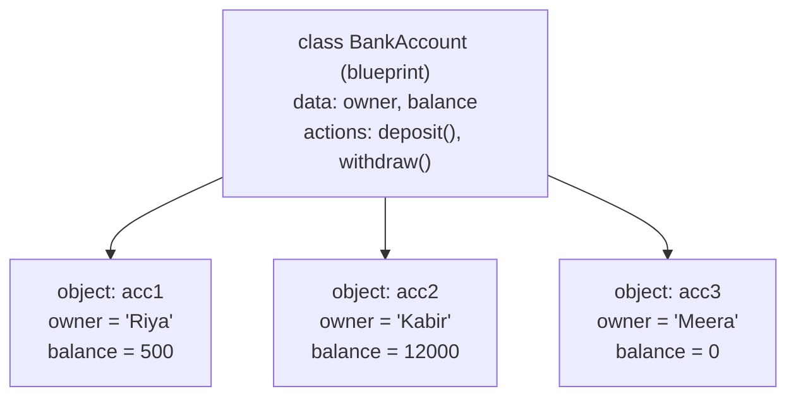
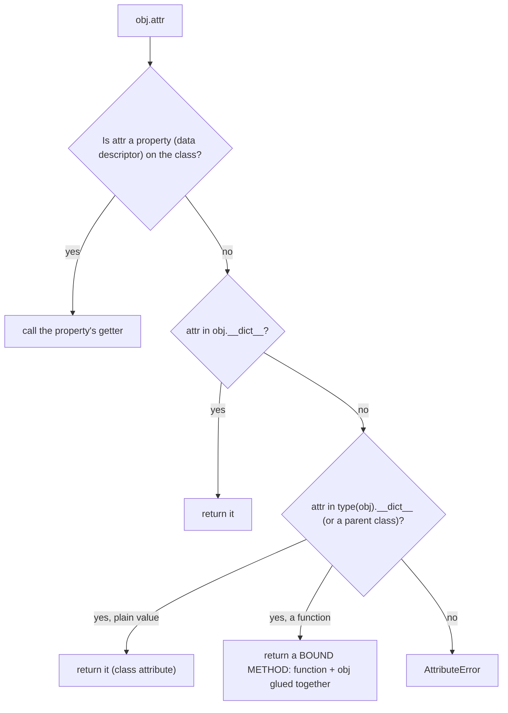

# Chapter 14 · OOP I: Classes & Objects

> So far your programs have been piles of variables and functions, like a kitchen where the ingredients are on one shelf and the recipes are in another room. Classes put each ingredient *together with* the things you can do to it. This one idea is how every large Python codebase, from Instagram's backend to the LeetCode `TreeNode`, is organised.

**You will learn:**
- Why **object-oriented programming (OOP)** exists, and the problem it solves
- **Class** vs **object**, `__init__`, and what `self` really is (no magic!)
- **Instance attributes** vs **class attributes**, and the sneaky bug that mixes them up
- Methods, plus `__str__` and `__repr__` so your objects print nicely
- **Encapsulation**: `_internal`, `__mangled` names and `@property` getters/setters
- `@classmethod` and `@staticmethod`, and when to use each
- Object identity (`is`, `id`, aliasing) and modelling real things: a bank account, a student, an inventory

**Before this:** [Functions](10-functions.md) · [Dictionaries & Hashing](09-dictionaries.md) · [Errors, Exceptions & Files](13-exceptions-files.md)

---

## 🧠 The Big Idea

A **class** is a **blueprint**. An **object** is a **house built from that blueprint**.

One blueprint for a "2BHK flat" can produce hundreds of flats. Every flat has the *same layout* (two bedrooms, a kitchen, a door you can lock), but each has *its own* paint colour, its own owner and its own furniture. Painting flat 101 blue doesn't change flat 102.



Every object bundles two things:

- **Data** (also called **attributes** or **state**): what the object *knows*. `owner`, `balance`.
- **Behaviour** (also called **methods**): what the object *can do*. `deposit()`, `withdraw()`.

You've been using objects all along without noticing. A list is an object: its data is the items, its behaviour is `.append()`, `.sort()`, `.pop()`. A string is an object with `.upper()` and `.split()`. In this chapter you learn to design your **own** types, just like `list` and `str`.

> 💡 `type([])` prints `<class 'list'>`. Python's own list is literally a class. You're about to join the club.

---

## 🔨 Building It Up

### 1. Why OOP? The problem with loose data

Let's model students with what we already know: dictionaries and functions.

```python
def make_student(name, marks):
    return {"name": name, "marks": marks}

def average(student):
    return sum(student["marks"]) / len(student["marks"])

riya = make_student("Riya", [90, 82, 77])
kabir = {"nmae": "Kabir", "marks": [60, 70]}     # typo in the key: nobody stops us

print(average(riya))
print(kabir.get("name"))                          # silently None
```

```text
83.0
None
```

It works, but it has problems that get worse as a program grows:

1. **Nothing enforces the shape.** Any dict with any keys can sneak in (`"nmae"`).
2. **Data and behaviour live apart.** Which functions work on a "student dict"? You have to search the whole codebase to find out.
3. **No protection.** Anyone can set `riya["marks"] = "lots"` and break `average` later.

OOP fixes all three by putting the data and the functions that work on it **inside one unit** with a clear shape. That's the core promise: **bundle state with the behaviour that's allowed to change it**.

### 2. Your first class and your first objects

```python
class Dog:
    pass                 # an empty blueprint, for now

rex = Dog()              # "call" the class to build an object
bruno = Dog()

print(type(rex))
print(isinstance(rex, Dog))
print(rex is bruno)      # two separate objects
```

```text
<class '__main__.Dog'>
True
False
```

What just happened:

- `class Dog:` defines a new type named `Dog`. Class names use **CapitalizedWords** (also called PascalCase), unlike functions which use `snake_case`.
- `Dog()` creates a new object of that type. Creating an object is called **instantiation**, and the object is an **instance** of the class. "Object" and "instance" mean the same thing.
- `__main__` is the name of the file being run (we'll meet it again in [Chapter 17](17-modules-stdlib.md)).

### 3. `__init__`: setting up a new object

An empty dog is useless. We want every dog to start life with a name and an age. Python calls a special method named **`__init__`** automatically right after it creates an object. (Methods whose names start and end with double underscores are called **dunder methods**, short for "double underscore". You'll meet many in [Chapter 15](15-oop-inheritance-magic.md).)

```python
class Dog:
    def __init__(self, name, age):
        self.name = name         # attach data to THIS particular dog
        self.age = age

rex = Dog("Rex", 3)
bruno = Dog("Bruno", 5)

print(rex.name, rex.age)
print(bruno.name, bruno.age)

rex.age = 4                      # change one dog...
print(rex.age, bruno.age)        # ...the other is untouched
```

```text
Rex 3
Bruno 5
4 5
```

What just happened: `Dog("Rex", 3)` does two things:

1. Creates a brand-new, empty `Dog` object.
2. Calls `Dog.__init__(that_new_object, "Rex", 3)`, which stores `name` and `age` **on** the object.

`self.name = name` reads as "on this object, create an attribute called `name` holding the value `name`." The left `name` is the attribute; the right `name` is the parameter. They don't have to match, but they usually do.

> 💡 `__init__` is often called the "constructor", but technically it's the **initialiser**: the object already exists when `__init__` runs. The method that actually *creates* the object is `__new__`, which you almost never need to touch. (Interviewers love this distinction.)

### 4. `self` is not magic

`self` is just **the object the method was called on**, passed in as the first argument. These two lines do exactly the same thing:

```python
class Greeter:
    def __init__(self, name):
        self.name = name

    def greet(self, greeting):
        return f"{greeting}, I'm {self.name}"

g = Greeter("Asha")
print(g.greet("Hello"))              # the normal way
print(Greeter.greet(g, "Hello"))     # what Python actually does
```

```text
Hello, I'm Asha
Hello, I'm Asha
```

When you write `g.greet("Hello")`, Python looks up `greet` on the class and quietly passes `g` as the first argument. That's why every method's first parameter is `self`: it's the slot that receives the object.

The name `self` is only a **convention**; Python would accept `this` or `me`. But every Python programmer uses `self`, so you should too.

> ⚠️ If you forget `self` in the definition (`def greet(greeting):`), calling `g.greet("Hi")` fails with `TypeError: Greeter.greet() takes 1 positional argument but 2 were given`. The "2" is `g` plus `"Hi"`. Now that error message makes sense!

### 5. Methods: behaviour that uses and changes state

**Methods** are functions defined inside a class. They can read and modify the object's attributes through `self`.

```python
class Counter:
    def __init__(self):
        self.count = 0

    def increment(self, step=1):
        self.count += step
        return self              # returning self allows chaining

    def reset(self):
        self.count = 0

    def is_zero(self):
        return self.count == 0

clicks = Counter()
clicks.increment()
clicks.increment(5).increment(10)    # chaining works because increment returns self
print(clicks.count, clicks.is_zero())
clicks.reset()
print(clicks.count, clicks.is_zero())
```

```text
16 False
0 True
```

Methods can also call each other through `self`: inside a method, write `self.other_method()`.

### 6. Instance attributes vs class attributes

So far every attribute belonged to one object. Sometimes data belongs to the **whole class**: shared by every instance. Put it directly in the class body, outside any method:

```python
class Employee:
    company = "Acme Corp"        # class attribute: shared by all employees
    headcount = 0                # class attribute: a shared counter

    def __init__(self, name, salary):
        self.name = name         # instance attributes: one per employee
        self.salary = salary
        Employee.headcount += 1  # update the SHARED counter via the class

a = Employee("Ana", 50000)
b = Employee("Ben", 65000)

print(a.company, b.company, Employee.company)
print(Employee.headcount)

Employee.company = "Acme Global"        # change it on the class...
print(a.company, b.company)             # ...everyone sees the change
```

```text
Acme Corp Acme Corp Acme Corp
2
Acme Global Acme Global
```

**How Python finds an attribute** (remember this, it explains everything below): when you write `a.company`, Python looks

1. in the **object's own** attributes first,
2. then in the **class**.

`a` has no `company` of its own, so Python finds the class's. Now the classic trap:

```python
class Employee:
    company = "Acme Corp"

a = Employee()
b = Employee()

a.company = "Startup Inc"       # creates a NEW instance attribute on a only!
print(a.company, b.company, Employee.company)
print(a.__dict__, b.__dict__)   # __dict__ shows an object's own attributes
```

```text
Startup Inc Acme Corp Acme Corp
{'company': 'Startup Inc'} {}
```

Assigning through an instance (`a.company = ...`) never touches the class. It creates a **new attribute on that instance** that **shadows** (hides) the class one. To change shared data, assign through the class name.

And the *really* nasty version, with a **mutable** class attribute:

```python
class Team:
    members = []                      # ❌ ONE list shared by every Team!

    def __init__(self, name):
        self.name = name

    def add(self, person):
        self.members.append(person)   # mutates the shared list (no assignment, so no shadowing)

red = Team("red")
blue = Team("blue")
red.add("Ana")
print(blue.members)                   # blue sees red's member!
```

```text
['Ana']
```

The fix: create mutable data **inside `__init__`**, so each object gets its own:

```python
class Team:
    def __init__(self, name):
        self.name = name
        self.members = []             # ✅ a fresh list for every team

    def add(self, person):
        self.members.append(person)

red, blue = Team("red"), Team("blue")
red.add("Ana")
print(red.members, blue.members)
```

```text
['Ana'] []
```

| | Class attribute | Instance attribute |
|---|---|---|
| Defined | in the class body | in `__init__` (or any method) via `self.x = ...` |
| Shared? | by all instances | one per instance |
| Good for | constants, counters, defaults | the object's own state |
| Mutable values (list/dict)? | ⚠️ shared, usually a bug | ✅ safe |

### 7. `__str__` and `__repr__`: making objects print nicely

Print an object and you get something ugly:

```python
class Point:
    def __init__(self, x, y):
        self.x = x
        self.y = y

p = Point(2, 3)
print(type(p).__name__, p.x, p.y)
print(str(p).startswith("<__main__.Point object at 0x"))
```

```text
Point 2 3
True
```

The default text is `<__main__.Point object at 0x7f3a...>`: the type plus a memory address (different every run). Two dunder methods fix this:

- **`__repr__`**: an unambiguous, developer-facing description. Ideally it looks like the code that would recreate the object. Used by the REPL, by debuggers, and **inside containers** (when you print a list of points).
- **`__str__`**: a friendly, human-facing description. Used by `print()` and `str()`. If you don't define it, Python falls back to `__repr__`.

```python
class Point:
    def __init__(self, x, y):
        self.x = x
        self.y = y

    def __repr__(self):
        return f"Point({self.x!r}, {self.y!r})"

    def __str__(self):
        return f"({self.x}, {self.y})"

p = Point(2, 3)
print(p)                 # uses __str__
print(repr(p))           # uses __repr__
print([p, Point(0, 0)])  # containers use __repr__ for their items
print(f"{p} and {p!r}")  # f-strings: str by default, !r for repr
```

```text
(2, 3)
Point(2, 3)
[Point(2, 3), Point(0, 0)]
(2, 3) and Point(2, 3)
```

> 💡 If you write only one, write **`__repr__`**. It's used everywhere, and `print` falls back to it. Using `!r` inside your `__repr__` means strings get quotes: `User('ana')` instead of the confusing `User(ana)`.

### 8. Encapsulation: hiding the insides

**Encapsulation** means: an object controls access to its own data. Outsiders use the object's methods (its **public interface**) instead of poking at its internals. A TV remote is encapsulation: you press "volume up", you don't solder wires inside.

Unlike Java or C++, Python has **no truly private attributes**. Instead it uses naming **conventions**:

| Name | Meaning | Enforced? |
|---|---|---|
| `balance` | public: part of the interface, use freely | n/a |
| `_balance` | "internal, please don't touch from outside" | No, just a polite signal |
| `__balance` | "really internal": triggers **name mangling** | Partly: the name is rewritten |
| `__init__` | dunder: special method for Python itself | n/a (don't invent your own) |

**Name mangling**: inside a class body, any name like `__secret` (two leading underscores, at most one trailing underscore) is automatically renamed to `_ClassName__secret`. Its main purpose is to stop **subclasses** ([Chapter 15](15-oop-inheritance-magic.md)) from accidentally overwriting the attribute, not to keep secrets.

```python
class Vault:
    def __init__(self):
        self.public = "anyone can read me"
        self._internal = "please don't touch"
        self.__secret = "mangled"

    def reveal(self):
        return self.__secret          # inside the class, the short name works

v = Vault()
print(v.public)
print(v._internal)                    # works; the underscore is just a hint
try:
    print(v.__secret)
except AttributeError as e:
    print("AttributeError:", e)
print(v.reveal())
print(v._Vault__secret)               # the mangled name: privacy is not real
print(sorted(v.__dict__))
```

```text
anyone can read me
please don't touch
AttributeError: 'Vault' object has no attribute '__secret'
mangled
mangled
['_Vault__secret', '_internal', 'public']
```

> 💡 Python's motto here is "**we're all consenting adults**": the language trusts you not to touch `_internal` things. In practice, use a **single underscore** for internal stuff. Use double underscores only when you're designing a class meant to be subclassed and you want to avoid name clashes.

### 9. `@property`: smart attributes

Suppose a `Temperature` class stores Celsius, and you want to block values below absolute zero (−273.15 °C). In Java you'd write `get_celsius()` and `set_celsius()` methods, and every caller would have to use them. In Python you keep the nice `t.celsius = 30` syntax and **still** run validation, using **`@property`**.

The `@something` line above a `def` is called a **decorator**. You'll learn exactly how decorators work in [Chapter 16](16-iterators-generators-decorators.md); for now, just learn the recipe.

```python
class Temperature:
    def __init__(self, celsius):
        self.celsius = celsius            # goes through the setter below, so it's validated too

    @property
    def celsius(self):                    # the GETTER: runs on  t.celsius
        return self._celsius

    @celsius.setter
    def celsius(self, value):             # the SETTER: runs on  t.celsius = value
        if value < -273.15:
            raise ValueError(f"{value} is below absolute zero")
        self._celsius = value

    @property
    def fahrenheit(self):                 # a COMPUTED property, no setter = read-only
        return self._celsius * 9 / 5 + 32

t = Temperature(25)
print(t.celsius, t.fahrenheit)
t.celsius = 100                           # looks like plain assignment, runs the setter
print(t.celsius, t.fahrenheit)

try:
    t.celsius = -300
except ValueError as e:
    print("ValueError:", e)

try:
    t.fahrenheit = 50
except AttributeError as e:
    print("AttributeError:", e)
```

```text
25 77.0
100 212.0
ValueError: -300 is below absolute zero
AttributeError: property 'fahrenheit' of 'Temperature' object has no setter
```

What just happened:

- The real data lives in `self._celsius` (underscore = internal). The **property** `celsius` is the public face.
- Reading `t.celsius` calls the getter; assigning `t.celsius = ...` calls the setter. The caller can't tell it's a method.
- `fahrenheit` has no setter, so it's **read-only** and always computed fresh from `_celsius`. No risk of the two values going out of sync.
- Even `__init__` uses `self.celsius = celsius`, so the validation applies from birth.

**Why this matters:** you can start with a plain attribute (`self.celsius = c`) and later, when you need validation, switch it to a property **without changing any code that uses the class**. That's why Pythonistas don't write `get_x()`/`set_x()` methods up front.

> ⚠️ The getter must return `self._celsius` (with underscore), not `self.celsius`. Writing `return self.celsius` inside the `celsius` getter calls the getter again, forever: `RecursionError`.

### 10. `@classmethod` and `@staticmethod`

Normal methods receive the **instance** (`self`). Two other kinds exist:

- **`@classmethod`** receives the **class** itself (called `cls` by convention). Main use: **alternative constructors**, extra ways to build an object.
- **`@staticmethod`** receives **nothing automatic**. It's a plain function that lives inside the class because it logically belongs there.

```python
class Date:
    def __init__(self, year, month, day):
        if not Date.is_valid(year, month, day):
            raise ValueError(f"invalid date {year}-{month}-{day}")
        self.year, self.month, self.day = year, month, day

    @classmethod
    def from_string(cls, text):           # alternative constructor: "2024-08-15"
        year, month, day = map(int, text.split("-"))
        return cls(year, month, day)      # cls is Date (or a subclass!)

    @classmethod
    def new_year(cls, year):
        return cls(year, 1, 1)

    @staticmethod
    def is_leap(year):
        return year % 4 == 0 and (year % 100 != 0 or year % 400 == 0)

    @staticmethod
    def is_valid(year, month, day):
        days = [31, 29 if Date.is_leap(year) else 28, 31, 30, 31, 30,
                31, 31, 30, 31, 30, 31]
        return 1 <= month <= 12 and 1 <= day <= days[month - 1]

    def __repr__(self):
        return f"Date({self.year}, {self.month}, {self.day})"

print(Date(2024, 8, 15))
print(Date.from_string("2024-02-29"))
print(Date.new_year(2025))
print(Date.is_leap(1900), Date.is_leap(2000))
try:
    Date.from_string("2023-02-29")
except ValueError as e:
    print("ValueError:", e)
```

```text
Date(2024, 8, 15)
Date(2024, 2, 29)
Date(2025, 1, 1)
False True
ValueError: invalid date 2023-2-29
```

| Kind | Decorator | First parameter | Can access | Typical use |
|---|---|---|---|---|
| Instance method | (none) | `self` (the object) | object + class | almost everything |
| Class method | `@classmethod` | `cls` (the class) | class, not a specific object | alternative constructors, class-wide counters |
| Static method | `@staticmethod` | none | neither (unless named explicitly) | helpers/utilities related to the class |

> 💡 Why `return cls(...)` instead of `return Date(...)`? If someone later makes a subclass `IndianDate(Date)`, then `IndianDate.from_string(...)` will correctly build an `IndianDate`. You'll see why that matters in [Chapter 15](15-oop-inheritance-magic.md). Python's own `dict.fromkeys(...)` and `datetime.fromtimestamp(...)` are class methods.

### 11. Object identity: `is`, `id`, and aliasing

Every object has an **identity**: a unique number for its lifetime, shown by `id()`. (In CPython it's the memory address.) `a is b` asks "are these the **same object**?", while `a == b` asks "are these **equal in value**?"

For your own classes, `==` falls back to `is` by default, because Python has no idea what "equal" means for a `Point` until you tell it. (You'll teach it with `__eq__` in [Chapter 15](15-oop-inheritance-magic.md).)

```python
class Point:
    def __init__(self, x, y):
        self.x, self.y = x, y

p1 = Point(1, 2)
p2 = Point(1, 2)
p3 = p1                       # NOT a copy: a second name for the same object

print(p1 == p2, p1 is p2)     # same values, different objects
print(p1 is p3, id(p1) == id(p3))

p3.x = 99                     # change through one name...
print(p1.x)                   # ...visible through the other
```

```text
False False
True True
99
```

This is **aliasing**, exactly as with lists in [Chapter 7](07-lists.md): assignment never copies objects; it attaches another name to the same object. It matters most when you pass objects to functions: the function receives the **same object**, so it can change it.

```python
class Account:
    def __init__(self, balance):
        self.balance = balance

def apply_fee(account):
    account.balance -= 50          # mutates the caller's object

def replace(account):
    account = Account(0)           # rebinds the LOCAL name only; caller unaffected

acc = Account(1000)
apply_fee(acc)
replace(acc)
print(acc.balance)
```

```text
950
```

### 12. Peeking inside: `__dict__`, `getattr`, `setattr`, `hasattr`

An object's attributes really are stored in a dictionary called `__dict__`. Python gives you functions to work with attributes **by name** (as strings), handy when the attribute name is only known at runtime:

```python
class Config:
    def __init__(self):
        self.debug = False
        self.port = 8080

c = Config()
print(c.__dict__)
print(getattr(c, "port"))                 # same as c.port
print(getattr(c, "host", "localhost"))    # default if missing (no AttributeError)
setattr(c, "debug", True)                 # same as c.debug = True
print(hasattr(c, "debug"), hasattr(c, "host"))

overrides = {"port": 9000, "host": "0.0.0.0"}
for key, value in overrides.items():      # apply settings from a dict
    setattr(c, key, value)
print(vars(c))                            # vars(obj) is the same as obj.__dict__
```

```text
{'debug': False, 'port': 8080}
8080
localhost
True False
{'debug': True, 'port': 9000, 'host': '0.0.0.0'}
```

Notice you can add attributes to an object at any time (`host` appeared from nowhere). Python allows it, but good style is to create **all** attributes in `__init__`, so a reader can see the object's full shape in one place.

### 13. Modelling real things I: a bank account

Time to put it all together. Requirements: an account has an owner and a balance; you can deposit and withdraw positive amounts; you can't overdraw; the balance can't be set directly from outside; and there's a transaction history.

```python
class InsufficientFundsError(Exception):
    pass

class BankAccount:
    interest_rate = 0.04                       # class attribute: same for all accounts
    _next_number = 1001                        # internal counter for account numbers

    def __init__(self, owner, opening_balance=0):
        self.owner = owner
        self.number = BankAccount._next_number
        BankAccount._next_number += 1
        self._balance = 0
        self._history = []                     # fresh list per account
        if opening_balance:
            self.deposit(opening_balance)

    @property
    def balance(self):                         # read-only from outside
        return self._balance

    def deposit(self, amount):
        self._check_positive(amount)
        self._balance += amount
        self._history.append(("deposit", amount))

    def withdraw(self, amount):
        self._check_positive(amount)
        if amount > self._balance:
            raise InsufficientFundsError(
                f"cannot withdraw {amount}, balance is {self._balance}")
        self._balance -= amount
        self._history.append(("withdraw", amount))

    def transfer_to(self, other, amount):
        self.withdraw(amount)                  # if this fails, nothing is deposited
        other.deposit(amount)

    def add_interest(self):
        self.deposit(round(self._balance * self.interest_rate, 2))

    def statement(self):
        return list(self._history)             # a copy, so callers can't edit ours

    @staticmethod
    def _check_positive(amount):
        if amount <= 0:
            raise ValueError("amount must be positive")

    def __repr__(self):
        return f"BankAccount({self.owner!r}, number={self.number}, balance={self._balance})"

riya = BankAccount("Riya", 1000)
kabir = BankAccount("Kabir")
riya.transfer_to(kabir, 300)
kabir.add_interest()
print(riya)
print(kabir)
print(kabir.statement())

try:
    kabir.withdraw(10_000)
except InsufficientFundsError as e:
    print("Declined:", e)

try:
    riya.balance = 1_000_000                   # nice try
except AttributeError:
    print("balance is read-only")
```

```text
BankAccount('Riya', number=1001, balance=700)
BankAccount('Kabir', number=1002, balance=312.0)
[('deposit', 300), ('deposit', 12.0)]
Declined: cannot withdraw 10000, balance is 312.0
balance is read-only
```

Design decisions worth stealing:

- **One door for every change.** All balance changes go through `deposit`/`withdraw`, so the rules (positive amounts, no overdraft, record history) live in exactly one place.
- **Read-only property** for `balance`: outsiders can look, not touch.
- **Return a copy** of internal lists (`list(self._history)`), so callers can't mutate our state behind our back.
- **Validate before changing anything** in `transfer_to`: if `withdraw` raises, `deposit` never runs, so money is never created or destroyed.

### 14. Modelling real things II: a student and a gradebook

Objects often **contain other objects**. A `Course` holds `Student` objects. This "has-a" relationship is called **composition** (more on it in [Chapter 15](15-oop-inheritance-magic.md)).

```python
class Student:
    def __init__(self, name, roll):
        self.name = name
        self.roll = roll
        self.marks = {}                        # subject -> mark

    def add_mark(self, subject, mark):
        if not 0 <= mark <= 100:
            raise ValueError("mark must be between 0 and 100")
        self.marks[subject] = mark

    @property
    def average(self):
        return sum(self.marks.values()) / len(self.marks) if self.marks else 0.0

    def __repr__(self):
        return f"Student({self.name!r}, roll={self.roll})"

class Course:
    def __init__(self, title):
        self.title = title
        self._students = {}                    # roll -> Student

    def enroll(self, student):
        self._students[student.roll] = student

    def topper(self):
        return max(self._students.values(), key=lambda s: s.average)

    def report(self):
        for s in sorted(self._students.values(), key=lambda s: -s.average):
            print(f"{s.roll:>3} {s.name:<6} {s.average:6.2f}")

dsa = Course("DSA")
for roll, name, marks in [(1, "Asha", {"arrays": 91, "trees": 85}),
                          (2, "Ben", {"arrays": 70, "trees": 95}),
                          (3, "Chen", {"arrays": 99, "trees": 92})]:
    s = Student(name, roll)
    for subject, mark in marks.items():
        s.add_mark(subject, mark)
    dsa.enroll(s)

dsa.report()
print("Topper:", dsa.topper())
```

```text
  3 Chen    95.50
  1 Asha    88.00
  2 Ben     82.50
Topper: Student('Chen', roll=3)
```

### 15. Modelling real things III: an inventory

One more, because "design a shop / library / parking lot" is a favourite interview warm-up (we'll do full machine-coding rounds in [Chapter 14 of System Design](../part-3-system-design/14-low-level-design.md)).

```python
class Product:
    def __init__(self, sku, name, price):
        if price < 0:
            raise ValueError("price cannot be negative")
        self.sku = sku
        self.name = name
        self.price = price

    def __repr__(self):
        return f"Product({self.sku!r}, {self.name!r}, {self.price})"

class Inventory:
    def __init__(self, low_stock_threshold=5):
        self._products = {}            # sku -> Product
        self._stock = {}               # sku -> quantity
        self.low_stock_threshold = low_stock_threshold

    def add_product(self, product, quantity=0):
        self._products[product.sku] = product
        self._stock[product.sku] = self._stock.get(product.sku, 0) + quantity

    def sell(self, sku, quantity):
        if sku not in self._products:
            raise KeyError(f"unknown product {sku}")
        if self._stock[sku] < quantity:
            raise ValueError(f"only {self._stock[sku]} left of {sku}")
        self._stock[sku] -= quantity
        return self._products[sku].price * quantity

    def total_value(self):
        return sum(p.price * self._stock[sku] for sku, p in self._products.items())

    def low_stock(self):
        return [sku for sku, qty in self._stock.items() if qty <= self.low_stock_threshold]

shop = Inventory()
shop.add_product(Product("PEN", "Gel pen", 20), 50)
shop.add_product(Product("NB", "Notebook", 60), 8)
shop.add_product(Product("BAG", "Backpack", 900), 2)

print("Bill:", shop.sell("NB", 4))
print("Stock value:", shop.total_value())
print("Reorder:", shop.low_stock())
try:
    shop.sell("BAG", 5)
except ValueError as e:
    print("Error:", e)
```

```text
Bill: 240
Stock value: 3040
Reorder: ['NB', 'BAG']
Error: only 2 left of BAG
```

---

## 🔬 Under the Hood

### Classes are objects too

In Python, **everything is an object**, including classes and functions. `class Dog:` runs the class body (like running a mini-program), collects every name defined in it into a dictionary, and builds a **class object** from it. That class object is stored in the variable `Dog`.

```python
class Dog:
    species = "Canis familiaris"
    def bark(self):
        return "Woof"

print(type(Dog))                               # the class of a class is 'type'
print("species" in Dog.__dict__, "bark" in Dog.__dict__)
Alias = Dog                                    # classes can be assigned like any value
print(Alias().bark())
```

```text
<class 'type'>
True True
Woof
```

### Attribute lookup, step by step

When you write `obj.attr`, Python (simplified) does this:



Two takeaways:

1. **Instance before class** explains shadowing: `a.company = ...` writes into `a.__dict__`, which is found first from then on.
2. **Properties win over the instance dict.** That's why `t.celsius = 5` runs your setter instead of just writing into `t.__dict__`. (Properties are an example of a **descriptor**, the mechanism behind methods, properties, `classmethod` and `staticmethod`.)

### What a "bound method" is

Functions defined in a class are stored in the **class** only, not copied into every object. When you access `g.greet`, Python creates a small **bound method** object that remembers both the function and the instance `g`. Calling it calls the function with `g` as the first argument.

```python
class Greeter:
    def greet(self):
        return f"hi from {id(self) == id(g)}"

g = Greeter()
m = g.greet                         # a bound method, not called yet
print(type(m).__name__)
print(m.__self__ is g, m.__func__ is Greeter.__dict__["greet"])
print(m())
```

```text
method
True True
hi from True
```

This is why 1,000,000 objects don't need 1,000,000 copies of each method: the methods live once on the class; only the data lives per object.

### Memory: each object carries a dict (unless you use `__slots__`)

Each instance normally has its own `__dict__`, a full hash table ([Chapter 9](09-dictionaries.md)). That's flexible (you can add attributes any time) but costs memory. If you're creating millions of small objects (say, `Point`s in a geometry problem), you can declare **`__slots__`** to say "these are the only attributes, store them in a fixed compact array instead of a dict":

```python
class SlimPoint:
    __slots__ = ("x", "y")
    def __init__(self, x, y):
        self.x, self.y = x, y

p = SlimPoint(1, 2)
print(p.x, hasattr(p, "__dict__"))
try:
    p.z = 3
except AttributeError:
    print("AttributeError: can't add new attribute 'z'")
```

```text
1 False
AttributeError: can't add new attribute 'z'
```

Slotted objects use noticeably less memory and have slightly faster attribute access, at the cost of flexibility. Use them only when you've measured a memory problem.

### What `Dog("Rex", 3)` really does

1. Calls `Dog.__new__(Dog, "Rex", 3)`, which allocates a new empty object on the **heap** (the memory region where all Python objects live; see [Chapter 18](18-internals-concurrency.md)).
2. If that object is an instance of `Dog`, calls `obj.__init__("Rex", 3)` to fill it in.
3. Returns the object. `__init__` must return `None`; returning anything else raises `TypeError`.

---

## 🧩 Pattern Decoder

### When should something be a class?

| Signal | Use |
|---|---|
| Just a calculation, no remembered state | a **function** |
| A fixed bundle of values, no behaviour | a `tuple`, `namedtuple` ([Chapter 17](17-modules-stdlib.md)) or `@dataclass` ([Chapter 15](15-oop-inheritance-magic.md)) |
| State **plus** rules about how it may change | a **class** |
| Many "things" of the same kind, each with its own state | a **class**, one instance per thing |
| A group of functions all passing the same 3 arguments around | probably a class whose attributes are those 3 values |

### Pythonic class idioms

- **Start with plain public attributes.** Add `@property` later only when you need validation or computation. Callers never notice the switch.
- **Use `@classmethod` alternative constructors** (`from_string`, `from_dict`, `from_json`) instead of complicated `__init__` signatures.
- **Always write a `__repr__`.** Future-you debugging at 2 a.m. will thank you.
- **Protect invariants in one place.** All changes to `balance` go through one method that enforces the rules.
- **Return copies of internal mutable data** (or read-only views) from getters.
- **Raise exceptions for invalid operations**, don't return error codes like `-1` ([Chapter 13](13-exceptions-files.md)).

### How classes show up in DSA

You'll write small classes in nearly every data-structure chapter:

- **Nodes.** Linked lists ([Chapter 10](../part-2-dsa/10-linked-lists.md)) and trees ([Chapter 13](../part-2-dsa/13-binary-trees.md)) are built from tiny node classes. LeetCode gives you exactly this:

```python
class ListNode:
    def __init__(self, val=0, next=None):
        self.val = val
        self.next = next

class TreeNode:
    def __init__(self, val=0, left=None, right=None):
        self.val = val
        self.left = left
        self.right = right

# build 1 -> 2 -> 3
head = ListNode(1, ListNode(2, ListNode(3)))
node, values = head, []
while node:
    values.append(node.val)
    node = node.next
print(values)

root = TreeNode(2, TreeNode(1), TreeNode(3))
print(root.left.val, root.val, root.right.val)
```

```text
[1, 2, 3]
1 2 3
```

- **"Design" problems.** LeetCode has a whole category ("Design a ...") where you implement a class with specific methods and complexity guarantees: Min Stack, LRU Cache, Implement Queue using Stacks, Design HashMap, Design Twitter. The skill is choosing **which attributes** to keep so every method is fast. Example, **Min Stack** (LeetCode 155): `push`, `pop`, `top` and `get_min` all in O(1).

```python
class MinStack:
    def __init__(self):
        self._stack = []         # (value, minimum of the stack up to here)

    def push(self, val):
        current_min = min(val, self._stack[-1][1]) if self._stack else val
        self._stack.append((val, current_min))

    def pop(self):
        self._stack.pop()

    def top(self):
        return self._stack[-1][0]

    def get_min(self):
        return self._stack[-1][1]

s = MinStack()
for v in [5, 3, 7, 2]:
    s.push(v)
print(s.get_min())   # 2
s.pop()
print(s.get_min())   # 3: the minimum "remembers" its earlier value
print(s.top())       # 7
```

```text
2
3
7
```

The trick: store, next to each value, the minimum **at the moment it was pushed**. When you pop, the old minimum is automatically restored. Extra attributes buy speed.

- **`class Solution:`** on LeetCode is just a namespace for your function; `self` is unused. Don't let it confuse you.

---

## ⚠️ Traps & Common Mistakes

1. **Forgetting `self` as the first parameter.**

```py
class Dog:
    def bark():                 # ❌ TypeError when called as rex.bark()
        print("Woof")

class Dog:
    def bark(self):             # ✅
        print("Woof")
```

2. **Forgetting `self.` when using an attribute.** Inside a method, `balance += 10` refers to a *local* variable (and fails with `UnboundLocalError`). You need `self.balance += 10`.

3. **Mutable class attributes** (`members = []` in the class body) are shared by every instance. Create lists/dicts in `__init__`.

4. **Mutable default arguments** in `__init__` ([Chapter 10](10-functions.md)) bite the same way:

```py
class Cart:
    def __init__(self, items=[]):       # ❌ every Cart() without args shares ONE list
        self.items = items

class Cart:
    def __init__(self, items=None):     # ✅
        self.items = list(items) if items else []
```

5. **Assigning a class attribute through an instance** (`a.company = "X"`) only creates a shadowing instance attribute. Use `ClassName.attr = ...` for shared changes.

6. **Property getter returning itself.** `return self.celsius` inside the `celsius` property recurses forever. Store the real value as `self._celsius`.

7. **Forgetting parentheses.** `acc.deposit` (no call) is a bound method object, not a deposit. `if acc.is_empty:` is always truthy because a method object is truthy. Write `acc.is_empty()`.

8. **Returning something from `__init__`.** `__init__` must return `None`. To "return" a differently built object, use a `@classmethod` constructor.

9. **Thinking `__x` is private.** It's only renamed to `_Class__x`. Use it for avoiding subclass clashes, not for security.

10. **Comparing objects with `==` and expecting value equality.** Without `__eq__`, `==` means "same object". `Point(1, 2) == Point(1, 2)` is `False` until [Chapter 15](15-oop-inheritance-magic.md).

11. **Java-style getters and setters everywhere** (`get_name()`, `set_name()`). Not Pythonic. Use plain attributes, then `@property` if needed.

---

## 💡 Tips & Tricks

- `vars(obj)` (or `obj.__dict__`) shows an object's data instantly while debugging.
- `dir(obj)` lists every attribute and method available, including inherited dunders.
- `isinstance(obj, ClassName)` is the right way to check types, rather than `type(obj) == ClassName` (it also respects inheritance, as you'll see in Chapter 15).
- `type(self).__name__` inside `__repr__` keeps the repr correct for subclasses: `f"{type(self).__name__}({self.x!r})"`.
- `getattr(obj, name, default)` safely reads an attribute that might not exist.
- One-letter abbreviations are fine for loop variables, but give classes and methods descriptive names: `BankAccount.withdraw`, not `BA.w`.
- Group a class's code in a predictable order: class attributes → `__init__` → properties → public methods → private helpers → dunders like `__repr__`.
- Want a quick record class without writing `__init__`/`__repr__`? Wait for `@dataclass` in [Chapter 15](15-oop-inheritance-magic.md). It'll feel like magic after writing them by hand.

---

## 🎯 Interview Questions

### 1. What is the difference between a class and an object? 🔥🔥🔥

<details><summary>Answer</summary>

A **class** is a blueprint/type that defines what data its instances hold and what methods they have. An **object** (instance) is a concrete thing built from that class, with its own copy of instance data. `list` is a class; `[1, 2]` is an object of that class. One class, many objects; each object knows its class (`type(obj)`), and methods are stored once on the class and shared.

</details>

### 2. What is `self`? Is it a keyword? 🔥🔥🔥

<details><summary>Answer</summary>

`self` is the first parameter of an instance method and refers to the instance the method was called on. `obj.method(a)` is translated to `type(obj).method(obj, a)`, so `self` receives `obj`. It's **not a keyword**: just a strong convention. Any name would work, but always use `self`. It's explicit in Python (unlike `this` in Java) because of the language's "explicit is better than implicit" philosophy.

</details>

### 3. Is `__init__` a constructor? What is `__new__`? 🔥🔥

<details><summary>Answer</summary>

Strictly, `__new__` is the constructor: a static method that **creates and returns** the new instance. `__init__` is the **initialiser**: it receives the already-created instance as `self` and sets up its attributes; it must return `None`.

You override `__new__` only in rare cases: subclassing immutable types like `int`, `str` or `tuple` (their value must be set at creation), or implementing patterns like singletons. For everyday classes, `__init__` is all you need, which is why people casually call it the constructor.

</details>

### 4. Difference between class attributes and instance attributes? 🔥🔥🔥

<details><summary>Answer</summary>

Class attributes are defined in the class body and **shared** by all instances. Instance attributes are set on `self` (usually in `__init__`) and belong to **one** object. Lookup checks the instance first, then the class, so an instance attribute with the same name **shadows** the class attribute.

Classic bug: a mutable class attribute (`items = []`) is shared, so appending through one instance shows up in all of them. Fix: create it in `__init__`.

```python
class A:
    shared = []
    def __init__(self):
        self.own = []

x, y = A(), A()
x.shared.append(1)
x.own.append(1)
print(y.shared, y.own)
```

```text
[1] []
```

</details>

### 5. What's the difference between `__str__` and `__repr__`? 🔥🔥🔥

<details><summary>Answer</summary>

`__repr__` is the **unambiguous, developer** representation, ideally valid Python that recreates the object (`Point(1, 2)`). It's used by `repr()`, the interactive shell, debuggers, and when the object is inside a container. `__str__` is the **readable, end-user** representation used by `print()` and `str()`. If `__str__` is missing, Python uses `__repr__`; the reverse isn't true. Rule: always implement `__repr__`; add `__str__` when you want a friendlier display.

</details>

### 6. Explain `@classmethod` vs `@staticmethod` vs instance methods. 🔥🔥🔥

<details><summary>Answer</summary>

- **Instance method**: receives the instance (`self`); can read/modify object and class state.
- **Class method**: receives the class (`cls`); can't see a particular instance. Main uses: **alternative constructors** (`Date.from_string("2024-08-15")`, `dict.fromkeys`) and class-level state. Because it receives `cls`, it builds the right type even when called on a subclass.
- **Static method**: receives nothing automatically. It's a regular function placed in the class namespace because it's logically related (a validation helper like `Date.is_leap(year)`).

</details>

### 7. Does Python have private variables? What is name mangling? 🔥🔥

<details><summary>Answer</summary>

No true private variables. Conventions: `_name` means "internal, don't use from outside" (not enforced). `__name` (two leading underscores, not ending with two) triggers **name mangling**: inside the class, it's rewritten to `_ClassName__name`. This avoids accidental name clashes with subclasses that use the same name; it doesn't provide security, because `obj._ClassName__name` still works. Python's philosophy is "we're all consenting adults".

</details>

### 8. What is `@property` and why use it instead of getters/setters? 🔥🔥

<details><summary>Answer</summary>

`@property` turns a method into a **managed attribute**: reading `obj.x` calls the getter, `obj.x = v` calls the `@x.setter`, `del obj.x` calls the `@x.deleter`. Benefits:

- Clean attribute syntax for callers while still running validation or computation.
- **Backward compatibility**: start with a plain attribute, convert to a property later without changing any calling code.
- Read-only attributes (getter only) and computed attributes (`area` from `width * height`) that can never go stale.

</details>

### 9. What's the difference between `is` and `==` for objects? 🔥🔥🔥

<details><summary>Answer</summary>

`is` compares **identity** (are both names the same object? same `id()`). `==` compares **value** by calling `__eq__`. For a custom class without `__eq__`, `==` falls back to identity, so two separately created but identical-looking objects are not equal. Use `is` only for singletons like `None` (`if x is None`), and `==` for values.

</details>

### 10. What is encapsulation, and how is it done in Python? 🔥🔥

<details><summary>Answer</summary>

Encapsulation is **bundling data with the methods that operate on it and restricting direct access to the internal state**, so the object can enforce its own rules (invariants). In Python it's done by convention and tools rather than hard enforcement: prefix internals with `_`, expose a public interface of methods, use `@property` for controlled/read-only access, and return copies of internal mutable data. Example: a `BankAccount` exposes `deposit`/`withdraw` and a read-only `balance` property, so the balance can never go negative.

</details>

### 11. Min Stack (LeetCode 155) 🔥🔥🔥

Design a stack supporting `push`, `pop`, `top` and retrieving the minimum element, all in O(1) time.

<details><summary>Answer</summary>

Store each value **together with the minimum of the stack at that point**. Then `get_min` is just a look at the top pair, and popping automatically restores the previous minimum. See the `MinStack` class in the Pattern Decoder above. All operations O(1) time; O(n) space.

An alternative uses a second stack holding only the minimums (push to it when `val <= current min`, pop from it when the popped value equals the current min), which saves space when there are many large values.

</details>

### 12. Implement Queue using Stacks (LeetCode 232) 🔥🔥

Implement a FIFO queue with `push`, `pop`, `peek`, `empty` using only stack operations (append to end, pop from end).

<details><summary>Answer</summary>

Two stacks: `inbox` receives pushes; `outbox` serves pops. When `outbox` is empty and we need the front, pour **everything** from `inbox` into `outbox`, which reverses the order, so the oldest item ends up on top.

```python
class MyQueue:
    def __init__(self):
        self._inbox = []
        self._outbox = []

    def push(self, x):
        self._inbox.append(x)

    def _shift(self):
        if not self._outbox:
            while self._inbox:
                self._outbox.append(self._inbox.pop())

    def pop(self):
        self._shift()
        return self._outbox.pop()

    def peek(self):
        self._shift()
        return self._outbox[-1]

    def empty(self):
        return not self._inbox and not self._outbox

q = MyQueue()
q.push(1); q.push(2); q.push(3)
print(q.pop(), q.peek())
q.push(4)
print(q.pop(), q.pop(), q.pop(), q.empty())
```

```text
1 2
2 3 4 True
```

Each element is moved from inbox to outbox at most once, so every operation is **amortised O(1)** (a single `pop` can be O(n), but n pops cost O(n) in total).

</details>

---

## 🏋️ Practice

**🟢 1. Rectangle.** Create `Rectangle(width, height)` with read-only properties `area` and `perimeter`, an `is_square()` method and a `__repr__`.

<details><summary>Solution</summary>

```python
class Rectangle:
    def __init__(self, width, height):
        self.width = width
        self.height = height

    @property
    def area(self):
        return self.width * self.height

    @property
    def perimeter(self):
        return 2 * (self.width + self.height)

    def is_square(self):
        return self.width == self.height

    def __repr__(self):
        return f"Rectangle({self.width}, {self.height})"

r = Rectangle(3, 4)
print(r, r.area, r.perimeter, r.is_square())
r.width = 4                       # area and perimeter update automatically
print(r, r.area, r.perimeter, r.is_square())
```

```text
Rectangle(3, 4) 12 14 False
Rectangle(4, 4) 16 16 True
```

</details>

**🟢 2. Instance counter.** Create a `Robot` class that gives every robot a serial name `"RX-1"`, `"RX-2"`, ... and has a class method `count()` returning how many robots exist.

<details><summary>Solution</summary>

```python
class Robot:
    _made = 0

    def __init__(self):
        Robot._made += 1
        self.name = f"RX-{Robot._made}"

    @classmethod
    def count(cls):
        return cls._made

    def __repr__(self):
        return f"Robot({self.name})"

army = [Robot() for _ in range(3)]
print(army, Robot.count())
```

```text
[Robot(RX-1), Robot(RX-2), Robot(RX-3)] 3
```

Note `Robot._made += 1`, not `self._made += 1`: the latter would create a shadowing instance attribute and the shared counter would stay at 0.

</details>

**🟡 3. Time of day.** `Clock(hours, minutes)` validates its inputs (0–23, 0–59), has `from_string("09:05")` as a class method, `add_minutes(n)` that wraps around midnight, and prints as `09:05`.

<details><summary>Solution</summary>

```python
class Clock:
    def __init__(self, hours, minutes):
        if not (0 <= hours < 24 and 0 <= minutes < 60):
            raise ValueError(f"invalid time {hours}:{minutes}")
        self._total = hours * 60 + minutes      # store one number: easier maths

    @classmethod
    def from_string(cls, text):
        h, m = text.split(":")
        return cls(int(h), int(m))

    def add_minutes(self, n):
        self._total = (self._total + n) % (24 * 60)
        return self

    def __str__(self):
        return f"{self._total // 60:02d}:{self._total % 60:02d}"

    def __repr__(self):
        return f"Clock.from_string('{self}')"

c = Clock.from_string("23:45")
print(c.add_minutes(30))
print(repr(c.add_minutes(-1500)))
```

```text
00:15
Clock.from_string('23:15')
```

Storing total minutes and using `% 1440` handles wrapping both forwards and backwards (Python's `%` with a positive divisor is never negative).

</details>

**🟡 4. Library.** A `Book(title, author)` and a `Library` that can `add(book)`, `checkout(title, member)` (raise an exception if unavailable), `return_book(title)` and list `available()` titles in sorted order.

<details><summary>Solution</summary>

```python
class Book:
    def __init__(self, title, author):
        self.title = title
        self.author = author
        self.borrower = None

    @property
    def available(self):
        return self.borrower is None

class Library:
    def __init__(self):
        self._books = {}

    def add(self, book):
        self._books[book.title] = book

    def checkout(self, title, member):
        book = self._books.get(title)
        if book is None:
            raise KeyError(f"no such book: {title}")
        if not book.available:
            raise ValueError(f"{title!r} is with {book.borrower}")
        book.borrower = member

    def return_book(self, title):
        self._books[title].borrower = None

    def available(self):
        return sorted(t for t, b in self._books.items() if b.available)

lib = Library()
for t, a in [("Dune", "Herbert"), ("Emma", "Austen"), ("Ulysses", "Joyce")]:
    lib.add(Book(t, a))
lib.checkout("Dune", "Asha")
try:
    lib.checkout("Dune", "Ben")
except ValueError as e:
    print("Sorry:", e)
print(lib.available())
lib.return_book("Dune")
print(lib.available())
```

```text
Sorry: 'Dune' is with Asha
['Emma', 'Ulysses']
['Dune', 'Emma', 'Ulysses']
```

</details>

**🟡 5. Spot the bug.** This shopping cart behaves strangely. Explain and fix it.

```py
class Cart:
    items = []
    def add(self, item):
        self.items.append(item)

a, b = Cart(), Cart()
a.add("apple")
print(b.items)        # ['apple'] ?!
```

<details><summary>Solution</summary>

`items` is a **class attribute**: one list shared by every cart. `self.items.append` finds it on the class (no instance attribute exists) and mutates it. Fix: give each instance its own list in `__init__`.

```python
class Cart:
    def __init__(self):
        self.items = []
    def add(self, item):
        self.items.append(item)

a, b = Cart(), Cart()
a.add("apple")
print(a.items, b.items)
```

```text
['apple'] []
```

</details>

**🔴 6. Browser history (LeetCode 1472, Design Browser History).** Implement `BrowserHistory(homepage)` with `visit(url)` (clears forward history), `back(steps)` and `forward(steps)` that return the current URL, each in O(1) except `visit` which may be amortised O(1).

<details><summary>Solution</summary>

Keep a list of pages, a `current` index, and a `last` index marking the end of valid forward history. `visit` overwrites in place instead of deleting the forward part.

```python
class BrowserHistory:
    def __init__(self, homepage):
        self._pages = [homepage]
        self._current = 0
        self._last = 0                       # index of the last valid page

    def visit(self, url):
        self._current += 1
        if self._current == len(self._pages):
            self._pages.append(url)
        else:
            self._pages[self._current] = url
        self._last = self._current           # forward history is gone

    def back(self, steps):
        self._current = max(0, self._current - steps)
        return self._pages[self._current]

    def forward(self, steps):
        self._current = min(self._last, self._current + steps)
        return self._pages[self._current]

h = BrowserHistory("home.com")
for url in ["a.com", "b.com", "c.com"]:
    h.visit(url)
print(h.back(1), h.back(1), h.forward(1))
h.visit("d.com")
print(h.forward(2), h.back(2), h.back(7))
```

```text
b.com a.com b.com
d.com a.com home.com
```

The key design decision is choosing the attributes (`_pages`, `_current`, `_last`) so that every method is a few index operations.

</details>

**🔴 7. Parking lot (mini machine-coding).** Design `ParkingLot(small, large)`. `park(plate, size)` puts a `"small"` car in a small spot if free, else a large spot; a `"large"` car only fits large spots. Return `True`/`False`. `leave(plate)` frees the spot. `free()` returns `(free_small, free_large)`. Parking the same plate twice should raise `ValueError`.

<details><summary>Solution</summary>

```python
class ParkingLot:
    def __init__(self, small, large):
        self._free = {"small": small, "large": large}
        self._parked = {}                      # plate -> spot type used

    def park(self, plate, size):
        if plate in self._parked:
            raise ValueError(f"{plate} is already parked")
        options = ["small", "large"] if size == "small" else ["large"]
        for spot in options:
            if self._free[spot] > 0:
                self._free[spot] -= 1
                self._parked[plate] = spot
                return True
        return False

    def leave(self, plate):
        spot = self._parked.pop(plate)         # KeyError if not parked
        self._free[spot] += 1

    def free(self):
        return self._free["small"], self._free["large"]

lot = ParkingLot(small=1, large=1)
print(lot.park("KA01", "small"), lot.park("KA02", "small"), lot.park("KA03", "large"))
print(lot.free())
lot.leave("KA02")
print(lot.park("KA03", "large"), lot.free())
```

```text
True True False
(0, 0)
True (0, 0)
```

The second small car overflowed into the large spot, so the truck couldn't park until that car left. Remembering *which* spot type each plate used is what makes `leave` correct.

</details>

---

## 🧠 Never-Forget Summary

- A **class** is a blueprint; an **object** is one thing built from it, with its own data.
- `__init__` fills in a freshly created object; `__new__` actually creates it.
- `self` is just the object the method was called on: `obj.m(x)` ≡ `Class.m(obj, x)`.
- Attribute lookup: **instance first, then class**. Assigning via an instance creates a shadow.
- Mutable data (lists, dicts) belongs in `__init__`, never in the class body or as a default argument.
- Always write `__repr__`; add `__str__` for friendly printing.
- `_x` = "internal, please"; `__x` = mangled to `_Class__x` (clash protection, not security).
- `@property` = attribute syntax + method power (validation, computed, read-only).
- `@classmethod` gets `cls` → alternative constructors. `@staticmethod` gets nothing → helpers.
- Without `__eq__`, `==` means `is`. Assignment and argument passing never copy objects.

**Memory hooks:**
- **"Blueprint, Build, Belongs."** Class is the blueprint, `Class()` builds, `self` is who it belongs to.
- **"Shared shelf vs own pocket."** Class attributes are on the shared shelf; instance attributes are in each object's pocket. Never put a shared bag (list) on the shelf.
- **"`cls` Constructs, static Stands alone."**

**One picture:**

| Thing | Syntax | Lives on | Remember |
|---|---|---|---|
| Instance attribute | `self.x = ...` in `__init__` | the object's `__dict__` | one per object |
| Class attribute | `x = ...` in class body | the class's `__dict__` | shared; don't make it mutable |
| Instance method | `def m(self, ...)` | the class | called as `obj.m()` |
| Class method | `@classmethod def m(cls, ...)` | the class | alternative constructors |
| Static method | `@staticmethod def m(...)` | the class | plain helper |
| Property | `@property def x(self)` + `@x.setter` | the class | validation without changing syntax |
| Developer text | `__repr__` | the class | used in lists and the shell |
| User text | `__str__` | the class | used by `print` |
| Internal name | `_x` / `__x` | wherever | convention / mangling |

> **If you remember only one thing:** an object is *data plus the only code allowed to change it*. Design every class so its rules live in one place and nobody can break them from outside.

---
**Next:** [Chapter 15 · OOP II: Inheritance, Polymorphism & Magic Methods](15-oop-inheritance-magic.md)  ·  **Back to** [Contents](../README.md)
