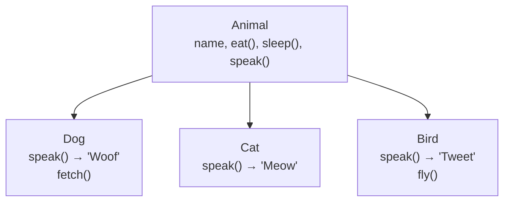
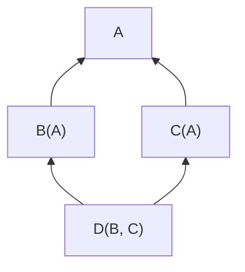
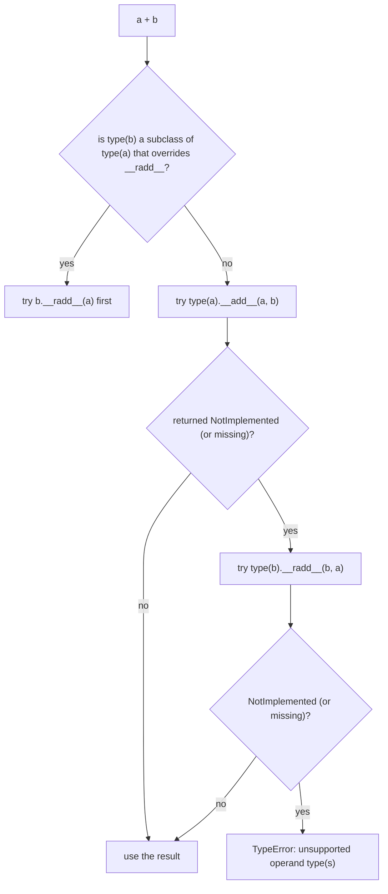

# Chapter 15 · OOP II: Inheritance, Polymorphism & Magic Methods

> Why does `len()` work on lists, strings, dicts *and* that pandas DataFrame you'll meet one day? Why can you `sort()` numbers and strings with the same call? It's not luck: it's a handful of ideas (inheritance, polymorphism and "magic" dunder methods) that let your own classes plug into Python as smoothly as the built-in ones.

**You will learn:**
- **Inheritance**: reuse a class by extending it, override methods, and call the parent with `super()`
- **Multiple inheritance**, the **diamond problem**, and the **MRO** (how Python decides which method wins)
- **Polymorphism** and **duck typing**: "if it quacks like a duck…"
- **Abstraction** with `abc.ABC` and `@abstractmethod`
- **Composition vs inheritance**, and why "has-a" often beats "is-a"
- Dunder methods: `__eq__`, `__hash__`, `__lt__`, `__len__`, `__getitem__`, `__iter__`, `__contains__`, `__add__`, `__call__`, `__bool__`, and a peek at `__enter__`/`__exit__`
- `functools.total_ordering` and `@dataclass`: let Python write the boring code
- The **four pillars of OOP**, the way interviewers ask them

**Before this:** [OOP I: Classes & Objects](14-oop-classes-objects.md) · [Errors, Exceptions & Files](13-exceptions-files.md)

---

## 🧠 The Big Idea

Two ideas, two pictures.

**Picture 1: a family tree.** A `Dog` *is an* `Animal`. Everything true about animals (they eat, they sleep, they have a name) is automatically true about dogs. Dogs add their own extras (fetch) and do some things differently (their sound is "Woof"). That's **inheritance**: a child class gets everything from its parent and can add or change things.



**Picture 2: wall sockets.** Python's built-in functions and operators (`len()`, `+`, `==`, `<`, `[]`, `for`, `in`, `with`) are like **sockets** in a wall. Any appliance with the right **plug** works in a socket, no matter who made it. The plugs are **dunder methods**: give your class `__len__` and `len(obj)` works; give it `__add__` and `obj + other` works.

| Socket (what you write) | Plug (what Python calls) |
|---|---|
| `len(x)` | `x.__len__()` |
| `a + b` | `a.__add__(b)` |
| `a == b` | `a.__eq__(b)` |
| `a < b` | `a.__lt__(b)` |
| `x[i]` | `x.__getitem__(i)` |
| `item in x` | `x.__contains__(item)` |
| `for v in x` | `x.__iter__()` |
| `x()` | `x.__call__()` |
| `with x:` | `x.__enter__()` / `x.__exit__(...)` |

Put the two pictures together and you get **polymorphism**: one piece of code (`animal.speak()`, `len(thing)`, `a + b`) that does the right thing for many different types.

---

## 🔨 Building It Up

### 1. Inheritance: reuse by extending

Write the shared stuff once in a **parent class** (also called **base class** or **superclass**). Then create **child classes** (**subclasses**, **derived classes**) by putting the parent's name in brackets.

```python
class Animal:
    def __init__(self, name):
        self.name = name

    def eat(self):
        return f"{self.name} is eating"

    def speak(self):
        return "..."

class Dog(Animal):             # Dog inherits from Animal
    def fetch(self):           # an extra method only dogs have
        return f"{self.name} fetches the ball"

rex = Dog("Rex")
print(rex.eat())               # inherited from Animal
print(rex.fetch())             # Dog's own
print(rex.speak())             # inherited (we haven't changed it yet)
print(isinstance(rex, Dog), isinstance(rex, Animal))
print(issubclass(Dog, Animal), issubclass(Animal, Dog))
```

```text
Rex is eating
Rex fetches the ball
...
True True
True False
```

What just happened: `Dog` has no `__init__` or `eat` of its own, so Python looks them up in `Animal`. A `Dog` **is an** `Animal`, so `isinstance(rex, Animal)` is `True`. Inheritance is a one-way street: an `Animal` is not necessarily a `Dog`.

> 💡 Every class secretly inherits from **`object`**, the root of all Python classes. That's where default behaviours like the ugly `<__main__.Dog object at 0x...>` repr and `==` meaning "same object" come from.

### 2. Overriding: doing it differently

A child can **override** (replace) a parent method by defining one with the same name:

```python
class Animal:
    def __init__(self, name):
        self.name = name

    def speak(self):
        return "..."

    def introduce(self):
        return f"I am {self.name} and I say {self.speak()}"

class Dog(Animal):
    def speak(self):                 # overrides Animal.speak
        return "Woof"

class Cat(Animal):
    def speak(self):
        return "Meow"

for pet in [Dog("Rex"), Cat("Tom"), Animal("Generic")]:
    print(pet.introduce())
```

```text
I am Rex and I say Woof
I am Tom and I say Meow
I am Generic and I say ...
```

Look closely: `introduce` lives in `Animal` and was written **before Dog existed**. Yet when called on a `Dog`, `self.speak()` runs **Dog's** `speak`. That's because `self` is the actual object (a `Dog`), and lookup always starts from the object's own class. Parent code calling methods that children override is the heart of reusable frameworks.

### 3. `super()`: extend, don't replace

Often you want to **add to** the parent's behaviour, not throw it away. `super()` gives you access to the parent's version of a method.

```python
class Employee:
    def __init__(self, name, salary):
        self.name = name
        self.salary = salary

    def describe(self):
        return f"{self.name} earns {self.salary}"

class Manager(Employee):
    def __init__(self, name, salary, reports):
        super().__init__(name, salary)          # let the parent set name and salary
        self.reports = reports                  # then add our own extra

    def describe(self):
        base = super().describe()               # reuse the parent's text
        return f"{base} and manages {len(self.reports)} people"

m = Manager("Priya", 150000, ["Ana", "Ben"])
print(m.describe())
print(m.name, m.reports)
```

```text
Priya earns 150000 and manages 2 people
Priya ['Ana', 'Ben']
```

What just happened: without the `super().__init__(...)` line, `Manager.__init__` would replace `Employee.__init__` completely, and `m.name` would never be set (an `AttributeError` later). **If your child defines `__init__`, it almost always needs to call `super().__init__(...)`.**

### 4. Inheritance chains

Inheritance can go several levels deep. Python searches up the chain until it finds the method:

```python
class Vehicle:
    wheels = 0
    def describe(self):
        return f"{type(self).__name__} with {self.wheels} wheels"

class Car(Vehicle):
    wheels = 4

class SportsCar(Car):
    def describe(self):
        return super().describe() + ", goes fast"

print(Vehicle().describe())
print(Car().describe())
print(SportsCar().describe())
print([cls.__name__ for cls in SportsCar.__mro__])
```

```text
Vehicle with 0 wheels
Car with 4 wheels
SportsCar with 4 wheels, goes fast
['SportsCar', 'Car', 'Vehicle', 'object']
```

`SportsCar.__mro__` is the **Method Resolution Order**: the exact list of classes Python searches, in order. For a simple chain it's just "me, my parent, its parent, ..., object". It gets interesting with multiple parents.

> ⚠️ Keep hierarchies **shallow**. Two or three levels is normal. Six levels deep means a reader has to open six classes to understand one method call.

### 5. Multiple inheritance and the diamond problem

A Python class can have **several parents**: `class C(A, B):`. That's powerful, but raises a question: if both `A` and `B` define `hello()`, which one does `C` get?

The famous tricky case is the **diamond**: two parents that share a grandparent.



```python
class A:
    def hello(self):
        return "A"

class B(A):
    def hello(self):
        return "B"

class C(A):
    def hello(self):
        return "C"

class D(B, C):
    pass

d = D()
print(d.hello())
print([cls.__name__ for cls in D.__mro__])
```

```text
B
['D', 'B', 'C', 'A', 'object']
```

Python builds the MRO with an algorithm called **C3 linearization**. You don't need to run it by hand, but you should know the rules it guarantees:

1. **A child always comes before its parents.** (`D` before `B` and `C`; `B` and `C` before `A`.)
2. **Parents keep the left-to-right order you wrote.** `class D(B, C)` means `B` before `C`.
3. **Every class appears exactly once**, so the shared grandparent `A` is visited only once, **after all its children**. That solves the diamond problem: no duplicate, no ambiguity.

If no order can satisfy these rules, Python refuses to create the class:

```py
class X: pass
class Y(X): pass
class Z(X, Y): pass   # TypeError: Cannot create a consistent method resolution order (MRO)
                      # X must come before Y (you listed it first) AND after Y (Y is its child)
```

### 6. `super()` means "next in the MRO", not "my parent"

This surprises everyone. In multiple inheritance, `super()` doesn't go to *your* parent; it goes to the **next class in the MRO of the object's actual type**. That lets every class in a diamond run exactly once, if they all call `super()`. This is called **cooperative multiple inheritance**.

```python
class Base:
    def setup(self):
        print("Base.setup")

class Logging(Base):
    def setup(self):
        print("Logging.setup")
        super().setup()

class Caching(Base):
    def setup(self):
        print("Caching.setup")
        super().setup()          # for an App object, this goes to... Base? No!

class App(Logging, Caching):
    def setup(self):
        print("App.setup")
        super().setup()

App().setup()
print([c.__name__ for c in App.__mro__])
```

```text
App.setup
Logging.setup
Caching.setup
Base.setup
['App', 'Logging', 'Caching', 'Base', 'object']
```

`Logging` knows nothing about `Caching`, yet `Logging`'s `super().setup()` called `Caching.setup`, because for an `App` object the MRO is `App → Logging → Caching → Base`. And `Base.setup` ran **once**, not twice. 🎉

### 7. Mixins: small, focused add-ons

A common, safe use of multiple inheritance is the **mixin**: a small class that adds **one** capability and isn't meant to be used on its own. Name them with a `Mixin` suffix.

```python
class ReprMixin:
    def __repr__(self):
        fields = ", ".join(f"{k}={v!r}" for k, v in vars(self).items())
        return f"{type(self).__name__}({fields})"

class ToDictMixin:
    def to_dict(self):
        return dict(vars(self))

class User(ReprMixin, ToDictMixin):
    def __init__(self, name, email):
        self.name = name
        self.email = email

u = User("ana", "ana@example.com")
print(u)
print(u.to_dict())
```

```text
User(name='ana', email='ana@example.com')
{'name': 'ana', 'email': 'ana@example.com'}
```

Any class can now get a nice repr and a `to_dict` by listing the mixins. Real frameworks (Django's class-based views, for example) are built this way.

### 8. Polymorphism: one interface, many forms

**Polymorphism** (Greek: "many shapes") means **the same call works on different types, each doing its own thing**. You saw it in section 2: `pet.introduce()` worked for dogs and cats. The calling code doesn't need `if type == ...` chains:

```python
class Shape:
    def area(self):
        raise NotImplementedError

class Circle(Shape):
    def __init__(self, r):
        self.r = r
    def area(self):
        return 3.14159 * self.r ** 2

class Square(Shape):
    def __init__(self, side):
        self.side = side
    def area(self):
        return self.side ** 2

class Triangle(Shape):
    def __init__(self, base, height):
        self.base, self.height = base, height
    def area(self):
        return 0.5 * self.base * self.height

shapes = [Circle(1), Square(3), Triangle(4, 5)]
for s in shapes:
    print(f"{type(s).__name__:<8} {s.area():.2f}")      # no if/elif on types!
print("total:", round(sum(s.area() for s in shapes), 2))
```

```text
Circle   3.14
Square   9.00
Triangle 10.00
total: 22.14
```

Adding a `Hexagon` tomorrow requires **zero** changes to the loop. Compare with the alternative:

```py
# ❌ every new shape means editing this function (and every function like it)
def area(shape):
    if shape["kind"] == "circle":
        return 3.14159 * shape["r"] ** 2
    elif shape["kind"] == "square":
        return shape["side"] ** 2
    ...
```

### 9. Duck typing: Python doesn't check the family tree

> "If it walks like a duck and quacks like a duck, it's a duck."

In Java, polymorphism requires a shared parent class or interface. Python is more relaxed: **any object with the right methods works**, related or not. This is **duck typing**.

```python
class Duck:
    def speak(self):
        return "Quack"

class Robot:                     # NOT an Animal, no shared parent at all
    def speak(self):
        return "Beep boop"

class Person:
    def speak(self):
        return "Hello"

def chorus(things):
    return " / ".join(t.speak() for t in things)

print(chorus([Duck(), Robot(), Person()]))
```

```text
Quack / Beep boop / Hello
```

You use duck typing constantly without noticing: `for` works on anything iterable, `len()` on anything with `__len__`, `json.dump` writes to anything with a `.write()` method (a real file, an `io.StringIO`, a network socket wrapper). That's why `io.StringIO` could stand in for a file in [Chapter 13](13-exceptions-files.md).

Duck typing pairs naturally with **EAFP**: just call the method and handle `AttributeError`/`TypeError` if it isn't there, rather than checking types first.

### 10. Abstraction: `abc.ABC` and `@abstractmethod`

In section 8, `Shape.area` raised `NotImplementedError`. But nothing stopped someone from writing a `Pentagon(Shape)` that forgets `area`, and the bug would only show up when `area()` is finally called, maybe in production. **Abstract base classes** catch it at the moment the object is created.

**Abstraction** means exposing *what* something does while hiding *how*. An abstract class defines the **contract** ("every shape must have `area` and `perimeter`") without implementing it.

```python
from abc import ABC, abstractmethod

class PaymentMethod(ABC):
    @abstractmethod
    def pay(self, amount):
        """Charge the amount. Every payment method MUST implement this."""

    def receipt(self, amount):               # concrete methods are allowed too
        return f"Paid {amount} via {type(self).__name__}: {self.pay(amount)}"

class UPI(PaymentMethod):
    def __init__(self, vpa):
        self.vpa = vpa
    def pay(self, amount):
        return f"UPI request sent to {self.vpa}"

class Card(PaymentMethod):
    def pay(self, amount):
        return "card charged"

class BrokenWallet(PaymentMethod):
    pass                                     # forgot to implement pay!

for method in [UPI("riya@okbank"), Card()]:
    print(method.receipt(499))

for cls in (PaymentMethod, BrokenWallet):
    try:
        cls()
    except TypeError as e:
        print("TypeError:", str(e).split(" with")[0])
```

```text
Paid 499 via UPI: UPI request sent to riya@okbank
Paid 499 via Card: card charged
TypeError: Can't instantiate abstract class PaymentMethod
TypeError: Can't instantiate abstract class BrokenWallet
```

What just happened:

- A class that inherits from `ABC` and has at least one `@abstractmethod` **cannot be instantiated**.
- A subclass becomes "concrete" (creatable) only once it overrides **every** abstract method. `BrokenWallet` forgot `pay`, so Python refuses to build it, catching the bug immediately.
- Abstract classes can still contain normal methods (`receipt`) that use the abstract ones. This is the **template method** pattern: the parent defines the overall algorithm, children fill in the steps.

> 💡 The full error message goes on to name the missing method (`pay`), telling you exactly what to fix (the precise wording varies slightly between Python versions, which is why the code above trims it).

Python's standard library is full of ABCs. `collections.abc` defines `Iterable`, `Sequence`, `Mapping` and more, and `isinstance([], collections.abc.Sequence)` is `True`.

### 11. Composition vs inheritance

Inheritance models **"is-a"**: a `Dog` **is an** `Animal`. **Composition** models **"has-a"**: a `Car` **has an** `Engine`. With composition, an object holds other objects as attributes and **delegates** work to them.

```python
class Engine:
    def __init__(self, horsepower):
        self.horsepower = horsepower
    def start(self):
        return f"{self.horsepower}hp engine roars"

class ElectricMotor:
    def start(self):
        return "electric motor hums silently"

class Car:
    def __init__(self, model, engine):
        self.model = model
        self.engine = engine            # HAS-A: the car holds an engine object

    def start(self):
        return f"{self.model}: {self.engine.start()}"   # delegate

print(Car("Swift", Engine(90)).start())
print(Car("Nexon EV", ElectricMotor()).start())         # swap the part, no new subclass
```

```text
Swift: 90hp engine roars
Nexon EV: electric motor hums silently
```

A classic interview example: should a `Stack` **inherit from** `list`?

```python
class BadStack(list):            # is-a list: inherits ALL list methods
    def push(self, x):
        self.append(x)

s = BadStack()
s.push(1); s.push(2); s.push(3)
s.insert(0, 99)                  # ❌ allowed! a "stack" with insertion at the bottom
print(s)

class Stack:                     # has-a list: exposes only stack operations
    def __init__(self):
        self._items = []
    def push(self, x):
        self._items.append(x)
    def pop(self):
        return self._items.pop()
    def peek(self):
        return self._items[-1]
    def __len__(self):
        return len(self._items)

good = Stack()
good.push(1); good.push(2)
print(good.pop(), len(good), hasattr(good, "insert"))
```

```text
[99, 1, 2, 3]
2 1 False
```

| | Inheritance ("is-a") | Composition ("has-a") |
|---|---|---|
| Relationship | `Dog` is an `Animal` | `Car` has an `Engine` |
| Coupling | tight: child depends on parent's internals | loose: only uses the part's public methods |
| Change at runtime? | no, fixed when the class is written | yes, swap the part (`ElectricMotor`) |
| Exposes | everything the parent has | only what you choose |
| Risk | fragile hierarchies, unwanted inherited methods | a little more delegation code |

> 💡 The famous design rule: **"favour composition over inheritance."** Use inheritance when the child truly *is* a specialised version of the parent and should support **everything** the parent does (this is the **Liskov Substitution Principle**, the "L" in SOLID, coming in [System Design Chapter 14](../part-3-system-design/14-low-level-design.md)). Otherwise, compose.

### 12. Magic methods I: equality and hashing (`__eq__`, `__hash__`)

By default `==` on your objects means "same object". Teach Python what equality means with `__eq__`:

```python
class Point:
    def __init__(self, x, y):
        self.x, self.y = x, y

    def __eq__(self, other):
        if not isinstance(other, Point):
            return NotImplemented          # "I don't know how to compare with that"
        return (self.x, self.y) == (other.x, other.y)

    def __hash__(self):
        return hash((self.x, self.y))      # equal points MUST have equal hashes

    def __repr__(self):
        return f"Point({self.x}, {self.y})"

a, b = Point(1, 2), Point(1, 2)
print(a == b, a is b, a != b)              # != is derived from __eq__ automatically
print(a == "not a point")
print({a, b, Point(3, 4)})                 # set removes the duplicate
print({a: "home"}[Point(1, 2)])            # usable as a dict key
```

```text
True False False
False
{Point(1, 2), Point(3, 4)}
home
```

Two essential rules (they connect directly to [Chapter 9](09-dictionaries.md)):

1. **If `a == b`, then `hash(a) == hash(b)` must be true.** Sets and dicts first jump to a bucket by hash, then confirm with `==`. If equal objects had different hashes, a set would happily store "duplicates" and dictionary lookups would fail.
2. **If you define `__eq__` without `__hash__`, Python sets `__hash__` to `None`**, making your objects unhashable (can't go in sets or be dict keys). This is deliberate: it stops you from accidentally breaking rule 1.

```python
class Money:
    def __init__(self, amount):
        self.amount = amount
    def __eq__(self, other):
        return isinstance(other, Money) and self.amount == other.amount

print(Money(5) == Money(5))
try:
    {Money(5)}
except TypeError as e:
    print("TypeError:", e)
```

```text
True
TypeError: unhashable type: 'Money'
```

> ⚠️ Only make objects hashable if the fields used in `__hash__` **never change** after creation. If you put a `Point` in a set and then change its `x`, its hash changes and the set can no longer find it. Mutable objects should usually stay unhashable (just like `list`).

**What's `NotImplemented`?** It's a special value (not the exception `NotImplementedError`!) that a dunder method returns to say "I can't handle this type". Python then tries the **other** operand's method, and if nobody can handle it, falls back to identity for `==` or raises `TypeError` for `<` and `+`.

### 13. Magic methods II: ordering (`__lt__` and friends) and `total_ordering`

To make `<`, `>`, `sorted()`, `min()` and `max()` work, define the comparison methods:

| Operator | Method |
|---|---|
| `a < b` | `__lt__` |
| `a <= b` | `__le__` |
| `a > b` | `__gt__` |
| `a >= b` | `__ge__` |

`sorted()` and `list.sort()` only need `__lt__`. Writing all four by hand is tedious and error-prone, so `functools.total_ordering` fills in the rest from `__eq__` plus **one** of them:

```python
from functools import total_ordering

@total_ordering
class Version:
    def __init__(self, text):
        self.parts = tuple(int(p) for p in text.split("."))

    def __eq__(self, other):
        return self.parts == other.parts

    def __lt__(self, other):
        return self.parts < other.parts      # tuples compare element by element

    def __repr__(self):
        return "v" + ".".join(map(str, self.parts))

releases = [Version("1.10.0"), Version("1.2.3"), Version("1.9"), Version("2.0")]
print(sorted(releases))
print(max(releases))
print(Version("1.10") > Version("1.9"), Version("3.0") >= Version("3.0"))
```

```text
[v1.2.3, v1.9, v1.10.0, v2.0]
v2.0
True True
```

What just happened: comparing version **strings** would put `"1.10.0"` before `"1.9"` (character by character, `"1"` < `"9"`). Converting to tuples of ints gives the correct numeric order. We only wrote `__lt__`, but `>` and `>=` work because `@total_ordering` generated them. (The `@` decorator syntax is fully explained in [Chapter 16](16-iterators-generators-decorators.md).)

> 💡 When you just need to **sort** by some field once, a `key` function is simpler than `__lt__`: `sorted(users, key=lambda u: u.age)`. Define `__lt__` when the type has one obvious natural order (versions, money, dates).

### 14. Magic methods III: acting like a container

Implement these and your object behaves like a built-in collection:

```python
class Playlist:
    def __init__(self, name, songs):
        self.name = name
        self._songs = list(songs)

    def __len__(self):                     # len(p)
        return len(self._songs)

    def __getitem__(self, index):          # p[i], p[a:b]
        return self._songs[index]

    def __setitem__(self, index, value):   # p[i] = value
        self._songs[index] = value

    def __contains__(self, song):          # song in p
        return song in self._songs

    def __iter__(self):                    # for song in p
        return iter(self._songs)

    def __bool__(self):                    # if p:
        return len(self._songs) > 0

    def __repr__(self):
        return f"Playlist({self.name!r}, {len(self)} songs)"

p = Playlist("Gym", ["Eye of the Tiger", "Stronger", "Lose Yourself"])
print(p, len(p))
print(p[0], "|", p[-1], "|", p[0:2])
p[1] = "Till I Collapse"
print("Stronger" in p, "Till I Collapse" in p)
for i, song in enumerate(p, 1):
    print(i, song)
print(bool(p), bool(Playlist("Empty", [])))
```

```text
Playlist('Gym', 3 songs) 3
Eye of the Tiger | Lose Yourself | ['Eye of the Tiger', 'Stronger']
False True
1 Eye of the Tiger
2 Till I Collapse
3 Lose Yourself
True False
```

What just happened: `p[0:2]` passed a **slice object** to `__getitem__`, and since we forwarded it to a list, slicing just worked. Notice that we **composed** a list (has-a) rather than inheriting from it, and chose exactly which list behaviours to expose.

Fun fact: if you define only `__getitem__` (accepting 0, 1, 2, ...), Python can *still* iterate your object and use `in`, by calling `__getitem__` with increasing indexes until it gets an `IndexError`. `__iter__` is the modern, preferred way; [Chapter 16](16-iterators-generators-decorators.md) explains the iterator protocol in full.

**Truthiness rules:** `if obj:` calls `__bool__`; if that's missing it uses `__len__` (zero means falsy); if both are missing, every object is truthy.

### 15. Magic methods IV: arithmetic (`__add__`, `__mul__`, `__radd__`...)

Make a 2D vector support `+`, `-`, `*` and `abs()`:

```python
import math

class Vector:
    def __init__(self, x, y):
        self.x, self.y = x, y

    def __add__(self, other):                    # v + w
        if not isinstance(other, Vector):
            return NotImplemented
        return Vector(self.x + other.x, self.y + other.y)

    def __sub__(self, other):                    # v - w
        if not isinstance(other, Vector):
            return NotImplemented
        return Vector(self.x - other.x, self.y - other.y)

    def __mul__(self, k):                        # v * 3
        if not isinstance(k, (int, float)):
            return NotImplemented
        return Vector(self.x * k, self.y * k)

    __rmul__ = __mul__                           # 3 * v (reflected): same logic

    def __neg__(self):                           # -v
        return Vector(-self.x, -self.y)

    def __abs__(self):                           # abs(v) = length
        return math.hypot(self.x, self.y)

    def __eq__(self, other):
        return isinstance(other, Vector) and (self.x, self.y) == (other.x, other.y)

    def __repr__(self):
        return f"Vector({self.x}, {self.y})"

v, w = Vector(3, 4), Vector(1, 1)
print(v + w, v - w, v * 2, 2 * v, -w)
print(abs(v))
print(v + w == Vector(4, 5))
try:
    v + 5
except TypeError as e:
    print("TypeError:", e)
```

```text
Vector(4, 5) Vector(2, 3) Vector(6, 8) Vector(6, 8) Vector(-1, -1)
5.0
True
TypeError: unsupported operand type(s) for +: 'Vector' and 'int'
```

**How `2 * v` works:** Python first tries `int.__mul__(2, v)`. `int` has no idea what a `Vector` is, so it returns `NotImplemented`. Python then tries the **reflected** method on the right operand: `v.__rmul__(2)`. Every arithmetic operator has an `r` version: `__radd__`, `__rsub__`, `__rmul__`, ...

That's also how `sum()` works: `sum(items)` starts at `0` and computes `0 + first_item`, so to make `sum(list_of_vectors)` work you'd add an `__radd__` that treats `0` specially, or call `sum(vectors, Vector(0, 0))`.

There are also **in-place** versions (`__iadd__` for `+=`). If you don't define them, `v += w` falls back to `v = v + w`, which is what you want for immutable-style objects.

| Operator | Method | Reflected |
|---|---|---|
| `+` | `__add__` | `__radd__` |
| `-` | `__sub__` | `__rsub__` |
| `*` | `__mul__` | `__rmul__` |
| `/` | `__truediv__` | `__rtruediv__` |
| `//` | `__floordiv__` | `__rfloordiv__` |
| `%` | `__mod__` | `__rmod__` |
| `**` | `__pow__` | `__rpow__` |
| `@` | `__matmul__` | `__rmatmul__` |
| unary `-` / `abs()` | `__neg__` / `__abs__` | |

### 16. Magic methods V: `__call__` (objects that act like functions)

Define `__call__` and your object can be called with `()` like a function, while still **remembering state** between calls:

```python
class RateLimiter:
    def __init__(self, max_calls):
        self.max_calls = max_calls
        self.calls = 0

    def __call__(self, user):
        self.calls += 1
        if self.calls > self.max_calls:
            return f"429 Too Many Requests for {user}"
        return f"200 OK for {user} (call {self.calls})"

limit = RateLimiter(max_calls=2)
for user in ["ana", "ana", "ana"]:
    print(limit(user))                 # calling an object!
print(callable(limit), callable(42))
```

```text
200 OK for ana (call 1)
200 OK for ana (call 2)
429 Too Many Requests for ana
True False
```

Classes themselves are callable (that's how `Dog("Rex")` works), functions are callable, and now your objects can be too. You'll see `__call__` again when we build **class-based decorators** in [Chapter 16](16-iterators-generators-decorators.md).

### 17. Magic methods VI: `__enter__` and `__exit__` (a preview)

In [Chapter 13](13-exceptions-files.md) you used `with open(...)`. Any object with `__enter__` and `__exit__` works with `with`:

```python
class Section:
    def __init__(self, title):
        self.title = title

    def __enter__(self):
        print(f"[start {self.title}]")
        return self                          # becomes the 'as' variable

    def __exit__(self, exc_type, exc_value, traceback):
        print(f"[end {self.title}]")
        return False                         # don't swallow exceptions

with Section("report") as s:
    print("  working inside", s.title)
```

```text
[start report]
  working inside report
[end report]
```

`__exit__` runs even if the block raises, which makes it perfect for clean-up. The full story (including the easier `@contextmanager` way) is in [Chapter 16](16-iterators-generators-decorators.md).

### 18. `@dataclass`: let Python write the boilerplate

Look at how much code `Point` needed: `__init__`, `__repr__`, `__eq__`, `__hash__`. For classes that are mostly **data**, the `dataclasses` module writes all of that for you from **type annotations** (the `name: type` syntax, which simply declares a field and its intended type):

```python
from dataclasses import dataclass, field

@dataclass
class Student:
    name: str
    roll: int
    marks: list = field(default_factory=list)   # a fresh list for every object
    active: bool = True                         # simple default

    def average(self):
        return sum(self.marks) / len(self.marks) if self.marks else 0.0

a = Student("Asha", 1, [90, 80])
b = Student("Asha", 1, [90, 80])
c = Student("Ben", 2)
print(a)
print(a == b, a is b)
print(c, c.average())
```

```text
Student(name='Asha', roll=1, marks=[90, 80], active=True)
True False
Student(name='Ben', roll=2, marks=[], active=True) 0.0
```

`@dataclass` generated `__init__`, `__repr__` and `__eq__` (comparing all fields in order). Options unlock more:

```python
from dataclasses import dataclass

@dataclass(frozen=True, order=True)
class Card:
    rank: int
    suit: str

    def __post_init__(self):                      # runs right after the generated __init__
        if not 2 <= self.rank <= 14:
            raise ValueError(f"bad rank {self.rank}")

hand = [Card(12, "hearts"), Card(3, "spades"), Card(12, "clubs")]
print(sorted(hand))                               # order=True: compares (rank, suit)
print(len({Card(3, "spades"), Card(3, "spades")}))   # frozen=True makes it hashable

try:
    hand[0].rank = 2
except AttributeError as e:                       # FrozenInstanceError is an AttributeError
    print(type(e).__name__, "-", e)
try:
    Card(20, "hearts")
except ValueError as e:
    print("ValueError:", e)
```

```text
[Card(rank=3, suit='spades'), Card(rank=12, suit='clubs'), Card(rank=12, suit='hearts')]
1
FrozenInstanceError - cannot assign to field 'rank'
ValueError: bad rank 20
```

| Option | What it adds |
|---|---|
| (default) | `__init__`, `__repr__`, `__eq__` |
| `order=True` | `<`, `<=`, `>`, `>=` comparing fields as a tuple, in definition order |
| `frozen=True` | fields can't be reassigned; also generates `__hash__` |
| `field(default_factory=list)` | safe mutable defaults (a plain `= []` is rejected with `ValueError`) |
| `__post_init__` | your extra validation/derived fields after `__init__` |
| `slots=True` (3.10+) | uses `__slots__` for lower memory |

> 💡 Rule of thumb: if a class is mostly "a bag of named fields", make it a `@dataclass`. If it's mostly behaviour with carefully protected state (like `BankAccount`), write it by hand.

### 19. The four pillars of OOP, interview style

Interviewers love "What are the four pillars of OOP? Explain with examples." Here is a crisp answer you can give in under two minutes:

| Pillar | One-line definition | Python example from this chapter |
|---|---|---|
| **Encapsulation** | Bundle data with the methods that operate on it and control access to internal state | `BankAccount` with `_balance` and a read-only `balance` property ([Chapter 14](14-oop-classes-objects.md)) |
| **Abstraction** | Expose *what* an object does, hide *how*; define contracts | `PaymentMethod(ABC)` with abstract `pay()` |
| **Inheritance** | A class acquires the attributes and methods of another and can extend or override them | `Manager(Employee)` using `super().__init__` |
| **Polymorphism** | One interface, many implementations: the same call behaves differently per type | `shape.area()` for `Circle`/`Square`; duck typing; operator overloading with `__add__` |

People often mix up encapsulation and abstraction. The difference: **encapsulation is about protecting the inside** (hiding data, controlling changes); **abstraction is about simplifying the outside** (a clean contract that hides complexity). A car's locked bonnet is encapsulation; its steering wheel and pedals are abstraction.

Python supports polymorphism in several flavours:

- **Subtype polymorphism**: overriding methods in subclasses (`Dog.speak`).
- **Duck typing**: unrelated classes with the same method names.
- **Operator overloading**: `+` means addition for ints, concatenation for strings, and vector addition for your `Vector`.
- **No method overloading by signature.** Unlike Java, defining `def area(self)` and `def area(self, scale)` in the same class keeps only the **last** one. Python uses default and keyword arguments instead (and `functools.singledispatch` for dispatch by argument type).

---

## 🔬 Under the Hood

### How operators find dunder methods

`a + b` is (roughly) this algorithm:



An important detail: Python looks up dunder methods on the **type**, not the instance. Assigning `obj.__len__ = lambda: 5` on one object does **not** make `len(obj)` work. Special methods must be defined in the class. (This lets CPython store them in fast fixed slots in the type object, so `len(x)` doesn't need a dictionary search.)

### How C3 linearization builds the MRO

For a class `C(B1, B2, ...)`, the MRO is: `C` followed by a **merge** of the parents' MROs and the list of parents `[B1, B2, ...]`. The merge repeatedly takes the **first head** of those lists that does **not** appear in the tail (any position except the first) of any other list.

Applied to the diamond `D(B, C)`, with `MRO(B) = [B, A, object]` and `MRO(C) = [C, A, object]`:

| Step | Lists to merge | Pick | Why |
|---|---|---|---|
| 1 | `[B,A,object]`, `[C,A,object]`, `[B,C]` | `B` | B isn't in any tail |
| 2 | `[A,object]`, `[C,A,object]`, `[C]` | `C` | A is in the tail of `[C,A,object]`, so skip A, take C |
| 3 | `[A,object]`, `[A,object]` | `A` | now free |
| 4 | `[object]`, `[object]` | `object` | |

Result: `D, B, C, A, object`, exactly what Python printed. The "skip a head that appears in a tail" rule is what forces the shared grandparent `A` to wait until all its children are done.

### `super()` under the hood

`super()` with no arguments is shorthand for `super(CurrentClass, self)`. It finds `type(self).__mro__`, locates `CurrentClass` in it, and starts the method search from the **next** class. Because it uses `type(self)`'s MRO (the real object's class), the same line of code in `Logging` reaches different classes depending on what the object actually is. That's why cooperative inheritance works.

### What `@dataclass` actually does

It's not magic at runtime: when the class is created, `@dataclass` reads the annotations, **writes Python source code** for `__init__`, `__repr__`, `__eq__` and friends as text, compiles it with `exec`, and attaches the resulting functions to the class. The generated `__init__` is as fast as a hand-written one. You can see the fields with `dataclasses.fields(obj)` and convert to a dict with `dataclasses.asdict(obj)`.

### `isinstance` vs `type(...) ==`

`type(x) == Dog` is true only for exactly `Dog`. `isinstance(x, Animal)` walks the MRO, so it's true for subclasses too. ABCs can even customise `isinstance` (that's how `isinstance([], collections.abc.Sequence)` is `True` although `list` doesn't list `Sequence` as a parent). Prefer `isinstance`, because it respects inheritance and polymorphism.

---

## 🧩 Pattern Decoder

### Design decision guide

| You need... | Reach for |
|---|---|
| A specialised version that supports *everything* the parent does | inheritance + `super()` |
| To reuse behaviour across unrelated classes | a **mixin** or composition |
| A part that can be swapped (engine, payment gateway, storage) | composition |
| A contract that subclasses must fulfil | `abc.ABC` + `@abstractmethod` |
| Objects usable in sets / as dict keys | `__eq__` + `__hash__` (immutable fields), or `@dataclass(frozen=True)` |
| Sorting by a natural order | `__lt__` + `@total_ordering`, or `@dataclass(order=True)` |
| Sorting by some field, once | `key=lambda` (no dunders needed) |
| A mostly-data record | `@dataclass` |
| A stateful function | a class with `__call__` (or a closure, [Chapter 16](16-iterators-generators-decorators.md)) |
| `with`-block setup/teardown | `__enter__`/`__exit__` |

### Pythonic idioms

- Return **`NotImplemented`** (not `False`, not an exception) from binary dunders when the other type is unknown.
- Use `type(self).__name__` in `__repr__` so subclasses print their own name.
- In `__eq__`, compare **tuples** of fields: `(self.x, self.y) == (other.x, other.y)`. In `__hash__`, hash the same tuple.
- Build classes from **small mixins and composed parts** rather than deep trees.
- Always call `super().__init__(...)` in a subclass `__init__`, and in cooperative hierarchies, call `super()` in every overriding method.

### How this shows up in DSA

- **Custom ordering for heaps and sorting.** Priority queues ([Heaps chapter](../part-2-dsa/15-heaps.md), via the `heapq` module from [Chapter 17](17-modules-stdlib.md)) compare items with `<`. To put objects in a heap, either push tuples `(priority, counter, obj)` or give the class `__lt__`. A classic example is **Merge k Sorted Lists**, where `ListNode` has no `__lt__`, so people add one or push `(node.val, i, node)` tuples.

```python
class ListNode:
    def __init__(self, val, next=None):
        self.val, self.next = val, next

    def __lt__(self, other):            # lets sorted()/min()/heapq compare nodes
        return self.val < other.val

nodes = [ListNode(5), ListNode(1), ListNode(3)]
print([n.val for n in sorted(nodes)], min(nodes).val)
```

```text
[1, 3, 5] 1
```

- **Hashable states for visited sets.** In BFS over states (puzzle boards, `(row, col, keys)` in grid problems) you need states in a `set`. Tuples work out of the box; for custom state classes use `@dataclass(frozen=True)`.
- **Graph edges and intervals as dataclasses** make code readable: `Interval(start, end)` with `order=True` sorts by start, then end ([Greedy & Intervals](../part-2-dsa/22-greedy-intervals.md)).
- **`__repr__` on tree nodes** saves hours when debugging recursion.
- **LRU Cache** and other design problems often extend or compose `collections.OrderedDict` ([Chapter 17](17-modules-stdlib.md)), a real-world example of choosing between inheritance and composition.

---

## ⚠️ Traps & Common Mistakes

1. **Forgetting `super().__init__()`** in a child `__init__`: the parent's attributes are never set.

```py
class Manager(Employee):
    def __init__(self, name, salary, reports):
        self.reports = reports             # ❌ name and salary never set

class Manager(Employee):
    def __init__(self, name, salary, reports):
        super().__init__(name, salary)     # ✅
        self.reports = reports
```

2. **Defining `__eq__` and then wondering why objects can't go in a set.** `__hash__` becomes `None`. Add `__hash__` (only if immutable) or use `@dataclass(frozen=True)`.

3. **Hashing mutable fields.** Changing an object after putting it into a set/dict "loses" it there.

4. **Returning `False` instead of `NotImplemented`** from `__eq__`/`__add__` for unknown types. It blocks Python from trying the other operand's method.

5. **Confusing `NotImplemented` with `NotImplementedError`.** The first is a value *returned* from binary dunders; the second is an exception *raised* for "subclass must implement this".

6. **Thinking `super()` means "my parent"** in multiple inheritance. It means "next in the MRO of the actual object".

7. **Inheriting just to reuse code** (`class Stack(list)`). You inherit every unwanted method too. Prefer composition.

8. **Deep inheritance trees.** If you need a diagram to know where `save()` comes from, flatten it.

9. **Expecting method overloading.** A second `def area(self, scale)` silently replaces the first. Use default arguments.

10. **Mutable default in a dataclass**: `tags: list = []` raises `ValueError: mutable default <class 'list'> for field tags is not allowed: use default_factory`. Use `field(default_factory=list)`.

11. **Comparing incompatible types with `@total_ordering`** without type checks: `Version("1.0") < 5` crashes with an `AttributeError` instead of a clean `TypeError`. Return `NotImplemented` for foreign types.

12. **Setting a dunder on an instance** (`obj.__len__ = ...`) and expecting `len(obj)` to use it. Dunders are looked up on the class.

---

## 💡 Tips & Tricks

- `ClassName.__mro__` (or `ClassName.mro()`) instantly answers "where does this method come from?"
- `help(SomeClass)` shows the MRO and every inherited method, grouped by the class that defines it.
- For `sum()` over custom objects, pass a start value: `sum(vectors, Vector(0, 0))`.
- `dataclasses.asdict(obj)` + `json.dumps` = instant JSON for data objects ([Chapter 13](13-exceptions-files.md)).
- `@dataclass(frozen=True)` objects are safe dictionary keys and great for caching.
- `__repr__` for dataclasses is generated; customise only fields with `field(repr=False)` (handy for passwords).
- To check "does this behave like a list?", use `isinstance(x, collections.abc.Sequence)`; to check "can I loop over it?", just try (`iter(x)`) and catch `TypeError`.
- Python 3.12+ adds `typing.override` to mark overriding methods; until then, a short comment does the job.
- When you see `__dunder__` you don't recognise, the Python docs page "Data model" lists them all.

---

## 🎯 Interview Questions

### 1. What are the four pillars of OOP? Explain each with a Python example. 🔥🔥🔥

<details><summary>Answer</summary>

- **Encapsulation**: bundling data and methods, controlling access to state. Python uses `_internal` naming, name mangling, and `@property` (e.g. a `BankAccount` whose `balance` is read-only and only changes through `deposit`/`withdraw`).
- **Abstraction**: exposing an essential interface and hiding details; `abc.ABC` with `@abstractmethod` defines contracts (e.g. `PaymentMethod.pay`).
- **Inheritance**: a class reuses and extends another (`class Manager(Employee)` with `super().__init__`).
- **Polymorphism**: the same operation works on different types (`shape.area()` across `Circle`/`Square`; `len()` on any object with `__len__`; `+` overloaded via `__add__`). Python also relies on duck typing: no shared base class required.

</details>

### 2. What is the MRO? How does Python resolve the diamond problem? 🔥🔥🔥

<details><summary>Answer</summary>

The **Method Resolution Order** is the ordered list of classes Python searches when looking up an attribute (`Class.__mro__`). Python computes it with **C3 linearization**, which guarantees: children come before parents, the left-to-right order of base classes is preserved, and each class appears exactly once. In a diamond `D(B, C)` where `B` and `C` inherit from `A`, the MRO is `D, B, C, A, object`: `A` is visited only once, after both `B` and `C`, so there's no ambiguity or duplicate call. If no consistent order exists, class creation fails with `TypeError`.

</details>

### 3. What does `super()` do? Does it always call the parent class? 🔥🔥🔥

<details><summary>Answer</summary>

`super()` returns a proxy that looks up methods starting from the class **after** the current class in the **MRO of `type(self)`**. In single inheritance that's the parent. In multiple inheritance it may be a **sibling** class: e.g. in `class App(Logging, Caching)`, `super()` inside `Logging` resolves to `Caching` for an `App` instance. This enables **cooperative multiple inheritance**, where every class calls `super()` and each method in the hierarchy runs exactly once.

</details>

### 4. Method overriding vs method overloading: does Python support both? 🔥🔥

<details><summary>Answer</summary>

**Overriding** (a subclass redefines a parent method with the same name) is fully supported. **Overloading** (several methods with the same name but different parameter lists) is **not**: a later `def` with the same name replaces the earlier one. Python gets the same effect with default arguments, `*args`/`**kwargs`, or type-based dispatch using `functools.singledispatch` / `singledispatchmethod`. **Operator overloading** (defining `__add__` etc.) is supported.

</details>

### 5. What is duck typing? 🔥🔥🔥

<details><summary>Answer</summary>

Duck typing means an object's suitability is determined by **the methods and attributes it has**, not by its class or inheritance: "if it walks like a duck and quacks like a duck, it's a duck". A function that calls `obj.write(text)` works with files, `io.StringIO`, sockets or any custom class with `write`. It makes Python code flexible and pairs with EAFP: call the method and handle `AttributeError`/`TypeError` instead of checking types. The trade-off is that errors show up at runtime, which is why type hints and ABCs/`Protocol`s exist for documentation and static checking.

</details>

### 6. Abstract class vs interface? How do you make one in Python? 🔥🔥

<details><summary>Answer</summary>

In Java, an **interface** declares methods with no implementation, while an **abstract class** may mix abstract and concrete methods plus state. Python has no `interface` keyword; both ideas are covered by **abstract base classes**: inherit from `abc.ABC` and mark required methods with `@abstractmethod`. A class with any unimplemented abstract method can't be instantiated (`TypeError`). An ABC with only abstract methods acts like an interface. For pure structural ("duck") interfaces checked by type checkers, there's also `typing.Protocol`.

</details>

### 7. Composition vs inheritance: which do you prefer and why? 🔥🔥🔥

<details><summary>Answer</summary>

Inheritance models **is-a** and gives the child the parent's entire interface; composition models **has-a**, holding other objects and delegating to them. Prefer **composition** by default because it: keeps coupling low (you depend only on a part's public methods), lets you swap parts at runtime (dependency injection: pass a different `Engine`/`PaymentGateway`), exposes only what you choose, and avoids fragile deep hierarchies. Use inheritance when the subclass is truly substitutable for the parent everywhere (Liskov Substitution Principle) and you want to reuse/extend its behaviour, e.g. custom exception hierarchies. Example: a `Stack` should *have* a list, not *be* a list, or it would expose `insert`.

</details>

### 8. What's the relationship between `__eq__` and `__hash__`? 🔥🔥🔥

<details><summary>Answer</summary>

Objects that compare equal **must** have the same hash, because dicts and sets locate items by hash and then confirm with `==`. If you override `__eq__` without `__hash__`, Python sets `__hash__ = None`, making instances unhashable, to prevent violating that rule. If you implement both, hash the same fields you compare, e.g. `hash((self.x, self.y))`, and only do so if those fields are **immutable**, otherwise an object's hash could change while it sits inside a set or dict. `@dataclass(frozen=True)` (or `eq=True, unsafe_hash=True` if you know what you're doing) generates consistent pairs.

</details>

### 9. What is the difference between `NotImplemented` and `NotImplementedError`? 🔥

<details><summary>Answer</summary>

`NotImplemented` is a singleton **value** returned by binary special methods (`__eq__`, `__add__`, `__lt__`...) to signal "I don't support this operand type"; Python then tries the reflected method on the other operand (`__radd__`, or the other side's `__eq__`) before giving up with `TypeError` (or identity comparison for `==`). `NotImplementedError` is an **exception** you raise in a method that subclasses are supposed to override, or for features not built yet.

</details>

### 10. What does `__call__` do? Give a use case. 🔥🔥

<details><summary>Answer</summary>

Defining `__call__` makes instances callable like functions: `obj(args)` runs `type(obj).__call__(obj, args)`. Use it when you want a function that **keeps state or configuration**: a rate limiter, a counter, a configured validator, a class-based decorator, or ML "model" objects (PyTorch modules are called like `model(x)`). `callable(obj)` checks whether something can be called.

</details>

### 11. What are dataclasses and what do they generate? 🔥🔥

<details><summary>Answer</summary>

`@dataclass` (module `dataclasses`, Python 3.7+) auto-generates special methods from annotated class fields: `__init__`, `__repr__`, `__eq__` by default; ordering methods with `order=True`; immutability plus `__hash__` with `frozen=True`; `__slots__` with `slots=True` (3.10+). `field(default_factory=list)` provides safe mutable defaults and `__post_init__` adds validation. They remove boilerplate for data-holding classes while remaining normal classes you can add methods to. Alternatives: `typing.NamedTuple` (immutable, tuple-based) or third-party libraries like `attrs`/`pydantic` (validation).

</details>

### 12. `isinstance()` vs `type() ==`? 🔥🔥

<details><summary>Answer</summary>

`type(x) == C` is true only if `x`'s class is exactly `C`. `isinstance(x, C)` is true if `x`'s class is `C` **or any subclass** (it checks the MRO, and ABCs can extend it with virtual subclasses). Prefer `isinstance` because it respects inheritance and polymorphism; a `Manager` should be accepted wherever an `Employee` is. `isinstance` also accepts a tuple: `isinstance(x, (int, float))`. Note that `bool` is a subclass of `int`, so `isinstance(True, int)` is `True`, a classic gotcha.

</details>

---

## 🏋️ Practice

**🟢 1. Shapes with an ABC.** Make an abstract `Shape` with abstract `area()` and `perimeter()` and a concrete `describe()` that uses them. Implement `Rectangle` and `Circle`. Sort a list of shapes by area.

<details><summary>Solution</summary>

```python
import math
from abc import ABC, abstractmethod

class Shape(ABC):
    @abstractmethod
    def area(self): ...

    @abstractmethod
    def perimeter(self): ...

    def describe(self):
        return f"{type(self).__name__}: area={self.area():.2f}, perimeter={self.perimeter():.2f}"

class Rectangle(Shape):
    def __init__(self, w, h):
        self.w, self.h = w, h
    def area(self):
        return self.w * self.h
    def perimeter(self):
        return 2 * (self.w + self.h)

class Circle(Shape):
    def __init__(self, r):
        self.r = r
    def area(self):
        return math.pi * self.r ** 2
    def perimeter(self):
        return 2 * math.pi * self.r

for s in sorted([Rectangle(3, 4), Circle(1), Rectangle(1, 1)], key=lambda s: s.area()):
    print(s.describe())
```

```text
Rectangle: area=1.00, perimeter=4.00
Circle: area=3.14, perimeter=6.28
Rectangle: area=12.00, perimeter=14.00
```

`...` (Ellipsis) is a common placeholder body for abstract methods.

</details>

**🟢 2. Predict the MRO.** Without running it, write the output. Then check.

```python
class A:
    def who(self): return "A"
class B(A):
    pass
class C(A):
    def who(self): return "C"
class D(B, C):
    pass

print(D().who(), [k.__name__ for k in D.__mro__])
```

<details><summary>Solution</summary>

```text
C ['D', 'B', 'C', 'A', 'object']
```

`B` doesn't define `who`, so the search continues to the next class in the MRO, which is `C` (not `A`!). Many people answer "A" because they search depth-first; C3 puts `A` after both `B` and `C`.

</details>

**🟡 3. Money with ordering.** Make a `Money(amount, currency)` class that supports `==`, `<` (via `total_ordering`), `+` (same currency only, else `ValueError`), hashing, and `sum()` over a list.

<details><summary>Solution</summary>

```python
from functools import total_ordering

@total_ordering
class Money:
    def __init__(self, amount, currency="INR"):
        self._amount = amount
        self._currency = currency

    @property
    def amount(self):
        return self._amount

    @property
    def currency(self):
        return self._currency

    def _check(self, other):
        if not isinstance(other, Money):
            return False
        if other.currency != self.currency:
            raise ValueError(f"cannot mix {self.currency} and {other.currency}")
        return True

    def __eq__(self, other):
        if not isinstance(other, Money):
            return NotImplemented
        return (self.amount, self.currency) == (other.amount, other.currency)

    def __hash__(self):
        return hash((self.amount, self.currency))

    def __lt__(self, other):
        if not self._check(other):
            return NotImplemented
        return self.amount < other.amount

    def __add__(self, other):
        if not self._check(other):
            return NotImplemented
        return Money(self.amount + other.amount, self.currency)

    def __radd__(self, other):          # makes sum() work: sum starts with 0
        if other == 0:
            return self
        return NotImplemented

    def __repr__(self):
        return f"Money({self.amount}, {self.currency!r})"

prices = [Money(250), Money(99), Money(1200)]
print(sum(prices), max(prices), sorted(prices)[0])
print(Money(5) >= Money(5), len({Money(5), Money(5)}))
try:
    Money(5) + Money(5, "USD")
except ValueError as e:
    print("ValueError:", e)
```

```text
Money(1549, 'INR') Money(1200, 'INR') Money(99, 'INR')
True 1
ValueError: cannot mix INR and USD
```

Read-only properties keep the object effectively immutable, which makes hashing safe.

</details>

**🟡 4. Matrix with `__getitem__`, `__add__`, `__matmul__`.** Make `Matrix(rows)` support `m[i, j]` (a tuple index), `m + n`, `m @ n` (matrix multiplication), `==` and a readable `__repr__`.

<details><summary>Solution</summary>

```python
class Matrix:
    def __init__(self, rows):
        self.rows = [list(r) for r in rows]
        self.n, self.m = len(self.rows), len(self.rows[0])

    def __getitem__(self, pos):          # m[i, j] passes the tuple (i, j)
        i, j = pos
        return self.rows[i][j]

    def __add__(self, other):
        return Matrix([[a + b for a, b in zip(r1, r2)]
                       for r1, r2 in zip(self.rows, other.rows)])

    def __matmul__(self, other):
        if self.m != other.n:
            raise ValueError("shapes don't match")
        return Matrix([[sum(self[i, k] * other[k, j] for k in range(self.m))
                        for j in range(other.m)] for i in range(self.n)])

    def __eq__(self, other):
        return isinstance(other, Matrix) and self.rows == other.rows

    def __repr__(self):
        return f"Matrix({self.rows})"

a = Matrix([[1, 2], [3, 4]])
identity = Matrix([[1, 0], [0, 1]])
print(a[1, 0], a + identity)
print(a @ a, a @ identity == a)
```

```text
3 Matrix([[2, 2], [3, 5]])
Matrix([[7, 10], [15, 22]]) True
```

</details>

**🟡 5. Composition refactor.** A `Logger` can write to the console or keep messages in memory. Instead of `ConsoleLogger(Logger)` / `MemoryLogger(Logger)` subclasses, build one `Logger` class that **has a** "sink" object with a `write(text)` method, and show swapping sinks.

<details><summary>Solution</summary>

```python
class ConsoleSink:
    def write(self, text):
        print(text)

class MemorySink:
    def __init__(self):
        self.lines = []
    def write(self, text):
        self.lines.append(text)

class Logger:
    def __init__(self, name, sink):
        self.name = name
        self.sink = sink                     # has-a sink (any object with .write)

    def log(self, level, message):
        self.sink.write(f"[{level}] {self.name}: {message}")

app = Logger("app", ConsoleSink())
app.log("INFO", "started")

memory = MemorySink()
app.sink = memory                            # swap at runtime
app.log("WARN", "disk 91% full")
app.log("INFO", "still running")
print(memory.lines)
```

```text
[INFO] app: started
['[WARN] app: disk 91% full', '[INFO] app: still running']
```

Duck typing + composition: `Logger` doesn't care what the sink is, only that it has `write`. Adding a `FileSink` later needs no change to `Logger`.

</details>

**🟡 6. Dataclass intervals.** Use `@dataclass(order=True, frozen=True)` for `Interval(start, end)`. Write `merge(intervals)` that merges overlapping intervals (LeetCode 56, Merge Intervals).

<details><summary>Solution</summary>

```python
from dataclasses import dataclass

@dataclass(order=True, frozen=True)
class Interval:
    start: int
    end: int

def merge(intervals):
    merged = []
    for iv in sorted(intervals):                     # order=True sorts by (start, end)
        if merged and iv.start <= merged[-1].end:    # overlaps the last one
            last = merged[-1]
            merged[-1] = Interval(last.start, max(last.end, iv.end))   # frozen: build a new one
        else:
            merged.append(iv)
    return merged

data = [Interval(8, 10), Interval(1, 3), Interval(2, 6), Interval(15, 18), Interval(17, 20)]
print(merge(data))
```

```text
[Interval(start=1, end=6), Interval(start=8, end=10), Interval(start=15, end=20)]
```

O(n log n) for the sort plus O(n) for the sweep. More interval problems in [Greedy & Intervals](../part-2-dsa/22-greedy-intervals.md).

</details>

**🔴 7. Cooperative plugins.** Write a `Pipeline` base whose `process(text)` returns text unchanged, and three mixins `Strip`, `Lower`, `NoDigits` that each transform the text and call `super().process(...)`. Show that `class Clean(NoDigits, Lower, Strip, Pipeline)` applies all three, and print the order they ran in.

<details><summary>Solution</summary>

```python
class Pipeline:
    def process(self, text):
        return text

class Strip(Pipeline):
    def process(self, text):
        print("  Strip")
        return super().process(text.strip())

class Lower(Pipeline):
    def process(self, text):
        print("  Lower")
        return super().process(text.lower())

class NoDigits(Pipeline):
    def process(self, text):
        print("  NoDigits")
        return super().process("".join(c for c in text if not c.isdigit()))

class Clean(NoDigits, Lower, Strip, Pipeline):
    pass

print([k.__name__ for k in Clean.__mro__])
print(repr(Clean().process("  Hello World 2024  ")))
```

```text
['Clean', 'NoDigits', 'Lower', 'Strip', 'Pipeline', 'object']
  NoDigits
  Lower
  Strip
'hello world'
```

Each mixin calls `super()`, which follows `Clean`'s MRO, so every step runs once, in MRO order, and `Pipeline.process` ends the chain. Reorder the bases and the order of steps changes. This is exactly how mixin-based frameworks compose behaviour.

</details>

---

## 🧠 Never-Forget Summary

- **Inheritance** = "is-a" reuse. Child gets everything, can **override** and **extend** with `super()`.
- A child `__init__` almost always needs `super().__init__(...)`.
- **MRO** (`Class.__mro__`), built by **C3**: child before parents, left-to-right, each class once. Solves the diamond.
- `super()` = **next in the MRO of the real object**, not "my parent".
- **Polymorphism**: one call, many behaviours. **Duck typing**: no shared parent needed, just the right methods.
- **Abstraction** with `ABC` + `@abstractmethod`: can't instantiate until every abstract method is implemented.
- **Favour composition ("has-a")** over inheritance unless the child truly can stand in for the parent.
- Dunders plug your class into Python: `__eq__`, `__hash__`, `__lt__`, `__len__`, `__getitem__`, `__contains__`, `__iter__`, `__add__`/`__radd__`, `__call__`, `__bool__`, `__enter__`/`__exit__`.
- Define `__eq__` → also define `__hash__` (immutable fields only) or lose hashability.
- Return **`NotImplemented`** for unknown operand types.
- `@total_ordering` = `__eq__` + one comparison → all six. `@dataclass` = free `__init__`/`__repr__`/`__eq__` (+ `order`, `frozen`).

**Memory hooks:**
- **"PIE-A"** for the pillars: **P**olymorphism, **I**nheritance, **E**ncapsulation, **A**bstraction. "Easy as PIE, plus A."
- **"Kids first, left to right, everyone once."** → the C3 MRO rules.
- **"Equal twins share a hash."** → `__eq__`/`__hash__` contract.
- **"Is-a → inherit, has-a → hold."**

**One picture:**

| You want | Write | Python then supports |
|---|---|---|
| Reuse & specialise | `class Child(Parent)` + `super()` | inherited methods, overriding |
| A contract | `class X(ABC)` + `@abstractmethod` | error if a method is missing |
| Swappable parts | `self.part = part` | delegation, runtime swaps |
| Value equality | `__eq__` | `==`, `!=`, `in` on lists |
| Use in sets/dicts | `__hash__` (with `__eq__`) | `{obj}`, `d[obj]` |
| Natural order | `__lt__` (+ `@total_ordering`) | `<`, `sorted`, `min`, `max` |
| Container behaviour | `__len__`, `__getitem__`, `__contains__`, `__iter__` | `len`, `[]`, `in`, `for` |
| Arithmetic | `__add__`, `__radd__`, `__mul__`... | `+`, `*`, `sum` |
| Callable objects | `__call__` | `obj()` |
| Clean-up blocks | `__enter__`, `__exit__` | `with obj:` |
| Data records | `@dataclass` | all of the boring methods, generated |

> **If you remember only one thing:** Python's syntax is a set of sockets (`len`, `+`, `==`, `[]`, `for`, `with`), and dunder methods are the plugs. Write the right plug and your class works everywhere built-in types do.

---
**Next:** [Chapter 16 · Iterators, Generators, Decorators & Context Managers](16-iterators-generators-decorators.md)  ·  **Back to** [Contents](../README.md)
