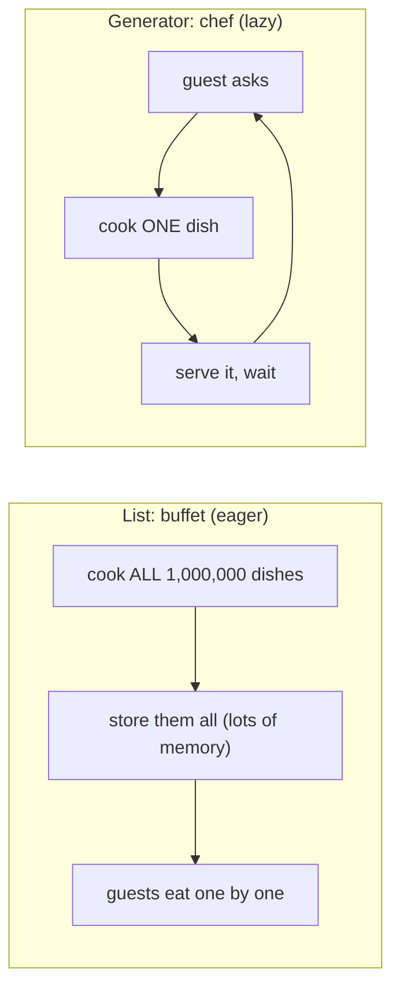
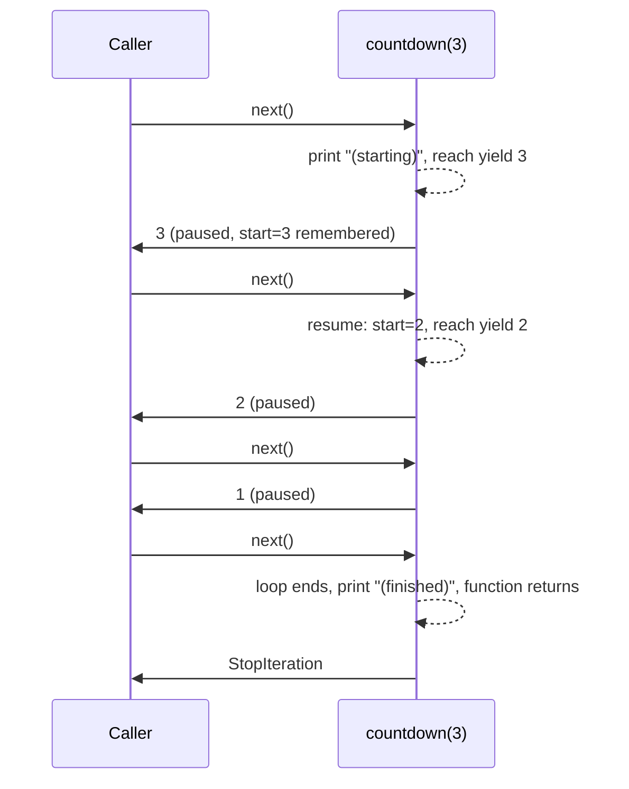

# Chapter 16 · Iterators, Generators, Decorators & Context Managers

> These four features are where "I know Python" turns into "I write Python like a pro". They let you process a 50 GB file with 10 KB of memory, add timing or caching to any function with one line, and make clean-up impossible to forget. They're also among the most asked Python interview topics, so let's make them feel obvious.

**You will learn:**
- **Iterable** vs **iterator**, and what a `for` loop *really* does
- How to build your own iterator class with `__iter__` and `__next__`
- **Generators** and `yield`: pausable functions, lazy evaluation and huge memory savings
- Generator expressions, `yield from`, and a peek at `send()`
- A practical tour of **`itertools`**
- **Decorators** from scratch: functions as objects → closures → wrappers → `@` syntax
- `functools.wraps`, decorators with arguments, stacking, class decorators, and real ones (timer, retry, cache, login_required)
- **Context managers**: `with`, `__enter__`/`__exit__`, and `contextlib.contextmanager`

**Before this:** [Functions](10-functions.md) · [Comprehensions & Functional Tools](11-comprehensions-functional.md) · [OOP II: Inheritance & Magic Methods](15-oop-inheritance-magic.md)

---

## 🧠 The Big Idea

Four ideas, four everyday pictures:

| Idea | Picture | One-line meaning |
|---|---|---|
| **Iterator** | A Pez candy dispenser | Gives you *one item at a time*, remembers where it is, and is empty when done |
| **Generator** | A chef who cooks each dish *when you order it*, instead of a buffet cooked in advance | A function that **pauses** after producing each value, and resumes when asked for the next |
| **Decorator** | Gift-wrapping a present | Wraps a function to add something (timing, caching, a login check) **without changing the function** |
| **Context manager** | Hotel check-in and check-out | Guarantees a setup step and a clean-up step around a block of code, **even if something goes wrong** |

The buffet vs chef contrast is the heart of generators:



The buffet uses memory for everything at once; the chef uses memory for one dish at a time, and if the guest leaves early, the rest is never cooked at all.

---

## 🔨 Building It Up

### 1. Iterables vs iterators

You've been writing `for x in something` since [Chapter 6](06-loops.md). Two different roles hide behind it:

- An **iterable** is anything you *can loop over*: a list, string, tuple, dict, set, file, range. It knows how to **give you an iterator** when asked (`iter(obj)`).
- An **iterator** is the object that *does the looping*: it hands out the next item each time you call `next()` on it, and raises **`StopIteration`** when it runs out.

A book is an iterable; a **bookmark** is an iterator. You can have many bookmarks in one book, each at a different page.

```python
fruits = ["apple", "banana", "cherry"]     # an iterable

it = iter(fruits)                           # get an iterator (a bookmark)
print(type(it).__name__)
print(next(it))
print(next(it))
print(next(it))
try:
    next(it)                                # nothing left
except StopIteration:
    print("StopIteration: the iterator is exhausted")
```

```text
list_iterator
apple
banana
cherry
StopIteration: the iterator is exhausted
```

### 2. What a `for` loop really does

This loop:

```py
for fruit in fruits:
    print(fruit)
```

is exactly this, written by hand:

```python
fruits = ["apple", "banana", "cherry"]

iterator = iter(fruits)            # 1. ask the iterable for an iterator
while True:
    try:
        fruit = next(iterator)     # 2. ask for the next item
    except StopIteration:          # 3. stop when it says "done"
        break
    print(fruit)                   # 4. run the loop body
```

```text
apple
banana
cherry
```

That's the whole **iterator protocol**: two dunder methods.

| Method | Called by | Must return |
|---|---|---|
| `__iter__()` | `iter(obj)`, the start of a `for` loop | an iterator |
| `__next__()` | `next(it)`, each `for` step | the next value, or raise `StopIteration` |

An **iterator is also an iterable**: its `__iter__` just returns itself. That's why you can write `for x in some_iterator`.

### 3. Iterators are one-shot

Bookmarks only move forward. Once an iterator is exhausted, it stays empty:

```python
numbers = [1, 2, 3]
it = iter(numbers)

print(list(it))      # consumes everything
print(list(it))      # already exhausted: empty!
print(list(numbers), list(numbers))   # the LIST can give fresh iterators forever

squares = map(lambda x: x * x, numbers)   # map, filter, zip, enumerate return iterators
print(sum(squares), sum(squares))
```

```text
[1, 2, 3]
[]
[1, 2, 3] [1, 2, 3]
14 0
```

> ⚠️ This is one of the most common Python bugs: storing a `map`/`filter`/`zip`/generator in a variable and looping over it twice. The second loop silently does nothing. If you need the values twice, store them in a list.

### 4. Building your own iterator class

Let's build a countdown, using the protocol directly:

```python
class Countdown:
    def __init__(self, start):
        self.current = start

    def __iter__(self):
        return self                     # an iterator is its own iterator

    def __next__(self):
        if self.current <= 0:
            raise StopIteration         # signal "no more items"
        value = self.current
        self.current -= 1
        return value

for n in Countdown(3):
    print(n, end=" ")
print("liftoff!")

c = Countdown(2)
print(list(c), list(c))                 # one-shot, like any iterator
```

```text
3 2 1 liftoff!
[2, 1] []
```

To make something you can loop over **many times** (like a list), separate the two roles: the **iterable** class's `__iter__` returns a **fresh iterator** each time.

```python
class CountdownIterator:
    def __init__(self, start):
        self.current = start
    def __iter__(self):
        return self
    def __next__(self):
        if self.current <= 0:
            raise StopIteration
        self.current -= 1
        return self.current + 1

class Countdown:                        # the reusable iterable
    def __init__(self, start):
        self.start = start
    def __iter__(self):
        return CountdownIterator(self.start)   # a NEW bookmark every time

c = Countdown(3)
print(list(c), list(c))                 # works twice now
print([(a, b) for a in c for b in c if a > b])   # nested loops over the same object
```

```text
[3, 2, 1] [3, 2, 1]
[(3, 2), (3, 1), (2, 1)]
```

That works, but it's a lot of ceremony for "count down". Generators make it a few lines.

### 5. Generators: functions that pause

A **generator function** is any function containing the keyword **`yield`**. Calling it **does not run its body**. Instead, it returns a **generator object** (which is an iterator). Each `next()` runs the body until the next `yield`, hands out that value, and **freezes** right there, local variables and all. The next `next()` **resumes** from the freeze point.

```python
def countdown(start):
    print("  (starting)")
    while start > 0:
        yield start                  # hand out a value and PAUSE here
        start -= 1
    print("  (finished)")

gen = countdown(3)                   # nothing printed yet: body hasn't started!
print(type(gen).__name__)
print(next(gen))
print(next(gen))
print(next(gen))
print(next(gen, "no more"))          # next(it, default) avoids StopIteration
```

```text
generator
  (starting)
3
2
1
  (finished)
no more
```



**`yield` vs `return`:** `return` ends a function for good and hands back one value. `yield` hands back a value **and keeps the function alive**, ready to continue. A generator can yield as many times as it wants; when its body finishes (or hits `return`), it raises `StopIteration` automatically.

Generators are iterators, so everything that consumes iterables works on them:

```python
def evens(limit):
    for n in range(0, limit, 2):
        yield n

print(list(evens(10)))
print(sum(evens(10)), max(evens(10)))
for i, e in enumerate(evens(6)):
    print(i, e)
```

```text
[0, 2, 4, 6, 8]
20 8
0 0
1 2
2 4
```

### 6. Infinite generators

Because values are produced only on demand, a generator can be **infinite**. The consumer decides when to stop.

```python
def fibonacci():
    a, b = 0, 1
    while True:                      # never ends on its own
        yield a
        a, b = b, a + b

fib = fibonacci()
first_ten = [next(fib) for _ in range(10)]
print(first_ten)

for f in fibonacci():                # stop by breaking out
    if f > 100:
        break
    last = f
print("largest Fibonacci <= 100:", last)
```

```text
[0, 1, 1, 2, 3, 5, 8, 13, 21, 34]
largest Fibonacci <= 100: 89
```

A list of "all Fibonacci numbers" is impossible. A generator of them is three lines.

### 7. Lazy evaluation and memory

**Lazy evaluation** means "don't compute a value until someone actually needs it". **Eager evaluation** (lists) computes everything up front. Let's measure:

```python
import sys

eager = [n * n for n in range(1_000_000)]     # list: all values exist now
lazy = (n * n for n in range(1_000_000))      # generator: none exist yet

print(f"list:      about {sys.getsizeof(eager) / 1_000_000:.0f} MB")
print(f"generator: under 1 KB? {sys.getsizeof(lazy) < 1000}")
print(sum(lazy) == sum(eager))
```

```text
list:      about 8 MB
generator: under 1 KB? True
True
```

The list's container alone is about 8 MB (8,448,728 bytes on a typical 64-bit CPython, and that's not even counting the integer objects it points to). The generator is a couple of hundred bytes, **no matter how many items** it will produce, because it only stores its paused state. (Exact byte counts vary slightly between Python versions, but the gap is always enormous.)

Laziness also means **you can stop early and skip the remaining work entirely**:

```python
def expensive_checks():
    for n in range(1, 1_000_000_000):          # a BILLION candidates
        yield n * n

# any() stops at the first True: only 4 values are ever computed
print(any(sq > 10 for sq in expensive_checks()))
first_big = next(sq for sq in expensive_checks() if sq > 50)
print(first_big)
```

```text
True
64
```

### 8. Generator pipelines

Generators chain together like an assembly line. Each stage pulls one item at a time from the previous one, so the whole pipeline uses constant memory, even for a 50 GB log file. Here `io.StringIO` stands in for a real file ([Chapter 13](13-exceptions-files.md)):

```python
import io

log_file = io.StringIO(
    "INFO user=ana action=login\n"
    "ERROR user=ben action=pay code=502\n"
    "INFO user=ana action=view\n"
    "ERROR user=chen action=pay code=504\n"
    "ERROR user=ben action=refund code=500\n"
)

def read_lines(f):
    for line in f:
        yield line.rstrip("\n")

def only_errors(lines):
    for line in lines:
        if line.startswith("ERROR"):
            yield line

def parse(lines):
    for line in lines:
        fields = dict(part.split("=") for part in line.split()[1:])
        yield fields

pipeline = parse(only_errors(read_lines(log_file)))    # nothing has run yet
for record in pipeline:                                 # pulling drives everything
    print(record["user"], record["code"])
```

```text
ben 502
chen 504
ben 500
```

Each line flows through all three stages before the next line is even read. This is how real data-processing tools (and Unix pipes like `cat log | grep ERROR | cut ...`) work.

### 9. Generator expressions

A **generator expression** is a list comprehension with **round brackets** ([Chapter 11](11-comprehensions-functional.md)). It produces a generator instead of a list:

```python
nums = [3, 1, 4, 1, 5, 9, 2, 6]

squares_list = [n * n for n in nums]      # list: built now
squares_gen = (n * n for n in nums)       # generator: built on demand

print(squares_list)
print(squares_gen.__class__.__name__)
print(sum(n * n for n in nums))           # when it's the only argument, drop the extra ( )
print(max(len(w) for w in ["hi", "hello", "hey"]))
print(", ".join(str(n) for n in nums if n > 3))
```

```text
[9, 1, 16, 1, 25, 81, 4, 36]
generator
173
5
4, 5, 9, 6
```

**Rule:** if you're going to **consume the values once** (sum, max, any, all, join, a for loop), use a generator expression. If you need to **index, slice, reuse or `len()`** them, use a list.

### 10. `yield from`: delegating to another iterable

`yield from iterable` yields every item of the iterable, one by one. It replaces `for x in iterable: yield x`, and shines in **recursive generators**:

```python
def flatten(items):
    for item in items:
        if isinstance(item, list):
            yield from flatten(item)     # hand over to a recursive generator
        else:
            yield item

nested = [1, [2, [3, 4], 5], [[6]], 7]
print(list(flatten(nested)))

def chain_all(*iterables):
    for it in iterables:
        yield from it

print(list(chain_all("ab", [1, 2], range(3))))
```

```text
[1, 2, 3, 4, 5, 6, 7]
['a', 'b', 1, 2, 0, 1, 2]
```

Tree traversal becomes beautiful. Here's an **in-order traversal** of a binary search tree as a generator (trees are coming in [DSA Chapter 13](../part-2-dsa/13-binary-trees.md); for now, each node has a value and a left and right child):

```python
class Node:
    def __init__(self, val, left=None, right=None):
        self.val, self.left, self.right = val, left, right

def inorder(node):
    if node:
        yield from inorder(node.left)
        yield node.val
        yield from inorder(node.right)

#        4
#      /   \
#     2     6
#    / \   /
#   1   3 5
root = Node(4, Node(2, Node(1), Node(3)), Node(6, Node(5)))
print(list(inorder(root)))
print(next(inorder(root)))          # smallest value, without visiting the rest
```

```text
[1, 2, 3, 4, 5, 6]
1
```

### 11. `send()`: talking back to a generator (brief)

`next(gen)` resumes a generator; **`gen.send(value)`** resumes it **and makes the paused `yield` expression evaluate to `value`**. That turns a generator into a tiny two-way machine (historically called a **coroutine**). You'll rarely write these by hand, but they're the ancestor of `async`/`await` ([Chapter 18](18-internals-concurrency.md)).

```python
def running_average():
    total, count, average = 0, 0, None
    while True:
        value = yield average          # send() delivers a value here
        total += value
        count += 1
        average = total / count

avg = running_average()
next(avg)                             # "prime" it: run up to the first yield
print(avg.send(10))
print(avg.send(20))
print(avg.send(60))
```

```text
10.0
15.0
30.0
```

Generators also have `.close()` (stop it; any `finally` inside runs) and `.throw(exc)` (raise an exception at the paused `yield`). A generator's `return value` ends it, and the value is attached to the `StopIteration` (and is what `yield from` evaluates to).

### 12. A tour of `itertools`

The standard module **`itertools`** is a toolbox of fast, lazy iterator building blocks. Here are the ones you'll actually use, especially in DSA:

```python
from itertools import (count, cycle, repeat, islice, chain, accumulate,
                       product, permutations, combinations,
                       combinations_with_replacement, groupby, zip_longest,
                       pairwise, takewhile, dropwhile, starmap)

# Infinite iterators (always pair with islice or a break)
print(list(islice(count(10, 5), 4)))            # 10, 15, 20, ...
print(list(islice(cycle("AB"), 5)))             # A B A B A ...
print(list(repeat("x", 3)))

# Slicing and joining iterators
print(list(islice(range(100), 2, 10, 3)))       # like [2:10:3] but for any iterator
print(list(chain([1, 2], (3,), "ab")))
print(list(chain.from_iterable([[1, 2], [3], [4, 5]])))   # flatten one level

# Running totals (prefix sums!)
print(list(accumulate([3, 1, 4, 1, 5])))
print(list(accumulate([3, 1, 4, 1, 5], max)))   # running maximum

# Combinatorics
print(list(product("ab", [0, 1])))              # nested loops / cartesian product
print(list(permutations([1, 2, 3], 2)))         # ordered arrangements
print(list(combinations([1, 2, 3, 4], 2)))      # unordered choices
print(list(combinations_with_replacement("ab", 2)))

# Grouping CONSECUTIVE equal items (run-length encoding)
print([(k, len(list(g))) for k, g in groupby("aaabccdd")])

# Pairs and uneven zips
print(list(pairwise([1, 4, 9, 16])))            # (1,4) (4,9) (9,16)  (Python 3.10+)
print(list(zip_longest("abc", [1], fillvalue="-")))

# Conditional cut-offs
print(list(takewhile(lambda x: x < 5, [1, 3, 6, 2])))
print(list(dropwhile(lambda x: x < 5, [1, 3, 6, 2])))
print(list(starmap(pow, [(2, 3), (3, 2)])))     # f(*args) for each tuple
```

```text
[10, 15, 20, 25]
['A', 'B', 'A', 'B', 'A']
['x', 'x', 'x']
[2, 5, 8]
[1, 2, 3, 'a', 'b']
[1, 2, 3, 4, 5]
[3, 4, 8, 9, 14]
[3, 3, 4, 4, 5]
[('a', 0), ('a', 1), ('b', 0), ('b', 1)]
[(1, 2), (1, 3), (2, 1), (2, 3), (3, 1), (3, 2)]
[(1, 2), (1, 3), (1, 4), (2, 3), (2, 4), (3, 4)]
[('a', 'a'), ('a', 'b'), ('b', 'b')]
[('a', 3), ('b', 1), ('c', 2), ('d', 2)]
[(1, 4), (4, 9), (9, 16)]
[('a', 1), ('b', '-'), ('c', '-')]
[1, 3]
[6, 2]
[8, 9]
```

| Function | Think of it as | DSA use |
|---|---|---|
| `accumulate` | running total / running max | prefix sums ([DSA Ch 06](../part-2-dsa/06-prefix-sums.md)) |
| `product` | nested for loops | all grid directions, brute-force combos |
| `permutations(xs, r)` | all orderings, n!/(n−r)! of them | brute-force checks, small search spaces |
| `combinations(xs, r)` | all subsets of size r, C(n, r) of them | choose k items |
| `groupby` | consecutive runs (sort first to group *all* equal items!) | run-length encoding, String Compression |
| `pairwise` | sliding pairs | differences between neighbours |
| `chain.from_iterable` | flatten one level | merging adjacency lists |
| `islice` | slicing for iterators | take first k from a generator |

> ⚠️ `groupby` groups only **adjacent** equal items: `groupby("abab")` gives four groups. Sort first if you want one group per key. Also, each group is an iterator that's invalidated when you move to the next group, so convert it (`list(g)`) right away.

### 13. Decorators, step 1: functions are objects

Now, decorators. To understand them, we need three facts about functions you've half-seen already ([Chapter 10](10-functions.md), [Chapter 11](11-comprehensions-functional.md)).

**Fact 1: functions are objects.** You can assign them to variables, store them in lists, and pass them to other functions.

```python
def shout(text):
    return text.upper() + "!"

def whisper(text):
    return text.lower() + "..."

yell = shout                         # no parentheses: the function itself, not a call
print(yell("hello"))
print(shout.__name__, type(shout).__name__)

def greet(style, name):              # a function that RECEIVES a function
    return style(f"Hi {name}")

for style in [shout, whisper]:
    print(greet(style, "Asha"))
```

```text
HELLO!
shout function
HI ASHA!
hi asha...
```

**Fact 2: functions can be defined inside functions, and returned.**

```python
def make_multiplier(factor):
    def multiply(x):
        return x * factor            # uses 'factor' from the enclosing function
    return multiply                  # return the inner function itself

double = make_multiplier(2)
triple = make_multiplier(3)
print(double(5), triple(5))
print(double.__name__)
```

```text
10 15
multiply
```

### 14. Decorators, step 2: closures

Look again at `double(5)`. When it runs, `make_multiplier` **has already returned**, so its local variable `factor` should be gone. Yet `double` still knows `factor = 2`. How?

The inner function **remembers the variables of the enclosing scope it uses**. A function bundled with its remembered variables is called a **closure**.

```python
def make_multiplier(factor):
    def multiply(x):
        return x * factor
    return multiply

double = make_multiplier(2)
print(double.__closure__[0].cell_contents)     # the remembered 'factor'
print(double.__code__.co_freevars)             # names it captured
```

```text
2
('factor',)
```

Closures can also keep **state that changes**. To *reassign* a captured variable (not just read it), declare it **`nonlocal`**:

```python
def make_counter():
    count = 0
    def increment():
        nonlocal count             # "count belongs to the enclosing function"
        count += 1
        return count
    return increment

clicks = make_counter()
other = make_counter()             # an independent counter with its own 'count'
print(clicks(), clicks(), clicks(), other())
```

```text
1 2 3 1
```

Without `nonlocal`, `count += 1` would try to create a new local `count` and fail with `UnboundLocalError`. A closure with state is a lightweight alternative to a class with `__call__` ([Chapter 15](15-oop-inheritance-magic.md)).

### 15. Decorators, step 3: wrappers

Combine both facts: write a function that **takes a function** and **returns a new function that wraps it**, doing something extra before and/or after.

```python
def announce(func):
    def wrapper(*args, **kwargs):            # accept ANY arguments...
        print(f"-> calling {func.__name__}{args}")
        result = func(*args, **kwargs)       # ...and pass them all through
        print(f"<- {func.__name__} returned {result}")
        return result                        # don't forget to return the result!
    return wrapper

def add(a, b):
    return a + b

add = announce(add)          # replace add with the wrapped version
total = add(2, 3)
print("total:", total)
```

```text
-> calling add(2, 3)
<- add returned 5
total: 5
```

What just happened: `announce(add)` returned `wrapper`, a closure that remembers the original `add` as `func`. We rebound the name `add` to `wrapper`. Now every call to `add(...)` goes through `wrapper`, which prints, calls the original, prints again, and returns the result. `*args, **kwargs` ([Chapter 10](10-functions.md)) let the wrapper work with **any** function signature.

That function, `announce`, **is a decorator**. A decorator is just a function that takes a function and returns a (usually wrapped) function.

### 16. Decorators, step 4: the `@` syntax

`add = announce(add)` is so common that Python has a shortcut. These two are **exactly** equivalent:

```py
def add(a, b):
    return a + b
add = announce(add)

@announce                   # same thing, written above the def
def add(a, b):
    return a + b
```

```python
def announce(func):
    def wrapper(*args, **kwargs):
        print(f"-> {func.__name__}")
        return func(*args, **kwargs)
    return wrapper

@announce
def greet(name, punctuation="!"):
    return f"Hello {name}{punctuation}"

print(greet("Kabir"))
print(greet("Meera", punctuation="?"))
```

```text
-> greet
Hello Kabir!
-> greet
Hello Meera?
```

> 💡 The decorator runs **once, when the `def` statement executes** (usually at import time), not on every call. What runs on every call is the **wrapper** it returned. This explains `@property`, `@classmethod`, `@staticmethod`, `@total_ordering` and `@dataclass` from Chapters 14 and 15: each is a function (or class) applied to whatever is defined right below it.

### 17. `functools.wraps`: keep the function's identity

Our wrapper has a side effect: the decorated function now *pretends to be* `wrapper`.

```python
import functools

def plain(func):
    def wrapper(*args, **kwargs):
        return func(*args, **kwargs)
    return wrapper

def polite(func):
    @functools.wraps(func)                 # copy name, docstring etc. from func
    def wrapper(*args, **kwargs):
        return func(*args, **kwargs)
    return wrapper

@plain
def area(r):
    """Area of a circle."""
    return 3.14159 * r * r

@polite
def volume(r):
    """Volume of a sphere."""
    return 4 / 3 * 3.14159 * r ** 3

print(area.__name__, area.__doc__)
print(volume.__name__, volume.__doc__)
print(volume.__wrapped__.__name__)         # wraps also keeps a link to the original
```

```text
wrapper None
volume Volume of a sphere.
volume
```

Without `wraps`, every decorated function is named `wrapper` and has no docstring, which breaks `help()`, logging, debugging and tools that look up functions by name. **Always use `@functools.wraps(func)` in your decorators.**

### 18. Decorators with arguments

What if you want `@repeat(3)`? Now `repeat(3)` must **return a decorator**. That means three layers of functions:

```python
import functools

def repeat(times):                         # layer 1: receives the decorator's arguments
    def decorator(func):                   # layer 2: receives the function
        @functools.wraps(func)
        def wrapper(*args, **kwargs):      # layer 3: runs on every call
            result = None
            for _ in range(times):
                result = func(*args, **kwargs)
            return result
        return wrapper
    return decorator

@repeat(3)                                 # repeat(3) runs first, returns 'decorator'
def cheer(name):
    print(f"Go {name}!")

cheer("India")
```

```text
Go India!
Go India!
Go India!
```

`@repeat(3)` above `def cheer` means `cheer = repeat(3)(cheer)`. Read it as: "call `repeat(3)` to get a decorator, then apply that decorator to `cheer`."

### 19. Stacking decorators

You can apply several decorators. They're applied **bottom-up** (closest to the `def` first), so the **top** one ends up **outermost**:

```python
import functools

def bold(func):
    @functools.wraps(func)
    def wrapper(*args, **kwargs):
        return f"<b>{func(*args, **kwargs)}</b>"
    return wrapper

def italic(func):
    @functools.wraps(func)
    def wrapper(*args, **kwargs):
        return f"<i>{func(*args, **kwargs)}</i>"
    return wrapper

@bold
@italic
def hello(name):
    return f"hello {name}"
# same as: hello = bold(italic(hello))

print(hello("world"))
```

```text
<b><i>hello world</i></b>
```

Think of putting on clothes: the decorator nearest the function is the first layer (shirt), the top one is the last layer (jacket). When the function is called, you go **through the jacket first**.

### 20. Class decorators and decorator classes (brief)

Two related ideas with confusingly similar names:

**A decorator applied to a class** receives the class and returns it (often after registering or modifying it). `@dataclass` is one. A common use is a **registry**:

```python
PLUGINS = {}

def register(cls):
    PLUGINS[cls.__name__.lower()] = cls     # remember the class by name
    return cls                              # return it unchanged

@register
class CsvExporter:
    def export(self, rows):
        return "\n".join(",".join(map(str, r)) for r in rows)

@register
class TsvExporter:
    def export(self, rows):
        return "\n".join("\t".join(map(str, r)) for r in rows)

print(sorted(PLUGINS))
print(PLUGINS["csvexporter"]().export([(1, 2), (3, 4)]))
```

```text
['csvexporter', 'tsvexporter']
1,2
3,4
```

**A class used as a decorator** works because classes are callable: `@CountCalls` calls `CountCalls(func)`, and the resulting object is called on each use via `__call__`. Handy when the decorator needs rich state:

```python
import functools

class CountCalls:
    def __init__(self, func):
        functools.update_wrapper(self, func)   # the class version of @wraps
        self.func = func
        self.calls = 0

    def __call__(self, *args, **kwargs):
        self.calls += 1
        return self.func(*args, **kwargs)

@CountCalls
def ping():
    return "pong"

ping(); ping(); ping()
print(ping.calls, ping.__name__)
```

```text
3 ping
```

### 21. Real decorators you'll actually write

**Timer** (measures how long a function takes). `time.perf_counter()` is a high-precision clock for measuring durations. The timing numbers differ on every run, so this is shown as a fragment:

```py
import functools
import time

def timer(func):
    @functools.wraps(func)
    def wrapper(*args, **kwargs):
        start = time.perf_counter()
        try:
            return func(*args, **kwargs)
        finally:                                   # report even if func raises
            elapsed = time.perf_counter() - start
            print(f"{func.__name__} took {elapsed * 1000:.2f} ms")
    return wrapper

@timer
def slow_sum(n):
    return sum(i * i for i in range(n))

slow_sum(1_000_000)        # prints something like: slow_sum took 61.37 ms
```

**Retry** (try again on failure, a must-have for flaky network calls). Here the "network" is a fake function that fails twice and then works, so the output is predictable:

```python
import functools

def retry(times=3, exceptions=(Exception,)):
    def decorator(func):
        @functools.wraps(func)
        def wrapper(*args, **kwargs):
            for attempt in range(1, times + 1):
                try:
                    return func(*args, **kwargs)
                except exceptions as e:
                    print(f"  attempt {attempt} failed: {e}")
                    if attempt == times:
                        raise                      # out of attempts: give up loudly
        return wrapper
    return decorator

calls = {"n": 0}

@retry(times=3, exceptions=(ConnectionError,))
def fetch_price():
    calls["n"] += 1
    if calls["n"] < 3:
        raise ConnectionError("server busy")
    return 4999

print("price:", fetch_price())
```

```text
  attempt 1 failed: server busy
  attempt 2 failed: server busy
price: 4999
```

In production you'd also sleep between attempts, usually with **exponential backoff** (wait 1 s, 2 s, 4 s ...), a pattern you'll meet again in [System Design Chapter 9](../part-3-system-design/09-microservices-reliability.md).

**Cache / memoize** (remember results of expensive calls). Watch it turn exponential recursion into linear:

```python
import functools

def memoize(func):
    cache = {}                                     # lives in the closure
    @functools.wraps(func)
    def wrapper(*args):
        if args not in cache:
            cache[args] = func(*args)
        return cache[args]
    wrapper.cache = cache                          # expose it for inspection
    return wrapper

calls = 0

@memoize
def fib(n):
    global calls
    calls += 1
    return n if n < 2 else fib(n - 1) + fib(n - 2)

print(fib(80), "computed with", calls, "real calls")
print(len(fib.cache), "results cached")
```

```text
23416728348467685 computed with 81 real calls
81 results cached
```

Without the cache, `fib(80)` would make more than 10^16 calls (it would run for years). With it, each `n` is computed once. This is **memoization**, the heart of top-down dynamic programming ([DSA Chapter 20](../part-2-dsa/20-dp-1d.md)). In real code you'd use the built-in `@functools.cache` or `@functools.lru_cache(maxsize=...)` ([Chapter 17](17-modules-stdlib.md)), which do exactly this, faster and with more features.

**login_required** (access control, the kind web frameworks like Flask and Django use):

```python
import functools

class PermissionDenied(Exception):
    pass

def login_required(func):
    @functools.wraps(func)
    def wrapper(user, *args, **kwargs):
        if not user.get("logged_in"):
            raise PermissionDenied(f"{func.__name__} needs a logged-in user")
        return func(user, *args, **kwargs)
    return wrapper

def role_required(role):
    def decorator(func):
        @functools.wraps(func)
        def wrapper(user, *args, **kwargs):
            if role not in user.get("roles", ()):
                raise PermissionDenied(f"{func.__name__} needs role {role!r}")
            return func(user, *args, **kwargs)
        return wrapper
    return decorator

@login_required
def view_profile(user):
    return f"Profile of {user['name']}"

@login_required
@role_required("admin")
def delete_user(user, target):
    return f"{user['name']} deleted {target}"

guest = {"name": "guest", "logged_in": False}
ana = {"name": "ana", "logged_in": True, "roles": ["admin"]}
ben = {"name": "ben", "logged_in": True, "roles": []}

print(view_profile(ana))
print(delete_user(ana, "spam_bot"))
for user, action in [(guest, view_profile), (ben, lambda u: delete_user(u, "ana"))]:
    try:
        action(user)
    except PermissionDenied as e:
        print("Denied:", e)
```

```text
Profile of ana
ana deleted spam_bot
Denied: view_profile needs a logged-in user
Denied: delete_user needs role 'admin'
```

Notice the stacking order: `login_required` (top, outermost) checks first, then `role_required`. The business logic inside `delete_user` stays clean: no permission code mixed in. That's the whole point of decorators: **separating cross-cutting concerns** (logging, timing, caching, auth, retries) from the core logic.

### 22. Context managers: the `with` statement

You used `with open(...)` in [Chapter 13](13-exceptions-files.md) and peeked at `__enter__`/`__exit__` in [Chapter 15](15-oop-inheritance-magic.md). Here's the full protocol:

```py
with EXPRESSION as name:
    BODY
```

1. Evaluate `EXPRESSION` to get the context manager `cm`.
2. Call `cm.__enter__()`; its return value goes into `name`.
3. Run `BODY`.
4. **Always** call `cm.__exit__(exc_type, exc_value, traceback)`:
   - If `BODY` finished normally, all three arguments are `None`.
   - If `BODY` raised, they describe the exception. If `__exit__` returns **`True`**, the exception is **swallowed**; otherwise it continues travelling up.

```python
class Transaction:
    """Apply changes to a dict, but roll back if anything fails."""
    def __init__(self, data):
        self.data = data

    def __enter__(self):
        self._backup = dict(self.data)       # snapshot before changes
        return self.data

    def __exit__(self, exc_type, exc_value, traceback):
        if exc_type is not None:
            self.data.clear()
            self.data.update(self._backup)   # roll back
            print(f"rolled back because of {exc_type.__name__}: {exc_value}")
        return False                         # don't swallow the exception

accounts = {"ana": 100, "ben": 50}

with Transaction(accounts) as acc:
    acc["ana"] -= 30
    acc["ben"] += 30
print(accounts)

try:
    with Transaction(accounts) as acc:
        acc["ana"] -= 500
        if acc["ana"] < 0:
            raise ValueError("overdraft")
        acc["ben"] += 500
except ValueError:
    pass
print(accounts)
```

```text
{'ana': 70, 'ben': 80}
rolled back because of ValueError: overdraft
{'ana': 70, 'ben': 80}
```

That's the same idea databases use for transactions: all changes happen, or none do.

### 23. `contextlib.contextmanager`: context managers from generators

Writing a class with `__enter__` and `__exit__` is verbose. The **`@contextmanager`** decorator lets you write a context manager as a **generator with exactly one `yield`**:

- Code **before** `yield` = `__enter__`.
- The **yielded value** = what `as` receives.
- Code **after** `yield` = `__exit__`. Put it in `finally` so it runs even when the body raises.

```python
from contextlib import contextmanager

@contextmanager
def tag(name):
    print(f"<{name}>")
    try:
        yield name.upper()          # the body of the with-block runs here
    finally:
        print(f"</{name}>")         # clean-up, guaranteed

with tag("div") as t:
    print("  inside, got", t)
    with tag("p"):
        print("    nested")
```

```text
<div>
  inside, got DIV
<p>
    nested
</p>
</div>
```

A realistic one: temporarily change a setting and **always** restore it.

```python
from contextlib import contextmanager

settings = {"debug": False, "currency": "INR"}

@contextmanager
def override(config, **changes):
    old = {k: config[k] for k in changes}
    config.update(changes)
    try:
        yield config
    finally:
        config.update(old)           # restore even if the block crashed

with override(settings, debug=True):
    print("inside:", settings)
print("after: ", settings)

try:
    with override(settings, currency="USD"):
        raise RuntimeError("boom")
except RuntimeError:
    pass
print("after crash:", settings)
```

```text
inside: {'debug': True, 'currency': 'INR'}
after:  {'debug': False, 'currency': 'INR'}
after crash: {'debug': False, 'currency': 'INR'}
```

`contextlib` has a few more ready-made helpers:

```python
from contextlib import suppress, redirect_stdout
import io

with suppress(KeyError, ZeroDivisionError):   # ignore these specific exceptions
    {}["missing"]
print("carried on after suppress")

buffer = io.StringIO()
with redirect_stdout(buffer):                 # capture print output
    print("this goes into the buffer")
print("captured:", repr(buffer.getvalue()))
```

```text
carried on after suppress
captured: 'this goes into the buffer\n'
```

| Helper | What it does |
|---|---|
| `@contextmanager` | turn a one-`yield` generator into a context manager |
| `suppress(*excs)` | ignore the listed exceptions inside the block |
| `redirect_stdout(f)` | send `print` output to another file-like object |
| `closing(obj)` | call `obj.close()` at the end |
| `ExitStack()` | manage a *dynamic number* of context managers (e.g. open N files) |
| `nullcontext()` | a do-nothing context manager, for "maybe use a lock" code |

Context managers are everywhere in real code: files, locks in threading (`with lock:`, [Chapter 18](18-internals-concurrency.md)), database transactions, temporary directories, timers, and test mocks.

---

## 🔬 Under the Hood

### How a generator pauses

A normal function call creates a **frame** (its local variables plus "which instruction am I on"), runs to completion, and the frame is destroyed. A generator's frame is **not destroyed at `yield`**: it's kept alive inside the generator object, with its instruction pointer parked right after the `yield`. `next()` simply resumes executing that saved frame. That's why locals survive between calls, and why a generator costs only about as much memory as one frame, regardless of how many values it produces.

```python
import inspect

def gen():
    x = 1
    yield x
    x += 1
    yield x

g = gen()
print(inspect.getgeneratorstate(g))
next(g)
print(inspect.getgeneratorstate(g), g.gi_frame.f_locals)
next(g)
print(g.gi_frame.f_locals)
next(g, None)
print(inspect.getgeneratorstate(g))
```

```text
GEN_CREATED
GEN_SUSPENDED {'x': 1}
{'x': 2}
GEN_CLOSED
```

A generator moves through the states **created → (running ↔ suspended) → closed**.

### How a `for` loop compiles

CPython compiles `for x in items:` into two bytecode instructions: `GET_ITER` (call `iter()` on `items`) and `FOR_ITER` (call `__next__`; on `StopIteration`, jump past the loop). For built-in types like lists, these are implemented in C and are extremely fast. You'll look at bytecode yourself with the `dis` module in [Chapter 18](18-internals-concurrency.md).

### Why `StopIteration` inside a generator becomes `RuntimeError`

If code *inside* a generator accidentally triggers `StopIteration` (say, calling `next()` on an exhausted iterator), it used to silently end the generator, hiding the bug. Since Python 3.7 (PEP 479), such a `StopIteration` is converted into a `RuntimeError`. To end a generator on purpose, just `return`.

### How closures store variables: cells

When an inner function uses a variable from an enclosing function, the compiler stores that variable in a **cell** object instead of a normal local slot. Both the outer function and the inner function point at the same cell. When the outer function returns, the cell survives because the inner function (via `__closure__`) still references it. `nonlocal` tells the compiler "assignments to this name go into the cell, not a new local".

This also explains the famous **late binding** gotcha: closures capture **variables (cells), not values**. All lambdas created in a loop share the same `i` cell, which holds its *final* value by the time they're called:

```python
funcs = [lambda: i for i in range(3)]
print([f() for f in funcs])              # all see the final i

fixed = [lambda i=i: i for i in range(3)] # default argument captures the value now
print([f() for f in fixed])
```

```text
[2, 2, 2]
[0, 1, 2]
```

### What `@decorator` compiles to

```py
@d1
@d2(arg)
def f(): ...
```

is executed as: create the function object `f`, then `f = d1(d2(arg)(f))`. There's no runtime cost besides the wrapper call itself: one extra function call per invocation (roughly tens of nanoseconds), which matters only in extremely hot loops.

---

## 🧩 Pattern Decoder

### Pythonic idioms

| Situation | Idiom |
|---|---|
| Produce a long or infinite sequence | a generator function with `yield` |
| Aggregate values once (`sum`, `max`, `any`, `join`) | generator expression, no list |
| Need the values twice, or `len`/indexing | build a list |
| Recursively produce values (tree walk, flatten) | `yield from` |
| Take the first k items of an iterator | `itertools.islice(it, k)` |
| "Find the first match, or a default" | `next((x for x in xs if cond(x)), default)` |
| Add timing/logging/caching/auth to many functions | a decorator with `@functools.wraps` |
| Decorator needs configuration | three-layer decorator factory `@deco(args)` |
| Setup + guaranteed clean-up | context manager (`@contextmanager` + `try/finally`) |
| Ignore one specific exception | `with suppress(Exc):` |

### How this shows up in DSA

- **Memoization for DP and DFS.** `@functools.cache` on a recursive function is the fastest route from a brute-force recursion to a top-down DP solution. You'll use it constantly in [DSA Chapter 20](../part-2-dsa/20-dp-1d.md).
- **Iterator design problems.** LeetCode has a family of "design an iterator" problems: **Binary Search Tree Iterator** (173), **Flatten Nested List Iterator** (341), **Peeking Iterator** (284), **Zigzag Iterator** (281). Each is a class with `next()`/`hasNext()`, and generators make them short (see the Interview Questions).
- **itertools for brute force and checks.** `permutations` / `combinations` / `product` generate search spaces for small inputs or for verifying your clever solution against a brute force. `accumulate` builds prefix sums in one line. `groupby` solves run-length problems. `pairwise` handles "adjacent element" conditions.
- **Lazy traversal.** A generator in-order traversal of a BST lets you stop after k items: that's **Kth Smallest Element in a BST** (230) in a few lines.

```python
from itertools import islice

class Node:
    def __init__(self, val, left=None, right=None):
        self.val, self.left, self.right = val, left, right

def inorder(node):
    if node:
        yield from inorder(node.left)
        yield node.val
        yield from inorder(node.right)

def kth_smallest(root, k):
    return next(islice(inorder(root), k - 1, None))   # stops after k values

root = Node(5, Node(3, Node(2, Node(1)), Node(4)), Node(6))
print([kth_smallest(root, k) for k in range(1, 7)])
```

```text
[1, 2, 3, 4, 5, 6]
```

> ⚠️ Recursive generators with `yield from` are elegant but add overhead per level, and deep trees can hit the recursion limit. For performance-critical traversals, an explicit stack ([DSA Chapter 11](../part-2-dsa/11-stacks.md)) is safer.

---

## ⚠️ Traps & Common Mistakes

1. **Iterating an exhausted iterator twice.** Generators, `map`, `filter`, `zip` are one-shot. The second loop does nothing, silently. Convert to a list if you need it again.

2. **Expecting a generator function to run when called.** `gen = countdown(3)` runs **nothing**; the body starts on the first `next()`. A generator that's never iterated never runs (including any `print` or file writes inside it).

3. **Using `return [values]` in a generator.** Inside a generator, `return x` ends it and puts `x` on the `StopIteration`; it does **not** yield `x`. Use `yield`.

4. **Taking `len()` of a generator.** `len(gen)` raises `TypeError`. Use `sum(1 for _ in gen)` (which consumes it).

5. **Forgetting to return the result in a wrapper.**

```py
def log(func):
    def wrapper(*args, **kwargs):
        print("calling")
        func(*args, **kwargs)          # ❌ result thrown away: every call returns None
    return wrapper

def log(func):
    @functools.wraps(func)
    def wrapper(*args, **kwargs):
        print("calling")
        return func(*args, **kwargs)   # ✅
    return wrapper
```

6. **Forgetting `@functools.wraps`.** Every decorated function becomes `wrapper` with no docstring.

7. **Calling the function at decoration time.** `return wrapper()` (with parentheses) inside a decorator runs the function once at definition and returns its result instead of a function.

8. **Mixing up `@deco` and `@deco()`.** If `deco` is a decorator factory (takes arguments), `@deco` without parentheses passes the function as the *argument*, and things break in confusing ways. Match how the decorator was designed.

9. **Late binding in closures.** `[lambda: i for i in range(3)]` all return 2. Capture the value with a default argument (`lambda i=i: i`).

10. **`@contextmanager` without `try/finally`.** If the `with` body raises, the exception is re-raised *at the `yield`*. Without `finally`, your clean-up code after `yield` is skipped.

11. **Returning `True` from `__exit__` by accident.** That swallows **every** exception from the block. Return `False`/`None` unless you deliberately want to suppress.

12. **`groupby` on unsorted data.** It only groups consecutive equal items.

---

## 💡 Tips & Tricks

- `next(iterator, default)` never raises `StopIteration`; great for "first match or None".
- `iter(callable, sentinel)` calls `callable()` until it returns `sentinel`. Example: reading fixed-size chunks with `iter(lambda: f.read(4096), "")`.
- `zip(*matrix)` transposes a matrix; `zip(a, a[1:])` (or `pairwise`) gives neighbours.
- `list(islice(gen, 10))` is the safe way to peek at the first 10 items of a possibly infinite generator.
- `any(...)` / `all(...)` with a generator expression short-circuit: they stop at the first decisive value.
- For simple caching, use `@functools.cache` (unbounded) or `@functools.lru_cache(maxsize=1024)` instead of writing your own.
- Name your decorator's inner function `wrapper`, and always use `*args, **kwargs` + `@functools.wraps`.
- A decorator that should work both as `@deco` and `@deco(option=1)` is possible but fiddly; for your own code, pick one style.
- `contextlib.ExitStack` is the tool when you need to open "however many files the user listed" in one `with`.
- To debug a generator pipeline, temporarily wrap a stage in `list(...)` and print it.

---

## 🎯 Interview Questions

### 1. What's the difference between an iterable and an iterator? 🔥🔥🔥

<details><summary>Answer</summary>

An **iterable** is any object that can produce an iterator: it implements `__iter__` (or the older `__getitem__` sequence protocol). Lists, strings, dicts, sets, files and ranges are iterables. An **iterator** is an object that produces values one at a time: it implements `__next__` (returning the next value or raising `StopIteration`) and `__iter__` returning itself. Iterables can usually be looped over many times (each `iter()` gives a fresh iterator); iterators are one-shot. A `for` loop calls `iter()` once and then `next()` until `StopIteration`.

</details>

### 2. What is a generator, and how is it different from a normal function? 🔥🔥🔥

<details><summary>Answer</summary>

A generator function contains `yield`. Calling it doesn't execute the body; it returns a generator object (an iterator). Each `next()` runs the body until the next `yield`, returns that value, and **suspends** the function with its local state intact; the next `next()` resumes from there. When the body ends, `StopIteration` is raised. A normal function runs to completion and returns one value; its frame is discarded. Generators are **lazy**: they compute values on demand, use O(1) memory regardless of the sequence length, can represent infinite sequences, and support pipelines.

</details>

### 3. `yield` vs `return`? 🔥🔥

<details><summary>Answer</summary>

`return` ends the function and sends back a single value. `yield` sends back a value but **pauses** the function so it can continue later, possibly yielding many values. In a generator, `return value` ends iteration; the value is stored on the `StopIteration` exception (and becomes the result of a `yield from` expression), not yielded.

</details>

### 4. List comprehension vs generator expression? When would you use each? 🔥🔥🔥

<details><summary>Answer</summary>

`[x*x for x in data]` builds the entire list in memory immediately; `(x*x for x in data)` creates a lazy generator that produces values on demand. Use a generator expression when you consume the values **once** (passing to `sum`, `max`, `any`, `join`, a loop), especially for large or unbounded data: it uses constant memory and can short-circuit. Use a list when you need to reuse the values, index or slice them, call `len()`, or when the data is small and speed of repeated access matters (list iteration is slightly faster than generator iteration).

</details>

### 5. What is a closure? 🔥🔥🔥

<details><summary>Answer</summary>

A closure is an inner function that **remembers variables from its enclosing function's scope** even after the outer function has returned. Example: `make_multiplier(2)` returns `multiply`, which still knows `factor = 2`. Captured variables live in cell objects (`func.__closure__`). To reassign a captured variable inside the inner function, declare it `nonlocal`. Closures power decorators, callbacks and function factories. Gotcha: closures capture variables, not values (late binding), so lambdas created in a loop all see the loop variable's final value unless you bind it with a default argument.

</details>

### 6. What is a decorator? Write one that times a function. 🔥🔥🔥

<details><summary>Answer</summary>

A decorator is a callable that takes a function and returns a replacement (usually a wrapper that adds behaviour before/after calling the original). `@timer` above `def f` means `f = timer(f)`.

```py
import functools, time

def timer(func):
    @functools.wraps(func)
    def wrapper(*args, **kwargs):
        start = time.perf_counter()
        try:
            return func(*args, **kwargs)
        finally:
            print(f"{func.__name__}: {time.perf_counter() - start:.4f}s")
    return wrapper
```

Key points to mention: `*args, **kwargs` to support any signature, **return** the wrapped function's result, `functools.wraps` to preserve metadata, `finally` so timing is reported even on exceptions. The decorator itself runs once at definition time; the wrapper runs on every call.

</details>

### 7. Why use `functools.wraps`? 🔥🔥

<details><summary>Answer</summary>

Without it, the decorated function's metadata is replaced by the wrapper's: `__name__` becomes `"wrapper"`, `__doc__` is lost, and so are `__module__`, `__qualname__` and annotations. That breaks `help()`, debugging output, logging, documentation tools, and frameworks that register functions by name (two different decorated routes both named `wrapper` can collide). `@functools.wraps(func)` copies the metadata and adds `__wrapped__`, a reference to the original function.

</details>

### 8. How do you write a decorator that takes arguments? 🔥🔥

<details><summary>Answer</summary>

Add one more layer: an outer function receives the arguments and returns the actual decorator.

```python
import functools

def repeat(times):
    def decorator(func):
        @functools.wraps(func)
        def wrapper(*args, **kwargs):
            return [func(*args, **kwargs) for _ in range(times)]
        return wrapper
    return decorator

@repeat(2)
def roll():
    return "six"

print(roll())
```

```text
['six', 'six']
```

`@repeat(2)` evaluates `repeat(2)` first, producing `decorator`, which is then applied: `roll = repeat(2)(roll)`.

</details>

### 9. In what order are stacked decorators applied? 🔥🔥

<details><summary>Answer</summary>

Bottom-up at **definition**: `@a @b def f` means `f = a(b(f))`, so `b` wraps `f` first and `a` wraps the result. At **call** time, execution enters the outermost wrapper first (`a`'s), then `b`'s, then `f`. Order matters, e.g. `@login_required` should be above `@cache` so unauthenticated users can't read cached results.

</details>

### 10. What is a context manager? How do you write one? 🔥🔥🔥

<details><summary>Answer</summary>

An object used with `with` that guarantees setup and teardown. Protocol: `__enter__()` runs at the start (its return value is bound by `as`); `__exit__(exc_type, exc, tb)` runs at the end, even on exceptions, and returning `True` suppresses the exception. Two ways to write one: a class with `__enter__`/`__exit__`, or a generator function decorated with `@contextlib.contextmanager`, with setup before a single `yield`, and teardown after it inside `finally`. Uses: files, locks, DB transactions, temporarily changing state, timing.

</details>

### 11. Binary Search Tree Iterator (LeetCode 173) 🔥🔥

Implement `BSTIterator(root)` with `next()` (returns the next smallest number) and `hasNext()`. Both should run in average O(1) time and use O(h) memory, where h is the tree height.

<details><summary>Answer</summary>

Keep a stack of the "leftmost path" not yet visited. `next()` pops the smallest node, then pushes the leftmost path of its right subtree. Each node is pushed and popped once, so n calls cost O(n) total: amortised O(1). The stack never holds more than one root-to-leaf path: O(h).

```python
class TreeNode:
    def __init__(self, val, left=None, right=None):
        self.val, self.left, self.right = val, left, right

class BSTIterator:
    def __init__(self, root):
        self._stack = []
        self._push_left(root)

    def _push_left(self, node):
        while node:
            self._stack.append(node)
            node = node.left

    def next(self):
        node = self._stack.pop()
        self._push_left(node.right)
        return node.val

    def hasNext(self):
        return bool(self._stack)

root = TreeNode(7, TreeNode(3), TreeNode(15, TreeNode(9), TreeNode(20)))
it = BSTIterator(root)
out = []
while it.hasNext():
    out.append(it.next())
print(out)
```

```text
[3, 7, 9, 15, 20]
```

The generator version (`inorder` with `yield from`) is equally lazy and uses O(h) memory via suspended frames; the hard part is `hasNext`, which needs one value of look-ahead.

</details>

### 12. Flatten Nested List Iterator (LeetCode 341) 🔥🔥

Given a nested list of integers like `[[1, 1], 2, [1, 1]]`, implement an iterator that returns the integers in order.

<details><summary>Answer</summary>

A recursive generator flattens lazily; the class wraps it and keeps one value of look-ahead so `hasNext` is easy. (On LeetCode the items are `NestedInteger` objects with `isInteger()`/`getInteger()`/`getList()`; here plain lists and ints keep the idea clear.)

```python
class NestedIterator:
    def __init__(self, nested):
        self._gen = self._flatten(nested)
        self._next = next(self._gen, None)        # look-ahead

    def _flatten(self, items):
        for item in items:
            if isinstance(item, list):
                yield from self._flatten(item)
            else:
                yield item

    def next(self):
        value = self._next
        self._next = next(self._gen, None)
        return value

    def hasNext(self):
        return self._next is not None

it = NestedIterator([[1, 1], 2, [1, [3, []]]])
result = []
while it.hasNext():
    result.append(it.next())
print(result)
```

```text
[1, 1, 2, 1, 3]
```

Time: O(1) amortised per element (plus nesting overhead), memory O(depth). An alternative uses an explicit stack of iterators.

</details>

### 13. What does this print, and why? 🔥🔥

```py
gen = (x * 2 for x in range(3))
print(list(gen))
print(list(gen))
```

<details><summary>Answer</summary>

`[0, 2, 4]` then `[]`. A generator expression is an iterator: once consumed by the first `list()`, it's exhausted, and the second `list()` gets nothing. Fix: use a list comprehension if you need the values twice, or recreate the generator.

</details>

---

## 🏋️ Practice

**🟢 1. `my_range` iterator class.** Implement `MyRange(start, stop, step=1)` as an iterator class (with `__iter__` and `__next__`) that behaves like `range` for positive steps.

<details><summary>Solution</summary>

```python
class MyRange:
    def __init__(self, start, stop, step=1):
        self.current, self.stop, self.step = start, stop, step

    def __iter__(self):
        return self

    def __next__(self):
        if self.current >= self.stop:
            raise StopIteration
        value = self.current
        self.current += self.step
        return value

print(list(MyRange(0, 10, 3)), list(MyRange(5, 5)))
```

```text
[0, 3, 6, 9] []
```

</details>

**🟢 2. Chunks.** Write a generator `chunks(items, size)` that yields consecutive lists of length `size` (the last may be shorter).

<details><summary>Solution</summary>

```python
def chunks(items, size):
    batch = []
    for item in items:                  # works for ANY iterable, even a generator
        batch.append(item)
        if len(batch) == size:
            yield batch
            batch = []
    if batch:
        yield batch

print(list(chunks(range(7), 3)))
print(list(chunks("abcd", 2)))
```

```text
[[0, 1, 2], [3, 4, 5], [6]]
[['a', 'b'], ['c', 'd']]
```

Using a running batch (instead of slicing `items[i:i+size]`) means it works on iterators and files, not just lists. (Python 3.12 adds `itertools.batched` for exactly this.)

</details>

**🟡 3. `count_calls` decorator.** Write a decorator that counts calls to the decorated function and exposes the count as `func.calls`, preserving the function's name.

<details><summary>Solution</summary>

```python
import functools

def count_calls(func):
    @functools.wraps(func)
    def wrapper(*args, **kwargs):
        wrapper.calls += 1               # functions are objects: they can hold attributes
        return func(*args, **kwargs)
    wrapper.calls = 0
    return wrapper

@count_calls
def square(x):
    return x * x

print([square(n) for n in range(4)], square.calls, square.__name__)
```

```text
[0, 1, 4, 9] 4 square
```

</details>

**🟡 4. Validate argument types.** Write a decorator factory `@accepts(int, int)` that raises `TypeError` if the positional arguments don't match the given types.

<details><summary>Solution</summary>

```python
import functools

def accepts(*types):
    def decorator(func):
        @functools.wraps(func)
        def wrapper(*args):
            for i, (arg, expected) in enumerate(zip(args, types)):
                if not isinstance(arg, expected):
                    raise TypeError(
                        f"{func.__name__} arg {i} must be {expected.__name__}, "
                        f"got {type(arg).__name__}")
            return func(*args)
        return wrapper
    return decorator

@accepts(int, int)
def gcd(a, b):
    while b:
        a, b = b, a % b
    return a

print(gcd(48, 18))
try:
    gcd(4.5, 3)
except TypeError as e:
    print("TypeError:", e)
```

```text
6
TypeError: gcd arg 0 must be int, got float
```

</details>

**🟡 5. Indenting context manager.** Write a context manager (using `@contextmanager`) called `indent()` so nested `with indent():` blocks increase the indentation of a `log()` function by 2 spaces per level, and restore it afterwards even after an exception.

<details><summary>Solution</summary>

```python
from contextlib import contextmanager

_level = [0]                       # a list so functions can mutate it

def log(text):
    print(" " * (2 * _level[0]) + text)

@contextmanager
def indent():
    _level[0] += 1
    try:
        yield
    finally:
        _level[0] -= 1

log("start")
with indent():
    log("step 1")
    with indent():
        log("detail")
    log("step 2")
try:
    with indent():
        raise ValueError
except ValueError:
    pass
log("end")
```

```text
start
  step 1
    detail
  step 2
end
```

</details>

**🟡 6. Run-length encoding with `groupby`.** Compress `"aaabccdddd"` to `"a3bc2d4"` (counts of 1 are omitted), and write the decoder too.

<details><summary>Solution</summary>

```python
from itertools import groupby

def encode(s):
    parts = []
    for ch, group in groupby(s):
        n = sum(1 for _ in group)
        parts.append(ch + (str(n) if n > 1 else ""))
    return "".join(parts)

def decode(s):
    out, i = [], 0
    while i < len(s):
        ch = s[i]
        i += 1
        digits = ""
        while i < len(s) and s[i].isdigit():
            digits += s[i]
            i += 1
        out.append(ch * int(digits or "1"))
    return "".join(out)

encoded = encode("aaabccdddd")
print(encoded, decode(encoded), decode(encode("x" * 12)))
```

```text
a3bc2d4 aaabccdddd xxxxxxxxxxxx
```

</details>

**🔴 7. Peeking Iterator (LeetCode 284).** Wrap any iterator in a class `PeekingIterator` with `peek()` (look at the next element without consuming it), `next()` and `has_next()`.

<details><summary>Solution</summary>

Cache one element of look-ahead, with a sentinel object to mark "nothing left" (so that `None` can still be a legitimate value).

```python
_END = object()                          # a unique sentinel

class PeekingIterator:
    def __init__(self, iterable):
        self._it = iter(iterable)
        self._ahead = next(self._it, _END)

    def peek(self):
        return self._ahead

    def next(self):
        value = self._ahead
        if value is _END:
            raise StopIteration
        self._ahead = next(self._it, _END)
        return value

    def has_next(self):
        return self._ahead is not _END

p = PeekingIterator(x * x for x in range(1, 4))
print(p.peek(), p.next(), p.peek(), p.next(), p.next(), p.has_next())
q = PeekingIterator([None, 0])
print(q.has_next(), q.next(), q.next(), q.has_next())
```

```text
1 1 4 4 9 False
True None 0 False
```

Every operation is O(1). The sentinel trick (`object()` is equal only to itself) is a classic way to avoid confusing "no value" with a real `None`.

</details>

**🔴 8. LRU-limited memoize.** Write `@lru_memo(maxsize)` that caches results but, when full, evicts the **least recently used** entry. Use a plain dict (dicts remember insertion order: delete and re-insert a key to mark it as recently used).

<details><summary>Solution</summary>

```python
import functools

def lru_memo(maxsize):
    def decorator(func):
        cache = {}
        @functools.wraps(func)
        def wrapper(*args):
            if args in cache:
                value = cache.pop(args)        # move to the "most recent" end
                cache[args] = value
                return value
            value = func(*args)
            cache[args] = value
            if len(cache) > maxsize:
                oldest = next(iter(cache))     # first key = least recently used
                del cache[oldest]
            return value
        wrapper.cache = cache
        return wrapper
    return decorator

@lru_memo(maxsize=2)
def square(n):
    print(f"  computing {n}")
    return n * n

for n in [2, 3, 2, 4, 3]:
    print(n, "->", square(n))
print([args[0] for args in square.cache])   # keys are argument tuples
```

```text
  computing 2
2 -> 4
  computing 3
3 -> 9
2 -> 4
  computing 4
4 -> 16
  computing 3
3 -> 9
[4, 3]
```

After using 2 again, 3 became the least recently used, so adding 4 evicted 3. This is the same idea as the classic **LRU Cache** (LeetCode 146), which you'll build with `OrderedDict` in [Chapter 17](17-modules-stdlib.md) and see in system design caching ([System Design Chapter 4](../part-3-system-design/04-caching-cdn.md)).

</details>

---

## 🧠 Never-Forget Summary

- **Iterable** gives iterators (`__iter__`); **iterator** gives values (`__next__`) and raises `StopIteration` when done. A `for` loop is `iter()` + repeated `next()`.
- Iterators (including generators, `map`, `zip`) are **one-shot**.
- **Generators** (`yield`) are pausable functions: lazy, O(1) memory, can be infinite, chain into pipelines.
- Generator expression = list comprehension with `()`: use it when you consume once.
- `yield from` delegates to another iterable; perfect for recursive traversal.
- `itertools`: `accumulate`, `product`, `permutations`, `combinations`, `groupby`, `islice`, `chain`, `pairwise`.
- Functions are objects → inner functions → **closures** remember enclosing variables (`nonlocal` to rebind).
- **Decorator** = function that takes a function and returns a wrapper; `@d` means `f = d(f)`, applied once at definition.
- Always `*args, **kwargs`, `return` the result, and `@functools.wraps`. Arguments → one more layer. Stacking applies bottom-up.
- **Context managers** guarantee clean-up: `__enter__`/`__exit__`, or `@contextmanager` with `try: yield finally:`.

**Memory hooks:**
- **"Book and bookmark."** Iterable is the book; iterator is the bookmark.
- **"Yield = pause, Return = stop."**
- **"Buffet vs chef."** List = cook everything now; generator = cook on order.
- **"Gift-wrap the function."** Decorator = wrapping, the gift inside doesn't change.
- **"Before yield = check-in, after yield = check-out (in `finally`)."** → `@contextmanager`.

**One picture:**

| Tool | Protocol / syntax | Use when |
|---|---|---|
| Iterator class | `__iter__` returns self, `__next__` raises `StopIteration` | custom traversal with complex state |
| Generator function | `yield` (and `yield from`) | producing sequences lazily, pipelines, recursion |
| Generator expression | `(expr for x in it if cond)` | one-pass aggregates |
| itertools | `islice`, `accumulate`, `product`, `groupby`... | fast, lazy building blocks |
| Closure | inner function + captured variables | function factories, private state |
| Decorator | `def deco(func): ... return wrapper` + `@deco` | timing, logging, caching, retries, auth |
| Decorator with args | `def deco(arg): def decorator(func): ...` | configurable behaviour |
| Context manager | `__enter__`/`__exit__` or `@contextmanager` | setup + guaranteed clean-up |

> **If you remember only one thing:** generators make *data* lazy, decorators make *behaviour* reusable, and context managers make *clean-up* automatic. All three exist so the code you actually care about stays short and focused.

---
**Next:** [Chapter 17 · Modules, Packages & the Standard Library](17-modules-stdlib.md)  ·  **Back to** [Contents](../README.md)
