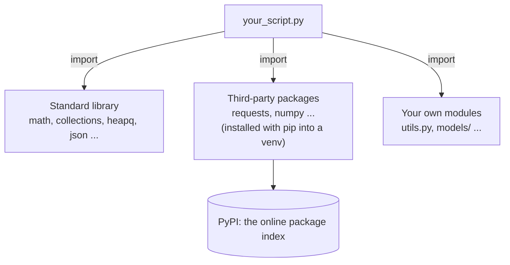
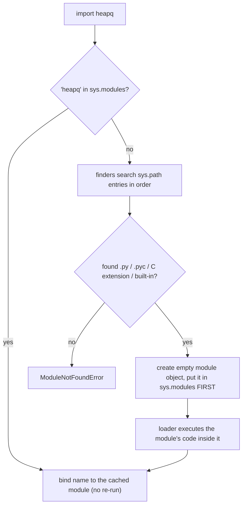

# Chapter 17 · Modules, Packages & the Standard Library

> Python's slogan is "batteries included". Somewhere in the standard library there's already a fast, battle-tested tool for counting things, keeping a priority queue, binary searching, caching, and parsing dates. Interview candidates who know these tools write a 40-line solution in 8 lines, and with fewer bugs. This chapter is your map of the toolbox.

**You will learn:**
- What **modules** and **packages** are, every import style, and how `import` actually finds code
- The `if __name__ == "__main__":` idiom, finally explained
- `pip`, **virtual environments** (`venv`) and `requirements.txt`, so projects don't fight each other
- The DSA power tools: `collections` (`deque`, `Counter`, `defaultdict`, `OrderedDict`, `namedtuple`), `heapq`, `bisect`, `functools` (`cache`, `lru_cache`, `reduce`, `partial`, `cmp_to_key`)
- Everyday helpers: `math`, `random` (seeded), `datetime`, `os`/`pathlib`, `sys`, `copy`, `typing`
- Competitive-programming tricks: `sys.setrecursionlimit` and fast input with `sys.stdin`

**Before this:** [Functions](10-functions.md) · [OOP II](15-oop-inheritance-magic.md) · [Iterators, Generators, Decorators & Context Managers](16-iterators-generators-decorators.md)

---

## 🧠 The Big Idea

Imagine building a house. You *could* forge your own nails, cut your own planks, and wire your own switches. Or you could go to a hardware store where everything is already made, tested and labelled.

- A **module** is one **toolbox**: a single `.py` file full of related functions and classes (`math`, `random`, `json`).
- A **package** is a **shelf of toolboxes**: a folder of modules (`collections`, `json`, `urllib`).
- The **standard library** is the **hardware store that comes free with Python**: 200+ modules, installed with Python itself.
- **PyPI** (the Python Package Index) is the **giant online marketplace** with hundreds of thousands of third-party packages (`requests`, `numpy`, `django`), installed with **`pip`**.
- A **virtual environment** is a **separate workshop per project**, so project A's tools don't clash with project B's.



> 💡 For interviews, you mostly need the **standard library**. On LeetCode and most coding platforms, third-party packages aren't available, but `collections`, `heapq`, `bisect`, `itertools`, `functools` and `math` always are.

---

## 🔨 Building It Up

### 1. A module is just a `.py` file

Every Python file is a module. Its name is the file name without `.py`. When you `import` it, Python runs the file once and gives you a **module object** whose attributes are everything the file defined.

```python
import math

print(type(math).__name__)
print(math.pi, math.sqrt(16))
print(len([name for name in dir(math) if not name.startswith("_")]) > 40)
print(math.__name__)
```

```text
module
3.141592653589793 4.0
True
math
```

What just happened: `import math` created a variable `math` that refers to the module object. You reach its contents with a dot: `math.pi`, `math.sqrt`. `dir(math)` lists everything inside.

### 2. The import styles

```python
import math                              # 1. import the module; use math.sqrt
import statistics as stats               # 2. import with a shorter alias
from math import gcd, inf                # 3. import specific names directly
from collections import Counter as C     # 4. specific name with an alias

print(math.floor(3.7))
print(stats.mean([1, 2, 3, 4]))
print(gcd(12, 18), inf > 10**100)
print(C("banana").most_common(1))
```

```text
3
2.5
6 True
[('a', 3)]
```

| Style | Example | Pros | Cons |
|---|---|---|---|
| `import m` | `import math` | clear where names come from (`math.sqrt`) | longer to type |
| `import m as alias` | `import numpy as np` | short; standard aliases are universal | don't invent weird aliases |
| `from m import name` | `from collections import deque` | short to use | can hide where `deque` came from |
| `from m import *` | `from math import *` | none worth it | ⚠️ dumps unknown names into your file, can silently overwrite yours |

> ⚠️ Avoid `from module import *`. If two modules both define `log` (e.g. `math.log` and a logging helper), the second import silently replaces the first, and readers can't tell where any name came from.

**Convention for the order of imports** at the top of a file (PEP 8, Python's style guide): standard library first, then third-party packages, then your own modules, with a blank line between groups.

### 3. How `import` finds and runs a module

When you write `import something`, Python:

1. Checks **`sys.modules`**, a dictionary cache of already-imported modules. If it's there, it just reuses it. **A module's code runs only once per program**, no matter how many times it's imported.
2. Otherwise searches the folders in **`sys.path`**, in order: the folder of the script you ran, then any paths in the `PYTHONPATH` environment variable, then the standard library folders, then `site-packages` (where `pip` installs things).
3. When found, it **runs the file top to bottom** in a fresh module object, stores it in `sys.modules`, and binds the name.

```python
import sys
import json
import json as again

print(json is again)                     # same module object, not loaded twice
print("json" in sys.modules)
print(type(sys.path).__name__, len(sys.path) > 0)
```

```text
True
True
list True
```

Python also caches the **compiled bytecode** of imported modules in `__pycache__/*.pyc` files so the next run can skip compiling. You'll see those folders appear next to your files: that's normal, and they're safe to delete.

### 4. Writing your own module

Make two files in the same folder:

```py
# geometry.py
PI = 3.14159

def circle_area(r):
    return PI * r * r

def _helper():               # leading underscore: "internal", skipped by import *
    pass
```

```py
# main.py
import geometry
from geometry import circle_area

print(geometry.PI)
print(circle_area(2))
```

Run `python main.py` and it prints `3.14159` and `12.56636`. Your own files are imported exactly like standard modules, because the script's folder is first in `sys.path`.

> ⚠️ **Never name your file after a module you use.** A file called `random.py` or `math.py` or `json.py` in your project folder gets found *before* the real one (your folder comes first in `sys.path`), so `import random` imports your file and everything breaks with confusing errors like `AttributeError: module 'random' has no attribute 'randint'`. This bites every beginner once.

### 5. `if __name__ == "__main__":`

Every module has a built-in variable **`__name__`**:

- When a file is **run directly** (`python geometry.py`), its `__name__` is the string `"__main__"`.
- When a file is **imported** (`import geometry`), its `__name__` is the module name, `"geometry"`.

```python
print("my __name__ is", repr(__name__))

def main():
    print("running as a script")

if __name__ == "__main__":
    main()
```

```text
my __name__ is '__main__'
running as a script
```

**Why it matters:** remember that importing a module *runs* it. Without the guard, any test code or demo at the bottom of `geometry.py` would run every time someone imports it. With the guard, the demo runs only when you execute the file directly:

```py
# geometry.py
def circle_area(r):
    return 3.14159 * r * r

if __name__ == "__main__":         # runs for "python geometry.py", NOT for "import geometry"
    print("self-test:", circle_area(1))
```

The guard is also **required** for `multiprocessing` on Windows and macOS ([Chapter 18](18-internals-concurrency.md)), because worker processes import your main file.

### 6. Packages: folders of modules

When a project grows, you group modules into a **package**: a folder, usually containing an `__init__.py` file.

```text
shop/                      <- project root (run python from here)
├── main.py
└── store/                 <- a package
    ├── __init__.py        <- runs when 'store' is first imported; marks the folder as a package
    ├── products.py
    ├── cart.py
    └── payments/          <- a sub-package
        ├── __init__.py
        └── upi.py
```

```py
# main.py
from store.products import Product          # absolute import: package.module
from store.payments import upi              # import a submodule
import store.cart as cart

# inside store/cart.py, sibling modules can use RELATIVE imports:
from .products import Product               # "." = this package (store)
from .payments.upi import pay               # ".payments" = store/payments
from .. import something                    # ".." = parent package (only inside nested packages)
```

What `__init__.py` is for:

- It **runs when the package is imported**, so it can set up things or expose a clean API: writing `from .products import Product` inside `store/__init__.py` lets users write `from store import Product`.
- `__all__ = ["Product", "Cart"]` in a module or `__init__.py` controls what `from store import *` exports.
- Since Python 3.3, a folder **without** `__init__.py` still works as a "namespace package", but include `__init__.py` in your own projects: it's explicit and avoids surprises.

> 💡 Relative imports (`from .products import ...`) only work inside packages. Running a file inside a package directly (`python store/cart.py`) breaks them; run it as a module from the project root instead: `python -m store.cart`.

### 7. `pip`, virtual environments and `requirements.txt`

**`pip`** installs packages from PyPI:

```bash
python -m pip install requests            # install the latest version
python -m pip install "requests==2.31.0"  # an exact version
python -m pip install --upgrade requests  # upgrade
python -m pip uninstall requests
python -m pip list                        # what's installed
```

(`python -m pip` guarantees you're using the pip that belongs to *that* Python, which avoids "I installed it but Python can't find it" problems.)

**The problem:** by default, pip installs into one global place. Project A needs `django 4`, project B needs `django 5`. They can't both win.

**The solution: a virtual environment** (**venv**), a private folder with its own Python and its own packages, one per project:

```bash
# create it (once per project) in a folder named .venv
python -m venv .venv

# activate it (every new terminal)
.venv\Scripts\activate          # Windows
source .venv/bin/activate       # macOS / Linux

# now pip installs only into this project
python -m pip install requests

deactivate                      # leave the venv
```

When a venv is active, your terminal prompt shows `(.venv)`, and `python`/`pip` point inside the `.venv` folder.

**`requirements.txt`** records your project's dependencies so anyone can recreate the environment:

```bash
python -m pip freeze > requirements.txt    # save exact installed versions
python -m pip install -r requirements.txt  # install them on another machine
```

```text
requests==2.31.0
python-dateutil>=2.8,<3
```

> 💡 Never commit the `.venv` folder to git (add it to `.gitignore`); commit `requirements.txt` instead. Modern tools like `uv`, `poetry` and `pyproject.toml` files do the same job with more features, but `venv` + `requirements.txt` is the foundation they all build on.

### 8. `collections`: supercharged containers

This module is the single most useful one for DSA. Five tools:

**`deque`** ("deck", double-ended queue): O(1) append and pop at **both** ends. A `list` is O(n) at the front, because every element shifts.

```python
from collections import deque

q = deque([1, 2, 3])
q.append(4)            # add right
q.appendleft(0)        # add left: O(1) (list.insert(0, x) is O(n))
print(q)
print(q.popleft(), q.pop(), q)   # remove from both ends, O(1)

q.rotate(1)            # rotate right by 1
print(q)

recent = deque(maxlen=3)          # a bounded deque drops the oldest item automatically
for page in ["home", "cart", "pay", "done"]:
    recent.append(page)
print(recent)
```

```text
deque([0, 1, 2, 3, 4])
0 4 deque([1, 2, 3])
deque([3, 1, 2])
deque(['cart', 'pay', 'done'], maxlen=3)
```

Use `deque` for **queues** (BFS in [Graphs](../part-2-dsa/16-graphs-bfs-dfs.md)), sliding windows, and "last N items". Note: indexing into the **middle** of a deque is O(n); it's fast only at the ends.

**`Counter`**: a dict that counts things.

```python
from collections import Counter

votes = Counter(["ana", "ben", "ana", "chen", "ana", "ben"])
print(votes)
print(votes["ana"], votes["nobody"])         # missing keys count as 0, no KeyError
print(votes.most_common(2))

letters = Counter("mississippi")
print(letters.most_common(1))
print(Counter("listen") == Counter("silent"))   # anagram check in one line

a, b = Counter("aab"), Counter("abc")
print(a + b, a - b)                           # combine counts / subtract (drops <= 0)
print(a & b, a | b)                           # min / max of counts
print(sorted(votes.elements()))               # expand back into items
print(votes.total())                          # sum of all counts (Python 3.10+)
```

```text
Counter({'ana': 3, 'ben': 2, 'chen': 1})
3 0
[('ana', 3), ('ben', 2)]
[('i', 4)]
True
Counter({'a': 3, 'b': 2, 'c': 1}) Counter({'a': 1})
Counter({'a': 1, 'b': 1}) Counter({'a': 2, 'b': 1, 'c': 1})
['ana', 'ana', 'ana', 'ben', 'ben', 'chen']
6
```

**`defaultdict`**: a dict that **creates a default value** the first time you touch a missing key. You pass a *factory* (any zero-argument callable: `list`, `int`, `set`, a lambda).

```python
from collections import defaultdict

# group words by their first letter
words = ["apple", "avocado", "banana", "blueberry", "cherry"]
groups = defaultdict(list)
for w in words:
    groups[w[0]].append(w)          # no "if key not in dict" dance
print(dict(groups))

# build a graph's adjacency list
edges = [(1, 2), (1, 3), (2, 3), (3, 4)]
graph = defaultdict(list)
for u, v in edges:
    graph[u].append(v)
    graph[v].append(u)              # undirected
print(dict(graph))

counts = defaultdict(int)           # int() == 0
for ch in "hello":
    counts[ch] += 1
print(dict(counts))
```

```text
{'a': ['apple', 'avocado'], 'b': ['banana', 'blueberry'], 'c': ['cherry']}
{1: [2, 3], 2: [1, 3], 3: [1, 2, 4], 4: [3]}
{'h': 1, 'e': 1, 'l': 2, 'o': 1}
```

> ⚠️ Even *reading* a missing key creates it: `if graph[99]:` silently adds `99: []`. Use `99 in graph` or `graph.get(99)` to check without creating.

**`OrderedDict`**: a dict with extra ordering powers. Since Python 3.7, normal dicts keep insertion order too, but `OrderedDict` adds `move_to_end()` and `popitem(last=False)`, both O(1). That's exactly what an **LRU cache** needs:

```python
from collections import OrderedDict

class LRUCache:                                   # LeetCode 146
    def __init__(self, capacity):
        self.capacity = capacity
        self.data = OrderedDict()

    def get(self, key):
        if key not in self.data:
            return -1
        self.data.move_to_end(key)                # mark as most recently used
        return self.data[key]

    def put(self, key, value):
        if key in self.data:
            self.data.move_to_end(key)
        self.data[key] = value
        if len(self.data) > self.capacity:
            self.data.popitem(last=False)         # evict the least recently used

cache = LRUCache(2)
cache.put(1, "one"); cache.put(2, "two")
print(cache.get(1))           # 1 is now most recent
cache.put(3, "three")         # evicts 2
print(cache.get(2), list(cache.data))
```

```text
one
-1 [1, 3]
```

**`namedtuple`**: a tuple whose fields have names. Immutable, lightweight, readable.

```python
from collections import namedtuple

Point = namedtuple("Point", ["x", "y"])
p = Point(3, 4)
print(p, p.x, p[1])                 # access by name OR index
x, y = p                            # unpacks like a tuple
print((p.x ** 2 + p.y ** 2) ** 0.5)
print(p._replace(x=10), p._asdict())

Edge = namedtuple("Edge", "src dst weight")    # fields can be a space-separated string
edges = [Edge("A", "B", 5), Edge("A", "C", 2)]
print(min(edges, key=lambda e: e.weight))
```

```text
Point(x=3, y=4) 3 4
5.0
Point(x=10, y=4) {'x': 3, 'y': 4}
Edge(src='A', dst='C', weight=2)
```

(`typing.NamedTuple` is the class-syntax version with type hints; `@dataclass` from [Chapter 15](15-oop-inheritance-magic.md) is the mutable, more flexible cousin.)

### 9. `heapq`: priority queues

A **heap** is a structure where the **smallest** item is always at the front, ready in O(1), and adding or removing an item costs only O(log n). Python's `heapq` keeps a heap inside a normal list. You'll learn how heaps work internally in [DSA Chapter 15](../part-2-dsa/15-heaps.md); here's how to *use* one.

```python
import heapq

nums = [5, 1, 8, 3, 2]
heapq.heapify(nums)                    # rearrange in place into a heap: O(n)
print(nums[0])                         # smallest is always at index 0

heapq.heappush(nums, 0)                # O(log n)
print(heapq.heappop(nums), heapq.heappop(nums))   # pops smallest first, O(log n)

print(heapq.nsmallest(2, [7, 3, 9, 1]), heapq.nlargest(2, [7, 3, 9, 1]))

# MAX-heap trick: Python only has a min-heap, so push negatives
max_heap = []
for x in [5, 1, 8]:
    heapq.heappush(max_heap, -x)
print(-heapq.heappop(max_heap))

# Priorities with tuples: (priority, tie_breaker, item)
tasks = []
heapq.heappush(tasks, (2, "write report"))
heapq.heappush(tasks, (1, "fix prod bug"))
heapq.heappush(tasks, (3, "lunch"))
while tasks:
    priority, task = heapq.heappop(tasks)
    print(priority, task)
```

```text
1
0 1
[1, 3] [9, 7]
8
1 fix prod bug
2 write report
3 lunch
```

Signals in a problem: "**k-th largest / smallest**", "**top k**", "**always process the cheapest / closest / earliest next**", "**merge k sorted**", "**running median**", and Dijkstra's shortest path ([DSA Chapter 17](../part-2-dsa/17-graphs-advanced.md)).

> ⚠️ When two tuples have equal priorities, Python compares the **next** element. If that's an object without `<` (like a `ListNode`), you get `TypeError`. Add a unique counter as a tie-breaker: `(priority, counter, item)`.

### 10. `bisect`: binary search on sorted lists

`bisect` finds where a value **would go** in a sorted list, in O(log n). (How binary search works inside: [DSA Chapter 8](../part-2-dsa/08-binary-search.md).)

```python
import bisect

scores = [10, 20, 20, 20, 30, 40]
print(bisect.bisect_left(scores, 20))     # first position where 20 could go (before equals)
print(bisect.bisect_right(scores, 20))    # last position (after equals)
print(bisect.bisect_right(scores, 20) - bisect.bisect_left(scores, 20))   # count of 20s

def contains(sorted_list, x):
    i = bisect.bisect_left(sorted_list, x)
    return i < len(sorted_list) and sorted_list[i] == x

print(contains(scores, 30), contains(scores, 25))

bisect.insort(scores, 25)                 # insert keeping it sorted (search O(log n), insert O(n))
print(scores)

def grade(mark, cutoffs=(40, 60, 75, 90), letters="FDCBA"):
    return letters[bisect.bisect_right(cutoffs, mark)]

print([grade(m) for m in [35, 40, 72, 90, 100]])
```

```text
1
4
3
True False
[10, 20, 20, 20, 25, 30, 40]
['F', 'D', 'C', 'A', 'A']
```

`bisect_left` gives the index of the **first element ≥ x**; `bisect_right` gives the index of the **first element > x**. Since Python 3.10, both accept a `key=` function.

### 11. `itertools`: a quick recap

You toured `itertools` in [Chapter 16](16-iterators-generators-decorators.md). The DSA highlights, in one place:

```python
from itertools import accumulate, combinations, permutations, product, groupby, pairwise

print(list(accumulate([2, 4, 1])))                   # prefix sums
print(list(combinations("abc", 2)))                  # choose 2
print(len(list(permutations(range(4)))))             # 4! orderings
print(list(product([0, 1], repeat=2)))               # all bit patterns of length 2
print([(k, len(list(g))) for k, g in groupby("aabccc")])
print([b - a for a, b in pairwise([1, 4, 9, 16])])   # differences between neighbours
```

```text
[2, 6, 7]
[('a', 'b'), ('a', 'c'), ('b', 'c')]
24
[(0, 0), (0, 1), (1, 0), (1, 1)]
[('a', 2), ('b', 1), ('c', 3)]
[3, 5, 7]
```

### 12. `functools`: tools for functions

**`cache` and `lru_cache`**: memoization in one line. You built this by hand in [Chapter 16](16-iterators-generators-decorators.md); this is the fast, built-in version.

```python
from functools import cache, lru_cache

@cache                                   # unlimited cache (Python 3.9+)
def grid_paths(r, c):
    """Number of ways from (0,0) to (r,c) moving only right/down."""
    if r == 0 or c == 0:
        return 1
    return grid_paths(r - 1, c) + grid_paths(r, c - 1)

print(grid_paths(16, 16))
print(grid_paths.cache_info().currsize)

@lru_cache(maxsize=2)                    # keeps only the 2 most recently used results
def square(n):
    return n * n

for n in [1, 2, 1, 3, 2]:
    square(n)
print(square.cache_info())
```

```text
601080390
288
CacheInfo(hits=1, misses=4, maxsize=2, currsize=2)
```

Without the cache, `grid_paths(16, 16)` would make over a billion recursive calls; with it, each of the 288 distinct `(r, c)` states is computed once. This turns many recursive DFS / DP solutions from "time limit exceeded" into "accepted". Arguments must be **hashable** (no lists), and `.cache_clear()` resets the cache (needed when you call the solver again with different data on LeetCode).

**`reduce`**: fold a sequence into one value by repeatedly applying a two-argument function.

```python
from functools import reduce
import operator

print(reduce(lambda acc, x: acc * x, [1, 2, 3, 4, 5]))     # 5! = 120
print(reduce(operator.xor, [4, 1, 2, 1, 2]))                # the single non-duplicate number
print(reduce(lambda acc, d: acc * 10 + d, [4, 0, 7], 0))    # digits -> number
```

```text
120
4
407
```

That XOR line is the famous **Single Number** (LeetCode 136) trick: `x ^ x = 0` and `x ^ 0 = x`, so pairs cancel out ([DSA Chapter 23](../part-2-dsa/23-bits-math.md)). For sums and products, prefer the clearer `sum()` and `math.prod()`.

**`partial`**: pre-fill some arguments of a function, creating a new function.

```python
from functools import partial

def power(base, exponent):
    return base ** exponent

square = partial(power, exponent=2)
cube = partial(power, exponent=3)
print(square(7), cube(2))

parse_binary = partial(int, base=2)
print(parse_binary("1011"))
```

```text
49 8
11
```

**`cmp_to_key`**: sort with an old-style comparison function `cmp(a, b)` that returns negative/zero/positive. Usually `key=` is simpler, but some orders can only be expressed by comparing **pairs**. The classic: **Largest Number** (LeetCode 179): arrange numbers to form the biggest possible number.

```python
from functools import cmp_to_key

def largest_number(nums):
    strs = list(map(str, nums))
    def compare(a, b):
        if a + b > b + a:           # "9" + "34" > "34" + "9", so "9" goes first
            return -1
        if a + b < b + a:
            return 1
        return 0
    strs.sort(key=cmp_to_key(compare))
    result = "".join(strs)
    return "0" if result[0] == "0" else result

print(largest_number([3, 30, 34, 5, 9]))
print(largest_number([0, 0]))
```

```text
9534330
0
```

### 13. `math`: number tools

```python
import math

print(math.gcd(48, 18), math.lcm(4, 6))         # lcm needs Python 3.9+
print(math.isqrt(99), math.sqrt(99))            # integer sqrt (exact) vs float sqrt
print(math.ceil(7 / 2), math.floor(-3.5), -7 // 2)
print(math.comb(5, 2), math.perm(5, 2), math.factorial(5))
print(math.prod([2, 3, 4]), math.dist((0, 0), (3, 4)))
print(math.inf > 10**18, -math.inf < -10**18)
print(math.log2(1024), math.log10(1000), round(math.log(math.e), 2))
print(math.isclose(0.1 + 0.2, 0.3), 0.1 + 0.2 == 0.3)
```

```text
6 12
9 9.9498743710662
4 -4 -4
10 20 120
24 5.0
True True
10.0 3.0 1.0
True False
```

Useful habits:

- `math.inf` / `-math.inf` (or `float("inf")`) as the starting value for "minimum so far" / "maximum so far".
- `math.isqrt(n)` for exact integer square roots (perfect-square checks: `math.isqrt(n) ** 2 == n`). `math.sqrt` uses floats and can be off for huge integers.
- `math.comb(n, k)` for "n choose k" counting questions.
- `math.isclose` for comparing floats, never `==` ([Chapter 3](03-operators-expressions.md)).

### 14. `random`: reproducible randomness with seeds

Computers produce **pseudo-random** numbers: a deterministic sequence that *looks* random, started from a **seed**. Same seed → same sequence, which is essential for reproducible tests and simulations.

```python
import random

random.seed(42)                             # fix the starting point
print(random.randint(1, 6), random.randint(1, 6), random.randint(1, 6))
print(round(random.random(), 4))            # float in [0, 1)
print(random.choice(["rock", "paper", "scissors"]))

deck = list(range(1, 11))
random.shuffle(deck)                        # shuffles in place
print(deck)
print(random.sample(range(100), 3))         # 3 distinct picks

random.seed(42)                             # same seed again...
print(random.randint(1, 6), random.randint(1, 6), random.randint(1, 6))   # ...same numbers
```

```text
6 1 1
0.7416
rock
[10, 8, 9, 1, 5, 7, 6, 2, 3, 4]
[4, 3, 11]
6 1 1
```

`random.Random(seed)` creates an independent generator object, which is handy when you don't want to disturb the global one.

> ⚠️ `random` is **not** for passwords, tokens or anything security-related: its sequence can be predicted. Use the **`secrets`** module (`secrets.token_hex(16)`) for that.

### 15. `datetime`: dates and times

```python
from datetime import date, datetime, timedelta

launch = date(2024, 8, 15)
deadline = date(2024, 9, 1)
print(deadline - launch)                    # subtracting dates gives a timedelta
print((deadline - launch).days, launch.weekday())   # Monday == 0

meeting = datetime(2024, 8, 15, 14, 30)
print(meeting + timedelta(hours=2, minutes=15))
print(meeting.strftime("%d %b %Y, %I:%M %p"))       # format: datetime -> string

parsed = datetime.strptime("2024-12-25 09:00", "%Y-%m-%d %H:%M")   # parse: string -> datetime
print(parsed, parsed.year, parsed.isoformat())
print(date.fromisoformat("2024-02-29") + timedelta(days=1))
```

```text
17 days, 0:00:00
17 3
2024-08-15 16:45:00
15 Aug 2024, 02:30 PM
2024-12-25 09:00:00 2024 2024-12-25T09:00:00
2024-03-01
```

| Code | Meaning | Example |
|---|---|---|
| `%Y` | 4-digit year | 2024 |
| `%m` / `%d` | month / day, zero-padded | 08 / 15 |
| `%H` / `%I` | hour 24h / 12h | 14 / 02 |
| `%M` / `%S` | minute / second | 30 / 00 |
| `%b` / `%B` | short / full month name | Aug / August |
| `%a` / `%A` | short / full weekday | Thu / Thursday |
| `%p` | AM/PM | PM |

The current moment comes from `datetime.now()` and `date.today()` (results change every run, of course). Datetimes without timezone information are called **naive**; for anything involving users in different countries, use **aware** datetimes: `datetime.now(timezone.utc)` and the `zoneinfo` module.

### 16. `os` and `pathlib`: talking to the operating system

You met `pathlib` in [Chapter 13](13-exceptions-files.md). `os` is the older, lower-level module, still used for environment variables and processes:

```py
import os
from pathlib import Path

print(os.getcwd())                       # current working directory
print(os.environ.get("HOME"))            # environment variable (None if missing)
api_key = os.environ.get("API_KEY", "")  # how apps read secrets/config
os.makedirs("out/logs", exist_ok=True)
print(os.listdir("."))                   # names in a folder
print(os.path.join("out", "logs", "a.txt"))   # old style
print(Path("out") / "logs" / "a.txt")         # modern style: prefer this
print(os.cpu_count())                    # number of CPU cores
```

Rule of thumb: **paths and files → `pathlib`**; **environment variables, process info, low-level OS calls → `os`**.

### 17. `sys`: the interpreter itself, and competitive-programming tricks

```python
import sys

print(sys.version_info >= (3, 8))           # compare versions safely
print(sys.maxsize == 2**63 - 1)             # largest list index on 64-bit (ints themselves are unbounded)
print(sys.getrecursionlimit())              # default recursion depth limit
print(sys.getsizeof(0) < sys.getsizeof(10**100))   # bigger ints use more bytes
print(sys.argv[0].endswith(".py"))          # command-line arguments; argv[0] is the script
```

```text
True
True
1000
True
True
```

**Raising the recursion limit.** Recursive DFS on a tree or graph with 10^5 nodes can go 10^5 levels deep, but Python stops at about 1,000 frames with `RecursionError` ([Chapter 12](12-recursion.md)). Competitive programmers raise the limit:

```python
import sys
sys.setrecursionlimit(10**6)

def depth(n):
    return 0 if n == 0 else 1 + depth(n - 1)

print(depth(5000))      # would crash with the default limit of 1000
```

```text
5000
```

> ⚠️ The limit is a safety net, not the real constraint. Each Python frame also uses C stack memory, and very deep recursion (hundreds of thousands of levels) can crash the whole interpreter with a segmentation fault instead of a clean error. For really deep structures, convert recursion to an explicit stack ([DSA Chapter 11](../part-2-dsa/11-stacks.md)).

**Fast input.** `input()` is slow when reading 10^5+ lines (each call has overhead). `sys.stdin` is the program's standard input, a **file object** ([Chapter 13](13-exceptions-files.md)), so you can read it all at once:

```py
import sys

def main():
    data = sys.stdin.buffer.read().split()     # read EVERYTHING, split on whitespace (bytes)
    n = int(data[0])
    nums = list(map(int, data[1:1 + n]))
    print(sum(nums))

main()

# Alternatives:
input = sys.stdin.readline                     # drop-in faster input(); note: keeps "\n"
n = int(input())
row = list(map(int, input().split()))

# Fast OUTPUT: build one string instead of thousands of print() calls
results = [1, 2, 3]
sys.stdout.write("\n".join(map(str, results)) + "\n")
```

This pattern can make I/O-heavy solutions several times faster on platforms like Codeforces and CodeChef. (On LeetCode you write functions, not I/O, so you won't need it there.)

### 18. `copy`: shallow vs deep copies

Assignment never copies ([Chapter 7](07-lists.md)). When you *do* want a copy, you must decide how deep:

```python
import copy

grid = [[1, 2], [3, 4]]
alias = grid
shallow = copy.copy(grid)          # same as grid[:] or list(grid)
deep = copy.deepcopy(grid)

grid[0][0] = 99                    # change an INNER list
grid.append([5, 6])                # change the OUTER list

print(alias)
print(shallow)                     # sees the inner change, not the append
print(deep)                        # completely independent
```

```text
[[99, 2], [3, 4], [5, 6]]
[[99, 2], [3, 4]]
[[1, 2], [3, 4]]
```

A **shallow** copy makes a new outer container but **shares** the inner objects. A **deep** copy recursively copies everything. In backtracking ([DSA Chapter 9](../part-2-dsa/09-backtracking.md)), saving `path[:]` (a shallow copy of a flat list) is enough; for a grid of lists, you need deep copies. [Chapter 18](18-internals-concurrency.md) shows what happens in memory.

### 19. `typing`: type hints

**Type hints** document what types a function expects and returns. Python **does not enforce them at runtime**; they're for humans, editors (autocomplete, warnings) and checkers like `mypy`.

```python
from typing import Optional, Callable

def average(nums: list[float]) -> float:
    return sum(nums) / len(nums)

def find_user(users: dict[int, str], user_id: int) -> Optional[str]:   # str or None
    return users.get(user_id)

def apply(f: Callable[[int], int], value: int) -> int:
    return f(value)

def first_or_default(items: list[str], default: str | None = None) -> str | None:   # 3.10+ syntax
    return items[0] if items else default

print(average([1.0, 2.0, 4.5]))
print(find_user({1: "ana"}, 2))
print(apply(lambda x: x * 10, 4))
print(first_or_default([], "none"))
print(average.__annotations__)
print(average([1, 2]))          # passing ints works anyway: hints are NOT enforced
```

```text
2.5
None
40
none
{'nums': list[float], 'return': <class 'float'>}
1.5
```

| Hint | Means |
|---|---|
| `int`, `str`, `float`, `bool` | that type |
| `list[int]`, `set[str]`, `dict[str, int]`, `tuple[int, str]` | containers with element types (3.9+) |
| `tuple[int, ...]` | a tuple of any length of ints |
| `Optional[X]` or `X \| None` | X or None |
| `Union[A, B]` or `A \| B` | either type |
| `Callable[[int, str], bool]` | a function taking (int, str), returning bool |
| `Any` | anything (opt out of checking) |

LeetCode's function signatures use hints (`def twoSum(self, nums: List[int], target: int) -> List[int]:`), with `List` from `typing`, the older spelling of `list[...]`.

---

## 🔬 Under the Hood

### What actually happens during `import`



Two consequences:

1. **Modules are singletons.** Every `import config` across your whole program gets the *same* module object. That's why a module is a simple, valid way to share configuration or a single shared instance.
2. **Circular imports** break because the module is put in `sys.modules` *before* its code finishes running. If `a.py` imports `b.py` and `b.py` imports `a.py` at the top, `b` receives a half-initialised `a` and `from a import thing` fails with `ImportError: cannot import name 'thing' from partially initialized module 'a'`. Fixes: move shared code into a third module, or import inside the function that needs it.

### `.pyc` files

Before running a module, Python compiles source to **bytecode** ([Chapter 18](18-internals-concurrency.md)). For imported modules it saves this bytecode to `__pycache__/name.cpython-311.pyc` (the tag shows the Python version), and next time it checks the source's timestamp: if unchanged, it skips compiling. The script you run directly is compiled fresh each time and not cached.

### Why the standard library is fast

Many key modules are written in **C**, not Python: `heapq`, `bisect`, `collections.deque`, `itertools`, `functools.lru_cache`, `math`, `json`'s speedups, and `Counter`'s counting loop. A call like `heapq.heappush` does all its work at C speed, so it's typically many times faster than the same algorithm written in pure Python. This is a big reason the "Pythonic" solution is often the fastest one: **let C loops do the work**.

### How `deque` gets O(1) at both ends

A `list` is one contiguous array: inserting at index 0 shifts every element (O(n)). A `deque` is a **doubly linked list of fixed-size blocks** (64 slots each in CPython). Adding to either end usually just writes into the free space of the end block, and allocates a new block when one fills up. Both ends are O(1), but reaching the middle means walking blocks, so `dq[i]` in the middle is O(n).

---

## 🧩 Pattern Decoder

### "Which module solves this?" cheat sheet

| Problem says... | Reach for | Example problems |
|---|---|---|
| count occurrences, frequency, anagram, majority | `Counter` | Valid Anagram, Top K Frequent Elements, Majority Element |
| group by some key | `defaultdict(list)` | Group Anagrams |
| build a graph from edges | `defaultdict(list)` / `defaultdict(set)` | Course Schedule, Number of Provinces |
| queue, BFS, level order, sliding window max | `deque` | Binary Tree Level Order Traversal, Sliding Window Maximum |
| k-th largest/smallest, top k, merge k sorted, always take min/max next | `heapq` | Kth Largest Element in an Array, Merge k Sorted Lists, Task Scheduler |
| search in sorted data, insertion position, count in range | `bisect` | Search Insert Position, Longest Increasing Subsequence (O(n log n)) |
| recursion with overlapping subproblems | `@cache` / `@lru_cache` | Climbing Stairs, Coin Change, Word Break |
| prefix sums, running max | `itertools.accumulate` | Range Sum Query, Best Time to Buy and Sell Stock |
| all subsets/orders/pairs (small n) | `combinations`, `permutations`, `product` | brute-force checks |
| custom pairwise sort order | `functools.cmp_to_key` | Largest Number |
| LRU cache | `OrderedDict` | LRU Cache |
| gcd / lcm / exact sqrt / n choose k | `math` | Fraction problems, Unique Paths (`comb`) |
| deep recursion on 10^5 nodes | `sys.setrecursionlimit` (or an explicit stack) | DFS on big trees |
| lots of input lines | `sys.stdin` | competitive programming |

### A competitive-programming starter template

```py
import sys
from collections import defaultdict, deque, Counter
from heapq import heappush, heappop
from bisect import bisect_left, bisect_right
from functools import cache
from math import inf, gcd

input = sys.stdin.readline
sys.setrecursionlimit(10**6)

def solve():
    n = int(input())
    nums = list(map(int, input().split()))
    # ... your logic ...
    return sum(nums)

def main():
    t = int(input())                       # number of test cases
    out = [str(solve()) for _ in range(t)]
    sys.stdout.write("\n".join(out) + "\n")

if __name__ == "__main__":
    main()
```

### Worked example: Top K Frequent Elements (LeetCode 347)

**Problem:** return the `k` most frequent elements.

**Idea:** `Counter` counts in O(n). `most_common(k)` uses a heap internally (O(n log k)). Interviewers may ask for O(n): **bucket sort** by frequency.

```python
from collections import Counter

def top_k_frequent(nums, k):
    return [x for x, _ in Counter(nums).most_common(k)]

def top_k_frequent_buckets(nums, k):          # O(n): index = frequency
    counts = Counter(nums)
    buckets = [[] for _ in range(len(nums) + 1)]
    for x, c in counts.items():
        buckets[c].append(x)
    result = []
    for freq in range(len(buckets) - 1, 0, -1):
        for x in buckets[freq]:
            result.append(x)
            if len(result) == k:
                return result
    return result

print(top_k_frequent([1, 1, 1, 2, 2, 3], 2))
print(top_k_frequent_buckets([4, 4, 5, 5, 5, 6], 1))
```

```text
[1, 2]
[5]
```

### When NOT to reach for a module

- When the interviewer explicitly asks you to implement the structure (e.g. "implement a heap", "implement LRU without OrderedDict"). Mention the library version, then build it by hand.
- `Counter` for a fixed tiny alphabet in a hot loop: a `[0] * 26` list indexed by `ord(c) - ord("a")` can be faster.
- `deque` when you need random access by index in the middle: use a list.

---

## ⚠️ Traps & Common Mistakes

1. **Naming your file after a module** (`random.py`, `heapq.py`, `collections.py`). Your file shadows the real one. Rename it and delete the `__pycache__` folder.

2. **`from module import *`.** Name collisions and unreadable code.

3. **Thinking importing twice runs the module twice.** It doesn't; `sys.modules` caches it. (Changes to the file during an interactive session need `importlib.reload(module)`.)

4. **Forgetting the `if __name__ == "__main__":` guard**, so test code runs on import (and `multiprocessing` breaks).

5. **Installing packages without activating the venv**, then wondering why `import requests` fails, or vice versa. Check with `python -m pip --version`, which shows which Python it belongs to.

6. **`heapq` is a min-heap only.** For a max-heap, push `-x` (and negate again when popping).

7. **Pushing uncomparable items into a heap.** `(priority, node)` crashes on ties if nodes have no `<`. Use `(priority, counter, node)`.

8. **`defaultdict` creates keys on read.** `if d[key]:` adds the key. Use `key in d`.

9. **`Counter` subtraction drops zero and negative counts.** `Counter(a=1) - Counter(a=2)` is empty, not `{'a': -1}`. Use `.subtract()` to keep negatives.

10. **`@cache` with mutable arguments.** Lists aren't hashable: `TypeError: unhashable type: 'list'`. Pass tuples, or cache an inner function that closes over the list and takes only indexes.

11. **Stale caches across test cases.** On LeetCode, a module-level `@cache` function keeps results between test cases with different inputs. Define the cached helper **inside** the method, or call `.cache_clear()`.

12. **`random` without a seed in tests.** Results differ every run; seed it for reproducibility. And never use `random` for secrets.

13. **Mixing `bisect_left` and `bisect_right`.** Left = first index with value ≥ x; right = first index with value > x. Off-by-one bugs live here.

14. **Shallow-copying a 2D grid** (`grid[:]` or `[row for row in grid]`): the rows are still shared. Use `[row[:] for row in grid]` or `copy.deepcopy`.

---

## 💡 Tips & Tricks

- `python -m module` runs a module as a script: `python -m venv`, `python -m pip`, `python -m timeit`, `python -m http.server 8000` (instant local web server), `python -m json.tool file.json` (pretty-print JSON).
- `help(heapq)` or `help(Counter.most_common)` in the REPL shows documentation offline.
- Want the module source? `import inspect; print(inspect.getsourcefile(collections))`.
- `Counter(word).most_common()[-1]` gets the least common; `most_common()` with no argument sorts everything.
- `heapq.merge(*sorted_lists)` lazily merges already-sorted iterables.
- `deque.rotate(k)` rotates in O(k); a quick way to solve "rotate array" style problems on queues.
- `math.inf` beats magic numbers like `999999999` as an initial minimum.
- `functools.cache` is `lru_cache(maxsize=None)`: unlimited and slightly faster.
- `sys.stdout.write` with a single joined string is much faster than thousands of `print` calls.
- In a project, keep `requirements.txt` sorted and pinned (`==`) for apps; libraries use looser ranges (`>=`).

---

## 🎯 Interview Questions

### 1. What's the difference between a module and a package? 🔥🔥🔥

<details><summary>Answer</summary>

A **module** is a single Python file (`utils.py`) whose top-level names become attributes of a module object when imported. A **package** is a directory that groups modules (and sub-packages), traditionally marked by an `__init__.py` file that runs when the package is imported and can define its public API. Packages give hierarchical namespaces: `store.payments.upi`. Since Python 3.3 there are also namespace packages (directories without `__init__.py`), mostly used to split one package across multiple locations.

</details>

### 2. What does `if __name__ == "__main__":` do? 🔥🔥🔥

<details><summary>Answer</summary>

Every module has a `__name__` attribute. When a file is executed directly, Python sets its `__name__` to `"__main__"`; when it's imported, `__name__` is the module's name. So code under this guard runs only when the file is run as a script, not when it's imported. It's used for entry points (`main()`), self-tests and demos, and it's required with `multiprocessing` on platforms that spawn new processes (Windows/macOS), which re-import the main module in each worker.

</details>

### 3. What happens when you import a module? Is it executed every time you import it? 🔥🔥

<details><summary>Answer</summary>

Python first checks `sys.modules`. If the module is cached there, it's reused immediately. Otherwise, the import system searches `sys.path` (script directory, `PYTHONPATH`, standard library, `site-packages`), creates a module object, registers it in `sys.modules`, executes the module's code top to bottom in that object's namespace, and binds the name in the importer. So a module's top-level code runs **once per process**; subsequent imports are just dictionary lookups. Compiled bytecode is cached in `__pycache__` to speed up future runs. `importlib.reload()` forces re-execution.

</details>

### 4. Why use virtual environments? 🔥🔥🔥

<details><summary>Answer</summary>

To isolate each project's dependencies. Without them, all projects share one global `site-packages`, so different projects needing different versions of the same library conflict, and upgrading for one project can break another. A venv (`python -m venv .venv`) contains its own interpreter link and package directory; activating it makes `python`/`pip` use it. Combined with a pinned `requirements.txt` (`pip freeze > requirements.txt`, `pip install -r requirements.txt`), it gives reproducible environments across machines, CI and production. It also avoids needing admin rights to install packages.

</details>

### 5. What are `Counter`, `defaultdict` and `deque` used for? 🔥🔥🔥

<details><summary>Answer</summary>

- `Counter`: a dict subclass for counting hashable items; missing keys return 0; has `most_common(k)`, arithmetic between counters, and `==` for multiset comparison (anagrams).
- `defaultdict(factory)`: a dict that calls `factory()` to create a value for a missing key on access; ideal for grouping (`defaultdict(list)`) and adjacency lists.
- `deque`: a double-ended queue with O(1) `append`/`appendleft`/`pop`/`popleft`; used for queues (BFS), sliding windows, and bounded history (`maxlen`). Lists are O(n) for operations at the front.

</details>

### 6. LRU Cache (LeetCode 146) 🔥🔥🔥

Design a cache with capacity `c` supporting `get(key)` and `put(key, value)` in O(1), evicting the least recently used key when full.

<details><summary>Answer</summary>

The quick version uses `OrderedDict` (see section 8): `move_to_end` on every access, `popitem(last=False)` to evict. Both O(1).

Interviewers often follow up: "now without `OrderedDict`". The classic implementation is a **hash map + doubly linked list**: the map gives O(1) lookup from key to node; the list keeps usage order with O(1) unlink/relink. Sentinel head/tail nodes avoid edge cases.

```python
class Node:
    __slots__ = ("key", "val", "prev", "next")
    def __init__(self, key=0, val=0):
        self.key, self.val = key, val
        self.prev = self.next = None

class LRUCache:
    def __init__(self, capacity):
        self.cap = capacity
        self.map = {}
        self.head, self.tail = Node(), Node()      # sentinels
        self.head.next, self.tail.prev = self.tail, self.head

    def _remove(self, node):
        node.prev.next, node.next.prev = node.next, node.prev

    def _add_front(self, node):                     # front = most recently used
        node.prev, node.next = self.head, self.head.next
        self.head.next.prev = node
        self.head.next = node

    def get(self, key):
        if key not in self.map:
            return -1
        node = self.map[key]
        self._remove(node)
        self._add_front(node)
        return node.val

    def put(self, key, value):
        if key in self.map:
            self._remove(self.map[key])
        node = Node(key, value)
        self.map[key] = node
        self._add_front(node)
        if len(self.map) > self.cap:
            lru = self.tail.prev                    # least recently used
            self._remove(lru)
            del self.map[lru.key]

c = LRUCache(2)
c.put(1, 1); c.put(2, 2)
print(c.get(1))
c.put(3, 3)
print(c.get(2), c.get(3))
c.put(4, 4)
print(c.get(1), c.get(3), c.get(4))
```

```text
1
-1 3
-1 3 4
```

All operations O(1); space O(capacity). Linked lists are covered in depth in [DSA Chapter 10](../part-2-dsa/10-linked-lists.md).

</details>

### 7. Kth Largest Element in an Array (LeetCode 215) 🔥🔥🔥

<details><summary>Answer</summary>

Keep a **min-heap of size k**: it holds the k largest seen so far, and its root is the k-th largest. Each push/pop is O(log k), total O(n log k), O(k) space. (`heapq.nlargest(k, nums)[-1]` is a one-liner doing the same; Quickselect gives O(n) average.)

```python
import heapq

def find_kth_largest(nums, k):
    heap = []
    for x in nums:
        heapq.heappush(heap, x)
        if len(heap) > k:
            heapq.heappop(heap)          # drop the smallest: it can't be in the top k
    return heap[0]

print(find_kth_largest([3, 2, 1, 5, 6, 4], 2), find_kth_largest([3, 2, 3, 1, 2, 4, 5, 5, 6], 4))
```

```text
5 4
```

</details>

### 8. Group Anagrams (LeetCode 49) 🔥🔥🔥

<details><summary>Answer</summary>

Anagrams share the same sorted letters, so use the sorted string (or a 26-count tuple) as a key in a `defaultdict(list)`.

```python
from collections import defaultdict

def group_anagrams(words):
    groups = defaultdict(list)
    for w in words:
        groups["".join(sorted(w))].append(w)
    return list(groups.values())

print(group_anagrams(["eat", "tea", "tan", "ate", "nat", "bat"]))
```

```text
[['eat', 'tea', 'ate'], ['tan', 'nat'], ['bat']]
```

Time O(n · L log L) for n words of length L (O(n · L) with a count-tuple key). Space O(n · L).

</details>

### 9. How does `lru_cache` work, and what are its limitations? 🔥🔥

<details><summary>Answer</summary>

`functools.lru_cache(maxsize=N)` wraps a function with a dictionary keyed by its arguments (positional and keyword, so they must be **hashable**). On a hit it returns the stored result and marks the entry as recently used; on a miss it calls the function and stores the result, evicting the least recently used entry when more than `maxsize` are stored (`maxsize=None`, or `@cache`, means unbounded). It's implemented in C and thread-safe for its internal bookkeeping. Limitations: unhashable arguments (lists, dicts) raise `TypeError`; memory grows with unbounded caches; cached results become stale if the function depends on external state; on methods, `self` becomes part of the key (keeping objects alive). `cache_info()` reports hits/misses and `cache_clear()` resets it.

</details>

### 10. Shallow copy vs deep copy? 🔥🔥🔥

<details><summary>Answer</summary>

A **shallow copy** (`copy.copy(x)`, `lst[:]`, `list(lst)`, `dict.copy()`) creates a new container holding **references to the same** inner objects. A **deep copy** (`copy.deepcopy(x)`) recursively copies the inner objects too (handling cycles with a memo dict). With nested mutable data, changing an inner element through the original shows up in a shallow copy but not in a deep copy. For flat lists of immutables (ints, strings), a shallow copy is enough and much faster.

</details>

### 11. Are Python type hints enforced? Why use them? 🔥🔥

<details><summary>Answer</summary>

No: the interpreter stores them in `__annotations__` but doesn't check them at runtime (`def f(x: int)` happily accepts a string). They're used by static type checkers (`mypy`, `pyright`), IDEs (autocomplete, inline errors), documentation, and some libraries that read them on purpose (`dataclasses`, `pydantic`, `FastAPI`). Benefits: catch bugs before running, make interfaces self-documenting, safer refactoring in large codebases.

</details>

### 12. How do you speed up input in Python for competitive programming? 🔥

<details><summary>Answer</summary>

Avoid calling `input()` hundreds of thousands of times. Read all input at once with `sys.stdin.buffer.read().split()` and convert tokens with `int`, or alias `input = sys.stdin.readline` (remember it keeps the trailing newline, so use `.split()`/`.strip()`). For output, collect results in a list and write once with `sys.stdout.write("\n".join(...))`. Also raise `sys.setrecursionlimit` for deep recursion (or use iteration), and prefer built-ins and C-backed modules (`heapq`, `bisect`, `collections`) inside hot loops.

</details>

---

## 🏋️ Practice

**🟢 1. Ransom Note (LeetCode 383).** Can `ransom` be built from the letters of `magazine` (each letter used at most once)?

<details><summary>Solution</summary>

```python
from collections import Counter

def can_construct(ransom, magazine):
    return not (Counter(ransom) - Counter(magazine))   # empty Counter = nothing missing

print(can_construct("aa", "aab"), can_construct("aa", "ab"))
```

```text
True False
```

Counter subtraction keeps only positive counts, i.e. letters we're short of. O(n + m).

</details>

**🟢 2. Last N commands.** Using a `deque` with `maxlen`, keep the last 3 commands typed, and print them most-recent-first after this sequence: `ls, cd, pwd, git status, make`.

<details><summary>Solution</summary>

```python
from collections import deque

history = deque(maxlen=3)
for cmd in ["ls", "cd", "pwd", "git status", "make"]:
    history.append(cmd)
print(list(reversed(history)))
```

```text
['make', 'git status', 'pwd']
```

</details>

**🟡 3. Merge k sorted lists with `heapq`.** Merge `[[1, 4, 7], [2, 5], [0, 9]]` into one sorted list in O(N log k), without just concatenating and sorting.

<details><summary>Solution</summary>

```python
import heapq

def merge_k(lists):
    heap = [(lst[0], i, 0) for i, lst in enumerate(lists) if lst]   # (value, which list, index)
    heapq.heapify(heap)
    out = []
    while heap:
        value, i, j = heapq.heappop(heap)
        out.append(value)
        if j + 1 < len(lists[i]):
            heapq.heappush(heap, (lists[i][j + 1], i, j + 1))
    return out

print(merge_k([[1, 4, 7], [2, 5], [0, 9]]))
```

```text
[0, 1, 2, 4, 5, 7, 9]
```

The heap holds at most one item per list (size k), so each of the N pops/pushes costs O(log k). The list index `i` doubles as a tie-breaker. This is the core of **Merge k Sorted Lists** (LeetCode 23).

</details>

**🟡 4. Time-based key-value store (LeetCode 981).** `set(key, value, timestamp)` and `get(key, timestamp)` returning the value with the largest timestamp ≤ the given one (or `""`). Timestamps for each key arrive in increasing order.

<details><summary>Solution</summary>

```python
import bisect
from collections import defaultdict

class TimeMap:
    def __init__(self):
        self.times = defaultdict(list)     # key -> sorted timestamps
        self.values = defaultdict(list)    # key -> values, same order

    def set(self, key, value, timestamp):
        self.times[key].append(timestamp)  # already increasing: stays sorted
        self.values[key].append(value)

    def get(self, key, timestamp):
        i = bisect.bisect_right(self.times.get(key, []), timestamp)
        return self.values[key][i - 1] if i else ""

tm = TimeMap()
tm.set("price", "100", 1)
tm.set("price", "120", 4)
print(tm.get("price", 3), tm.get("price", 4), tm.get("price", 10), repr(tm.get("price", 0)))
```

```text
100 120 120 ''
```

`bisect_right` returns the index just past the last timestamp ≤ t, so `i - 1` is the answer. O(log n) per `get`. Note the use of `.get(key, [])` to avoid creating keys on read.

</details>

**🟡 5. Count paths in a grid with obstacles, using `@cache`.** A robot moves only right or down on a grid where `1` is an obstacle. Count paths from top-left to bottom-right (LeetCode 63, Unique Paths II).

<details><summary>Solution</summary>

```python
from functools import cache

def unique_paths_with_obstacles(grid):
    rows, cols = len(grid), len(grid[0])

    @cache                                  # defined inside: fresh cache per grid
    def paths(r, c):
        if r >= rows or c >= cols or grid[r][c] == 1:
            return 0
        if (r, c) == (rows - 1, cols - 1):
            return 1
        return paths(r + 1, c) + paths(r, c + 1)

    return paths(0, 0)

print(unique_paths_with_obstacles([[0, 0, 0], [0, 1, 0], [0, 0, 0]]))
print(unique_paths_with_obstacles([[0, 1], [0, 0]]))
```

```text
2
1
```

Each cell is computed once: O(rows × cols) time and space. Defining the cached function inside avoids stale results between different grids.

</details>

**🟡 6. Meeting length report.** Given meetings as `("2024-08-15 09:30", "2024-08-15 11:05")` string pairs, use `datetime` to compute each duration in minutes and the total, and find the longest meeting.

<details><summary>Solution</summary>

```python
from datetime import datetime

FMT = "%Y-%m-%d %H:%M"

def minutes(start, end):
    delta = datetime.strptime(end, FMT) - datetime.strptime(start, FMT)
    return int(delta.total_seconds() // 60)

meetings = {
    "standup": ("2024-08-15 09:30", "2024-08-15 09:45"),
    "design review": ("2024-08-15 11:00", "2024-08-15 12:35"),
    "late night deploy": ("2024-08-15 23:30", "2024-08-16 00:50"),
}
lengths = {name: minutes(*times) for name, times in meetings.items()}
print(lengths)
print("total:", sum(lengths.values()), "| longest:", max(lengths, key=lengths.get))
```

```text
{'standup': 15, 'design review': 95, 'late night deploy': 80}
total: 190 | longest: design review
```

Using real datetimes (not hour/minute arithmetic on strings) handles midnight crossings correctly.

</details>

**🔴 7. Task Scheduler (LeetCode 621).** Tasks are letters; identical tasks need at least `n` idle intervals between them. Find the minimum number of intervals to finish all tasks. Use `Counter` and `heapq`, simulating with a max-heap and a cooldown queue.

<details><summary>Solution</summary>

```python
import heapq
from collections import Counter, deque

def least_interval(tasks, n):
    heap = [-c for c in Counter(tasks).values()]      # max-heap of remaining counts
    heapq.heapify(heap)
    cooldown = deque()                                 # (count_left, time_when_available)
    time = 0
    while heap or cooldown:
        time += 1
        if heap:
            left = heapq.heappop(heap) + 1             # run the most frequent task once
            if left:
                cooldown.append((left, time + n))
        if cooldown and cooldown[0][1] == time:
            heapq.heappush(heap, cooldown.popleft()[0])
    return time

print(least_interval(list("AAABBB"), 2))   # A B idle A B idle A B
print(least_interval(list("AAABBB"), 0))
print(least_interval(list("AAAAAABCDEFG"), 2))
```

```text
8
6
16
```

Greedy reason: always run the task with the most remaining copies, because it's the one most likely to force idle time later. Each time step does O(log 26) work. (There's also an O(n) formula: `max(len(tasks), (max_count - 1) * (n + 1) + number_of_tasks_with_max_count)`, worth mentioning in the interview.)

</details>

---

## 🧠 Never-Forget Summary

- A **module** is a `.py` file; a **package** is a folder of modules (with `__init__.py`).
- `import` checks `sys.modules` first, then searches `sys.path`; a module's code runs **once**.
- `if __name__ == "__main__":` → run only when executed directly, not when imported.
- Never name your file `random.py`/`math.py`: it shadows the real module.
- One **venv** per project; `pip freeze > requirements.txt`, `pip install -r requirements.txt`.
- `Counter` counts, `defaultdict` groups, `deque` queues (O(1) both ends), `OrderedDict` → LRU, `namedtuple` → readable tuples.
- `heapq` = min-heap (negate for max); `bisect_left`/`bisect_right` = binary search on sorted lists.
- `@cache` / `@lru_cache` = one-line memoization; `reduce`, `partial`, `cmp_to_key` for special jobs.
- `math` (gcd, isqrt, comb, inf), seeded `random`, `datetime` + `timedelta`, `pathlib`/`os`, `copy.deepcopy`, type hints (not enforced).
- Competitive programming: `sys.stdin` fast input, `sys.setrecursionlimit`, write output once.

**Memory hooks:**
- **"Count, Group, Queue, Heap, Search, Remember"** → `Counter`, `defaultdict`, `deque`, `heapq`, `bisect`, `cache`. The six DSA superpowers.
- **"Heaps are humble: smallest first."** Negate for max.
- **"Left lands on, Right runs past."** `bisect_left` lands on the first equal value; `bisect_right` runs past the last equal one.
- **"Main means me."** `__name__ == "__main__"` means "I was run myself".

**One picture:**

| Tool | Import | Key operations | Cost |
|---|---|---|---|
| `deque` | `from collections import deque` | `append`, `appendleft`, `pop`, `popleft` | O(1) each end |
| `Counter` | `from collections import Counter` | `most_common(k)`, `+ - & \|`, `==` | O(n) build |
| `defaultdict` | `from collections import defaultdict` | `d[k].append(x)` with no key check | O(1) avg |
| `OrderedDict` | `from collections import OrderedDict` | `move_to_end`, `popitem(last=False)` | O(1) |
| `heapq` | `import heapq` | `heappush`, `heappop`, `heapify`, `nlargest` | O(log n), heapify O(n) |
| `bisect` | `import bisect` | `bisect_left`, `bisect_right`, `insort` | O(log n) search |
| `cache` | `from functools import cache` | `@cache` above a recursive function | O(1) per repeated call |
| `itertools` | `from itertools import ...` | `accumulate`, `combinations`, `product` | lazy |
| `math` | `import math` | `gcd`, `isqrt`, `comb`, `inf` | |
| `sys` | `import sys` | `stdin`, `setrecursionlimit` | |

> **If you remember only one thing:** before writing a data structure by hand, ask "is this already in `collections`, `heapq`, `bisect`, `itertools` or `functools`?" Nine times out of ten it is, it's written in C, and it has no bugs.

---
**Next:** [Chapter 18 · Python Internals & Concurrency](18-internals-concurrency.md)  ·  **Back to** [Contents](../README.md)
