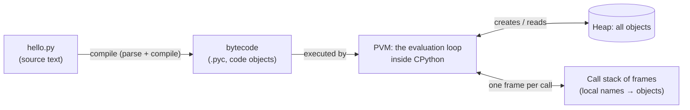
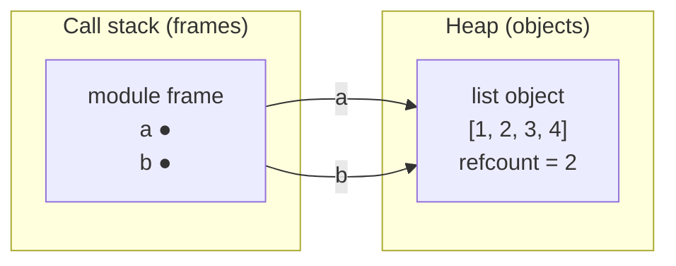
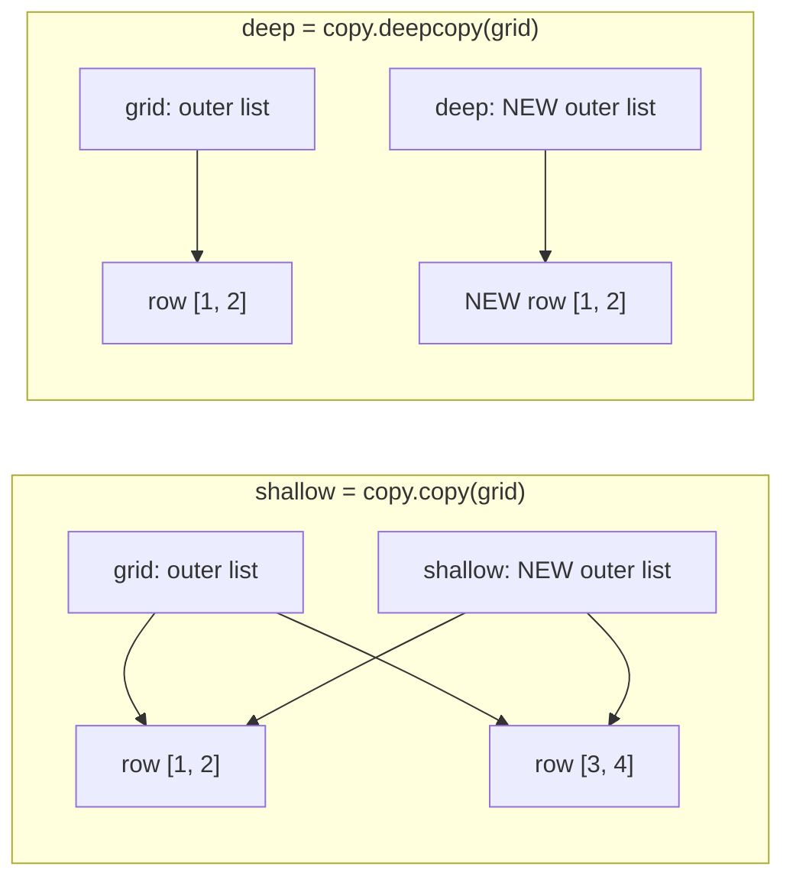
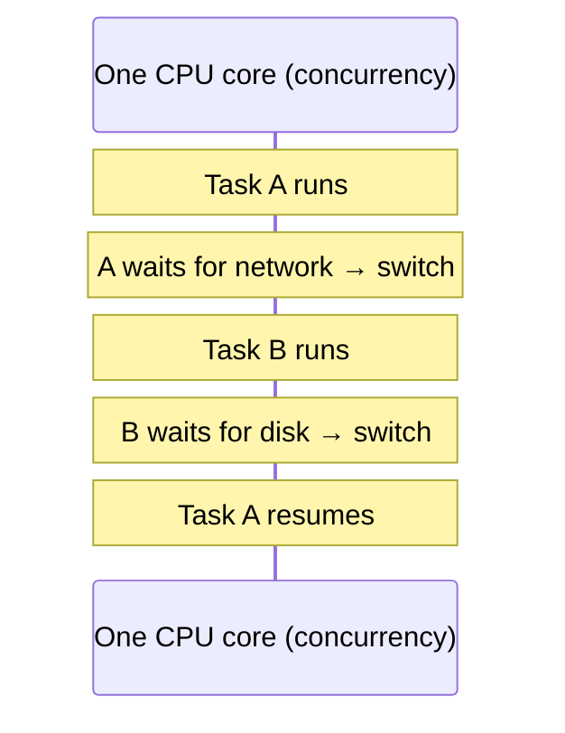
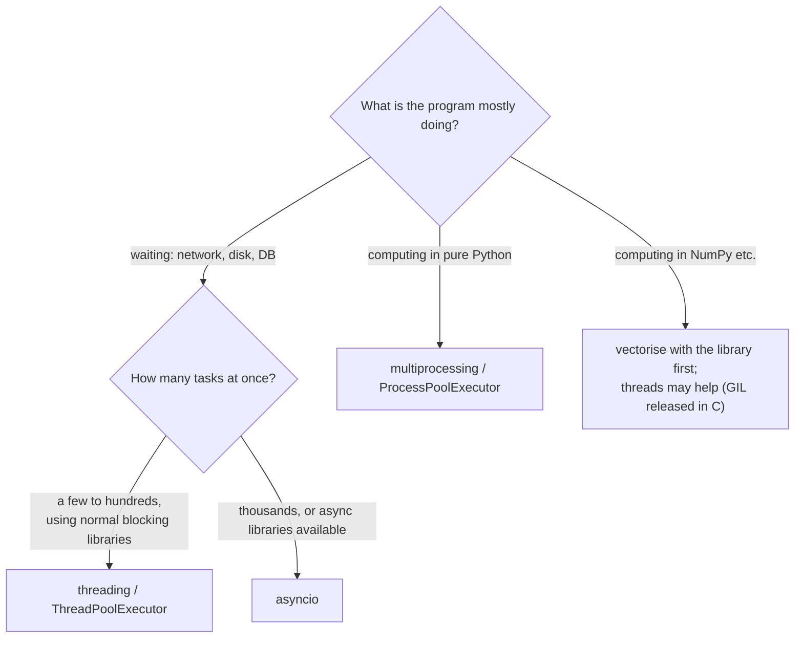

# Chapter 18 · Python Internals & Concurrency

> You can drive a car without knowing how the engine works, until it makes a strange noise. This chapter opens the bonnet: how Python actually runs your code, where your objects live in memory, why `a is b` sometimes lies to you, what the famous GIL is, and how to make programs do many things at once. It's the chapter that turns "it works, I don't know why" into "I know exactly why".

**You will learn:**
- How CPython runs code: **source → bytecode → Python Virtual Machine**, and how to peek with `dis`
- "Everything is an object": names vs objects, **stack frames vs heap**
- **Reference counting**, the **garbage collector** and reference cycles
- Small-integer caching, string interning, and `is` vs `==` once and for all
- A deep dive into **mutability**, argument passing, and shallow vs deep copies
- The **GIL**, **concurrency vs parallelism**, and when to use **threading**, **multiprocessing** or **asyncio**
- Practical performance tips, and how to measure with `timeit` and `cProfile`

**Before this:** [Variables, Data Types & Memory](02-variables-types-memory.md) · [Iterators, Generators, Decorators & Context Managers](16-iterators-generators-decorators.md) · [Modules & the Standard Library](17-modules-stdlib.md)

---

## 🧠 The Big Idea

Picture a restaurant kitchen.

- Your **source code** is a recipe written in English. The kitchen staff can't follow English directly.
- The **compiler** translates it into a list of tiny, precise steps ("take pan", "add 2 eggs", "stir"). That's **bytecode**.
- The **Python Virtual Machine (PVM)** is the chef who follows those steps one by one, really fast.
- The **heap** is the big pantry where all ingredients (**objects**) are stored. Your **variables** are just **sticky labels** pointing at things in the pantry.
- A **cleaner** (reference counting + the garbage collector) throws away ingredients nobody has a label on anymore.
- The **GIL** is a rule in this kitchen: **only one chef may use the stove at a time**, no matter how many chefs you hire.



The second half of the chapter is about doing **many things at once**:

- **Concurrency** = one cook juggling several dishes, switching between them while each waits (water boiling, oven heating). Lots of progress, one pair of hands.
- **Parallelism** = several cooks working at the **same instant** on different dishes. Needs several pairs of hands (CPU cores).

Python gives you three tools (threads, processes, asyncio), and the GIL decides which one fits which job.

---

## 🔨 Building It Up

### 1. Source → bytecode → PVM

"Python is interpreted" is half true. When you run `python app.py`, **CPython** (the standard Python implementation, written in C) does two steps:

1. **Compile**: parse the text into a tree, then compile it into **bytecode**: compact instructions for an imaginary machine. This is fast and happens before your first line runs (it's why a syntax error anywhere in the file stops everything, [Chapter 13](13-exceptions-files.md)).
2. **Execute**: the **Python Virtual Machine**, a big loop in C, reads bytecode instructions one at a time and performs them.

You can see the compiled code object yourself:

```python
def add_tax(price):
    rate = 0.18
    return price + price * rate

code = add_tax.__code__                 # the compiled code object
print(type(code).__name__)
print(code.co_varnames)                 # local variable names
print(code.co_consts[1:])               # constants used (first slot is the docstring/None)
print(isinstance(code.co_code, bytes))  # the raw bytecode is just bytes
print(add_tax(100))
```

```text
code
('price', 'rate')
(0.18,)
True
118.0
```

To read bytecode in a human-friendly form, use the **`dis`** (disassembler) module. Exact instructions differ between Python versions, so here's a typical Python 3.11 output as an illustration:

```py
import dis

def add_tax(price):
    rate = 0.18
    return price + price * rate

dis.dis(add_tax)
```

```text
  1           0 RESUME                   0
  2           2 LOAD_CONST               1 (0.18)
              4 STORE_FAST               1 (rate)
  3           6 LOAD_FAST                0 (price)
              8 LOAD_FAST                0 (price)
             10 LOAD_FAST                1 (rate)
             12 BINARY_OP                5 (*)
             16 BINARY_OP                0 (+)
             20 RETURN_VALUE
```

What just happened: the PVM is a **stack machine**. `LOAD_FAST` pushes a local variable onto a small value stack; `BINARY_OP` pops two values, combines them, pushes the result; `RETURN_VALUE` pops the final answer. `price + price * rate` became "push price, push price, push rate, multiply, add". Every line of Python becomes a handful of these steps, and each step costs some work in C, which is why **fewer bytecode instructions usually means faster code**.

> 💡 "CPython" is *the* Python you downloaded. Other implementations exist: **PyPy** (with a JIT compiler that turns hot code into machine code, often much faster for pure-Python loops), **Jython** (on the Java VM) and **MicroPython** (for microcontrollers). Everything in this chapter describes CPython.

### 2. Everything is an object

In Python, **every value is an object**: numbers, strings, functions, classes, modules, even `None` and types themselves. Every object has three things:

| Property | Question it answers | How to see it | Can it change? |
|---|---|---|---|
| **identity** | *which* object is this? | `id(x)` | never, for the object's lifetime |
| **type** | *what kind* of object? | `type(x)` | no (in practice) |
| **value** | *what does it hold?* | `print(x)`, `x == y` | only if the object is **mutable** |

```python
def greet():
    return "hi"

for thing in [42, 3.5, "text", [1, 2], greet, int, None, len]:
    print(f"{type(thing).__name__:<22} is an object: {isinstance(thing, object)}")

greet.author = "riya"             # functions are objects: they can even carry attributes
print(greet.author, greet.__name__)
```

```text
int                    is an object: True
float                  is an object: True
str                    is an object: True
list                   is an object: True
function               is an object: True
type                   is an object: True
NoneType               is an object: True
builtin_function_or_method is an object: True
riya greet
```

Because even an `int` is a full object (with a type pointer and a reference count, see below), a small integer takes about 28 bytes on a 64-bit machine, not 4 or 8 like in C. That's the price of Python's flexibility, and why libraries like NumPy store numbers in raw C arrays instead.

### 3. Names are labels: stack frames vs heap

A Python **variable is not a box that contains a value**. It's a **name (label) that refers to an object**. Assignment never copies; it just attaches a label.

Memory is organised in two areas:

- **The heap**: where **all objects** live. Big, shared by the whole program.
- **The call stack**: one **frame** per active function call. A frame holds that call's **local names** (and which line it's on). Names in a frame are just **references** (arrows) to objects on the heap.

```python
def make_list():
    items = [1, 2, 3]        # the list object is created on the HEAP
    return items             # return the reference; the frame disappears, the object survives

a = make_list()
b = a                        # second label, same object
b.append(4)
print(a, a is b)
```

```text
[1, 2, 3, 4] True
```



While `make_list` was running, its own frame had a name `items` pointing at the list. When the function returned, the **frame** was destroyed (its label `items` vanished), but the **object** lived on, because `a` still referred to it. Objects live as long as something refers to them, not as long as the function that made them.

### 4. Reference counting: how Python frees memory

Every CPython object stores a **reference count**: how many references (labels, list slots, attributes...) point at it. Assigning a name or putting it in a container increments it; a name going away (`del`, reassignment, a function returning) decrements it. **When the count hits zero, the object is freed immediately.**

```python
import sys

data = [1, 2, 3]
base = sys.getrefcount(data)       # note: getrefcount itself adds a temporary reference

alias = data
holder = [data, data]              # the list holds two more references
print(sys.getrefcount(data) - base)

del alias                          # del removes a NAME, not the object
holder.clear()
print(sys.getrefcount(data) - base)
```

```text
3
0
```

We print *differences* because the absolute number depends on Python internals (and `getrefcount` adds one for its own argument). The idea is what matters: `del x` **never deletes an object directly**; it removes one reference. The object dies only when the **last** reference is gone.

We can watch an object die with `__del__` (a method called just before an object is destroyed; useful for demos, rarely for real code):

```python
class Tracked:
    def __init__(self, name):
        self.name = name
    def __del__(self):
        print(f"  {self.name} freed")

print("step 1")
t = Tracked("A")
print("step 2")
t = Tracked("B")          # A loses its last reference -> freed right now
print("step 3")
del t                     # B loses its last reference
print("step 4")
```

```text
step 1
step 2
  A freed
step 3
  B freed
step 4
```

Reference counting is **simple and immediate**: memory comes back the moment it's not needed, which is why `with open(...)` style clean-up is so predictable in CPython.

### 5. The garbage collector: cleaning up cycles

Reference counting has one blind spot: **cycles**. If object A refers to B and B refers to A, both counts stay at 1 even when nothing else in the program can reach them. They're unreachable garbage that refcounting alone never frees.

That's what the **cyclic garbage collector** (module `gc`) is for. Periodically, it scans container objects, finds groups that are only referenced by each other, and frees them. We can prove it with a **weak reference**: a reference that does *not* increase the count, so it lets us check whether the object still exists without keeping it alive.

```python
import gc
import weakref

class Node:
    def __init__(self, name):
        self.name = name
        self.partner = None

gc.disable()                     # turn off the automatic collector for this demo

a, b = Node("a"), Node("b")
a.partner, b.partner = b, a      # a <-> b: a reference cycle
probe = weakref.ref(a)           # watches a without keeping it alive

del a, b                         # no names left, but each still references the other
print("after del:", probe() is not None)      # still alive: refcounts are 1, not 0

gc.collect()                     # run the cycle detector manually
print("after gc.collect():", probe() is None) # finally freed

gc.enable()
```

```text
after del: True
after gc.collect(): True
```

How the collector stays cheap: it's **generational**. New objects start in generation 0, which is scanned often. Objects that survive a scan move to generation 1, then 2, which are scanned rarely. Most objects die young (temporary lists, strings), so the frequent scans are small. (Newer versions tune the details, but the idea is the same.)

> 💡 Doubly linked lists, trees with parent pointers and graphs naturally create cycles. That's fine: the GC handles them. The `weakref` module exists for caches and parent pointers where you *don't* want a reference to keep something alive.

### 6. Small-integer caching and string interning

Creating objects costs time, so CPython **reuses** some immutable objects:

- **Small integers** from **-5 to 256** are created once at startup and shared. Every `7` in your program is the same object.
- **Interned strings**: short strings that look like identifiers (variable names, `"hello"`, `"user_id"`) are often stored once and shared. You can force it with `sys.intern(s)`.

```python
import sys

x = int("256")              # computed at runtime, so the compiler can't merge them
y = int("256")
print(x == y, x is y)       # 256 is in the small-int cache: same object

x = int("257")
y = int("257")
print(x == y, x is y)       # 257 is not cached: two different objects

a = "".join(["py", "thon"])          # built at runtime: a new string object
b = "python"
print(a == b, a is b)
print(sys.intern(a) is sys.intern(b))   # interning makes them share one object
```

```text
True True
True False
True False
True
```

Why `int("257")` and not just `257`? When the same constant appears twice in **one file**, the compiler may store it once, so `a = 257; b = 257; a is b` can print `True` in a script and `False` when typed line by line in the interactive shell. These are **implementation details**, which is exactly the point of the next section.

### 7. `is` vs `==`, once and for all

| | `==` | `is` |
|---|---|---|
| Asks | "do these have **equal values**?" | "are these the **same object**?" |
| Implemented by | `__eq__` (customisable, [Chapter 15](15-oop-inheritance-magic.md)) | comparing identities (not customisable) |
| Use for | numbers, strings, lists, almost everything | `None`, `True`/`False`, sentinel objects |

```python
a = [1, 2, 3]
b = [1, 2, 3]
c = a
print(a == b, a is b)       # equal values, different objects
print(a == c, a is c)       # same object

result = None
print(result is None)       # the correct way to check for None

nan = float("nan")
print(nan == nan, nan is nan)   # NaN is not equal to itself (IEEE 754 rule)
```

```text
True False
True True
True
False True
```

> ⚠️ **Never use `is` to compare numbers or strings.** `x is 257` may work in one place and fail in another depending on caching and compilation. Python 3.8+ even warns: `SyntaxWarning: "is" with a literal`. Use `==`. Use `is` only for singletons like `None`.

### 8. Mutability deep dive

An object is **mutable** if its value can change in place (`list`, `dict`, `set`, most custom objects) and **immutable** if not (`int`, `float`, `str`, `tuple`, `frozenset`, `bytes`). "Changing" an immutable object really means **creating a new object** and moving the label:

```python
s = "hi"
print_id_before = id(s)
s += "!"                        # builds a NEW string, rebinds s
print(s, id(s) == print_id_before)

nums = [1, 2]
list_id_before = id(nums)
nums += [3]                     # list += mutates IN PLACE (calls __iadd__)
print(nums, id(nums) == list_id_before)

t = (1, 2)
t_alias = t
t += (3,)                       # tuple +=: a new tuple; the alias still sees the old one
print(t, t_alias)
```

```text
hi! False
[1, 2, 3] True
(1, 2, 3) (1, 2)
```

So `x += y` means "mutate in place" for mutable types but "build a new object and rebind" for immutable ones. That difference matters when there are **other references**:

```python
def add_item(lst):
    lst += ["new"]              # mutates the caller's list

def add_text(s):
    s += " new"                 # rebinds the LOCAL name only

items, text = ["old"], "old"
add_item(items)
add_text(text)
print(items, text)
```

```text
['old', 'new'] old
```

**Is Python "pass by value" or "pass by reference"?** Neither, exactly. It's **pass by object reference** (also called "call by sharing"): the function receives a **reference to the same object**. If the object is mutable and the function mutates it, the caller sees the change. If the function **reassigns** its parameter, only its local label moves; the caller is unaffected.

**Immutable containers can hold mutable things.** A tuple can't change *which* objects it holds, but those objects can change:

```python
t = ([1, 2], "x")
t[0].append(3)                  # the list inside is mutable
print(t)

try:
    t[0] += [4]                 # the famous puzzle
except TypeError as e:
    print("TypeError:", e)
print(t)                        # ...and yet the list changed!
```

```text
([1, 2, 3], 'x')
TypeError: 'tuple' object does not support item assignment
([1, 2, 3, 4], 'x')
```

What just happened: `t[0] += [4]` is two steps: (1) `t[0].__iadd__([4])` mutates the list in place (succeeds), then (2) `t[0] = result` tries to store it back into the tuple (fails). The exception comes *after* the mutation already happened. A classic interview brain-teaser.

> 💡 Only **immutable** objects (or ones whose hash never changes) can be dict keys and set members ([Chapter 9](09-dictionaries.md)). That's why `(1, 2)` can be a key but `[1, 2]` can't, and why a tuple *containing* a list isn't hashable either.

### 9. Shallow vs deep copy, in memory

You met `copy.copy` and `copy.deepcopy` in [Chapter 17](17-modules-stdlib.md). Here's the picture of what they do:



The most famous consequence is the **`[[0] * n] * m` grid trap**:

```python
bad = [[0] * 3] * 2             # ONE inner list, referenced twice
bad[0][0] = 1
print(bad)

good = [[0] * 3 for _ in range(2)]   # a fresh inner list per row
good[0][0] = 1
print(good)

print(bad[0] is bad[1], good[0] is good[1])
```

```text
[[1, 0, 0], [1, 0, 0]]
[[1, 0, 0], [0, 0, 0]]
True False
```

`[x] * n` copies **references**, never objects. For `[0] * 3` that's harmless (ints are immutable), but for lists of lists it creates aliases. You'll initialise DP tables this way constantly in [DSA Chapter 21](../part-2-dsa/21-dp-2d-advanced.md), so burn the comprehension version into memory.

### 10. Concurrency vs parallelism

Now the second big topic. Two words people mix up:

- **Concurrency**: dealing with **many tasks at once** by **interleaving** them. Progress on several tasks overlaps in time, but at any instant maybe only one is running. A single waiter serving ten tables is concurrent.
- **Parallelism**: **doing** many tasks **at the same instant** on multiple CPU cores. Ten waiters serving ten tables simultaneously is parallel.



Why bother? Because programs wait a lot. Work comes in two flavours:

- **I/O-bound**: the program mostly **waits** for something external: network responses, disk reads, database queries, user input. The CPU is idle during the wait. **Concurrency** helps hugely: while one task waits, run another.
- **CPU-bound**: the program mostly **computes**: image processing, number crunching, heavy loops. The CPU is never idle. Only **parallelism** (more cores) makes it faster.

### 11. The GIL (Global Interpreter Lock)

CPython has a **Global Interpreter Lock**: a lock that allows **only one thread to execute Python bytecode at a time** in a process.

Why does it exist? Remember reference counts (section 4). Every single assignment changes some object's count. If two threads changed the same count at the same instant, the count could get corrupted, freeing objects still in use (crash) or leaking memory. Protecting every object with its own lock would make single-threaded code slower. The GIL is the simple solution: **one big lock** around the interpreter. It makes CPython's internals simple, single-threaded code fast, and C extensions easy to write.

The consequences:

| Work type | Threads in CPython | Why |
|---|---|---|
| **I/O-bound** | ✅ speed up a lot | a thread **releases the GIL while waiting** for I/O (network, disk, `time.sleep`), so others run |
| **CPU-bound (pure Python)** | ❌ no speed-up (often slightly slower) | only one thread can run bytecode; they just take turns |
| **CPU-bound in C libraries** (NumPy, hashlib, compression) | ✅ can speed up | many C extensions release the GIL during heavy computation |

The interpreter also forces a running thread to give up the GIL periodically (every 5 ms by default, see `sys.getswitchinterval()`), so threads take turns fairly.

> 💡 **The GIL is changing.** Python 3.13 introduced an optional, experimental **free-threaded build** (PEP 703) without a GIL, where threads can run Python code truly in parallel. It's not the default yet, and many libraries are still adapting, so everything below describes the normal GIL build that you'll meet in interviews and most jobs.

### 12. `threading`: concurrency for I/O-bound work

A **thread** is an independent flow of execution inside the same process. Threads **share memory** (the same heap, the same global variables), which makes communication easy and also makes bugs easy.

The basic API:

```py
import threading
import time

def download(name, seconds):
    print(f"start {name}")
    time.sleep(seconds)              # stands in for waiting on the network; releases the GIL
    print(f"done  {name}")

threads = [threading.Thread(target=download, args=(f"file{i}", 1)) for i in range(3)]
for t in threads:
    t.start()                        # begin running concurrently
for t in threads:
    t.join()                         # wait for each to finish
# total time: about 1 second, not 3. The start/done lines may interleave in any order.
```

The modern, easier way is **`concurrent.futures.ThreadPoolExecutor`**: a pool of worker threads, and `map` collects results **in input order**. Here five "downloads" that each wait 0.2 seconds finish in about 0.2 seconds total, instead of 1 second:

```python
import time
from concurrent.futures import ThreadPoolExecutor

def fetch(url):
    time.sleep(0.2)                   # simulated network wait (releases the GIL)
    return f"{url}: 200 OK"

urls = [f"site{i}.com" for i in range(5)]

start = time.perf_counter()
with ThreadPoolExecutor(max_workers=5) as pool:     # a context manager: waits for all tasks
    results = list(pool.map(fetch, urls))
elapsed = time.perf_counter() - start

print(results)
print("concurrent (well under 1 second)?", elapsed < 0.8)
```

```text
['site0.com: 200 OK', 'site1.com: 200 OK', 'site2.com: 200 OK', 'site3.com: 200 OK', 'site4.com: 200 OK']
concurrent (well under 1 second)? True
```

**Race conditions.** Because threads share memory, two threads updating the same variable can interfere. `counter += 1` is really three steps (read, add, write); if a thread switch lands between them, an update is lost:

```py
import threading

counter = 0

def work():
    global counter
    for _ in range(100_000):
        counter += 1                 # read-modify-write: NOT atomic

threads = [threading.Thread(target=work) for _ in range(4)]
for t in threads: t.start()
for t in threads: t.join()
print(counter)                       # can be less than 400000 (depends on version and timing)
```

The fix is a **lock** (also called a **mutex**): only one thread at a time may hold it, so the protected block runs without interruption. Locks are context managers ([Chapter 16](16-iterators-generators-decorators.md)), so `with lock:` acquires and **always** releases:

```python
import threading

counter = 0
lock = threading.Lock()

def work():
    global counter
    for _ in range(50_000):
        with lock:                   # only one thread inside at a time
            counter += 1

threads = [threading.Thread(target=work) for _ in range(4)]
for t in threads:
    t.start()
for t in threads:
    t.join()
print(counter)                       # always exactly 200000
```

```text
200000
```

Other threading tools worth knowing by name: `queue.Queue` (a thread-safe queue, the cleanest way for threads to pass work to each other: the **producer-consumer** pattern), `threading.Event` (one thread signals others), `RLock` (a lock the same thread can acquire repeatedly) and `Semaphore` (allow up to N threads at once, e.g. "max 3 simultaneous downloads").

> ⚠️ **Deadlock**: thread 1 holds lock A and waits for lock B, while thread 2 holds B and waits for A. Both wait forever. Prevent it by always acquiring multiple locks **in the same global order**, holding locks as briefly as possible, or using timeouts.

### 13. `multiprocessing`: parallelism for CPU-bound work

To use several CPU cores for pure-Python computation, use several **processes**. Each process is a separate Python interpreter with its **own memory and its own GIL**, so they truly run in parallel.

```py
import time
from concurrent.futures import ProcessPoolExecutor

def count_primes(limit):                       # CPU-heavy, pure Python
    count = 0
    for n in range(2, limit):
        if all(n % d for d in range(2, int(n ** 0.5) + 1)):
            count += 1
    return count

if __name__ == "__main__":                     # REQUIRED: workers re-import this file
    jobs = [200_000] * 4

    start = time.perf_counter()
    serial = [count_primes(j) for j in jobs]
    print("serial:  ", round(time.perf_counter() - start, 2), "s")

    start = time.perf_counter()
    with ProcessPoolExecutor() as pool:        # one worker per CPU core by default
        parallel = list(pool.map(count_primes, jobs))
    print("parallel:", round(time.perf_counter() - start, 2), "s")
    # On a 4-core machine, parallel is typically 2.5x to 3.5x faster.
```

Things to know:

- **The `if __name__ == "__main__":` guard is mandatory** ([Chapter 17](17-modules-stdlib.md)). On Windows and macOS, each worker process starts fresh and **imports your main file**; without the guard, each worker would try to start its own pool, endlessly.
- Processes **don't share memory**. Arguments and results are **pickled** (serialised into bytes, like a more general JSON) and sent between processes. Sending huge data back and forth can cost more than the computation saves. Functions you send must be defined at the top level of a module.
- Starting a process is far slower than starting a thread (milliseconds, plus a fresh interpreter). Use processes for **chunky** work: seconds of computation per task, not microseconds.
- The lower-level API is `multiprocessing.Process` and `multiprocessing.Pool`; `ProcessPoolExecutor` has the same interface as `ThreadPoolExecutor`, so switching between them is a one-word change.

### 14. `asyncio`: thousands of waits on a single thread

Threads have overhead (memory per thread, switching cost, locks). For programs that juggle **thousands** of slow network connections (web servers, chat servers, scrapers, bots), Python offers **`asyncio`**: concurrency on a **single thread** using **cooperative multitasking**.

The vocabulary:

- **`async def`** defines a **coroutine function**. Calling it doesn't run it; it returns a **coroutine object** (like calling a generator function, [Chapter 16](16-iterators-generators-decorators.md)).
- **`await something`** means "pause **me** here until `something` is done, and **let other coroutines run meanwhile**". You can only `await` inside an `async def`.
- The **event loop** is the scheduler: it runs one coroutine until it hits an `await` on something not ready yet, then switches to another one that *is* ready.
- **`asyncio.run(main())`** starts the event loop and runs `main` until it finishes.
- **`asyncio.gather(a, b, c)`** runs several coroutines concurrently and collects their results (in the order given).

```python
import asyncio
import time

async def fetch(name, delay):
    print(f"start {name}")
    await asyncio.sleep(delay)        # non-blocking wait: the loop runs others meanwhile
    print(f"done  {name}")
    return f"{name} data"

async def main():
    start = time.perf_counter()
    results = await asyncio.gather(
        fetch("users", 0.3),
        fetch("orders", 0.1),
        fetch("prices", 0.2),
    )
    elapsed = time.perf_counter() - start
    print(results)
    print("took about as long as the slowest (0.3 s)?", elapsed < 0.55)

asyncio.run(main())
```

```text
start users
start orders
start prices
done  orders
done  prices
done  users
['users data', 'orders data', 'prices data']
took about as long as the slowest (0.3 s)? True
```

What just happened: `gather` started all three. Each one ran until its `await asyncio.sleep(...)`, then **voluntarily** handed control back to the loop. The loop woke each one when its timer finished, shortest first. Total time ≈ the longest wait, not the sum. And `results` came back in the order we **passed** them, not the order they finished.

```mermaid
sequenceDiagram
    participant Loop as Event loop (1 thread)
    participant U as fetch users
    participant O as fetch orders
    participant P as fetch prices
    Loop->>U: run until await (0.3 s timer)
    Loop->>O: run until await (0.1 s timer)
    Loop->>P: run until await (0.2 s timer)
    Note over Loop: nothing ready, loop sleeps
    Loop->>O: 0.1 s passed, resume → done
    Loop->>P: 0.2 s passed, resume → done
    Loop->>U: 0.3 s passed, resume → done
```

> ⚠️ **The cardinal rule of asyncio: never block the event loop.** `time.sleep(1)` or a heavy CPU loop inside a coroutine freezes **every** coroutine, because nothing can run until it returns (cooperative = nobody can interrupt you). Use `await asyncio.sleep`, async libraries (like `aiohttp` or `httpx` for HTTP), or push blocking work to a thread with `await asyncio.to_thread(func, args)`.

Because only one coroutine runs at a time and switches happen **only at `await`**, code between two `await`s can't be interrupted, so you need far fewer locks than with threads.

### 15. Choosing between them



| | `threading` | `multiprocessing` | `asyncio` |
|---|---|---|---|
| Best for | I/O-bound, moderate number of tasks | CPU-bound | I/O-bound, very many tasks |
| Runs in parallel? | No (GIL), but waits overlap | **Yes**, one GIL per process | No, single thread |
| Memory | shared | separate (data is pickled) | shared |
| Switching | preemptive (OS decides, any time) | OS scheduler | cooperative (only at `await`) |
| Cost per task | ~moderate (OS thread) | high (a whole process) | tiny (a coroutine object) |
| Main danger | race conditions, deadlocks | serialisation overhead, `__main__` guard | blocking the loop |
| Works with ordinary libraries? | yes | yes | needs async-aware libraries |

A rule of thumb you can quote: **"Threads for waiting, processes for computing, asyncio for waiting at massive scale."**

### 16. Performance tips that actually matter

First, the golden rule: **measure before optimising**. Intuition about speed is often wrong. Two tools:

- **`timeit`** for micro-benchmarks of small snippets. It runs code many times and reports the total.
- **`cProfile`** for whole programs: it tells you **which functions** take the time.

```py
import timeit

# compare two ways to build a list of squares (numbers vary by machine)
loop = """
result = []
for i in range(1000):
    result.append(i * i)
"""
comp = "result = [i * i for i in range(1000)]"

print(timeit.timeit(loop, number=10_000))   # e.g. 0.42
print(timeit.timeit(comp, number=10_000))   # e.g. 0.25  (comprehension is faster)
```

```py
import cProfile

def slow_part():
    return sum(i * i for i in range(2_000_000))

def fast_part():
    return sum(range(1000))

def main():
    slow_part()
    fast_part()

cProfile.run("main()", sort="cumulative")
# prints a table: ncalls, tottime, cumtime per function -> slow_part dominates
```

From the command line: `python -m timeit "sum(range(1000))"` and `python -m cProfile -s cumtime app.py`.

Now the tips, roughly in order of impact:

1. **Pick the right algorithm and data structure.** O(n²) → O(n log n) beats any micro-trick. A `set` lookup is O(1); a `list` lookup is O(n). This is what Part 2 of the book is about.
2. **Use built-ins and the standard library.** `sum`, `min`, `max`, `sorted`, `any`, `all`, `map`, `str.join`, `collections`, `heapq`: they run as C loops, skipping the bytecode overhead of a Python loop.
3. **Prefer comprehensions** to `for` + `append`: fewer bytecode instructions per item.
4. **Build strings with `"".join(parts)`**, not `+=` in a loop. Strings are immutable, so `s += piece` may copy the whole string every time: O(n²) in the worst case. (CPython sometimes optimises `+=` in place, but that's an implementation detail you shouldn't rely on.)
5. **Local variables are faster than globals and attribute lookups.** Locals are read by index (`LOAD_FAST`); globals need a dictionary lookup; `obj.method` needs an attribute lookup every time. In a hot loop, bind once:

```python
import math

def slow(values):
    out = []
    for v in values:
        out.append(math.sqrt(v))      # looks up 'math', then 'sqrt', then 'out.append' each time
    return out

def faster(values):
    sqrt = math.sqrt                  # bind once to a local name
    out = []
    append = out.append
    for v in values:
        append(sqrt(v))
    return out

def fastest(values):
    return list(map(math.sqrt, values))   # the loop itself runs in C

data = [1.0, 4.0, 9.0]
print(slow(data) == faster(data) == fastest(data), fastest(data))
```

```text
True [1.0, 2.0, 3.0]
```

6. **Avoid repeated work in loops**: compute `len(x)` or a constant expression once outside the loop.
7. **Use generators for big pipelines** to save memory ([Chapter 16](16-iterators-generators-decorators.md)), and `@cache` for repeated computations ([Chapter 17](17-modules-stdlib.md)).
8. **Use `deque` for queues** (`list.pop(0)` is O(n)), and `__slots__` for millions of small objects ([Chapter 14](14-oop-classes-objects.md)).
9. **For heavy numeric work, use NumPy**, which stores numbers in compact C arrays and runs vectorised C loops, often 10-100x faster than pure Python loops.
10. **Still too slow?** Try PyPy, or move the hot loop into a compiled extension (Cython, Rust via PyO3). For interviews, steps 1 to 5 are what matter.

---

## 🔬 Under the Hood

### What every object looks like in C

Every CPython object begins with the same header, a C struct called `PyObject`:

```text
+------------------+
| ob_refcnt        |  reference count (section 4)
| ob_type  ------->|  pointer to the type object (int, list, YourClass ...)
+------------------+
| type-specific    |  e.g. for a list: size, capacity, pointer to an array of PyObject*
| data ...         |  for an int: the digits of the number
+------------------+
```

That's why `type(x)` is instant (follow a pointer), why every object costs at least 16 bytes of header on 64-bit, and why a list is really an **array of pointers** to objects scattered around the heap, not an array of values. Since Python 3.12, some objects (like `None`, `True`, small ints) are **immortal**: their reference count is pinned and never changes, which helps with performance and future GIL-free work.

### Memory allocation: pymalloc

Allocating memory from the operating system is slow. CPython has its own allocator, **pymalloc**, for small objects (≤ 512 bytes): it grabs big **arenas** from the OS, splits them into **pools** for each size class, and hands out fixed-size **blocks**. Freed blocks are reused quickly for new objects of the same size. Side effect: a Python process may not return memory to the OS immediately after objects are freed, because the arena stays reserved for reuse.

### The evaluation loop and the "specialising adaptive interpreter"

The PVM is essentially a giant `switch` statement in C (`ceval.c`): fetch the next instruction, jump to the code for it, repeat. Python 3.11 made this loop much faster (the CPython docs cite an average speed-up of about 25% over 3.10) with a **specialising adaptive interpreter**: after an instruction runs a few times, it's replaced by a specialised version for the types it actually sees. For example, a `BINARY_OP` that keeps adding two ints becomes an "add two ints" instruction that skips the generic type dispatch. That's why `dis` output differs between versions, and why type-stable code tends to run faster.

### How the GIL is handed over

A thread holding the GIL runs bytecode until either it **blocks on I/O** (it releases the GIL voluntarily around the system call) or the **switch interval** expires (default 0.005 s): then another waiting thread requests the GIL, and the running thread releases it at the next safe point between instructions. Note that this means the GIL protects the *interpreter's* internals, not *your* data: a thread can be switched out between the read and the write of `counter += 1`, which is why you still need locks.

### How `async`/`await` relates to generators

Coroutines are built on the same machinery as generators: a suspended frame that can be resumed. `await` is close to `yield from` ([Chapter 16](16-iterators-generators-decorators.md)): it suspends the coroutine and passes control up to the event loop. When the awaited operation is ready, the loop resumes the coroutine with the result, like `send()`. The event loop itself uses the operating system's readiness APIs (`select`, `epoll`, `kqueue`, IOCP on Windows) to wait for many sockets at once in a single call.

---

## 🧩 Pattern Decoder

### Decision guide

| If you need to... | Choose | Because |
|---|---|---|
| call 50 web APIs and combine results | `ThreadPoolExecutor` | I/O-bound, blocking libraries are fine |
| handle 10,000 open websocket connections | `asyncio` | coroutines are cheap; one thread handles all |
| resize 10,000 images in pure Python | `ProcessPoolExecutor` | CPU-bound: needs multiple cores, bypasses the GIL |
| crunch big numeric arrays | NumPy (vectorise) | C loops beat any Python-level parallelism |
| keep a UI responsive while doing work | a background thread | the UI thread keeps handling events |
| share a counter between threads | `threading.Lock` or `queue.Queue` | prevent race conditions |
| check if `x` is `None` | `x is None` | identity check on a singleton |
| compare values | `==` | equality, never `is` |
| copy a nested structure | `copy.deepcopy` or a comprehension of copies | avoid shared inner objects |

### Memory and mutability idioms

- **Never use a mutable default argument** (`def f(x=[])`): the default object is created **once**, when the `def` runs, and shared by every call ([Chapter 10](10-functions.md)). Now you know why: it's one heap object referenced by the function forever.
- **Build 2D grids with a comprehension**: `[[0] * cols for _ in range(rows)]`.
- **Return new objects from "pure" functions**; mutate in place only when it's clearly the function's job (and document it, like `list.sort()` returning `None`).
- **Freeze data you share widely**: tuples, `frozenset`, `@dataclass(frozen=True)`.

### How this shows up in DSA

- **Backtracking** ([DSA Chapter 9](../part-2-dsa/09-backtracking.md)): appending `path` (a reference) to the results and then mutating `path` gives you a list of identical lists. Append `path[:]` (a copy). This is aliasing from section 3 in action.
- **DP tables** must be built with comprehensions, not `[[0] * n] * m`.
- **Recursion depth**: each recursive call creates a frame on the call stack. Python's limit (about 1000) is why deep DFS needs `sys.setrecursionlimit` or an explicit stack.
- **Performance on platforms**: Python is roughly an order of magnitude slower than C++ for tight loops. Interviewers don't mind, but on judges with tight limits: use built-ins, avoid needless function calls in inner loops, use `sys.stdin` for input, and precompute.
- **Concurrency questions** in interviews are usually conceptual ("GIL?", "threads vs processes?"), plus classic LeetCode concurrency problems like **Print in Order** (1114) and **Print FooBar Alternately** (1115), solved with `threading.Event`, `Lock` or `Semaphore`.

---

## ⚠️ Traps & Common Mistakes

1. **Using `is` for value comparison.** `x is 1000` may be `False` even when `x == 1000`. Use `==`; reserve `is` for `None`.

2. **Thinking `del x` deletes the object.** It deletes the **name**. The object lives while other references exist.

3. **The `[[0] * n] * m` grid.** All rows are the same list.

4. **Mutable default arguments.** One shared object across calls.

5. **Expecting threads to speed up CPU-bound Python code.** The GIL lets only one thread run bytecode at a time; use processes.

6. **Forgetting `if __name__ == "__main__":` with multiprocessing.** On Windows/macOS this causes errors or runaway process creation.

7. **Unprotected shared state in threads.** `counter += 1` isn't atomic. Use a `Lock`, or better, avoid sharing (use `queue.Queue` or return results from workers).

8. **Calling blocking functions inside `async def`.** `time.sleep`, `requests.get` or a heavy loop freeze the whole event loop. Use async equivalents or `asyncio.to_thread`.

9. **Calling a coroutine without awaiting it.**

```py
async def save():
    ...

async def main():
    save()            # ❌ creates a coroutine object and throws it away: nothing runs
                      #    (Python warns: "coroutine 'save' was never awaited")
    await save()      # ✅
```

10. **Sending huge objects to worker processes.** Pickling a 1 GB list to each worker can be slower than doing the work in one process. Send small inputs (file names, ranges), return small outputs.

11. **Optimising without measuring.** Use `timeit`/`cProfile` first; the slow part is rarely where you guess.

12. **Relying on CPython details** (small-int cache, `+=` string optimisation, exact `getrefcount` values) for program correctness. They're not guaranteed and vary across versions and implementations.

---

## 💡 Tips & Tricks

- `import dis; dis.dis(func)` is a great way to understand *why* one version of code is faster.
- `sys.getsizeof(obj)` shows an object's own size (not what it points to). For a deep size, you'd have to walk the references.
- `id(a) == id(b)` is equivalent to `a is b` (for objects alive at the same time).
- `weakref.WeakValueDictionary` makes caches that don't keep objects alive.
- `gc.collect()` returns the number of unreachable objects found; `gc.get_count()` shows generation counters.
- Use `concurrent.futures` (`ThreadPoolExecutor` / `ProcessPoolExecutor`) before reaching for raw `Thread`/`Process`: same interface, fewer bugs.
- `executor.submit(f, x)` returns a **Future** (a placeholder for a result); `as_completed(futures)` yields them as they finish, fastest first.
- In asyncio, `asyncio.wait_for(coro, timeout=5)` adds a timeout; `asyncio.Semaphore(10)` limits concurrency (e.g. "at most 10 requests at once").
- `python -X importtime app.py` shows how long each import takes: great for slow start-ups.
- When in doubt about speed in interviews, say: "the asymptotic complexity is what matters; in Python I'd lean on built-ins for the constant factor."

---

## 🎯 Interview Questions

### 1. Is Python compiled or interpreted? 🔥🔥🔥

<details><summary>Answer</summary>

Both, in the CPython implementation. Source code is first **compiled to bytecode** (stored in code objects, and cached as `.pyc` files for imported modules), and then that bytecode is **interpreted** by the Python Virtual Machine, a loop written in C. There's no ahead-of-time compilation to machine code in standard CPython. Other implementations differ: PyPy uses a JIT compiler that compiles hot paths to machine code at runtime. (CPython 3.13 also added an experimental JIT, off by default.)

</details>

### 2. How is memory managed in Python? 🔥🔥🔥

<details><summary>Answer</summary>

All objects live on a private **heap** managed by the interpreter. CPython uses **reference counting** as the primary mechanism: each object tracks how many references point to it and is freed immediately when the count reaches zero. Because reference counting can't free **reference cycles**, a **generational cyclic garbage collector** (`gc` module) periodically finds and frees groups of objects that only reference each other. Small objects are allocated by **pymalloc** (arenas → pools → blocks) for speed. Programmers don't free memory manually; they can influence it with `del` (removing references), `weakref`, `__slots__`, and the `gc` module.

</details>

### 3. What is the GIL? Why does Python have it, and what are its consequences? 🔥🔥🔥

<details><summary>Answer</summary>

The **Global Interpreter Lock** is a mutex in CPython that allows only one thread to execute Python bytecode at a time within a process. It exists mainly because CPython's memory management (reference counting) isn't thread-safe; one global lock keeps the interpreter simple, makes single-threaded code fast, and makes C extensions easier to write.

Consequences: multithreading **does not speed up CPU-bound pure-Python code**, but it **does** help I/O-bound code, because threads release the GIL while waiting on I/O (and many C libraries like NumPy release it during heavy computation). For CPU-bound parallelism, use `multiprocessing` (each process has its own interpreter and GIL). Python 3.13 offers an experimental free-threaded build without the GIL (PEP 703). Note the GIL doesn't make your own code thread-safe: compound operations like `x += 1` still need locks.

</details>

### 4. Threading vs multiprocessing vs asyncio: when do you use each? 🔥🔥🔥

<details><summary>Answer</summary>

- **threading**: I/O-bound work with ordinary blocking libraries (API calls, file/DB access), moderate concurrency. Shared memory, preemptive switching, needs locks for shared state. No CPU parallelism due to the GIL.
- **multiprocessing**: CPU-bound work in Python. True parallelism across cores; separate memory, so data is pickled between processes; higher startup and communication cost; needs the `__main__` guard.
- **asyncio**: I/O-bound work at high concurrency (thousands of connections) with async-aware libraries. Single thread, cooperative switching at `await`, very low per-task overhead; must never block the event loop.

Summary line: threads for waiting, processes for computing, asyncio for waiting at massive scale.

</details>

### 5. What's the difference between concurrency and parallelism? 🔥🔥

<details><summary>Answer</summary>

**Concurrency** is about structure: managing multiple tasks whose execution overlaps in time, possibly by interleaving them on one CPU (switching while tasks wait). **Parallelism** is about execution: running multiple tasks at literally the same instant on multiple cores. Concurrency is possible without parallelism (asyncio on one thread; threads under the GIL), and parallelism needs multiple cores or machines (multiprocessing). Rob Pike's phrasing: "concurrency is about dealing with lots of things at once; parallelism is about doing lots of things at once."

</details>

### 6. Explain `is` vs `==`. Why is `256 is 256` true but `257 is 257` sometimes false? 🔥🔥🔥

<details><summary>Answer</summary>

`==` compares values (calls `__eq__`); `is` compares identity (same object in memory). CPython **caches small integers from -5 to 256**, so every occurrence of those values refers to one shared object, and `is` is `True`. Larger integers created separately at runtime are different objects with equal values, so `is` is `False`. Results can vary: constants within the same compiled code block may be merged, so `a = 257; b = 257; a is b` can be `True` in a script but `False` in the interactive shell. That's why you must never use `is` for numbers or strings, only for singletons like `None`.

</details>

### 7. Is Python pass-by-value or pass-by-reference? 🔥🔥🔥

<details><summary>Answer</summary>

Neither exactly: it's **pass by object reference** (call by sharing). The function parameter becomes a new name bound to the **same object** the caller passed. If the function **mutates** a mutable object (`lst.append(x)`), the caller sees the change. If it **rebinds** the parameter (`lst = [ ]`, or `s += "x"` on an immutable string), only the local name changes and the caller is unaffected. So immutable arguments behave "like" pass-by-value and mutable ones "like" pass-by-reference, but the mechanism is the same for both.

</details>

### 8. What happens with `t = ([1, 2], 3); t[0] += [3]`? 🔥🔥

<details><summary>Answer</summary>

It raises `TypeError: 'tuple' object does not support item assignment`, **but the list inside is still modified** to `[1, 2, 3]`. `t[0] += [3]` is executed as: get `t[0]` (the list), call its in-place `__iadd__([3])` (which mutates the list and returns it), then assign the result back to `t[0]`. The final assignment fails because tuples are immutable, but by then the mutation has already happened. It shows the difference between mutating an object and rebinding a reference.

</details>

### 9. What are reference cycles and how does Python handle them? 🔥🔥

<details><summary>Answer</summary>

A reference cycle is a group of objects that refer to each other (e.g. a node whose `parent` points to an object that lists it as a child, or `a.self_ref = a`). When no outside references remain, each object's reference count is still at least 1, so reference counting can't free them. CPython's **cyclic garbage collector** periodically examines container objects, determines which are reachable only from within the group, and frees them. It's generational (young objects are checked more often). You can trigger it with `gc.collect()`, and avoid creating strong cycles using `weakref` (e.g. for parent pointers or caches).

</details>

### 10. What is a race condition? How do you prevent one? What's a deadlock? 🔥🔥

<details><summary>Answer</summary>

A **race condition** is a bug where the result depends on the unpredictable timing of threads accessing shared data, e.g. two threads doing `counter += 1` (read, add, write) can interleave and lose an update. Prevent it with **mutual exclusion**: a `threading.Lock` around the critical section (`with lock: ...`), or by not sharing mutable state at all (pass messages via `queue.Queue`, use immutable data, or give each worker its own data and combine results at the end).

A **deadlock** is when two or more threads each hold a lock the other needs, so all wait forever. Prevent it by acquiring locks in a consistent global order, keeping critical sections small, using timeouts (`lock.acquire(timeout=1)`), or using higher-level primitives.

</details>

### 11. How would you find out why a Python program is slow? 🔥🔥

<details><summary>Answer</summary>

Measure first: run it under **`cProfile`** (`python -m cProfile -s cumtime app.py`) to find which functions consume the time; use **`timeit`** to compare alternative implementations of a hot snippet; optionally use line profilers or sampling profilers (`py-spy`) for production. Then fix in order of impact: better algorithm/data structure (complexity), use built-ins/C-backed modules and comprehensions, avoid repeated work and attribute/global lookups in hot loops, cache repeated computations (`functools.cache`), use generators to cut memory, and for I/O-bound waits add concurrency (threads/asyncio), for CPU-bound work use multiprocessing or NumPy/compiled extensions.

</details>

### 12. Print in Order (LeetCode 1114) 🔥

Three threads call `first()`, `second()` and `third()` in any order. Make sure they always print in the order first, second, third.

<details><summary>Answer</summary>

Use two `threading.Event` objects as "gates": `second` waits until `first` has finished; `third` waits until `second` has finished. `Event.wait()` blocks until another thread calls `set()`.

```python
import threading

class Foo:
    def __init__(self):
        self.first_done = threading.Event()
        self.second_done = threading.Event()

    def first(self, print_first):
        print_first()
        self.first_done.set()

    def second(self, print_second):
        self.first_done.wait()
        print_second()
        self.second_done.set()

    def third(self, print_third):
        self.second_done.wait()
        print_third()

foo = Foo()
calls = [
    (foo.third, lambda: print("third")),
    (foo.second, lambda: print("second")),
    (foo.first, lambda: print("first")),
]
threads = [threading.Thread(target=method, args=(printer,)) for method, printer in calls]
for t in threads:
    t.start()                       # started in the WRONG order on purpose
for t in threads:
    t.join()
```

```text
first
second
third
```

Events (or locks/semaphores initialised as "taken") are the standard tool for ordering threads.

</details>

---

## 🏋️ Practice

**🟢 1. Predict the output.** Then run it.

```python
a = [1, 2]
b = a
a = a + [3]
c = b
c += [4]
print(a, b, c, b is c)
```

<details><summary>Solution</summary>

```text
[1, 2, 3] [1, 2, 4] [1, 2, 4] True
```

`a = a + [3]` builds a **new** list and rebinds `a`; `b` still points to the original `[1, 2]`. `c = b` is another label on that original, and `c += [4]` mutates it in place, so `b` and `c` both show `[1, 2, 4]` and are the same object.

</details>

**🟢 2. Spot the aliasing bug.** This backtracking-style code should collect `[[1], [1, 2], [1, 2, 3]]`, but doesn't. Explain and fix.

```py
path, results = [], []
for x in [1, 2, 3]:
    path.append(x)
    results.append(path)
print(results)     # [[1, 2, 3], [1, 2, 3], [1, 2, 3]]
```

<details><summary>Solution</summary>

`results` holds three references to the **same** `path` list, which ends as `[1, 2, 3]`. Append a copy instead:

```python
path, results = [], []
for x in [1, 2, 3]:
    path.append(x)
    results.append(path[:])        # snapshot of the current state
print(results)
```

```text
[[1], [1, 2], [1, 2, 3]]
```

</details>

**🟡 3. Thread-safe bank account.** Write a `SafeAccount` class whose `deposit(amount)` is protected by a lock. Run 8 threads that each deposit 1 a total of 10,000 times and confirm the balance is exactly 80,000.

<details><summary>Solution</summary>

```python
import threading

class SafeAccount:
    def __init__(self):
        self._balance = 0
        self._lock = threading.Lock()

    def deposit(self, amount):
        with self._lock:                 # the read-modify-write happens atomically
            self._balance += amount

    @property
    def balance(self):
        with self._lock:
            return self._balance

acct = SafeAccount()

def worker():
    for _ in range(10_000):
        acct.deposit(1)

threads = [threading.Thread(target=worker) for _ in range(8)]
for t in threads:
    t.start()
for t in threads:
    t.join()
print(acct.balance)
```

```text
80000
```

Encapsulating the lock inside the class (rather than asking callers to lock) means nobody can forget it: encapsulation from [Chapter 14](14-oop-classes-objects.md) doing real work.

</details>

**🟡 4. Prove the cycle collector works.** Create a self-referencing list (`lst.append(lst)`), keep a way to detect whether it was freed, delete it with `gc` disabled, and show it survives until `gc.collect()`. (Hint: lists can't be weakly referenced, so wrap it in a small class instance that holds the list and is part of the cycle.)

<details><summary>Solution</summary>

```python
import gc
import weakref

class Box:
    pass

gc.disable()
box = Box()
box.items = [box]                 # cycle: box -> list -> box
alive = weakref.ref(box)

del box
print("survives del:", alive() is not None)
found = gc.collect()
print("freed by gc:", alive() is None, "| found some garbage:", found > 0)
gc.enable()
```

```text
survives del: True
freed by gc: True | found some garbage: True
```

</details>

**🟡 5. Concurrent "downloads" with asyncio.** Write `async def download(name, size)` that "downloads" in chunks: for each of `size` chunks it awaits `asyncio.sleep(0.01)`. Run three downloads of sizes 3, 1 and 2 concurrently with `gather`, recording the order they **finish** in a list, and return their names in the order given.

<details><summary>Solution</summary>

```python
import asyncio

async def download(name, size, finished):
    for _ in range(size):
        await asyncio.sleep(0.01)        # each chunk is a pause point
    finished.append(name)
    return f"{name} ({size} chunks)"

async def main():
    finished = []
    results = await asyncio.gather(
        download("video", 3, finished),
        download("icon", 1, finished),
        download("song", 2, finished),
    )
    print("finish order:", finished)
    print("results:", results)

asyncio.run(main())
```

```text
finish order: ['icon', 'song', 'video']
results: ['video (3 chunks)', 'icon (1 chunks)', 'song (2 chunks)']
```

`gather` keeps results in the order you passed them, even though they finished in a different order.

</details>

**🟡 6. Optimise this function.** It builds a comma-separated report of squares of even numbers. Rewrite it to be idiomatic and faster, and check both give identical output.

```python
def report_slow(n):
    s = ""
    for i in range(n):
        if i % 2 == 0:
            if s != "":
                s = s + ","
            s = s + str(i * i)
    return s

print(report_slow(10))
```

<details><summary>Solution</summary>

```python
def report_slow(n):
    s = ""
    for i in range(n):
        if i % 2 == 0:
            if s != "":
                s = s + ","
            s = s + str(i * i)
    return s

def report_fast(n):
    return ",".join(str(i * i) for i in range(0, n, 2))   # step 2 skips the odd check

print(report_fast(10))
print(all(report_slow(n) == report_fast(n) for n in range(50)))
```

```text
0,4,16,36,64
True
```

Three wins: `range(0, n, 2)` removes the modulo test, the generator expression runs fewer bytecodes per item, and `join` builds the string once (linear) instead of repeated concatenation (potentially quadratic).

</details>

**🔴 7. Print FooBar Alternately (LeetCode 1115).** Two threads: one calls `foo()` n times, the other `bar()` n times. Make the output `foobarfoobar...` (n pairs), using two `threading.Semaphore`s.

<details><summary>Solution</summary>

A **semaphore** holds a counter: `acquire()` waits until the counter is positive and decrements it; `release()` increments it. Start `foo`'s semaphore at 1 (foo may go first) and `bar`'s at 0 (bar must wait). Each thread, after printing, releases the *other* one.

```python
import threading

class FooBar:
    def __init__(self, n):
        self.n = n
        self.foo_turn = threading.Semaphore(1)
        self.bar_turn = threading.Semaphore(0)

    def foo(self, print_foo):
        for _ in range(self.n):
            self.foo_turn.acquire()
            print_foo()
            self.bar_turn.release()     # let bar go

    def bar(self, print_bar):
        for _ in range(self.n):
            self.bar_turn.acquire()
            print_bar()
            self.foo_turn.release()     # let foo go

output = []
fb = FooBar(3)
t1 = threading.Thread(target=fb.bar, args=(lambda: output.append("bar"),))
t2 = threading.Thread(target=fb.foo, args=(lambda: output.append("foo"),))
t1.start(); t2.start()                  # bar's thread starts first, still waits its turn
t1.join(); t2.join()
print("".join(output))
```

```text
foobarfoobarfoobar
```

The semaphores act like a baton passed back and forth: at any moment exactly one thread holds permission to print.

</details>

---

## 🧠 Never-Forget Summary

- CPython **compiles** source to **bytecode**, then the **PVM** interprets it; `dis` shows the instructions.
- **Everything is an object** with identity, type and value; variables are **labels** pointing at objects on the **heap**; each call gets a **frame** on the stack.
- **Reference counting** frees objects the moment their count hits zero; the **cyclic GC** cleans up reference cycles; `del` removes a name, not an object.
- Small ints (-5..256) and many short strings are **shared**: never rely on it. `is` for `None`, `==` for values.
- Mutable objects change in place; immutable "changes" build new objects. `+=` differs between them.
- Arguments are passed **by object reference**: mutation is visible to the caller, rebinding isn't.
- `[x] * n` copies references: build grids with comprehensions; deepcopy nested data.
- **Concurrency** = interleaving; **parallelism** = simultaneous on many cores.
- The **GIL** lets one thread run bytecode at a time: threads help I/O-bound work, not CPU-bound Python.
- **Threads** for waiting (use locks!), **processes** for computing (`__main__` guard), **asyncio** for massive waiting (never block the loop).
- Measure with `timeit`/`cProfile`, then: better algorithm → built-ins → comprehensions → `join` → locals.

**Memory hooks:**
- **"Recipe → Steps → Chef."** Source → bytecode → PVM.
- **"Labels, not boxes."** Variables point at objects; assignment just adds a label.
- **"Zero friends, gone; only friends with each other, wait for the GC."** Refcounting vs cycle collection.
- **"Threads wait, Processes compute, Async waits at scale."**
- **"One stove, many chefs."** The GIL: only one thread cooks Python at a time.

**One picture:**

| Concept | Key fact | Tool / syntax |
|---|---|---|
| Execution | source → bytecode → PVM | `dis.dis(f)`, `f.__code__` |
| Objects | identity, type, value | `id()`, `type()`, `==` |
| Memory | refcount + generational GC | `sys.getrefcount`, `gc.collect()`, `weakref` |
| Identity | `is` = same object | only for `None`/singletons |
| Caching | small ints -5..256, interned strings | `sys.intern` |
| Mutability | in-place vs new object | `list +=` mutates, `str +=` rebinds |
| Copies | shallow shares insides, deep copies all | `copy.copy`, `copy.deepcopy` |
| I/O-bound | waits overlap | `ThreadPoolExecutor`, `asyncio.gather` |
| CPU-bound | needs cores | `ProcessPoolExecutor` |
| Shared state | protect it | `Lock`, `Event`, `Semaphore`, `queue.Queue` |
| Speed | measure, then fix the algorithm | `timeit`, `cProfile`, built-ins |

> **If you remember only one thing:** in Python, names are just labels on objects that live on the heap, and only one thread runs Python at a time. Almost every "weird" behaviour (aliasing, `is` surprises, mutable defaults, threads not speeding things up) follows from those two facts.

---
**Next:** [Part 2 · Chapter 01 · Thinking in Algorithms & Big-O](../part-2-dsa/01-big-o-complexity.md)  ·  **Back to** [Contents](../README.md)
