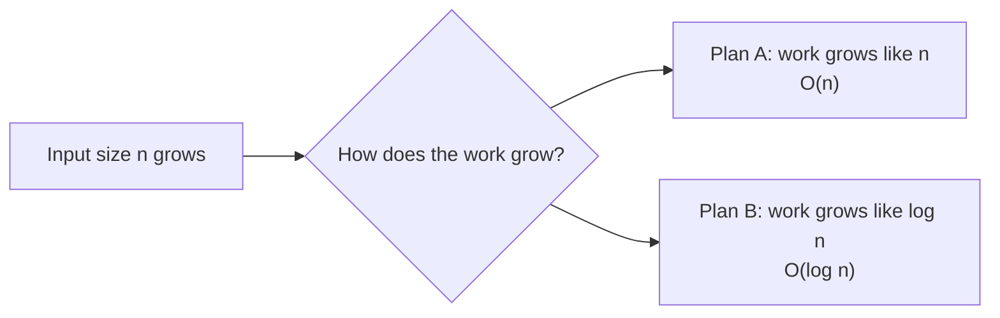
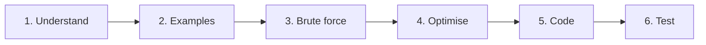
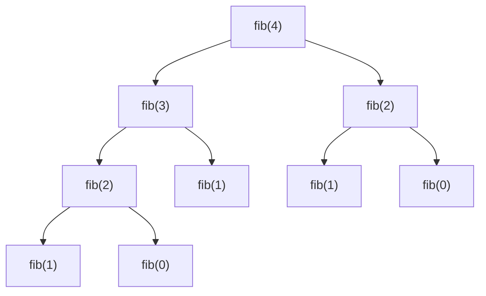

# Chapter 01 · Thinking in Algorithms & Big-O

> Two students write code that gives the right answer. On 1,000 inputs both finish instantly. On 1,000,000 inputs one finishes in half a second and the other would still be running at your next birthday. Big-O is the tool that tells you, *before you run anything*, which student you are.

**You will learn:**
- What an algorithm actually is, and a 6-step method to attack **any** problem
- What Big-O, Big-Ω and Big-Θ mean, in plain words and formally
- The rules for computing complexity, and how to analyse loops, nested loops, halving loops and recursion
- Recursion trees and a gentle introduction to the **Master Theorem**
- Space complexity, including the hidden cost of the recursion stack
- Best / average / worst case and **amortized** analysis (why `append` is O(1))
- How to read the constraints of a problem and know the target complexity instantly
- The real cost of every common Python operation on `list`, `dict`, `set`, `str`, `deque` and `heapq`

**Before this:** [Lists](../part-1-python/07-lists.md) · [Dictionaries & Hashing](../part-1-python/09-dictionaries.md) · [Functions](../part-1-python/10-functions.md) · [Recursion](../part-1-python/12-recursion.md)

---

## 🧠 The Big Idea

Imagine you're looking for "Sharma, Priya" in a printed phone book with 1,000 pages.

- **Plan A:** start at page 1 and read every page until you find her. Worst case: 1,000 pages.
- **Plan B:** open the middle. "Sharma" comes after "M", so tear away the first half. Open the middle of what's left. Repeat. Worst case: about **10** pages, because 1,000 halved 10 times is less than 1.

Now make the phone book 1,000,000 pages long:

- Plan A: up to 1,000,000 pages.
- Plan B: about **20** pages.

The book got 1,000 times bigger. Plan A got 1,000 times slower. Plan B needed just 10 more steps. That difference in *how the work grows* is what Big-O describes.



> 💡 **The core insight:** Big-O doesn't measure seconds. It measures the **shape of growth**: if I double the input, what happens to the work? Seconds depend on your laptop. Growth shape depends only on your algorithm.

---

## 🔨 Building It Up

### 1. What is an algorithm?

An **algorithm** is a finite list of clear steps that turns an input into an output. A recipe is an algorithm: ingredients in, dish out.

A good algorithm has five properties:

| Property | Meaning | Recipe version |
|---|---|---|
| **Input** | takes zero or more inputs | ingredients |
| **Output** | produces at least one result | the dish |
| **Definite** | every step is unambiguous | "add 5 g salt", not "add some salt" |
| **Finite** | it always stops | the recipe ends; it doesn't say "stir forever" |
| **Effective** | every step can actually be done | no "add a pinch of unicorn" |

Here is a tiny algorithm: find the largest number in a list.

```python
def find_max(nums):
    best = nums[0]            # assume the first one is the biggest so far
    for x in nums[1:]:
        if x > best:
            best = x          # found a bigger one, remember it
    return best

print(find_max([3, 9, 2, 7]))
```

```text
9
```

What just happened: we looked at each number exactly once and kept the "best so far". This "walk once, carry a summary" idea will show up in half the problems in this book.

### 2. How to approach ANY problem: the 6-step method

Most beginners read a problem and immediately start typing. Strong engineers follow a routine. Memorise it as **"U E B O C T"** ("**U**ncle **E**ats **B**iryani, **O**rders **C**hai **T**oo"):



1. **Understand.** Restate the problem in your own words. What's the input type and size? What exactly is the output? Can there be duplicates, negatives, empty input?
2. **Examples.** Work 2–3 small examples by hand, including an edge case (empty list, one element, all the same).
3. **Brute force.** Find *any* correct solution, even a slow one. Say its complexity out loud.
4. **Optimise.** Ask: "What work am I repeating?" and "Which data structure makes that repeated work fast?"
5. **Code.** Write clean code with good names.
6. **Test.** Dry-run your examples through the code line by line. Then check edge cases.

Let's do it once on a real problem: **"Does this list contain any duplicate?"**

**Understand:** input is a list of integers, output is True/False. **Examples:** `[1,2,3,1]` → True, `[1,2,3]` → False, `[]` → False.

**Brute force:** compare every pair.

```python
def has_duplicate_brute(nums):
    n = len(nums)
    for i in range(n):
        for j in range(i + 1, n):     # every pair (i, j) with i < j
            if nums[i] == nums[j]:
                return True
    return False

print(has_duplicate_brute([1, 2, 3, 1]), has_duplicate_brute([1, 2, 3]), has_duplicate_brute([]))
```

```text
True False False
```

That checks about n²/2 pairs. **O(n²)**.

**Optimise, idea 1:** after sorting, duplicates sit next to each other. Sorting costs O(n log n) (we'll see why in [Chapter 07](07-sorting.md)), then one pass.

**Optimise, idea 2:** the repeated work is "have I seen this number before?". A **set** answers that in O(1) on average.

```python
def has_duplicate_sorted(nums):
    s = sorted(nums)                      # O(n log n)
    for i in range(1, len(s)):
        if s[i] == s[i - 1]:              # duplicates are neighbours now
            return True
    return False

def has_duplicate_set(nums):
    seen = set()
    for x in nums:
        if x in seen:                     # O(1) average lookup
            return True
        seen.add(x)
    return False

for f in (has_duplicate_sorted, has_duplicate_set):
    print(f.__name__, f([1, 2, 3, 1]), f([1, 2, 3]), f([]))
```

```text
has_duplicate_sorted True False False
has_duplicate_set True False False
```

Three correct answers, three different growth shapes:

| Approach | Time | Extra space |
|---|---|---|
| Compare all pairs | O(n²) | O(1) |
| Sort, then check neighbours | O(n log n) | O(n) (`sorted` makes a copy) |
| Set of seen values | O(n) | O(n) |

That table **is** the interview. Interviewers don't just want an answer; they want to watch you move from the left column down to the best row and explain the trade-off.

### 3. Why we count steps instead of timing

A stopwatch result depends on your CPU, what else is running, and the Python version. Instead we count **basic operations**: comparisons, additions, assignments, index lookups. Each takes roughly constant time.

Let's count how many times the innermost line runs for two different algorithms:

```python
def count_linear(n):
    steps = 0
    for i in range(n):
        steps += 1
    return steps

def count_pairs(n):
    steps = 0
    for i in range(n):
        for j in range(n):
            steps += 1
    return steps

for n in (10, 100, 1000):
    print(n, count_linear(n), count_pairs(n))
```

```text
10 10 100
100 100 10000
1000 1000 1000000
```

What just happened: when n grew 10×, the single loop did 10× more work and the double loop did **100×** more. That ratio, not the raw number, is what Big-O captures.

### 4. Big-O, Big-Ω, Big-Θ: the three bounds

Suppose an algorithm does exactly `f(n) = 3n² + 5n + 20` steps.

When n is large, the `3n²` part completely dominates. At n = 1,000: 3n² = 3,000,000 while 5n + 20 = 5,020. The small terms are noise. And the constant 3 only changes the speed by a fixed factor; it doesn't change the *shape*. So we say the growth is "like n²".

| Notation | Read as | Plain meaning | Analogy |
|---|---|---|---|
| **O(g(n))** | "Big-O of g" | grows **at most** like g (upper bound) | "the trip takes at most 2 hours" |
| **Ω(g(n))** | "Big-Omega of g" | grows **at least** like g (lower bound) | "the trip takes at least 1 hour" |
| **Θ(g(n))** | "Big-Theta of g" | grows **exactly** like g (both bounds) | "the trip takes about 1.5 hours" |

**Formal definition** (just once, so you've seen it): f(n) is O(g(n)) if there exist constants c > 0 and n₀ such that `f(n) ≤ c · g(n)` for every n ≥ n₀. In words: *after some point, f never goes above a constant multiple of g.*

For `3n² + 5n + 20`: pick c = 4. For n ≥ 8, `3n² + 5n + 20 ≤ 4n²` (because n² ≥ 5n + 20 once n ≥ 8). So it's O(n²). It's also Ω(n²) (since it's always ≥ 3n²), so it's Θ(n²).

> 💡 **What interviewers mean:** in interviews (and in this book) people say "Big-O" but usually mean the **tight** bound, i.e. Θ. If you say bubble sort is O(n³) you're technically right (n² ≤ n³) but you'll get a strange look. Always give the tightest bound you can.

### 5. The rules for computing complexity

Six rules cover almost everything.

**Rule 1: Drop constants.** O(2n) = O(n). O(500) = O(1).

**Rule 2: Drop smaller terms.** O(n² + n) = O(n²). O(n + log n) = O(n).

**Rule 3: Sequential steps add.**

```py
for x in a: ...      # O(n)
for x in a: ...      # O(n)
# total: O(n + n) = O(n)
```

**Rule 4: Nested steps multiply.**

```py
for x in a:          # n times
    for y in a:      #   n times each
        ...          # total: O(n * n) = O(n²)
```

**Rule 5: Different inputs get different letters.** This is the most common mistake.

```py
def print_pairs(a, b):
    for x in a:          # len(a) = A
        for y in b:      # len(b) = B
            print(x, y)
# O(A * B), NOT O(n²). If b is tiny, this is basically linear.
```

**Rule 6: For if/else, take the worse branch** (when you're computing the worst case).

```py
if flag:
    total = sum(nums)          # O(n)
else:
    total = nums[0]            # O(1)
# worst case: O(n)
```

Let's apply all six to one function:

```python
def mystery(a, b):
    total = 0
    for x in a:                 # A iterations
        total += x
    for x in a:                 # A iterations
        for y in b:             #   B iterations each
            if x == y:
                total += 1
    for _ in range(100):        # constant: 100 iterations
        total += 1
    return total

print(mystery([1, 2, 3], [2, 3, 4, 5]))
```

```text
108
```

Steps: A + A·B + 100 → drop the constant → **O(A·B)** (the A term is dominated by A·B as long as B ≥ 1).

### 6. Analysing loops: the five shapes

Almost every loop you'll meet is one of these shapes. Learn to recognise them by sight.

**Shape 1: simple loop → O(n)**

```py
for i in range(n): ...          # n iterations
for i in range(0, n, 2): ...    # n/2 iterations, still O(n)
```

**Shape 2: nested independent loops → O(n²)**

```py
for i in range(n):
    for j in range(n): ...      # n * n
```

**Shape 3: nested dependent loops (triangle) → still O(n²)**

```py
for i in range(n):
    for j in range(i + 1, n): ...   # (n-1) + (n-2) + ... + 1 + 0
```

The inner loop runs n−1, then n−2, ..., then 0 times. That sum is n(n−1)/2 ≈ n²/2. Drop the ½ → O(n²). People often guess "it's smaller, so maybe O(n log n)". It isn't: half of n² is still n².

**Shape 4: halving or doubling loops → O(log n)**

```py
i = n
while i > 1:
    i //= 2          # n, n/2, n/4, ... , 1

i = 1
while i < n:
    i *= 2           # 1, 2, 4, 8, ... , n
```

How many times can you halve n before reaching 1? That number is **log₂ n**. For n = 1,000,000 it's about 20. This is why logarithms show up everywhere: **log n = "how many times can I cut this in half?"**

**Shape 5: square-root loop → O(√n)**

```py
i = 1
while i * i <= n:    # stops when i passes √n
    i += 1
```

Here's all five counted for real:

```python
import math

def count(n):
    linear = sum(1 for _ in range(n))
    triangle = sum(1 for i in range(n) for _ in range(i + 1, n))
    halving, i = 0, n
    while i > 1:
        i //= 2
        halving += 1
    root, i = 0, 1
    while i * i <= n:
        i += 1
        root += 1
    return linear, triangle, halving, root

for n in (16, 1024):
    lin, tri, half, root = count(n)
    print(f"n={n}: linear={lin} triangle={tri} (n(n-1)/2={n*(n-1)//2}) "
          f"halving={half} (log2 n={int(math.log2(n))}) root={root}")
```

```text
n=16: linear=16 triangle=120 (n(n-1)/2=120) halving=4 (log2 n=4) root=4
n=1024: linear=1024 triangle=523776 (n(n-1)/2=523776) halving=10 (log2 n=10) root=32
```

What just happened: the formulas match the real counts exactly. Going from n = 16 to n = 1024 (64× bigger), the halving loop went from 4 to just 10 iterations, while the triangle loop exploded from 120 to over half a million.

**A sneaky one: a loop inside a halving loop.**

```py
i = n
while i > 0:
    for j in range(i): ...   # n + n/2 + n/4 + ... 
    i //= 2
```

It looks like O(n log n), but the inner work is n + n/2 + n/4 + ... which adds up to less than 2n. So it's **O(n)**. Always add up the actual work instead of multiplying blindly.

**And the opposite trap: a halving loop inside a full loop.**

```py
for i in range(n):        # n times
    j = n
    while j > 1:          #   log n times each
        j //= 2
# O(n log n)
```

### 7. Analysing recursion: calls × work per call

For a recursive function, ask two questions:

1. **How many calls** happen in total?
2. **How much work** does each call do (not counting its recursive calls)?

Multiply them (or, when calls do different amounts of work, add up the work across all calls).

**Linear recursion: factorial.** `fact(n)` calls `fact(n-1)`, which calls `fact(n-2)`, ... down to `fact(0)`. That's n + 1 calls, each doing O(1) work → **O(n)** time. The call stack also gets n + 1 deep → **O(n)** space.

**Branching recursion: naive Fibonacci.** Each call makes *two* calls:

```python
calls = 0

def fib(n):
    global calls
    calls += 1
    if n < 2:
        return n
    return fib(n - 1) + fib(n - 2)

for n in (10, 20, 25):
    calls = 0
    value = fib(n)
    print(f"fib({n}) = {value}, calls = {calls}")
```

```text
fib(10) = 55, calls = 177
fib(20) = 6765, calls = 21891
fib(25) = 75025, calls = 242785
```

Every +5 to n multiplies the calls by about 11. That's exponential growth. Here's the **recursion tree**, where each node is a call:



The tree has depth n, and each level has up to twice as many nodes as the level above: 1, 2, 4, 8, ... So the total is at most 2⁰ + 2¹ + ... + 2ⁿ ≈ 2ⁿ⁺¹. Time **O(2ⁿ)**. (The tight bound is about O(1.618ⁿ), but O(2ⁿ) is the standard answer.) Space is only **O(n)**, because at any moment the stack holds just one path from the root to a leaf.

> 💡 **Rule of thumb for recursion:** time ≈ O(branches^depth) when each call does O(1) work. Space ≈ O(depth).

Notice `fib(2)` is computed twice in that small tree. In `fib(25)`, `fib(2)` is computed tens of thousands of times. Caching those repeated answers is called **memoisation**, and it turns this into O(n). That's the entire idea behind Dynamic Programming ([Chapter 20](20-dp-1d.md)).

**Halving recursion: binary search.** One call on half the data, plus O(1) work: n → n/2 → n/4 → ... → 1. That's log n calls → **O(log n)**.

**Divide and conquer: merge sort.** Split into two halves, sort each recursively, then merge in O(n). Draw the tree level by level:

```text
level 0:            [ n ]                    work n
level 1:       [n/2]     [n/2]               work n/2 + n/2 = n
level 2:   [n/4] [n/4] [n/4] [n/4]           work 4 × n/4 = n
...                                          ...
level log n: n pieces of size 1              work n
```

Each level does n total work, and there are log n levels → **O(n log n)**. This "work per level × number of levels" trick is how you analyse any recursion tree.

### 8. Recurrences and the Master Theorem (gentle intro)

We can write the cost of a recursive function as an equation called a **recurrence**. `T(n)` means "time to solve a problem of size n".

| Algorithm | Recurrence | Read as | Result |
|---|---|---|---|
| Factorial | T(n) = T(n−1) + O(1) | one smaller call + constant work | O(n) |
| Binary search | T(n) = T(n/2) + O(1) | one half-size call + constant work | O(log n) |
| Merge sort | T(n) = 2T(n/2) + O(n) | two half-size calls + linear merge | O(n log n) |
| Naive Fibonacci | T(n) = T(n−1) + T(n−2) + O(1) | two calls, barely smaller | O(2ⁿ) |
| Tree traversal | T(n) = 2T(n/2) + O(1) | visit both halves, O(1) at node | O(n) |
| Selection-style | T(n) = T(n−1) + O(n) | one smaller call + linear work | O(n²) |

For the very common shape **T(n) = a·T(n/b) + O(n^d)** (a sub-problems, each of size n/b, plus n^d work to split/combine), the **Master Theorem** gives the answer by comparing `a` with `b^d`:

| Case | Condition | Who wins | Answer | Example |
|---|---|---|---|---|
| 1 | a < b^d | the top-level work dominates | O(n^d) | T(n) = T(n/2) + O(n) → O(n) |
| 2 | a = b^d | every level does equal work | O(n^d log n) | merge sort: a=2, b=2, d=1 → O(n log n) |
| 3 | a > b^d | the leaves dominate | O(n^(log_b a)) | T(n) = 2T(n/2) + O(1) → O(n) |

Intuition: `a` says how fast the number of sub-problems multiplies; `b^d` says how fast the work per sub-problem shrinks. Whichever is faster decides where most of the work lives: at the top, evenly spread, or at the bottom. You don't need to memorise proofs; recognising merge sort (case 2) and binary search (a=1, b=2, d=0 → case 2 → O(log n)) covers most interviews.

### 9. The common complexity classes

Here they are, from fastest to slowest, with how many steps each needs:

```python
import math

def fmt(x):
    return f"{x:.1e}" if x >= 1e6 else str(round(x))

sizes = [10, 100, 1000, 10**6]
rows = [
    ("O(1)", lambda n: 1),
    ("O(log n)", lambda n: math.log2(n)),
    ("O(sqrt n)", lambda n: math.sqrt(n)),
    ("O(n)", lambda n: n),
    ("O(n log n)", lambda n: n * math.log2(n)),
    ("O(n^2)", lambda n: n * n),
    ("O(n^3)", lambda n: n ** 3),
]
print(f"{'class':<11}" + "".join(f"{n:>10}" for n in sizes))
for name, f in rows:
    print(f"{name:<11}" + "".join(f"{fmt(f(n)):>10}" for n in sizes))
print(f"{'O(2^n)':<11}" + "".join(f"{fmt(2 ** n) if n <= 100 else 'way too big':>10}" for n in sizes[:2]))
```

```text
class              10       100      1000   1000000
O(1)                1         1         1         1
O(log n)            3         7        10        20
O(sqrt n)           3        10        32      1000
O(n)               10       100      1000   1.0e+06
O(n log n)         33       664      9966   2.0e+07
O(n^2)            100     10000   1.0e+06   1.0e+12
O(n^3)           1000   1.0e+06   1.0e+09   1.0e+18
O(2^n)           1024   1.3e+30
```

Read the last column: with a million items, O(n log n) is about 20 million steps (fine), while O(n²) is a **trillion** (hopeless). And O(2ⁿ) is already 10³⁰ at n = 100: more steps than there are grains of sand on Earth.

| Class | Name | Typical example |
|---|---|---|
| O(1) | constant | index a list, dict lookup, push/pop at the end |
| O(log n) | logarithmic | binary search, heap push/pop |
| O(√n) | square root | checking if n is prime by trial division |
| O(n) | linear | one pass over the data |
| O(n log n) | linearithmic | good sorting, divide and conquer |
| O(n²) | quadratic | all pairs, simple sorts |
| O(n³) | cubic | all triples, naive matrix multiplication |
| O(2ⁿ) | exponential | all subsets |
| O(n!) | factorial | all orderings (permutations) |

> 💡 **The ladder:** 1 < log n < √n < n < n log n < n² < n³ < 2ⁿ < n!. Memorise this order; you'll compare against it constantly.

### 10. Space complexity

**Space complexity** is how much *extra* memory the algorithm needs as n grows. We usually count **auxiliary space**: memory beyond the input itself.

```python
def total_o1(nums):          # O(1) extra space: one variable
    s = 0
    for x in nums:
        s += x
    return s

def squares_on(nums):        # O(n) extra space: a new list of size n
    return [x * x for x in nums]

def grid_on2(n):             # O(n^2) extra space: an n x n table
    return [[0] * n for _ in range(n)]

print(total_o1([1, 2, 3]), squares_on([1, 2, 3]), len(grid_on2(4)) * len(grid_on2(4)[0]))
```

```text
6 [1, 4, 9] 16
```

**The hidden cost: the recursion stack.** Every function call that hasn't returned yet keeps a **stack frame** in memory (its local variables and where to return to). Recursion depth d means O(d) space, even if you never create a list.

```python
import sys

def sum_recursive(nums, i=0):
    if i == len(nums):
        return 0
    return nums[i] + sum_recursive(nums, i + 1)    # depth grows to len(nums)

print(sum_recursive(list(range(100))))
print("default recursion limit:", sys.getrecursionlimit())
```

```text
4950
default recursion limit: 1000
```

That function uses **O(n) space** even though it looks like it stores nothing. Call it on a list of 5,000 items and Python raises `RecursionError`, because CPython limits the depth (1,000 by default). A loop doing the same job uses O(1). This is why interviewers ask, "what's the space complexity, *including* the stack?"

| Recursion | Max depth | Stack space |
|---|---|---|
| factorial(n) | n | O(n) |
| naive fib(n) | n | O(n) (only one path is on the stack at a time) |
| binary search (recursive) | log n | O(log n) |
| merge sort | log n | O(log n) stack + O(n) for merging buffers |
| DFS on a tree of height h | h | O(h) |

### 11. Best, average and worst case

The same algorithm can do very different amounts of work depending on *which* input of size n it gets. Take linear search:

```python
def linear_search(nums, target):
    comparisons = 0
    for i, x in enumerate(nums):
        comparisons += 1
        if x == target:
            return i, comparisons
    return -1, comparisons

data = [7, 3, 9, 1, 5, 8, 2, 6]
print("best   :", linear_search(data, 7))     # first element
print("worst  :", linear_search(data, 4))     # not present at all
print("middle :", linear_search(data, 5))
```

```text
best   : (0, 1)
worst  : (-1, 8)
middle : (4, 5)
```

- **Best case:** the target is first → 1 comparison → O(1). (Nobody cares; it's too optimistic.)
- **Worst case:** missing → n comparisons → O(n). **This is the default answer** in interviews.
- **Average case:** if the target is equally likely anywhere, about n/2 comparisons → O(n).

> ⚠️ **Don't mix these up with O/Ω/Θ.** Best/worst/average describe *which input*. O/Ω/Θ describe *bounds on a growth function*. You can say "the worst case of quicksort is Θ(n²)" and "the average case is Θ(n log n)": two different inputs, each with a tight bound.

Where the difference really matters:

| Algorithm | Best | Average | Worst |
|---|---|---|---|
| Linear search | O(1) | O(n) | O(n) |
| Insertion sort | O(n) (already sorted) | O(n²) | O(n²) |
| Quick sort | O(n log n) | O(n log n) | O(n²) |
| Hash table lookup | O(1) | O(1) | O(n) (all keys collide) |

### 12. Amortized analysis: why `append` is O(1)

A Python list lives in one block of memory with some spare room at the end. When the room runs out, Python allocates a **bigger** block and copies every element over. That copy is O(n)! So how can `append` be O(1)?

Because the block grows by a **multiplying factor**, big copies are rare. Let's simulate a list that doubles its capacity when full and count every element copy:

```python
def simulate_appends(n):
    capacity, size, copies = 1, 0, 0
    for _ in range(n):
        if size == capacity:       # full: move to a block twice as big
            copies += size         # copy every existing element
            capacity *= 2
        size += 1                  # the append itself
    return copies

for n in (8, 1000, 1_000_000):
    c = simulate_appends(n)
    print(f"{n} appends -> {c} copies, {c / n:.2f} copies per append")
```

```text
8 appends -> 7 copies, 0.88 copies per append
1000 appends -> 1023 copies, 1.02 copies per append
1000000 appends -> 1048575 copies, 1.05 copies per append
```

What just happened: copies happen at sizes 1, 2, 4, 8, ..., and 1 + 2 + 4 + ... + n/2 < n. So n appends cost less than 2n total work, i.e. **O(1) amortized** per append. "Amortized" means **averaged over a sequence of operations**: one append may be slow, but no long sequence of appends can be slow on average.

> 💡 **Analogy:** you pay ₹1,200 rent once a year instead of ₹100 each month. The yearly payment hurts, but the cost *per month* is still ₹100. Amortized O(1) is the same deal. (CPython actually grows lists by about 1.125× instead of 2×; any constant factor > 1 gives the same O(1) amortized result.)

Amortized is **not** the same as average case. Average case averages over *random inputs*. Amortized is a *guarantee* about any sequence of operations, with no randomness involved.

### 13. Constraints tell you the target complexity

This is the most useful trick in competitive programming and interviews. A typical judge allows around 1 second. Compiled languages manage very roughly 10⁸ simple operations per second; Python is slower, very roughly 10⁷. So from the input size you can work out which complexities are even possible:

| Max n | Target complexity | Typical techniques |
|---|---|---|
| n ≤ 10 | O(n!) or O(n · 2ⁿ) | permutations, backtracking |
| n ≤ 20 | O(2ⁿ) | subsets, bitmask brute force |
| n ≤ 100 | O(n³) | triple loops, Floyd–Warshall, interval DP |
| n ≤ 1,000 – 5,000 | O(n²) | all pairs, 2D DP |
| n ≤ 10⁵ – 10⁶ | O(n log n) or O(n) | sorting, binary search, heaps, two pointers, sliding window, hashing |
| n ≤ 10⁹ or more | O(log n) or O(1) | binary search on the answer, math |

So when a problem says `1 <= nums.length <= 10^5`, it's quietly telling you: **"O(n²) will time out; find O(n log n) or better."** Read the constraints *before* designing.

### 14. The cost of Python operations

Python hides loops inside innocent-looking one-liners. `x in my_list` is a loop. `my_list.pop(0)` is a loop. Learn this table and you'll never accidentally write O(n²).

**list** (a dynamic array, [Chapter 02](02-arrays-strings.md))

| Operation | Cost | Why |
|---|---|---|
| `a[i]`, `a[i] = x`, `len(a)` | O(1) | direct address arithmetic / stored length |
| `a.append(x)`, `a.pop()` | O(1) amortized | work at the end only |
| `a.pop(0)`, `a.insert(0, x)` | O(n) | every other element shifts |
| `a.insert(i, x)`, `a.pop(i)`, `del a[i]` | O(n − i) | elements after i shift |
| `x in a`, `a.index(x)`, `a.count(x)`, `a.remove(x)` | O(n) | linear scan |
| `a[i:j]` (slice) | O(j − i) | copies that many elements |
| `a + b` | O(len(a) + len(b)) | builds a new list |
| `a.extend(b)` | O(len(b)) amortized | appends each item |
| `a.sort()`, `sorted(a)` | O(n log n) | Timsort |
| `a.reverse()`, `a[::-1]` | O(n) | touches every element |
| `min(a)`, `max(a)`, `sum(a)` | O(n) | linear scan |
| `a * k` | O(n · k) | builds a bigger list |

**dict** and **set** (hash tables, [Chapter 05](05-hashing.md))

| Operation | Average | Worst |
|---|---|---|
| `d[k]`, `d[k] = v`, `k in d`, `del d[k]` | O(1) | O(n) |
| `s.add(x)`, `x in s`, `s.remove(x)` | O(1) | O(n) |
| iterate over all items | O(n) | O(n) |
| `s | t` (union) | O(len(s) + len(t)) | |
| `s & t` (intersection) | O(min(len(s), len(t))) | |
| `d.copy()`, `set(iterable)` | O(n) | |

**str** (immutable)

| Operation | Cost | Note |
|---|---|---|
| `s[i]`, `len(s)` | O(1) | |
| `s[i:j]` | O(j − i) | creates a new string |
| `s + t` | O(len(s) + len(t)) | creates a new string |
| `sub in s`, `s.find(sub)` | O(n · m) worst, usually much faster | |
| `"".join(parts)` | O(total length) | the right way to build strings |
| `s.split()`, `s.replace(...)`, `s.lower()` | O(n) | |
| building with `s += ch` in a loop | O(n²) worst | each `+=` may copy the whole string |

**collections.deque** (double-ended queue, [Chapter 12](12-queues-deques.md))

| Operation | Cost |
|---|---|
| `append`, `appendleft`, `pop`, `popleft` | O(1) |
| `d[i]` (indexing in the middle) | O(n) |
| `rotate(k)` | O(k) |

**heapq** (binary heap on a list, [Chapter 15](15-heaps.md))

| Operation | Cost |
|---|---|
| `heappush`, `heappop`, `heapreplace` | O(log n) |
| `h[0]` (peek at min) | O(1) |
| `heapify(list)` | O(n) |
| `nlargest(k, a)`, `nsmallest(k, a)` | O(n log k) |

Here's how much a hidden loop can hurt. Both functions below do the same job (count how many items of `queries` appear in `data`), but one checks a list and one checks a set. We count the comparisons the list version does:

```python
def count_hits_list(data, queries):
    comparisons = 0
    hits = 0
    for q in queries:
        for x in data:              # this is what "q in data" does inside
            comparisons += 1
            if x == q:
                hits += 1
                break
    return hits, comparisons

def count_hits_set(data, queries):
    lookup = set(data)              # O(n) once
    return sum(1 for q in queries if q in lookup)   # O(1) each

data = list(range(2000))
queries = list(range(1000, 3000))
print(count_hits_list(data, queries))
print(count_hits_set(data, queries))
```

```text
(1000, 3500500)
1000
```

Same answer. The list version did 3.5 million comparisons; the set version did about 4,000 operations (2,000 to build the set, 2,000 lookups).

---

## 🔬 Under the Hood

### Why the base of the logarithm doesn't matter

log₂ n, log₁₀ n and ln n differ only by a constant factor: log₂ n = log₁₀ n / log₁₀ 2 ≈ 3.32 × log₁₀ n. Big-O drops constants, so we just write **O(log n)**. In computer science, "log" usually means log₂ because we're usually halving.

### Why list indexing is O(1) but `x in list` is O(n)

A CPython list stores a contiguous array of **pointers** (memory addresses) to the actual objects. Each pointer is 8 bytes on a 64-bit machine. To get `a[i]`, the CPU computes `start_address + i × 8` in one step and jumps there: no searching. But to answer `x in a`, Python has no idea where `x` might be, so it must compare against `a[0]`, `a[1]`, ... one by one.

A **set** or **dict** instead computes `hash(x)`, turns it into a slot number, and jumps straight to that slot. That's why membership is O(1) on average. The "on average" is there because two keys can land in the same slot (a **collision**), which costs extra probes. With a terrible hash function, everything collides and lookups decay to O(n). [Chapter 05](05-hashing.md) goes deep on this.

### Why `s += ch` in a loop can be O(n²)

Strings are **immutable**: you can't change one in place. So `s = s + ch` builds a brand-new string and copies all of `s` into it. Building a string of length n this way copies 1 + 2 + ... + n ≈ n²/2 characters. (CPython has a special trick that sometimes resizes the string in place when no one else references it, so you may not see the slowdown on your laptop. Don't rely on it: other Python implementations don't do it, and it silently stops working in many situations.) The safe pattern is to collect pieces in a list and call `"".join(pieces)` once, which is O(n).

### Why constants still matter in real life

Big-O ignores constants, but your users don't. An O(n) algorithm that does 50 operations per element can lose to an O(n log n) one that does 2 per element until n is in the billions. Also, a Python loop is roughly 10–100× slower than the same loop inside a built-in written in C (like `sum`, `sorted`, `set`). So in Python, "use the built-in" is often the biggest speed-up available. Big-O tells you which algorithm **scales**; constants tell you which one wins **at your size**.

### Why O(n log n) is the "speed limit" for comparison sorting

Any sort that only compares pairs of elements must be able to produce each of the n! possible orderings. Each comparison has two outcomes, so k comparisons can distinguish at most 2ᵏ cases. You need 2ᵏ ≥ n!, so k ≥ log₂(n!) ≈ n log₂ n. We'll prove this properly in [Chapter 07](07-sorting.md).

---

## 🧩 Pattern Decoder

In DSA chapters this section decodes a problem-solving pattern. In this chapter, the "pattern" is **decoding complexity itself**: reading code (or constraints) and instantly knowing the Big-O.

### Signals: what tells you the complexity

| You see... | It's probably... |
|---|---|
| a single loop over the input | O(n) |
| two nested loops over the same input | O(n²) |
| `i *= 2`, `i //= 2`, `lo, hi = mid...`, "cut in half" | O(log n) |
| a loop of n containing an O(log n) step (heap push, binary search) | O(n log n) |
| `sort()` / `sorted()` anywhere | at least O(n log n) |
| recursion with 2 calls, size n−1 each | O(2ⁿ) |
| recursion with 2 calls on halves + linear merge | O(n log n) |
| "generate all subsets" | O(2ⁿ · n) |
| "generate all permutations" | O(n! · n) |
| `x in some_list` inside a loop | hidden O(n) → O(n²) total |
| `list.pop(0)` / `insert(0, ...)` inside a loop | hidden O(n) → O(n²) total |
| constraint n ≤ 10⁵ | target O(n log n) or better |
| constraint n ≤ 20 | exponential is allowed |

### Template: the 4-question complexity checklist

```py
# For any piece of code, answer these four questions in order:
# 1. What is n? (and m, k... one letter per independent input size)
# 2. For each loop: how many iterations, as a function of n?
#    - +1/-1 step -> n   |   *2 or //2 step -> log n   |   i*i <= n -> sqrt n
# 3. Combine: sequential -> ADD, nested -> MULTIPLY,
#    recursion -> (number of calls) x (work per call), or (work per level) x (levels)
# 4. Simplify: drop constants and smaller terms. Then ask "what about SPACE?"
#    (new lists/dicts/sets + recursion depth)
```

### Variation 1: "Is it really O(n²)?" (the reader/writer trap)

**Code:**

```py
i = 0
for j in range(n):
    while i < j and some_condition(i, j):
        i += 1
```

**Idea:** there's a nested loop, but `i` only ever moves forward and never resets. Across the *entire* run, `i` increases at most n times. So the inner `while` runs at most n times **in total**, not n times per `j`. Total: O(n + n) = **O(n)**. This is exactly why sliding window ([Chapter 04](04-sliding-window.md)) is linear. **Count how far each pointer travels in total**, not how many loops you see.

### Variation 2: two inputs

**Problem:** for each word in `words` (W words), check whether it's in `banned` (B words).

```python
def filter_banned(words, banned):
    banned_set = set(banned)                         # O(B)
    return [w for w in words if w not in banned_set]  # O(W) lookups at O(1)

print(filter_banned(["hit", "ball", "the", "hit"], ["hit"]))
```

```text
['ball', 'the']
```

Complexity: **O(W + B)** time, O(B) extra space. With a list instead of a set it would be O(W · B). Never collapse two sizes into one "n".

### Variation 3: recursion with memo

**Problem:** count the ways to climb n stairs taking 1 or 2 steps (this is Fibonacci in disguise).

```python
from functools import lru_cache

@lru_cache(maxsize=None)
def climb(n):
    if n <= 1:
        return 1
    return climb(n - 1) + climb(n - 2)

print(climb(10), climb(50))
print(climb.cache_info().misses)
```

```text
89 20365011074
51
```

Without the cache: O(2ⁿ). With it: each value 0..n is computed once (`misses` = 51 distinct sub-problems for n = 50) and each computation is O(1), so **O(n)** time and O(n) space. The rule: **memoised recursion costs (number of distinct states) × (work per state).**

### Dry run: counting a halving loop

```python
def halvings(n):
    steps = 0
    while n > 1:
        n //= 2
        steps += 1
    return steps

print(halvings(100))
```

```text
6
```

| step | n before | n after `n //= 2` |
|---|---|---|
| 1 | 100 | 50 |
| 2 | 50 | 25 |
| 3 | 25 | 12 |
| 4 | 12 | 6 |
| 5 | 6 | 3 |
| 6 | 3 | 1 |

6 steps, and log₂ 100 ≈ 6.6. The count is ⌊log₂ n⌋. Double n to 200 and you get just one more step.

### When NOT to trust Big-O alone

- **Tiny inputs.** For n = 10, an O(n²) insertion sort beats a fancy O(n log n) sort (that's why Python's Timsort uses insertion sort on small chunks).
- **Huge constants.** O(1) with a 10-second network call is slower than O(n) over 100 items in memory.
- **Memory locality.** Arrays are cache-friendly; linked structures jump around memory. Same Big-O, very different speeds.
- **Worst case is rare and guarded.** Hash tables are O(n) in the worst case, but with a good hash you plan for O(1).

---

## ⚠️ Traps & Common Mistakes

1. **Calling two different sizes "n".** A loop over `a` inside a loop over `b` is O(A·B), not O(n²).

2. **Forgetting hidden loops in built-ins.**

```py
# ❌ O(n²): "x in result" scans the list every time
result = []
for x in nums:
    if x not in result:
        result.append(x)

# ✅ O(n): a set for membership, a list to keep order
seen, result = set(), []
for x in nums:
    if x not in seen:
        seen.add(x)
        result.append(x)
```

3. **Using `pop(0)` as a queue.**

```py
# ❌ O(n) per pop
queue = [1, 2, 3]
first = queue.pop(0)

# ✅ O(1) per pop
from collections import deque
queue = deque([1, 2, 3])
first = queue.popleft()
```

4. **Ignoring the recursion stack in space complexity.** A recursive DFS on a path-shaped tree of n nodes uses O(n) stack space.

5. **Thinking "nested loops = O(n²)" automatically.** Check whether the inner pointer resets. If it never moves backward, the total might be O(n).

6. **Thinking "half the work" changes Big-O.** n²/2 is still O(n²). Only a change in *shape* (e.g. n² → n log n) counts.

7. **Building strings with `+=` in a loop.** Use a list and `"".join(...)`.

8. **Slicing inside a loop or recursion.** `nums[1:]` copies n−1 elements each call, turning an O(n) recursion into O(n²) time and space. Pass an index instead.

```py
# ❌ O(n²): each call copies the rest of the list
def total(nums):
    return 0 if not nums else nums[0] + total(nums[1:])

# ✅ O(n): pass the position
def total(nums, i=0):
    return 0 if i == len(nums) else nums[i] + total(nums, i + 1)
```

9. **Saying "hash map lookups are always O(1)".** Say "O(1) on average, O(n) worst case due to collisions". Interviewers love that precision.

---

## 💡 Tips & Tricks

- **Read the constraints first.** n ≤ 10⁵ means "no O(n²)". n ≤ 20 means "exponential is fine, think subsets".
- **State brute force with its complexity before optimising.** It shows structured thinking and gives you a fallback.
- **The optimisation question:** "What work am I repeating?" Repeated searching → hash set/map. Repeated sums → prefix sums ([Chapter 06](06-prefix-sums.md)). Repeated sub-problems → memoisation/DP.
- **Trade space for time.** Most O(n²) → O(n) improvements spend O(n) memory on a set or dict.
- **For recursion, draw the tree** for a small input. Count nodes per level and the number of levels.
- **log n is tiny.** log₂ of a billion is about 30. Treat O(log n) as "almost free".
- When asked for complexity, give **time and space**, and mention best/worst if they differ (e.g. quicksort).
- Prefer built-ins (`sum`, `max`, `sorted`, `set`, `Counter`): same Big-O as your loop, much smaller constant.

---

## 🎯 Interview Questions

### 1. What is the time complexity of this code? 🔥🔥🔥

```py
for i in range(n):
    j = 1
    while j < n:
        j *= 2
```

<details><summary>Answer</summary>

The outer loop runs n times. The inner loop doubles `j` until it reaches n: log n times. Nested → multiply → **O(n log n)** time, O(1) space.

Follow-up they often ask: "What if the inner loop were `while j < i`?" Then the inner work is log 1 + log 2 + ... + log n = log(n!) ≈ n log n. Still **O(n log n)**.

</details>

### 2. Contains Duplicate 🔥🔥🔥

Return True if any value appears at least twice.

<details><summary>Answer</summary>

Walk through brute force O(n²) → sort O(n log n) → set O(n), exactly as in section 2. The final answer:

```python
def contains_duplicate(nums):
    return len(set(nums)) != len(nums)

print(contains_duplicate([1, 2, 3, 1]), contains_duplicate([1, 2, 3, 4]))
```

```text
True False
```

Time O(n), space O(n). If the interviewer says "O(1) extra space", sort in place and compare neighbours: O(n log n) time.

</details>

### 3. Why is `list.append` O(1) if resizing copies the whole list? 🔥🔥🔥

<details><summary>Answer</summary>

Resizing is O(n), but capacity grows by a constant **factor**, so resizes happen at sizes that form a geometric series (1, 2, 4, 8, ... for doubling). The total copying over n appends is less than 2n, so each append costs **O(1) amortized**. Amortized means averaged over any sequence of operations, guaranteed, with no randomness. A single append can still take O(n). See the simulation in section 12. CPython grows by about 1.125×, which gives the same result with less wasted memory.

</details>

### 4. Fibonacci Number 🔥🔥🔥

Compute `F(n)` with `F(0)=0, F(1)=1`. What are the complexities of the naive recursion and how do you improve it?

<details><summary>Answer</summary>

Naive recursion: O(2ⁿ) time (the recursion tree doubles each level), O(n) stack space. Memoisation: O(n) time and space. Iterating with two variables: O(n) time, **O(1)** space.

```python
def fib(n):
    prev, curr = 0, 1
    for _ in range(n):
        prev, curr = curr, prev + curr
    return prev

print([fib(i) for i in range(10)], fib(90))
```

```text
[0, 1, 1, 2, 3, 5, 8, 13, 21, 34] 2880067194370816120
```

</details>

### 5. Pow(x, n) 🔥🔥

Compute xⁿ faster than multiplying n times.

<details><summary>Answer</summary>

**Fast exponentiation** (exponentiation by squaring): xⁿ = (x^(n/2))² when n is even, and x · xⁿ⁻¹ when odd. The exponent halves every step, so O(log n) multiplications instead of n. Handle negative n with 1 / x^(−n).

```python
def my_pow(x, n):
    if n < 0:
        x, n = 1 / x, -n
    result = 1.0
    while n:
        if n & 1:            # lowest bit set: this power of x is needed
            result *= x
        x *= x               # x, x^2, x^4, x^8, ...
        n >>= 1              # halve the exponent
    return result

print(my_pow(2.0, 10), my_pow(2.0, -2), my_pow(3.0, 5))
```

```text
1024.0 0.25 243.0
```

Time O(log n), space O(1). The bit tricks (`n & 1`, `n >>= 1`) are explained in [Chapter 23](23-bits-math.md); `n % 2` and `n //= 2` work the same.

</details>

### 6. Missing Number 🔥🔥🔥

`nums` holds n distinct numbers from `0..n`, with exactly one missing. Find it in O(n) time and O(1) space.

<details><summary>Answer</summary>

Brute force: for each candidate, scan the list → O(n²). Set: O(n) time, O(n) space. Best: the sum of `0..n` is n(n+1)/2; subtract the actual sum.

```python
def missing_number(nums):
    n = len(nums)
    return n * (n + 1) // 2 - sum(nums)

print(missing_number([3, 0, 1]), missing_number([9, 6, 4, 2, 3, 5, 7, 0, 1]))
```

```text
2 8
```

Time O(n), space O(1). (In Python integers never overflow. In Java/C++ mention the XOR trick to avoid overflow.)

</details>

### 7. Count Primes 🔥🔥

Count primes strictly less than n (n up to 5 × 10⁶).

<details><summary>Answer</summary>

Checking each number by trial division up to √k costs O(n√n): too slow. The **Sieve of Eratosthenes** crosses out multiples of each prime, starting from p². Total work is n/2 + n/3 + n/5 + ... = O(n log log n), which is practically linear.

```python
def count_primes(n):
    if n < 3:
        return 0
    is_prime = [True] * n
    is_prime[0] = is_prime[1] = False
    p = 2
    while p * p < n:
        if is_prime[p]:
            for multiple in range(p * p, n, p):   # smaller multiples were already crossed out
                is_prime[multiple] = False
        p += 1
    return sum(is_prime)

print(count_primes(10), count_primes(100), count_primes(1_000_000))
```

```text
4 25 78498
```

Time O(n log log n), space O(n).

</details>

### 8. What's the complexity of this recursion? 🔥🔥

```py
def f(n):
    if n <= 1:
        return 1
    return f(n // 2) + f(n // 2)
```

<details><summary>Answer</summary>

T(n) = 2T(n/2) + O(1). Master theorem: a = 2, b = 2, d = 0 → a > b^d → O(n^(log₂ 2)) = **O(n)**. Intuition: the tree has log n levels, and level k has 2ᵏ nodes, so the last level has about n nodes and the total is about 2n. Space is O(log n) (the depth). Classic trick question: people say O(log n) because "it halves", forgetting that there are *two* calls.

</details>

### 9. Explain best, average, worst case with quicksort 🔥🔥

<details><summary>Answer</summary>

Quicksort picks a pivot and partitions. If the pivot splits the data roughly in half, the recursion has log n levels of O(n) work → O(n log n) (best and average). If the pivot is always the smallest or largest element (e.g. picking the first element of an already-sorted array), each level only removes one element → n levels → **O(n²)** worst case. A random pivot makes the worst case extremely unlikely. Details in [Chapter 07](07-sorting.md).

</details>

### 10. Given n ≤ 10⁵, would an O(n²) solution pass? 🔥🔥

<details><summary>Answer</summary>

No. 10⁵ squared is 10¹⁰ operations. At roughly 10⁸ simple operations per second in a compiled language (and far fewer in Python), that's over a minute. You need O(n log n) or O(n): think sorting, hashing, two pointers, sliding window, prefix sums or heaps. Saying this out loud before coding is a strong signal to the interviewer.

</details>

### 11. Space complexity of recursive vs iterative binary search? 🔥

<details><summary>Answer</summary>

Both are O(log n) time. Recursive uses O(log n) space for the call stack (one frame per halving). Iterative uses O(1) space (just `lo`, `hi`, `mid`). Python doesn't optimise tail calls, so the recursive version really does keep all those frames. Binary search itself is covered in [Chapter 08](08-binary-search.md).

</details>

### 12. Power of Two 🔥

Return True if n is a power of two. Do it in O(1).

<details><summary>Answer</summary>

Loop version: divide by 2 while even, O(log n). O(1) version: a power of two has exactly one 1-bit, and `n & (n - 1)` clears the lowest 1-bit, so the result is 0 only for powers of two.

```python
def is_power_of_two(n):
    return n > 0 and n & (n - 1) == 0

print([k for k in range(1, 70) if is_power_of_two(k)])
```

```text
[1, 2, 4, 8, 16, 32, 64]
```

Time O(1), space O(1). More bit tricks in [Chapter 23](23-bits-math.md).

</details>

---

## 🏋️ Practice

**🟢 1. Give the time complexity** of each snippet.

```py
# (a)
for i in range(n):
    for j in range(5):
        pass

# (b)
for i in range(n):
    for j in range(i):
        pass

# (c)
i = n
while i > 0:
    i -= 3
```

<details><summary>Solution</summary>

(a) O(n): the inner loop is a constant 5. (b) O(n²): 0 + 1 + ... + (n−1) = n(n−1)/2. (c) O(n): about n/3 iterations.

</details>

**🟢 2. Space complexity:** what's the auxiliary space of `def rev(s): return s[::-1]` and of the two-pointer in-place reversal of a list?

<details><summary>Solution</summary>

`s[::-1]` builds a new string of length n → O(n). Two-pointer in-place swap of a list uses two integers → O(1).

</details>

**🟡 3. Rewrite this O(n²) function in O(n):** return the list of numbers that appear more than once, in order of their second appearance.

```py
def dups(nums):
    out = []
    for i, x in enumerate(nums):
        if x in nums[:i] and x not in out:
            out.append(x)
    return out
```

<details><summary>Solution</summary>

`x in nums[:i]` copies and scans; `x not in out` scans again. Use two sets.

```python
def dups(nums):
    seen, reported, out = set(), set(), []
    for x in nums:
        if x in seen and x not in reported:
            reported.add(x)
            out.append(x)
        seen.add(x)
    return out

print(dups([4, 3, 2, 7, 8, 2, 3, 1, 3]))
```

```text
[2, 3]
```

O(n) time, O(n) space.

</details>

**🟡 4. Solve the recurrence** T(n) = 4T(n/2) + O(n), and T(n) = T(n/2) + O(n).

<details><summary>Solution</summary>

First: a = 4, b = 2, d = 1, b^d = 2 < 4 → leaves dominate → O(n^(log₂ 4)) = **O(n²)**.
Second: a = 1, b^d = 2 > 1 → top dominates → **O(n)** (n + n/2 + n/4 + ... < 2n).

</details>

**🟡 5. Count the iterations exactly.** How many times does the body run for n = 64? Write a program to confirm.

```py
i = 1
while i < n:
    j = 0
    while j < i:
        j += 1
    i *= 2
```

<details><summary>Solution</summary>

Inner runs i times for i = 1, 2, 4, 8, 16, 32 → 63 = n − 1. So it's O(n), not O(n log n).

```python
def count(n):
    total, i = 0, 1
    while i < n:
        j = 0
        while j < i:
            j += 1
            total += 1
        i *= 2
    return total

print(count(64), count(1000))
```

```text
63 1023
```

</details>

**🔴 6. Subsets count.** Write a recursive function that generates all subsets of a list and returns how many it made. What's its time complexity, and the maximum n that's realistic in Python?

<details><summary>Solution</summary>

Each element is either in or out → 2ⁿ subsets, and copying each subset costs up to O(n) → **O(n · 2ⁿ)**. At ~10⁷ simple operations per second in Python, n ≈ 20 (about 20 million) is the practical ceiling.

```python
def all_subsets(nums):
    result = []

    def build(i, current):
        if i == len(nums):
            result.append(current[:])    # copy: O(n)
            return
        build(i + 1, current)            # skip nums[i]
        current.append(nums[i])
        build(i + 1, current)            # take nums[i]
        current.pop()

    build(0, [])
    return result

subsets = all_subsets([1, 2, 3])
print(len(subsets), subsets)
print(len(all_subsets(list(range(10)))))
```

```text
8 [[], [3], [2], [2, 3], [1], [1, 3], [1, 2], [1, 2, 3]]
1024
```

This is backtracking, coming in [Chapter 09](09-backtracking.md).

</details>

**🔴 7. Amortized puzzle.** A stack supports `push` (O(1)) and `multipop(k)` which pops up to k items (O(k)). Show that any sequence of n operations costs O(n) in total.

<details><summary>Solution</summary>

Each element can be popped at most once after being pushed. There are at most n pushes, so across *all* `multipop` calls, at most n elements are popped in total. Total work ≤ n (pushes) + n (pops) = O(n), so each operation is **O(1) amortized**, even though one `multipop` can be O(n). This "each element enters once and leaves once" argument is exactly why monotonic stacks ([Chapter 11](11-stacks.md)) are linear.

</details>

---

## 🧠 Never-Forget Summary

- An algorithm is a finite, definite recipe from input to output.
- Solve problems with **U-E-B-O-C-T**: Understand, Examples, Brute force, Optimise, Code, Test.
- Big-O describes **growth shape**, not seconds. O = upper bound, Ω = lower, Θ = tight.
- Drop constants and smaller terms. Sequential → add. Nested → multiply. Different inputs → different letters.
- Halving or doubling → log n. Triangle loops → still n². Pointers that never go back → linear total.
- Recursion: calls × work per call, or work per level × levels. Space = max depth.
- Master theorem: compare a with b^d (merge sort: equal → n log n).
- Amortized O(1) = cheap on average over any sequence (list append, multipop).
- Constraints → target: 10⁵ means O(n log n) or better; 20 means exponential is OK.
- Python's hidden loops: `in list`, `pop(0)`, `insert(0)`, slicing, `+=` on strings.

**Memory hooks:**
- **"Halve it → log it."** Anything that halves the problem is logarithmic.
- **"Branches to the depth."** Recursion with b branches and depth d costs about bᵈ.
- **"Lists search, sets know."** `x in list` searches; `x in set` just knows.

**One picture:**

| Code shape | Time | Example |
|---|---|---|
| no loop | O(1) | `a[i]`, `d[k]` |
| halve each step | O(log n) | binary search |
| one loop | O(n) | sum, max, two pointers |
| loop × halving / sort | O(n log n) | merge sort, `sorted()` |
| loop × loop | O(n²) | all pairs |
| 2 branches, depth n | O(2ⁿ) | subsets, naive fib |
| n choices, then n−1, ... | O(n!) | permutations |

> **If you remember only one thing:** before writing code, ask "if n doubles, what happens to my work?" That one question is all of Big-O.

---
**Next:** [Chapter 02 · Arrays & Strings Fundamentals](02-arrays-strings.md)  ·  **Back to** [Contents](../README.md)
