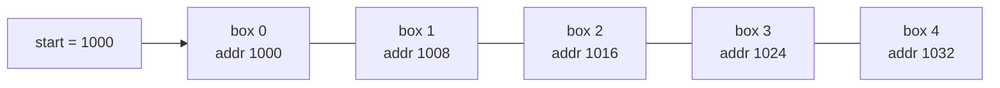
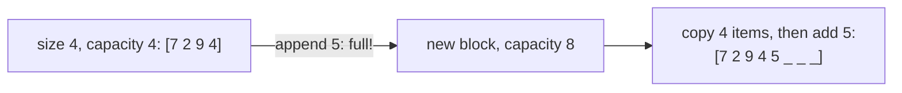
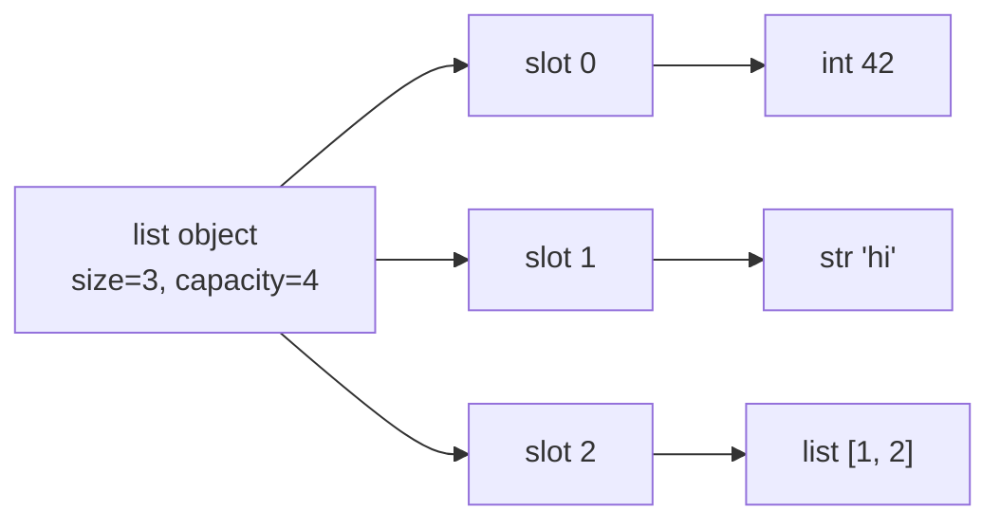

# Chapter 02 · Arrays & Strings Fundamentals

> Picture a hostel corridor with 100 identical rooms, numbered 0 to 99. If you know the room number, you walk straight there: no knocking on other doors. That one property, "jump straight to item i", is why arrays sit underneath almost every data structure you'll ever use.

**You will learn:**
- How an array is laid out in memory, and why `a[i]` is O(1)
- Static vs dynamic arrays, and how a Python `list` really works inside
- The true cost of every core operation (access, append, insert, delete, search, slice)
- In-place techniques and the standard traversal patterns
- Rotation with the **reverse trick**, and **Kadane's algorithm** for maximum subarray
- Matrix traversal: row/column order, transpose, rotate 90°, spiral, diagonals
- Strings for DSA: immutability, building strings efficiently, `ord`/`chr` tricks and 26-slot count arrays
- 12 classic interview problems on arrays and strings

**Before this:** [Lists](../part-1-python/07-lists.md) · [Strings Deep Dive](../part-1-python/04-strings.md) · [Big-O](01-big-o-complexity.md)

---

## 🧠 The Big Idea

An **array** is a row of equal-sized boxes placed **side by side** in memory. Because every box is the same size and they're packed together, the computer can find any box with one multiplication and one addition:

```text
address of box i = start address + i × box size
```



Want box 3? 1000 + 3 × 8 = 1024. Done. It doesn't matter if the array has 5 boxes or 5 billion: **one calculation**. That's O(1) random access, the array's superpower.

The price of that superpower: since the boxes are packed tightly, there's no gap to squeeze a new box into the middle. To insert at position 2, every box from 2 onward must shift one place right. That's O(n).

> 💡 **The core insight:** arrays are fantastic at **"read or write position i"** and **"add or remove at the end"**, and bad at **"insert or delete in the middle or front"**. Every array trick in this chapter is about using the cheap operations and avoiding the expensive ones.

A **string** is basically an array of characters with one extra rule in Python: it can't be changed after it's made. We'll see why that matters a lot.

---

## 🔨 Building It Up

### 1. Memory layout: contiguous boxes

Your computer's memory (RAM) is one giant numbered row of bytes. An array claims one continuous stretch of it. An array of 64-bit integers uses 8 bytes per element, so element i starts 8 × i bytes after element 0.

Python's standard library has a real typed array in the `array` module. Let's look at its element size:

```python
from array import array

nums = array("q", [10, 20, 30, 40])   # "q" = signed 64-bit integers
print(nums.itemsize, "bytes per element")
print("element 2 is", nums[2])
print("byte offset of element 2:", 2 * nums.itemsize)
```

```text
8 bytes per element
element 2 is 30
byte offset of element 2: 16
```

What just happened: every element is exactly 8 bytes, so element 2 sits 16 bytes after the start. Equal sizes + no gaps = instant addressing.

There's a second, hidden benefit: **cache locality**. When the CPU reads one box from RAM, it fetches a whole chunk of neighbours (a **cache line**, typically 64 bytes) into its fast cache. Walking an array left to right means the next element is usually already in cache. That's why a simple loop over an array is very fast in practice.

### 2. Static vs dynamic arrays

A **static array** has a fixed size chosen when it's created (like `int a[10]` in C). Full means full.

A **dynamic array** grows automatically. It keeps a **capacity** (boxes reserved) bigger than its **size** (boxes used). When size hits capacity, it:

1. reserves a new, bigger block (a constant factor bigger),
2. copies everything over,
3. frees the old block.



As you saw in [Chapter 01](01-big-o-complexity.md), growing by a constant factor makes `append` **O(1) amortized**: the rare O(n) copy is spread over many cheap appends.

| | Static array | Dynamic array |
|---|---|---|
| Size | fixed at creation | grows/shrinks |
| Append at end | impossible when full | O(1) amortized |
| Memory | exact | some spare capacity |
| Examples | C arrays, Java `int[]` | Python `list`, Java `ArrayList`, C++ `vector` |

### 3. How a Python list really works

A Python list is a dynamic array, but of **pointers**, not of values. Each slot holds the memory address of an object that lives somewhere else.



This explains three things beginners find confusing:

1. **A list can hold mixed types.** Every slot is the same size (one pointer, 8 bytes), whatever it points to.
2. **`a[i]` is O(1)** even with mixed types: you index the pointer array, then follow one pointer.
3. **`[[0] * 3] * 3` is a trap.** It copies the *pointer* to the same inner list three times.

```python
bad = [[0] * 3] * 3          # three pointers to ONE inner list
bad[0][0] = 9
print(bad)

good = [[0] * 3 for _ in range(3)]   # three separate inner lists
good[0][0] = 9
print(good)
```

```text
[[9, 0, 0], [9, 0, 0], [9, 0, 0]]
[[9, 0, 0], [0, 0, 0], [0, 0, 0]]
```

What just happened: in `bad`, all three rows are the same object, so changing one "changes" all three. Always build grids with a comprehension.

You can watch the spare capacity at work: the list's memory size only jumps occasionally as you append.

```python
import sys

a = []
last = sys.getsizeof(a)
jumps = 0
for i in range(100):
    a.append(i)
    size = sys.getsizeof(a)
    if size != last:          # memory grew: a resize happened here
        jumps += 1
        last = size
print("appends:", len(a), "| fewer than 20 resizes:", jumps < 20)
```

```text
appends: 100 | fewer than 20 resizes: True
```

(The exact number of resizes differs between Python versions, around a dozen, which is why we print a yes/no instead of the number. The point: only a handful of the 100 appends triggered a copy.)

### 4. Core operations and their costs

| Operation | Python | Cost | Why |
|---|---|---|---|
| Read / write index i | `a[i]`, `a[i] = x` | O(1) | address arithmetic |
| Append at end | `a.append(x)` | O(1) amortized | spare capacity |
| Remove from end | `a.pop()` | O(1) | nothing shifts |
| Insert at i | `a.insert(i, x)` | O(n − i) | shift the tail right |
| Delete at i | `a.pop(i)`, `del a[i]` | O(n − i) | shift the tail left |
| Search by value | `x in a`, `a.index(x)` | O(n) | must scan |
| Slice | `a[i:j]` | O(j − i) | copies elements |
| Length | `len(a)` | O(1) | stored |

Let's see the shifting with our own insert function, which counts moves:

```python
def insert_at(arr, index, value):
    arr.append(None)                   # make room at the end
    moves = 0
    for i in range(len(arr) - 1, index, -1):
        arr[i] = arr[i - 1]            # shift one step right, from the back
        moves += 1
    arr[index] = value
    return moves

a = [10, 20, 30, 40, 50]
print(insert_at(a, 1, 15), a)
b = [10, 20, 30, 40, 50]
print(insert_at(b, 5, 60), b)
```

```text
4 [10, 15, 20, 30, 40, 50]
0 [10, 20, 30, 40, 50, 60]
```

What just happened: inserting near the front moved 4 elements; inserting at the end moved none. We shift **from the back** so we never overwrite a value before moving it.

### 5. In-place techniques

**In place** means modifying the input array using only O(1) extra memory, instead of building a new one. Interviewers love asking for it. The basic tools:

- **Swap:** `a[i], a[j] = a[j], a[i]`
- **Two pointers from both ends** (reverse, palindrome): [Chapter 03](03-two-pointers.md)
- **Reader/writer pointers** (filter while keeping order): [Chapter 03](03-two-pointers.md)
- **Overwrite from the back** when merging into spare space at the end
- **Use the array itself as storage** (mark visited by negating values, store info in row 0 of a matrix)

The most basic one, reversing a range in place:

```python
def reverse_range(arr, lo, hi):
    """Reverse arr[lo..hi] (inclusive) in place."""
    while lo < hi:
        arr[lo], arr[hi] = arr[hi], arr[lo]
        lo += 1
        hi -= 1

nums = [1, 2, 3, 4, 5, 6, 7]
reverse_range(nums, 2, 5)
print(nums)
```

```text
[1, 2, 6, 5, 4, 3, 7]
```

Keep `reverse_range` in your pocket: it powers rotation in section 7 and several matrix tricks.

**Using the array as its own hash set.** If values are in the range 1..n, the array can mark "seen" by flipping the sign at index `value − 1`:

```python
def find_duplicates(nums):
    """Values are in 1..n; each appears once or twice. O(n) time, O(1) extra space."""
    result = []
    for x in nums:
        idx = abs(x) - 1                 # abs: the slot may already be negated
        if nums[idx] < 0:
            result.append(abs(x))        # already marked once: duplicate
        else:
            nums[idx] = -nums[idx]       # mark value idx+1 as seen
    return result

print(find_duplicates([4, 3, 2, 7, 8, 2, 3, 1]))
```

```text
[2, 3]
```

### 6. Traversal patterns

Most array solutions are one of these walks. Recognise them and half the code writes itself.

```python
nums = [3, 1, 4, 1, 5]

# 1. Forward with index and value
print([f"{i}:{x}" for i, x in enumerate(nums)])

# 2. Backward
print([nums[i] for i in range(len(nums) - 1, -1, -1)])

# 3. Adjacent pairs (compare neighbours)
print([(nums[i - 1], nums[i]) for i in range(1, len(nums))])

# 4. Running state (carry a summary while walking)
running, best = 0, []
for x in nums:
    running += x
    best.append(running)
print(best)

# 5. Two passes: info from the left, then from the right
n = len(nums)
left_max = [0] * n
right_max = [0] * n
for i in range(n):
    left_max[i] = max(nums[i], left_max[i - 1] if i else nums[i])
for i in range(n - 1, -1, -1):
    right_max[i] = max(nums[i], right_max[i + 1] if i < n - 1 else nums[i])
print(left_max, right_max)
```

```text
['0:3', '1:1', '2:4', '3:1', '4:5']
[5, 1, 4, 1, 3]
[(3, 1), (1, 4), (4, 1), (1, 5)]
[3, 4, 8, 9, 14]
[3, 3, 4, 4, 5] [5, 5, 5, 5, 5]
```

Pattern 4 (running state) is the seed of **prefix sums** ([Chapter 06](06-prefix-sums.md)) and **Kadane** (section 8). Pattern 5 (left pass + right pass) solves Trapping Rain Water and Product of Array Except Self.

**Best Time to Buy and Sell Stock** is the running-state pattern in its purest form: walk once, remember the cheapest price so far, and check the profit if you sold today.

```python
def max_profit(prices):
    min_price = float("inf")
    best = 0
    for p in prices:
        min_price = min(min_price, p)        # best day to have bought, so far
        best = max(best, p - min_price)      # profit if we sell today
    return best

print(max_profit([7, 1, 5, 3, 6, 4]), max_profit([7, 6, 4, 3, 1]))
```

```text
5 0
```

### 7. Rotation and the reverse trick

**Rotate right by k:** `[1,2,3,4,5,6,7]`, k = 3 → `[5,6,7,1,2,3,4]`. The last k elements move to the front.

**Way 1, slicing:** easy, O(n) time, but O(n) extra space.

**Way 2, the reverse trick:** O(n) time, **O(1)** space.

1. Reverse the whole array.
2. Reverse the first k.
3. Reverse the rest.

```text
start:              1 2 3 4 5 6 7
reverse all:        7 6 5 4 3 2 1
reverse first 3:    5 6 7 | 4 3 2 1
reverse last 4:     5 6 7 | 1 2 3 4   ✅
```

Why it works: reversing the whole array puts the last k elements at the front (good) but backwards (bad). Reversing each part again fixes the order inside each part, without moving the parts.

```python
def reverse_range(arr, lo, hi):
    while lo < hi:
        arr[lo], arr[hi] = arr[hi], arr[lo]
        lo += 1
        hi -= 1

def rotate_right(nums, k):
    n = len(nums)
    k %= n                       # rotating by n is a no-op; handles k > n
    reverse_range(nums, 0, n - 1)
    reverse_range(nums, 0, k - 1)
    reverse_range(nums, k, n - 1)
    return nums

print(rotate_right([1, 2, 3, 4, 5, 6, 7], 3))
print(rotate_right([1, 2, 3], 4))                      # 4 % 3 = 1
print([1, 2, 3, 4, 5, 6, 7][-3:] + [1, 2, 3, 4, 5, 6, 7][:-3])   # slicing version
```

```text
[5, 6, 7, 1, 2, 3, 4]
[3, 1, 2]
[5, 6, 7, 1, 2, 3, 4]
```

Rotating **left** by k is the same as rotating right by n − k. Or reverse the first k, reverse the rest, then reverse all.

### 8. Kadane's algorithm: maximum subarray sum

**Problem:** find the contiguous subarray with the largest sum. `[-2,1,-3,4,-1,2,1,-5,4]` → 6 (from `[4,-1,2,1]`).

Brute force tries every start and end: O(n²) (or O(n³) if you re-sum each one).

**Kadane's insight:** walk left to right, and at each index ask one question: **"Is the best subarray ending here better off extending the previous one, or starting fresh at this element?"**

If the best sum ending at the previous index is negative, it can only drag us down, so we throw it away and start fresh.

```text
best_ending_here(i) = max(nums[i], best_ending_here(i-1) + nums[i])
answer = max over all i of best_ending_here(i)
```

```python
def max_subarray(nums):
    current = best = nums[0]
    for x in nums[1:]:
        current = max(x, current + x)   # extend, or start fresh at x
        best = max(best, current)
    return best

print(max_subarray([-2, 1, -3, 4, -1, 2, 1, -5, 4]))
print(max_subarray([-3, -1, -2]))     # all negative: best is the single largest
```

```text
6
-1
```

**Dry run** on `[-2, 1, -3, 4, -1, 2, 1, -5, 4]`:

| i | x | current = max(x, current + x) | best |
|---|---|---|---|
| 0 | -2 | -2 (start) | -2 |
| 1 | 1 | max(1, -1) = 1 → fresh | 1 |
| 2 | -3 | max(-3, -2) = -2 | 1 |
| 3 | 4 | max(4, 2) = 4 → fresh | 4 |
| 4 | -1 | max(-1, 3) = 3 | 4 |
| 5 | 2 | max(2, 5) = 5 | 5 |
| 6 | 1 | max(1, 6) = 6 | 6 |
| 7 | -5 | max(-5, 1) = 1 | 6 |
| 8 | 4 | max(4, 5) = 5 | 6 |

Want the actual subarray, not just the sum? Remember where the current run started:

```python
def max_subarray_with_range(nums):
    current, best = nums[0], nums[0]
    start = best_l = best_r = 0
    for i in range(1, len(nums)):
        if current + nums[i] < nums[i]:
            current, start = nums[i], i          # start fresh here
        else:
            current += nums[i]
        if current > best:
            best, best_l, best_r = current, start, i
    return best, nums[best_l:best_r + 1]

print(max_subarray_with_range([-2, 1, -3, 4, -1, 2, 1, -5, 4]))
```

```text
(6, [4, -1, 2, 1])
```

O(n) time, O(1) space. Kadane is actually a tiny Dynamic Programming solution (the state is "best sum ending here"); you'll recognise it again in [Chapter 20](20-dp-1d.md).

### 9. Matrix traversal

A **matrix** (2D array) in Python is a list of rows: `grid[r][c]` is row r, column c. With R rows and C columns:

```python
grid = [
    [1, 2, 3],
    [4, 5, 6],
    [7, 8, 9],
]
R, C = len(grid), len(grid[0])

print("row-major:   ", [grid[r][c] for r in range(R) for c in range(C)])
print("column-major:", [grid[r][c] for c in range(C) for r in range(R)])
print("main diag:   ", [grid[i][i] for i in range(min(R, C))])
print("anti diag:   ", [grid[i][C - 1 - i] for i in range(min(R, C))])
```

```text
row-major:    [1, 2, 3, 4, 5, 6, 7, 8, 9]
column-major: [1, 4, 7, 2, 5, 8, 3, 6, 9]
main diag:    [1, 5, 9]
anti diag:    [3, 5, 7]
```

**The diagonal rule:** cells on the same "\\" diagonal share `r − c`; cells on the same "/" anti-diagonal share `r + c`. This one fact solves N-Queens, Valid Sudoku-style checks and diagonal traversals.

```python
from collections import defaultdict

grid = [[1, 2, 3], [4, 5, 6], [7, 8, 9]]
by_anti = defaultdict(list)
for r in range(3):
    for c in range(3):
        by_anti[r + c].append(grid[r][c])     # same r + c = same "/" diagonal
print(dict(by_anti))
```

```text
{0: [1], 1: [2, 4], 2: [3, 5, 7], 3: [6, 8], 4: [9]}
```

**Transpose** (swap rows and columns: `t[c][r] = g[r][c]`). For a square matrix, in place, swap across the main diagonal, touching only cells above it:

```python
def transpose_in_place(m):
    n = len(m)
    for r in range(n):
        for c in range(r + 1, n):        # only above the diagonal, or we'd swap back
            m[r][c], m[c][r] = m[c][r], m[r][c]
    return m

print(transpose_in_place([[1, 2, 3], [4, 5, 6], [7, 8, 9]]))
print([list(row) for row in zip(*[[1, 2, 3], [4, 5, 6]])])   # non-square: build a new one
```

```text
[[1, 4, 7], [2, 5, 8], [3, 6, 9]]
[[1, 4], [2, 5], [3, 6]]
```

**Rotate 90° clockwise = transpose, then reverse each row.**

```text
1 2 3    transpose    1 4 7    reverse rows    7 4 1
4 5 6   ---------->   2 5 8   ------------>    8 5 2
7 8 9                 3 6 9                    9 6 3
```

(Counter-clockwise = transpose, then reverse the order of the rows; or reverse each row first, then transpose.)

**Spiral order** walks the outer ring, then the next ring inward. Keep four boundaries and shrink them:

```python
def spiral_order(matrix):
    result = []
    top, bottom = 0, len(matrix) - 1
    left, right = 0, len(matrix[0]) - 1
    while top <= bottom and left <= right:
        for c in range(left, right + 1):          # → along the top row
            result.append(matrix[top][c])
        top += 1
        for r in range(top, bottom + 1):          # ↓ down the right column
            result.append(matrix[r][right])
        right -= 1
        if top <= bottom:                         # ← along the bottom row (if one is left)
            for c in range(right, left - 1, -1):
                result.append(matrix[bottom][c])
            bottom -= 1
        if left <= right:                         # ↑ up the left column (if one is left)
            for r in range(bottom, top - 1, -1):
                result.append(matrix[r][left])
            left += 1
    return result

print(spiral_order([[1, 2, 3], [4, 5, 6], [7, 8, 9]]))
print(spiral_order([[1, 2, 3, 4], [5, 6, 7, 8], [9, 10, 11, 12]]))
```

```text
[1, 2, 3, 6, 9, 8, 7, 4, 5]
[1, 2, 3, 4, 8, 12, 11, 10, 9, 5, 6, 7]
```

The two `if` checks matter for non-square matrices: after going right and down, the remaining area may be a single row or column, and without the checks you'd walk it twice.

**Neighbours in a grid** use direction arrays, which you'll use constantly in graph problems ([Chapter 16](16-graphs-bfs-dfs.md)):

```python
grid = [[1, 2, 3], [4, 5, 6], [7, 8, 9]]
R, C = 3, 3
DIRS = [(-1, 0), (1, 0), (0, -1), (0, 1)]     # up, down, left, right

def neighbours(r, c):
    for dr, dc in DIRS:
        nr, nc = r + dr, c + dc
        if 0 <= nr < R and 0 <= nc < C:       # stay inside the grid
            yield grid[nr][nc]

print(sorted(neighbours(1, 1)), sorted(neighbours(0, 0)))
```

```text
[2, 4, 6, 8] [2, 4]
```

### 10. Strings for DSA

**Immutability.** A Python `str` can't be changed after creation. `s[0] = "x"` raises `TypeError`. Every "modification" (`s + t`, `s.replace(...)`, `s.upper()`) builds a **new** string. Consequences:

- Building a string with `+=` in a loop can cost O(n²) (each step may copy everything so far).
- Strings are safe as dict keys and set members (they're hashable because they can't change).
- To edit characters in place, convert to a list: `chars = list(s)`, edit, then `"".join(chars)`.

```python
def build_slow(n):
    s = ""
    for i in range(n):
        s += str(i % 10)        # may copy s each time: O(n^2) worst case
    return s

def build_fast(n):
    parts = []
    for i in range(n):
        parts.append(str(i % 10))   # O(1) amortized
    return "".join(parts)           # one O(n) pass at the end

print(build_slow(12) == build_fast(12), build_fast(12))
```

```text
True 012345678901
```

**`ord` and `chr`.** Every character has a number (its Unicode **code point**). `ord("a")` is 97, `ord("b")` is 98, ... `ord("z")` is 122. So `ord(ch) - ord("a")` maps `a..z` to `0..25`, a perfect array index.

```python
print(ord("a"), ord("z"), ord("A"), ord("0"))
print(ord("d") - ord("a"))                    # letter position: 3
print(chr(ord("a") + 3))                      # back to a letter: 'd'
print(chr((ord("y") - ord("a") + 3) % 26 + ord("a")))   # Caesar shift wraps: 'b'
print(int("7"), ord("7") - ord("0"))          # digit char to number, two ways
```

```text
97 122 65 48
3
d
b
7 7
```

**The 26-slot count array.** When a problem says "lowercase English letters only", you can count characters in a list of 26 ints instead of a dict. It's O(1) space (26 is a constant), fast, and a list can be turned into a tuple and used as a dict key.

```python
def letter_counts(s):
    counts = [0] * 26
    for ch in s:
        counts[ord(ch) - ord("a")] += 1
    return counts

def is_anagram(s, t):
    return len(s) == len(t) and letter_counts(s) == letter_counts(t)

print(letter_counts("banana")[:3])          # a, b, c
print(is_anagram("listen", "silent"), is_anagram("rat", "car"))
```

```text
[3, 1, 0]
True False
```

**Useful string methods** for DSA: `s.isalnum()`, `s.isalpha()`, `s.isdigit()`, `s.lower()`, `s.split()` (splits on any whitespace and drops empties), `" ".join(words)`, `s[::-1]` (reverse), `s.startswith(p)`, `s.count(sub)`, and `collections.Counter(s)` for a quick frequency map.

**Reverse Words in a String** puts several of these together:

```python
def reverse_words(s):
    return " ".join(reversed(s.split()))     # split() also removes extra spaces

print(repr(reverse_words("  the sky   is blue ")))
```

```text
'blue is sky the'
```

### 11. A few classic problems, start to finish

**Move all negatives before positives? Merge? Dedupe?** Those are two-pointer problems (next chapter). Here are three pure array/string classics.

**Plus One:** a number is stored as a list of digits; add one.

```python
def plus_one(digits):
    digits = digits[:]                       # don't mutate the caller's list
    for i in range(len(digits) - 1, -1, -1):
        if digits[i] < 9:
            digits[i] += 1
            return digits                    # no carry left: done
        digits[i] = 0                        # 9 + 1 = 10: write 0, carry on
    return [1] + digits                      # all 9s: e.g. 999 -> 1000

print(plus_one([1, 2, 3]), plus_one([1, 9, 9]), plus_one([9, 9]))
```

```text
[1, 2, 4] [2, 0, 0] [1, 0, 0]
```

**Longest Common Prefix** of several strings: compare column by column.

```python
def longest_common_prefix(strs):
    if not strs:
        return ""
    for i, ch in enumerate(strs[0]):
        for other in strs[1:]:
            if i == len(other) or other[i] != ch:
                return strs[0][:i]
    return strs[0]

print(longest_common_prefix(["flower", "flow", "flight"]))
print(repr(longest_common_prefix(["dog", "racecar", "car"])))
```

```text
fl
''
```

Time O(S) where S is the total number of characters; space O(1) besides the answer.

**Pascal's Triangle:** each row is built from the previous one, a nice "previous row → next row" array walk.

```python
def pascal(num_rows):
    rows = [[1]]
    for _ in range(num_rows - 1):
        prev = rows[-1]
        row = [1] + [prev[i - 1] + prev[i] for i in range(1, len(prev))] + [1]
        rows.append(row)
    return rows

for row in pascal(5):
    print(row)
```

```text
[1]
[1, 1]
[1, 2, 1]
[1, 3, 3, 1]
[1, 4, 6, 4, 1]
```

---

## 🔬 Under the Hood

### The CPython list struct

Inside CPython, a list is a C struct with three key fields: `ob_size` (how many items are used), `allocated` (capacity), and `ob_item`, a pointer to a C array of `PyObject*` pointers. `len(a)` just returns `ob_size`: O(1). `a[i]` checks `0 <= i < ob_size` and returns `ob_item[i]`: O(1).

When `append` finds `ob_size == allocated`, CPython calls `list_resize`, which picks a new capacity of roughly `size + size/8 + a small constant`. That's about 12.5% growth, which is gentler than doubling (less wasted memory) but still a constant factor, so append stays amortized O(1).

`pop()` from the end never shifts. When a list shrinks below half its capacity, CPython may shrink the allocation too, so memory doesn't stay wasted forever.

### Why a list of ints uses more memory than you'd think

Each slot is an 8-byte pointer, and each `int` is a full Python object (around 28 bytes for small values). So a list of a million ints costs roughly 8 MB of pointers plus the int objects. (CPython caches the small ints from −5 to 256, so a list full of small repeated numbers shares those objects.) A typed `array("q", ...)` stores raw 8-byte numbers with no per-element objects, and libraries like NumPy do the same. That's why NumPy is both smaller and faster for numeric work.

### Why `insert(0, x)` is O(n) but still feels fast

CPython shifts the pointers with `memmove`, a highly optimised C routine that moves memory in big blocks. So for a few thousand elements you won't notice. But it's still linear: do it n times and you've written an O(n²) algorithm. For frequent front operations, use `collections.deque` ([Chapter 12](12-queues-deques.md)).

### How strings are stored

CPython stores a string as a compact array of fixed-width code units: 1 byte per character if every character fits in Latin-1, 2 bytes if every character is within the Basic Multilingual Plane, otherwise 4 bytes. All characters in one string use the same width, which is exactly why `s[i]` is still O(1): it's array indexing again. A string also caches its hash after the first time it's computed, so using the same string as a dict key repeatedly is cheap.

### Row-major order and why loop order matters

In C and NumPy, a 2D array is one long block with rows stored one after another (**row-major**). Iterating row by row walks memory in order (cache-friendly); iterating column by column jumps by a whole row each step. In plain Python each row is a separate list, so the effect is smaller, but "outer loop over rows, inner over columns" is still the natural and fastest default.

---

## 🧩 Pattern Decoder

### Signals: which array technique?

| You see in the problem... | Think |
|---|---|
| "maximum / minimum **subarray** sum", "contiguous" with negatives | **Kadane** |
| "best time to buy and sell", "max difference with i < j" | **running min/max** (one pass) |
| "rotate the array by k", "O(1) extra space" | **reverse trick** |
| "rotate the image / matrix 90°" | **transpose + reverse rows** |
| "spiral", "layer by layer" | **four shrinking boundaries** |
| "diagonal", "anti-diagonal", "queens" | **r − c** and **r + c** keys |
| "lowercase letters only", "anagram" | **26-slot count array** |
| "values in range 1..n", "O(1) extra space" | **use the array as a hash** (negate / swap to index) |
| "for each element, something about everything to its left and right" | **two passes** (left array + right array) |
| "in place", "remove / move elements" | reader/writer two pointers ([Chapter 03](03-two-pointers.md)) |
| "contiguous subarray with a condition (sum ≥ k, at most k distinct)" | sliding window ([Chapter 04](04-sliding-window.md)) |
| "subarray sum equals k" with negatives | prefix sums + hashmap ([Chapter 06](06-prefix-sums.md)) |

### Template A: one-pass with running state

```py
def one_pass(nums):
    state = initial_state()          # e.g. min so far, best ending here, count
    answer = initial_answer()
    for x in nums:
        state = update(state, x)     # absorb x into the summary
        answer = better(answer, state)
    return answer
```

### Template B: Kadane (best subarray ending here)

```py
def kadane(nums):
    current = best = nums[0]
    for x in nums[1:]:
        current = max(x, current + x)   # extend or restart
        best = max(best, current)
    return best
```

### Template C: matrix boundaries (spiral / layers)

```py
top, bottom, left, right = 0, R - 1, 0, C - 1
while top <= bottom and left <= right:
    # walk top row (left..right), then top += 1
    # walk right column (top..bottom), then right -= 1
    # if top <= bottom: walk bottom row (right..left), then bottom -= 1
    # if left <= right: walk left column (bottom..top), then left += 1
```

### Template D: frequency array for letters

```py
counts = [0] * 26
for ch in s:
    counts[ord(ch) - ord("a")] += 1
key = tuple(counts)       # hashable signature: equal for all anagrams
```

### Variation 1: Maximum Product Subarray (Kadane with a twist)

**Problem:** largest product of a contiguous subarray. `[2,3,-2,4]` → 6.

**Idea:** a negative number flips the biggest product into the smallest and vice versa. So track **both** the max and min product ending here. When `x` is negative, swap them before extending.

```python
def max_product(nums):
    cur_max = cur_min = best = nums[0]
    for x in nums[1:]:
        if x < 0:
            cur_max, cur_min = cur_min, cur_max     # negative flips big and small
        cur_max = max(x, cur_max * x)
        cur_min = min(x, cur_min * x)
        best = max(best, cur_max)
    return best

print(max_product([2, 3, -2, 4]), max_product([-2, 0, -1]), max_product([-2, 3, -4]))
```

```text
6 0 24
```

O(n) time, O(1) space.

### Variation 2: Product of Array Except Self (two passes)

**Problem:** `out[i]` = product of every element except `nums[i]`, without division. `[1,2,3,4]` → `[24,12,8,6]`.

**Idea:** `out[i]` = (product of everything left of i) × (product of everything right of i). One pass left-to-right fills the left products; one pass right-to-left multiplies in the right products.

```python
def product_except_self(nums):
    n = len(nums)
    out = [1] * n
    left = 1
    for i in range(n):
        out[i] = left            # product of nums[0..i-1]
        left *= nums[i]
    right = 1
    for i in range(n - 1, -1, -1):
        out[i] *= right          # times product of nums[i+1..n-1]
        right *= nums[i]
    return out

print(product_except_self([1, 2, 3, 4]))
```

```text
[24, 12, 8, 6]
```

O(n) time, O(1) extra space (the output doesn't count). This pattern gets its own treatment in [Chapter 06](06-prefix-sums.md).

### Variation 3: Majority Element (Boyer–Moore voting)

**Problem:** one value appears more than n/2 times. Find it in O(n) time and O(1) space.

**Idea:** pair up each majority vote with a different vote and cancel them. Since the majority has more than half, it can't be fully cancelled. Keep a `candidate` and a `count`: same value → count up, different → count down, count hits 0 → new candidate.

```python
def majority_element(nums):
    candidate, count = None, 0
    for x in nums:
        if count == 0:
            candidate = x
        count += 1 if x == candidate else -1
    return candidate

print(majority_element([2, 2, 1, 1, 1, 2, 2]))
```

```text
2
```

**Dry run** on `[2, 2, 1, 1, 1, 2, 2]`:

| x | candidate before | count before | action | count after |
|---|---|---|---|---|
| 2 | None | 0 | new candidate 2, +1 | 1 |
| 2 | 2 | 1 | same, +1 | 2 |
| 1 | 2 | 2 | different, −1 | 1 |
| 1 | 2 | 1 | different, −1 | 0 |
| 1 | 2 | 0 | new candidate 1, +1 | 1 |
| 2 | 1 | 1 | different, −1 | 0 |
| 2 | 1 | 0 | new candidate 2, +1 | 1 |

Final candidate: 2. (If a majority isn't guaranteed, do a second pass to count the candidate.)

### Variation 4: Set Matrix Zeroes (use the matrix as storage)

**Problem:** if a cell is 0, set its whole row and column to 0, in place.

**Idea:** you need to remember which rows and columns to zero. Instead of two extra arrays, use **row 0 and column 0 as the markers**, plus one flag for whether row 0 itself had a zero.

```python
def set_zeroes(m):
    R, C = len(m), len(m[0])
    first_row_zero = any(m[0][c] == 0 for c in range(C))
    for r in range(1, R):
        for c in range(C):
            if m[r][c] == 0:
                m[r][0] = 0          # mark row r
                m[0][c] = 0          # mark column c
    for r in range(1, R):
        for c in range(C - 1, -1, -1):   # right to left so column 0's marker is read last
            if m[r][0] == 0 or m[0][c] == 0:
                m[r][c] = 0
    if first_row_zero:
        for c in range(C):
            m[0][c] = 0
    return m

print(set_zeroes([[1, 1, 1], [1, 0, 1], [1, 1, 1]]))
print(set_zeroes([[0, 1, 2, 0], [3, 4, 5, 2], [1, 3, 1, 5]]))
```

```text
[[1, 0, 1], [0, 0, 0], [1, 0, 1]]
[[0, 0, 0, 0], [0, 4, 5, 0], [0, 3, 1, 0]]
```

O(R·C) time, O(1) extra space.

### When NOT to use plain array tricks

- **Many inserts/deletes in the middle or front** → linked list ([Chapter 10](10-linked-lists.md)) or deque ([Chapter 12](12-queues-deques.md)).
- **Lots of "is x present?" queries** → a set, not repeated `x in list` ([Chapter 05](05-hashing.md)).
- **Many range-sum queries** → prefix sums ([Chapter 06](06-prefix-sums.md)), not re-summing each time.
- **Kadane with a length limit or extra condition** ("subarray of length exactly k") → that's sliding window.
- **Letters beyond a–z** (Unicode, mixed case, digits) → use a dict / `Counter`, not a 26-array.

---

## ⚠️ Traps & Common Mistakes

1. **Building a grid with `[[0] * C] * R`.** All rows share one list. Use `[[0] * C for _ in range(R)]`.

2. **Forgetting `k %= n` in rotation.** Rotating by k = 10 on 7 elements breaks the reverse trick (and `n = 0` must be handled separately).

3. **Kadane initialised with 0.**

```py
# ❌ returns 0 for [-3, -1, -2] (an empty subarray isn't allowed)
best = current = 0

# ✅ start from the first element
best = current = nums[0]
```

4. **Removing from a list while looping over it.** Elements get skipped. Use reader/writer or build a new list.

5. **`s += ch` in a long loop.** Collect into a list and `"".join` at the end.

6. **Trying to assign into a string.** `s[i] = "x"` fails. Convert with `list(s)`.

7. **Off-by-one in spiral order** on non-square matrices: forgetting the `if top <= bottom` / `if left <= right` checks duplicates the last row or column.

8. **Transposing a square matrix by swapping every (r, c).** Each pair gets swapped twice, giving back the original. Only loop over `c > r`.

9. **Using `ord(ch) - 97` on uppercase or digits.** Gives a negative or out-of-range index. Check the constraints, or normalise with `.lower()`.

10. **Mutating the caller's list unexpectedly.** If the function shouldn't change its input, copy first (`a[:]`), and say so in an interview.

---

## 💡 Tips & Tricks

- `a[-1]` is the last element, `a[-k:]` the last k. `a[::-1]` reverses (a copy). `a.reverse()` reverses in place.
- `enumerate(a)` gives index and value; `zip(a, b)` walks two lists together; `zip(*grid)` transposes.
- `for row in grid: print(*row)` prints a matrix neatly.
- `float("inf")` and `float("-inf")` are great starting values for min/max trackers.
- `max(nums, key=...)`, `min(...)`, `sum(...)` are C-speed loops; prefer them over hand-written loops for simple jobs.
- Index tricks: the middle is `n // 2`; the mirror of i is `n - 1 - i`; a 2D cell (r, c) flattens to `r * C + c` and back with `divmod(idx, C)`.
- For letter problems, mention the 26-array as "O(1) space because the alphabet is fixed". Interviewers like hearing it.
- When asked for O(1) space, ask yourself: "Can the input itself store my bookkeeping?" (negation, row 0 markers, swapping values to their index).

---

## 🎯 Interview Questions

### 1. Best Time to Buy and Sell Stock 🔥🔥🔥

Buy one day, sell a later day; maximise profit.

<details><summary>Answer</summary>

Running-minimum pattern: for each day, profit if sold today = price − cheapest price seen before. One pass.

```python
def max_profit(prices):
    min_price, best = float("inf"), 0
    for p in prices:
        min_price = min(min_price, p)
        best = max(best, p - min_price)
    return best

print(max_profit([7, 1, 5, 3, 6, 4]))
```

```text
5
```

Time O(n), space O(1).

</details>

### 2. Maximum Subarray 🔥🔥🔥

<details><summary>Answer</summary>

Kadane: `current = max(x, current + x)`, track the best. See section 8 for code and dry run. Time O(n), space O(1). Follow-up "use divide and conquer" exists (O(n log n)), but Kadane is the expected answer. Key sentence: "a negative running sum can only hurt the future, so restart."

</details>

### 3. Rotate Array 🔥🔥🔥

Rotate right by k in place.

<details><summary>Answer</summary>

Reverse all, reverse first k, reverse the rest, after `k %= n`.

```python
def rotate(nums, k):
    def rev(lo, hi):
        while lo < hi:
            nums[lo], nums[hi] = nums[hi], nums[lo]
            lo += 1; hi -= 1
    n = len(nums)
    k %= n
    rev(0, n - 1); rev(0, k - 1); rev(k, n - 1)
    return nums

print(rotate([1, 2, 3, 4, 5, 6, 7], 3), rotate([-1, -100, 3, 99], 2))
```

```text
[5, 6, 7, 1, 2, 3, 4] [3, 99, -1, -100]
```

Time O(n), space O(1). Also mention the slicing version `nums[:] = nums[-k:] + nums[:-k]` (O(n) space).

</details>

### 4. Rotate Image 🔥🔥🔥

Rotate an n × n matrix 90° clockwise in place.

<details><summary>Answer</summary>

Transpose (swap across the main diagonal), then reverse every row.

```python
def rotate_image(m):
    n = len(m)
    for r in range(n):
        for c in range(r + 1, n):
            m[r][c], m[c][r] = m[c][r], m[r][c]
    for row in m:
        row.reverse()
    return m

for row in rotate_image([[1, 2, 3], [4, 5, 6], [7, 8, 9]]):
    print(row)
```

```text
[7, 4, 1]
[8, 5, 2]
[9, 6, 3]
```

Time O(n²), space O(1).

</details>

### 5. Spiral Matrix 🔥🔥🔥

<details><summary>Answer</summary>

Four boundaries (`top`, `bottom`, `left`, `right`), walk the ring, shrink, repeat. Remember the two guard checks for the bottom row and left column. Code and output in section 9. Time O(R·C), space O(1) besides the output.

</details>

### 6. Set Matrix Zeroes 🔥🔥

<details><summary>Answer</summary>

Easy version: record zero rows and columns in two sets, then zero them: O(R + C) space. Optimal: use row 0 and column 0 as markers plus a flag for row 0, giving O(1) extra space. Code in the Pattern Decoder (Variation 4). Time O(R·C).

</details>

### 7. Valid Anagram 🔥🔥🔥

<details><summary>Answer</summary>

Count letters with a 26-array (or `Counter` for Unicode). Lengths must match.

```python
def is_anagram(s, t):
    if len(s) != len(t):
        return False
    counts = [0] * 26
    for a, b in zip(s, t):
        counts[ord(a) - ord("a")] += 1
        counts[ord(b) - ord("a")] -= 1
    return all(c == 0 for c in counts)

print(is_anagram("anagram", "nagaram"), is_anagram("rat", "car"))
```

```text
True False
```

Time O(n), space O(1). Alternative: `sorted(s) == sorted(t)` is O(n log n).

</details>

### 8. Majority Element 🔥🔥

<details><summary>Answer</summary>

Boyer–Moore voting: keep a candidate and a count; count 0 → adopt the current element; same → +1, different → −1. Code and dry run in Variation 3. Time O(n), space O(1). A `Counter` solution is O(n) space; sorting and taking `nums[n // 2]` is O(n log n).

</details>

### 9. Maximum Product Subarray 🔥🔥

<details><summary>Answer</summary>

Track both the max and min product ending here; a negative swaps them. Code in Variation 1. Time O(n), space O(1). Zeros reset both naturally because `max(x, ...)` with x = 0 restarts.

</details>

### 10. Longest Common Prefix 🔥🔥

<details><summary>Answer</summary>

Vertical scan: for each index of the first string, check every other string has the same character there. Stop at the first mismatch or the end of any string. Code in section 11. Time O(S) total characters, space O(1).

A neat alternative: sort the strings; the common prefix of the whole list equals the common prefix of the first and last strings (O(S log n) because of sorting).

</details>

### 11. Reverse Words in a String 🔥🔥

<details><summary>Answer</summary>

`" ".join(reversed(s.split()))`. `split()` with no argument handles leading, trailing and repeated spaces. Time O(n), space O(n). If asked to do it "in place" (on a char array, as in C/Java): reverse the whole array, then reverse each word, then clean extra spaces with a reader/writer pass. That's the reverse trick again.

</details>

### 12. Find All Duplicates in an Array 🔥🔥

Values are in `1..n`; each appears once or twice. Find the twice-appearing ones in O(n) time and O(1) extra space.

<details><summary>Answer</summary>

Use the array as a hash: for each value v, look at index `|v| − 1`. If it's already negative, v is a duplicate; otherwise negate it. Code in section 5.

```python
def find_duplicates(nums):
    out = []
    for x in nums:
        i = abs(x) - 1
        if nums[i] < 0:
            out.append(abs(x))
        else:
            nums[i] = -nums[i]
    return out

print(find_duplicates([4, 3, 2, 7, 8, 2, 3, 1]), find_duplicates([1, 1, 2]))
```

```text
[2, 3] [1]
```

Time O(n), space O(1) besides the output. (It mutates the input. Mention you could restore signs afterwards.)

</details>

### 13. String Compression 🔥

Compress `["a","a","b","b","c","c","c"]` in place to `["a","2","b","2","c","3"]` and return the new length.

<details><summary>Answer</summary>

Reader/writer: the reader finds each run of equal chars; the writer writes the char then the count's digits (only if count > 1).

```python
def compress(chars):
    write = read = 0
    while read < len(chars):
        ch, start = chars[read], read
        while read < len(chars) and chars[read] == ch:
            read += 1
        chars[write] = ch
        write += 1
        run = read - start
        if run > 1:
            for d in str(run):
                chars[write] = d
                write += 1
    return write

arr = list("aabbccc")
k = compress(arr)
print(k, arr[:k])
arr2 = list("abbbbbbbbbbbb")
k2 = compress(arr2)
print(k2, arr2[:k2])
```

```text
6 ['a', '2', 'b', '2', 'c', '3']
4 ['a', 'b', '1', '2']
```

Time O(n), space O(1). The writer never overtakes the reader, because a run's compressed form is never longer than the run.

</details>

---

## 🏋️ Practice

**🟢 1. Second largest distinct value** in one pass, or None if it doesn't exist.

<details><summary>Solution</summary>

```python
def second_largest(nums):
    first = second = None
    for x in nums:
        if first is None or x > first:
            first, second = x, first
        elif x != first and (second is None or x > second):
            second = x
    return second

print(second_largest([3, 5, 1, 5, 4]), second_largest([7, 7]))
```

```text
4 None
```

</details>

**🟢 2. Check if an array is sorted and rotated** (e.g. `[3,4,5,1,2]` → True). Hint: count the "drops".

<details><summary>Solution</summary>

A sorted-then-rotated array has at most one place where `nums[i] > nums[i+1]`, counting the wrap-around from the last to the first element.

```python
def check_rotated_sorted(nums):
    n = len(nums)
    drops = sum(1 for i in range(n) if nums[i] > nums[(i + 1) % n])
    return drops <= 1

print(check_rotated_sorted([3, 4, 5, 1, 2]), check_rotated_sorted([2, 1, 3, 4]))
```

```text
True False
```

</details>

**🟢 3. First unique character** in a lowercase string; return its index or −1.

<details><summary>Solution</summary>

```python
def first_uniq_char(s):
    counts = [0] * 26
    for ch in s:
        counts[ord(ch) - ord("a")] += 1
    for i, ch in enumerate(s):
        if counts[ord(ch) - ord("a")] == 1:
            return i
    return -1

print(first_uniq_char("leetcode"), first_uniq_char("loveleetcode"), first_uniq_char("aabb"))
```

```text
0 2 -1
```

</details>

**🟡 4. Diagonal Traverse:** return the elements of an R × C matrix in zigzag diagonal order. `[[1,2,3],[4,5,6],[7,8,9]]` → `[1,2,4,7,5,3,6,8,9]`.

<details><summary>Solution</summary>

Group by `r + c`. Even diagonals go upward (reverse the natural top-to-bottom order).

```python
def find_diagonal_order(mat):
    R, C = len(mat), len(mat[0])
    diags = [[] for _ in range(R + C - 1)]
    for r in range(R):
        for c in range(C):
            diags[r + c].append(mat[r][c])
    out = []
    for d, items in enumerate(diags):
        out.extend(reversed(items) if d % 2 == 0 else items)
    return out

print(find_diagonal_order([[1, 2, 3], [4, 5, 6], [7, 8, 9]]))
```

```text
[1, 2, 4, 7, 5, 3, 6, 8, 9]
```

</details>

**🟡 5. Maximum Circular Subarray Sum.** The array wraps around. `[5,-3,5]` → 10.

<details><summary>Solution</summary>

Either the best subarray doesn't wrap (normal Kadane), or it wraps, in which case it's total − (minimum subarray). If all numbers are negative, the "wrap" answer would be an empty array, so return the normal Kadane answer.

```python
def max_circular(nums):
    cur_max = cur_min = 0
    best_max, best_min = nums[0], nums[0]
    total = 0
    for x in nums:
        cur_max = max(x, cur_max + x)
        best_max = max(best_max, cur_max)
        cur_min = min(x, cur_min + x)
        best_min = min(best_min, cur_min)
        total += x
    return best_max if best_max < 0 else max(best_max, total - best_min)

print(max_circular([5, -3, 5]), max_circular([1, -2, 3, -2]), max_circular([-3, -2, -3]))
```

```text
10 3 -2
```

</details>

**🟡 6. Spiral Matrix II:** generate an n × n matrix filled with 1..n² in spiral order.

<details><summary>Solution</summary>

Same four boundaries; write instead of read.

```python
def generate_spiral(n):
    m = [[0] * n for _ in range(n)]
    top, bottom, left, right = 0, n - 1, 0, n - 1
    k = 1
    while top <= bottom and left <= right:
        for c in range(left, right + 1):
            m[top][c] = k; k += 1
        top += 1
        for r in range(top, bottom + 1):
            m[r][right] = k; k += 1
        right -= 1
        if top <= bottom:
            for c in range(right, left - 1, -1):
                m[bottom][c] = k; k += 1
            bottom -= 1
        if left <= right:
            for r in range(bottom, top - 1, -1):
                m[r][left] = k; k += 1
            left += 1
    return m

for row in generate_spiral(4):
    print(row)
```

```text
[1, 2, 3, 4]
[12, 13, 14, 5]
[11, 16, 15, 6]
[10, 9, 8, 7]
```

</details>

**🔴 7. First Missing Positive** in O(n) time and O(1) extra space. `[3,4,-1,1]` → 2.

<details><summary>Solution</summary>

The answer is in `1..n+1`. Place every value v in `1..n` at index `v − 1` by swapping ("cyclic sort"). Then the first index i where `nums[i] != i + 1` gives the answer. Each swap puts one value in its final place, so there are at most n swaps in total: O(n).

```python
def first_missing_positive(nums):
    n = len(nums)
    for i in range(n):
        while 1 <= nums[i] <= n and nums[nums[i] - 1] != nums[i]:
            j = nums[i] - 1
            nums[i], nums[j] = nums[j], nums[i]     # send nums[i] home
    for i in range(n):
        if nums[i] != i + 1:
            return i + 1
    return n + 1

print(first_missing_positive([3, 4, -1, 1]), first_missing_positive([1, 2, 0]),
      first_missing_positive([7, 8, 9]))
```

```text
2 3 1
```

</details>

**🔴 8. Game of Life (in place).** Update a board of 0/1 cells to the next generation without a copy.

<details><summary>Solution</summary>

Encode two states in one cell: bit 0 is the current state, bit 1 the next. Count live neighbours using `cell & 1`, set bit 1, then shift everything right by 1.

```python
def game_of_life(board):
    R, C = len(board), len(board[0])
    for r in range(R):
        for c in range(C):
            live = 0
            for dr in (-1, 0, 1):
                for dc in (-1, 0, 1):
                    if (dr or dc) and 0 <= r + dr < R and 0 <= c + dc < C:
                        live += board[r + dr][c + dc] & 1
            if (board[r][c] & 1 and live in (2, 3)) or (not board[r][c] & 1 and live == 3):
                board[r][c] |= 2                 # mark "alive next generation"
    for r in range(R):
        for c in range(C):
            board[r][c] >>= 1                    # next state becomes current
    return board

for row in game_of_life([[0, 1, 0], [0, 0, 1], [1, 1, 1], [0, 0, 0]]):
    print(row)
```

```text
[0, 0, 0]
[1, 0, 1]
[0, 1, 1]
[0, 1, 0]
```

</details>

---

## 🧠 Never-Forget Summary

- An array = equal-sized boxes side by side → `a[i]` is one address calculation → O(1).
- Middle/front insert and delete shift elements → O(n). End operations are O(1) (amortized for append).
- A Python list is a dynamic array of **pointers** that over-allocates by about 12.5%.
- Build grids with a comprehension, never `[[0]*C]*R`.
- **Rotate by k** = reverse all, reverse first k, reverse rest (after `k %= n`).
- **Kadane**: `current = max(x, current + x)`; restart when the past only hurts.
- **Rotate 90° clockwise** = transpose + reverse each row. **Spiral** = four shrinking walls.
- Diagonals share `r − c`; anti-diagonals share `r + c`.
- Strings are immutable: build with a list + `"".join`. `ord(ch) - ord("a")` → 0..25 index.
- O(1) space tricks: reverse, swap, negate-as-marker, row-0 markers, cyclic sort.

**Memory hooks:**
- **"Arrays: jump fast, shift slow."**
- **"Flip all, flip parts"** → rotation.
- **"Transpose, then mirror"** → rotate image.
- **"Bad past? Fresh start."** → Kadane.

**One picture:**

| Task | Technique | Time | Space |
|---|---|---|---|
| Access / update i | index | O(1) | O(1) |
| Rotate by k | reverse trick | O(n) | O(1) |
| Max subarray sum | Kadane | O(n) | O(1) |
| Buy/sell stock | running min | O(n) | O(1) |
| Rotate matrix | transpose + reverse rows | O(n²) | O(1) |
| Spiral order | 4 boundaries | O(R·C) | O(1) |
| Anagram check | 26-count array | O(n) | O(1) |
| Majority element | Boyer–Moore | O(n) | O(1) |

> **If you remember only one thing:** arrays are cheap at the **ends** and at a **known index**, expensive in the **middle**. Design every solution to stay where arrays are cheap.

---
**Next:** [Chapter 03 · Two Pointers](03-two-pointers.md)  ·  **Back to** [Contents](../README.md)
