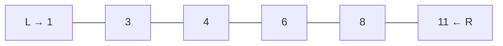
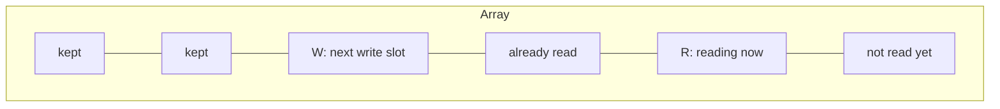

# Chapter 03 · Two Pointers

> Two scouts walk a long corridor of treasure chests, one from each end. Each step, one of them moves closer, and together they check what a single scout would need hundreds of trips to check. That's the whole trick, and it turns many O(n²) problems into O(n).

**You will learn:**
- What a "pointer" means in array problems (it's just an index)
- The three shapes of the pattern: **opposite ends**, **same direction (reader/writer)**, and **two arrays**
- *Why* moving one pointer never skips the answer (the proof idea that makes this click)
- A reusable template for each shape
- How to recognise a two-pointer problem from its wording in under 10 seconds
- 10 classic interview problems solved step by step

**Before this:** [Big-O](01-big-o-complexity.md) · [Arrays & Strings Fundamentals](02-arrays-strings.md)

---

## 🧠 The Big Idea

Suppose you have a **sorted** list and you want two numbers that add up to 10:

```text
index:   0   1   2   3   4   5
value:   1   3   4   6   8   11
```

The brute-force way checks every pair: (1,3), (1,4), (1,6), ... That's about n²/2 pairs. For 100,000 numbers, that's 5 billion checks. Too slow.

The two-pointer way puts one finger on the smallest number and one on the largest:



- 1 + 11 = 12. **Too big.** The only way to make the sum smaller is to use a smaller right number. Move **R** left.
- 1 + 8 = 9. **Too small.** The only way to grow it is a bigger left number. Move **L** right.
- 3 + 8 = 11. Too big. Move R left.
- 3 + 6 = 9. Too small. Move L right.
- 4 + 6 = 10. **Found it!**

Five checks instead of fifteen. And in the worst case it's never more than n checks, because every step moves one finger inward and they can only meet once.

> 💡 **The core insight:** each comparison lets you throw away a whole row of possibilities at once, not just one pair. That's where the speed comes from.

---

## 🔨 Building It Up

### 1. A "pointer" is just an index

In languages like C, a pointer is a memory address. In array problems, when people say "pointer" they just mean **a variable holding an index**, like `left = 0` and `right = len(nums) - 1`. Nothing fancy.

```python
nums = [10, 20, 30, 40, 50]
left, right = 0, len(nums) - 1
print(nums[left], nums[right])

left += 1
right -= 1
print(nums[left], nums[right])
```

```text
10 50
20 40
```

What just happened: we "moved" the pointers by changing two integers. Every two-pointer algorithm is just a loop that decides, at each step, **which integer to change**.

### 2. Shape #1: Opposite ends (converging pointers)

Start at both ends, walk toward each other, stop when they meet.

```python
def reverse_in_place(chars):
    left, right = 0, len(chars) - 1
    while left < right:
        chars[left], chars[right] = chars[right], chars[left]   # swap
        left += 1
        right -= 1
    return chars

print(reverse_in_place(list("python")))
```

```text
['n', 'o', 'h', 't', 'y', 'p']
```

What just happened: each step fixes two positions at once (the outermost unfixed pair), so it takes n/2 swaps and O(1) extra memory. The condition is `left < right` (not `<=`): when they're equal, they point at the middle element, which doesn't need swapping.

**Palindrome check** is the same shape, comparing instead of swapping:

```python
def is_palindrome(s):
    left, right = 0, len(s) - 1
    while left < right:
        if s[left] != s[right]:
            return False
        left += 1
        right -= 1
    return True

print(is_palindrome("racecar"), is_palindrome("rocket"))
```

```text
True False
```

### 3. Opposite ends + a decision: Pair sum in a sorted array

This is the Big Idea example in code. The decision rule is the heart of it.

```python
def pair_with_sum(nums, target):
    """nums is sorted ascending. Return indexes of two numbers summing to target."""
    left, right = 0, len(nums) - 1
    while left < right:
        total = nums[left] + nums[right]
        if total == target:
            return [left, right]
        elif total < target:
            left += 1        # need a bigger sum -> bigger left number
        else:
            right -= 1       # need a smaller sum -> smaller right number
    return []

print(pair_with_sum([1, 3, 4, 6, 8, 11], 10))
print(pair_with_sum([1, 2, 3], 100))
```

```text
[2, 3]
[]
```

**Dry run** for target 10:

| step | left | right | nums[left] + nums[right] | decision |
|---|---|---|---|---|
| 1 | 0 | 5 | 1 + 11 = 12 | too big → right-- |
| 2 | 0 | 4 | 1 + 8 = 9 | too small → left++ |
| 3 | 1 | 4 | 3 + 8 = 11 | too big → right-- |
| 4 | 1 | 3 | 3 + 6 = 9 | too small → left++ |
| 5 | 2 | 3 | 4 + 6 = 10 | ✅ found |

### 4. Shape #2: Same direction (reader / writer)

Both pointers start at the left. A **fast** pointer (the reader) looks at every element. A **slow** pointer (the writer) marks where the next "kept" element should go. This is how you filter an array **in place** with O(1) extra memory.



Everything left of `write` is the finished answer. Everything between `write` and `read` is garbage we're allowed to overwrite.

**Move all zeroes to the end** (keeping the order of the others):

```python
def move_zeroes(nums):
    write = 0
    for read in range(len(nums)):
        if nums[read] != 0:
            nums[write], nums[read] = nums[read], nums[write]
            write += 1
    return nums

print(move_zeroes([0, 1, 0, 3, 12]))
```

```text
[1, 3, 12, 0, 0]
```

**Remove duplicates from a sorted array**, returning the new length:

```python
def remove_duplicates(nums):
    if not nums:
        return 0
    write = 1                          # nums[0] is always kept
    for read in range(1, len(nums)):
        if nums[read] != nums[write - 1]:   # differs from the last kept value
            nums[write] = nums[read]
            write += 1
    return write

arr = [0, 0, 1, 1, 1, 2, 2, 3, 3, 4]
k = remove_duplicates(arr)
print(k, arr[:k])
```

```text
5 [0, 1, 2, 3, 4]
```

What just happened: because the array is sorted, duplicates are neighbours. We only keep a value if it differs from the last value we *kept*.

### 5. Shape #3: Two arrays, one pointer each

When you have **two sorted sequences**, walk them together, one pointer per array, always advancing the pointer at the smaller value. This is the "merge" step of merge sort.

```python
def merge_sorted(a, b):
    i = j = 0
    out = []
    while i < len(a) and j < len(b):
        if a[i] <= b[j]:
            out.append(a[i]); i += 1
        else:
            out.append(b[j]); j += 1
    out.extend(a[i:])     # at most one of these
    out.extend(b[j:])     # has anything left
    return out

print(merge_sorted([1, 4, 7, 10], [2, 3, 8]))
```

```text
[1, 2, 3, 4, 7, 8, 10]
```

The same walk solves **intersection of two sorted arrays** and **is `s` a subsequence of `t`**:

```python
def is_subsequence(s, t):
    i = 0                       # pointer into s
    for ch in t:                # pointer into t is the loop itself
        if i < len(s) and s[i] == ch:
            i += 1
    return i == len(s)

print(is_subsequence("ace", "abcde"), is_subsequence("aec", "abcde"))
```

```text
True False
```

### 6. Combining with an outer loop: 3Sum

Many "find k numbers" problems are an outer loop that fixes one number, plus two pointers for the rest. 3Sum is the famous one: fix `nums[i]`, then find a pair summing to `-nums[i]` in the part to its right.

```python
def three_sum(nums):
    nums.sort()
    result = []
    for i in range(len(nums) - 2):
        if i > 0 and nums[i] == nums[i - 1]:
            continue                       # skip duplicate first numbers
        if nums[i] > 0:
            break                          # sorted: no way to reach 0 anymore
        left, right = i + 1, len(nums) - 1
        while left < right:
            total = nums[i] + nums[left] + nums[right]
            if total < 0:
                left += 1
            elif total > 0:
                right -= 1
            else:
                result.append([nums[i], nums[left], nums[right]])
                left += 1
                right -= 1
                while left < right and nums[left] == nums[left - 1]:
                    left += 1              # skip duplicate second numbers
    return result

print(three_sum([-1, 0, 1, 2, -1, -4]))
```

```text
[[-1, -1, 2], [-1, 0, 1]]
```

Time: sorting O(n log n) plus n × O(n) for the pointer walks, so **O(n²)**. That beats the brute force O(n³).

---

## 🔬 Under the Hood

### Why moving a pointer never skips the answer

This is the part most tutorials skip, and it's why people "memorise" two pointers and then fail on a variation. Let's prove the pair-sum rule.

Suppose `nums[left] + nums[right] > target`. Consider **every** pair that uses `right` together with some index `k` between `left` and `right`:

- Since the array is sorted, `nums[k] >= nums[left]`.
- So `nums[k] + nums[right] >= nums[left] + nums[right] > target`.

**Every** pair involving `right` is too big. So `right` can never be part of the answer, and we can safely throw it away by doing `right -= 1`. One comparison just eliminated up to n pairs.

The mirror argument works for "too small": every pair using `left` is too small, so `left` is useless.

> 💡 **The general rule:** a two-pointer move is valid when you can argue "the element I'm discarding cannot be part of any better answer." If you can't make that argument, two pointers is the wrong tool.

### Why it's O(n)

Each loop iteration moves `left` right or `right` left (or both). The gap `right - left` starts at n−1 and shrinks by at least 1 per iteration. It can't go below 0. So there are at most n−1 iterations. For the reader/writer shape, the `read` pointer visits each index exactly once, also O(n).

### Memory

All shapes above use a constant number of integer variables: **O(1) extra space**, except merge (which builds a new output list). This is why interviewers love two pointers: when they say "do it in place" or "O(1) extra space", two pointers is often what they want.

---

## 🧩 Pattern Decoder

### Signals: when to reach for two pointers

| You see in the problem... | Think |
|---|---|
| "sorted array", "find a pair / triplet with sum X" | Opposite ends |
| "palindrome", "reverse", "compare from both ends" | Opposite ends |
| "maximise area / width between two lines" | Opposite ends + move the shorter side |
| "in place", "O(1) extra space", "remove / move elements" | Reader / writer |
| "remove duplicates from sorted array" | Reader / writer |
| "two sorted arrays / lists", "merge", "intersection" | One pointer per array |
| "is subsequence" | One pointer per sequence |
| "linked list middle / cycle / k-th from end" | Fast & slow pointers ([Chapter 10](10-linked-lists.md)) |
| "contiguous subarray with a condition" | Probably **sliding window** ([Chapter 04](04-sliding-window.md)), which is a special two-pointer shape |

### Template A: Opposite ends

```py
def opposite_ends(arr):
    left, right = 0, len(arr) - 1
    while left < right:
        # 1. look at arr[left], arr[right]
        # 2. if it's the answer -> record / return
        # 3. decide which side can be discarded (the proof!), move that pointer
        if condition_to_move_left(arr[left], arr[right]):
            left += 1
        else:
            right -= 1
    return answer
```

### Template B: Reader / writer

```py
def reader_writer(arr):
    write = 0
    for read in range(len(arr)):
        if keep(arr[read]):          # the only thing that changes per problem
            arr[write] = arr[read]
            write += 1
    return write                     # arr[:write] is the result
```

### Template C: Two sequences

```py
def two_sequences(a, b):
    i = j = 0
    while i < len(a) and j < len(b):
        if a[i] < b[j]:   i += 1     # or: take a[i]
        elif a[i] > b[j]: j += 1     # or: take b[j]
        else:                        # equal: handle the match
            i += 1; j += 1
    # handle leftovers if the problem needs them
```

### Variation: Container With Most Water (move the shorter side)

**Problem:** `height[i]` is a vertical line at position i. Pick two lines that, with the x-axis, hold the most water. Area = `min(h[l], h[r]) * (r - l)`.

**Idea:** start with the widest container. The **shorter** line limits the height. If we moved the taller line inward, the width shrinks and the height can't exceed the shorter line, so the area can only get worse. So the shorter line is useless: discard it.

```python
def max_area(height):
    left, right = 0, len(height) - 1
    best = 0
    while left < right:
        area = min(height[left], height[right]) * (right - left)
        best = max(best, area)
        if height[left] < height[right]:
            left += 1
        else:
            right -= 1
    return best

print(max_area([1, 8, 6, 2, 5, 4, 8, 3, 7]))
```

```text
49
```

O(n) time, O(1) space.

### Variation: Sort Colors / Dutch National Flag (three pointers)

**Problem:** an array has only 0s, 1s and 2s. Sort it in one pass, in place.

**Idea:** keep three regions: `[0, low)` all 0s, `[low, mid)` all 1s, `(high, end]` all 2s. `mid` scans the unknown middle part.

```python
def sort_colors(nums):
    low, mid, high = 0, 0, len(nums) - 1
    while mid <= high:
        if nums[mid] == 0:
            nums[low], nums[mid] = nums[mid], nums[low]
            low += 1
            mid += 1
        elif nums[mid] == 1:
            mid += 1
        else:
            nums[mid], nums[high] = nums[high], nums[mid]
            high -= 1          # don't move mid: the swapped-in value is unchecked
    return nums

print(sort_colors([2, 0, 2, 1, 1, 0]))
```

```text
[0, 0, 1, 1, 2, 2]
```

### Variation: Squares of a Sorted Array (fill from the back)

**Problem:** sorted array with negatives, return the squares sorted. `[-4,-1,0,3,10]` → `[0,1,9,16,100]`.

**Idea:** the largest square is at one of the two ends. Compare the ends, and write the bigger square into the **back** of the result.

```python
def sorted_squares(nums):
    n = len(nums)
    out = [0] * n
    left, right = 0, n - 1
    for pos in range(n - 1, -1, -1):
        if abs(nums[left]) > abs(nums[right]):
            out[pos] = nums[left] ** 2
            left += 1
        else:
            out[pos] = nums[right] ** 2
            right -= 1
    return out

print(sorted_squares([-4, -1, 0, 3, 10]))
```

```text
[0, 1, 9, 16, 100]
```

### When NOT to use two pointers

- **Unsorted array + pair sum + you need original indexes** → use a hash map (Two Sum, [Chapter 05](05-hashing.md)). Sorting would scramble the indexes.
- **Arbitrary subsets** (not pairs, not contiguous) → backtracking or DP.
- **You can't prove a discard rule.** If moving either pointer might skip the answer, you need a different approach.

---

## ⚠️ Traps & Common Mistakes

1. **Using opposite ends on an unsorted array.** The discard proof needs sorted order. Sort first (if indexes don't matter), or use hashing.
2. **`while left <= right` vs `while left < right`.** For pairs you need two *different* elements, so use `<`. Using `<=` lets `left == right` pair an element with itself.
3. **Forgetting to skip duplicates** in 3Sum-style problems, which gives repeated triplets in the output.
4. **Moving `mid` after swapping with `high`** in Dutch flag. The value swapped in from the right hasn't been checked yet.
5. **Off-by-one in reader/writer:** returning `write - 1` instead of `write`. `write` already equals the count of kept elements.
6. **Modifying while iterating with `for x in arr: arr.remove(...)`.** This skips elements. Use reader/writer instead:

```py
# ❌ wrong: skips elements as the list shrinks under the loop
for x in nums:
    if x == 0:
        nums.remove(x)

# ✅ right
write = 0
for read in range(len(nums)):
    if nums[read] != 0:
        nums[write] = nums[read]; write += 1
del nums[write:]
```

---

## 💡 Tips & Tricks

- Before coding, say the **discard rule** out loud: "if the sum is too big, every pair with `right` is too big, so drop `right`." If you can say it, the code writes itself.
- Draw the array and the pointers on paper and do a 4-step dry run. It catches 90% of bugs.
- "Return indexes from an unsorted array" → hash map. "Return values / count / boolean" → sorting + two pointers is fine.
- For k-Sum: sort once, then k−2 nested loops + one two-pointer pass, giving O(n^(k−1)).
- In Python, swapping is one line: `a[i], a[j] = a[j], a[i]`.
- If an interviewer says "can you do better than O(n log n)?" and the input is already sorted, they're hinting at a two-pointer O(n) solution.

---

## 🎯 Interview Questions

### 1. Two Sum II – Input Array Is Sorted 🔥🔥🔥

Given a 1-indexed sorted array, return the indexes of two numbers that add up to `target`.

<details><summary>Answer</summary>

Opposite-ends pointers, exactly the Big Idea. Return 1-based indexes.

```python
def two_sum_sorted(numbers, target):
    left, right = 0, len(numbers) - 1
    while left < right:
        s = numbers[left] + numbers[right]
        if s == target:
            return [left + 1, right + 1]
        if s < target:
            left += 1
        else:
            right -= 1

print(two_sum_sorted([2, 7, 11, 15], 9))
```

Time O(n), space O(1).

</details>

### 2. Valid Palindrome 🔥🔥🔥

Given a string, return True if it's a palindrome after lowercasing and removing non-alphanumeric characters. `"A man, a plan, a canal: Panama"` → True.

<details><summary>Answer</summary>

Opposite ends, skipping characters that aren't letters or digits.

```python
def is_valid_palindrome(s):
    left, right = 0, len(s) - 1
    while left < right:
        while left < right and not s[left].isalnum():
            left += 1
        while left < right and not s[right].isalnum():
            right -= 1
        if s[left].lower() != s[right].lower():
            return False
        left += 1
        right -= 1
    return True

print(is_valid_palindrome("A man, a plan, a canal: Panama"))
print(is_valid_palindrome("race a car"))
```

Time O(n), space O(1). (The one-liner `t == t[::-1]` on a cleaned string is O(n) space. Mention both.)

</details>

### 3. Valid Palindrome II 🔥🔥

Can the string become a palindrome by deleting **at most one** character? `"abca"` → True.

<details><summary>Answer</summary>

Walk inward. At the first mismatch, you get one deletion: try skipping the left char **or** the right char, and check whether the rest is a palindrome.

```python
def valid_palindrome_ii(s):
    def is_pal(i, j):
        while i < j:
            if s[i] != s[j]:
                return False
            i += 1; j -= 1
        return True

    left, right = 0, len(s) - 1
    while left < right:
        if s[left] != s[right]:
            return is_pal(left + 1, right) or is_pal(left, right - 1)
        left += 1; right -= 1
    return True

print(valid_palindrome_ii("abca"), valid_palindrome_ii("abc"))
```

Time O(n), space O(1).

</details>

### 4. 3Sum 🔥🔥🔥

Return all unique triplets that sum to zero.

<details><summary>Answer</summary>

Sort, fix `i`, two pointers on the rest, skip duplicates. See section 6 above for the full code. Time O(n²), space O(1) besides the output (sorting may use O(n)).

Follow-ups interviewers ask: *3Sum Closest* (track the best `abs(total - target)` instead of exact matches) and *4Sum* (add one more outer loop).

</details>

### 5. 3Sum Closest 🔥🔥

Find the triplet whose sum is closest to `target` and return that sum.

<details><summary>Answer</summary>

```python
def three_sum_closest(nums, target):
    nums.sort()
    best = nums[0] + nums[1] + nums[2]
    for i in range(len(nums) - 2):
        left, right = i + 1, len(nums) - 1
        while left < right:
            s = nums[i] + nums[left] + nums[right]
            if abs(s - target) < abs(best - target):
                best = s
            if s < target:
                left += 1
            elif s > target:
                right -= 1
            else:
                return s            # can't get closer than exact
    return best

print(three_sum_closest([-1, 2, 1, -4], 1))
```

Time O(n²), space O(1).

</details>

### 6. Container With Most Water 🔥🔥🔥

<details><summary>Answer</summary>

Opposite ends, always move the **shorter** line (see the Pattern Decoder for code and proof). The key sentence for the interviewer: "Moving the taller line can only reduce width without raising the limiting height, so the shorter line can be discarded." O(n) time, O(1) space.

</details>

### 7. Trapping Rain Water 🔥🔥🔥

Given bar heights, compute how much rain water is trapped. `[0,1,0,2,1,0,1,3,2,1,2,1]` → 6.

<details><summary>Answer</summary>

Water above bar i = `min(max height to its left, max height to its right) − height[i]`.

Two pointers: keep `left_max` and `right_max`. If `height[left] < height[right]`, the right side definitely has a wall at least as tall as `height[right] > height[left]`, so the water at `left` is decided by `left_max` alone. Process `left` and move it. Otherwise process `right`.

```python
def trap(height):
    left, right = 0, len(height) - 1
    left_max = right_max = water = 0
    while left < right:
        if height[left] < height[right]:
            left_max = max(left_max, height[left])
            water += left_max - height[left]
            left += 1
        else:
            right_max = max(right_max, height[right])
            water += right_max - height[right]
            right -= 1
    return water

print(trap([0, 1, 0, 2, 1, 0, 1, 3, 2, 1, 2, 1]))
```

Time O(n), space O(1). (Alternatives: prefix-max arrays O(n) space, or a monotonic stack, [Chapter 11](11-stacks.md).)

</details>

### 8. Remove Duplicates from Sorted Array II 🔥🔥

Each element may appear **at most twice**. Do it in place and return the new length.

<details><summary>Answer</summary>

Reader/writer, but compare with the element **two** positions back in the written part.

```python
def remove_duplicates_ii(nums):
    write = 0
    for x in nums:
        if write < 2 or x != nums[write - 2]:
            nums[write] = x
            write += 1
    return write

arr = [1, 1, 1, 2, 2, 3]
k = remove_duplicates_ii(arr)
print(k, arr[:k])
```

Generalises to "at most k times": replace 2 with k. Time O(n), space O(1).

</details>

### 9. Merge Sorted Array (in place) 🔥🔥🔥

`nums1` has length m + n, with its first m elements valid and n empty slots at the end. Merge `nums2` (length n) into it, in place.

<details><summary>Answer</summary>

Fill from the **back**, so you never overwrite unread values of `nums1`.

```python
def merge_into(nums1, m, nums2, n):
    i, j, k = m - 1, n - 1, m + n - 1
    while j >= 0:
        if i >= 0 and nums1[i] > nums2[j]:
            nums1[k] = nums1[i]; i -= 1
        else:
            nums1[k] = nums2[j]; j -= 1
        k -= 1
    return nums1

print(merge_into([1, 2, 3, 0, 0, 0], 3, [2, 5, 6], 3))
```

Time O(m + n), space O(1). We loop while `j >= 0`: once `nums2` is used up, the rest of `nums1` is already in place.

</details>

### 10. Boats to Save People 🔥🔥

Each boat carries at most 2 people and a weight `limit`. Find the minimum number of boats.

<details><summary>Answer</summary>

Sort. Pair the heaviest remaining person with the lightest if they fit together; otherwise the heaviest goes alone. (Greedy + two pointers: the heaviest person must go in some boat, and the lightest person is the best possible partner.)

```python
def num_rescue_boats(people, limit):
    people.sort()
    left, right = 0, len(people) - 1
    boats = 0
    while left <= right:            # <= : one last person still needs a boat
        if people[left] + people[right] <= limit:
            left += 1
        right -= 1
        boats += 1
    return boats

print(num_rescue_boats([3, 2, 2, 1], 3), num_rescue_boats([3, 5, 3, 4], 5))
```

Time O(n log n), space O(1). Note `left <= right` here: a single remaining person still needs a boat.

</details>

---

## 🏋️ Practice

**🟢 1. Reverse only the vowels** of a string. `"hello"` → `"holle"`.

<details><summary>Solution</summary>

```python
def reverse_vowels(s):
    chars = list(s)
    vowels = set("aeiouAEIOU")
    left, right = 0, len(chars) - 1
    while left < right:
        if chars[left] not in vowels:
            left += 1
        elif chars[right] not in vowels:
            right -= 1
        else:
            chars[left], chars[right] = chars[right], chars[left]
            left += 1; right -= 1
    return "".join(chars)

print(reverse_vowels("hello"), reverse_vowels("leetcode"))
```

</details>

**🟢 2. Remove Element:** remove all occurrences of `val` in place and return the new length.

<details><summary>Solution</summary>

```python
def remove_element(nums, val):
    write = 0
    for x in nums:
        if x != val:
            nums[write] = x
            write += 1
    return write

arr = [3, 2, 2, 3]
k = remove_element(arr, 3)
print(k, arr[:k])
```

</details>

**🟡 3. Intersection of two sorted arrays** (keep duplicates as many times as they appear in both). `[1,2,2,3]`, `[2,2,4]` → `[2,2]`.

<details><summary>Solution</summary>

```python
def intersect_sorted(a, b):
    i = j = 0
    out = []
    while i < len(a) and j < len(b):
        if a[i] < b[j]:
            i += 1
        elif a[i] > b[j]:
            j += 1
        else:
            out.append(a[i]); i += 1; j += 1
    return out

print(intersect_sorted([1, 2, 2, 3], [2, 2, 4]))
```

</details>

**🟡 4. Count pairs with sum less than target** in an array (any order). `[-1,1,2,3,1]`, target 2 → 3.

<details><summary>Solution</summary>

Sort. If `nums[left] + nums[right] < target`, then `left` pairs with **every** index from `left+1` to `right`: that's `right - left` pairs at once.

```python
def count_pairs(nums, target):
    nums.sort()
    left, right = 0, len(nums) - 1
    count = 0
    while left < right:
        if nums[left] + nums[right] < target:
            count += right - left
            left += 1
        else:
            right -= 1
    return count

print(count_pairs([-1, 1, 2, 3, 1], 2))
```

</details>

**🟡 5. Backspace String Compare:** `#` means backspace. Are `"ab#c"` and `"ad#c"` equal after typing? Do it in O(1) space.

<details><summary>Solution</summary>

Walk both strings **from the end**, skipping characters erased by `#`.

```python
def backspace_compare(s, t):
    def next_valid(string, i):
        skip = 0
        while i >= 0:
            if string[i] == "#":
                skip += 1
            elif skip:
                skip -= 1
            else:
                break
            i -= 1
        return i

    i, j = len(s) - 1, len(t) - 1
    while True:
        i, j = next_valid(s, i), next_valid(t, j)
        if i < 0 or j < 0:
            return i < 0 and j < 0
        if s[i] != t[j]:
            return False
        i -= 1; j -= 1

print(backspace_compare("ab#c", "ad#c"), backspace_compare("a#c", "b"))
```

</details>

**🔴 6. 4Sum:** all unique quadruplets summing to `target`.

<details><summary>Solution</summary>

Two outer loops plus two pointers. O(n³).

```python
def four_sum(nums, target):
    nums.sort()
    n, res = len(nums), []
    for i in range(n - 3):
        if i > 0 and nums[i] == nums[i - 1]:
            continue
        for j in range(i + 1, n - 2):
            if j > i + 1 and nums[j] == nums[j - 1]:
                continue
            left, right = j + 1, n - 1
            while left < right:
                s = nums[i] + nums[j] + nums[left] + nums[right]
                if s < target:
                    left += 1
                elif s > target:
                    right -= 1
                else:
                    res.append([nums[i], nums[j], nums[left], nums[right]])
                    left += 1; right -= 1
                    while left < right and nums[left] == nums[left - 1]:
                        left += 1
    return res

print(four_sum([1, 0, -1, 0, -2, 2], 0))
```

</details>

**🔴 7. Minimum swaps to make a binary string's 1s all adjacent?** Skip this one: it needs a sliding window. It's here on purpose to train your eye. Which chapter's pattern is it?

<details><summary>Answer</summary>

**Sliding window** ([Chapter 04](04-sliding-window.md)): count the 1s (k), then find the window of size k that already contains the most 1s. The answer is k minus that maximum. Recognising when a problem is *not* two pointers is just as important.

</details>

---

## 🧠 Never-Forget Summary

- A pointer is just an index. Two pointers = two indexes moving under a rule.
- **Opposite ends**: sorted pairs, palindromes, container with most water, trapping rain water.
- **Reader/writer**: in-place filtering (remove, dedupe, move zeroes). `arr[:write]` is the answer.
- **One per array**: merging, intersection, subsequence.
- **k-Sum** = sort + (k−2) loops + one two-pointer walk.
- It works because each move **discards an element that can't be in any answer**. Prove the discard and the code is correct.
- Complexity: O(n) per walk, O(1) extra space. That's why it answers "do it in place".
- Unsorted + need original indexes → hash map instead.

**Memory hook: "SQUEEZE, FILTER, ZIP"**
- **Squeeze** from both ends (opposite ends)
- **Filter** in place (reader/writer)
- **Zip** two lists together (one pointer each)

**One picture:**

| Shape | Start | Move rule | Classic problems |
|---|---|---|---|
| Squeeze | `0` and `n-1` | discard the side that can't help | Two Sum II, 3Sum, Container, Rain Water, Palindrome |
| Filter | both at `0` | `write` advances only when keeping | Move Zeroes, Remove Duplicates, Remove Element |
| Zip | `0` in each array | advance the smaller one | Merge Sorted, Intersection, Is Subsequence |

> **If you remember only one thing:** two pointers is about *throwing away* candidates in bulk. Always ask, "which side can I safely discard?"

---
**Next:** [Chapter 04 · Sliding Window](04-sliding-window.md)  ·  **Back to** [Contents](../README.md)
