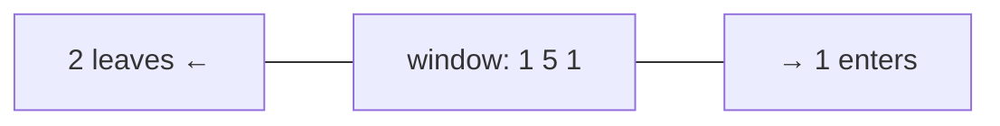

# Chapter 04 · Sliding Window

> You're on a train, looking out of a window that shows exactly three houses at a time. As the train moves, one house slides in on the right and one slides out on the left. You never need to look at all three again: you just update what changed. That lazy, clever update is the sliding window, and it turns "check every subarray" from O(n²) into O(n).

**You will learn:**
- What a "window" is and why it's just two pointers moving in the **same** direction
- **Fixed-size** windows and **variable-size** windows (grow / shrink)
- One template that solves almost every window problem
- *Why* it's O(n) even though there's a loop inside a loop
- Windows with a hashmap / `Counter` for character and frequency problems
- The **"at most K"** trick and **exactly K = atMost(K) − atMost(K − 1)**
- When sliding window **fails** (negative numbers) and what to use instead
- 10+ classic problems, from "max sum of size k" to "minimum window substring"

**Before this:** [Big-O](01-big-o-complexity.md) · [Arrays & Strings Fundamentals](02-arrays-strings.md) · [Two Pointers](03-two-pointers.md) · [Dictionaries & Hashing](../part-1-python/09-dictionaries.md)

---

## 🧠 The Big Idea

**Problem:** find the largest sum of any 3 consecutive numbers in `[2, 1, 5, 1, 3, 2]`.

The brute force adds up every block of 3 from scratch:

```text
[2 1 5] 1 3 2      → 2+1+5 = 8
 2 [1 5 1] 3 2     → 1+5+1 = 7
 2 1 [5 1 3] 2     → 5+1+3 = 9
 2 1 5 [1 3 2]     → 1+3+2 = 6
```

Notice the waste: going from `[2 1 5]` to `[1 5 1]`, the `1 + 5` in the middle is added **again**. With windows of size k, each sum redoes k − 1 additions that we already did.

The sliding window says: the new window is the old window, **minus the element that left, plus the element that entered**.

```text
sum([1 5 1]) = sum([2 1 5]) − 2 + 1 = 8 − 2 + 1 = 7
```



One subtraction and one addition per step, no matter how big k is. O(n) instead of O(n·k).

Now the bigger version of the idea. Some windows aren't a fixed size; they **stretch and shrink** like a caterpillar:

- The **right** edge moves forward to **grab** new elements (the caterpillar's head stretches).
- When the window breaks a rule (too many distinct letters, sum too big, a duplicate), the **left** edge moves forward to **release** elements until the rule holds again (the tail catches up).

Both edges only ever move **forward**. That's the whole reason it's fast.

> 💡 **The core insight:** a sliding window keeps a **summary** of the current window (a sum, a count, a set) and updates it **incrementally** as elements enter on the right and leave on the left. You never rescan the window.

---

## 🔨 Building It Up

### 1. What is a window?

A **window** is a contiguous chunk of an array or string, described by two indexes: `left` and `right`. We'll use the **inclusive** convention: the window is `nums[left..right]`, and its length is `right - left + 1`.

```python
nums = [2, 1, 5, 1, 3, 2]
left, right = 1, 3
window = nums[left:right + 1]
print(window, "length:", right - left + 1)
```

```text
[1, 5, 1] length: 3
```

Key word: **contiguous**. Sliding window only works for **subarrays** and **substrings** (consecutive elements), never for subsequences or subsets, where you can skip elements.

### 2. Fixed-size window: the warm-up

Window size is given (k). Build the first window, then slide: add the new right element, remove the old left element.

```python
def max_sum_size_k(nums, k):
    window_sum = sum(nums[:k])        # first window
    best = window_sum
    for right in range(k, len(nums)):
        window_sum += nums[right]       # element entering
        window_sum -= nums[right - k]   # element leaving
        best = max(best, window_sum)
    return best

print(max_sum_size_k([2, 1, 5, 1, 3, 2], 3))
print(max_sum_size_k([1, 9, -1, -2, 7, 3, -1, 2], 4))
```

```text
9
13
```

**Dry run** for `[2, 1, 5, 1, 3, 2]`, k = 3:

| right | enters | leaves (`right - k`) | window | window_sum | best |
|---|---|---|---|---|---|
| (start) | | | [2 1 5] | 8 | 8 |
| 3 | 1 | 2 | [1 5 1] | 7 | 8 |
| 4 | 3 | 1 | [5 1 3] | 9 | 9 |
| 5 | 2 | 5 | [1 3 2] | 6 | 9 |

What just happened: each step did exactly two arithmetic operations. With fixed windows, the element leaving is always the one at `right - k`.

The same shape works for **averages**, **counts** (e.g. "number of vowels in each window of size k") and anything else you can add and remove.

```python
def max_vowels(s, k):
    vowels = set("aeiou")
    count = sum(1 for ch in s[:k] if ch in vowels)
    best = count
    for right in range(k, len(s)):
        count += s[right] in vowels         # True counts as 1
        count -= s[right - k] in vowels
        best = max(best, count)
    return best

print(max_vowels("abciiidef", 3), max_vowels("leetcode", 3))
```

```text
3 2
```

### 3. Variable-size window: grow and shrink

Now the window size isn't given; we're looking for the **longest** or **shortest** window satisfying some condition.

**Problem: Minimum Size Subarray Sum.** Given positive numbers and a target, find the length of the shortest subarray with sum ≥ target. `[2, 3, 1, 2, 4, 3]`, target 7 → 2 (`[4, 3]`).

The plan:

1. Move `right` forward, adding `nums[right]` to the sum (**grow**).
2. **While** the sum is ≥ target, the window is valid: record its length, then remove `nums[left]` and move `left` forward (**shrink**) to see if a shorter one still works.

```python
def min_subarray_len(target, nums):
    left = 0
    window_sum = 0
    best = float("inf")
    for right, x in enumerate(nums):
        window_sum += x                          # grow
        while window_sum >= target:              # valid: try to shrink
            best = min(best, right - left + 1)
            window_sum -= nums[left]
            left += 1
    return 0 if best == float("inf") else best

print(min_subarray_len(7, [2, 3, 1, 2, 4, 3]))
print(min_subarray_len(100, [1, 2, 3]))
```

```text
2
0
```

**Dry run** for target 7:

| right | x | sum after grow | while sum ≥ 7? | shrink steps | best |
|---|---|---|---|---|---|
| 0 | 2 | 2 | no | | ∞ |
| 1 | 3 | 5 | no | | ∞ |
| 2 | 1 | 6 | no | | ∞ |
| 3 | 2 | 8 | yes | len 4 → best 4; remove 2 → sum 6, left=1 | 4 |
| 4 | 4 | 10 | yes | len 4; remove 3 → 7, left=2; len 3 → best 3; remove 1 → 6, left=3 | 3 |
| 5 | 3 | 9 | yes | len 3; remove 2 → 7, left=4; len 2 → best 2; remove 4 → 3, left=5 | 2 |

What just happened: `left` never moved backward. Once we know a window starting at `left` works, we don't need any longer window starting there (we want the shortest), so `left` can move on for good.

### 4. The longest valid window

The mirror image: find the **longest** window that stays valid. Here we shrink **while the window is invalid**, then record.

**Problem: Longest Substring Without Repeating Characters.** `"abcabcbb"` → 3 (`"abc"`).

```python
def length_of_longest_substring(s):
    in_window = set()
    left = 0
    best = 0
    for right, ch in enumerate(s):
        while ch in in_window:            # adding ch would create a repeat: shrink
            in_window.remove(s[left])
            left += 1
        in_window.add(ch)                 # now the window is valid again
        best = max(best, right - left + 1)
    return best

for s in ("abcabcbb", "bbbbb", "pwwkew", ""):
    print(repr(s), length_of_longest_substring(s))
```

```text
'abcabcbb' 3
'bbbbb' 1
'pwwkew' 3
'' 0
```

**Dry run** for `"pwwkew"`:

| right | ch | window before | action | window after | best |
|---|---|---|---|---|---|
| 0 | p | "" | add | "p" | 1 |
| 1 | w | "p" | add | "pw" | 2 |
| 2 | w | "pw" | w repeats → remove p, remove w; add w | "w" | 2 |
| 3 | k | "w" | add | "wk" | 2 |
| 4 | e | "wk" | add | "wke" | 3 |
| 5 | w | "wke" | w repeats → remove w; add w | "kew" | 3 |

So we have two flavours, and the only difference is **where you record the answer**:

| Looking for | Shrink while... | Record the answer... |
|---|---|---|
| **shortest** valid window | window is **valid** | **inside** the shrink loop (before shrinking) |
| **longest** valid window | window is **invalid** | **after** the shrink loop |

### 5. The universal template

Every variable-size window problem fits this skeleton. Learn it like your phone number.

```py
def sliding_window(arr):
    left = 0
    state = ...                  # sum, Counter, set, count of something
    best = ...                   # 0 for longest, inf for shortest, 0 for counting
    for right in range(len(arr)):
        add arr[right] to state                   # 1. EXPAND: take the new element

        while window is invalid:                  # 2. SHRINK until valid again
            remove arr[left] from state           #    (for "shortest": while VALID)
            left += 1

        best = update(best, right - left + 1)     # 3. RECORD
    return best
```

Three questions decide every problem:

1. **What's the state?** (What do I need to know about the window to judge it?)
2. **When is the window invalid?** (What rule breaks?)
3. **What do I record?** (Max length, min length, count of windows, the window itself?)

### 6. Windows with a hashmap (Counter)

When the rule is about **characters or frequencies**, the state is a dictionary of counts.

**Problem: Longest Substring with At Most K Distinct Characters.** `"eceba"`, k = 2 → 3 (`"ece"`).

- State: `counts`, a dict of char → count in the window. The number of distinct chars is `len(counts)`.
- Invalid when: `len(counts) > k`.
- Record: the longest length.

```python
from collections import defaultdict

def longest_k_distinct(s, k):
    counts = defaultdict(int)
    left = best = 0
    for right, ch in enumerate(s):
        counts[ch] += 1
        while len(counts) > k:
            counts[s[left]] -= 1
            if counts[s[left]] == 0:
                del counts[s[left]]          # keep len(counts) == number of distinct
            left += 1
        best = max(best, right - left + 1)
    return best

print(longest_k_distinct("eceba", 2), longest_k_distinct("aa", 1), longest_k_distinct("abaccc", 2))
```

```text
3 2 4
```

What just happened: the `del` when a count hits zero is essential. Without it, `len(counts)` would count characters that have already left the window.

**Fruit Into Baskets** is this exact problem with k = 2, dressed up as a story: you have two baskets, each holding one type of fruit, and you pick from consecutive trees. "Longest run of trees with at most 2 types." Same code.

### 7. Matching a pattern: Permutation in String & Find All Anagrams

**Problem: Permutation in String.** Does `s2` contain any permutation of `s1` as a substring? `s1 = "ab"`, `s2 = "eidbaooo"` → True (`"ba"`).

A permutation of `s1` = any substring of `s2` with **the same length** and **the same character counts**. So it's a **fixed** window of size `len(s1)`, and we compare counts.

Comparing two 26-slot arrays each step is O(26) = O(1). Even better, keep a single number `matches`: how many of the 26 letters currently have equal counts in both.

```python
def check_inclusion(s1, s2):
    k = len(s1)
    if k > len(s2):
        return False
    need = [0] * 26
    have = [0] * 26
    for ch in s1:
        need[ord(ch) - 97] += 1
    for right, ch in enumerate(s2):
        have[ord(ch) - 97] += 1               # enters
        if right >= k:
            have[ord(s2[right - k]) - 97] -= 1   # leaves (fixed size k)
        if have == need:                       # O(26) compare = O(1)
            return True
    return False

print(check_inclusion("ab", "eidbaooo"), check_inclusion("ab", "eidboaoo"))
```

```text
True False
```

**Find All Anagrams in a String** is the same code, but instead of returning True at the first match, collect every starting index `right - k + 1`:

```python
def find_anagrams(s, p):
    k = len(p)
    need, have = [0] * 26, [0] * 26
    for ch in p:
        need[ord(ch) - 97] += 1
    result = []
    for right, ch in enumerate(s):
        have[ord(ch) - 97] += 1
        if right >= k:
            have[ord(s[right - k]) - 97] -= 1
        if have == need:
            result.append(right - k + 1)       # window start
    return result

print(find_anagrams("cbaebabacd", "abc"), find_anagrams("abab", "ab"))
```

```text
[0, 6] [0, 1, 2]
```

### 8. The hardest classic: Minimum Window Substring

**Problem:** smallest substring of `s` that contains every character of `t` (with multiplicity). `s = "ADOBECODEBANC"`, `t = "ABC"` → `"BANC"`.

This is the **shortest valid window** shape (shrink while valid), with a clever validity check:

- `need`: Counter of `t`.
- `missing`: how many characters of `t` (counting duplicates) the window still lacks. The window is valid exactly when `missing == 0`.
- When a char enters and `need[ch] > 0` before decrementing, it was genuinely needed → `missing -= 1`. Then decrement `need[ch]` (it can go negative, meaning "surplus").
- When a char leaves, increment `need[ch]`; if it becomes > 0, the window now lacks it → `missing += 1`.

```python
from collections import Counter

def min_window(s, t):
    if not t or not s:
        return ""
    need = Counter(t)
    missing = len(t)
    left = 0
    best_start, best_len = 0, float("inf")
    for right, ch in enumerate(s):
        if need[ch] > 0:
            missing -= 1                       # this char was still needed
        need[ch] -= 1                          # negative = surplus copies in window
        while missing == 0:                    # valid: record, then try to shrink
            if right - left + 1 < best_len:
                best_start, best_len = left, right - left + 1
            need[s[left]] += 1
            if need[s[left]] > 0:
                missing += 1                   # we just dropped a needed char
            left += 1
    return "" if best_len == float("inf") else s[best_start:best_start + best_len]

print(min_window("ADOBECODEBANC", "ABC"))
print(repr(min_window("a", "aa")))
print(min_window("aa", "aa"))
```

```text
BANC
''
aa
```

**Dry run** (key moments only) for `s = "ADOBECODEBANC"`, `t = "ABC"`:

| right | ch | missing after | window valid? | action | best |
|---|---|---|---|---|---|
| 0 | A | 2 | no | | |
| 3 | B | 1 | no | | |
| 5 | C | 0 | yes | record "ADOBEC" (6); drop A → missing 1, left = 1 | "ADOBEC" |
| 10 | A | 0 | yes | windows of length 10, 9, 8, 7, 6 aren't shorter than 6; drop D, O, B (a spare B remains, so still valid), E, then C → missing 1, left = 6 | "ADOBEC" |
| 12 | C | 0 | yes | drop O, D; record "EBANC" (5); drop E; record "BANC" (4); drop B → missing 1, left = 10 | "BANC" |

(Rows where nothing interesting happens are skipped. Notice how dropping the first `B` at right = 10 kept the window valid: `need["B"]` went from −1 to 0, not above 0, because a second `B` was still inside.)

Time O(|s| + |t|): each character enters once and leaves once. Space O(size of alphabet).

### 9. Counting windows: "how many subarrays..."

Sometimes the question is **how many** valid subarrays exist, not the longest. Trick: for the longest-style window, when the window `[left..right]` is valid, **every** window ending at `right` and starting anywhere in `left..right` is also valid (shrinking a valid "at most" window keeps it valid). That's `right - left + 1` subarrays, all ending at `right`.

**Problem: Subarray Product Less Than K.** Count contiguous subarrays (positive numbers) with product < k. `[10, 5, 2, 6]`, k = 100 → 8.

```python
def num_subarray_product_less_than_k(nums, k):
    if k <= 1:
        return 0
    product = 1
    left = count = 0
    for right, x in enumerate(nums):
        product *= x
        while product >= k:
            product //= nums[left]
            left += 1
        count += right - left + 1        # all windows ending at right
    return count

print(num_subarray_product_less_than_k([10, 5, 2, 6], 100))
```

```text
8
```

The 8 are: [10], [5], [10,5], [2], [5,2], [6], [2,6], [5,2,6]. (`product //= nums[left]` is exact because `product` is always the product of the current window's integers.)

### 10. "At most K" and "exactly K = atMost(K) − atMost(K − 1)"

Here's a problem that **seems** like a window but isn't directly: **Subarrays with K Different Integers.** Count subarrays with **exactly** k distinct values. `[1,2,1,2,3]`, k = 2 → 7.

Why the plain window fails: with "exactly k", a window that's valid can become invalid by growing (k+1 distinct) **or** by shrinking (k−1 distinct). The window has no single "shrink until valid" direction, so we can't decide how to move `left`.

**The trick:** "at most k" *does* have a clean direction (more elements = more distinct, so only too-big windows are invalid). And:

```text
exactly(k) = atMost(k) − atMost(k − 1)
```

Every subarray with exactly k distinct is counted in atMost(k) but not in atMost(k−1). Every subarray with fewer than k distinct is counted in both and cancels out.

```python
from collections import defaultdict

def at_most_k_distinct(nums, k):
    counts = defaultdict(int)
    left = total = 0
    for right, x in enumerate(nums):
        counts[x] += 1
        while len(counts) > k:
            counts[nums[left]] -= 1
            if counts[nums[left]] == 0:
                del counts[nums[left]]
            left += 1
        total += right - left + 1           # every window ending at right
    return total

def subarrays_with_k_distinct(nums, k):
    return at_most_k_distinct(nums, k) - at_most_k_distinct(nums, k - 1)

nums = [1, 2, 1, 2, 3]
print(at_most_k_distinct(nums, 2), at_most_k_distinct(nums, 1))
print(subarrays_with_k_distinct(nums, 2), subarrays_with_k_distinct([1, 2, 1, 3, 4], 3))
```

```text
12 5
7 3
```

The same trick solves **Binary Subarrays With Sum** (exactly `goal` ones) and **Count Number of Nice Subarrays** (exactly k odd numbers): count "at most goal" minus "at most goal − 1".

### 11. Windows that allow k "mistakes"

**Problem: Max Consecutive Ones III.** Binary array; you may flip at most k zeros to ones. Longest run of ones? `[1,1,1,0,0,0,1,1,1,1,0]`, k = 2 → 6.

Reframe: "longest window containing **at most k zeros**". State = number of zeros in the window.

```python
def longest_ones(nums, k):
    left = zeros = best = 0
    for right, x in enumerate(nums):
        zeros += x == 0
        while zeros > k:
            zeros -= nums[left] == 0
            left += 1
        best = max(best, right - left + 1)
    return best

print(longest_ones([1, 1, 1, 0, 0, 0, 1, 1, 1, 1, 0], 2))
print(longest_ones([0, 0, 1, 1, 0, 0, 1, 1, 1, 0, 1, 1, 0, 0, 0, 1, 1, 1, 1], 3))
```

```text
6
10
```

**Problem: Longest Repeating Character Replacement.** Uppercase string; you may replace at most k characters. Longest substring of one repeated letter? `"AABABBA"`, k = 1 → 4.

A window can become all one letter if `window length − (count of its most frequent letter) ≤ k`: we keep the most common letter and replace the rest.

```python
def character_replacement(s, k):
    counts = [0] * 26
    left = max_freq = best = 0
    for right, ch in enumerate(s):
        counts[ord(ch) - 65] += 1
        max_freq = max(max_freq, counts[ord(ch) - 65])
        while (right - left + 1) - max_freq > k:     # too many replacements needed
            counts[ord(s[left]) - 65] -= 1
            left += 1
        best = max(best, right - left + 1)
    return best

print(character_replacement("ABAB", 2), character_replacement("AABABBA", 1))
```

```text
4 4
```

> 💡 **A famous subtlety:** we never *decrease* `max_freq` when shrinking, so it can be stale (too high). That's fine! The answer only improves when a window with a genuinely higher `max_freq` appears, and a stale `max_freq` only stops the window from shrinking more than necessary; it never lets `best` record a length that wasn't truly achievable at some earlier point. Many people find this the trickiest line in all of sliding window, so if it's fuzzy, recomputing `max(counts)` each time (O(26)) is a perfectly fine answer.

---

## 🔬 Under the Hood

### Why it's O(n) despite the nested loop

Look at the template: a `for` loop over `right` with a `while` loop over `left` inside. Looks O(n²). It isn't.

Count **pointer moves**, not loops:

- `right` moves from 0 to n − 1: exactly n moves.
- `left` only ever increases, never resets, and never passes `right`. So across the **entire** run it moves at most n times.

Each pointer move does O(1) work (update a sum, a count, a dict entry). So total work ≤ n + n = **O(n)**. This is **amortized** reasoning: some single `while` loops might run many times, but they "use up" `left` moves that can never be spent again.

In other words: **every element enters the window once and leaves at most once.**

### Why moving `left` forward never skips the answer

This is the "discard proof" from [Chapter 03](03-two-pointers.md), applied to windows. It relies on **monotonicity**:

- **Longest valid window** problems: if `[left..right]` is invalid, then **any bigger window** `[left'..right]` with `left' < left` is also invalid (adding elements can't fix "too many distinct" or "sum too big with positives"). And for future `right' > right`, windows starting at the old `left` are even bigger, so also invalid. So once `left` moves past an index, no window starting there can ever be the answer.
- **Shortest valid window** problems: once `[left..right]` is valid, any window `[left..right']` with `right' > right` is longer, so it can't beat what we just recorded. So we're done with this `left` forever.

> 💡 **The general rule:** sliding window works when the validity of a window is **monotonic**: growing a window can only move it in one direction (valid → invalid, or invalid → valid), and shrinking moves it the other way.

### Why negative numbers break it

"Shortest subarray with sum ≥ k" with `[2, -1, 2]`, k = 3. A positive-only window would reason: "the sum is too small, grow; the sum is big enough, shrink." But with negatives, shrinking can **increase** the sum (removing a −1) and growing can **decrease** it. Monotonicity is gone, so the discard argument fails. You'll need **prefix sums** ([Chapter 06](06-prefix-sums.md)), sometimes with a monotonic deque ([Chapter 12](12-queues-deques.md)).

### Space

The state is O(1) for sums and counts, O(k) or O(alphabet) for a Counter of the window, and O(min(n, alphabet)) for a set of characters. The 26-slot array version is O(1).

---

## 🧩 Pattern Decoder

### Signals: when to reach for a sliding window

| You see in the problem... | Think |
|---|---|
| "**contiguous** subarray / substring" | sliding window is a strong candidate |
| "of size k", "every k consecutive", "window of length k" | **fixed** window |
| "longest / maximum length ... such that" | **variable**, shrink while invalid, record after |
| "shortest / minimum length ... such that" | **variable**, shrink while valid, record inside |
| "at most k distinct / k zeros / k replacements" | variable window, state = Counter or count |
| "**exactly** k ..." (count of subarrays) | atMost(k) − atMost(k − 1) |
| "number of subarrays where ..." (monotonic condition) | add `right - left + 1` each step |
| "permutation / anagram of p inside s" | fixed window of `len(p)` + count arrays |
| "contains all characters of t" | variable window + `need` Counter + `missing` |
| all numbers **positive** + sum condition | window works |
| numbers can be **negative** + sum condition | ❌ window fails → prefix sums ([Chapter 06](06-prefix-sums.md)) |
| "subsequence" (elements can be skipped) | ❌ not a window → DP or two pointers |
| "max of every window of size k" | window + monotonic deque ([Chapter 12](12-queues-deques.md)) |

### Template A: Fixed window of size k

```py
def fixed_window(arr, k):
    state = init()
    for i in range(k):
        add(state, arr[i])                  # build the first window
    best = evaluate(state)
    for right in range(k, len(arr)):
        add(state, arr[right])              # enters
        remove(state, arr[right - k])       # leaves
        best = better(best, evaluate(state))
    return best
```

### Template B: Longest valid window

```py
def longest_valid(arr):
    left = 0
    best = 0
    state = init()
    for right in range(len(arr)):
        add(state, arr[right])
        while not valid(state):             # shrink until valid
            remove(state, arr[left])
            left += 1
        best = max(best, right - left + 1)  # record AFTER shrinking
    return best
```

### Template C: Shortest valid window

```py
def shortest_valid(arr):
    left = 0
    best = float("inf")
    state = init()
    for right in range(len(arr)):
        add(state, arr[right])
        while valid(state):                 # shrink while still valid
            best = min(best, right - left + 1)   # record BEFORE removing
            remove(state, arr[left])
            left += 1
    return 0 if best == float("inf") else best
```

### Template D: Count subarrays (at most / exactly)

```py
def count_at_most(arr, k):
    left = total = 0
    state = init()
    for right in range(len(arr)):
        add(state, arr[right])
        while exceeds(state, k):
            remove(state, arr[left])
            left += 1
        total += right - left + 1           # windows ending at right
    return total

def count_exactly(arr, k):
    return count_at_most(arr, k) - count_at_most(arr, k - 1)
```

### Variation 1: Maximum Average Subarray I (fixed)

**Problem:** max average of any subarray of length k. Same as max sum, divided by k at the end.

```python
def find_max_average(nums, k):
    s = best = sum(nums[:k])
    for right in range(k, len(nums)):
        s += nums[right] - nums[right - k]
        best = max(best, s)
    return best / k

print(find_max_average([1, 12, -5, -6, 50, 3], 4))
```

```text
12.75
```

O(n) time, O(1) space. Note negatives are fine here: with a **fixed** size there's no shrink decision to get wrong.

### Variation 2: Count Number of Nice Subarrays (exactly k)

**Problem:** count subarrays with exactly k odd numbers. `[1,1,2,1,1]`, k = 3 → 2.

**Idea:** "at most k odd numbers" is monotonic. Use the exactly-trick.

```python
def number_of_nice_subarrays(nums, k):
    def at_most(k):
        if k < 0:
            return 0
        left = odd = total = 0
        for right, x in enumerate(nums):
            odd += x % 2
            while odd > k:
                odd -= nums[left] % 2
                left += 1
            total += right - left + 1
        return total
    return at_most(k) - at_most(k - 1)

print(number_of_nice_subarrays([1, 1, 2, 1, 1], 3))
print(number_of_nice_subarrays([2, 2, 2, 1, 2, 2, 1, 2, 2, 2], 2))
```

```text
2
16
```

O(n) time, O(1) space.

### Variation 3: Grumpy Bookstore Owner (fixed window on "extra gain")

**Problem:** `customers[i]` arrive at minute i; the owner is grumpy at minutes where `grumpy[i] = 1` and those customers are unsatisfied. A secret technique keeps him calm for `minutes` consecutive minutes once. Max satisfied customers?

**Idea:** base = customers already satisfied. Then slide a fixed window of size `minutes` to find the maximum **extra** customers (those at grumpy minutes) you can rescue.

```python
def max_satisfied(customers, grumpy, minutes):
    base = sum(c for c, g in zip(customers, grumpy) if g == 0)
    extra = best_extra = 0
    for right in range(len(customers)):
        extra += customers[right] * grumpy[right]
        if right >= minutes:
            extra -= customers[right - minutes] * grumpy[right - minutes]
        best_extra = max(best_extra, extra)
    return base + best_extra

print(max_satisfied([1, 0, 1, 2, 1, 1, 7, 5], [0, 1, 0, 1, 0, 1, 0, 1], 3))
```

```text
16
```

The lesson: the window's state doesn't have to be "the sum of the elements"; it's whatever quantity you're optimising.

### Dry run: Longest Repeating Character Replacement, `"AABABBA"`, k = 1

| right | ch | counts (A,B) | max_freq | window | len − max_freq | action | best |
|---|---|---|---|---|---|---|---|
| 0 | A | 1,0 | 1 | A | 0 | | 1 |
| 1 | A | 2,0 | 2 | AA | 0 | | 2 |
| 2 | B | 2,1 | 2 | AAB | 1 | | 3 |
| 3 | A | 3,1 | 3 | AABA | 1 | | 4 |
| 4 | B | 3,2 | 3 | AABAB | 2 > 1 | drop A → ABAB | 4 |
| 5 | B | 2,3 | 3 | ABABB | 2 > 1 | drop A → BABB | 4 |
| 6 | A | 2,3 | 3 | BABBA | 2 > 1 | drop B → ABBA | 4 |

Answer 4 (e.g. `"AABA"` → `"AAAA"`).

### When NOT to use a sliding window

- **Negative numbers with a sum condition** ("subarray sum equals k", "shortest subarray with sum ≥ k" with negatives) → prefix sums + hashmap or monotonic deque.
- **Subsequences or subsets** (you can skip elements) → DP or backtracking.
- **"Exactly k" directly** → don't try to shrink on "exactly"; use atMost(k) − atMost(k−1), or prefix sums.
- **The validity isn't monotonic** (e.g. "sum is a prime number"): growing doesn't consistently make things worse or better, so you can't decide which pointer to move.
- **Pairs, not ranges** (e.g. "two numbers summing to x") → two pointers or hashing.

---

## ⚠️ Traps & Common Mistakes

1. **Using `if` instead of `while` to shrink.** One removal may not be enough to restore validity.

```py
# ❌ shrinks only one step; the window can stay invalid
if len(counts) > k:
    ...remove s[left]...; left += 1

# ✅ keep shrinking until the rule holds
while len(counts) > k:
    ...remove s[left]...; left += 1
```

2. **Not deleting zero-count keys** in a dict-based window. `len(counts)` then over-counts distinct elements.

3. **Recording in the wrong place.** Longest → after the shrink loop. Shortest → inside it, before removing.

4. **Off-by-one window length.** Inclusive window `[left..right]` has length `right - left + 1`, not `right - left`.

5. **Using a sliding window with negative numbers** for a sum target. It silently gives wrong answers. Test with a negative number before trusting it.

6. **Rebuilding the window state from scratch each step**, e.g. `sum(nums[left:right+1])` or `Counter(s[left:right+1])` inside the loop. That's O(n·k), defeating the point.

7. **Fixed window: removing the wrong element.** The element leaving is `arr[right - k]`, and only once `right >= k`.

8. **Trying "exactly k" with one window.** Use the subtraction trick.

9. **Returning `inf`** when no valid window exists in a "shortest" problem. Convert to 0 or −1 as the problem asks.

---

## 💡 Tips & Tricks

- Say the three questions out loud: **"State? Invalid when? Record what?"** Then fill the template.
- `"longest"` → shrink while **bad**. `"shortest"` → shrink while **good**. (Mnemonic: *long means patient with good windows, short means greedy to cut*.)
- For lowercase-only strings, a 26-int list is faster and lighter than a `Counter`, and comparing two lists is O(26).
- `right - left + 1` serves double duty: the window length **and** the number of valid subarrays ending at `right` (for "at most" counting).
- `Counter` subtraction drops non-positive counts automatically, but a `defaultdict(int)` with manual `del` is clearer in a window.
- If you can't decide which way to move `left`, the problem probably isn't a pure window. Think prefix sums or a deque.
- For "longest substring without repeating characters" you can jump `left` directly using a `last_seen` index map: `left = max(left, last_seen[ch] + 1)`. Same O(n), fewer steps.

---

## 🎯 Interview Questions

### 1. Longest Substring Without Repeating Characters 🔥🔥🔥

<details><summary>Answer</summary>

Variable window; state = last index of each character. When `ch` was seen inside the window, jump `left` past its previous position.

```python
def length_of_longest_substring(s):
    last_seen = {}
    left = best = 0
    for right, ch in enumerate(s):
        if ch in last_seen and last_seen[ch] >= left:
            left = last_seen[ch] + 1          # jump past the previous copy
        last_seen[ch] = right
        best = max(best, right - left + 1)
    return best

print(length_of_longest_substring("abcabcbb"), length_of_longest_substring("abba"))
```

```text
3 2
```

Time O(n), space O(min(n, alphabet)). The `>= left` check matters: in `"abba"`, the old `a` at index 0 is outside the window when we reach the last `a`.

</details>

### 2. Minimum Window Substring 🔥🔥🔥

<details><summary>Answer</summary>

Shortest-valid template with `need` Counter and a `missing` counter (section 8). Expand until `missing == 0`, then shrink while valid, recording the smallest window. Time O(|s| + |t|), space O(alphabet). Explain the meaning of negative `need` values (surplus copies) — interviewers check that you understand it, not just recall it.

</details>

### 3. Longest Repeating Character Replacement 🔥🔥🔥

<details><summary>Answer</summary>

Window is valid while `length − max_freq ≤ k`. Track counts and `max_freq`; shrink by one when invalid. Code and dry run in section 11 and the Pattern Decoder. Time O(n), space O(26). Be ready to explain why a stale `max_freq` doesn't cause wrong answers (or use `max(counts)` each step for O(26n)).

</details>

### 4. Permutation in String 🔥🔥🔥

<details><summary>Answer</summary>

Fixed window of `len(s1)` over `s2`, comparing 26-count arrays (section 7). Time O(26 · n) = O(n), space O(1).

</details>

### 5. Find All Anagrams in a String 🔥🔥🔥

<details><summary>Answer</summary>

Same as Permutation in String, collecting every start index `right - k + 1` where counts match (section 7). Time O(n), space O(1) besides the output.

</details>

### 6. Minimum Size Subarray Sum 🔥🔥🔥

<details><summary>Answer</summary>

All numbers are positive, so the shortest-valid window works: grow, and while sum ≥ target, record and shrink (section 3). Time O(n), space O(1). Follow-up "O(n log n)": prefix sums + binary search ([Chapter 08](08-binary-search.md)).

</details>

### 7. Max Consecutive Ones III 🔥🔥

<details><summary>Answer</summary>

Longest window with at most k zeros (section 11). Time O(n), space O(1). Mention the reframe explicitly: "flipping at most k zeros = a window containing at most k zeros."

</details>

### 8. Fruit Into Baskets 🔥🔥

You walk along a row of trees (`fruits[i]` is the fruit type). With two baskets, each holding a single type, collect as many fruits as possible from **consecutive** trees.

<details><summary>Answer</summary>

Longest subarray with at most 2 distinct values.

```python
from collections import defaultdict

def total_fruit(fruits):
    basket = defaultdict(int)
    left = best = 0
    for right, f in enumerate(fruits):
        basket[f] += 1
        while len(basket) > 2:
            basket[fruits[left]] -= 1
            if basket[fruits[left]] == 0:
                del basket[fruits[left]]
            left += 1
        best = max(best, right - left + 1)
    return best

print(total_fruit([1, 2, 1]), total_fruit([0, 1, 2, 2]), total_fruit([1, 2, 3, 2, 2]))
```

```text
3 3 4
```

Time O(n), space O(1) (at most 3 keys).

</details>

### 9. Subarrays with K Different Integers 🔥🔥

<details><summary>Answer</summary>

exactly(k) = atMost(k) − atMost(k − 1), where atMost counts windows with `right - left + 1` per step (section 10). Time O(n), space O(k). The key explanation: "exactly" isn't monotonic, "at most" is.

</details>

### 10. Maximum Points You Can Obtain from Cards 🔥🔥

Take exactly k cards, each from the start or the end of the row; maximise the sum.

<details><summary>Answer</summary>

Taking k cards from the ends leaves a **contiguous** block of n − k cards in the middle. Maximise what you take = minimise the middle window. Fixed window of size n − k.

```python
def max_score(card_points, k):
    n = len(card_points)
    size = n - k
    window = sum(card_points[:size])
    smallest = window
    for right in range(size, n):
        window += card_points[right] - card_points[right - size]
        smallest = min(smallest, window)
    return sum(card_points) - smallest

print(max_score([1, 2, 3, 4, 5, 6, 1], 3), max_score([9, 7, 7, 9, 7, 7, 9], 7))
```

```text
12 55
```

Time O(n), space O(1). The insight ("flip the problem to the complement window") is what's being tested.

</details>

### 11. Sliding Window Maximum 🔥🔥🔥

Return the max of every window of size k.

<details><summary>Answer</summary>

A plain window can add and remove from a sum, but **max** can't be "un-added" in O(1). Use a **monotonic deque** of indexes whose values are decreasing; the front is the max. Each index is pushed and popped once → O(n).

```python
from collections import deque

def max_sliding_window(nums, k):
    dq = deque()                    # indexes, values decreasing
    out = []
    for right, x in enumerate(nums):
        while dq and nums[dq[-1]] <= x:
            dq.pop()                # smaller values can never be a max again
        dq.append(right)
        if dq[0] <= right - k:
            dq.popleft()            # front fell out of the window
        if right >= k - 1:
            out.append(nums[dq[0]])
    return out

print(max_sliding_window([1, 3, -1, -3, 5, 3, 6, 7], 3))
```

```text
[3, 3, 5, 5, 6, 7]
```

Time O(n), space O(k). Full explanation in [Chapter 12](12-queues-deques.md).

</details>

### 12. Binary Subarrays With Sum 🔥

Count subarrays of a binary array with sum exactly `goal`.

<details><summary>Answer</summary>

atMost(goal) − atMost(goal − 1). (Prefix sums + hashmap also works; see [Chapter 06](06-prefix-sums.md).)

```python
def num_subarrays_with_sum(nums, goal):
    def at_most(g):
        if g < 0:
            return 0
        left = s = total = 0
        for right, x in enumerate(nums):
            s += x
            while s > g:
                s -= nums[left]
                left += 1
            total += right - left + 1
        return total
    return at_most(goal) - at_most(goal - 1)

print(num_subarrays_with_sum([1, 0, 1, 0, 1], 2), num_subarrays_with_sum([0, 0, 0, 0, 0], 0))
```

```text
4 15
```

Time O(n), space O(1).

</details>

---

## 🏋️ Practice

**🟢 1. Contains Duplicate II:** is there a pair of equal values with indexes at most k apart?

<details><summary>Solution</summary>

Fixed window of the last k elements, kept in a set.

```python
def contains_nearby_duplicate(nums, k):
    window = set()
    for i, x in enumerate(nums):
        if x in window:
            return True
        window.add(x)
        if len(window) > k:
            window.remove(nums[i - k])     # keep only the last k values
    return False

print(contains_nearby_duplicate([1, 2, 3, 1], 3), contains_nearby_duplicate([1, 2, 3, 1, 2, 3], 2))
```

```text
True False
```

</details>

**🟢 2. Number of sub-arrays of size k with average ≥ threshold.**

<details><summary>Solution</summary>

Compare sums with `k * threshold` to avoid floats.

```python
def num_of_subarrays(arr, k, threshold):
    target = k * threshold
    s = sum(arr[:k])
    count = int(s >= target)
    for right in range(k, len(arr)):
        s += arr[right] - arr[right - k]
        count += s >= target
    return count

print(num_of_subarrays([2, 2, 2, 2, 5, 5, 5, 8], 3, 4))
```

```text
3
```

</details>

**🟡 3. Longest Subarray of 1's After Deleting One Element** (you must delete exactly one).

<details><summary>Solution</summary>

Longest window with at most one zero, minus 1 (the deleted element).

```python
def longest_subarray(nums):
    left = zeros = best = 0
    for right, x in enumerate(nums):
        zeros += x == 0
        while zeros > 1:
            zeros -= nums[left] == 0
            left += 1
        best = max(best, right - left)       # length - 1
    return best

print(longest_subarray([1, 1, 0, 1]), longest_subarray([0, 1, 1, 1, 0, 1, 1, 0, 1]), longest_subarray([1, 1, 1]))
```

```text
3 5 2
```

</details>

**🟡 4. Minimum swaps to group all 1's together** (the puzzle from the end of Chapter 03).

<details><summary>Solution</summary>

Let k = number of 1s. Slide a window of size k; the window needing the fewest swaps is the one already holding the most 1s.

```python
def min_swaps(data):
    k = sum(data)
    if k <= 1:
        return 0
    ones = best = sum(data[:k])
    for right in range(k, len(data)):
        ones += data[right] - data[right - k]
        best = max(best, ones)
    return k - best

print(min_swaps([1, 0, 1, 0, 1]), min_swaps([1, 0, 1, 0, 1, 0, 0, 1, 1, 0, 1]))
```

```text
1 3
```

</details>

**🟡 5. Get Equal Substrings Within Budget:** change `s[i]` to `t[i]` costs `|ord(s[i]) − ord(t[i])|`. Longest substring you can make equal with total cost ≤ maxCost.

<details><summary>Solution</summary>

```python
def equal_substring(s, t, max_cost):
    left = cost = best = 0
    for right in range(len(s)):
        cost += abs(ord(s[right]) - ord(t[right]))
        while cost > max_cost:
            cost -= abs(ord(s[left]) - ord(t[left]))
            left += 1
        best = max(best, right - left + 1)
    return best

print(equal_substring("abcd", "bcdf", 3), equal_substring("abcd", "cdef", 3))
```

```text
3 1
```

</details>

**🔴 6. Substring with Concatenation of All Words.** All words have the same length L. Find every start index in `s` where some concatenation of all words (each used once) begins.

<details><summary>Solution</summary>

Run L separate windows, one for each offset `0..L−1`, stepping by L (word by word). Each window keeps a Counter of words; shrink when a word appears too often.

```python
from collections import Counter

def find_substring(s, words):
    if not s or not words:
        return []
    L, count = len(words[0]), len(words)
    need = Counter(words)
    result = []
    for offset in range(L):
        left = offset
        seen = Counter()
        used = 0
        for right in range(offset, len(s) - L + 1, L):
            word = s[right:right + L]
            if word not in need:
                seen.clear(); used = 0
                left = right + L                 # restart after the bad word
                continue
            seen[word] += 1
            used += 1
            while seen[word] > need[word]:       # too many copies: shrink
                seen[s[left:left + L]] -= 1
                used -= 1
                left += L
            if used == count:
                result.append(left)
    return sorted(result)

print(find_substring("barfoothefoobarman", ["foo", "bar"]))
print(find_substring("barfoofoobarthefoobarman", ["bar", "foo", "the"]))
```

```text
[0, 9]
[6, 9, 12]
```

Time O(L · n/L · L) = O(n · L) for slicing words, space O(number of words).

</details>

**🔴 7. Why does this fail?** Someone uses Template C for "shortest subarray with sum ≥ k" on `[84, -37, 32, 40, 95]`, k = 167. What goes wrong, and what's the right tool?

<details><summary>Answer</summary>

The real answer is 3 (`[32, 40, 95]` = 167). The window grows to the whole array (sum 214 ≥ 167), records 5, and shrinks: removing 84 gives 130 < 167, so it stops, and never tries removing 84 **and** −37 together (which would leave 167). Removing the negative would have *increased* the sum, which breaks the window's monotonic logic. The right tool is prefix sums + a monotonic deque (LeetCode 862, Shortest Subarray with Sum at Least K): see [Chapter 06](06-prefix-sums.md) and [Chapter 12](12-queues-deques.md).

</details>

---

## 🧠 Never-Forget Summary

- A window = a **contiguous** range `[left..right]`, length `right − left + 1`.
- **Fixed** size k: add `arr[right]`, remove `arr[right − k]`.
- **Variable**: expand right every step; shrink left with a `while` loop.
- **Longest**: shrink while invalid, record after. **Shortest**: shrink while valid, record inside.
- **Count subarrays**: add `right − left + 1` per step for "at most" conditions.
- **Exactly k** = atMost(k) − atMost(k − 1).
- State can be a sum, a count, a set, a Counter or a 26-array. Delete zero-count keys.
- O(n) because each element enters once and leaves at most once.
- Requires **monotonic validity**. Negative numbers + sum target → prefix sums instead.

**Memory hooks:**
- **"Grab with the right, drop with the left."**
- **"Long is lazy, short is greedy"**: longest shrinks only when forced; shortest shrinks whenever it can.
- **"Exactly is two at-mosts."**

**One picture:**

| Problem type | Shrink while | Record | Classic problems |
|---|---|---|---|
| Fixed size k | (always slide) | every step | Max Sum Size K, Anagrams, Permutation in String |
| Longest valid | invalid | after shrink: `max(len)` | Longest Substring w/o Repeat, Char Replacement, Max Ones III, Fruit Baskets |
| Shortest valid | valid | inside shrink: `min(len)` | Min Size Subarray Sum, Min Window Substring |
| Count (at most) | invalid | `+= right − left + 1` | Product < K, Subarrays ≤ K distinct |
| Count (exactly) | — | atMost(k) − atMost(k−1) | K Different Integers, Nice Subarrays, Binary Sum |

> **If you remember only one thing:** if the problem says **contiguous** and the condition only gets worse as the window grows, slide a window: grab on the right, drop on the left, never go back.

---
**Next:** [Chapter 05 · Hashing Patterns](05-hashing.md)  ·  **Back to** [Contents](../README.md)
