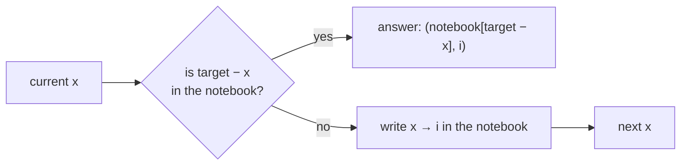
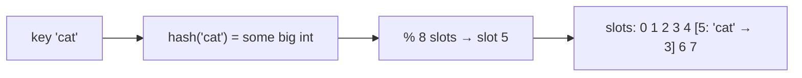

# Chapter 05 · Hashing Patterns

> A librarian with a perfect memory doesn't search the shelves when you ask for a book. She hears the title, and her brain instantly says "shelf 412". Hash maps give your code that librarian. Most "turn O(n²) into O(n)" moments in interviews are just this: stop searching, start remembering.

**You will learn:**
- A quick recap of how hash maps and sets work, and what "O(1) average" really promises
- **Collisions**, load factor, and the O(n) worst case (and why Python randomises string hashes)
- The seven hashing patterns: **complement lookup**, **frequency counting**, **canonical keys / grouping**, **seen set**, **index map**, **set-as-universe** (longest consecutive), and **bijection maps**
- Bucket sort for **Top K Frequent Elements** in O(n)
- Encode/decode design and validation problems (Valid Sudoku)
- The space-for-time trade-off and when hashing is the wrong tool

**Before this:** [Dictionaries & Hashing](../part-1-python/09-dictionaries.md) · [Tuples & Sets](../part-1-python/08-tuples-sets.md) · [Big-O](01-big-o-complexity.md) · [Arrays & Strings](02-arrays-strings.md)

---

## 🧠 The Big Idea

Here's the problem that started a million interviews. **Two Sum:** given `[2, 7, 11, 15]` and target 9, return the indexes of two numbers that add up to 9.

The brute force asks every pair: "Do you two add up to 9?" That's O(n²).

The hashing way flips the question. Walk the list once, and for each number `x`, ask: **"Have I already seen the partner `9 − x`?"** To answer instantly, keep a notebook (a dict) of every number you've seen and where.

```text
see 2  → need 7. Seen 7? no.  Write down {2: 0}
see 7  → need 2. Seen 2? YES, at index 0.  Answer: [0, 1]
```



The "searching" part of brute force (an inner loop of n) became a single O(1) dictionary lookup. One loop instead of two.

> 💡 **The core insight:** whenever your brute force has an inner loop that **searches** for something ("is there an element equal to / matching / pairing with this one?"), a hash map can usually replace that search with one O(1) lookup. You pay with O(n) memory.

---

## 🔨 Building It Up

### 1. Hash map and hash set recap (DSA view)

You met `dict` and `set` in [Chapter 09 of Part 1](../part-1-python/09-dictionaries.md). For DSA, here's all you need to remember:

| Structure | Stores | Key operations (average) |
|---|---|---|
| `set` | unique keys | `add`, `in`, `remove`: O(1) |
| `dict` | key → value | `d[k]`, `d[k] = v`, `k in d`, `del d[k]`: O(1) |
| `collections.Counter` | key → count | `Counter(iterable)`: O(n); `c[k]` (missing → 0) |
| `collections.defaultdict(f)` | key → value, auto-creates missing values with `f()` | same as dict |

Keys must be **hashable**: numbers, strings, tuples of hashables, frozensets. Lists, dicts and sets are not (they can change, which would break the table).

```python
from collections import Counter, defaultdict

counts = Counter("mississippi")
print(counts.most_common(2), counts["z"])          # missing key -> 0, no KeyError

groups = defaultdict(list)
for word in ["apple", "avocado", "banana", "blueberry", "cherry"]:
    groups[word[0]].append(word)                    # no need to check "if key in groups"
print(dict(groups))

print((1, 2) in {(1, 2), (3, 4)})                   # tuples are hashable: great as keys
```

```text
[('i', 4), ('s', 4)] 0
{'a': ['apple', 'avocado'], 'b': ['banana', 'blueberry'], 'c': ['cherry']}
True
```

### 2. How a hash table works, in one picture

A hash table is an **array of slots** plus a **hash function**. To store key `k`:

1. Compute `h = hash(k)`, a big integer.
2. Turn it into a slot number: `h % number_of_slots` (CPython uses the low bits).
3. Put the entry in that slot.

To look `k` up later, do the same calculation and go straight to the slot. That's why it's O(1): it's array indexing again ([Chapter 02](02-arrays-strings.md)), with the index computed from the key.



### 3. Collisions and the worst case

Two different keys can land in the same slot. That's a **collision**. It's unavoidable (infinitely many keys, finitely many slots). Two classic fixes:

- **Chaining:** each slot holds a small list of entries. A lookup scans that list. (Java's `HashMap` does this.)
- **Open addressing:** if the slot is taken, **probe** other slots in a fixed sequence until you find a free one (or the key). CPython's `dict` and `set` do this.

Let's build a tiny chaining hash map to see collisions happen:

```python
class ChainedHashMap:
    def __init__(self, slots=4):
        self.buckets = [[] for _ in range(slots)]

    def _bucket(self, key):
        return self.buckets[hash(key) % len(self.buckets)]

    def put(self, key, value):
        bucket = self._bucket(key)
        for i, (k, _) in enumerate(bucket):
            if k == key:
                bucket[i] = (key, value)       # update existing key
                return
        bucket.append((key, value))            # new key (maybe a collision)

    def get(self, key):
        for k, v in self._bucket(key):         # scan only this bucket
            if k == key:
                return v
        raise KeyError(key)

m = ChainedHashMap(slots=4)
for n in [1, 5, 9, 2]:                         # small ints hash to themselves
    m.put(n, n * 10)
print(m.buckets)
print(m.get(9))
```

```text
[[], [(1, 10), (5, 50), (9, 90)], [(2, 20)], []]
90
```

What just happened: 1, 5 and 9 all have `n % 4 == 1`, so they **collided** in bucket 1. Looking up 9 scanned that bucket's three entries. If **every** key collided, one bucket would hold all n entries and every lookup would be O(n). That's the hash table's **worst case**.

Real hash tables stay fast with two tricks:

- **A good hash function** spreads keys evenly, so buckets stay short.
- **Resizing:** when the **load factor** (entries ÷ slots) gets too high, allocate a bigger table (a constant factor bigger) and re-insert everything. Like list growth, this keeps inserts **O(1) amortized** ([Chapter 01](01-big-o-complexity.md)). CPython resizes a dict when it's about two-thirds full.

> ⚠️ **Hash flooding:** an attacker who knows your hash function can send thousands of keys that all collide, turning your O(1) server into an O(n) one (and O(n²) for n inserts). That's why Python **randomises string hashes** per process (`PYTHONHASHSEED`): `hash("cat")` differs between runs, so attackers can't precompute collisions. Small integers still hash to themselves, which is why the demo above is deterministic.

### 4. Pattern 1: Complement lookup (Two Sum)

**Shape:** "find two elements that **combine** to a target". For each `x`, the partner is determined (`target − x`, `target / x`, `x XOR target`...). Look it up among earlier elements.

```python
def two_sum(nums, target):
    index_of = {}                       # value -> index where we saw it
    for i, x in enumerate(nums):
        partner = target - x
        if partner in index_of:         # O(1) instead of an inner loop
            return [index_of[partner], i]
        index_of[x] = i                 # store AFTER checking: never pair x with itself
    return []

print(two_sum([2, 7, 11, 15], 9))
print(two_sum([3, 2, 4], 6))
print(two_sum([3, 3], 6))
```

```text
[0, 1]
[1, 2]
[0, 1]
```

**Dry run** for `[3, 2, 4]`, target 6:

| i | x | partner = 6 − x | partner in map? | map after |
|---|---|---|---|---|
| 0 | 3 | 3 | no (map is empty, 3 not yet stored) | {3: 0} |
| 1 | 2 | 4 | no | {3: 0, 2: 1} |
| 2 | 4 | 2 | **yes, at 1** | return [1, 2] |

What just happened: at i = 0 we checked for 3 **before** storing our own 3, which is why we didn't wrongly pair index 0 with itself. And `[3, 3]` works because the second 3 finds the first.

Compare with [Chapter 03](03-two-pointers.md): if the array were **sorted**, two pointers would do it in O(1) space. Unsorted and needing original indexes → hash map.

### 5. Pattern 2: Frequency counting

**Shape:** "how many times does each thing appear?", "same counts?", "most common?", "appears exactly once?"

```python
from collections import Counter

def first_unique(s):
    counts = Counter(s)                 # pass 1: count
    for i, ch in enumerate(s):          # pass 2: find the first with count 1
        if counts[ch] == 1:
            return i
    return -1

def can_construct(ransom_note, magazine):
    have = Counter(magazine)
    need = Counter(ransom_note)
    return all(have[ch] >= cnt for ch, cnt in need.items())

print(first_unique("leetcode"), first_unique("aabb"))
print(can_construct("aa", "aab"), can_construct("aa", "ab"))
```

```text
0 -1
True False
```

The **two-pass** shape (count everything, then use the counts) is extremely common. So is the **one-pass** shape where you count as you go and answer questions about the past.

### 6. Pattern 3: Canonical keys and grouping

**Shape:** "group things that are **equivalent** in some way" (anagrams, same pattern, same shift). Design a **canonical key**: a value that's identical for all equivalent items and different otherwise. Then `groups[key].append(item)`.

**Group Anagrams:** `["eat","tea","tan","ate","nat","bat"]` → `[["eat","tea","ate"],["tan","nat"],["bat"]]`.

Two possible keys:

- **Sorted letters:** `"".join(sorted(word))` → `"aet"` for eat/tea/ate. Cost O(k log k) per word of length k.
- **Count signature:** a tuple of 26 counts. Cost O(k) per word.

```python
from collections import defaultdict

def group_anagrams(words):
    groups = defaultdict(list)
    for w in words:
        counts = [0] * 26
        for ch in w:
            counts[ord(ch) - ord("a")] += 1
        groups[tuple(counts)].append(w)        # tuple: lists can't be dict keys
    return list(groups.values())

print(group_anagrams(["eat", "tea", "tan", "ate", "nat", "bat"]))
```

```text
[['eat', 'tea', 'ate'], ['tan', 'nat'], ['bat']]
```

**Group Shifted Strings** ("abc", "bcd", "xyz" are all shifts of each other): the key is the tuple of gaps between consecutive letters, mod 26.

```python
from collections import defaultdict

def group_shifted(strings):
    groups = defaultdict(list)
    for s in strings:
        key = tuple((ord(b) - ord(a)) % 26 for a, b in zip(s, s[1:]))
        groups[key].append(s)
    return list(groups.values())

print(group_shifted(["abc", "bcd", "acef", "xyz", "az", "ba", "a", "z"]))
```

```text
[['abc', 'bcd', 'xyz'], ['acef'], ['az', 'ba'], ['a', 'z']]
```

> 💡 **The canonical-key question:** "What do all members of a group have in common that nobody outside the group has?" Turn that into a hashable value (a string or a tuple) and you're done.

### 7. Pattern 4: Seen set (dedupe, cycle detection)

**Shape:** "have I been here before?" Duplicates, repeats, cycles.

**Happy Number:** replace n with the sum of the squares of its digits, repeatedly. Happy if you reach 1; unhappy if you loop forever. "Loop forever" = you see a number you've seen before.

```python
def is_happy(n):
    seen = set()
    while n != 1 and n not in seen:
        seen.add(n)
        n = sum(int(d) ** 2 for d in str(n))
    return n == 1

print(is_happy(19), is_happy(2))
```

```text
True False
```

19 → 82 → 68 → 100 → 1. Happy. (You can also detect the cycle with O(1) space using fast and slow pointers, coming in [Chapter 10](10-linked-lists.md).)

### 8. Pattern 5: Index map (value → position)

**Shape:** "where did I last/first see this?", "distance between equal elements", "earliest index with this property". Store an index (or list of indexes) as the value.

**Contains Duplicate II:** are there equal values at most k apart?

```python
def contains_nearby_duplicate(nums, k):
    last_index = {}
    for i, x in enumerate(nums):
        if x in last_index and i - last_index[x] <= k:
            return True
        last_index[x] = i               # keep the most recent: it's the closest for the future
    return False

print(contains_nearby_duplicate([1, 2, 3, 1], 3), contains_nearby_duplicate([1, 2, 3, 1, 2, 3], 2))
```

```text
True False
```

The index map is also the engine of the most important hashing pattern in the next chapter: **prefix sum → earliest index** ([Chapter 06](06-prefix-sums.md)).

### 9. Pattern 6: The set as a universe (Longest Consecutive Sequence)

**Problem:** unsorted `[100, 4, 200, 1, 3, 2]` → longest run of consecutive integers is `1, 2, 3, 4` → 4. Must be O(n), so no sorting.

**Idea:** put everything in a set. A number `x` **starts** a run only if `x − 1` is **not** in the set. From each start, count upward while `x + 1, x + 2, ...` exist.

```python
def longest_consecutive(nums):
    num_set = set(nums)
    best = 0
    for x in num_set:
        if x - 1 not in num_set:          # x is the start of a run
            length = 1
            while x + length in num_set:
                length += 1
            best = max(best, length)
    return best

print(longest_consecutive([100, 4, 200, 1, 3, 2]))
print(longest_consecutive([0, 3, 7, 2, 5, 8, 4, 6, 0, 1]))
```

```text
4
9
```

Why O(n) despite the `while` inside a `for`? The `while` loop only runs from **run starts**, and it walks each run exactly once. Every number belongs to exactly one run, so the total `while` steps across all starts is at most n. (Without the `x − 1 not in num_set` check, every number would walk its own run: O(n²).)

**Dry run** on `{100, 4, 200, 1, 3, 2}`:

| x | x − 1 in set? | start? | walk | length |
|---|---|---|---|---|
| 100 | 99: no | yes | 101? no | 1 |
| 4 | 3: yes | no | skip | |
| 200 | 199: no | yes | 201? no | 1 |
| 1 | 0: no | yes | 2 ✓, 3 ✓, 4 ✓, 5 ✗ | 4 |
| 3 | 2: yes | no | skip | |
| 2 | 1: yes | no | skip | |

### 10. Pattern 7: Bijection maps (Isomorphic Strings, Word Pattern)

**Shape:** "is there a one-to-one mapping between these two sequences?" Use **two** maps (forward and backward), because a one-way map can't catch two letters mapping to the same letter.

**Isomorphic Strings:** `"egg"` and `"add"` → True (e→a, g→d). `"badc"` and `"baba"` → False (b→b and d→b would both map to b).

```python
def is_isomorphic(s, t):
    if len(s) != len(t):
        return False
    s_to_t, t_to_s = {}, {}
    for a, b in zip(s, t):
        if s_to_t.get(a, b) != b or t_to_s.get(b, a) != a:
            return False                  # a conflict in either direction
        s_to_t[a] = b
        t_to_s[b] = a
    return True

for s, t in [("egg", "add"), ("foo", "bar"), ("paper", "title"), ("badc", "baba")]:
    print(s, t, is_isomorphic(s, t))
```

```text
egg add True
foo bar False
paper title True
badc baba False
```

`d.get(a, b) != b` reads: "if `a` already maps to something, it had better be `b`." The default `b` makes a brand-new key pass automatically.

A slick alternative: two strings are isomorphic exactly when their **first-occurrence patterns** match. Map each character to the index of its first appearance: `"egg"` → `[0, 1, 1]`, `"add"` → `[0, 1, 1]`. That's the **canonical key** pattern again.

### 11. Validation with sets: Valid Sudoku

**Problem:** check whether the filled cells of a 9×9 board break the rules (no repeat in any row, column or 3×3 box). Empty cells are `"."`.

**Idea:** one pass over the cells. For each digit, build three "fingerprints" (row r has d, column c has d, box b has d) and check a single seen-set for them. The box number is `(r // 3) * 3 + c // 3`.

```python
def is_valid_sudoku(board):
    seen = set()
    for r in range(9):
        for c in range(9):
            d = board[r][c]
            if d == ".":
                continue
            keys = (("row", r, d), ("col", c, d), ("box", r // 3, c // 3, d))
            if any(k in seen for k in keys):
                return False
            seen.update(keys)
    return True

board = [
    ["5", "3", ".", ".", "7", ".", ".", ".", "."],
    ["6", ".", ".", "1", "9", "5", ".", ".", "."],
    [".", "9", "8", ".", ".", ".", ".", "6", "."],
    ["8", ".", ".", ".", "6", ".", ".", ".", "3"],
    ["4", ".", ".", "8", ".", "3", ".", ".", "1"],
    ["7", ".", ".", ".", "2", ".", ".", ".", "6"],
    [".", "6", ".", ".", ".", ".", "2", "8", "."],
    [".", ".", ".", "4", "1", "9", ".", ".", "5"],
    [".", ".", ".", ".", "8", ".", ".", "7", "9"],
]
print(is_valid_sudoku(board))
board[0][0] = "8"                     # now column 0 has two 8s
print(is_valid_sudoku(board))
```

```text
True
False
```

O(81) = O(1) for a fixed board; O(n²) for an n×n generalisation.

### 12. Top K Frequent Elements with bucket sort

**Problem:** return the k most frequent elements. `[1,1,1,2,2,3]`, k = 2 → `[1, 2]`.

Three solutions, getting better:

| Approach | Time |
|---|---|
| Count, then sort all items by count | O(n log n) |
| Count, then a heap of size k ([Chapter 15](15-heaps.md)) | O(n log k) |
| Count, then **bucket by frequency** | **O(n)** |

**Bucket idea:** a frequency is between 1 and n. Make n + 1 buckets, where `buckets[f]` lists the elements appearing exactly f times. Then read buckets from the highest frequency down until you have k.

```python
from collections import Counter

def top_k_frequent(nums, k):
    counts = Counter(nums)
    buckets = [[] for _ in range(len(nums) + 1)]   # index = frequency
    for value, freq in counts.items():
        buckets[freq].append(value)
    result = []
    for freq in range(len(buckets) - 1, 0, -1):    # highest frequency first
        for value in buckets[freq]:
            result.append(value)
            if len(result) == k:
                return result
    return result

print(top_k_frequent([1, 1, 1, 2, 2, 3], 2))
print(top_k_frequent([4, 4, 5, 5, 5, 6, 6, 6, 6, 7], 3))
print(Counter([1, 1, 1, 2, 2, 3]).most_common(2))   # the library one-liner
```

```text
[1, 2]
[6, 5, 4]
[(1, 3), (2, 2)]
```

What just happened: no comparison sort at all. The frequency itself is used as an array index, which is the trick behind **counting sort** and **bucket sort** ([Chapter 07](07-sorting.md)).

### 13. Encode and decode

**Problem: Encode and Decode Strings.** Design `encode(list_of_strings) → one string` and `decode(string) → original list`. Strings may contain **any** character, including whatever separator you'd pick.

Joining with `","` fails if a string contains a comma. The robust fix is **length-prefixing**: write each string as `len#string`. The decoder reads digits up to `#`, then reads exactly that many characters, so the content is never interpreted.

```python
def encode(strs):
    return "".join(f"{len(s)}#{s}" for s in strs)

def decode(data):
    result, i = [], 0
    while i < len(data):
        j = data.index("#", i)            # end of the length field
        length = int(data[i:j])
        result.append(data[j + 1:j + 1 + length])
        i = j + 1 + length                # jump straight past this string
    return result

original = ["hello", "", "a#b", "4#x", "world,!"]
packed = encode(original)
print(packed)
print(decode(packed) == original)
```

```text
5#hello0#3#a#b3#4#x7#world,!
True
```

This idea (length-prefixed framing) is exactly how many network protocols separate messages. The related design problem **Encode and Decode TinyURL** uses a hash map from a short code to the long URL; you'll design it properly at scale in [System Design Chapter 12](../part-3-system-design/12-case-studies-1.md).

---

## 🔬 Under the Hood

### How CPython's dict actually stores things

Since Python 3.6, a dict has two arrays:

1. A compact **entries** array holding `(hash, key, value)` rows **in insertion order**. That's why dicts remember insertion order.
2. A sparse **indices** table (the hash table) whose slots hold positions in the entries array.

Lookup: compute `hash(key)`, use its low bits to pick a slot in the indices table. If the slot points to an entry whose stored hash and key match, done. If it points to a different key (a collision), CPython probes another slot using a "perturbed" sequence that mixes in more bits of the hash, so colliding keys spread out instead of clumping. An empty slot means "not present".

A `set` uses a similar open-addressing table but stores just keys.

### Why equal objects must have equal hashes

The table finds a key by its hash first, and only then checks `==`. If `a == b` but `hash(a) != hash(b)`, they'd land in different slots and the dict would treat them as different keys. So Python requires: **if `a == b` then `hash(a) == hash(b)`**. That's why `hash(1) == hash(1.0) == hash(True)`, and why `{1: "x", 1.0: "y"}` has just one key. (The reverse isn't required: different keys may share a hash; that's just a collision.)

### Why mutable objects aren't hashable

If you put a list in a set and then appended to it, its hash would change, but it would still sit in the slot for its *old* hash. Lookups would go to the wrong slot and the set would silently lose it. So Python forbids it. Use a `tuple` (or `frozenset`) as a key instead.

### What "O(1) average" really means

With a good hash and a load factor kept below a constant, the **expected** number of probes per operation is a constant. "Expected" assumes keys behave like random with respect to the hash. Individual operations can be slower (a long probe sequence, or a resize that's O(n)), and adversarial keys can make everything O(n). In interviews, say: **"O(1) average, O(n) worst case."**

### The space you're paying

A dict with n entries uses O(n) memory, but with a significant constant: each entry stores a hash, a key pointer and a value pointer, plus the sparse index table that's kept partly empty. A dict of a million small ints can take tens of megabytes. For "values in 0..n" problems, a plain list indexed by value is lighter and faster than a dict.

---

## 🧩 Pattern Decoder

### Signals: when to reach for hashing

| You see in the problem... | Pattern | Example |
|---|---|---|
| "two elements that sum / combine to target", **unsorted**, return indexes | **complement lookup** | Two Sum |
| "count", "frequency", "most / least common", "appears once / twice" | **frequency counting** | First Unique Char, Top K Frequent |
| "same characters / counts", "anagram", "can be built from" | **Counter compare** | Valid Anagram, Ransom Note |
| "group", "categorise", "equivalent" | **canonical key → list** | Group Anagrams, Shifted Strings |
| "duplicate", "repeat", "cycle", "visited before" | **seen set** | Contains Duplicate, Happy Number |
| "distance between equal values", "first / last occurrence" | **index map** | Contains Duplicate II |
| "consecutive values" in an **unsorted** array, O(n) required | **set as universe**, start only at run starts | Longest Consecutive Sequence |
| "one-to-one", "pattern matches", "isomorphic" | **two maps (bijection)** | Isomorphic Strings, Word Pattern |
| "validate rows / columns / boxes" | **set of fingerprints** | Valid Sudoku |
| "k most frequent" with O(n) target | **count + bucket by frequency** | Top K Frequent |
| "subarray sum equals k" (with negatives) | **prefix sum + hashmap** ([Chapter 06](06-prefix-sums.md)) | Subarray Sum Equals K |
| brute force has an inner loop that **searches** | replace the search with a lookup | almost everything |

### Template A: Complement lookup (one pass)

```py
def complement_lookup(nums, target):
    seen = {}                                  # value -> index (or count)
    for i, x in enumerate(nums):
        want = complement(x, target)           # target - x, target ^ x, ...
        if want in seen:
            return answer(seen[want], i)       # or: count += seen[want]
        seen[x] = i                            # add AFTER checking
    return not_found
```

### Template B: Count then query (two passes)

```py
from collections import Counter

def count_then_query(items):
    counts = Counter(items)                    # pass 1
    for x in items:                            # pass 2 (keeps original order)
        if condition(counts[x]):
            return x
```

### Template C: Group by canonical key

```py
from collections import defaultdict

def group(items):
    groups = defaultdict(list)
    for item in items:
        groups[canonical_key(item)].append(item)   # key must be hashable
    return list(groups.values())
```

### Template D: Counting pairs as you go

```py
from collections import defaultdict

def count_pairs(nums):
    seen = defaultdict(int)                    # value -> how many times seen so far
    pairs = 0
    for x in nums:
        pairs += seen[partner(x)]              # every earlier partner forms a pair with x
        seen[x] += 1
    return pairs
```

### Variation 1: Number of Good Pairs (counting as you go)

**Problem:** count pairs `i < j` with `nums[i] == nums[j]`. `[1,2,3,1,1,3]` → 4.

**Idea:** when you meet a value for the (c+1)-th time, it forms a pair with each of the c earlier copies.

```python
from collections import defaultdict

def num_identical_pairs(nums):
    seen = defaultdict(int)
    pairs = 0
    for x in nums:
        pairs += seen[x]           # pair x with every earlier copy
        seen[x] += 1
    return pairs

print(num_identical_pairs([1, 2, 3, 1, 1, 3]), num_identical_pairs([1, 1, 1, 1]))
```

```text
4 6
```

O(n) time, O(n) space. (Or use the formula: a value appearing c times gives c·(c−1)/2 pairs.)

### Variation 2: 4Sum II (split in half + complement)

**Problem:** four lists A, B, C, D of length n. Count tuples with `A[i] + B[j] + C[k] + D[l] == 0`.

**Idea:** brute force is O(n⁴). Store every `a + b` sum with its count (O(n²)), then for every `c + d`, look up `−(c + d)` (O(n²)). Total O(n²). This "meet in the middle" split is a powerful hashing trick.

```python
from collections import Counter

def four_sum_count(A, B, C, D):
    ab = Counter(a + b for a in A for b in B)
    return sum(ab[-(c + d)] for c in C for d in D)

print(four_sum_count([1, 2], [-2, -1], [-1, 2], [0, 2]))
```

```text
2
```

O(n²) time and space.

### Variation 3: Word Pattern (bijection between letters and words)

**Problem:** does `s` follow `pattern`? `"abba"`, `"dog cat cat dog"` → True.

```python
def word_pattern(pattern, s):
    words = s.split()
    if len(words) != len(pattern):
        return False
    return len(set(pattern)) == len(set(words)) == len(set(zip(pattern, words)))

print(word_pattern("abba", "dog cat cat dog"), word_pattern("abba", "dog cat cat fish"),
      word_pattern("aaaa", "dog cat cat dog"), word_pattern("abba", "dog dog dog dog"))
```

```text
True False False False
```

Why this works: if the mapping is a bijection, the number of distinct letters, distinct words and distinct (letter, word) pairs are all equal. Any conflict makes the pair count bigger than one of the others. Cute, and worth explaining out loud.

### When NOT to use hashing

- **The data is sorted, or sorting is allowed** and you need O(1) space → two pointers ([Chapter 03](03-two-pointers.md)).
- **You need order-based queries** ("smallest key ≥ x", "keys in a range") → a sorted structure or binary search ([Chapter 08](08-binary-search.md), [Chapter 14](14-binary-search-trees.md)). Hash maps have no notion of "near".
- **Keys are small integers in a known range** (0..n, or 26 letters) → a plain list is faster and lighter.
- **Memory is extremely tight** → sorting + scanning (O(1) extra space) may be preferred over O(n) space.
- **Contiguous-window constraints** → sliding window may need only O(1) or O(k) state.

---

## ⚠️ Traps & Common Mistakes

1. **Adding before checking in Two Sum.** You can pair an element with itself.

```py
# ❌ for nums=[3], target=6 this "finds" [0, 0]
for i, x in enumerate(nums):
    seen[x] = i
    if target - x in seen: return [seen[target - x], i]

# ✅ check first, then store
for i, x in enumerate(nums):
    if target - x in seen: return [seen[target - x], i]
    seen[x] = i
```

2. **Using a list as a dict key.** `TypeError: unhashable type: 'list'`. Convert to a `tuple`.

3. **Assuming dict order = sorted order.** Dicts keep **insertion** order, not sorted order. Sort explicitly when needed.

4. **`d[k] += 1` on a missing key** raises `KeyError`. Use `Counter`, `defaultdict(int)`, or `d[k] = d.get(k, 0) + 1`.

5. **Reading a `defaultdict` to check membership.** `if counts[x]:` *creates* key x with 0. Use `if x in counts:` when you don't want side effects (this matters when you later use `len(counts)`).

6. **One-directional maps for bijection problems.** `"badc"` vs `"baba"` passes a single map. Always check both directions.

7. **Forgetting the worst case.** Saying "always O(1)" in an interview loses points. Say "average".

8. **Using a set when you need counts.** `set` loses multiplicity: `set("aab") == set("ab")`. Anagram checks need `Counter`.

9. **Mutating a key object after inserting it** (e.g. a custom class whose `__hash__` depends on a mutable field). The entry becomes unreachable.

---

## 💡 Tips & Tricks

- Ask: **"What am I searching for repeatedly?"** That thing becomes the dict key.
- `Counter(a) == Counter(b)` checks "same multiset". `Counter(a) - Counter(b)` gives what's missing (keeps only positives).
- `dict.setdefault(k, []).append(v)` works without `defaultdict`.
- `sorted(counts, key=counts.get, reverse=True)` sorts keys by frequency.
- Need a pair as a key? Use a tuple `(a, b)`. Need an unordered pair? Use `(min(a, b), max(a, b))` or a `frozenset`.
- For "group" problems, the whole solution is choosing the key. Spend your thinking time there.
- `len(set(x)) == len(x)` is the quickest "all unique?" check.
- In an interview, when you add a hash map, say the trade-off explicitly: "this uses O(n) extra space to get O(n) time."

---

## 🎯 Interview Questions

### 1. Two Sum 🔥🔥🔥

<details><summary>Answer</summary>

Complement lookup: one pass, check `target − x` in a value→index map, then store `x`. Code and dry run in section 4. Time O(n), space O(n). Mention: brute force O(n²); sort + two pointers O(n log n) but loses original indexes (unless you sort `(value, index)` pairs).

</details>

### 2. Valid Anagram 🔥🔥🔥

<details><summary>Answer</summary>

```python
from collections import Counter

def is_anagram(s, t):
    return Counter(s) == Counter(t)

print(is_anagram("anagram", "nagaram"), is_anagram("rat", "car"))
```

```text
True False
```

Time O(n), space O(alphabet). Follow-up "what about Unicode?": `Counter` handles it; the 26-array doesn't.

</details>

### 3. Group Anagrams 🔥🔥🔥

<details><summary>Answer</summary>

Canonical key: either `"".join(sorted(w))` (O(k log k) per word) or the 26-count tuple (O(k) per word). Code in section 6. Time O(n · k), space O(n · k) for n words of length k.

</details>

### 4. Top K Frequent Elements 🔥🔥🔥

<details><summary>Answer</summary>

Count with `Counter`, then bucket by frequency and read from the top: O(n) (section 12). Mention the alternatives: sort by count O(n log n), heap of size k O(n log k). The heap is better when k is tiny and the data streams in; buckets win for a single batch.

</details>

### 5. Longest Consecutive Sequence 🔥🔥🔥

<details><summary>Answer</summary>

Set of all numbers; start counting only from `x` where `x − 1` is absent; extend with `x + 1, x + 2, ...` (section 9). Time O(n): each number is visited by at most one walk. Space O(n). Sorting would be O(n log n), which the problem forbids.

</details>

### 6. Contains Duplicate 🔥🔥🔥

<details><summary>Answer</summary>

Seen set (or `len(set(nums)) != len(nums)`). Time O(n), space O(n). If asked for O(1) space: sort and compare neighbours, O(n log n).

```python
def contains_duplicate(nums):
    seen = set()
    for x in nums:
        if x in seen:
            return True          # early exit beats building the whole set
        seen.add(x)
    return False

print(contains_duplicate([1, 2, 3, 1]), contains_duplicate([1, 2, 3]))
```

```text
True False
```

</details>

### 7. Isomorphic Strings 🔥🔥

<details><summary>Answer</summary>

Two maps (s→t and t→s), checking for conflicts in both directions (section 10). Or compare first-occurrence patterns: `[s.index(c) for c in s] == [t.index(c) for c in t]` (that one-liner is O(n²) because `.index` scans; build the pattern with a dict for O(n)). Time O(n), space O(alphabet).

</details>

### 8. Valid Sudoku 🔥🔥

<details><summary>Answer</summary>

One pass with a set of fingerprints `("row", r, d)`, `("col", c, d)`, `("box", r//3, c//3, d)` (section 11). Or 27 separate sets. Time and space O(1) for 9×9. Key detail: the box index formula.

</details>

### 9. Encode and Decode Strings 🔥🔥

<details><summary>Answer</summary>

Length-prefix each string: `len#content`. Decoding reads the number up to `#`, then exactly that many characters, so content can contain anything, including `#` and digits (section 13). Time O(total length) both ways. Explain why a plain delimiter fails and why escaping is the other option (more fiddly).

</details>

### 10. Subarray Sum Equals K 🔥🔥🔥

Count subarrays whose sum is exactly k (numbers can be negative).

<details><summary>Answer</summary>

Complement lookup on **prefix sums**: if the running sum is `s` now and was `s − k` at some earlier point, the part in between sums to k. Keep a Counter of prefix sums seen so far.

```python
from collections import defaultdict

def subarray_sum(nums, k):
    seen = defaultdict(int)
    seen[0] = 1                       # the empty prefix
    running = count = 0
    for x in nums:
        running += x
        count += seen[running - k]    # earlier prefixes that complete a sum of k
        seen[running] += 1
    return count

print(subarray_sum([1, 1, 1], 2), subarray_sum([1, 2, 3], 3), subarray_sum([1, -1, 0], 0))
```

```text
2 2 3
```

Time O(n), space O(n). This is the star of [Chapter 06](06-prefix-sums.md). Sliding window fails here because of negatives.

</details>

### 11. Ransom Note 🔥

<details><summary>Answer</summary>

Count the magazine; for each note letter, decrement and fail if it goes below 0 (section 5 has the Counter version). Time O(m + n), space O(alphabet).

</details>

### 12. Find All Duplicates / First Missing Positive with a hash set (and why the interviewer will push back) 🔥🔥

<details><summary>Answer</summary>

A set solves both in O(n) time and O(n) space. Expect the follow-up "now O(1) extra space": since values are in `1..n`, use the array itself as the hash table (negation marks or cyclic sort), as shown in [Chapter 02](02-arrays-strings.md). Recognising that "values in 1..n" means "the array can be its own hash map" is the real test.

</details>

### 13. Design HashMap 🔥🔥

Implement `put`, `get`, `remove` without using built-in hash tables.

<details><summary>Answer</summary>

An array of buckets with chaining; resize when the load factor passes a threshold.

```python
class MyHashMap:
    def __init__(self):
        self.capacity = 8
        self.size = 0
        self.buckets = [[] for _ in range(self.capacity)]

    def _index(self, key):
        return hash(key) % self.capacity

    def put(self, key, value):
        bucket = self.buckets[self._index(key)]
        for pair in bucket:
            if pair[0] == key:
                pair[1] = value
                return
        bucket.append([key, value])
        self.size += 1
        if self.size > self.capacity * 0.75:      # keep chains short
            self._resize()

    def get(self, key):
        for k, v in self.buckets[self._index(key)]:
            if k == key:
                return v
        return -1

    def remove(self, key):
        bucket = self.buckets[self._index(key)]
        for i, (k, _) in enumerate(bucket):
            if k == key:
                bucket.pop(i)
                self.size -= 1
                return

    def _resize(self):
        old = [pair for bucket in self.buckets for pair in bucket]
        self.capacity *= 2
        self.buckets = [[] for _ in range(self.capacity)]
        for k, v in old:
            self.buckets[self._index(k)].append([k, v])

m = MyHashMap()
for i in range(20):
    m.put(i, i * i)
m.remove(3)
print(m.get(4), m.get(3), m.get(19), m.capacity)
```

```text
16 -1 361 32
```

`put`/`get`/`remove` are O(1) average; resizing is O(n) but amortized O(1) per put.

</details>

---

## 🏋️ Practice

**🟢 1. Intersection of Two Arrays** (unique values in both).

<details><summary>Solution</summary>

```python
def intersection(a, b):
    return sorted(set(a) & set(b))

print(intersection([1, 2, 2, 1], [2, 2]), intersection([4, 9, 5], [9, 4, 9, 8, 4]))
```

```text
[2] [4, 9]
```

O(n + m). (`sorted` only to make the output order predictable.)

</details>

**🟢 2. Jewels and Stones:** how many characters of `stones` are also in `jewels`?

<details><summary>Solution</summary>

```python
def num_jewels_in_stones(jewels, stones):
    jewel_set = set(jewels)
    return sum(ch in jewel_set for ch in stones)

print(num_jewels_in_stones("aA", "aAAbbbb"))
```

```text
3
```

O(J + S) instead of O(J · S).

</details>

**🟢 3. Sort Characters By Frequency:** `"tree"` → `"eert"` (or `"eetr"`).

<details><summary>Solution</summary>

```python
from collections import Counter

def frequency_sort(s):
    return "".join(ch * cnt for ch, cnt in Counter(s).most_common())

print(frequency_sort("tree"), frequency_sort("Aabb"))
```

```text
eetr bbAa
```

(`most_common` keeps first-seen order for ties, so this output is deterministic.)

</details>

**🟡 4. Find Players With Zero or One Losses** from a list of `[winner, loser]` matches. Return two sorted lists.

<details><summary>Solution</summary>

```python
from collections import Counter

def find_winners(matches):
    losses = Counter()
    players = set()
    for w, l in matches:
        players.update((w, l))
        losses[l] += 1
    zero = sorted(p for p in players if losses[p] == 0)
    one = sorted(p for p in players if losses[p] == 1)
    return [zero, one]

print(find_winners([[1, 3], [2, 3], [3, 6], [5, 6], [5, 7], [4, 5], [4, 8], [4, 9], [10, 4], [10, 9]]))
```

```text
[[1, 2, 10], [4, 5, 7, 8]]
```

</details>

**🟡 5. Count pairs whose sum is a power of two** (Count Good Meals): count pairs `i < j` with `a[i] + a[j]` a power of two (up to 2²¹).

<details><summary>Solution</summary>

Counting-as-you-go with 22 possible complements per element.

```python
from collections import defaultdict

def count_pairs(deliciousness):
    seen = defaultdict(int)
    total = 0
    for x in deliciousness:
        for p in range(22):
            total += seen.get((1 << p) - x, 0)   # .get: don't create keys
        seen[x] += 1
    return total % (10**9 + 7)

print(count_pairs([1, 3, 5, 7, 9]), count_pairs([1, 1, 1, 3, 3, 3, 7]))
```

```text
4 15
```

O(22 · n) = O(n).

</details>

**🟡 6. Longest Palindrome buildable from letters** of a string. `"abccccdd"` → 7.

<details><summary>Solution</summary>

Every pair of equal letters can go on both sides; one odd letter may sit in the middle.

```python
from collections import Counter

def longest_palindrome(s):
    length = 0
    has_odd = False
    for cnt in Counter(s).values():
        length += cnt // 2 * 2
        if cnt % 2:
            has_odd = True
    return length + has_odd

print(longest_palindrome("abccccdd"), longest_palindrome("a"))
```

```text
7 1
```

</details>

**🔴 7. Max Points on a Line:** given points, the maximum number on one straight line.

<details><summary>Solution</summary>

For each anchor point, group the other points by **slope** from the anchor. Avoid floats: the slope key is the reduced fraction `(dy/g, dx/g)` with a normalised sign. O(n²) time.

```python
from collections import defaultdict
from math import gcd

def max_points(points):
    n = len(points)
    if n <= 2:
        return n
    best = 0
    for i in range(n):
        slopes = defaultdict(int)
        x1, y1 = points[i]
        for j in range(i + 1, n):
            dx, dy = points[j][0] - x1, points[j][1] - y1
            g = gcd(dx, dy)
            dx, dy = dx // g, dy // g
            if dx < 0 or (dx == 0 and dy < 0):    # same line, same key
                dx, dy = -dx, -dy
            slopes[(dx, dy)] += 1
        if slopes:
            best = max(best, max(slopes.values()) + 1)   # +1 for the anchor
    return best

print(max_points([[1, 1], [2, 2], [3, 3]]))
print(max_points([[1, 1], [3, 2], [5, 3], [4, 1], [2, 3], [1, 4]]))
```

```text
3
4
```

The canonical-key pattern again: the key is the reduced slope.

</details>

**🔴 8. Brick Wall:** draw a vertical line crossing the fewest bricks. Rows are lists of brick widths.

<details><summary>Solution</summary>

Count how many rows have an **edge** at each x position (prefix sums of widths, excluding the far right). The best line goes through the most common edge.

```python
from collections import Counter

def least_bricks(wall):
    edges = Counter()
    for row in wall:
        x = 0
        for width in row[:-1]:       # skip the wall's right boundary
            x += width
            edges[x] += 1
    return len(wall) - max(edges.values(), default=0)

wall = [[1, 2, 2, 1], [3, 1, 2], [1, 3, 2], [2, 4], [3, 1, 2], [1, 3, 1, 1]]
print(least_bricks(wall))
```

```text
2
```

O(total bricks).

</details>

---

## 🧠 Never-Forget Summary

- Hash map/set = an array of slots, indexed by `hash(key)`. Lookups are **O(1) average, O(n) worst case**.
- Collisions are handled by chaining or open addressing (CPython); resizing keeps the load factor low.
- Keys must be hashable (immutable). Use tuples for composite keys.
- **Complement lookup**: check `target − x` before storing `x`.
- **Frequency counting**: `Counter`, then query.
- **Canonical key**: what all members of a group share → `groups[key].append(item)`.
- **Seen set** for duplicates and cycles; **index map** for distances and first/last positions.
- **Longest consecutive**: start only where `x − 1` is missing → O(n).
- **Bijection**: two maps, or compare distinct counts.
- **Top K**: bucket by frequency → O(n).
- The universal trade: **O(n) extra space buys an O(n) → O(1) inner search**.

**Memory hooks:**
- **"Don't search. Remember."**
- **"Check, then store"** (Two Sum order).
- **"Same key, same group."**
- **"Two-way street for one-to-one."**

**One picture:**

| Pattern | Key → Value | Classic problems |
|---|---|---|
| Complement | value → index | Two Sum, 4Sum II, Subarray Sum = K |
| Frequency | item → count | Valid Anagram, Top K, First Unique |
| Grouping | canonical key → list | Group Anagrams, Shifted Strings, Max Points |
| Seen set | item | Contains Duplicate, Happy Number |
| Index map | value → last index | Contains Duplicate II |
| Universe set | number | Longest Consecutive Sequence |
| Bijection | a → b and b → a | Isomorphic Strings, Word Pattern |

> **If you remember only one thing:** when your brute force has an inner loop that **looks for** something, a hash map can almost always look it up instead.

---
**Next:** [Chapter 06 · Prefix Sums & Difference Arrays](06-prefix-sums.md)  ·  **Back to** [Contents](../README.md)
