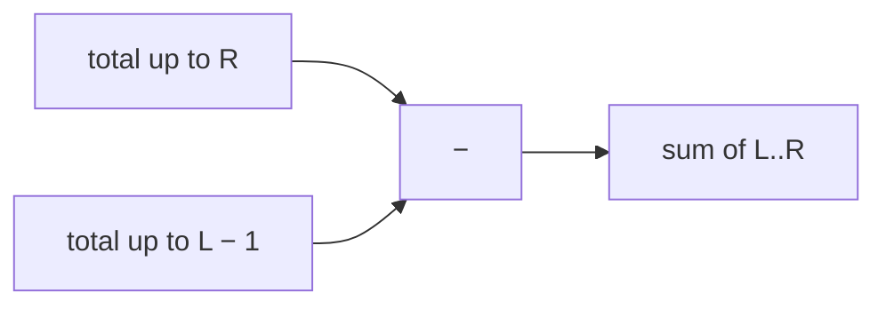
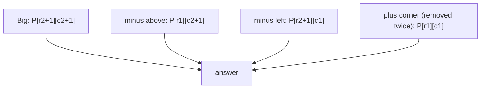

# Chapter 06 · Prefix Sums & Difference Arrays

> A cricket scoreboard doesn't show runs per over; it shows the **total so far**. Want to know how many runs were scored between over 10 and over 20? Just subtract two totals. No re-adding. That tiny subtraction trick is a prefix sum, and it answers "sum of any range" in O(1) after one O(n) pass.

**You will learn:**
- How to build a **prefix sum** array and answer any range-sum query in O(1)
- The off-by-one-proof convention (`prefix[0] = 0`)
- **Prefix sum + hashmap**: the pattern behind Subarray Sum Equals K, Contiguous Array and Subarrays Divisible by K
- **Prefix XOR** and other "prefix anything" ideas
- **2D prefix sums** for rectangle sums in O(1)
- **Difference arrays**: apply many range updates in O(1) each
- **Prefix and suffix products** (Product of Array Except Self)
- Why sliding window fails with negatives and prefix sums don't

**Before this:** [Big-O](01-big-o-complexity.md) · [Arrays & Strings](02-arrays-strings.md) · [Sliding Window](04-sliding-window.md) · [Hashing Patterns](05-hashing.md)

---

## 🧠 The Big Idea

Runs scored in each over of a match:

```text
over:        1   2   3   4   5   6
runs:        4   9   2   7   6   3
total so far:4  13  15  22  28  31
```

How many runs in overs 3 to 5? The slow way: 2 + 7 + 6 = 15. The fast way:

```text
(total after over 5) − (total after over 2) = 28 − 13 = 15
```

The "total so far" row is a **prefix sum**. Once you have it, *any* range sum is **one subtraction**, no matter how long the range.



The flip side is just as useful. Suppose you want to **add** 5 runs of penalty to every over from 2 to 4 (many such updates, then read the final scores). Instead of touching every over, write `+5` at over 2 and `−5` just after over 4. When you finally compute the running total of those marks, the +5 "switches on" at over 2 and "switches off" after over 4. That's a **difference array**.

> 💡 **The core insight:** prefix sums turn **range queries** into two point lookups. Difference arrays turn **range updates** into two point writes. They're inverses of each other: the prefix sum of a difference array gives back the original.

---

## 🔨 Building It Up

### 1. Building a prefix sum array

Define `prefix[i]` = sum of the first `i` elements, i.e. `nums[0] + ... + nums[i−1]`. So `prefix` has length n + 1, and `prefix[0] = 0` (the sum of zero elements).

```python
def build_prefix(nums):
    prefix = [0] * (len(nums) + 1)
    for i, x in enumerate(nums):
        prefix[i + 1] = prefix[i] + x       # total so far
    return prefix

nums = [4, 9, 2, 7, 6, 3]
prefix = build_prefix(nums)
print(prefix)

from itertools import accumulate
print([0] + list(accumulate(nums)))       # the library way
```

```text
[0, 4, 13, 15, 22, 28, 31]
[0, 4, 13, 15, 22, 28, 31]
```

Building it is O(n), once.

### 2. Range sum queries in O(1)

The sum of `nums[l..r]` (inclusive) is:

```text
sum(l, r) = prefix[r + 1] − prefix[l]
```

`prefix[r + 1]` is everything up to and including index r; `prefix[l]` is everything before index l. Subtract, and only `l..r` remains.

```python
nums = [4, 9, 2, 7, 6, 3]
prefix = [0]
for x in nums:
    prefix.append(prefix[-1] + x)

def range_sum(l, r):
    return prefix[r + 1] - prefix[l]

print(range_sum(2, 4))      # 2 + 7 + 6
print(range_sum(0, 5))      # everything
print(range_sum(3, 3))      # a single element
```

```text
15
31
7
```

What just happened: three queries, each one subtraction. If you have q queries on an array of n, prefix sums cost **O(n + q)** instead of **O(n · q)**.

> 💡 **Why `prefix[0] = 0`?** It makes `sum(0, r)` work with the same formula (`prefix[r+1] − prefix[0]`) instead of needing an `if l == 0` special case. That leading zero is going to matter a lot in the hashmap pattern too: it represents "the empty prefix before the array starts".

**Range Sum Query – Immutable** is exactly this as a class:

```python
class NumArray:
    def __init__(self, nums):
        self.prefix = [0]
        for x in nums:
            self.prefix.append(self.prefix[-1] + x)

    def sum_range(self, left, right):
        return self.prefix[right + 1] - self.prefix[left]

arr = NumArray([-2, 0, 3, -5, 2, -1])
print(arr.sum_range(0, 2), arr.sum_range(2, 5), arr.sum_range(0, 5))
```

```text
1 -1 -3
```

(If the array also gets **updated** between queries, a prefix array would need O(n) to rebuild after each update. That's when you use a Fenwick tree or segment tree: [Chapter 24](24-advanced-structures.md).)

### 3. Simple uses: pivot index and running balance

**Find Pivot Index:** the index where the sum of everything to the left equals the sum of everything to the right.

Left sum at i = `prefix[i]`. Right sum = `total − prefix[i] − nums[i]`. We don't even need the array: keep a running left sum.

```python
def pivot_index(nums):
    total = sum(nums)
    left = 0
    for i, x in enumerate(nums):
        if left == total - left - x:     # left sum == right sum
            return i
        left += x
    return -1

print(pivot_index([1, 7, 3, 6, 5, 6]), pivot_index([1, 2, 3]), pivot_index([2, 1, -1]))
```

```text
3 -1 0
```

### 4. Prefix sum + hashmap: the star pattern

Now the big one. **Subarray Sum Equals K:** count contiguous subarrays summing to exactly k. Numbers **can be negative**.

Sliding window fails (negatives break monotonicity, [Chapter 04](04-sliding-window.md)). Brute force over all (l, r) is O(n²).

**The key equation.** A subarray `l..r` sums to k when:

```text
prefix[r + 1] − prefix[l] = k
⟺  prefix[l] = prefix[r + 1] − k
```

So, walking left to right with a running sum `s` (that's `prefix[r + 1]`), the number of good subarrays **ending here** is: **how many earlier prefix sums equal `s − k`?** That's the complement lookup from Two Sum ([Chapter 05](05-hashing.md)), applied to prefix sums. Keep a Counter of prefix sums seen so far.

```python
from collections import defaultdict

def subarray_sum(nums, k):
    count_of = defaultdict(int)
    count_of[0] = 1                  # the empty prefix: lets subarrays start at index 0
    running = result = 0
    for x in nums:
        running += x
        result += count_of[running - k]   # earlier prefixes that complete a sum of k
        count_of[running] += 1            # record this prefix for future positions
    return result

print(subarray_sum([1, 1, 1], 2))
print(subarray_sum([1, 2, 3], 3))
print(subarray_sum([3, 4, 7, 2, -3, 1, 4, 2], 7))
```

```text
2
2
4
```

**Dry run** for `[3, 4, 7, 2, -3, 1, 4, 2]`, k = 7:

| i | x | running | running − 7 | count_of[running − 7] | result | count_of after |
|---|---|---|---|---|---|---|
| | | 0 | | | 0 | {0:1} |
| 0 | 3 | 3 | −4 | 0 | 0 | {0:1, 3:1} |
| 1 | 4 | 7 | 0 | **1** ([3,4]) | 1 | +{7:1} |
| 2 | 7 | 14 | 7 | **1** ([7]) | 2 | +{14:1} |
| 3 | 2 | 16 | 9 | 0 | 2 | +{16:1} |
| 4 | −3 | 13 | 6 | 0 | 2 | +{13:1} |
| 5 | 1 | 14 | 7 | **1** ([7,2,−3,1]) | 3 | {14:2} |
| 6 | 4 | 18 | 11 | 0 | 3 | +{18:1} |
| 7 | 2 | 20 | 13 | **1** ([1,4,2]) | 4 | +{20:1} |

What just happened: each row asks "how many places before me had a running total exactly 7 less than mine?" Each such place marks the start of a subarray summing to 7. Two critical details:

1. **`count_of[0] = 1` before the loop.** Without it, subarrays starting at index 0 (like `[3, 4]`) are missed, because their "earlier prefix" is the empty one.
2. **Look up before you store** (same as Two Sum). Otherwise with k = 0 you'd count the empty subarray.

Time O(n), space O(n).

### 5. Variation: Contiguous Array (equal 0s and 1s)

**Problem:** longest contiguous subarray with an equal number of 0s and 1s. `[0, 1, 1, 0, 1, 1, 1, 0]` → 4.

**Trick:** treat 0 as −1. Then "equal 0s and 1s" means "sum is 0". And a subarray `l..r` sums to 0 exactly when `prefix[r+1] == prefix[l]`: **the same running sum appears twice**.

For the **longest**, store the **first** index where each running sum appeared (never overwrite it: earlier = longer).

```python
def find_max_length(nums):
    first_seen = {0: -1}               # running sum 0 "happened" before index 0
    running = best = 0
    for i, x in enumerate(nums):
        running += 1 if x == 1 else -1
        if running in first_seen:
            best = max(best, i - first_seen[running])
        else:
            first_seen[running] = i    # keep the earliest index only
    return best

print(find_max_length([0, 1]), find_max_length([0, 1, 0]), find_max_length([0, 1, 1, 0, 1, 1, 1, 0]))
```

```text
2 2 4
```

**Dry run** for `[0, 1, 1, 0, 1, 1, 1, 0]`:

| i | x | running | seen before? | length | best | first_seen |
|---|---|---|---|---|---|---|
| | | 0 | | | 0 | {0: −1} |
| 0 | 0 | −1 | no | | 0 | +{−1: 0} |
| 1 | 1 | 0 | yes at −1 | 1 − (−1) = 2 | 2 | |
| 2 | 1 | 1 | no | | 2 | +{1: 2} |
| 3 | 0 | 0 | yes at −1 | 3 − (−1) = 4 | 4 | |
| 4 | 1 | 1 | yes at 2 | 2 | 4 | |
| 5 | 1 | 2 | no | | 4 | +{2: 5} |
| 6 | 1 | 3 | no | | 4 | +{3: 6} |
| 7 | 0 | 2 | yes at 5 | 2 | 4 | |

Note the convention change: for **counting**, we store `{sum: how many times}` and seed `{0: 1}`. For **longest length**, we store `{sum: first index}` and seed `{0: -1}`. Same idea, different bookkeeping.

### 6. Variation: Subarrays Divisible by K (prefix sums mod k)

**Problem:** count subarrays whose sum is divisible by k. `[4, 5, 0, -2, -3, 1]`, k = 5 → 7.

**Trick:** `(prefix[r+1] − prefix[l])` is divisible by k exactly when `prefix[r+1] % k == prefix[l] % k`. So count pairs of prefixes with the **same remainder**.

```python
from collections import defaultdict

def subarrays_div_by_k(nums, k):
    count_of = defaultdict(int)
    count_of[0] = 1
    running = result = 0
    for x in nums:
        running = (running + x) % k    # Python's % is never negative for k > 0
        result += count_of[running]    # every earlier prefix with the same remainder
        count_of[running] += 1
    return result

print(subarrays_div_by_k([4, 5, 0, -2, -3, 1], 5), subarrays_div_by_k([5], 9))
```

```text
7 0
```

> ⚠️ In Java/C++, `-2 % 5` is `-2`, so you'd need `((x % k) + k) % k`. Python's `%` already returns a value in `0..k−1` for positive k. Mention this in interviews: it shows you know the language difference.

**Continuous Subarray Sum** (is there a subarray of length ≥ 2 with sum divisible by k?) is the same remainder idea, storing the **first index** of each remainder and checking `i − first[rem] >= 2`.

### 7. Prefix XOR

Prefix sums work for any operation that can be "undone". XOR undoes itself (`a ^ a = 0`), so:

```text
xor(l..r) = px[r + 1] ^ px[l]       where px[i] = nums[0] ^ ... ^ nums[i−1]
```

**XOR Queries of a Subarray:**

```python
def xor_queries(arr, queries):
    px = [0]
    for x in arr:
        px.append(px[-1] ^ x)
    return [px[r + 1] ^ px[l] for l, r in queries]

print(xor_queries([1, 3, 4, 8], [[0, 1], [1, 2], [0, 3], [3, 3]]))
```

```text
[2, 7, 14, 8]
```

And the hashmap pattern carries over: **count subarrays with XOR equal to k** = for each prefix XOR `p`, count earlier prefixes equal to `p ^ k`.

```python
from collections import defaultdict

def count_subarrays_xor(nums, k):
    seen = defaultdict(int)
    seen[0] = 1
    px = result = 0
    for x in nums:
        px ^= x
        result += seen[px ^ k]       # earlier prefix q with q ^ px == k
        seen[px] += 1
    return result

print(count_subarrays_xor([4, 2, 2, 6, 4], 6), count_subarrays_xor([5, 6, 7, 8, 9], 5))
```

```text
4 2
```

**Which operations work?** Sum (undo with −), XOR (undo with XOR), and product when there are no zeros (undo with ÷). **Max and min don't** work this way: you can't "subtract" a max. For range-max queries use a sparse table or segment tree ([Chapter 24](24-advanced-structures.md)).

### 8. 2D prefix sums

**Problem:** many queries asking for the sum of a rectangle in a matrix.

Define `P[r][c]` = sum of the rectangle from `(0, 0)` to `(r−1, c−1)` (again, an extra row and column of zeros). Build with **inclusion–exclusion**:

```text
P[r+1][c+1] = grid[r][c] + P[r][c+1] + P[r+1][c] − P[r][c]
```

You add the rectangle above and the rectangle to the left, but their overlap (top-left) got added twice, so subtract it once.

Query the rectangle with corners `(r1, c1)` to `(r2, c2)`:

```text
sum = P[r2+1][c2+1] − P[r1][c2+1] − P[r2+1][c1] + P[r1][c1]
```

Take the big rectangle, remove the strip above, remove the strip to the left, and add back the top-left corner (removed twice).



```python
class NumMatrix:
    def __init__(self, grid):
        R, C = len(grid), len(grid[0])
        self.P = [[0] * (C + 1) for _ in range(R + 1)]
        for r in range(R):
            for c in range(C):
                self.P[r + 1][c + 1] = (grid[r][c] + self.P[r][c + 1]
                                        + self.P[r + 1][c] - self.P[r][c])

    def sum_region(self, r1, c1, r2, c2):
        P = self.P
        return P[r2 + 1][c2 + 1] - P[r1][c2 + 1] - P[r2 + 1][c1] + P[r1][c1]

matrix = [
    [3, 0, 1, 4, 2],
    [5, 6, 3, 2, 1],
    [1, 2, 0, 1, 5],
    [4, 1, 0, 1, 7],
    [1, 0, 3, 0, 5],
]
nm = NumMatrix(matrix)
print(nm.sum_region(2, 1, 4, 3), nm.sum_region(1, 1, 2, 2), nm.sum_region(1, 2, 2, 4))
```

```text
8 11 12
```

Build O(R·C), each query O(1). This is **Range Sum Query 2D – Immutable**.

### 9. Difference arrays: many range updates

**Problem:** start with zeros; apply many updates "add v to every index in l..r"; then report the final array.

Naive: each update loops over its range → O(n) per update → O(n · q).

**Difference array:** `diff[l] += v` and `diff[r + 1] −= v`. After all updates, the **prefix sum of `diff`** is the final array. Each update is O(1); the final pass is O(n).

Why? In the prefix sum, the `+v` at l is carried to every index from l onward; the `−v` at r + 1 cancels it from r + 1 onward. Net effect: +v exactly on `l..r`.

```python
def apply_range_updates(n, updates):
    diff = [0] * (n + 1)            # one extra slot so r + 1 never overflows
    for l, r, v in updates:
        diff[l] += v                # switch on at l
        diff[r + 1] -= v            # switch off after r
    result, running = [], 0
    for i in range(n):
        running += diff[i]
        result.append(running)
    return result

print(apply_range_updates(6, [(1, 3, 5), (2, 5, 2), (0, 0, 10)]))
```

```text
[10, 5, 7, 7, 2, 2]
```

**Dry run:**

| step | diff (indexes 0..6) |
|---|---|
| start | [0, 0, 0, 0, 0, 0, 0] |
| +5 on 1..3 | [0, 5, 0, 0, −5, 0, 0] |
| +2 on 2..5 | [0, 5, 2, 0, −5, 0, −2] |
| +10 on 0..0 | [10, −10+5, 2, 0, −5, 0, −2] = [10, −5, 2, 0, −5, 0, −2] |
| prefix sums | 10, 5, 7, 7, 2, 2 |

### 10. Classic: Corporate Flight Bookings

**Problem:** flights 1..n. Each booking `[first, last, seats]` reserves `seats` on every flight from first to last. Return total seats per flight.

That's literally a difference array, with 1-based labels.

```python
def corp_flight_bookings(bookings, n):
    diff = [0] * (n + 1)
    for first, last, seats in bookings:
        diff[first - 1] += seats        # convert to 0-based
        diff[last] -= seats             # (last - 1) + 1
    answer, running = [], 0
    for i in range(n):
        running += diff[i]
        answer.append(running)
    return answer

print(corp_flight_bookings([[1, 2, 10], [2, 3, 20], [2, 5, 25]], 5))
```

```text
[10, 55, 45, 25, 25]
```

O(n + number of bookings).

### 11. Classic: Car Pooling

**Problem:** a car with `capacity` seats drives east. Each trip `[passengers, from, to]` picks up at km `from` and drops off at km `to`. Can it complete every trip without exceeding capacity?

**Idea:** passengers are in the car on the half-open range `[from, to)`. Difference array over kilometres: `+p` at `from`, `−p` at `to`. Then sweep and check the running load never exceeds capacity.

```python
def car_pooling(trips, capacity):
    last_stop = max(to for _, _, to in trips)
    diff = [0] * (last_stop + 1)
    for passengers, start, end in trips:
        diff[start] += passengers
        diff[end] -= passengers         # they leave AT end, so not counted there
    load = 0
    for change in diff:
        load += change
        if load > capacity:
            return False
    return True

print(car_pooling([[2, 1, 5], [3, 3, 7]], 4), car_pooling([[2, 1, 5], [3, 3, 7]], 5))
```

```text
False True
```

This "+ at start, − at end, then sweep" idea is also how you solve **Meeting Rooms II** (max simultaneous meetings), coming in [Chapter 22](22-greedy-intervals.md).

### 12. Prefix and suffix products: Product of Array Except Self

**Problem:** `answer[i]` = product of all elements except `nums[i]`, in O(n), **without division**. `[1, 2, 3, 4]` → `[24, 12, 8, 6]`.

```text
answer[i] = (product of everything LEFT of i) × (product of everything RIGHT of i)
             = prefix_product[i]               × suffix_product[i + 1]
```

```python
def product_except_self(nums):
    n = len(nums)
    left = [1] * n                     # left[i] = nums[0] * ... * nums[i-1]
    for i in range(1, n):
        left[i] = left[i - 1] * nums[i - 1]
    right = [1] * n                    # right[i] = nums[i+1] * ... * nums[n-1]
    for i in range(n - 2, -1, -1):
        right[i] = right[i + 1] * nums[i + 1]
    print("left :", left)
    print("right:", right)
    return [left[i] * right[i] for i in range(n)]

print(product_except_self([1, 2, 3, 4]))
```

```text
left : [1, 1, 2, 6]
right: [24, 12, 4, 1]
[24, 12, 8, 6]
```

The O(1)-extra-space version (output array doesn't count) reuses the output for `left` and keeps `right` as a single running variable:

```python
def product_except_self(nums):
    n = len(nums)
    out = [1] * n
    running = 1
    for i in range(n):                 # pass 1: left products
        out[i] = running
        running *= nums[i]
    running = 1
    for i in range(n - 1, -1, -1):     # pass 2: multiply in right products
        out[i] *= running
        running *= nums[i]
    return out

print(product_except_self([1, 2, 3, 4]), product_except_self([-1, 1, 0, -3, 3]))
```

```text
[24, 12, 8, 6] [0, 0, 9, 0, 0]
```

Why "no division"? `total / nums[i]` breaks when there's a zero (and the problem forbids it anyway). Prefix/suffix products handle zeros naturally.

---

## 🔬 Under the Hood

### Why range sum = two lookups

`prefix[r+1]` = `nums[0] + ... + nums[l−1]` + `nums[l] + ... + nums[r]`.
`prefix[l]`   = `nums[0] + ... + nums[l−1]`.

Subtracting cancels the shared head exactly, leaving `nums[l] + ... + nums[r]`. This works for any operation with an **inverse** (a way to cancel): + has −, XOR has XOR, × has ÷ (if no zeros). It's why "prefix max" can't answer arbitrary range-max queries: there's no way to cancel the head's contribution.

### Prefix sums and difference arrays are inverses

- `prefix(diff(a)) = a`: if `diff[i] = a[i] − a[i−1]`, adding them back up telescopes to `a[i]`.
- `diff(prefix(a)) = a`: consecutive differences of running totals give back each element.

This is the discrete version of "integration and differentiation undo each other" from calculus. Prefix sum = integrate; difference = differentiate. A range update is a "step" in the derivative (up at l, down after r), which is why it costs only two writes.

### Why the hashmap version is O(n)

One pass; each step does one dictionary lookup and one update, both O(1) on average ([Chapter 05](05-hashing.md)). Space is O(n) for the dictionary of prefix values. The brute force examines all n(n+1)/2 subarrays; the hashmap version instead asks, for each right end, a single question answered in O(1).

### Why sliding window fails but prefix sums don't

Sliding window needs **monotonic** validity: growing the window must only push the sum one way. With negatives, it doesn't. Prefix sums make no such assumption: they compute exact sums for every possible (l, r) **implicitly**, and the hashmap counts the matches. Negative numbers, zeros, anything goes.

### Overflow and big numbers

In Python, integers grow as needed, so prefix sums never overflow. In Java/C++, prefix sums of large arrays can overflow `int`; use `long`. Prefix **products** grow very fast, which is another reason problems that need them guarantee results fit in 32 bits.

### Memory for 2D

A 2D prefix table costs O(R·C) extra space, same as the grid. If R·C is huge and queries are few, it may not be worth it. If the grid also changes, use a 2D Fenwick tree ([Chapter 24](24-advanced-structures.md)).

---

## 🧩 Pattern Decoder

### Signals: when to reach for prefix sums

| You see in the problem... | Think |
|---|---|
| "sum of range [l, r]", many queries, array doesn't change | **1D prefix sum** |
| "sum of a rectangle / submatrix", many queries | **2D prefix sum** |
| "subarray sum **equals** k" (count), negatives allowed | **prefix sum + Counter**, seed `{0: 1}` |
| "**longest** subarray with sum k / sum 0" | **prefix sum + first index**, seed `{0: -1}` |
| "equal number of 0s and 1s / As and Bs" | map one to −1 → "sum = 0" |
| "sum divisible by k", "sum % k" | **prefix mod k + Counter** |
| "XOR of range", "subarrays with XOR = k" | **prefix XOR** |
| "add v to every element in [l, r]", many times, then read | **difference array** |
| "bookings", "trips", "intervals add load", "max overlap" | difference array + sweep |
| "product of all except self", "left info × right info" | **prefix/suffix products** |
| "left sum equals right sum", "pivot" | total and running left sum |
| sliding window **almost** works but numbers can be negative | prefix sums |

### Template A: Static range queries

```py
prefix = [0]
for x in nums:
    prefix.append(prefix[-1] + x)

def query(l, r):                       # inclusive l..r
    return prefix[r + 1] - prefix[l]
```

### Template B: Count subarrays with target property (prefix + Counter)

```py
from collections import defaultdict

def count_subarrays(nums, k):
    seen = defaultdict(int)
    seen[START] = 1                    # START = 0 for sums/XOR/mod: the empty prefix
    running = count = 0
    for x in nums:
        running = combine(running, x)  # +x, ^x, (running + x) % k ...
        count += seen[partner(running, k)]   # running - k, running ^ k, running % k ...
        seen[running] += 1
    return count
```

### Template C: Longest subarray with target property (prefix + first index)

```py
def longest_subarray(nums, k):
    first = {0: -1}                    # empty prefix "ends" at index -1
    running = best = 0
    for i, x in enumerate(nums):
        running += transform(x)        # e.g. +1 / -1
        if running - k in first:
            best = max(best, i - first[running - k])
        if running not in first:       # never overwrite: earliest gives longest
            first[running] = i
    return best
```

### Template D: Difference array

```py
diff = [0] * (n + 1)
for l, r, v in updates:                # inclusive l..r
    diff[l] += v
    diff[r + 1] -= v
result, running = [], 0
for i in range(n):
    running += diff[i]
    result.append(running)
```

### Variation 1: Maximum Size Subarray Sum Equals k

**Problem:** the longest subarray with sum exactly k (negatives allowed). `[1, -1, 5, -2, 3]`, k = 3 → 4.

```python
def max_sub_array_len(nums, k):
    first = {0: -1}
    running = best = 0
    for i, x in enumerate(nums):
        running += x
        if running - k in first:
            best = max(best, i - first[running - k])
        first.setdefault(running, i)   # store only the first occurrence
    return best

print(max_sub_array_len([1, -1, 5, -2, 3], 3), max_sub_array_len([-2, -1, 2, 1], 1))
```

```text
4 2
```

O(n) time and space. Template C with `transform(x) = x`.

### Variation 2: Count Number of Nice Subarrays (prefix version)

**Problem:** count subarrays with exactly k odd numbers. In [Chapter 04](04-sliding-window.md) we used atMost(k) − atMost(k−1). With prefix sums: map each number to 1 if odd else 0, then it's "subarray sum equals k".

```python
from collections import defaultdict

def number_of_subarrays(nums, k):
    seen = defaultdict(int)
    seen[0] = 1
    odd = count = 0
    for x in nums:
        odd += x % 2
        count += seen[odd - k]
        seen[odd] += 1
    return count

print(number_of_subarrays([1, 1, 2, 1, 1], 3), number_of_subarrays([2, 2, 2, 1, 2, 2, 1, 2, 2, 2], 2))
```

```text
2 16
```

Same answers as the window version. Two tools, one problem: knowing both is a strength.

### Variation 3: Range Addition on a 2D grid (2D difference array)

**Problem:** many updates "add v to the rectangle (r1, c1)–(r2, c2)", then output the grid.

**Idea:** the 2D version marks four corners: +v at (r1, c1), −v at (r1, c2+1), −v at (r2+1, c1), +v at (r2+1, c2+1). Then take a 2D prefix sum.

```python
def range_add_2d(R, C, updates):
    diff = [[0] * (C + 1) for _ in range(R + 1)]
    for r1, c1, r2, c2, v in updates:
        diff[r1][c1] += v
        diff[r1][c2 + 1] -= v
        diff[r2 + 1][c1] -= v
        diff[r2 + 1][c2 + 1] += v
    grid = [[0] * C for _ in range(R)]
    for r in range(R):
        for c in range(C):
            up = grid[r - 1][c] if r else 0
            left = grid[r][c - 1] if c else 0
            corner = grid[r - 1][c - 1] if r and c else 0
            grid[r][c] = diff[r][c] + up + left - corner
    return grid

for row in range_add_2d(3, 4, [(0, 0, 1, 1, 1), (1, 1, 2, 3, 2)]):
    print(row)
```

```text
[1, 1, 0, 0]
[1, 3, 2, 2]
[0, 2, 2, 2]
```

O(1) per update, O(R·C) to build the final grid.

### When NOT to use prefix sums

- **The array changes between queries** (point updates mixed with range queries) → Fenwick or segment tree ([Chapter 24](24-advanced-structures.md)).
- **Range max/min queries** → no inverse operation; use a sparse table, segment tree, or monotonic deque for sliding windows ([Chapter 12](12-queues-deques.md)).
- **All numbers positive and you want longest/shortest window with sum ≤ / ≥ k** → sliding window is simpler and O(1) space.
- **Only one query** → just loop over the range; building a prefix array doesn't help.
- **Subsequences** (non-contiguous) → prefix sums only describe contiguous ranges.

---

## ⚠️ Traps & Common Mistakes

1. **Forgetting the seed.** Without `seen[0] = 1` (counting) or `first = {0: -1}` (longest), subarrays starting at index 0 are missed.

```py
# ❌ subarray_sum([3, 4], 7) returns 0
seen = defaultdict(int)

# ✅ returns 1
seen = defaultdict(int); seen[0] = 1
```

2. **Off-by-one in the query formula.** With `prefix[0] = 0`, the sum of `l..r` is `prefix[r + 1] − prefix[l]`, not `prefix[r] − prefix[l]`.

3. **Storing before looking up** in the hashmap pattern. With k = 0 this counts empty subarrays.

4. **Overwriting the first index** in "longest" problems. `first[running] = i` every time keeps the *latest* index, which gives the *shortest* match. Use `setdefault` or `if running not in first`.

5. **Negative remainders in other languages.** `-2 % 5` is 3 in Python but −2 in Java/C++. Normalise with `((x % k) + k) % k` there.

6. **Difference array of size n instead of n + 1.** `diff[r + 1]` is out of range when r = n − 1.

7. **Car pooling off-by-one.** Passengers leave at `to`, so subtract at `to`, not `to + 1`.

8. **Trying prefix max for range max.** `prefix_max[r] − prefix_max[l]` is meaningless. No inverse, no prefix trick.

9. **2D inclusion–exclusion sign errors.** Remember: add the corner back once (it was subtracted twice).

---

## 💡 Tips & Tricks

- Always pad with a leading zero: `prefix = [0]`. It removes every `if l == 0` special case.
- `itertools.accumulate(nums)` builds running sums in C; `accumulate(nums, operator.xor)` or `accumulate(nums, max)` for other operations (prefix max is fine for "max so far", just not range queries).
- Turn conditions into sums: **odd → 1, even → 0**; **0 → −1, 1 → +1**; **vowel → 1**. Then "count/longest subarray with property" becomes "sum equals k".
- Counting → `Counter` with `{0: 1}`. Longest → first index with `{0: -1}`. Say this out loud; it's half the solution.
- When an interviewer says "what if there are many update operations and only one read at the end?" → difference array. "Many reads, no updates" → prefix sum. "Many of both" → Fenwick tree.
- For "+ at start, − at end" sweeps where coordinates are huge (like 10⁹), sort the events instead of allocating a giant array ([Chapter 22](22-greedy-intervals.md)).

---

## 🎯 Interview Questions

### 1. Range Sum Query – Immutable 🔥🔥

<details><summary>Answer</summary>

Precompute `prefix` with a leading 0; each query is `prefix[r+1] − prefix[l]` (section 2). Build O(n), query O(1), space O(n). Follow-up "with updates": Fenwick tree, O(log n) per operation.

</details>

### 2. Subarray Sum Equals K 🔥🔥🔥

<details><summary>Answer</summary>

Prefix sum + Counter seeded with `{0: 1}`; for each running sum `s`, add `count[s − k]`, then record `s` (section 4, with a full dry run). Time O(n), space O(n). Explain why sliding window fails (negatives) — that's usually the follow-up.

</details>

### 3. Contiguous Array 🔥🔥🔥

<details><summary>Answer</summary>

Map 0 → −1; find the longest subarray with sum 0 using first-index map seeded `{0: -1}` (section 5). Time O(n), space O(n).

</details>

### 4. Product of Array Except Self 🔥🔥🔥

<details><summary>Answer</summary>

Left-products pass into the output array, then a right-to-left pass multiplying a running suffix product (section 12). Time O(n), O(1) extra space. Explain why division is avoided (zeros).

</details>

### 5. Subarray Sums Divisible by K 🔥🔥

<details><summary>Answer</summary>

Count pairs of prefixes with equal `prefix % k`; seed `{0: 1}` (section 6). Time O(n), space O(k). Mention negative-modulo handling in other languages.

</details>

### 6. Continuous Subarray Sum 🔥🔥

Is there a subarray of length at least 2 whose sum is a multiple of k?

<details><summary>Answer</summary>

Store the **first index** of each remainder; if the same remainder appears again at least 2 positions later, the subarray between them works.

```python
def check_subarray_sum(nums, k):
    first = {0: -1}
    running = 0
    for i, x in enumerate(nums):
        running = (running + x) % k
        if running in first:
            if i - first[running] >= 2:
                return True
        else:
            first[running] = i
    return False

print(check_subarray_sum([23, 2, 4, 6, 7], 6), check_subarray_sum([23, 2, 6, 4, 7], 13),
      check_subarray_sum([5, 0, 0, 0], 3))
```

```text
True False True
```

Time O(n), space O(min(n, k)). The last example: `[0, 0]` sums to 0, a multiple of every k.

</details>

### 7. Range Sum Query 2D – Immutable 🔥🔥

<details><summary>Answer</summary>

2D prefix table with a zero border; build by inclusion–exclusion; query with four lookups (section 8). Build O(R·C), query O(1).

</details>

### 8. Corporate Flight Bookings 🔥🔥

<details><summary>Answer</summary>

Difference array: `+seats` at `first − 1`, `−seats` at `last`; prefix-sum at the end (section 10). Time O(n + bookings).

</details>

### 9. Car Pooling 🔥🔥

<details><summary>Answer</summary>

Difference array over positions: `+p` at pickup, `−p` at drop-off; sweep and check the running load against capacity (section 11). Time O(trips + max position). If positions were huge: sort the 2·trips events by position (drop-offs before pickups at the same spot) for O(t log t).

</details>

### 10. Find Pivot Index 🔥🔥

<details><summary>Answer</summary>

Total sum, then walk with a running left sum; pivot when `left == total − left − nums[i]` (section 3). Time O(n), space O(1).

</details>

### 11. Subarray Sum Equals K with XOR (Count Subarrays with XOR k) 🔥

<details><summary>Answer</summary>

Prefix XOR + Counter, looking up `px ^ k` (section 7). Time O(n), space O(n). The reason it works: `px_r ^ px_l = k` ⟺ `px_l = px_r ^ k`.

</details>

### 12. Count Vowel Strings in Ranges 🔥

Given words and queries `[l, r]`, count words in each range that start and end with a vowel.

<details><summary>Answer</summary>

Convert each word to 1/0, prefix-sum it, answer each query in O(1).

```python
def vowel_strings(words, queries):
    vowels = set("aeiou")
    prefix = [0]
    for w in words:
        prefix.append(prefix[-1] + (w[0] in vowels and w[-1] in vowels))
    return [prefix[r + 1] - prefix[l] for l, r in queries]

print(vowel_strings(["aba", "bcb", "ece", "aa", "e"], [[0, 2], [1, 4], [1, 1]]))
```

```text
[2, 3, 0]
```

O(n + q).

</details>

---

## 🏋️ Practice

**🟢 1. Running Sum of 1d Array.** Return the running sums of `[1, 2, 3, 4]`.

<details><summary>Solution</summary>

```python
from itertools import accumulate

def running_sum(nums):
    return list(accumulate(nums))

print(running_sum([1, 2, 3, 4]), running_sum([3, 1, 2, 10, 1]))
```

```text
[1, 3, 6, 10] [3, 4, 6, 16, 17]
```

</details>

**🟢 2. Find the Highest Altitude.** A biker starts at altitude 0; `gain[i]` is the change between points. Return the highest altitude reached.

<details><summary>Solution</summary>

```python
def largest_altitude(gain):
    altitude = best = 0
    for g in gain:
        altitude += g
        best = max(best, altitude)
    return best

print(largest_altitude([-5, 1, 5, 0, -7]), largest_altitude([-4, -3, -2, -1, 4, 3, 2]))
```

```text
1 0
```

</details>

**🟡 3. Minimum Value to Get Positive Step by Step Sum.** Find the smallest positive start value so the running sum never drops below 1.

<details><summary>Solution</summary>

The start must cover the lowest point of the prefix sums.

```python
def min_start_value(nums):
    running = lowest = 0
    for x in nums:
        running += x
        lowest = min(lowest, running)
    return 1 - lowest

print(min_start_value([-3, 2, -3, 4, 2]), min_start_value([1, 2]))
```

```text
5 1
```

</details>

**🟡 4. Longest Well-Performing Interval.** Days with > 8 hours are "tiring". Find the longest interval where tiring days strictly outnumber non-tiring days.

<details><summary>Solution</summary>

Map tiring → +1, else −1. If the running score is positive, the whole prefix works. Otherwise the best interval ending here starts right after the first time the score was `running − 1` (scores move by ±1, so `running − 1` is reached before any lower value).

```python
def longest_wpi(hours):
    first = {}
    running = best = 0
    for i, h in enumerate(hours):
        running += 1 if h > 8 else -1
        if running > 0:
            best = i + 1
        elif running - 1 in first:
            best = max(best, i - first[running - 1])
        first.setdefault(running, i)
    return best

print(longest_wpi([9, 9, 6, 0, 6, 6, 9]), longest_wpi([6, 6, 6]))
```

```text
3 0
```

</details>

**🟡 5. Shifting Letters II.** Apply shifts `[start, end, direction]` (1 forward, 0 backward) to a string.

<details><summary>Solution</summary>

Difference array of shift amounts, then apply mod 26.

```python
def shifting_letters(s, shifts):
    diff = [0] * (len(s) + 1)
    for start, end, direction in shifts:
        v = 1 if direction else -1
        diff[start] += v
        diff[end + 1] -= v
    out, running = [], 0
    for i, ch in enumerate(s):
        running += diff[i]
        out.append(chr((ord(ch) - 97 + running) % 26 + 97))
    return "".join(out)

print(shifting_letters("abc", [[0, 1, 0], [1, 2, 1], [0, 2, 1]]), shifting_letters("dztz", [[0, 0, 0], [1, 1, 1]]))
```

```text
ace catz
```

</details>

**🔴 6. Number of Submatrices That Sum to Target.**

<details><summary>Solution</summary>

Fix a pair of rows (top, bottom). Collapse the columns between them into a 1D array of column sums, then run **Subarray Sum Equals K** on it. O(R² · C).

```python
from collections import defaultdict

def num_submatrix_sum_target(matrix, target):
    R, C = len(matrix), len(matrix[0])
    total = 0
    for top in range(R):
        col_sums = [0] * C
        for bottom in range(top, R):
            for c in range(C):
                col_sums[c] += matrix[bottom][c]     # extend the strip down one row
            seen = defaultdict(int)
            seen[0] = 1
            running = 0
            for x in col_sums:
                running += x
                total += seen[running - target]
                seen[running] += 1
    return total

print(num_submatrix_sum_target([[0, 1, 0], [1, 1, 1], [0, 1, 0]], 0))
print(num_submatrix_sum_target([[1, -1], [-1, 1]], 0))
```

```text
4
5
```

</details>

**🔴 7. Make Sum Divisible by P.** Remove the shortest subarray (not the whole array) so the remaining sum is divisible by p. Return its length or −1.

<details><summary>Solution</summary>

Let `need = total % p`. We need a subarray whose sum % p == need. With prefix remainders: at each i, look for the **latest** earlier prefix with remainder `(running − need) % p` (latest → shortest), so store the last index.

```python
def min_subarray(nums, p):
    need = sum(nums) % p
    if need == 0:
        return 0
    last = {0: -1}
    running = 0
    best = len(nums)
    for i, x in enumerate(nums):
        running = (running + x) % p
        want = (running - need) % p
        if want in last:
            best = min(best, i - last[want])
        last[running] = i               # overwrite: the latest gives the shortest
    return best if best < len(nums) else -1

print(min_subarray([3, 1, 4, 2], 6), min_subarray([6, 3, 5, 2], 9), min_subarray([1, 2, 3], 7))
```

```text
1 2 -1
```

Notice the twist: **shortest** → store the **latest** index (the opposite of "longest" problems).

</details>

---

## 🧠 Never-Forget Summary

- `prefix[i]` = sum of the first i elements, with `prefix[0] = 0`. Range `l..r` = `prefix[r+1] − prefix[l]`.
- Build O(n), query O(1). Works for any operation with an inverse (+, XOR, × without zeros), **not** max/min.
- **Prefix + Counter** (seed `{0: 1}`) counts subarrays with sum k; look up `running − k` **before** storing.
- **Prefix + first index** (seed `{0: -1}`) finds the longest; **latest index** finds the shortest.
- Turn conditions into ±1 or 0/1 to reuse "sum equals k".
- Divisible by k → equal remainders. Python's `%` is already non-negative.
- **2D**: build with inclusion–exclusion; query = big − top − left + corner.
- **Difference array**: `+v` at l, `−v` at r+1, prefix-sum at the end. O(1) per update.
- **Prefix/suffix products** solve "everything except me" without division.
- Prefix sums handle negatives; sliding window doesn't.

**Memory hooks:**
- **"Total minus total."** (range sum)
- **"Seen it before? It's a subarray."** (prefix + hashmap)
- **"Switch on, switch off."** (difference array)
- **"Count from zero-one, longest from minus-one."** (`{0: 1}` vs `{0: -1}`)

**One picture:**

| Need | Tool | Precompute | Per operation |
|---|---|---|---|
| Many range sums | prefix sum | O(n) | O(1) query |
| Count subarrays sum = k | prefix + Counter | — | O(n) total |
| Longest subarray sum = k | prefix + first index | — | O(n) total |
| Rectangle sums | 2D prefix | O(R·C) | O(1) query |
| Many range adds, read once | difference array | — | O(1) update, O(n) final |
| Except-self product | prefix × suffix | O(n) | — |
| Range XOR | prefix XOR | O(n) | O(1) query |

> **If you remember only one thing:** the sum of any subarray is the **difference of two prefix sums**, so "find a subarray with sum k" becomes "find an earlier prefix equal to `running − k`" — a hashmap lookup.

---
**Next:** [Chapter 07 · Sorting Algorithms](07-sorting.md)  ·  **Back to** [Contents](../README.md)
