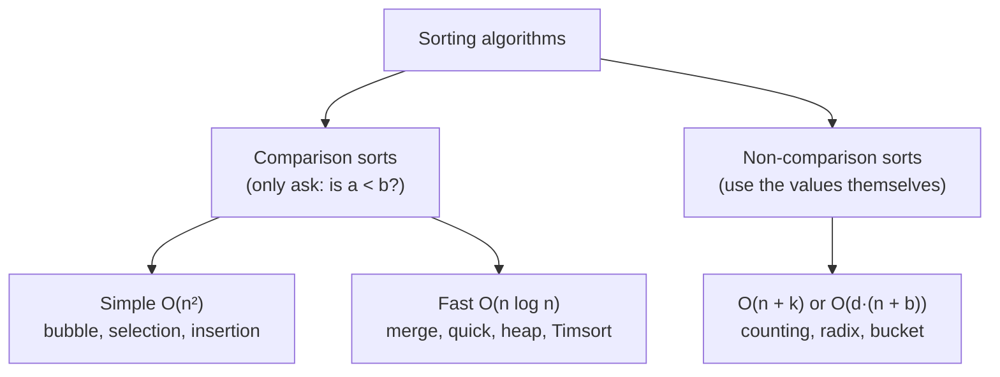
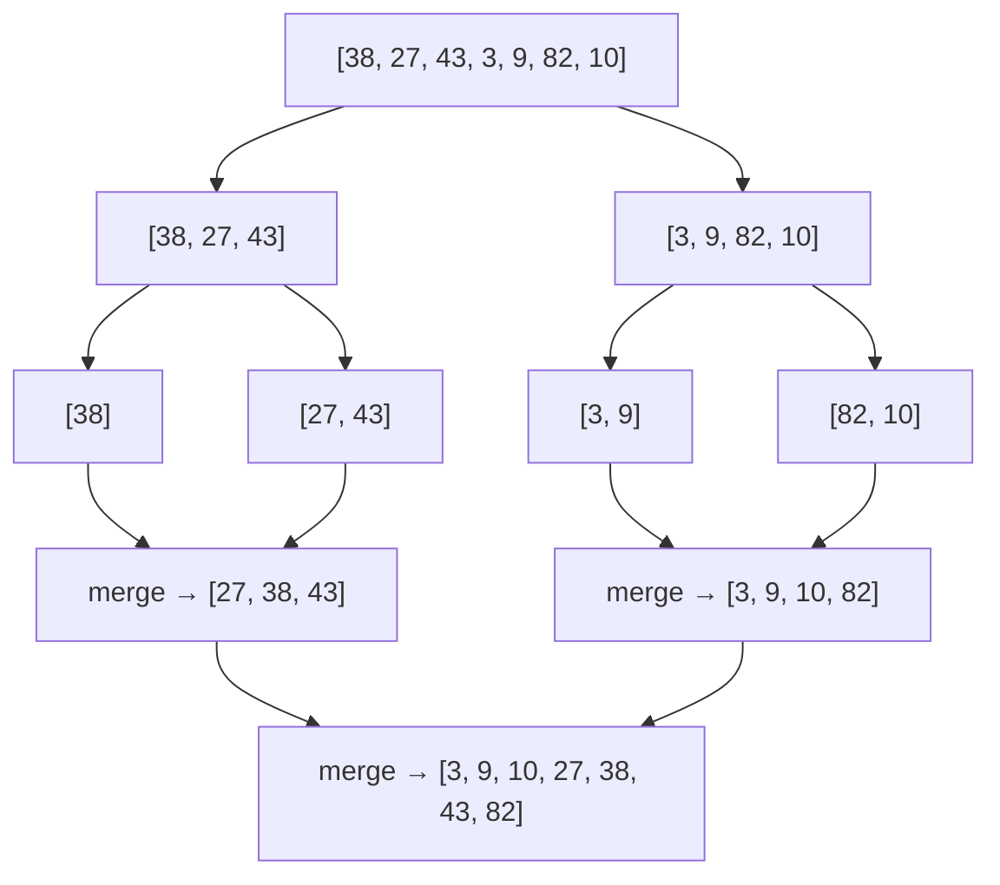

# Chapter 07 · Sorting Algorithms

> Hand a librarian 10,000 books in random order and ask "do we have *Wings of Fire*?" She'll sigh and start walking. Hand her the same books sorted by title and she'll find it in seconds. Sorting is the chore you do once so that every question afterwards becomes easy, and it's the secret first step of a huge number of interview solutions.

**You will learn:**
- Why sorting unlocks so many other techniques (binary search, two pointers, greedy, dedupe)
- The vocabulary: **stable**, **in-place**, **comparison-based**, **adaptive**
- Why no comparison sort can beat **Ω(n log n)**
- Bubble, selection and insertion sort, with full traces (and when insertion sort is actually great)
- **Merge sort** and **quick sort** in depth: divide and conquer, partition schemes, pivots, worst cases
- Heap sort, and the non-comparison sorts: **counting**, **radix**, **bucket**
- How Python's **Timsort** works, and custom ordering with `key` and `functools.cmp_to_key`
- **Quickselect** for the k-th element in O(n) average
- Classic problems: Sort Colors, Kth Largest, Largest Number, Count Inversions, Sort by Frequency, Merge Intervals

**Before this:** [Big-O](01-big-o-complexity.md) · [Arrays & Strings](02-arrays-strings.md) · [Two Pointers](03-two-pointers.md) · [Recursion](../part-1-python/12-recursion.md) · [Functions (lambda, key)](../part-1-python/10-functions.md)

---

## 🧠 The Big Idea

A shuffled deck of cards. How would *you* sort it? Most people do one of these without thinking:

- **Pick the smallest card, put it first, repeat.** That's **selection sort**.
- **Take cards one by one and slide each into its place in your hand.** That's **insertion sort**.
- **Split the deck between two friends, each sorts half, then you merge the two sorted piles by repeatedly taking the smaller top card.** That's **merge sort**.
- **Pick a card (say the 7), throw smaller cards left and bigger cards right, then sort each side the same way.** That's **quick sort**.



The first two do O(n²) work. The last two do O(n log n) by **dividing** the problem. And there's a theoretical speed limit: no algorithm that only compares pairs can beat n log n. To go faster you must stop comparing and use the values directly (counting sort and friends).

> 💡 **The core insight:** sorting is rarely the goal; it's the **setup**. Once data is sorted, equal items are neighbours, the smallest and largest are at the ends, and you can binary search or squeeze with two pointers. When you're stuck, ask: "Would this be easy if the input were sorted?"

---

## 🔨 Building It Up

### 1. Why sorting matters, and the vocabulary

Sorting first turns hard problems into easy ones:

| Problem | Unsorted | After sorting |
|---|---|---|
| Find duplicates | O(n²) or a hash set | neighbours, O(n) scan |
| Pair with sum | O(n²) or a hash map | two pointers ([Chapter 03](03-two-pointers.md)) |
| Search many times | O(n) per search | binary search O(log n) ([Chapter 08](08-binary-search.md)) |
| Merge overlapping intervals | messy | sort by start, one pass ([Chapter 22](22-greedy-intervals.md)) |
| Median / k-th smallest | — | index directly |

Four words describe every sorting algorithm:

- **Stable:** equal elements keep their original relative order. Sort students by marks; a stable sort keeps students with equal marks in their original (say, alphabetical) order. This matters when you sort by one key after another.
- **In-place:** uses O(1) extra memory (or O(log n) for recursion), rearranging the array itself.
- **Comparison-based:** only learns about elements by asking "is a < b?".
- **Adaptive:** runs faster when the input is already nearly sorted.

```python
students = [("Asha", 90), ("Ravi", 85), ("Meera", 90), ("Kabir", 85)]
by_marks = sorted(students, key=lambda s: s[1])      # Python's sort is stable
print(by_marks)
```

```text
[('Ravi', 85), ('Kabir', 85), ('Asha', 90), ('Meera', 90)]
```

What just happened: Ravi was before Kabir in the input, and stays before him among the 85s. Asha stays before Meera. That's stability.

### 2. Bubble sort

Walk through the array, swapping neighbours that are out of order. After one pass, the largest element has "bubbled" to the end. Repeat on the remaining part. Stop early if a pass makes no swaps (the array is sorted).

```python
def bubble_sort(arr):
    a = arr[:]
    n = len(a)
    for end in range(n - 1, 0, -1):          # a[end+1:] is already final
        swapped = False
        for i in range(end):
            if a[i] > a[i + 1]:
                a[i], a[i + 1] = a[i + 1], a[i]
                swapped = True
        print(f"after pass: {a}")
        if not swapped:                       # no swaps: already sorted
            break
    return a

print(bubble_sort([5, 1, 4, 2, 8]))
```

```text
after pass: [1, 4, 2, 5, 8]
after pass: [1, 2, 4, 5, 8]
after pass: [1, 2, 4, 5, 8]
[1, 2, 4, 5, 8]
```

What just happened: pass 1 carried 5 right until it hit 8 (bigger, so 8 continued to the end). Pass 2 fixed the 4/2 pair. Pass 3 found nothing to swap and stopped early.

- Time: O(n²) worst/average, **O(n) best** (already sorted, thanks to the `swapped` flag).
- Space: O(1). **Stable** (only swaps strictly greater neighbours). In-place.
- Reality: almost never used. It's here because interviewers ask "what's bubble sort's best case?"

### 3. Selection sort

For each position i, find the **smallest** element in the unsorted part `a[i:]` and swap it into position i.

```python
def selection_sort(arr):
    a = arr[:]
    n = len(a)
    for i in range(n - 1):
        smallest = i
        for j in range(i + 1, n):
            if a[j] < a[smallest]:
                smallest = j
        a[i], a[smallest] = a[smallest], a[i]   # one swap per position
        print(f"i={i}: {a}")
    return a

print(selection_sort([64, 25, 12, 22, 11]))
```

```text
i=0: [11, 25, 12, 22, 64]
i=1: [11, 12, 25, 22, 64]
i=2: [11, 12, 22, 25, 64]
i=3: [11, 12, 22, 25, 64]
[11, 12, 22, 25, 64]
```

- Time: **always** O(n²) comparisons, even if already sorted (not adaptive).
- Swaps: at most n − 1. That's its one strength: useful when writes are very expensive.
- **Not stable:** the long-distance swap can jump an element over an equal one. Example: `[(2,'a'), (2,'b'), (1,'c')]` → swapping (1,'c') into position 0 moves (2,'a') behind (2,'b').

### 4. Insertion sort

Treat the left part as a sorted hand. Take the next card and shift bigger cards right until you find its spot.

```python
def insertion_sort(arr):
    a = arr[:]
    for i in range(1, len(a)):
        key = a[i]                       # the card we're inserting
        j = i - 1
        while j >= 0 and a[j] > key:     # shift bigger cards one step right
            a[j + 1] = a[j]
            j -= 1
        a[j + 1] = key                   # drop the card into the gap
        print(f"insert {key}: {a}")
    return a

print(insertion_sort([12, 11, 13, 5, 6]))
```

```text
insert 11: [11, 12, 13, 5, 6]
insert 13: [11, 12, 13, 5, 6]
insert 5: [5, 11, 12, 13, 6]
insert 6: [5, 6, 11, 12, 13]
[5, 6, 11, 12, 13]
```

**Trace** of inserting 5 into `[11, 12, 13 | 5, 6]`:

| j | a[j] | a[j] > 5? | action | array |
|---|---|---|---|---|
| 2 | 13 | yes | shift 13 right | [11, 12, 13, 13, 6] |
| 1 | 12 | yes | shift 12 right | [11, 12, 12, 13, 6] |
| 0 | 11 | yes | shift 11 right | [11, 11, 12, 13, 6] |
| −1 | | stop | place 5 at j+1 = 0 | [5, 11, 12, 13, 6] |

- Time: O(n²) worst (reverse sorted), **O(n) best** (already sorted: each `while` stops immediately). More precisely, O(n + number of inversions).
- Space O(1). **Stable** (uses `>`, not `>=`). In-place. **Adaptive.**
- Reality: it's the fastest sort for **small** or **nearly sorted** arrays, which is why Timsort uses it for small runs.

### 5. Merge sort: divide and conquer

**Divide and conquer** = split the problem into smaller copies of itself, solve them recursively, combine the answers.

Merge sort:
1. **Divide:** split the array in half.
2. **Conquer:** sort each half recursively (an array of size ≤ 1 is already sorted).
3. **Combine:** **merge** the two sorted halves, the two-sequence two-pointer walk from [Chapter 03](03-two-pointers.md).



```python
def merge(left, right):
    out = []
    i = j = 0
    while i < len(left) and j < len(right):
        if left[i] <= right[j]:          # <= keeps it stable: ties take from the left
            out.append(left[i]); i += 1
        else:
            out.append(right[j]); j += 1
    out.extend(left[i:])
    out.extend(right[j:])
    return out

def merge_sort(a):
    if len(a) <= 1:
        return a
    mid = len(a) // 2
    return merge(merge_sort(a[:mid]), merge_sort(a[mid:]))

print(merge_sort([38, 27, 43, 3, 9, 82, 10]))
print(merge_sort([]), merge_sort([5, 5, 1]))
```

```text
[3, 9, 10, 27, 38, 43, 82]
[] [1, 5, 5]
```

**The recurrence:** T(n) = 2T(n/2) + O(n). Two half-size sub-problems plus a linear merge. From [Chapter 01](01-big-o-complexity.md): the recursion tree has log n levels, each doing O(n) total merging → **O(n log n)**, in the best, average **and** worst case.

- Space: O(n) for the merge buffers (plus O(log n) recursion depth).
- **Stable** (thanks to `<=`). Not in-place.
- Superpower: guaranteed O(n log n), and it works brilliantly on linked lists ([Chapter 10](10-linked-lists.md)) and on data too big for memory ("external sorting": sort chunks, then merge them).

### 6. Quick sort: partition and recurse

Quick sort flips merge sort around: do the hard work **before** recursing.

1. Pick a **pivot**.
2. **Partition:** rearrange so everything smaller than the pivot is on its left and everything bigger on its right. The pivot is now in its **final** position.
3. Recurse on the left part and the right part. No combine step needed.

**Lomuto partition** (simplest to write): pivot = last element; `i` marks the end of the "smaller than pivot" region; scan with `j`.

```python
def lomuto_partition(a, lo, hi):
    pivot = a[hi]
    i = lo                                  # a[lo:i] holds values < pivot
    for j in range(lo, hi):
        if a[j] < pivot:
            a[i], a[j] = a[j], a[i]
            i += 1
    a[i], a[hi] = a[hi], a[i]               # put the pivot right after the small region
    return i

def quick_sort(a, lo=0, hi=None):
    if hi is None:
        hi = len(a) - 1
    if lo < hi:
        p = lomuto_partition(a, lo, hi)
        quick_sort(a, lo, p - 1)
        quick_sort(a, p + 1, hi)
    return a

data = [10, 80, 30, 90, 40, 50, 70]
print(quick_sort(data))
```

```text
[10, 30, 40, 50, 70, 80, 90]
```

**Partition trace** for `[10, 80, 30, 90, 40, 50, 70]`, pivot 70:

| j | a[j] | a[j] < 70? | action | array | i after |
|---|---|---|---|---|---|
| 0 | 10 | yes | swap a[0], a[0] | [10, 80, 30, 90, 40, 50, 70] | 1 |
| 1 | 80 | no | | | 1 |
| 2 | 30 | yes | swap a[1], a[2] | [10, 30, 80, 90, 40, 50, 70] | 2 |
| 3 | 90 | no | | | 2 |
| 4 | 40 | yes | swap a[2], a[4] | [10, 30, 40, 90, 80, 50, 70] | 3 |
| 5 | 50 | yes | swap a[3], a[5] | [10, 30, 40, 50, 80, 90, 70] | 4 |
| end | | | swap pivot into a[4] | [10, 30, 40, 50, **70**, 90, 80] | |

70 is now at index 4 forever; recurse on `[10, 30, 40, 50]` and `[90, 80]`.

**Hoare partition** (the original, faster in practice): two pointers start at both ends and walk toward each other, swapping a "too big on the left" with a "too small on the right". It does about three times fewer swaps than Lomuto on average and behaves better with many duplicates. Note that with Hoare, the pivot doesn't necessarily end at the returned index, so you recurse on `[lo..p]` and `[p+1..hi]`.

```python
def hoare_partition(a, lo, hi):
    pivot = a[(lo + hi) // 2]               # middle element as pivot
    i, j = lo - 1, hi + 1
    while True:
        i += 1
        while a[i] < pivot:
            i += 1
        j -= 1
        while a[j] > pivot:
            j -= 1
        if i >= j:
            return j
        a[i], a[j] = a[j], a[i]

def quick_sort_hoare(a, lo=0, hi=None):
    if hi is None:
        hi = len(a) - 1
    if lo < hi:
        p = hoare_partition(a, lo, hi)
        quick_sort_hoare(a, lo, p)          # note: p, not p - 1
        quick_sort_hoare(a, p + 1, hi)
    return a

print(quick_sort_hoare([3, 6, 8, 10, 1, 2, 1]))
print(quick_sort_hoare([5, 5, 5, 5]))
```

```text
[1, 1, 2, 3, 6, 8, 10]
[5, 5, 5, 5]
```

**Complexity and the pivot problem.**

- **Good pivot** (splits roughly in half): T(n) = 2T(n/2) + O(n) → **O(n log n)**.
- **Bad pivot** (always the smallest or largest): T(n) = T(n − 1) + O(n) → **O(n²)**. With "last element as pivot", an **already sorted** array is the worst case!
- **Average** over random inputs: O(n log n).
- Space: O(log n) recursion on average, O(n) in the worst case. In-place. **Not stable.**

**Fixing the pivot:**

| Strategy | Idea | Worst case |
|---|---|---|
| First / last element | simple | O(n²) on sorted input |
| Middle element | better on sorted input | O(n²) on crafted inputs |
| Median of three | median of first, middle, last | rare O(n²) |
| **Random pivot** | pick a random index | O(n²) only with astronomically bad luck; **expected O(n log n) for every input** |

```python
import random

def randomized_quick_sort(a, lo=0, hi=None):
    if hi is None:
        hi = len(a) - 1
    if lo < hi:
        r = random.randint(lo, hi)
        a[r], a[hi] = a[hi], a[r]           # move a random pivot to the end, then Lomuto
        pivot, i = a[hi], lo
        for j in range(lo, hi):
            if a[j] < pivot:
                a[i], a[j] = a[j], a[i]
                i += 1
        a[i], a[hi] = a[hi], a[i]
        randomized_quick_sort(a, lo, i - 1)
        randomized_quick_sort(a, i + 1, hi)
    return a

random.seed(7)                              # fixed seed: same run every time
print(randomized_quick_sort(list(range(10, 0, -1))))
```

```text
[1, 2, 3, 4, 5, 6, 7, 8, 9, 10]
```

The randomness moves the bad luck from **the input** (which an adversary controls) to **the coin flips** (which nobody controls).

> 💡 **Many duplicates?** Two-way partitions degrade when most values are equal. **Three-way partitioning** (Dutch National Flag, [Chapter 03](03-two-pointers.md)) splits into `< pivot`, `== pivot`, `> pivot` and skips the whole middle block.

### 7. Heap sort

A **binary heap** ([Chapter 15](15-heaps.md)) is an array arranged so the largest element (in a max-heap) is always at index 0, and removing it takes O(log n). Heap sort:

1. **Heapify** the array in place into a max-heap: O(n).
2. Repeatedly swap the max (index 0) to the end, shrink the heap by one, and **sift down** the new root: n × O(log n).

```python
def sift_down(a, root, size):
    while True:
        largest = root
        left, right = 2 * root + 1, 2 * root + 2       # children in the array layout
        if left < size and a[left] > a[largest]:
            largest = left
        if right < size and a[right] > a[largest]:
            largest = right
        if largest == root:
            return
        a[root], a[largest] = a[largest], a[root]
        root = largest

def heap_sort(a):
    n = len(a)
    for i in range(n // 2 - 1, -1, -1):     # build the max-heap bottom-up
        sift_down(a, i, n)
    for end in range(n - 1, 0, -1):
        a[0], a[end] = a[end], a[0]          # current max goes to its final place
        sift_down(a, 0, end)                 # restore the heap on a[0:end]
    return a

print(heap_sort([12, 11, 13, 5, 6, 7]))
```

```text
[5, 6, 7, 11, 12, 13]
```

- Time: **O(n log n) always**. Space: **O(1)**. In-place. **Not stable.**
- It's the only common sort with guaranteed O(n log n) **and** O(1) space. In practice it's slower than quick sort (it jumps around memory, so caches help less). It's the fallback inside **introsort** (C++'s `std::sort`): quick sort that switches to heap sort if recursion gets too deep.

Don't worry if sift-down feels new; [Chapter 15](15-heaps.md) builds heaps from scratch.

### 8. Counting sort: no comparisons at all

If values are small integers in a range `0..k`, just **count** how many times each value appears, then write them out in order.

```python
def counting_sort_simple(nums, k):
    counts = [0] * (k + 1)
    for x in nums:
        counts[x] += 1
    out = []
    for value, c in enumerate(counts):
        out.extend([value] * c)
    return out

print(counting_sort_simple([4, 2, 2, 8, 3, 3, 1], 8))
```

```text
[1, 2, 2, 3, 3, 4, 8]
```

Time **O(n + k)**, space O(n + k). When k is about n (or smaller), that's **linear**, beating the n log n "limit", because it never compares.

To sort **records** by a small integer key while staying **stable** (needed for radix sort), use **prefix sums** of the counts ([Chapter 06](06-prefix-sums.md)) to find where each key's block starts:

```python
def counting_sort_stable(items, key, k):
    counts = [0] * (k + 1)
    for item in items:
        counts[key(item)] += 1
    starts = [0] * (k + 1)                 # starts[v] = first output slot for key v
    for v in range(1, k + 1):
        starts[v] = starts[v - 1] + counts[v - 1]
    out = [None] * len(items)
    for item in items:                     # left to right keeps equal keys in order
        out[starts[key(item)]] = item
        starts[key(item)] += 1
    return out

people = [("Asha", 3), ("Ravi", 1), ("Meera", 3), ("Kabir", 2), ("Zoya", 1)]
print(counting_sort_stable(people, key=lambda p: p[1], k=3))
```

```text
[('Ravi', 1), ('Zoya', 1), ('Kabir', 2), ('Asha', 3), ('Meera', 3)]
```

When **not** to use it: when k is huge (sorting 10 numbers between 0 and 10⁹ would allocate a billion counters).

### 9. Radix sort

Sort numbers **digit by digit**, from the least significant digit (LSD) to the most significant, using a **stable** counting sort on each digit. Because each pass is stable, the order from earlier (less significant) digits is preserved among ties of later digits.

```python
def radix_sort(nums):
    if not nums:
        return nums
    exp = 1
    biggest = max(nums)
    while biggest // exp > 0:
        buckets = [[] for _ in range(10)]          # stable: append keeps order
        for x in nums:
            buckets[(x // exp) % 10].append(x)
        nums = [x for bucket in buckets for x in bucket]
        print(f"by digit {exp:>3}: {nums}")
        exp *= 10
    return nums

print(radix_sort([170, 45, 75, 90, 802, 24, 2, 66]))
```

```text
by digit   1: [170, 90, 802, 2, 24, 45, 75, 66]
by digit  10: [802, 2, 24, 45, 66, 170, 75, 90]
by digit 100: [2, 24, 45, 66, 75, 90, 170, 802]
[2, 24, 45, 66, 75, 90, 170, 802]
```

Time **O(d · (n + b))** for d digits in base b (here b = 10). For fixed-width integers (like 32-bit), d is a constant, so it's O(n). Works for non-negative integers and fixed-length strings; negatives need an offset or a separate pass.

### 10. Bucket sort

If values are spread roughly **uniformly** over a range, scatter them into n buckets by value, sort each (tiny) bucket, and concatenate.

```python
def bucket_sort(values):
    n = len(values)
    buckets = [[] for _ in range(n)]
    for v in values:                      # values assumed in [0, 1)
        buckets[int(v * n)].append(v)
    for b in buckets:
        b.sort()                          # each bucket is tiny on average
    return [v for b in buckets for v in b]

print(bucket_sort([0.78, 0.17, 0.39, 0.26, 0.72, 0.94, 0.21, 0.12, 0.23, 0.68]))
```

```text
[0.12, 0.17, 0.21, 0.23, 0.26, 0.39, 0.68, 0.72, 0.78, 0.94]
```

Average **O(n)** for uniform data; worst O(n²) (or O(n log n) with a good inner sort) if everything lands in one bucket. You already used the idea in **Top K Frequent Elements** ([Chapter 05](05-hashing.md)), where frequency was the bucket index.

### 11. Python's sort: Timsort

`list.sort()` and `sorted()` use **Timsort**, invented by Tim Peters for Python in 2002. (Recent CPython versions refine the rule for choosing which runs to merge, borrowing from an algorithm called Powersort, but it's still Timsort at heart.) The idea:

1. Scan for **runs**: stretches that are already ascending (or strictly descending, which it reverses).
2. Extend short runs to a minimum length (typically 32–64) with **insertion sort** (fast on small arrays).
3. **Merge** runs pairwise, merge-sort style, with clever rules to keep merges balanced, plus **galloping** (when one run keeps "winning", jump ahead with exponential search instead of comparing one at a time).

Properties:

| Property | Timsort |
|---|---|
| Worst case | O(n log n) |
| Best case | **O(n)** (already sorted or reverse sorted: one run) |
| Space | O(n) worst |
| Stable | **Yes** (guaranteed by the language) |
| Adaptive | Very: real-world data is often partly sorted |

```python
nums = [5, 2, 9, 1]
print(sorted(nums), nums)          # sorted(): new list, original untouched
nums.sort(reverse=True)            # .sort(): in place, returns None
print(nums)

words = ["banana", "Apple", "cherry", "apple"]
print(sorted(words))                           # uppercase letters sort before lowercase
print(sorted(words, key=str.lower))            # case-insensitive (stable for ties)
print(sorted(words, key=lambda w: (len(w), w)))  # by length, then alphabetically
```

```text
[1, 2, 5, 9] [5, 2, 9, 1]
[9, 5, 2, 1]
['Apple', 'apple', 'banana', 'cherry']
['Apple', 'apple', 'banana', 'cherry']
['Apple', 'apple', 'banana', 'cherry']
```

(All three lines happen to agree for this list. Try adding `"Banana"` and see them differ.)

### 12. Custom ordering: `key` and `cmp_to_key`

A **key function** maps each element to a value Python already knows how to compare. It's called **once per element**, so it's fast. Tuples compare element by element, which makes multi-level sorting easy. Negate numbers to reverse one level only.

```python
people = [("Asha", 25, 90), ("Ravi", 22, 85), ("Meera", 25, 95), ("Kabir", 22, 85)]

# age ascending, then marks DESCENDING, then name ascending
print(sorted(people, key=lambda p: (p[1], -p[2], p[0])))
```

```text
[('Kabir', 22, 85), ('Ravi', 22, 85), ('Meera', 25, 95), ('Asha', 25, 90)]
```

Check it by writing out the key tuples: Kabir `(22, -85, "Kabir")`, Ravi `(22, -85, "Ravi")`, Meera `(25, -95, "Meera")`, Asha `(25, -90, "Asha")`. Among the 25-year-olds, −95 < −90, so Meera (higher marks) comes first. Writing the keys out like this is the fastest way to catch your own mistakes when you predict a sort order in an interview.

Sometimes the order **can't** be expressed as a key, because it depends on comparing two elements *together*. The classic: **Largest Number**. Arrange `[3, 30, 34, 5, 9]` to form the largest number → `"9534330"`. Should "3" go before "30"? Compare the two concatenations: "330" vs "303". "330" is bigger, so "3" goes first.

`functools.cmp_to_key` turns a **comparator** (returns negative if a should come first, positive if b should, 0 if tie) into a key:

```python
from functools import cmp_to_key

def largest_number(nums):
    strs = [str(x) for x in nums]

    def compare(a, b):
        if a + b > b + a:
            return -1          # a first
        if a + b < b + a:
            return 1           # b first
        return 0

    strs.sort(key=cmp_to_key(compare))
    result = "".join(strs)
    return "0" if result[0] == "0" else result    # [0, 0] -> "0", not "00"

print(largest_number([10, 2]), largest_number([3, 30, 34, 5, 9]), largest_number([0, 0]))
```

```text
210 9534330 0
```

(Why is this comparator a valid ordering? Comparing `a+b` with `b+a` is equivalent to comparing the infinite repetitions `aaaa...` and `bbbb...`, which is transitive. That's the proof sketch interviewers sometimes want.)

### 13. Quickselect: the k-th element without fully sorting

**Problem:** find the k-th smallest element. Sorting costs O(n log n). But after one quick sort **partition**, the pivot is at its final index p. If p == k, done. If k < p, the answer is on the left; otherwise on the right. **Recurse into one side only.**

```python
import random

def quickselect(nums, k):
    """Return the k-th smallest (0-based) element. Modifies a copy."""
    a = nums[:]
    lo, hi = 0, len(a) - 1
    while True:
        r = random.randint(lo, hi)
        a[r], a[hi] = a[hi], a[r]
        pivot, i = a[hi], lo
        for j in range(lo, hi):                 # Lomuto partition
            if a[j] < pivot:
                a[i], a[j] = a[j], a[i]
                i += 1
        a[i], a[hi] = a[hi], a[i]
        if i == k:
            return a[i]
        if k < i:
            hi = i - 1                          # answer is on the left
        else:
            lo = i + 1                          # answer is on the right

random.seed(1)
nums = [3, 2, 1, 5, 6, 4]
print([quickselect(nums, k) for k in range(len(nums))])
print("2nd largest:", quickselect(nums, len(nums) - 2))
```

```text
[1, 2, 3, 4, 5, 6]
2nd largest: 5
```

**Why O(n) on average?** With a random pivot, each step throws away (on average) a constant fraction of the array: n + n/2 + n/4 + ... < 2n. Worst case is O(n²) (always the worst pivot), which random pivots make very unlikely. Compare: a heap of size k gives O(n log k) worst case ([Chapter 15](15-heaps.md)).

### 14. Comparison table

| Algorithm | Best | Average | Worst | Extra space | Stable | In-place | Notes |
|---|---|---|---|---|---|---|---|
| Bubble | O(n) | O(n²) | O(n²) | O(1) | ✅ | ✅ | teaching only |
| Selection | O(n²) | O(n²) | O(n²) | O(1) | ❌ | ✅ | fewest swaps |
| Insertion | O(n) | O(n²) | O(n²) | O(1) | ✅ | ✅ | small / nearly sorted |
| Merge | O(n log n) | O(n log n) | O(n log n) | O(n) | ✅ | ❌ | linked lists, external sort |
| Quick | O(n log n) | O(n log n) | O(n²) | O(log n) | ❌ | ✅ | fastest in practice |
| Heap | O(n log n) | O(n log n) | O(n log n) | O(1) | ❌ | ✅ | guaranteed + O(1) space |
| Counting | O(n + k) | O(n + k) | O(n + k) | O(n + k) | ✅* | ❌ | small integer range |
| Radix | O(d(n + b)) | O(d(n + b)) | O(d(n + b)) | O(n + b) | ✅ | ❌ | fixed-width keys |
| Bucket | O(n) | O(n) | O(n²) | O(n) | ✅* | ❌ | uniform data |
| Timsort | O(n) | O(n log n) | O(n log n) | O(n) | ✅ | ❌ | Python, Java objects |

\* when implemented as shown (stable counting pass, stable bucket sort).

---

## 🔬 Under the Hood

### Why comparison sorting can't beat Ω(n log n)

Picture any comparison sort as a **decision tree**: each internal node is a question "is a[i] < a[j]?", with a yes branch and a no branch. Each leaf is a final answer: one specific ordering of the input.

- There are **n!** possible orderings of n distinct elements, and the algorithm must be able to output each one, so the tree needs at least n! leaves.
- A binary tree of height h has at most 2ʰ leaves. So 2ʰ ≥ n!, i.e. **h ≥ log₂(n!)**.
- log₂(n!) = log₂ 1 + log₂ 2 + ... + log₂ n. The top half of those terms are each at least log₂(n/2), and there are n/2 of them, so log₂(n!) ≥ (n/2) · log₂(n/2), which is Θ(n log n).

The height is the worst-case number of comparisons. So **every** comparison sort needs Ω(n log n) comparisons in the worst case. Merge sort and heap sort hit this bound, so they're **optimal** among comparison sorts. Counting/radix sort escape the bound because they don't compare: they use values as array indexes.

```python
import math

for n in (10, 100, 1000):
    print(n, round(math.log2(math.factorial(n))), round(n * math.log2(n)))
```

```text
10 22 33
100 525 664
1000 8529 9966
```

log₂(n!) tracks n log₂ n closely (it's about n log₂ n − 1.44n).

### Why merge sort is O(n log n) in every case

The split is always exactly in half, regardless of the data, so there are always ⌈log₂ n⌉ levels. Each level merges a total of n elements. No input can make it worse. The cost: an O(n) buffer for merging.

### Why quick sort is usually faster than merge sort anyway

Both are O(n log n) on average, but quick sort:
- partitions **in place**, scanning memory sequentially (cache-friendly),
- has a very tight inner loop (one comparison, an occasional swap),
- needs no merge buffer.

Merge sort does more data movement (copying into buffers). In C, that makes quick sort faster by a constant factor. That's why C's `qsort` and C++'s `std::sort` are quick-sort based (with safeguards), while languages that need **stability** (Python, Java for objects) use merge-based Timsort.

### Why Python's sort is stable, and why that's useful

The Python language **guarantees** `sort()` is stable. This allows multi-pass sorting: sort by the secondary key first, then by the primary key, and ties in the primary key stay ordered by the secondary.

```python
records = [("Ravi", "B"), ("Asha", "A"), ("Kabir", "B"), ("Meera", "A")]
records.sort(key=lambda r: r[0])     # secondary: name
records.sort(key=lambda r: r[1])     # primary: grade (stable keeps names ordered)
print(records)
```

```text
[('Asha', 'A'), ('Meera', 'A'), ('Kabir', 'B'), ('Ravi', 'B')]
```

### Key functions vs comparators, performance-wise

With `key=`, Python calls your function n times, stores the keys, and then compares keys in fast C code. With `cmp_to_key`, every one of the ~n log n comparisons calls your Python comparator. So prefer `key` whenever the order can be expressed as a value; use `cmp_to_key` only for genuinely pairwise orders like Largest Number.

---

## 🧩 Pattern Decoder

### Signals: when sorting (or a sorting idea) is the answer

| You see in the problem... | Think |
|---|---|
| "pairs / triplets with sum", "closest", order doesn't matter | **sort + two pointers** |
| "intervals", "meetings", "overlapping", "merge ranges" | **sort by start**, sweep |
| "minimum number of...", "maximise by choosing greedily" | **sort, then greedy** ([Chapter 22](22-greedy-intervals.md)) |
| "group equal items", "remove duplicates" without extra space | sort, then neighbours |
| "k-th largest / smallest", "top k", "median" | **quickselect** (avg O(n)) or heap |
| "arrange to form the largest / smallest" | **custom comparator** (`cmp_to_key`) |
| "sort by frequency / by multiple keys" | `key=` with a **tuple** |
| "values in small range" (0..k, letters, ages) | **counting sort** O(n + k) |
| "only 0s, 1s and 2s" | **Dutch National Flag** (3-way partition) |
| "count pairs i < j with a[i] > a[j]" (inversions) | **merge sort with counting** |
| "sort a linked list" | **merge sort** ([Chapter 10](10-linked-lists.md)) |
| "nearly sorted, each element at most k away" | insertion sort O(nk) or heap of size k |
| "O(n) required" + integers | counting / radix / bucket |

### Template A: Merge sort with a "do something during merge" hook

```py
def merge_sort_count(a):
    if len(a) <= 1:
        return a, 0
    mid = len(a) // 2
    left, cl = merge_sort_count(a[:mid])
    right, cr = merge_sort_count(a[mid:])
    merged, count = [], cl + cr
    i = j = 0
    while i < len(left) and j < len(right):
        if left[i] <= right[j]:
            merged.append(left[i]); i += 1
        else:
            count += len(left) - i     # HOOK: right[j] beats every remaining left item
            merged.append(right[j]); j += 1
    merged += left[i:] + right[j:]
    return merged, count
```

### Template B: Partition (the engine of quick sort and quickselect)

```py
def partition(a, lo, hi):
    pivot = a[hi]                     # (randomise first: swap a random index into hi)
    i = lo
    for j in range(lo, hi):
        if a[j] < pivot:              # the only line that changes per problem
            a[i], a[j] = a[j], a[i]
            i += 1
    a[i], a[hi] = a[hi], a[i]
    return i                          # pivot's final index
```

### Template C: Custom order

```py
from functools import cmp_to_key

items.sort(key=lambda x: (primary(x), -secondary_desc(x), tertiary(x)))   # value-based
items.sort(key=cmp_to_key(lambda a, b: -1 if a_first(a, b) else 1))      # pairwise
```

### Variation 1: Count Inversions (merge sort hook)

**Problem:** count pairs `i < j` with `a[i] > a[j]`. It measures "how unsorted" an array is. `[8, 4, 2, 1]` → 6.

**Idea:** during the merge, when `right[j]` is taken before `left[i]`, it's smaller than **all** remaining left elements (the left half is sorted), so it forms `len(left) − i` inversions at once. That's the counting hook.

```python
def count_inversions(a):
    if len(a) <= 1:
        return a, 0
    mid = len(a) // 2
    left, cl = count_inversions(a[:mid])
    right, cr = count_inversions(a[mid:])
    merged, count = [], cl + cr
    i = j = 0
    while i < len(left) and j < len(right):
        if left[i] <= right[j]:
            merged.append(left[i]); i += 1
        else:
            count += len(left) - i
            merged.append(right[j]); j += 1
    merged += left[i:] + right[j:]
    return merged, count

print(count_inversions([8, 4, 2, 1])[1], count_inversions([2, 4, 1, 3, 5])[1], count_inversions([1, 2, 3])[1])
```

```text
6 3 0
```

**Dry run** of the final merge for `[2, 4, 1, 3, 5]`: halves sort to `left = [2, 4]` (0 inversions inside) and `right = [1, 3, 5]` (0 inside).

| i (left[i]) | j (right[j]) | compare | take | inversions added | total |
|---|---|---|---|---|---|
| 0 (2) | 0 (1) | 2 > 1 | 1 | len(left) − 0 = 2 → (2,1), (4,1) | 2 |
| 0 (2) | 1 (3) | 2 ≤ 3 | 2 | 0 | 2 |
| 1 (4) | 1 (3) | 4 > 3 | 3 | len(left) − 1 = 1 → (4,3) | 3 |
| 1 (4) | 2 (5) | 4 ≤ 5 | 4 | 0 | 3 |
| — | 2 (5) | left done | 5 | 0 | 3 |

O(n log n) instead of O(n²). The same hook solves **Count of Smaller Numbers After Self** and **Reverse Pairs**.

### Variation 2: Sort Colors (3-way partition)

**Problem:** sort an array of 0s, 1s and 2s in one pass, in place.

```python
def sort_colors(nums):
    low, mid, high = 0, 0, len(nums) - 1
    while mid <= high:
        if nums[mid] == 0:
            nums[low], nums[mid] = nums[mid], nums[low]
            low += 1; mid += 1
        elif nums[mid] == 1:
            mid += 1
        else:
            nums[mid], nums[high] = nums[high], nums[mid]
            high -= 1              # don't advance mid: the swapped-in value is unchecked
    return nums

print(sort_colors([2, 0, 2, 1, 1, 0]), sort_colors([2, 0, 1]))
```

```text
[0, 0, 1, 1, 2, 2] [0, 1, 2]
```

O(n), O(1). This is quick sort's partition with pivot 1 and three regions (see [Chapter 03](03-two-pointers.md)). A counting sort (count 0s, 1s, 2s, then overwrite) is also O(n) but takes two passes.

### Variation 3: Merge Intervals (sort, then sweep) — a preview

**Problem:** merge all overlapping intervals. `[[1,3],[2,6],[8,10],[15,18]]` → `[[1,6],[8,10],[15,18]]`.

**Idea:** after sorting by start, overlapping intervals are **adjacent**. Walk once: if the current interval starts before the last merged one ends, extend it; otherwise start a new one.

```python
def merge_intervals(intervals):
    intervals.sort(key=lambda iv: iv[0])
    merged = []
    for start, end in intervals:
        if merged and start <= merged[-1][1]:
            merged[-1][1] = max(merged[-1][1], end)    # overlap: extend
        else:
            merged.append([start, end])                # gap: new interval
    return merged

print(merge_intervals([[1, 3], [2, 6], [8, 10], [15, 18]]))
print(merge_intervals([[1, 4], [4, 5]]), merge_intervals([[1, 4], [2, 3]]))
```

```text
[[1, 6], [8, 10], [15, 18]]
[[1, 5]] [[1, 4]]
```

O(n log n) for the sort, O(n) for the sweep. The whole intervals family is in [Chapter 22](22-greedy-intervals.md).

### When NOT to sort

- **You need original indexes** and the answer is about positions (e.g. Two Sum) → hashing, or sort `(value, index)` pairs.
- **The order of the input matters** (subarrays, sliding windows, "contiguous") → sorting destroys the structure.
- **You only need the k-th element or top k** → quickselect O(n) or a heap O(n log k), not a full O(n log n) sort.
- **O(n) is required** and values aren't small integers → hashing.
- **Data streams in** and you need the current order repeatedly → a heap or balanced BST, not re-sorting.

---

## ⚠️ Traps & Common Mistakes

1. **`x = x.sort()`** sets x to `None`. `.sort()` sorts in place and returns `None`; `sorted(x)` returns a new list.

```py
# ❌
nums = nums.sort()      # nums is now None

# ✅
nums.sort()             # or: nums = sorted(nums)
```

2. **Quick sort with first/last pivot on sorted input** → O(n²) and, in Python, `RecursionError` for large n. Randomise the pivot.

3. **Losing stability by accident.** Using `<` instead of `<=` in merge (taking from the right on ties) makes merge sort unstable. Using `>=` instead of `>` in insertion sort does too.

4. **Hoare partition recursion bounds.** Recurse on `[lo, p]` and `[p+1, hi]`, not `[lo, p−1]`; the pivot isn't necessarily at p.

5. **Largest Number: forgetting the all-zeros case.** `[0, 0]` must return `"0"`, not `"00"`.

6. **Sorting numbers as strings.** `sorted(["10", "9", "2"])` gives `['10', '2', '9']` (lexicographic). Use `key=int`.

7. **Counting sort on a huge range.** `[0, 10**9]` needs a billion counters. Check the range first.

8. **Assuming O(n log n) is always needed.** If the problem says values are 0..100, counting sort is O(n).

9. **Sorting inside a loop.** `for ...: arr.sort()` is O(n · n log n). Sort once, or use a heap.

10. **Comparators returning booleans.** `cmp_to_key` needs negative/zero/positive integers. `lambda a, b: a + b > b + a` returns True/False (1/0) and silently breaks the order.

---

## 💡 Tips & Tricks

- In interviews, just use `sorted()` / `.sort()` unless asked to implement a sort. Say "Timsort, O(n log n), stable".
- Multi-key sort: `key=lambda x: (a(x), -b(x))`. For descending **strings** (can't negate), sort twice using stability, or use `reverse=True` on a single key.
- `heapq.nsmallest(k, a)` / `nlargest(k, a)` are O(n log k): better than sorting when k is small.
- `sorted(d.items(), key=lambda kv: kv[1], reverse=True)` sorts a dict by value.
- `bisect.insort(a, x)` keeps a list sorted on insert (O(n) per insert because of shifting; fine for small lists).
- Want indexes in sorted order? `sorted(range(n), key=nums.__getitem__)` (an **argsort**).
- When you see O(n²) brute force over pairs, try sorting first; it often unlocks two pointers or greedy.
- If you implement quick sort in an interview, mention the pivot choice and the O(n²) worst case before the interviewer does.

---

## 🎯 Interview Questions

### 1. Kth Largest Element in an Array 🔥🔥🔥

<details><summary>Answer</summary>

Three answers, in order: sort (O(n log n)); min-heap of size k (O(n log k), [Chapter 15](15-heaps.md)); **quickselect** (O(n) average, O(n²) worst). k-th largest = (n − k)-th smallest, 0-based.

```python
import heapq
import random

def find_kth_largest(nums, k):
    target = len(nums) - k             # index in sorted order
    a = nums[:]
    lo, hi = 0, len(a) - 1
    while True:
        r = random.randint(lo, hi)
        a[r], a[hi] = a[hi], a[r]
        pivot, i = a[hi], lo
        for j in range(lo, hi):
            if a[j] < pivot:
                a[i], a[j] = a[j], a[i]
                i += 1
        a[i], a[hi] = a[hi], a[i]
        if i == target:
            return a[i]
        if i < target:
            lo = i + 1
        else:
            hi = i - 1

random.seed(0)
print(find_kth_largest([3, 2, 1, 5, 6, 4], 2), find_kth_largest([3, 2, 3, 1, 2, 4, 5, 5, 6], 4))
print(heapq.nlargest(2, [3, 2, 1, 5, 6, 4])[-1])     # the heap one-liner
```

```text
5 4
5
```

</details>

### 2. Sort Colors 🔥🔥🔥

<details><summary>Answer</summary>

Dutch National Flag: three pointers `low`, `mid`, `high` (Variation 2). One pass, O(n) time, O(1) space. Mention counting sort as the two-pass alternative and why you don't advance `mid` after swapping with `high`.

</details>

### 3. Merge Intervals 🔥🔥🔥

<details><summary>Answer</summary>

Sort by start; extend the last merged interval while the next one overlaps (`start <= last_end`), else append (Variation 3). O(n log n) time, O(n) for the output.

</details>

### 4. Largest Number 🔥🔥

<details><summary>Answer</summary>

Convert to strings; sort with the comparator "a before b if a + b > b + a" via `cmp_to_key`; join; handle the all-zeros case (section 12). Time O(n log n · L) where L is the digit length (string comparisons). Be ready to justify transitivity.

</details>

### 5. Count Inversions / Reverse Pairs 🔥🔥

<details><summary>Answer</summary>

Merge sort with a counting hook: when taking from the right half, add `len(left) − i` (Variation 1). O(n log n). **Reverse Pairs** (count `i < j` with `nums[i] > 2 * nums[j]`) uses the same skeleton but counts with a separate two-pointer pass **before** merging, because the condition differs from the merge order:

```python
def reverse_pairs(nums):
    def sort_count(a):
        if len(a) <= 1:
            return a, 0
        mid = len(a) // 2
        left, cl = sort_count(a[:mid])
        right, cr = sort_count(a[mid:])
        count = cl + cr
        j = 0
        for x in left:                       # both halves sorted: j only moves forward
            while j < len(right) and x > 2 * right[j]:
                j += 1
            count += j
        return sorted(left + right), count   # merge (Timsort merges two runs in O(n))
    return sort_count(nums)[1]

print(reverse_pairs([1, 3, 2, 3, 1]), reverse_pairs([2, 4, 3, 5, 1]))
```

```text
2 3
```

</details>

### 6. Sort Characters By Frequency / Sort Array by Increasing Frequency 🔥🔥

Sort numbers by increasing frequency; ties by **decreasing** value. `[1,1,2,2,2,3]` → `[3,1,1,2,2,2]`.

<details><summary>Answer</summary>

A tuple key: `(frequency, −value)`.

```python
from collections import Counter

def frequency_sort(nums):
    freq = Counter(nums)
    return sorted(nums, key=lambda x: (freq[x], -x))

print(frequency_sort([1, 1, 2, 2, 2, 3]), frequency_sort([2, 3, 1, 3, 2]))
```

```text
[3, 1, 1, 2, 2, 2] [1, 3, 3, 2, 2]
```

O(n log n). The character version (most frequent first) can use bucket sort for O(n) ([Chapter 05](05-hashing.md)).

</details>

### 7. Implement merge sort / quick sort and compare them 🔥🔥🔥

<details><summary>Answer</summary>

Code in sections 5 and 6. The comparison interviewers want: merge sort is O(n log n) in every case, stable, O(n) extra space, great for linked lists and external data. Quick sort is O(n log n) average but O(n²) worst (mitigated by random pivots), in place with O(log n) stack, not stable, and usually faster in practice due to cache-friendly partitioning.

</details>

### 8. What makes a sort stable, and when do you need it? 🔥🔥

<details><summary>Answer</summary>

Stable = equal keys keep their input order. Needed when sorting by multiple keys in passes (sort by secondary, then by primary), when the input order carries meaning (earlier transactions first), and inside radix sort (each digit pass must preserve the previous passes' order). Stable: insertion, merge, counting (as implemented), Timsort. Unstable: selection, quick, heap.

</details>

### 9. Why can't we sort faster than O(n log n)? And how does counting sort do it? 🔥🔥

<details><summary>Answer</summary>

Decision-tree argument: n! possible orderings need a tree with n! leaves; a binary tree of height h has ≤ 2ʰ leaves; so h ≥ log₂(n!) = Θ(n log n) comparisons in the worst case (Under the Hood). Counting sort doesn't compare: it uses each value as an array index, so the bound doesn't apply. Its cost is O(n + k), good only when the value range k is small.

</details>

### 10. Sort an Array (without built-ins, O(n log n)) 🔥🔥

<details><summary>Answer</summary>

Use merge sort (safe O(n log n)) or heap sort (O(1) space). Avoid plain quick sort with a fixed pivot: the judge typically includes sorted or all-equal inputs that trigger O(n²). If you choose quick sort, use a random pivot **and** three-way partitioning for duplicates.

</details>

### 11. Meeting Rooms (can one person attend all meetings?) 🔥🔥

<details><summary>Answer</summary>

Sort by start time; any meeting starting before the previous one ends is a conflict.

```python
def can_attend_meetings(intervals):
    intervals.sort()
    return all(intervals[i][0] >= intervals[i - 1][1] for i in range(1, len(intervals)))

print(can_attend_meetings([[0, 30], [5, 10], [15, 20]]), can_attend_meetings([[7, 10], [2, 4]]))
```

```text
False True
```

O(n log n). Follow-up "how many rooms?" (Meeting Rooms II) → sweep line or a heap ([Chapter 22](22-greedy-intervals.md)).

</details>

### 12. H-Index 🔥

**H-Index:** a researcher has index h if h papers have at least h citations each. `[3, 0, 6, 1, 5]` → 3.

<details><summary>Answer</summary>

Sort descending; h is the largest i + 1 with `citations[i] >= i + 1`. Or O(n) with counting sort, since h ≤ n.

```python
def h_index(citations):
    n = len(citations)
    buckets = [0] * (n + 1)
    for c in citations:
        buckets[min(c, n)] += 1           # citations above n count as n
    papers = 0
    for h in range(n, -1, -1):
        papers += buckets[h]              # papers with at least h citations
        if papers >= h:
            return h
    return 0

print(h_index([3, 0, 6, 1, 5]), h_index([1, 3, 1]), h_index([0, 0]))
```

```text
3 1 0
```

O(n) time and space: a counting sort with a capped range.

</details>

---

## 🏋️ Practice

**🟢 1. Squares of a Sorted Array** — you saw two pointers in Chapter 03. Now just square and sort. What's the complexity difference?

<details><summary>Solution</summary>

```python
def sorted_squares(nums):
    return sorted(x * x for x in nums)

print(sorted_squares([-4, -1, 0, 3, 10]))
```

```text
[0, 1, 9, 16, 100]
```

O(n log n) here vs O(n) with two pointers. (Timsort is quick on this input in practice because the squares form a descending run then an ascending run, but the guarantee is still O(n log n).)

</details>

**🟢 2. Relative Sort Array:** sort `arr1` so elements appear in the order given by `arr2`; leftovers go at the end in ascending order.

<details><summary>Solution</summary>

```python
def relative_sort_array(arr1, arr2):
    rank = {v: i for i, v in enumerate(arr2)}
    return sorted(arr1, key=lambda x: (rank.get(x, len(arr2)), x))

print(relative_sort_array([2, 3, 1, 3, 2, 4, 6, 7, 9, 2, 19], [2, 1, 4, 3, 9, 6]))
```

```text
[2, 2, 2, 1, 4, 3, 3, 9, 6, 7, 19]
```

</details>

**🟢 3. Implement insertion sort in descending order** and print each step for `[3, 1, 2]`.

<details><summary>Solution</summary>

Flip the comparison.

```python
def insertion_sort_desc(a):
    for i in range(1, len(a)):
        key, j = a[i], i - 1
        while j >= 0 and a[j] < key:
            a[j + 1] = a[j]
            j -= 1
        a[j + 1] = key
        print(a)
    return a

insertion_sort_desc([3, 1, 2])
```

```text
[3, 1, 2]
[3, 2, 1]
```

</details>

**🟡 4. Sort a list of version strings** like `"1.10.0"`, `"1.2"`, `"1.2.0.1"` correctly (numerically, part by part, where missing parts count as 0).

<details><summary>Solution</summary>

A key of integer tuples, with trailing zeros stripped so `"1.2"` and `"1.2.0"` compare equal.

```python
def version_key(v):
    parts = [int(p) for p in v.split(".")]
    while parts and parts[-1] == 0:
        parts.pop()
    return tuple(parts)

versions = ["1.10.0", "1.2", "1.2.0.1", "1.9", "1.2.0"]
print(sorted(versions, key=version_key))
```

```text
['1.2', '1.2.0', '1.2.0.1', '1.9', '1.10.0']
```

(`"1.2"` and `"1.2.0"` have equal keys; stability keeps their input order.)

</details>

**🟡 5. Maximum Gap:** the largest difference between consecutive elements in sorted order, in O(n) time (non-negative integers).

<details><summary>Solution</summary>

Radix sort (O(n) for bounded integers), then scan neighbours. (The famous pigeonhole-bucket solution also works.)

```python
def maximum_gap(nums):
    if len(nums) < 2:
        return 0
    exp, biggest = 1, max(nums)
    while biggest // exp > 0:
        buckets = [[] for _ in range(10)]
        for x in nums:
            buckets[(x // exp) % 10].append(x)
        nums = [x for b in buckets for x in b]
        exp *= 10
    return max(b - a for a, b in zip(nums, nums[1:]))

print(maximum_gap([3, 6, 9, 1]), maximum_gap([10]), maximum_gap([1, 10000000]))
```

```text
3 0 9999999
```

</details>

**🟡 6. K Closest Points to Origin** (return any order; we sort the answer for printing).

<details><summary>Solution</summary>

Quickselect on squared distance: average O(n). Here's the simple O(n log n) version plus the key idea.

```python
def k_closest(points, k):
    return sorted(points, key=lambda p: p[0] ** 2 + p[1] ** 2)[:k]

print(k_closest([[1, 3], [-2, 2]], 1), k_closest([[3, 3], [5, -1], [-2, 4]], 2))
```

```text
[[-2, 2]] [[3, 3], [-2, 4]]
```

No square root needed: comparing squared distances gives the same order. For O(n) average, partition by distance with quickselect until the pivot lands at index k.

</details>

**🔴 7. Count of Smaller Numbers After Self.** For each `nums[i]`, count elements to its right that are smaller.

<details><summary>Solution</summary>

Merge sort on **indexes**. When an element from the left half is placed, every right-half element already placed before it is smaller and was originally to its right.

```python
def count_smaller(nums):
    counts = [0] * len(nums)

    def sort(idx):
        if len(idx) <= 1:
            return idx
        mid = len(idx) // 2
        left, right = sort(idx[:mid]), sort(idx[mid:])
        merged, j = [], 0
        for i in left:
            while j < len(right) and nums[right[j]] < nums[i]:
                merged.append(right[j])
                j += 1
            counts[i] += j                  # right elements smaller than nums[i]
            merged.append(i)
        merged.extend(right[j:])
        return merged

    sort(list(range(len(nums))))
    return counts

print(count_smaller([5, 2, 6, 1]), count_smaller([-1, -1]))
```

```text
[2, 1, 1, 0] [0, 0]
```

O(n log n). (A Fenwick tree also works: [Chapter 24](24-advanced-structures.md).)

</details>

**🔴 8. Sort a nearly sorted array:** each element is at most k positions from its sorted position. Do it in O(n log k).

<details><summary>Solution</summary>

The smallest remaining element is always within the next k + 1 elements, so keep a min-heap of size k + 1 ([Chapter 15](15-heaps.md)).

```python
import heapq

def sort_k_sorted(nums, k):
    heap = nums[:k + 1]
    heapq.heapify(heap)
    out = []
    for x in nums[k + 1:]:
        out.append(heapq.heappushpop(heap, x))   # push x, pop the smallest
    while heap:
        out.append(heapq.heappop(heap))
    return out

print(sort_k_sorted([6, 5, 3, 2, 8, 10, 9], 3))
```

```text
[2, 3, 5, 6, 8, 9, 10]
```

Insertion sort is O(n·k) on the same input, also fine when k is tiny.

</details>

---

## 🧠 Never-Forget Summary

- Sorting is usually the **setup** that unlocks two pointers, binary search, greedy and neighbour scans.
- **Stable** = ties keep input order. **In-place** = O(1) extra. **Adaptive** = faster on nearly sorted data.
- Bubble/selection/insertion are O(n²). Insertion is O(n) on sorted input and the best for tiny arrays.
- **Merge sort**: split, sort halves, merge. O(n log n) always, O(n) space, stable.
- **Quick sort**: partition around a pivot, recurse. O(n log n) average, O(n²) worst; **randomise the pivot**.
- **Heap sort**: O(n log n) always, O(1) space, not stable.
- Comparison sorts need **Ω(n log n)** (decision tree with n! leaves). Counting/radix/bucket dodge it by not comparing.
- Python uses **Timsort**: stable, O(n) on sorted runs, O(n log n) worst.
- Custom order: `key=` with tuples (negate for descending); `cmp_to_key` only for pairwise rules like Largest Number.
- **Quickselect** finds the k-th element in O(n) average by recursing into one side.

**Memory hooks:**
- **"Merge: split dumb, combine smart. Quick: split smart, combine nothing."**
- **"Random pivot, no regret."**
- **"Count when the range is small."**
- **"Can't key it? Compare it."** (`cmp_to_key`)

**One picture:**

| Need | Use | Time |
|---|---|---|
| General sort in Python | `sorted()` / `.sort()` (Timsort) | O(n log n), stable |
| Guaranteed + stable | merge sort | O(n log n), O(n) space |
| Fast in place | quick sort (random pivot) | O(n log n) avg |
| Guaranteed + O(1) space | heap sort | O(n log n) |
| Small int range | counting sort | O(n + k) |
| Fixed-width ints | radix sort | O(d(n + b)) |
| k-th element | quickselect | O(n) avg |
| Count inversions | merge sort + hook | O(n log n) |
| Only 0/1/2 | Dutch National Flag | O(n), O(1) |

> **If you remember only one thing:** when a problem feels hard, ask "would it be easy if the input were sorted?" If yes, you've just paid O(n log n) for a much simpler problem.

---
**Next:** [Chapter 08 · Binary Search](08-binary-search.md)  ·  **Back to** [Contents](../README.md)
