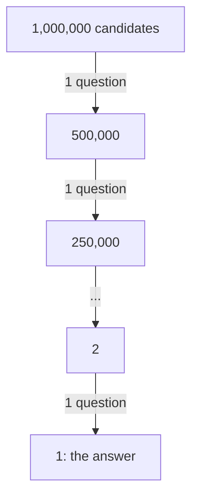
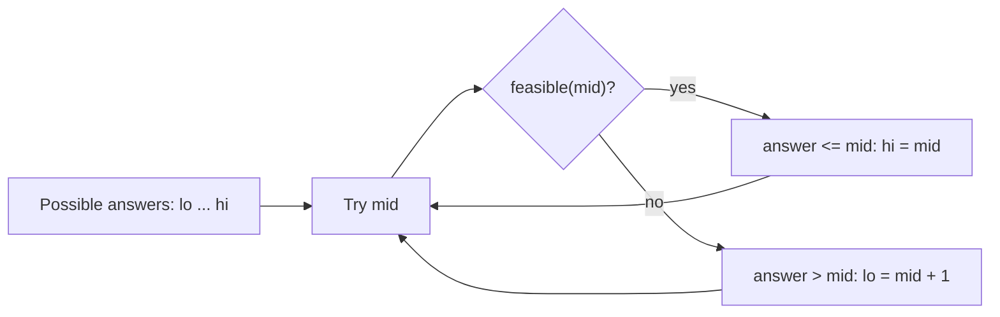

# Chapter 08 · Binary Search

> Your friend thinks of a number between 1 and a billion. You're allowed to ask "is it bigger than X?" How many questions do you need? Just **30**. That magic, throwing away half of everything with every single question, is binary search. And once you see it as "find the first YES", you'll spot it in problems that don't even look like searching.

**You will learn:**
- Why halving beats scanning, and why 30 steps is enough for a billion items
- The classic `lo <= hi` binary search, traced line by line
- **One robust template** ("first index where the predicate is true") that solves almost every variant without off-by-one bugs
- `lower_bound`, `upper_bound` and Python's `bisect` module
- The tricky family: rotated arrays, peak element, 2D matrices
- **Binary search on the answer**: Koko Eating Bananas, Ship Packages, Split Array Largest Sum, square roots
- Floating-point binary search and the famous Median of Two Sorted Arrays
- A decoder table that kills off-by-one errors forever

**Before this:** [Big-O](01-big-o-complexity.md) · [Arrays & Strings Fundamentals](02-arrays-strings.md) · [Sorting Algorithms](07-sorting.md)

---

## 🧠 The Big Idea

Think about how you look up the word "mango" in a paper dictionary. You don't start at page 1. You open somewhere in the middle, see "kettle", and think: "M comes after K, so everything on the left half is useless." You just threw away half the book with one glance. Open the middle of the right half, see "orange": too far, throw away the right part. A handful of flips and you're there.

That's **binary search**: look at the middle, decide which half *cannot* contain the answer, and throw it away.



How many halvings until one item is left? For n items it's about **log₂ n**:

| Items | Halvings needed |
|---|---|
| 1,000 | 10 |
| 1,000,000 | 20 |
| 1,000,000,000 | 30 |
| every atom in the universe (~10⁸⁰) | ~266 |

A linear scan of a billion items does a billion checks. Binary search does 30. That's not "a bit faster", that's a different universe.

But here is the deeper picture, the one that makes this chapter click. Binary search is **not really about finding a number in a sorted array**. It's about this shape:

```text
index:      0      1      2      3     4     5     6
question:  NO     NO     NO     YES   YES   YES   YES
                              ^
                     find this boundary
```

Whenever you can ask a yes/no question about each position, and the answers are all NO and then all YES (never flipping back), binary search finds the **first YES** in O(log n) questions. A sorted array is just one place where this shape shows up. "Is this eating speed fast enough?", "Is this ship capacity big enough?", "Is this version broken?" all have the same NO-NO-NO-YES-YES shape. Learn to see the shape and you've learned binary search.

> 💡 **The core insight:** binary search needs *monotonic* yes/no answers, not necessarily a sorted array. If a YES at position x guarantees YES at every position after x, you can binary search.

---

## 🔨 Building It Up

### 1. The guessing game

Let's play "guess my number" from 1 to 100 the smart way: always guess the middle of what's still possible.

```python
def guess_game(secret, low=1, high=100):
    guesses = 0
    while low <= high:
        guess = (low + high) // 2
        guesses += 1
        if guess == secret:
            print(f"guess {guesses}: {guess} -> correct!")
            return guesses
        elif guess < secret:
            print(f"guess {guesses}: {guess} -> higher")
            low = guess + 1          # everything <= guess is impossible
        else:
            print(f"guess {guesses}: {guess} -> lower")
            high = guess - 1         # everything >= guess is impossible

guess_game(73)

# worst-case number of guesses for n items is n.bit_length() (= floor(log2 n) + 1)
for n in [100, 1_000_000, 1_000_000_000]:
    print(n, "->", n.bit_length(), "guesses at most")
```

```text
guess 1: 50 -> higher
guess 2: 75 -> lower
guess 3: 62 -> higher
guess 4: 68 -> higher
guess 5: 71 -> higher
guess 6: 73 -> correct!
100 -> 7 guesses at most
1000000 -> 20 guesses at most
1000000000 -> 30 guesses at most
```

What just happened: `low` and `high` describe the range of numbers that are **still possible**. Each answer cuts that range in half. When "higher" comes back, the guess and everything below it are dead, so `low = guess + 1`. The `+ 1` and `- 1` matter: the guess itself has been ruled out, so it must leave the range.

### 2. The classic version: find a target in a sorted list

The same game, but the "numbers" are positions in a sorted list.

```python
def binary_search(nums, target):
    lo, hi = 0, len(nums) - 1          # search space: every index, inclusive
    while lo <= hi:                    # while the space is non-empty
        mid = (lo + hi) // 2
        if nums[mid] == target:
            return mid
        elif nums[mid] < target:
            lo = mid + 1               # target is to the right of mid
        else:
            hi = mid - 1               # target is to the left of mid
    return -1                          # space became empty: not there

nums = [2, 5, 8, 12, 16, 23, 38, 56, 72, 91]
print(binary_search(nums, 23))
print(binary_search(nums, 7))
```

```text
5
-1
```

**Dry run** for target 23:

| step | lo | hi | mid | nums[mid] | decision |
|---|---|---|---|---|---|
| 1 | 0 | 9 | 4 | 16 | 16 < 23 → lo = 5 |
| 2 | 5 | 9 | 7 | 56 | 56 > 23 → hi = 6 |
| 3 | 5 | 6 | 5 | 23 | ✅ found at 5 |

**Dry run** for target 7 (not present):

| step | lo | hi | mid | nums[mid] | decision |
|---|---|---|---|---|---|
| 1 | 0 | 9 | 4 | 16 | 16 > 7 → hi = 3 |
| 2 | 0 | 3 | 1 | 5 | 5 < 7 → lo = 2 |
| 3 | 2 | 3 | 2 | 8 | 8 > 7 → hi = 1 |
| 4 | 2 | 1 | | | lo > hi → return -1 |

What just happened: `[lo, hi]` is a **closed** range (both ends included) of indexes where the target could still be. The loop runs `while lo <= hi` because a range like `[5, 5]` still holds one candidate. When `lo` passes `hi`, nothing is left.

Notice where `lo` ended up in the failed search: index 2, exactly where 7 *would be inserted* to keep the list sorted. Remember that, it comes back in a minute.

This version is fine for "is the target there?". But real problems ask fussier things: "the **first** position of 2 in `[1, 2, 2, 2, 3]`", "the **smallest** speed that works", "the **last** day that's safe". The classic version gets clumsy there. So we need a better tool.

### 3. Seeing every problem as "first YES"

Take the sorted list `[2, 5, 8, 12, 16, 23, 38]` and ask at each index: "is `nums[i] >= 12`?"

```text
index:            0   1   2   3    4    5    6
nums:             2   5   8   12   16   23   38
nums[i] >= 12?    F   F   F   T    T    T    T
```

All the F's come first, then all the T's. The first T (index 3) is where 12 lives, or where it would be inserted if it were missing. A function like `lambda i: nums[i] >= 12` that answers True/False is called a **predicate**. If its answers go F...F T...T, we call it **monotonic**.

Almost every binary search problem is: **"find the first index where a monotonic predicate becomes True."** Only the predicate changes.

### 4. The one template to rule them all

```python
def first_true(lo, hi, pred):
    """Smallest x in [lo, hi) with pred(x) True. Returns hi if pred is never True.
    Requires pred to be monotonic: False ... False True ... True."""
    while lo < hi:
        mid = (lo + hi) // 2
        if pred(mid):
            hi = mid          # mid might be the answer; keep it
        else:
            lo = mid + 1      # mid is False, so the answer is strictly right of it
    return lo                 # lo == hi: the boundary

nums = [2, 5, 8, 12, 16, 23, 38]
print(first_true(0, len(nums), lambda i: nums[i] >= 12))
print(first_true(0, len(nums), lambda i: nums[i] >= 100))
print(first_true(0, len(nums), lambda i: nums[i] >= 0))
print(first_true(0, len(nums), lambda i: nums[i] >= 13))
```

```text
3
7
0
4
```

**Dry run** for `nums[i] >= 12`:

| step | lo | hi | mid | nums[mid] | pred(mid) | action |
|---|---|---|---|---|---|---|
| 1 | 0 | 7 | 3 | 12 | True | hi = 3 |
| 2 | 0 | 3 | 1 | 5 | False | lo = 2 |
| 3 | 2 | 3 | 2 | 8 | False | lo = 3 |
| 4 | 3 | 3 | | | | lo == hi → return 3 |

What just happened, rule by rule:

- **Half-open range `[lo, hi)`**: `hi` is *not* a candidate index, it's "one past the end". Starting with `hi = len(nums)` gives us a natural "not found" answer: if no element passes, we return `len(nums)`.
- **`while lo < hi`**: stop when the range has shrunk to a single point. That point is the answer. No "found it" check inside the loop.
- **`hi = mid` (not `mid - 1`)**: mid passed, so it *might* be the first True. Don't throw it away.
- **`lo = mid + 1`**: mid failed, so it definitely isn't the answer.

Why does it never loop forever? `mid = (lo + hi) // 2` is always **strictly less than `hi`** when `lo < hi`. So `hi = mid` always shrinks the range, and `lo = mid + 1` always shrinks it too. Every iteration makes progress.

> 💡 Memorise this template exactly. With it, you only ever have to think about one thing: **what is the predicate?** The loop itself never changes.

### 5. Lower bound, upper bound, and Python's `bisect`

Two predicates come up so often they have names:

| Name | Predicate | Meaning |
|---|---|---|
| **lower_bound** | `nums[i] >= target` | first index with value **≥** target (first occurrence, or insert position) |
| **upper_bound** | `nums[i] > target` | first index with value **>** target (one past the last occurrence) |

Python ships both in the `bisect` module, written in C, so they're fast:

```python
import bisect

def lower_bound(nums, target):
    lo, hi = 0, len(nums)
    while lo < hi:
        mid = (lo + hi) // 2
        if nums[mid] >= target:
            hi = mid
        else:
            lo = mid + 1
    return lo

def upper_bound(nums, target):
    lo, hi = 0, len(nums)
    while lo < hi:
        mid = (lo + hi) // 2
        if nums[mid] > target:
            hi = mid
        else:
            lo = mid + 1
    return lo

nums = [1, 2, 2, 2, 3, 5]
print(lower_bound(nums, 2), upper_bound(nums, 2))
print(bisect.bisect_left(nums, 2), bisect.bisect_right(nums, 2))
print("count of 2:", upper_bound(nums, 2) - lower_bound(nums, 2))
print("count of 4:", bisect.bisect_right(nums, 4) - bisect.bisect_left(nums, 4))

bisect.insort(nums, 4)        # insert while keeping the list sorted
print(nums)

# bisect also accepts key= (Python 3.10+): search records by a field
people = [("asha", 19), ("ravi", 23), ("meera", 31)]   # sorted by age
print(bisect.bisect_left(people, 23, key=lambda p: p[1]))
```

```text
1 4
1 4
count of 2: 3
count of 4: 0
[1, 2, 2, 2, 3, 4, 5]
1
```

What just happened: the 2s live in `[lower_bound, upper_bound)` = `[1, 4)`, so there are 4 − 1 = 3 of them. The count of a missing value is 0 because both bounds land on the same insert position. `bisect_left` is lower_bound; `bisect_right` (also called `bisect.bisect`) is upper_bound.

> ⚠️ `bisect.insort` finds the spot in O(log n) but inserting into a list still shifts elements, which is O(n). Binary search makes *finding* fast, not *inserting*.

### 6. "Last True" and the floor trick

Sometimes you want the **last** index where something holds, like "the last element ≤ target" (the **floor**). Flip it around: the last `<=` is just one before the first `>`.

```python
import bisect

def floor_index(nums, target):
    """Index of the largest element <= target, or -1 if none."""
    return bisect.bisect_right(nums, target) - 1

def ceil_index(nums, target):
    """Index of the smallest element >= target, or len(nums) if none."""
    return bisect.bisect_left(nums, target)

nums = [10, 20, 30, 40]
for t in [5, 20, 25, 45]:
    f, c = floor_index(nums, t), ceil_index(nums, t)
    print(t, "floor:", nums[f] if f >= 0 else None,
             "ceil:", nums[c] if c < len(nums) else None)
```

```text
5 floor: None ceil: 10
20 floor: 20 ceil: 20
25 floor: 20 ceil: 30
45 floor: 40 ceil: None
```

What just happened: "last True of P" = "first True of not-P" − 1. You never need a second template; you just negate the predicate.

### 7. Search in a rotated sorted array

Take a sorted list and "rotate" it: chop it somewhere and swap the two pieces. `[0, 1, 2, 4, 5, 6, 7]` might become `[4, 5, 6, 7, 0, 1, 2]`. It's no longer sorted, so can we still binary search?

```text
values:  4   5   6   7 | 0   1   2
         ^^^^^^^^^^^^^   ^^^^^^^^^
          sorted part     sorted part
```

The key fact: **if you cut a rotated array at any `mid`, at least one of the two halves is perfectly sorted.** And for a sorted half, checking "is the target inside it?" is easy: just compare with its two ends.

```python
def search_rotated(nums, target):
    lo, hi = 0, len(nums) - 1
    while lo <= hi:
        mid = (lo + hi) // 2
        if nums[mid] == target:
            return mid
        if nums[lo] <= nums[mid]:                 # left half [lo..mid] is sorted
            if nums[lo] <= target < nums[mid]:
                hi = mid - 1                      # target is inside the sorted left half
            else:
                lo = mid + 1
        else:                                     # right half [mid..hi] is sorted
            if nums[mid] < target <= nums[hi]:
                lo = mid + 1                      # target is inside the sorted right half
            else:
                hi = mid - 1
    return -1

nums = [4, 5, 6, 7, 0, 1, 2]
print(search_rotated(nums, 0), search_rotated(nums, 3), search_rotated(nums, 4))
```

```text
4 -1 0
```

**Dry run** for target 0:

| step | lo | hi | mid | nums[mid] | sorted half | target inside it? | action |
|---|---|---|---|---|---|---|---|
| 1 | 0 | 6 | 3 | 7 | left (4 ≤ 7) | 4 ≤ 0 < 7? no | lo = 4 |
| 2 | 4 | 6 | 5 | 1 | left (0 ≤ 1) | 0 ≤ 0 < 1? yes | hi = 4 |
| 3 | 4 | 4 | 4 | 0 | | | ✅ found at 4 |

What just happened: we never asked "which half has the target?" directly (that's hard in a rotated array). We asked "which half is sorted?" (easy), then "is the target in the sorted one?" (easy). If not, it must be in the other half.

> ⚠️ Why `nums[lo] <= nums[mid]` with `<=`? When `lo == mid` (a range of 1 or 2 elements), the "left half" is just one element, which is trivially sorted. Using `<` would wrongly call it unsorted.

### 8. Find the minimum in a rotated sorted array

Where's the smallest element (the "rotation point")? Use the predicate trick. Ask at each index: "is `nums[i] <= nums[-1]`?" (is this element in the second sorted piece?)

```text
nums:               4   5   6   7   0   1   2
nums[i] <= 2 ?      F   F   F   F   T   T   T
                                    ^ minimum!
```

Elements of the first piece are all bigger than the last element; elements of the second piece are all ≤ it. Monotonic! First True = the minimum.

```python
def find_min(nums):
    lo, hi = 0, len(nums) - 1         # the last index is always True, so it's a safe hi
    while lo < hi:
        mid = (lo + hi) // 2
        if nums[mid] <= nums[-1]:     # mid is in the second (smaller) piece
            hi = mid
        else:
            lo = mid + 1
    return nums[lo]

print(find_min([3, 4, 5, 1, 2]))
print(find_min([4, 5, 6, 7, 0, 1, 2]))
print(find_min([11, 13, 15, 17]))     # not rotated at all
```

```text
1
0
11
```

What just happened: the same `first_true` template, nothing new, just a clever predicate. The index of the minimum also tells you **how many times** the array was rotated.

### 9. Peak element: binary search on an unsorted array

A **peak** is an element strictly bigger than its neighbours (imagine `-∞` beyond both ends). Find any peak in O(log n). The array is not sorted at all! How?

Compare `nums[mid]` with `nums[mid + 1]`:

- If `nums[mid] < nums[mid + 1]`, you're walking **uphill** to the right. Keep walking right and you either find a spot where it goes down (a peak) or hit the end (which is a peak, because beyond it is −∞). So a peak exists to the right of `mid`.
- Otherwise you're going downhill, and by the mirror argument a peak exists at `mid` or to its left.

```python
def find_peak(nums):
    lo, hi = 0, len(nums) - 1
    while lo < hi:
        mid = (lo + hi) // 2
        if nums[mid] < nums[mid + 1]:   # uphill to the right: a peak lies right
            lo = mid + 1
        else:                           # downhill: mid or something left is a peak
            hi = mid
    return lo

print(find_peak([1, 2, 3, 1]))
print(find_peak([1, 2, 1, 3, 5, 6, 4]))
```

```text
2
5
```

What just happened: we didn't need sorted order, only a guarantee that **one side definitely contains an answer**. That's the true requirement of binary search. (Index 1 is also a peak in the second list; any peak is accepted.)

### 10. Searching a 2D matrix

**Search a 2D Matrix:** each row is sorted, and each row's first element is bigger than the previous row's last. Then the whole matrix, read row by row, is one long sorted list. Pretend it's 1D and convert indexes: position `p` lives at row `p // cols`, column `p % cols`.

```python
def search_matrix(matrix, target):
    rows, cols = len(matrix), len(matrix[0])
    lo, hi = 0, rows * cols - 1
    while lo <= hi:
        mid = (lo + hi) // 2
        value = matrix[mid // cols][mid % cols]    # 1D index -> (row, col)
        if value == target:
            return True
        if value < target:
            lo = mid + 1
        else:
            hi = mid - 1
    return False

m = [[1, 3, 5, 7],
     [10, 11, 16, 20],
     [23, 30, 34, 60]]
print(search_matrix(m, 3), search_matrix(m, 13))
```

```text
True False
```

O(log(rows × cols)).

**Search a 2D Matrix II** is weaker: rows sorted, columns sorted, but rows don't continue each other. Here the trick is the **staircase**: start at the **top-right** corner. Everything to its left is smaller, everything below is bigger, so each comparison deletes a whole row or column.

```python
def search_matrix_ii(matrix, target):
    r, c = 0, len(matrix[0]) - 1          # top-right corner
    while r < len(matrix) and c >= 0:
        value = matrix[r][c]
        if value == target:
            return True
        if value > target:
            c -= 1        # whole column below is even bigger: drop it
        else:
            r += 1        # whole row to the left is even smaller: drop it
    return False

m = [[1, 4, 7, 11, 15],
     [2, 5, 8, 12, 19],
     [3, 6, 9, 16, 22],
     [10, 13, 14, 17, 24],
     [18, 21, 23, 26, 30]]
print(search_matrix_ii(m, 5), search_matrix_ii(m, 20))
```

```text
True False
```

O(rows + cols). Not strictly binary search, but the same spirit as two pointers ([Chapter 03](03-two-pointers.md)): every step discards a whole line of candidates.

### 11. Binary search on the answer

This is the idea that turns binary search from "a lookup trick" into a superpower.

Some problems ask for the **minimum X such that something is possible** (or maximum X such that it's still OK). Often:
1. Checking "is X good enough?" is easy (a simple O(n) loop).
2. If X works, every bigger X also works. (Monotonic!)

Then don't search an array. **Search the range of possible answers**, using the "is X good enough?" check as your predicate.



**Warm-up: integer square root.** Find `floor(sqrt(x))` without `math`. The answer is the **last** r with `r * r <= x`, which is one less than the **first** r with `r * r > x`.

```python
import math

def my_sqrt(x):
    lo, hi = 0, x + 1                 # first r with r*r > x lies in [0, x+1]
    while lo < hi:
        mid = (lo + hi) // 2
        if mid * mid > x:
            hi = mid
        else:
            lo = mid + 1
    return lo - 1                     # last r with r*r <= x

for x in [0, 1, 4, 8, 15, 16, 2147395599]:
    print(x, my_sqrt(x), math.isqrt(x))
```

```text
0 0 0
1 1 1
4 2 2
8 2 2
15 3 3
16 4 4
2147395599 46339 46339
```

**Koko Eating Bananas.** Koko has piles of bananas and `h` hours. Each hour she picks one pile and eats up to `k` bananas from it (if the pile has fewer, she finishes it and waits for the next hour). Find the **minimum** speed `k` to finish in `h` hours.

- Feasibility check: at speed k, a pile of p takes `ceil(p / k)` hours. Sum them, compare with h.
- Monotonic: if speed k works, any faster speed works too.
- Range: at least 1, and `max(piles)` is always enough (one hour per pile).

```python
def min_eating_speed(piles, h):
    def hours_needed(k):
        return sum((p + k - 1) // k for p in piles)   # (p + k - 1) // k == ceil(p / k)

    lo, hi = 1, max(piles)
    while lo < hi:
        mid = (lo + hi) // 2
        if hours_needed(mid) <= h:     # fast enough: try slower
            hi = mid
        else:                          # too slow
            lo = mid + 1
    return lo

print(min_eating_speed([3, 6, 7, 11], 8))
print(min_eating_speed([30, 11, 23, 4, 20], 5))
print(min_eating_speed([30, 11, 23, 4, 20], 6))
```

```text
4
30
23
```

**Dry run** for piles `[3, 6, 7, 11]`, h = 8:

| step | lo | hi | mid (speed) | hours per pile | total | ≤ 8? | action |
|---|---|---|---|---|---|---|---|
| 1 | 1 | 11 | 6 | 1, 1, 2, 2 | 6 | yes | hi = 6 |
| 2 | 1 | 6 | 3 | 1, 2, 3, 4 | 10 | no | lo = 4 |
| 3 | 4 | 6 | 5 | 1, 2, 2, 3 | 8 | yes | hi = 5 |
| 4 | 4 | 5 | 4 | 1, 2, 2, 3 | 8 | yes | hi = 4 |
| 5 | 4 | 4 | | | | | return 4 |

Time: O(n log(max pile)). Trying every speed from 1 upward would be O(n × max pile).

**Capacity To Ship Packages Within D Days.** Packages (in a fixed order) go onto a ship each day; the ship has a weight capacity. Find the **minimum capacity** to ship everything within `days` days.

- Feasibility: greedily load packages in order; start a new day when the next one doesn't fit. Count days.
- Range: capacity must be at least `max(weights)` (the heaviest package must fit) and `sum(weights)` always works (one day).

```python
def ship_within_days(weights, days):
    def days_needed(capacity):
        d, load = 1, 0
        for w in weights:
            if load + w > capacity:    # doesn't fit: ship today's load, start tomorrow
                d += 1
                load = 0
            load += w
        return d

    lo, hi = max(weights), sum(weights)
    while lo < hi:
        mid = (lo + hi) // 2
        if days_needed(mid) <= days:
            hi = mid
        else:
            lo = mid + 1
    return lo

print(ship_within_days([1, 2, 3, 4, 5, 6, 7, 8, 9, 10], 5))
print(ship_within_days([3, 2, 2, 4, 1, 4], 3))
print(ship_within_days([1, 2, 3, 1, 1], 4))
```

```text
15
6
3
```

**Split Array Largest Sum** is the *same problem in disguise*: split an array into `k` contiguous parts so that the largest part-sum is as small as possible. "Largest part-sum ≤ X" is exactly "ship capacity X", and "k parts" is "k days".

```python
def split_array(nums, k):
    def parts_needed(limit):
        parts, current = 1, 0
        for x in nums:
            if current + x > limit:
                parts += 1
                current = 0
            current += x
        return parts

    lo, hi = max(nums), sum(nums)
    while lo < hi:
        mid = (lo + hi) // 2
        if parts_needed(mid) <= k:     # fewer parts is fine: we can always split more
            hi = mid
        else:
            lo = mid + 1
    return lo

print(split_array([7, 2, 5, 10, 8], 2))
print(split_array([1, 2, 3, 4, 5], 2))
```

```text
18
9
```

What just happened: three "different" problems, one skeleton. Only `feasible()` and the range `[lo, hi]` change. This family has many members: minimum days to make bouquets, magnetic force between balls, minimum time to complete trips, allocate books, painter's partition, aggressive cows. Once you see "minimise the maximum" or "maximise the minimum", think **binary search on the answer**.

### 12. Floating-point binary search

Sometimes the answer is a real number, like the cube root of 2. There's no "next integer" to step to, so instead of `lo = mid + 1` we use `lo = mid`, and instead of `while lo < hi` we just run a **fixed number of iterations**. Each iteration halves the range, so 100 iterations shrink it by 2¹⁰⁰, far beyond what a float can even represent.

```python
def cube_root(x, iterations=100):
    """Cube root of x >= 0 by bisection."""
    lo, hi = 0.0, max(1.0, x)          # for x < 1 the root is bigger than x, so hi = 1
    for _ in range(iterations):
        mid = (lo + hi) / 2
        if mid ** 3 < x:
            lo = mid
        else:
            hi = mid
    return (lo + hi) / 2

for x in [27, 2, 0.001]:
    print(x, f"{cube_root(x):.6f}")
```

```text
27 3.000000
2 1.259921
0.001 0.100000
```

What just happened: with floats, never test `lo == hi` or `mid == target`; rounding means they might never be exactly equal, and the loop would run forever. A fixed iteration count (or `while hi - lo > 1e-9`) is always safe.

### 13. Median of Two Sorted Arrays

The boss fight. Two sorted arrays `a` (size m) and `b` (size n). Find the median of all m + n numbers in **O(log(min(m, n)))**. Merging takes O(m + n), which is too slow for the interviewer.

**The idea: binary search on a cut.** Imagine the merged array split into a left half and a right half. The left half contains some `i` elements from `a` and `j` elements from `b`, with `i + j = half` where `half = (m + n + 1) // 2`. Once we pick `i`, `j` is forced.

```text
a:   a[0] ... a[i-1]  |  a[i] ... a[m-1]
b:   b[0] ... b[j-1]  |  b[j] ... b[n-1]
     ---- left half ----  --- right half ---
```

The cut is correct when every left element ≤ every right element. Since each array is sorted on its own, we only need to check the two "cross" pairs:

- `a[i-1] <= b[j]` and `b[j-1] <= a[i]`

If `a[i-1] > b[j]`, we took too many from `a`: move `i` left. Otherwise, if `b[j-1] > a[i]`, we took too few from `a`: move `i` right. That's monotonic, so binary search over `i` in `[0, m]`. Run it on the **shorter** array so `j` never goes out of range. Missing neighbours (cut at an edge) count as −∞ / +∞.

```python
def find_median_sorted_arrays(a, b):
    if len(a) > len(b):
        a, b = b, a                       # binary search the shorter array
    m, n = len(a), len(b)
    half = (m + n + 1) // 2               # size of the left half
    neg_inf, pos_inf = float("-inf"), float("inf")

    lo, hi = 0, m
    while lo <= hi:
        i = (lo + hi) // 2                # elements taken from a
        j = half - i                      # elements taken from b
        a_left = a[i - 1] if i > 0 else neg_inf
        a_right = a[i] if i < m else pos_inf
        b_left = b[j - 1] if j > 0 else neg_inf
        b_right = b[j] if j < n else pos_inf

        if a_left <= b_right and b_left <= a_right:     # perfect cut
            if (m + n) % 2 == 1:
                return float(max(a_left, b_left))
            return (max(a_left, b_left) + min(a_right, b_right)) / 2
        elif a_left > b_right:
            hi = i - 1                    # too many from a
        else:
            lo = i + 1                    # too few from a

print(find_median_sorted_arrays([1, 3], [2]))
print(find_median_sorted_arrays([1, 2], [3, 4]))
print(find_median_sorted_arrays([1, 3, 8, 9, 15], [7, 11, 18, 19, 21, 25]))
print(find_median_sorted_arrays([], [1]))
```

```text
2.0
2.5
11.0
1.0
```

**Dry run** for `a = [1, 3, 8, 9, 15]`, `b = [7, 11, 18, 19, 21, 25]` (m = 5, n = 6, half = 6):

| step | lo | hi | i | j | a_left | a_right | b_left | b_right | verdict |
|---|---|---|---|---|---|---|---|---|---|
| 1 | 0 | 5 | 2 | 4 | 3 | 8 | 19 | 21 | b_left 19 > a_right 8: too few from a → lo = 3 |
| 2 | 3 | 5 | 4 | 2 | 9 | 15 | 11 | 18 | 9 ≤ 18 and 11 ≤ 15 ✅ |

Total is 11 (odd), so the median is `max(9, 11) = 11`. Check: merged = 1, 3, 7, 8, 9, **11**, 15, 18, 19, 21, 25. ✓

---

## 🔬 Under the Hood

### Why it's O(log n)

Every iteration cuts the remaining range roughly in half. Starting with n candidates, after k steps about n / 2ᵏ remain. We stop when that hits 1: n / 2ᵏ = 1 → k = log₂ n. Doubling the input adds just **one** step. That's why binary search on a billion items takes 30 steps and on two billion takes 31.

For binary search on the answer, each step runs a feasibility check costing O(n), and there are O(log R) steps where R is the size of the answer range: **O(n log R)** total.

### Proof that the template is correct

For `first_true(lo, hi, pred)` we keep this **invariant** (a fact that's true before and after every iteration):

> Everything left of `lo` is False. Everything at `hi` or beyond is True (or past the end). So the first True is somewhere in `[lo, hi]`.

- **At the start**: nothing is left of `lo` and nothing is at or past `hi` (except "past the end"), so it holds trivially.
- **If `pred(mid)` is True**: the first True is at `mid` or earlier. Setting `hi = mid` keeps "everything at `hi` or beyond is True" (monotonic!).
- **If `pred(mid)` is False**: then everything up to `mid` is False (monotonic again). Setting `lo = mid + 1` keeps "everything left of `lo` is False".
- **Progress**: when `lo < hi`, `lo <= mid < hi`, so both branches shrink the range by at least 1.
- **At the end**: `lo == hi`, and the invariant says the boundary is exactly there.

Notice where we used monotonicity: in both branches. Without it, `pred(mid)` being True says nothing about `mid + 1`, and the whole thing collapses. **No monotonic predicate, no binary search.**

### `(lo + hi) // 2` and integer overflow

In Python, integers grow as big as needed, so `lo + hi` can never overflow. In Java, C++ or Go, `lo + hi` can exceed the maximum 32-bit int (about 2.1 billion) and wrap around to a negative number. That bug sat inside Java's own `Arrays.binarySearch` for years. The safe form in those languages is:

```py
mid = lo + (hi - lo) // 2      # same value, never overflows
```

Interviewers love asking about this. Use the safe form if you code in another language, and mention it even in Python.

### Rounding direction matters

`(lo + hi) // 2` rounds **down**, so `mid` can equal `lo` but never `hi` (when `lo < hi`). That's why our template pairs it with `hi = mid` and `lo = mid + 1`. If you ever write `lo = mid` (a "last True" style loop), you must round **up** with `(lo + hi + 1) // 2`; otherwise, with `lo = 0, hi = 1`, mid is 0, `lo = mid` changes nothing, and you loop forever. The Pattern Decoder has a table for this.

### What `bisect` really does

`bisect_left` is literally our `lower_bound` loop, implemented in C inside CPython (with a pure-Python fallback in `Lib/bisect.py`). So it's the same O(log n) algorithm, just with a much smaller constant factor than a Python loop.

---

## 🧩 Pattern Decoder

### Signals: when to reach for binary search

| You see in the problem... | Think |
|---|---|
| "sorted array", "find target / position / insert position" | Classic or `bisect` |
| "first / last occurrence", "count of x in sorted array" | lower_bound / upper_bound |
| "O(log n)" required in the problem statement | Binary search, almost certainly |
| "rotated sorted array" | Find the sorted half, or predicate `nums[i] <= nums[-1]` |
| "peak", "mountain", "bitonic" | Compare `mid` with `mid + 1` |
| "minimum X such that ... is possible" | Binary search on the answer (first True) |
| "maximum X such that ... is still OK" | Binary search on the answer (last True) |
| "minimise the maximum" / "maximise the minimum" | Binary search on the answer, almost always |
| "within D days / H hours / K groups" | Feasibility check + binary search on the answer |
| "square root / cube root / precision 1e-6" | Integer or floating-point binary search |
| huge answer range (up to 10⁹ or 10¹⁸) with a cheap check | Binary search on the answer |
| "k-th smallest" in a structure where counting "how many ≤ x" is easy | Binary search on the value |

### Template A: first True (the one to memorise)

```py
def first_true(lo, hi, pred):
    # search space [lo, hi); hi is returned if pred is never True
    while lo < hi:
        mid = (lo + hi) // 2
        if pred(mid):
            hi = mid          # mid could be the answer
        else:
            lo = mid + 1      # mid is definitely not
    return lo
```

### Template B: last True (if you prefer it over "first True − 1")

```py
def last_true(lo, hi, pred):
    # pred is True ... True False ... False on [lo, hi]; assumes pred(lo) is True
    while lo < hi:
        mid = (lo + hi + 1) // 2   # round UP, or lo = mid could loop forever
        if pred(mid):
            lo = mid               # mid is fine, maybe something later is too
        else:
            hi = mid - 1
    return lo
```

### Template C: binary search on the answer

```py
def solve(data):
    def feasible(x):
        # O(n) greedy check: can we do it with value x?
        ...
    lo, hi = smallest_possible_answer, largest_possible_answer
    while lo < hi:
        mid = (lo + hi) // 2
        if feasible(mid):
            hi = mid
        else:
            lo = mid + 1
    return lo
```

Three questions to answer before you code:
1. **What is X?** (speed, capacity, largest sum, day...)
2. **Is `feasible` monotonic?** (If X works, does X + 1 work?)
3. **What's the range?** `lo` must be a value that *could* be the answer; `hi` must be a value that *surely* works.

### Template D: floating point

```py
lo, hi = low_bound, high_bound
for _ in range(100):           # 100 halvings: more precision than a float holds
    mid = (lo + hi) / 2
    if pred(mid):
        hi = mid
    else:
        lo = mid
answer = (lo + hi) / 2
```

### The off-by-one decoder

The four questions that cause every binary search bug, answered once:

| Choice | Classic "find target" | First True (Template A) | Last True (Template B) |
|---|---|---|---|
| Search space | `[lo, hi]` closed | `[lo, hi)` half-open | `[lo, hi]` closed |
| Initial `hi` | `n - 1` | `n` (means "none") | `n - 1` |
| Loop condition | `lo <= hi` | `lo < hi` | `lo < hi` |
| `mid` | `(lo + hi) // 2` | `(lo + hi) // 2` | `(lo + hi + 1) // 2` |
| On "go right" | `lo = mid + 1` | `lo = mid + 1` | `lo = mid` |
| On "go left" | `hi = mid - 1` | `hi = mid` | `hi = mid - 1` |
| Answer | returned inside loop, else -1 | `lo` after the loop | `lo` after the loop |

**The golden rule:** if a branch keeps `mid` in the range (`hi = mid` or `lo = mid`), the loop is `lo < hi`, and `mid` must round *away* from that side. If both branches drop `mid` (`± 1`), the loop is `lo <= hi`.

### Variation: Find First and Last Position of Element in Sorted Array

**Problem:** return `[first, last]` index of `target`, or `[-1, -1]`.

**Idea:** first = lower_bound. last = upper_bound − 1. Check that `first` actually holds the target.

```python
import bisect

def search_range(nums, target):
    first = bisect.bisect_left(nums, target)
    if first == len(nums) or nums[first] != target:
        return [-1, -1]
    last = bisect.bisect_right(nums, target) - 1
    return [first, last]

print(search_range([5, 7, 7, 8, 8, 10], 8))
print(search_range([5, 7, 7, 8, 8, 10], 6))
print(search_range([], 0))
```

```text
[3, 4]
[-1, -1]
[-1, -1]
```

Two binary searches: O(log n). In an interview, be ready to write `lower_bound` by hand instead of importing `bisect`.

### Variation: Minimum Number of Days to Make m Bouquets (on the answer)

**Problem:** flower i blooms on day `bloom_day[i]`. A bouquet needs `k` **adjacent** bloomed flowers. Minimum day to make `m` bouquets, or -1.

**Idea:** "by day D, can I make m bouquets?" is monotonic (more days, more flowers). Range: `[min(bloom_day), max(bloom_day)]`. Impossible only if `m * k > n`.

```python
def min_days(bloom_day, m, k):
    if m * k > len(bloom_day):
        return -1

    def can_make(day):
        bouquets = run = 0
        for d in bloom_day:
            if d <= day:
                run += 1
                if run == k:         # a full bouquet from adjacent flowers
                    bouquets += 1
                    run = 0
            else:
                run = 0              # a gap breaks adjacency
        return bouquets >= m

    lo, hi = min(bloom_day), max(bloom_day)
    while lo < hi:
        mid = (lo + hi) // 2
        if can_make(mid):
            hi = mid
        else:
            lo = mid + 1
    return lo

print(min_days([1, 10, 3, 10, 2], 3, 1))
print(min_days([1, 10, 3, 10, 2], 3, 2))
print(min_days([7, 7, 7, 7, 12, 7, 7], 2, 3))
```

```text
3
-1
12
```

O(n log(max day)).

### When NOT to use binary search

- **The data is unsorted and you search once.** Sorting costs O(n log n), a linear scan costs O(n). Sort + binary search only pays off for *many* queries.
- **The predicate isn't monotonic.** "Find a subarray with sum exactly k" in an array with negatives: a bigger window can have a smaller sum. Use prefix sums + hashing ([Chapter 06](06-prefix-sums.md)) instead.
- **You need a hash lookup.** "Is x in this collection?" with no ordering questions → a `set` gives O(1) ([Chapter 05](05-hashing.md)).
- **Linked lists.** Jumping to the middle costs O(n), so binary search loses its advantage ([Chapter 10](10-linked-lists.md)).
- **You need lots of inserts and deletes while staying sorted.** A sorted list makes each insert O(n). That's a job for a balanced BST ([Chapter 14](14-binary-search-trees.md)) or a heap ([Chapter 15](15-heaps.md)).

---

## ⚠️ Traps & Common Mistakes

1. **Infinite loop with `lo = mid`.** With `mid = (lo + hi) // 2` and `lo = 0, hi = 1`, mid is 0 and `lo = mid` never moves.

```py
# ❌ wrong: loops forever when hi == lo + 1 and pred(mid) is True
while lo < hi:
    mid = (lo + hi) // 2
    if pred(mid): lo = mid
    else: hi = mid - 1

# ✅ right: round up whenever a branch does lo = mid
while lo < hi:
    mid = (lo + hi + 1) // 2
    if pred(mid): lo = mid
    else: hi = mid - 1
```

2. **Mixing styles.** `while lo < hi` with `hi = mid - 1` skips candidates; `while lo <= hi` with `hi = mid` loops forever. Pick one row of the decoder table and stick to it.
3. **Wrong `hi` for "insert position".** The answer can be `len(nums)` (insert at the end), so the range must be `[0, len(nums))` with `hi = len(nums)`, not `len(nums) - 1`.
4. **Wrong range in binary search on the answer.** Ship packages with `lo = 1` instead of `lo = max(weights)`: the greedy check silently gives nonsense when one package is heavier than the capacity. `lo` must be a value that could genuinely be the answer.
5. **Non-monotonic predicate.** Before coding, say: "if X works, does X + 1 work too?" If you can't say yes, binary search is wrong.
6. **Using `/` instead of `//`.** `mid = (lo + hi) / 2` gives a float, and `nums[2.5]` crashes with `TypeError`.
7. **Comparing floats with `==`.** In floating-point search, loop a fixed number of times or until `hi - lo < eps`.
8. **Rotated array with duplicates.** `[1, 0, 1, 1, 1]`: `nums[lo] == nums[mid] == nums[hi]`, so you can't tell which half is sorted. You must shrink both ends by one, and the worst case becomes O(n). Say this out loud in an interview.
9. **Forgetting to verify the result.** lower_bound returns an *insert position*. Always check `idx < len(nums) and nums[idx] == target` before claiming you found it.
10. **`bisect` on an unsorted list.** It won't complain. It'll just quietly give wrong answers.

---

## 💡 Tips & Tricks

- **Write the predicate first, as a sentence.** "First index where `nums[i] >= target`." The loop is always the same template.
- **Test the tiny cases:** empty list, one element, two elements, target smaller than everything, target bigger than everything. Off-by-one bugs live there.
- **"Last True" = "first False" − 1.** You rarely need Template B.
- **`(p + k - 1) // k`** is integer `ceil(p / k)` without floats. Also `-(-p // k)`.
- **When the problem says "O(log n)"**, the interviewer is basically telling you "binary search".
- **"Minimise the maximum" / "maximise the minimum"** is a 90% signal for binary search on the answer.
- **Know `bisect` cold:** `bisect_left`, `bisect_right`, `insort`, and the `key=` argument (Python 3.10+). In interviews, offer to hand-write lower_bound too.
- **Cap the answer range wisely.** `hi = max(piles)` for Koko, `sum(weights)` for shipping. A smaller range means fewer iterations, but even `10**18` is only ~60 steps.
- **Debug by printing `lo, mid, hi` each loop** on a 5-element input. You'll see the bug in seconds.

---

## 🎯 Interview Questions

### 1. Binary Search 🔥🔥🔥

Return the index of `target` in a sorted array, or -1.

<details><summary>Answer</summary>

The classic `lo <= hi` loop from section 2. Mention the overflow-safe `mid = lo + (hi - lo) // 2` for other languages. Time O(log n), space O(1). An alternative with the template: `i = bisect_left(nums, target)`; return `i` if `i < len(nums) and nums[i] == target` else -1.

</details>

### 2. Find First and Last Position of Element in Sorted Array 🔥🔥🔥

<details><summary>Answer</summary>

Two binary searches: lower_bound for the first, upper_bound − 1 for the last. Written by hand, without `bisect`:

```python
def search_range(nums, target):
    def first_at_least(x):
        lo, hi = 0, len(nums)
        while lo < hi:
            mid = (lo + hi) // 2
            if nums[mid] >= x:
                hi = mid
            else:
                lo = mid + 1
        return lo

    first = first_at_least(target)
    if first == len(nums) or nums[first] != target:
        return [-1, -1]
    return [first, first_at_least(target + 1) - 1]   # integers: "> target" == ">= target + 1"

print(search_range([5, 7, 7, 8, 8, 10], 8), search_range([5, 7, 7, 8, 8, 10], 6))
```

```text
[3, 4] [-1, -1]
```

Time O(log n), space O(1).

</details>

### 3. Search Insert Position 🔥🔥

Return the index of `target`, or where it would be inserted.

<details><summary>Answer</summary>

That's exactly lower_bound. The answer can be `len(nums)`, so `hi` starts at `len(nums)`.

```python
def search_insert(nums, target):
    lo, hi = 0, len(nums)
    while lo < hi:
        mid = (lo + hi) // 2
        if nums[mid] >= target:
            hi = mid
        else:
            lo = mid + 1
    return lo

print(search_insert([1, 3, 5, 6], 5), search_insert([1, 3, 5, 6], 2), search_insert([1, 3, 5, 6], 7))
```

```text
2 1 4
```

Time O(log n), space O(1).

</details>

### 4. Search in Rotated Sorted Array 🔥🔥🔥

<details><summary>Answer</summary>

See section 7. The key sentence for the interviewer: "At any mid, one half is sorted. I check whether the target lies inside the sorted half by comparing with its endpoints; if yes, search there, otherwise search the other half." Time O(log n), space O(1).

An alternative interviewers also accept: find the rotation point with `find_min` (section 8), then run a normal binary search on the correct side.

</details>

### 5. Find Minimum in Rotated Sorted Array 🔥🔥🔥

<details><summary>Answer</summary>

Section 8: first index where `nums[i] <= nums[-1]`. Equivalent formulation: compare `nums[mid]` with `nums[hi]`; if bigger, the minimum is strictly right of mid (`lo = mid + 1`), else `hi = mid`. Time O(log n). Follow-up **with duplicates** (Find Minimum in Rotated Sorted Array II): when `nums[mid] == nums[hi]`, do `hi -= 1`; worst case O(n).

</details>

### 6. Find Peak Element 🔥🔥

<details><summary>Answer</summary>

Section 9. The proof is what interviewers want: "If `nums[mid] < nums[mid + 1]`, the array climbs to the right. It must eventually come down or hit the end, which counts as a drop to −∞, so a peak exists on the right." O(log n) time, O(1) space.

</details>

### 7. Search a 2D Matrix 🔥🔥

<details><summary>Answer</summary>

Section 10: treat it as a 1D sorted array of length `rows * cols`; index `p` → `matrix[p // cols][p % cols]`. O(log(rows × cols)). If asked about **Search a 2D Matrix II** (only rows and columns sorted), use the top-right staircase: O(rows + cols).

</details>

### 8. Koko Eating Bananas 🔥🔥🔥

<details><summary>Answer</summary>

Binary search on the speed in `[1, max(piles)]`; feasible if `sum(ceil(p / k)) <= h`. Full code and dry run in section 11. Time O(n log(max pile)), space O(1). Say why it's monotonic: "a faster speed never needs more hours."

</details>

### 9. Capacity To Ship Packages Within D Days 🔥🔥

<details><summary>Answer</summary>

Binary search on capacity in `[max(weights), sum(weights)]`, greedy day counting as the check (section 11). Time O(n log(sum)), space O(1). Why is greedy loading optimal for the check? Putting a package on today's ship whenever it fits can never force *more* days later, because it only leaves less work for the future.

</details>

### 10. Split Array Largest Sum 🔥🔥

<details><summary>Answer</summary>

Identical to shipping packages with k days (section 11). Binary search the largest allowed part-sum in `[max(nums), sum(nums)]`; feasible if greedy splitting needs ≤ k parts. Time O(n log(sum)). (A DP solution exists in O(k·n²), but binary search is the expected one.)

</details>

### 11. Median of Two Sorted Arrays 🔥🔥🔥

<details><summary>Answer</summary>

Binary search the cut position `i` in the shorter array; `j = half - i`. Valid when `a[i-1] <= b[j]` and `b[j-1] <= a[i]`. Full code and dry run in section 13. Time O(log(min(m, n))), space O(1). Explain the ±∞ sentinels for cuts at the edges; that's where most candidates slip.

</details>

### 12. Sqrt(x) 🔥🔥

<details><summary>Answer</summary>

Last `r` with `r * r <= x` = first `r` with `r * r > x`, minus 1 (section 11). Time O(log x). Mention that Newton's method converges faster, and that in other languages `mid * mid` can overflow, so compare `mid <= x // mid` instead.

</details>

### 13. Time Based Key-Value Store 🔥🔥

`set(key, value, timestamp)` with increasing timestamps; `get(key, timestamp)` returns the value with the largest timestamp ≤ the given one, or `""`.

<details><summary>Answer</summary>

Each key keeps a list of timestamps (automatically sorted since they only increase) and a parallel list of values. `get` is a floor search: `bisect_right(times, t) - 1`.

```python
import bisect
from collections import defaultdict

class TimeMap:
    def __init__(self):
        self.times = defaultdict(list)
        self.values = defaultdict(list)

    def set(self, key, value, timestamp):
        self.times[key].append(timestamp)       # timestamps arrive in increasing order
        self.values[key].append(value)

    def get(self, key, timestamp):
        i = bisect.bisect_right(self.times[key], timestamp) - 1   # last time <= timestamp
        return self.values[key][i] if i >= 0 else ""

tm = TimeMap()
tm.set("foo", "bar", 1)
print(tm.get("foo", 1), tm.get("foo", 3))
tm.set("foo", "bar2", 4)
print(tm.get("foo", 4), tm.get("foo", 5), repr(tm.get("foo", 0)))
```

```text
bar bar
bar2 bar2 ''
```

`set` O(1), `get` O(log n) per key.

</details>

### 14. Single Element in a Sorted Array 🔥🔥

Every element appears twice except one. Find it in O(log n).

<details><summary>Answer</summary>

Before the single element, pairs start at **even** indexes (`nums[0] == nums[1]`, ...). After it, pairs start at odd indexes. So check only even `mid`s: if `nums[mid] == nums[mid + 1]`, the single one is further right; else it's at mid or to the left.

```python
def single_non_duplicate(nums):
    lo, hi = 0, len(nums) - 1
    while lo < hi:
        mid = (lo + hi) // 2
        if mid % 2 == 1:
            mid -= 1                      # make mid even: the start of a pair
        if nums[mid] == nums[mid + 1]:
            lo = mid + 2                  # pairs still intact: answer is right
        else:
            hi = mid                      # pairing broke at or before mid
    return nums[lo]

print(single_non_duplicate([1, 1, 2, 3, 3, 4, 4, 8, 8]), single_non_duplicate([3, 3, 7, 7, 10, 11, 11]))
```

```text
2 10
```

Time O(log n), space O(1).

</details>

### 15. Find K Closest Elements 🔥🔥

Return the `k` elements closest to `x` from a sorted array, in sorted order (ties go to the smaller element).

<details><summary>Answer</summary>

The answer is a window `arr[left : left + k]`. Binary search the **start** `left` in `[0, n - k]`. Compare the two elements just outside a candidate window: if `x - arr[mid] > arr[mid + k] - x`, the window's left end is worse than the element after its right end, so shift right.

```python
def find_closest_elements(arr, k, x):
    lo, hi = 0, len(arr) - k
    while lo < hi:
        mid = (lo + hi) // 2
        if x - arr[mid] > arr[mid + k] - x:
            lo = mid + 1
        else:
            hi = mid
    return arr[lo:lo + k]

print(find_closest_elements([1, 2, 3, 4, 5], 4, 3), find_closest_elements([1, 2, 3, 4, 5], 4, -1))
```

```text
[1, 2, 3, 4] [1, 2, 3, 4]
```

Time O(log(n − k) + k), space O(1) besides the output.

</details>

---

## 🏋️ Practice

**🟢 1. Count occurrences** of `target` in a sorted array in O(log n). `[1, 2, 2, 2, 3, 5]`, 2 → 3.

<details><summary>Solution</summary>

```python
import bisect

def count_occurrences(nums, target):
    return bisect.bisect_right(nums, target) - bisect.bisect_left(nums, target)

print(count_occurrences([1, 2, 2, 2, 3, 5], 2), count_occurrences([1, 2, 2, 2, 3, 5], 4))
```

```text
3 0
```

</details>

**🟢 2. First Bad Version.** Versions `1..n`; once a version is bad, all later ones are bad. Find the first bad one with few calls to `is_bad(v)`.

<details><summary>Solution</summary>

Exactly "first True".

```python
def first_bad_version(n, is_bad):
    lo, hi = 1, n
    calls = 0
    while lo < hi:
        mid = (lo + hi) // 2
        calls += 1
        if is_bad(mid):
            hi = mid
        else:
            lo = mid + 1
    return lo, calls

print(first_bad_version(5, lambda v: v >= 4))
print(first_bad_version(1_000_000, lambda v: v >= 777_777))
```

```text
(4, 2)
(777777, 20)
```

</details>

**🟢 3. Valid Perfect Square** without `sqrt`. 16 → True, 14 → False.

<details><summary>Solution</summary>

```python
def is_perfect_square(num):
    lo, hi = 1, num
    while lo <= hi:
        mid = (lo + hi) // 2
        sq = mid * mid
        if sq == num:
            return True
        if sq < num:
            lo = mid + 1
        else:
            hi = mid - 1
    return False

print(is_perfect_square(16), is_perfect_square(14), is_perfect_square(1))
```

```text
True False True
```

</details>

**🟡 4. Kth Missing Positive Number.** `arr = [2, 3, 4, 7, 11]`, k = 5 → 9 (missing: 1, 5, 6, 8, **9**, ...).

<details><summary>Solution</summary>

Before index i, `arr[i] - (i + 1)` numbers are missing. That count only grows, so find the first i where it's ≥ k. Then the answer is `i + k`.

```python
def find_kth_positive(arr, k):
    lo, hi = 0, len(arr)
    while lo < hi:
        mid = (lo + hi) // 2
        if arr[mid] - (mid + 1) >= k:
            hi = mid
        else:
            lo = mid + 1
    return lo + k

print(find_kth_positive([2, 3, 4, 7, 11], 5), find_kth_positive([1, 2, 3, 4], 2))
```

```text
9 6
```

Why `lo + k`? Exactly `lo` array numbers come before the answer, and k missing ones, so the answer is the `(lo + k)`-th positive integer.

</details>

**🟡 5. Search in Rotated Sorted Array II** (duplicates allowed). Return True/False.

<details><summary>Solution</summary>

Same as section 7, plus one rule: if `nums[lo] == nums[mid] == nums[hi]`, you can't tell which half is sorted, so shrink both ends. Worst case O(n).

```python
def search_rotated_dups(nums, target):
    lo, hi = 0, len(nums) - 1
    while lo <= hi:
        mid = (lo + hi) // 2
        if nums[mid] == target:
            return True
        if nums[lo] == nums[mid] == nums[hi]:
            lo += 1
            hi -= 1
        elif nums[lo] <= nums[mid]:
            if nums[lo] <= target < nums[mid]:
                hi = mid - 1
            else:
                lo = mid + 1
        else:
            if nums[mid] < target <= nums[hi]:
                lo = mid + 1
            else:
                hi = mid - 1
    return False

print(search_rotated_dups([2, 5, 6, 0, 0, 1, 2], 0), search_rotated_dups([2, 5, 6, 0, 0, 1, 2], 3),
      search_rotated_dups([1, 0, 1, 1, 1], 0))
```

```text
True False True
```

</details>

**🔴 6. Kth Smallest Element in a Sorted Matrix** (rows and columns sorted). `[[1,5,9],[10,11,13],[12,13,15]]`, k = 8 → 13.

<details><summary>Solution</summary>

Binary search on the **value**: the answer is the first value v such that at least k elements are ≤ v. Count "≤ v" with the staircase walk from the bottom-left in O(n).

```python
def kth_smallest(matrix, k):
    n = len(matrix)

    def count_at_most(v):
        count, r, c = 0, n - 1, 0          # start bottom-left
        while r >= 0 and c < n:
            if matrix[r][c] <= v:
                count += r + 1             # everything above in this column is <= v too
                c += 1
            else:
                r -= 1
        return count

    lo, hi = matrix[0][0], matrix[-1][-1]
    while lo < hi:
        mid = (lo + hi) // 2
        if count_at_most(mid) >= k:
            hi = mid
        else:
            lo = mid + 1
    return lo

print(kth_smallest([[1, 5, 9], [10, 11, 13], [12, 13, 15]], 8))
```

```text
13
```

Time O(n log(max − min)). The answer is always a real matrix value because it's the *first* value whose count reaches k.

</details>

**🔴 7. Find in Mountain Array.** The array strictly increases then strictly decreases. Return the **smallest** index of `target`, or -1, in O(log n).

<details><summary>Solution</summary>

Three binary searches: find the peak (section 9), search the ascending left part, then the descending right part.

```python
def find_in_mountain(arr, target):
    lo, hi = 0, len(arr) - 1
    while lo < hi:                               # 1. peak
        mid = (lo + hi) // 2
        if arr[mid] < arr[mid + 1]:
            lo = mid + 1
        else:
            hi = mid
    peak = lo

    def search(lo, hi, ascending):
        while lo <= hi:
            mid = (lo + hi) // 2
            if arr[mid] == target:
                return mid
            if (arr[mid] < target) == ascending:
                lo = mid + 1
            else:
                hi = mid - 1
        return -1

    left = search(0, peak, True)                 # 2. ascending side first (smaller index)
    return left if left != -1 else search(peak + 1, len(arr) - 1, False)   # 3.

print(find_in_mountain([1, 2, 3, 4, 5, 3, 1], 3), find_in_mountain([0, 1, 2, 4, 2, 1], 3),
      find_in_mountain([1, 5, 2], 2))
```

```text
2 -1 2
```

</details>

---

## 🧠 Never-Forget Summary

- Binary search throws away **half** the candidates per step: O(log n). A billion items → 30 steps.
- It needs a **monotonic** yes/no question, not necessarily a sorted array.
- Think of every problem as **F F F T T T → find the first T**.
- **The template:** `while lo < hi: mid = (lo+hi)//2; if pred(mid): hi = mid else: lo = mid + 1; return lo`.
- lower_bound = first `>= x` (`bisect_left`), upper_bound = first `> x` (`bisect_right`). Count = upper − lower.
- Last True = first False − 1. Floor = `bisect_right − 1`.
- Rotated array: **one half is always sorted**; or use predicate `nums[i] <= nums[-1]` for the minimum.
- Peak: compare `mid` with `mid + 1` and walk uphill.
- **Binary search on the answer**: "min X that works" / "minimise the max" → feasibility check + template.
- Floats: fixed iterations, never `==`.
- Median of two sorted arrays: binary search the **cut** in the shorter array.

**Memory hook: "PRED-MID-SHRINK"**
- **Pred**: say the yes/no question out loud
- **Mid**: round down if `hi = mid`, round up if `lo = mid`
- **Shrink**: keep mid if it could be the answer, drop it if it can't

**One picture:**

| Problem type | Search space | Predicate (first True) | Example |
|---|---|---|---|
| Exact / insert position | indexes `[0, n)` | `nums[i] >= target` | Search Insert, First & Last |
| Rotated minimum | indexes `[0, n-1]` | `nums[i] <= nums[-1]` | Find Min in Rotated |
| Peak | indexes `[0, n-1]` | `nums[i] > nums[i+1]` | Find Peak Element |
| On the answer | values `[lo, hi]` | `feasible(x)` | Koko, Ship, Split Array |
| Floating point | reals `[lo, hi]` | `f(x) >= target` | Cube root |
| Two arrays | cuts `[0, m]` | `b[j-1] <= a[i]` (with `j = half - i`) | Median of Two Sorted Arrays |

> **If you remember only one thing:** binary search is "find the first YES". Name the yes/no question, check it never flips back, and the template does the rest.

---
**Next:** [Chapter 09 · Recursion & Backtracking](09-backtracking.md)  ·  **Back to** [Contents](../README.md)
