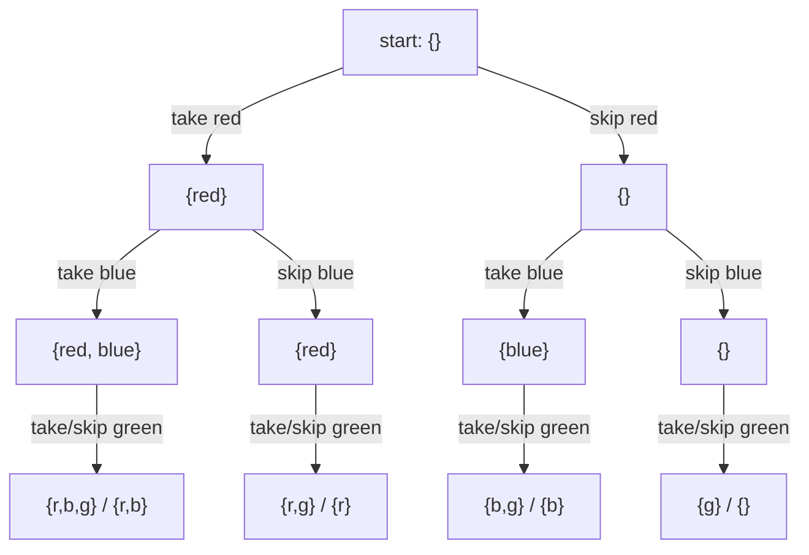
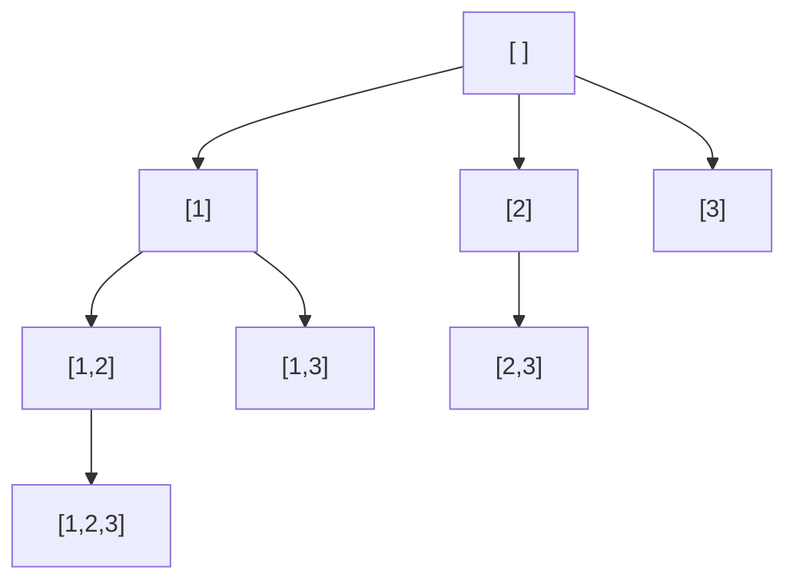

# Chapter 09 · Recursion & Backtracking

> You're in a maze. At every fork you pick a path, walk until you hit a dead end, then **walk back** to the last fork and try the next path. You never need a map; you just need to remember where you came from. That "try, fail, step back, try again" loop is backtracking, and it solves puzzles from Sudoku to N-Queens to "list every subset".

**You will learn:**
- A 5-minute refresher on recursion and the call stack
- How to draw any "generate all ..." problem as a **decision tree**
- The **choose → explore → unchoose** template that solves every problem in this chapter
- The three families: **subsets**, **permutations**, **combinations** (and how to handle duplicates in each)
- Classic puzzles: Generate Parentheses, Palindrome Partitioning, Word Search, N-Queens, Sudoku
- **Pruning**: how to cut dead branches early, which is the difference between 1 second and 1 hour
- How to work out the time complexity of a backtracking solution

**Before this:** [Recursion](../part-1-python/12-recursion.md) · [Functions](../part-1-python/10-functions.md) · [Big-O](01-big-o-complexity.md)

---

## 🧠 The Big Idea

You're packing for a trip and you own 3 T-shirts: red, blue, green. How many different "sets" of T-shirts could you pack? Think of it as a series of yes/no decisions:



Every path from the top to the bottom is one answer. The tree has 2 × 2 × 2 = 8 leaves, so there are 8 subsets. This picture is called a **decision tree**, and every backtracking problem is just: **walk this tree, and collect the leaves you like.**

How do you walk a tree you never built? With recursion. You stand at a node, make a choice (go down a branch), let a recursive call handle everything below, then **undo the choice** and try the next branch. Undoing is the "back" in backtracking.

```text
choose   -> put red in the bag
explore  -> recursively decide everything else
unchoose -> take red out of the bag, so the next branch starts clean
```

> 💡 **The core insight:** backtracking = depth-first walk of a decision tree, with **one** shared "current path" that you modify on the way down and restore on the way up. The skill is designing the tree: what is a "choice", and when is a path finished?

---

## 🔨 Building It Up

### 1. Recursion recap in five minutes

A **recursive function** calls itself on a smaller version of the problem. It needs two parts:

1. A **base case**: a tiny input you can answer directly (stops the recursion).
2. A **recursive case**: break the problem into a smaller one and **trust** the call to solve it.

```python
def countdown(n):
    if n == 0:                 # base case
        print("liftoff!")
        return
    print(n)
    countdown(n - 1)           # smaller problem: trust it works

def total(nums):
    if not nums:               # base case: sum of nothing is 0
        return 0
    return nums[0] + total(nums[1:])   # first + sum of the rest

countdown(3)
print(total([4, 5, 6]))
```

```text
3
2
1
liftoff!
15
```

What just happened: each call waits for the call below it to finish. Python keeps those waiting calls on the **call stack**, one **frame** per call, each with its own local variables. When the base case returns, frames pop off one by one. Python's default limit is about 1,000 frames (`sys.getrecursionlimit()`), which matters if your recursion goes 10,000 levels deep. Backtracking trees are usually shallow (depth ≤ n), so this is rarely a problem.

### 2. Watching the decision tree come alive

Let's print the subsets tree for `[1, 2]` with indentation showing depth. This is the include/exclude decision tree from the Big Idea.

```python
def subsets_traced(nums):
    path = []

    def explore(i, depth):
        pad = "    " * depth
        if i == len(nums):                    # made a decision for every element
            print(pad + "leaf:", path)
            return
        print(pad + f"take {nums[i]}?")
        path.append(nums[i])                  # choose
        explore(i + 1, depth + 1)             # explore
        path.pop()                            # unchoose
        print(pad + f"skip {nums[i]}")
        explore(i + 1, depth + 1)             # explore the other branch

    explore(0, 0)

subsets_traced([1, 2])
```

```text
take 1?
    take 2?
        leaf: [1, 2]
    skip 2
        leaf: [1]
skip 1
    take 2?
        leaf: [2]
    skip 2
        leaf: []
```

What just happened: we used **one** list, `path`, for the whole search. Going down a "take" branch appends; coming back up pops. So when we start the "skip 1" branch, `path` is empty again, exactly as if the "take 1" branch never happened. That's the magic of unchoose.

### 3. The template: choose → explore → unchoose

Every problem in this chapter fits this skeleton:

```py
def backtrack(state):
    if is_complete(state):            # a leaf: record a COPY of the answer
        results.append(path[:])
        return
    for choice in choices(state):     # every branch from this node
        if not is_valid(choice):      # pruning: skip branches that can't work
            continue
        make(choice)                  # choose
        backtrack(next_state)         # explore
        undo(choice)                  # unchoose
```

Four design decisions turn the template into a solution:

| Decision | Question to ask |
|---|---|
| **State** | What do I need to know at each node? (index, path, used set, remaining sum...) |
| **Choices** | What are the branches from here? |
| **Goal** | When is a path a complete answer? |
| **Pruning** | When can I tell a branch is hopeless without exploring it? |

### 4. Subsets

**Problem:** list all subsets of distinct numbers.

There are two natural trees. The include/exclude tree (section 2) works. The more flexible one is the **"pick the next element" tree**: at each node, choose which element to add next, but only from elements **after** the last one you picked (so `[1, 2]` and `[2, 1]` don't both appear). Here, **every node is an answer**, not just the leaves.



```python
def subsets(nums):
    result, path = [], []

    def backtrack(start):
        result.append(path[:])               # every node is a subset: record a copy
        for i in range(start, len(nums)):    # only pick elements after the last pick
            path.append(nums[i])             # choose
            backtrack(i + 1)                 # explore
            path.pop()                       # unchoose

    backtrack(0)
    return result

print(subsets([1, 2, 3]))
```

```text
[[], [1], [1, 2], [1, 2, 3], [1, 3], [2], [2, 3], [3]]
```

What just happened: `start` is the key state. It says "you may only choose from index `start` onward", which guarantees each subset is generated once, in increasing index order.

> ⚠️ `result.append(path[:])` and **not** `result.append(path)`. `path` is one list that keeps changing. Appending it directly stores 8 references to the *same* list, which ends up empty. Section "Traps" shows the disaster.

### 5. Subsets II: with duplicates

**Problem:** `nums = [1, 2, 2]` has duplicates. Return all *unique* subsets. The plain version would produce `[1, 2]` twice (using the first 2 or the second 2).

**Fix:** sort, so equal values sit together. Then at any node, among the sibling branches, use each value **only once**: skip `nums[i]` if it equals `nums[i - 1]` and `i > start` (meaning `nums[i - 1]` was already tried as a sibling at this same level).

```python
def subsets_with_dup(nums):
    nums.sort()                                    # duplicates become neighbours
    result, path = [], []

    def backtrack(start):
        result.append(path[:])
        for i in range(start, len(nums)):
            if i > start and nums[i] == nums[i - 1]:
                continue                           # same value already tried at this level
            path.append(nums[i])
            backtrack(i + 1)
            path.pop()

    backtrack(0)
    return result

print(subsets_with_dup([1, 2, 2]))
```

```text
[[], [1], [1, 2], [1, 2, 2], [2], [2, 2]]
```

What just happened: `i > start` is the subtle part. At the node `[1, 2]` (start = 2), the second 2 is the *first* choice at that level, so it's allowed, which gives `[1, 2, 2]`. But at the root, after trying the first 2 as a branch, the second 2 would start an identical subtree, so it's skipped.

> 💡 **"Skip duplicates among siblings, not along a path."** Picking 2 then 2 down one path is fine. Picking 2 as the first branch and 2 again as the second branch at the *same* level is the duplicate.

### 6. Permutations

**Problem:** all orderings of distinct numbers. Now order matters, so `start` doesn't work: after picking 3, we still need to be able to pick 1. Instead, track which elements are **used**.

```python
def permute(nums):
    result, path = [], []
    used = [False] * len(nums)

    def backtrack():
        if len(path) == len(nums):          # every element placed: a full permutation
            result.append(path[:])
            return
        for i in range(len(nums)):          # any unused element can go next
            if used[i]:
                continue
            used[i] = True                  # choose
            path.append(nums[i])
            backtrack()                     # explore
            path.pop()                      # unchoose (both pieces of state!)
            used[i] = False

    backtrack()
    return result

print(permute([1, 2, 3]))
```

```text
[[1, 2, 3], [1, 3, 2], [2, 1, 3], [2, 3, 1], [3, 1, 2], [3, 2, 1]]
```

**Dry run** of the first few steps:

| step | action | path | used |
|---|---|---|---|
| 1 | choose 1 | [1] | T F F |
| 2 | choose 2 | [1, 2] | T T F |
| 3 | choose 3 | [1, 2, 3] | T T T → record |
| 4 | unchoose 3 | [1, 2] | T T F |
| 5 | unchoose 2 | [1] | T F F |
| 6 | choose 3 | [1, 3] | T F T |
| 7 | choose 2 | [1, 3, 2] | T T T → record |

What just happened: the tree has n choices at the top, n − 1 below, and so on: n! leaves. Every time we undo, we undo **all** the state we changed (`path` and `used`).

### 7. Permutations II: with duplicates

**Problem:** `[1, 1, 2]` should give 3 unique permutations, not 6.

**Fix:** sort, then skip `nums[i]` if it equals `nums[i - 1]` **and `nums[i - 1]` is not currently used**. That rule forces identical values to be used in left-to-right order, so the two 1s can never swap roles.

```python
def permute_unique(nums):
    nums.sort()
    result, path = [], []
    used = [False] * len(nums)

    def backtrack():
        if len(path) == len(nums):
            result.append(path[:])
            return
        for i in range(len(nums)):
            if used[i]:
                continue
            if i > 0 and nums[i] == nums[i - 1] and not used[i - 1]:
                continue        # the earlier twin is free: using this one first would duplicate
            used[i] = True
            path.append(nums[i])
            backtrack()
            path.pop()
            used[i] = False

    backtrack()
    return result

print(permute_unique([1, 1, 2]))
```

```text
[[1, 1, 2], [1, 2, 1], [2, 1, 1]]
```

What just happened: think of the two 1s as 1ₐ and 1ᵦ. The rule says "1ᵦ may only be placed if 1ₐ is already placed". So the only arrangements allowed have 1ₐ before 1ᵦ, which cuts each duplicated pair down to one.

### 8. Combinations

**Problem:** all ways to choose `k` numbers from `1..n` (order doesn't matter). It's subsets, but we only record paths of length k.

**Pruning:** if we need `k - len(path)` more numbers but fewer than that remain, stop. So the loop only goes up to `n - (k - len(path)) + 1`.

```python
def combine(n, k):
    result, path = [], []

    def backtrack(start):
        if len(path) == k:
            result.append(path[:])
            return
        need = k - len(path)
        for x in range(start, n - need + 2):   # leave room for the remaining picks
            path.append(x)
            backtrack(x + 1)
            path.pop()

    backtrack(1)
    return result

print(combine(4, 2))
print(len(combine(10, 3)))
```

```text
[[1, 2], [1, 3], [1, 4], [2, 3], [2, 4], [3, 4]]
120
```

What just happened: without pruning, the code still works, it just explores branches like `[4]` that can never reach length 2. Check the bound with n = 4, k = 2, empty path: need = 2, so `x` goes up to 4 − 2 + 1 = 3. Starting at 4 would leave nothing after it. C(10, 3) = 120. ✓

### 9. Combination Sum I, II, III

Three classic variations differ in just **one line** each. Spot the difference.

**Combination Sum (I):** distinct candidates, each can be used **unlimited** times, find all combos summing to `target`. Reuse is allowed, so recurse with `i` (not `i + 1`). Sorting lets us `break` as soon as a candidate is too big.

```python
def combination_sum(candidates, target):
    candidates.sort()
    result, path = [], []

    def backtrack(start, remaining):
        if remaining == 0:
            result.append(path[:])
            return
        for i in range(start, len(candidates)):
            c = candidates[i]
            if c > remaining:
                break                       # sorted: every later candidate is too big too
            path.append(c)
            backtrack(i, remaining - c)     # i, not i + 1: c may be reused
            path.pop()

    backtrack(0, target)
    return result

print(combination_sum([2, 3, 6, 7], 7))
print(combination_sum([2, 3, 5], 8))
```

```text
[[2, 2, 3], [7]]
[[2, 2, 2, 2], [2, 3, 3], [3, 5]]
```

**Dry run** for `[2, 3, 6, 7]`, target 7 (first branches):

| path | remaining | next choices | outcome |
|---|---|---|---|
| [2] | 5 | 2, 3 (6 > 5 → break) | |
| [2, 2] | 3 | 2, 3 | |
| [2, 2, 2] | 1 | 2 > 1 → break | dead end |
| [2, 2, 3] | 0 | | ✅ record |
| [2, 3] | 2 | 3 > 2 → break | dead end |
| [3] | 4 | 3 (6 > 4 → break) | |
| [3, 3] | 1 | 3 > 1 → break | dead end |
| [6] | 1 | 6 > 1 → break | dead end |
| [7] | 0 | | ✅ record |

**Combination Sum II:** candidates may contain duplicates, each used **at most once**, unique combos. That's "recurse with `i + 1`" plus the "skip duplicate siblings" rule from Subsets II.

```python
def combination_sum2(candidates, target):
    candidates.sort()
    result, path = [], []

    def backtrack(start, remaining):
        if remaining == 0:
            result.append(path[:])
            return
        for i in range(start, len(candidates)):
            if i > start and candidates[i] == candidates[i - 1]:
                continue                    # duplicate sibling
            if candidates[i] > remaining:
                break
            path.append(candidates[i])
            backtrack(i + 1, remaining - candidates[i])   # i + 1: use each once
            path.pop()

    backtrack(0, target)
    return result

print(combination_sum2([10, 1, 2, 7, 6, 1, 5], 8))
```

```text
[[1, 1, 6], [1, 2, 5], [1, 7], [2, 6]]
```

**Combination Sum III:** use exactly `k` numbers from 1–9, each at most once, summing to `n`. Two goals at once: length k **and** sum n.

```python
def combination_sum3(k, n):
    result, path = [], []

    def backtrack(start, remaining):
        if len(path) == k:
            if remaining == 0:
                result.append(path[:])
            return                          # length k reached: stop either way
        for x in range(start, 10):
            if x > remaining:
                break
            path.append(x)
            backtrack(x + 1, remaining - x)
            path.pop()

    backtrack(1, n)
    return result

print(combination_sum3(3, 7))
print(combination_sum3(3, 9))
```

```text
[[1, 2, 4]]
[[1, 2, 6], [1, 3, 5], [2, 3, 4]]
```

| Problem | Duplicates in input? | Reuse? | Recurse with | Extra rule |
|---|---|---|---|---|
| Combination Sum | no | yes | `i` | |
| Combination Sum II | yes | no | `i + 1` | skip `i > start and c[i] == c[i-1]` |
| Combination Sum III | no (1–9) | no | `x + 1` | stop at length k |

### 10. Letter Combinations of a Phone Number

**Problem:** digits 2–9 map to letters like an old phone keypad. Return all letter strings a digit string could represent.

Here the tree has one level per **digit**, and the branches are that digit's letters. No `start`, no `used`: the position in the input decides the choices.

```python
def letter_combinations(digits):
    if not digits:
        return []
    keypad = {"2": "abc", "3": "def", "4": "ghi", "5": "jkl",
              "6": "mno", "7": "pqrs", "8": "tuv", "9": "wxyz"}
    result, path = [], []

    def backtrack(i):
        if i == len(digits):
            result.append("".join(path))
            return
        for letter in keypad[digits[i]]:
            path.append(letter)
            backtrack(i + 1)
            path.pop()

    backtrack(0)
    return result

print(letter_combinations("23"))
print(len(letter_combinations("79")))
```

```text
['ad', 'ae', 'af', 'bd', 'be', 'bf', 'cd', 'ce', 'cf']
16
```

What just happened: 3 × 3 = 9 strings for "23", 4 × 4 = 16 for "79". We build strings in a **list** and `join` at the leaf because adding to a string creates a new string every time.

### 11. Generate Parentheses

**Problem:** all valid strings of `n` pairs of parentheses.

Choices at each step: add `(` or `)`. Pruning makes it valid **by construction**:
- You may add `(` only if you've used fewer than n.
- You may add `)` only if it closes something: `close < open`.

```python
def generate_parenthesis(n):
    result, path = [], []

    def backtrack(open_count, close_count):
        if len(path) == 2 * n:
            result.append("".join(path))
            return
        if open_count < n:
            path.append("(")
            backtrack(open_count + 1, close_count)
            path.pop()
        if close_count < open_count:
            path.append(")")
            backtrack(open_count, close_count + 1)
            path.pop()

    backtrack(0, 0)
    return result

print(generate_parenthesis(3))
print([len(generate_parenthesis(n)) for n in range(1, 8)])
```

```text
['((()))', '(()())', '(())()', '()(())', '()()()']
[1, 2, 5, 14, 42, 132, 429]
```

What just happened: we never generate an invalid string and then reject it; invalid branches are never entered. The counts 1, 2, 5, 14, 42... are the famous **Catalan numbers**.

### 12. Palindrome Partitioning

**Problem:** split a string into pieces so that every piece is a palindrome. Return all ways. `"aab"` → `[["a","a","b"], ["aa","b"]]`.

The choice at each step: **where does the next piece end?** Try every end position `end`; only go deeper if `s[start:end]` is a palindrome.

```python
def partition(s):
    result, path = [], []

    def is_pal(t):
        return t == t[::-1]

    def backtrack(start):
        if start == len(s):                    # the whole string is cut up
            result.append(path[:])
            return
        for end in range(start + 1, len(s) + 1):
            piece = s[start:end]
            if is_pal(piece):                  # prune: only palindromic pieces
                path.append(piece)
                backtrack(end)
                path.pop()

    backtrack(0)
    return result

print(partition("aab"))
print(partition("racecar"))
```

```text
[['a', 'a', 'b'], ['aa', 'b']]
[['r', 'a', 'c', 'e', 'c', 'a', 'r'], ['r', 'a', 'cec', 'a', 'r'], ['r', 'aceca', 'r'], ['racecar']]
```

What just happened: "split a string" problems (palindrome partitioning, restore IP addresses, word break II) all use this shape: **the choice is the length of the next piece**. An optimisation: precompute a table `is_pal[i][j]` with DP ([Chapter 21](21-dp-2d-advanced.md)) so each check is O(1).

### 13. Word Search

**Problem:** does a word exist in a grid of letters, moving up/down/left/right, using each cell at most once in a path?

Start from every cell. From a cell, the choices are the 4 neighbours. "Used" is tracked by temporarily overwriting the cell with `#` (choose) and restoring it afterwards (unchoose).

```python
def exist(board, word):
    rows, cols = len(board), len(board[0])

    def dfs(r, c, i):
        if i == len(word):
            return True                                   # matched every letter
        if not (0 <= r < rows and 0 <= c < cols) or board[r][c] != word[i]:
            return False                                  # off the grid or wrong letter
        saved = board[r][c]
        board[r][c] = "#"                                 # choose: mark as used
        found = (dfs(r + 1, c, i + 1) or dfs(r - 1, c, i + 1) or
                 dfs(r, c + 1, i + 1) or dfs(r, c - 1, i + 1))
        board[r][c] = saved                               # unchoose: restore
        return found

    return any(dfs(r, c, 0) for r in range(rows) for c in range(cols))

board = [list("ABCE"), list("SFCS"), list("ADEE")]
print(exist(board, "ABCCED"), exist(board, "SEE"), exist(board, "ABCB"))
```

```text
True True False
```

What just happened: "ABCB" fails because the only B next to C is the one we already used, and it's marked `#`. Note the restore happens even when `found` is True, so the board is left unchanged for the caller. Time: O(rows × cols × 3^L) for a word of length L (after the first step, at most 3 directions are new). This is grid DFS, which [Chapter 16](16-graphs-bfs-dfs.md) generalises.

### 14. N-Queens

**Problem:** place n queens on an n × n chessboard so that no two attack each other (same row, column or diagonal).

**Tree design:** one queen per row (two in a row would attack), so the decision at depth `r` is "which column for the queen in row r?". To check attacks in O(1), keep three sets:
- `cols`: columns already taken
- `diag`: `r - c` is the same for every cell on a "\" diagonal
- `anti`: `r + c` is the same for every cell on a "/" diagonal

```text
r - c values (4x4)        r + c values (4x4)
 0 -1 -2 -3                0  1  2  3
 1  0 -1 -2                1  2  3  4
 2  1  0 -1                2  3  4  5
 3  2  1  0                3  4  5  6
```

```python
def solve_n_queens(n):
    result = []
    queens = []                          # queens[r] = column of the queen in row r
    cols, diag, anti = set(), set(), set()

    def backtrack(r):
        if r == n:
            result.append(["." * c + "Q" + "." * (n - c - 1) for c in queens])
            return
        for c in range(n):
            if c in cols or (r - c) in diag or (r + c) in anti:
                continue                 # attacked: prune
            queens.append(c); cols.add(c); diag.add(r - c); anti.add(r + c)
            backtrack(r + 1)
            queens.pop(); cols.remove(c); diag.remove(r - c); anti.remove(r + c)

    backtrack(0)
    return result

for board in solve_n_queens(4):
    print("\n".join(board))
    print()
print([len(solve_n_queens(n)) for n in range(1, 9)])
```

```text
.Q..
...Q
Q...
..Q.

..Q.
Q...
...Q
.Q..

[1, 0, 0, 2, 10, 4, 40, 92]
```

What just happened: the sets turn "is this square attacked?" from an O(n) scan into O(1) lookups. The famous answer for the 8 × 8 board: **92** solutions.

### 15. Sudoku Solver

**Problem:** fill a 9 × 9 grid so every row, column and 3 × 3 box contains 1–9 exactly once.

**Tree design:** find the empty cells; at each one, try digits 1–9 that don't break a rule. Keep sets of digits used per row, per column and per box so each check is O(1). Box index: `(r // 3) * 3 + c // 3`.

```python
def solve_sudoku(board):
    rows = [set() for _ in range(9)]
    cols = [set() for _ in range(9)]
    boxes = [set() for _ in range(9)]
    empty = []
    for r in range(9):
        for c in range(9):
            d = board[r][c]
            if d == ".":
                empty.append((r, c))
            else:
                rows[r].add(d); cols[c].add(d); boxes[(r // 3) * 3 + c // 3].add(d)

    def backtrack(k):
        if k == len(empty):
            return True                          # every empty cell filled
        r, c = empty[k]
        b = (r // 3) * 3 + c // 3
        for d in "123456789":
            if d in rows[r] or d in cols[c] or d in boxes[b]:
                continue
            board[r][c] = d
            rows[r].add(d); cols[c].add(d); boxes[b].add(d)
            if backtrack(k + 1):
                return True                      # solved: stop searching, keep the board
            board[r][c] = "."
            rows[r].remove(d); cols[c].remove(d); boxes[b].remove(d)
        return False                             # no digit fits: tell the caller to backtrack

    backtrack(0)

puzzle = ["53..7....", "6..195...", ".98....6.", "8...6...3", "4..8.3..1",
          "7...2...6", ".6....28.", "...419..5", "....8..79"]
board = [list(row) for row in puzzle]
solve_sudoku(board)
for row in board:
    print("".join(row))
```

```text
534678912
672195348
198342567
859761423
426853791
713924856
961537284
287419635
345286179
```

What just happened: this is a **"find one"** backtrack instead of "find all". The function returns True the moment a solution exists, and that True bubbles all the way up without undoing anything, so the filled board survives. If a cell has no legal digit, it returns False and the caller undoes its own choice and tries the next digit.

---

## 🔬 Under the Hood

### Why one shared `path` works (and why we copy at the leaves)

There's only **one** `path` list in memory for the whole search. Every frame on the call stack sees the same object. That's efficient (no copying on every step), and correct because of a simple promise: **every function call leaves `path` exactly as it found it.** Choose and unchoose come in matched pairs, like brackets.

At a leaf, `path` holds an answer *right now*, but it will be modified in the next microsecond. So we store a **snapshot**: `path[:]` (or `list(path)`, or `"".join(path)` for strings). That snapshot costs O(length of path), which is part of the complexity below.

The alternative style passes a new list down: `backtrack(i + 1, path + [x])`. No undo needed, because each call gets its own copy, but every step copies the path. It's fine for small inputs and some people find it easier to read.

### Memory: O(depth)

The call stack holds one frame per level of the tree, so extra space is **O(depth)**: O(n) for subsets and permutations, O(target / smallest candidate) for Combination Sum, 81 for Sudoku. The output itself can be exponential, but that's usually not counted as "extra" space.

### Complexity analysis: count the nodes

The time of a backtracking algorithm is roughly:

> **(number of nodes in the tree) × (work per node)**, plus the cost of copying each answer.

| Problem | Leaves / answers | Work per answer | Time |
|---|---|---|---|
| Subsets | 2ⁿ | copy O(n) | **O(n · 2ⁿ)** |
| Permutations | n! | copy O(n) | **O(n · n!)** |
| Combinations C(n, k) | C(n, k) | copy O(k) | **O(k · C(n, k))** |
| Letter Combinations | up to 4ⁿ | join O(n) | **O(n · 4ⁿ)** |
| Generate Parentheses | Catalan(n) ≈ 4ⁿ / (n^1.5 √π) | O(n) | **O(4ⁿ / √n)** |
| Palindrome Partitioning | up to 2ⁿ⁻¹ cut patterns | O(n) checks per piece | **O(n · 2ⁿ)** |
| Word Search | per start: 4 · 3^(L−1) paths | O(1) | **O(R · C · 3^L)** |
| N-Queens | ≤ n · (n−1) · (n−2) ... | O(1) with sets | **O(n!)** (far less in practice) |
| Sudoku (m empty cells) | ≤ 9^m | O(1) with sets | **O(9^m)** (pruning makes it fast) |

Why is the subsets tree 2ⁿ? Each element has two choices (in or out), and choices multiply: 2 × 2 × ... n times. Why n! for permutations? n choices for the first slot, n − 1 for the second, ... 1 for the last. Multiply them.

You **cannot** beat the size of the output: if the answer has 2ⁿ subsets, any algorithm must spend at least 2ⁿ steps writing them. That's why interviewers accept exponential time here, and why the inputs are small (n ≤ 10 for permutations, n ≤ 20 for subsets).

### Why pruning matters so much

Pruning removes whole **subtrees**, not single nodes. Cutting a branch at depth 2 of a permutation tree for n = 10 removes 8! = 40,320 leaves in one `continue`. N-Queens with one queen per row but no column or diagonal checks would explore all 8⁸ ≈ 16.7 million placements; with the checks, the search touches about 2,000 nodes for n = 8. The worst-case big-O often stays the same, but the real running time drops by orders of magnitude.

---

## 🧩 Pattern Decoder

### Signals: when to reach for backtracking

| You see in the problem... | Think |
|---|---|
| "return **all** subsets / combinations / permutations" | Backtracking (subset / permutation family) |
| "generate all valid ..." (parentheses, IP addresses, words) | Backtracking with validity pruning |
| "all ways to split / partition a string" | Choice = length of the next piece |
| "place items so that no two conflict" (queens, sudoku, coloring) | Constraint satisfaction: try, check, undo |
| "find a path in a grid using each cell once" | Grid DFS with mark / unmark |
| small constraints: n ≤ 10, n ≤ 15, n ≤ 20 | Exponential is allowed → backtracking |
| "**count** the ways" or "**min/max** ..." with large n | Probably DP ([Chapter 20](20-dp-1d.md)), not backtracking |

### The master template

```py
def solve(input_data):
    result, path = [], []

    def backtrack(state):
        if goal_reached(state):
            result.append(path[:])          # SNAPSHOT, never the live list
            return                          # (omit return if every node is an answer)
        for choice in choices(state):
            if not valid(choice, state):    # PRUNE as early as possible
                continue                    # (or break, if choices are sorted)
            path.append(choice)             # CHOOSE
            backtrack(next_state(state, choice))   # EXPLORE
            path.pop()                      # UNCHOOSE: restore everything you changed

    backtrack(initial_state)
    return result
```

### The three families decoded

| Family | Order matters? | State | Loop | Recurse with | Answer recorded |
|---|---|---|---|---|---|
| **Subsets** | no | `start` | `for i in range(start, n)` | `i + 1` | at every node |
| **Combinations** (size k / target sum) | no | `start`, remaining | same | `i + 1` (or `i` if reuse) | when size or sum hits the goal |
| **Permutations** | yes | `used[]` | `for i in range(n)` skipping used | (no index) | when `len(path) == n` |
| **Position-based** (phone, sudoku, N-Queens) | fixed slots | current position | choices for this slot | position + 1 | when all slots filled |
| **Split a string** | fixed order | `start` | `for end in range(start+1, n+1)` | `end` | when `start == n` |

### Handling duplicates: the one rule

Sort first, then:

| Family | Skip condition | Meaning |
|---|---|---|
| Subsets / Combinations | `i > start and nums[i] == nums[i-1]` | same value already tried as a sibling at this level |
| Permutations | `i > 0 and nums[i] == nums[i-1] and not used[i-1]` | equal values must be used left to right |

### Variation: Restore IP Addresses (split-a-string family)

**Problem:** insert three dots into a digit string to make valid IPv4 addresses (4 parts, each 0–255, no leading zeros unless the part is exactly "0").

**Idea:** choice = length (1, 2 or 3) of the next part. Prune if the part is invalid, or if the remaining digits can't fill the remaining parts (each part needs 1–3 digits).

```python
def restore_ip_addresses(s):
    result, parts = [], []

    def backtrack(start):
        if len(parts) == 4:
            if start == len(s):
                result.append(".".join(parts))
            return
        remaining_parts = 4 - len(parts)
        remaining_chars = len(s) - start
        if not (remaining_parts <= remaining_chars <= 3 * remaining_parts):
            return                                  # prune: impossible to finish
        for length in (1, 2, 3):
            piece = s[start:start + length]
            if len(piece) < length:
                break
            if (piece[0] == "0" and length > 1) or int(piece) > 255:
                continue                            # leading zero or too big
            parts.append(piece)
            backtrack(start + length)
            parts.pop()

    backtrack(0)
    return result

print(restore_ip_addresses("25525511135"))
print(restore_ip_addresses("0000"))
print(restore_ip_addresses("101023"))
```

```text
['255.255.11.135', '255.255.111.35']
['0.0.0.0']
['1.0.10.23', '1.0.102.3', '10.1.0.23', '10.10.2.3', '101.0.2.3']
```

The tree has at most 3⁴ = 81 leaves, so it's O(1) for all practical purposes.

### Variation: Partition to K Equal Sum Subsets (bucket filling)

**Problem:** can `nums` be divided into `k` groups with equal sums?

**Idea:** each group must sum to `target = sum / k`. Put numbers into k buckets one at a time. Pruning tricks that make it fast:
1. Sort **descending**: big numbers fail fast.
2. If a bucket is empty and placing the number there failed, don't try other empty buckets: they're identical.

```python
def can_partition_k_subsets(nums, k):
    total = sum(nums)
    if total % k:
        return False
    target = total // k
    nums = sorted(nums, reverse=True)       # big first: fail early
    if nums[0] > target:
        return False
    buckets = [0] * k

    def backtrack(i):
        if i == len(nums):
            return True                      # every number placed; sums must all be target
        for b in range(k):
            if buckets[b] + nums[i] <= target:
                buckets[b] += nums[i]
                if backtrack(i + 1):
                    return True
                buckets[b] -= nums[i]
            if buckets[b] == 0:
                break                        # empty buckets are interchangeable
        return False

    return backtrack(0)

print(can_partition_k_subsets([4, 3, 2, 3, 5, 2, 1], 4))
print(can_partition_k_subsets([1, 2, 3, 4], 3))
```

```text
True
False
```

Worst case O(kⁿ), but the pruning makes typical inputs (n ≤ 16) instant.

### Pruning strategies, collected

1. **Sort + break.** If candidates are sorted and this one is already too big, every later one is too. `break`, don't `continue`.
2. **Feasibility bounds.** "Not enough elements left to reach size k", "remaining digits can't fill the remaining IP parts". Check before looping.
3. **Constraint sets.** Keep sets/arrays of what's used (columns, diagonals, row digits) so validity is O(1).
4. **Validity by construction.** Generate Parentheses never builds an invalid prefix.
5. **Symmetry breaking.** Identical buckets, duplicate values: try each "kind" of choice only once per level.
6. **Fail-first ordering.** Place the most constrained item first (big numbers first; in Sudoku, the cell with fewest options).
7. **Stop at the first solution** when only one is needed: return True and propagate it.
8. **Memoise** if the same state repeats. At that point you're doing DP ([Chapter 20](20-dp-1d.md)).

### When NOT to use backtracking

- **Counting** the number of ways when n is large ("how many ways to climb 50 stairs"): the count may be astronomically big but computable by DP in O(n).
- **Optimisation with overlapping subproblems** (minimum coins, longest subsequence): DP.
- **A greedy choice is provably optimal** ([Chapter 22](22-greedy-intervals.md)).
- **Shortest path in a grid/graph:** BFS ([Chapter 16](16-graphs-bfs-dfs.md)). Backtracking explores every path, BFS finds the shortest one directly.
- **n is large** (say n > 25 for subsets, n > 11 for permutations) and the problem doesn't ask you to list everything: look for a smarter pattern.

---

## ⚠️ Traps & Common Mistakes

1. **Appending the live list instead of a copy.**

```python
def broken_subsets(nums):
    result, path = [], []
    def backtrack(start):
        result.append(path)                 # ❌ same list object every time
        for i in range(start, len(nums)):
            path.append(nums[i]); backtrack(i + 1); path.pop()
    backtrack(0)
    return result

def fixed_subsets(nums):
    result, path = [], []
    def backtrack(start):
        result.append(path[:])              # ✅ snapshot
        for i in range(start, len(nums)):
            path.append(nums[i]); backtrack(i + 1); path.pop()
    backtrack(0)
    return result

print(broken_subsets([1, 2]))
print(fixed_subsets([1, 2]))
```

```text
[[], [], [], []]
[[], [1], [1, 2], [2]]
```

2. **Forgetting to undo part of the state.** In N-Queens you change four things (queens, cols, diag, anti); undo all four. In permutations, undo both `path` and `used`.
3. **Using `start` for permutations** (or `used` for subsets). Subsets/combinations: "only look forward" (`start`). Permutations: "anything not used" (`used`).
4. **`i` vs `i + 1`** in Combination Sum. `i` means "may reuse this element"; `i + 1` means "each element at most once". Mixing them up gives infinite-looking recursion or missing answers.
5. **Skipping duplicates with `i > 0` instead of `i > start`** in Subsets II. `i > 0` also skips valid paths like `[2, 2]`, because it skips down a path, not just among siblings.
6. **Forgetting to sort before the duplicate rule.** The rule only works if equal values are neighbours.
7. **`continue` where `break` is valid (or the reverse).** `break` is only safe when the candidates are sorted and the condition holds for every later candidate too.
8. **Not restoring the grid in Word Search** when returning early. If you `return True` before restoring, the caller's board is corrupted. Compute `found`, restore, then return.
9. **Mutable default arguments:** `def backtrack(path=[])` shares one list across calls to the outer function. Create `path` inside the outer function instead.
10. **Building strings with `+=` in deep recursion.** Each `+=` copies the string. Use a list and `"".join` at the leaf (or pass `s + ch`, which is fine for short strings).

---

## 💡 Tips & Tricks

- **Draw the tree for a tiny input first** (2 or 3 elements). Label edges with choices. The code is a direct translation of the drawing.
- **Say the four decisions out loud**: state, choices, goal, pruning.
- **"Order matters?"** decides the family in one second: no → `start`, yes → `used`.
- **Duplicates?** Sort, then the one-line skip rule.
- **"Find one" vs "find all":** for one, return a boolean and stop on True. For all, collect and keep going.
- `itertools.combinations`, `itertools.permutations` and `itertools.product` exist and are great in real code, but interviewers want to see you write the backtracking yourself.
- Use **sets or boolean arrays** for O(1) validity checks, never scan the path to see if something's used.
- If your recursion seems to explore the same `(index, remaining)` state many times, add `@functools.lru_cache`: you've just turned backtracking into DP.
- When asked "what's the complexity?", answer with **"number of leaves × cost per leaf"** and name the number: 2ⁿ, n!, C(n, k), 4ⁿ.

---

## 🎯 Interview Questions

### 1. Subsets 🔥🔥🔥

<details><summary>Answer</summary>

Start-index backtracking, recording every node (section 4). Time O(n · 2ⁿ), space O(n) recursion depth. Also mention the **bitmask** alternative: every number from 0 to 2ⁿ − 1 is a subset (bit i set = include `nums[i]`).

```python
def subsets_bitmask(nums):
    n = len(nums)
    return [[nums[i] for i in range(n) if mask >> i & 1] for mask in range(1 << n)]

print(subsets_bitmask([1, 2, 3]))
```

```text
[[], [1], [2], [1, 2], [3], [1, 3], [2, 3], [1, 2, 3]]
```

</details>

### 2. Subsets II 🔥🔥

<details><summary>Answer</summary>

Sort, then skip `nums[i]` if `i > start and nums[i] == nums[i-1]` (section 5). Time O(n · 2ⁿ), space O(n). The key sentence: "I skip duplicates among siblings at the same level, never along a single path."

</details>

### 3. Permutations 🔥🔥🔥

<details><summary>Answer</summary>

`used[]` array, record when `len(path) == n` (section 6). Time O(n · n!), space O(n). A swap-based version also exists: swap `nums[start]` with each `nums[i]` for `i >= start`, recurse on `start + 1`, swap back. It avoids the `used` array.

```python
def permute_swap(nums):
    result = []

    def backtrack(start):
        if start == len(nums):
            result.append(nums[:])
            return
        for i in range(start, len(nums)):
            nums[start], nums[i] = nums[i], nums[start]   # choose nums[i] for this slot
            backtrack(start + 1)
            nums[start], nums[i] = nums[i], nums[start]   # unchoose

    backtrack(0)
    return result

print(permute_swap([1, 2, 3]))
```

```text
[[1, 2, 3], [1, 3, 2], [2, 1, 3], [2, 3, 1], [3, 2, 1], [3, 1, 2]]
```

</details>

### 4. Permutations II 🔥🔥

<details><summary>Answer</summary>

Sort, then skip if `nums[i] == nums[i-1] and not used[i-1]` (section 7). Time O(n · n!), space O(n). Explain the rule as "identical values must be placed in left-to-right order."

</details>

### 5. Combinations 🔥🔥

<details><summary>Answer</summary>

Start-index backtracking with the "enough elements left" pruning (section 8). Time O(k · C(n, k)), space O(k).

</details>

### 6. Combination Sum 🔥🔥🔥

<details><summary>Answer</summary>

Sort, recurse with `i` (reuse allowed), `break` when a candidate exceeds the remaining sum (section 9). Time is exponential: roughly O(n^(T/m)) where T is the target and m the smallest candidate (the tree depth is at most T/m). Space O(T/m).

</details>

### 7. Combination Sum II 🔥🔥

<details><summary>Answer</summary>

Sort, recurse with `i + 1`, skip duplicate siblings, break on too-big (section 9). Time O(n · 2ⁿ) worst case, space O(n).

</details>

### 8. Letter Combinations of a Phone Number 🔥🔥🔥

<details><summary>Answer</summary>

One recursion level per digit, branch over that digit's letters (section 10). Time O(n · 4ⁿ) (7 and 9 have four letters), space O(n). Handle the empty input: return `[]`, not `[""]`.

</details>

### 9. Generate Parentheses 🔥🔥🔥

<details><summary>Answer</summary>

Add `(` while `open < n`; add `)` while `close < open` (section 11). Every leaf is valid by construction. Time O(4ⁿ / √n) (Catalan number of answers × O(n) each), space O(n).

</details>

### 10. Palindrome Partitioning 🔥🔥

<details><summary>Answer</summary>

Choice = end of the next piece; only recurse if the piece is a palindrome (section 12). Time O(n · 2ⁿ), space O(n). Improvement: precompute `is_pal[i][j]` with DP so each check is O(1).

</details>

### 11. Word Search 🔥🔥🔥

<details><summary>Answer</summary>

DFS from every cell, mark with `#`, restore after (section 13). Time O(R · C · 3^L), space O(L). Pruning interviewers like: if the board has fewer copies of some letter than the word needs, return False immediately; and if the last letter of the word is rarer than the first, search the reversed word.

</details>

### 12. N-Queens 🔥🔥

<details><summary>Answer</summary>

One queen per row, sets for columns, `r - c` and `r + c` diagonals (section 14). Time O(n!), space O(n). **N-Queens II** asks only for the count: same code, increment a counter instead of building boards.

</details>

### 13. Sudoku Solver 🔥🔥

<details><summary>Answer</summary>

Row/column/box sets, try digits in each empty cell, return True up the stack when solved (section 15). Time O(9^m) worst case for m empty cells, space O(m). A strong follow-up answer: always fill the empty cell with the **fewest** legal digits next (the "most constrained variable" heuristic). It shrinks the tree dramatically.

</details>

### 14. Restore IP Addresses 🔥🔥

<details><summary>Answer</summary>

Split-a-string backtracking: part lengths 1–3, reject leading zeros and values > 255, prune when the remaining length can't fit the remaining parts. Full code in the Pattern Decoder. Time O(3⁴) = O(1), space O(1).

</details>

### 15. Letter Case Permutation 🔥

Return all strings made by changing the case of each letter. `"a1b2"` → `["a1b2", "a1B2", "A1b2", "A1B2"]`.

<details><summary>Answer</summary>

Position-based: at each letter branch into lower and upper; digits have one branch.

```python
def letter_case_permutation(s):
    result, path = [], []

    def backtrack(i):
        if i == len(s):
            result.append("".join(path))
            return
        options = [s[i].lower(), s[i].upper()] if s[i].isalpha() else [s[i]]
        for ch in options:
            path.append(ch)
            backtrack(i + 1)
            path.pop()

    backtrack(0)
    return result

print(letter_case_permutation("a1b2"))
```

```text
['a1b2', 'a1B2', 'A1b2', 'A1B2']
```

Time O(n · 2^L) for L letters, space O(n).

</details>

---

## 🏋️ Practice

**🟢 1. All binary strings** of length n. n = 3 → `000, 001, ..., 111`.

<details><summary>Solution</summary>

```python
def binary_strings(n):
    result, path = [], []

    def backtrack():
        if len(path) == n:
            result.append("".join(path))
            return
        for bit in "01":
            path.append(bit)
            backtrack()
            path.pop()

    backtrack()
    return result

print(binary_strings(3))
```

```text
['000', '001', '010', '011', '100', '101', '110', '111']
```

</details>

**🟢 2. Subsets of size exactly k** from a list of distinct items. `["a", "b", "c", "d"]`, k = 3.

<details><summary>Solution</summary>

Combinations with a different input: record only when `len(path) == k`, and prune when not enough items remain.

```python
def subsets_of_size(items, k):
    result, path = [], []

    def backtrack(start):
        if len(path) == k:
            result.append("".join(path))
            return
        for i in range(start, len(items) - (k - len(path)) + 1):
            path.append(items[i])
            backtrack(i + 1)
            path.pop()

    backtrack(0)
    return result

print(subsets_of_size(["a", "b", "c", "d"], 3))
```

```text
['abc', 'abd', 'acd', 'bcd']
```

</details>

**🟡 3. Beautiful Arrangement:** count permutations `p` of `1..n` where for every position i (1-based), `p[i] % i == 0` or `i % p[i] == 0`.

<details><summary>Solution</summary>

Permutation family, filling positions 1..n and pruning any number that isn't "beautiful" at the current position.

```python
def count_arrangement(n):
    used = [False] * (n + 1)

    def backtrack(pos):
        if pos > n:
            return 1
        count = 0
        for x in range(1, n + 1):
            if not used[x] and (x % pos == 0 or pos % x == 0):
                used[x] = True
                count += backtrack(pos + 1)
                used[x] = False
        return count

    return backtrack(1)

print([count_arrangement(n) for n in range(1, 9)])
```

```text
[1, 2, 3, 8, 10, 36, 41, 132]
```

</details>

**🟡 4. Maximum Length of a Concatenated String with Unique Characters.** Pick some strings from `arr` so their concatenation has no repeated letters; maximise its length. `["un", "iq", "ue"]` → 4.

<details><summary>Solution</summary>

Subsets of the strings, pruning any choice that would repeat a letter. Strings with internal repeats are dropped up front.

```python
def max_length(arr):
    words = [set(w) for w in arr if len(set(w)) == len(w)]
    best = 0

    def backtrack(start, chosen):
        nonlocal best
        best = max(best, len(chosen))
        for i in range(start, len(words)):
            if chosen.isdisjoint(words[i]):          # prune: no shared letters
                backtrack(i + 1, chosen | words[i])  # new set: no undo needed

    backtrack(0, set())
    return best

print(max_length(["un", "iq", "ue"]), max_length(["cha", "r", "act", "ers"]), max_length(["aa", "bb"]))
```

```text
4 6 0
```

Here we pass a new set down (`chosen | words[i]`) instead of mutating one. Both styles are valid.

</details>

**🔴 5. Word Break II:** return all sentences formed by splitting `s` into dictionary words. `"catsanddog"`, `["cat", "cats", "and", "sand", "dog"]`.

<details><summary>Solution</summary>

Split-a-string family; the "valid piece" check is dictionary membership.

```python
def word_break(s, word_dict):
    words = set(word_dict)
    result, path = [], []

    def backtrack(start):
        if start == len(s):
            result.append(" ".join(path))
            return
        for end in range(start + 1, len(s) + 1):
            if s[start:end] in words:
                path.append(s[start:end])
                backtrack(end)
                path.pop()

    backtrack(0)
    return sorted(result)

print(word_break("catsanddog", ["cat", "cats", "and", "sand", "dog"]))
print(word_break("pineapplepenapple", ["apple", "pen", "applepen", "pine", "pineapple"]))
```

```text
['cat sand dog', 'cats and dog']
['pine apple pen apple', 'pine applepen apple', 'pineapple pen apple']
```

For adversarial inputs like `"aaaa...ab"` add memoisation on `start` (DP, [Chapter 20](20-dp-1d.md)).

</details>

**🔴 6. Matchsticks to Square:** can all matchsticks form a square (each used exactly once)? `[1, 1, 2, 2, 2]` → True.

<details><summary>Solution</summary>

Partition into k = 4 equal-sum buckets: the same code as "Partition to K Equal Sum Subsets".

```python
def makesquare(matchsticks):
    total = sum(matchsticks)
    if len(matchsticks) < 4 or total % 4:
        return False
    side = total // 4
    sticks = sorted(matchsticks, reverse=True)
    if sticks[0] > side:
        return False
    sides = [0] * 4

    def backtrack(i):
        if i == len(sticks):
            return True
        for s in range(4):
            if sides[s] + sticks[i] <= side:
                sides[s] += sticks[i]
                if backtrack(i + 1):
                    return True
                sides[s] -= sticks[i]
            if sides[s] == 0:
                break                       # empty sides are identical
        return False

    return backtrack(0)

print(makesquare([1, 1, 2, 2, 2]), makesquare([3, 3, 3, 3, 4]))
```

```text
True False
```

</details>

**🔴 7. Count N-Queens solutions for n = 1..10** quickly, without building boards.

<details><summary>Solution</summary>

Same tree as section 14, but return counts and use boolean arrays for speed.

```python
def total_n_queens(n):
    cols = [False] * n
    diag = [False] * (2 * n)        # index r - c + n
    anti = [False] * (2 * n)        # index r + c

    def backtrack(r):
        if r == n:
            return 1
        count = 0
        for c in range(n):
            if cols[c] or diag[r - c + n] or anti[r + c]:
                continue
            cols[c] = diag[r - c + n] = anti[r + c] = True
            count += backtrack(r + 1)
            cols[c] = diag[r - c + n] = anti[r + c] = False
        return count

    return backtrack(0)

print([total_n_queens(n) for n in range(1, 11)])
```

```text
[1, 0, 0, 2, 10, 4, 40, 92, 352, 724]
```

</details>

---

## 🧠 Never-Forget Summary

- Backtracking = **depth-first walk of a decision tree** with one shared path.
- Template: **choose → explore → unchoose**, and record a **copy** at the goal.
- Design with four questions: **state, choices, goal, pruning**.
- **Subsets / combinations**: `start` index, recurse with `i + 1` (or `i` to allow reuse).
- **Permutations**: `used[]`, loop over everything.
- **Duplicates**: sort, then skip equal siblings (`i > start`), or for permutations skip if the earlier twin is unused.
- **Split a string**: choice = where the next piece ends.
- **Constraint puzzles** (N-Queens, Sudoku): sets for O(1) conflict checks; return True to stop at the first solution.
- Complexity = leaves × cost per leaf: 2ⁿ, n!, C(n, k), 4ⁿ. You can't beat the output size.
- Pruning cuts **whole subtrees**: sort + break, bounds, symmetry, fail-first.
- "Count the ways" or "min/max" with big n → DP, not backtracking.

**Memory hook: "SCOUT"**
- **S**tate: what do I carry?
- **C**hoices: what branches?
- **O**bjective: when is it done?
- **U**ndo: restore everything you touched
- **T**rim: prune dead branches early

**One picture:**

| Problem | Family | Key state | Recurse with | Duplicate / validity rule |
|---|---|---|---|---|
| Subsets | subsets | start | i + 1 | record every node |
| Subsets II | subsets | start | i + 1 | skip `i > start and equal` |
| Permutations | permutations | used[] | (none) | skip used |
| Permutations II | permutations | used[] | (none) | skip equal with unused twin |
| Combinations | combinations | start | i + 1 | stop at size k |
| Combination Sum | combinations | start, remaining | **i** | sort + break |
| Combination Sum II | combinations | start, remaining | i + 1 | skip equal siblings |
| Phone letters | position | index | i + 1 | branch over letters |
| Parentheses | position | open, close | (counts) | `open < n`, `close < open` |
| Palindrome Partition | split string | start | end | piece is palindrome |
| Word Search | grid DFS | r, c, i | neighbours | mark / restore cell |
| N-Queens / Sudoku | constraints | row / cell | next slot | sets of used values |

> **If you remember only one thing:** draw the decision tree, then walk it with *choose, explore, unchoose*. Every "generate all" problem is that one picture.

---
**Next:** [Chapter 10 · Linked Lists](10-linked-lists.md)  ·  **Back to** [Contents](../README.md)
