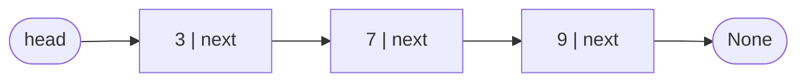
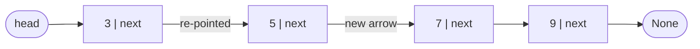
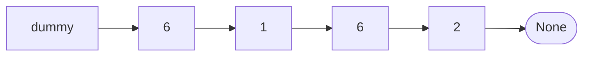
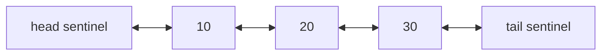
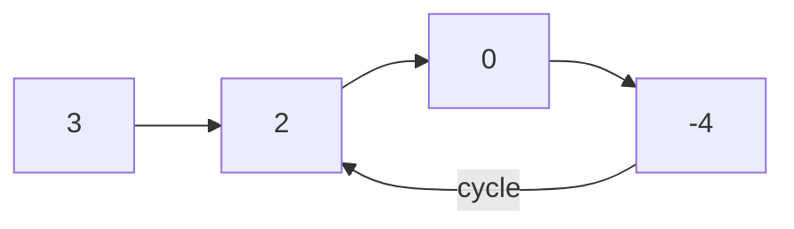
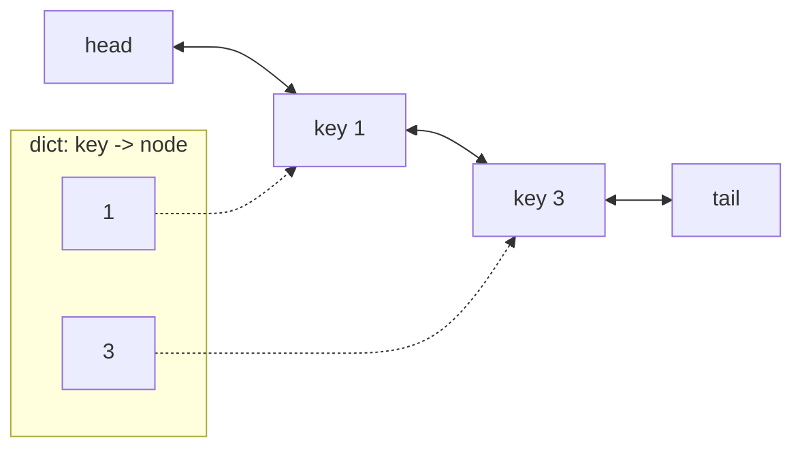

# Chapter 10 · Linked Lists

> A treasure hunt: the first clue is under the doormat, and it says "next clue is in the fridge". The fridge clue points to the bookshelf, and so on. Nobody has a list of all the hiding spots; each clue only knows the next one. That's a linked list. It sounds primitive, and that's exactly why interviewers love it: every problem is a test of whether you can move pointers around without losing anything.

**You will learn:**
- What a node and a pointer really are in Python, built from scratch
- Singly, doubly and circular linked lists: build, traverse, insert, delete
- The **dummy head** trick that deletes half your edge cases
- **Reversing** a list, iteratively and recursively, one pointer at a time
- **Fast & slow pointers**: middle node, cycle detection, cycle start (with Floyd's proof), happy number
- Classic problems: merge, reorder, palindrome, add two numbers, intersection, random pointers, reverse in k-groups
- How to build an **LRU cache** from a doubly linked list and a dict

**Before this:** [OOP I: Classes & Objects](../part-1-python/14-oop-classes-objects.md) · [Two Pointers](03-two-pointers.md) · [Hashing Patterns](05-hashing.md)

---

## 🧠 The Big Idea

A Python list (an **array**) stores its items in one continuous row of memory slots, like seats in a cinema row. To find seat 500, you jump straight there. But to insert someone at seat 3, everyone from seat 3 onward must shift one seat right. That's O(n).

A **linked list** stores each item in its own little box called a **node**. Each node holds a value and a **pointer** (a reference) to the next node. The boxes can live anywhere in memory; the pointers chain them together.



Inserting a new node between 3 and 7 doesn't move anyone. You just re-point two arrows:



The price: there's no "jump to item 500". To reach it you must follow 500 arrows from the head.

| Operation | Array (Python list) | Linked list |
|---|---|---|
| Read the i-th item | **O(1)** | O(n) (walk there) |
| Insert/delete at the front | O(n) (shift everything) | **O(1)** |
| Insert/delete after a node you already hold | O(n) | **O(1)** |
| Append at the end | O(1) amortised | O(1) with a tail pointer |
| Search for a value | O(n) | O(n) |
| Extra memory per item | small | a pointer (or two) per node |

> 💡 **The core insight:** a linked list trades fast *access* for fast *rewiring*. Every linked-list problem is about rewiring arrows in the right order without dropping the rest of the chain.

---

## 🔨 Building It Up

### 1. A node, from scratch

A node is a tiny object with two attributes: the value, and a reference to the next node (or `None` at the end).

```python
class ListNode:
    def __init__(self, val, next=None):
        self.val = val
        self.next = next

# build 3 -> 7 -> 9 by hand
c = ListNode(9)
b = ListNode(7, c)
a = ListNode(3, b)
head = a

print(head.val, head.next.val, head.next.next.val)
print(head.next.next.next)

# traverse: follow the arrows until None
node = head
while node is not None:
    print(node.val, end=" -> ")
    node = node.next
print("None")
```

```text
3 7 9
None
3 -> 7 -> 9 -> None
```

What just happened: `head` is just a variable holding a reference to the first node. In Python, every variable is a reference to an object ([Chapter 2 of Part 1](../part-1-python/02-variables-types-memory.md)), so "pointer" here simply means "an attribute that refers to another node object". The loop `node = node.next` is the heartbeat of every linked-list algorithm: **move one step along the chain**.

> ⚠️ Never move `head` itself while traversing (`head = head.next`) unless you mean to. You'll lose your only handle on the start of the list. Use a separate walker variable like `node` or `curr`.

### 2. Two helpers we'll use everywhere

Typing `ListNode(3, ListNode(7, ...))` gets old fast. These two helpers convert between Python lists and linked lists. Every runnable example in this chapter redefines them so each block stands alone.

```python
class ListNode:
    def __init__(self, val=0, next=None):
        self.val = val
        self.next = next

def build(values):
    """Python list -> linked list. Returns the head (or None if empty)."""
    dummy = ListNode()             # a fake node in front, so the loop has no special case
    tail = dummy
    for v in values:
        tail.next = ListNode(v)
        tail = tail.next
    return dummy.next

def to_list(head):
    """Linked list -> Python list, for printing."""
    out = []
    while head:
        out.append(head.val)
        head = head.next           # moving the *parameter* is fine: the caller's head is untouched
    return out

def length(head):
    count = 0
    while head:
        count += 1
        head = head.next
    return count

h = build([4, 8, 15, 16, 23, 42])
print(to_list(h), "length", length(h))
print(to_list(build([])))
```

```text
[4, 8, 15, 16, 23, 42] length 6
[]
```

What just happened: `build` uses a **dummy** node so that adding the first real node is no different from adding the tenth. You'll see this trick again and again.

### 3. A complete singly linked list class

Let's wrap a list in a class with a `head`, a `tail` (so appending is O(1)) and a `size`.

```python
class ListNode:
    def __init__(self, val, next=None):
        self.val = val
        self.next = next

class SinglyLinkedList:
    def __init__(self):
        self.head = None
        self.tail = None
        self.size = 0

    def push_front(self, val):                 # O(1)
        self.head = ListNode(val, self.head)
        if self.tail is None:                  # list was empty
            self.tail = self.head
        self.size += 1

    def push_back(self, val):                  # O(1) thanks to the tail pointer
        node = ListNode(val)
        if self.tail is None:
            self.head = self.tail = node
        else:
            self.tail.next = node
            self.tail = node
        self.size += 1

    def insert_at(self, index, val):           # O(index): walk, then O(1) rewire
        if index == 0:
            return self.push_front(val)
        if index == self.size:
            return self.push_back(val)
        prev = self.head
        for _ in range(index - 1):             # stop at the node BEFORE the spot
            prev = prev.next
        prev.next = ListNode(val, prev.next)   # new node points to prev's old next
        self.size += 1

    def delete_value(self, val):               # remove the first node holding val
        prev, curr = None, self.head
        while curr and curr.val != val:
            prev, curr = curr, curr.next
        if curr is None:
            return False                       # not found
        if prev is None:
            self.head = curr.next              # deleting the head
        else:
            prev.next = curr.next              # skip over curr
        if curr is self.tail:
            self.tail = prev
        self.size -= 1
        return True

    def __iter__(self):
        node = self.head
        while node:
            yield node.val
            node = node.next

    def __repr__(self):
        return " -> ".join(map(str, self)) + " -> None"

ll = SinglyLinkedList()
for x in [10, 20, 30]:
    ll.push_back(x)
ll.push_front(5)
ll.insert_at(2, 15)
print(ll, "| size", ll.size)
ll.delete_value(5)
ll.delete_value(30)
ll.delete_value(99)
print(ll, "| size", ll.size, "| tail", ll.tail.val)
```

```text
5 -> 10 -> 15 -> 20 -> 30 -> None | size 5
10 -> 15 -> 20 -> None | size 3 | tail 20
```

What just happened: **deleting** a node in a singly linked list means making its *predecessor* skip it: `prev.next = curr.next`. The skipped node has no references left, so Python frees it automatically. Notice the special cases we had to handle: deleting the head (no `prev`) and deleting the tail (update `self.tail`). Section 4 makes the head case disappear.

> 💡 **Insertion order matters.** In `insert_at`, `ListNode(val, prev.next)` grabs the old `prev.next` *before* we overwrite it. If you wrote `prev.next = ListNode(val)` first, the rest of the list would be lost forever.

### 4. The dummy head trick

Problem: **Remove Linked List Elements** (delete every node with value `val`). Without a dummy, the head is special because it has no predecessor. With a dummy node placed in front of the head, *every* real node has a predecessor.



```python
class ListNode:
    def __init__(self, val=0, next=None):
        self.val = val
        self.next = next

def build(values):
    dummy = tail = ListNode()
    for v in values:
        tail.next = ListNode(v)
        tail = tail.next
    return dummy.next

def to_list(head):
    out = []
    while head:
        out.append(head.val)
        head = head.next
    return out

def remove_elements(head, val):
    dummy = ListNode(0, head)       # dummy.next is the real head
    prev = dummy
    while prev.next:
        if prev.next.val == val:
            prev.next = prev.next.next   # unlink; don't move prev (new next is unchecked)
        else:
            prev = prev.next
    return dummy.next               # the real head, which may have changed

print(to_list(remove_elements(build([6, 1, 6, 6, 2, 6]), 6)))
print(to_list(remove_elements(build([7, 7, 7]), 7)))
```

```text
[1, 2]
[]
```

What just happened: no `if prev is None` anywhere. The dummy absorbs the edge case. At the end we return `dummy.next`, which correctly becomes `None` when every node was removed.

> 💡 **Rule of thumb:** if the head of the list might change (deleting, merging, partitioning, reversing a section), start with `dummy = ListNode(0, head)` and return `dummy.next`.

### 5. Doubly linked lists

A **doubly linked list** gives each node a `prev` pointer too. Now you can walk backwards, and, more importantly, **delete a node in O(1) when you hold a reference to it**, because the node knows its own predecessor.



We'll use two **sentinels** (dummy nodes at both ends) so that inserting and deleting never deal with `None`.

```python
class DNode:
    def __init__(self, val=None):
        self.val = val
        self.prev = None
        self.next = None

class DoublyLinkedList:
    def __init__(self):
        self.head = DNode()            # sentinels: never hold real data
        self.tail = DNode()
        self.head.next = self.tail
        self.tail.prev = self.head

    def insert_after(self, node, val):            # O(1)
        new = DNode(val)
        new.prev, new.next = node, node.next      # 1. new node points both ways
        node.next.prev = new                      # 2. old neighbour points back to it
        node.next = new                           # 3. node points forward to it
        return new

    def push_back(self, val):
        return self.insert_after(self.tail.prev, val)

    def remove(self, node):                       # O(1): neighbours skip over node
        node.prev.next = node.next
        node.next.prev = node.prev

    def forward(self):
        out, node = [], self.head.next
        while node is not self.tail:
            out.append(node.val)
            node = node.next
        return out

    def backward(self):
        out, node = [], self.tail.prev
        while node is not self.head:
            out.append(node.val)
            node = node.prev
        return out

dll = DoublyLinkedList()
n10 = dll.push_back(10)
n20 = dll.push_back(20)
dll.push_back(30)
dll.insert_after(n10, 15)
print(dll.forward(), dll.backward())
dll.remove(n20)                     # we hold the node: no searching needed
print(dll.forward())
```

```text
[10, 15, 20, 30] [30, 20, 15, 10]
[10, 15, 30]
```

What just happened: `remove` is two lines and no loop. That O(1) delete-by-reference is the reason doubly linked lists power LRU caches (section 13), browser history, and Python's own `collections.deque` (which is a doubly linked list of fixed-size blocks).

### 6. Circular linked lists

In a **circular** list, the last node points back to the first instead of `None`. There's no end, so traversal stops when you come back to where you started. It's the natural model for things that go round and round: players taking turns, round-robin scheduling, a playlist on repeat.

Classic demo, the **Josephus problem**: n people stand in a circle; counting starts at person 1, and every k-th person is eliminated. Who survives?

```python
class ListNode:
    def __init__(self, val, next=None):
        self.val = val
        self.next = next

def josephus(n, k):
    head = ListNode(1)
    tail = head
    for i in range(2, n + 1):
        tail.next = ListNode(i)
        tail = tail.next
    tail.next = head                    # close the circle

    order = []
    prev = tail                         # node before the current one
    while prev.next is not prev:        # more than one person left
        for _ in range(k - 1):          # move k-1 steps
            prev = prev.next
        order.append(prev.next.val)     # the k-th person is eliminated
        prev.next = prev.next.next
    return order, prev.val

order, survivor = josephus(7, 3)
print("eliminated:", order)
print("survivor:", survivor)
```

```text
eliminated: [3, 6, 2, 7, 5, 1]
survivor: 4
```

What just happened: a circle with one node points to itself, so `prev.next is not prev` means "more than one left". Deletion is the same `prev.next = prev.next.next` as before. With a circular list, the one danger is a traversal loop with no stopping condition: always stop when you return to your starting node.

### 7. Reversing a list, iteratively

The single most important linked-list operation. Turn `1 → 2 → 3 → None` into `3 → 2 → 1 → None`, in place.

Walk the list with three variables:
- `prev`: the already-reversed part (starts as `None`)
- `curr`: the node we're flipping now
- `nxt`: a bookmark for the rest of the list, saved **before** we break the arrow

```python
class ListNode:
    def __init__(self, val=0, next=None):
        self.val = val
        self.next = next

def build(values):
    dummy = tail = ListNode()
    for v in values:
        tail.next = ListNode(v)
        tail = tail.next
    return dummy.next

def to_list(head):
    out = []
    while head:
        out.append(head.val)
        head = head.next
    return out

def reverse_list(head):
    prev, curr = None, head
    while curr:
        nxt = curr.next        # 1. bookmark the rest
        curr.next = prev       # 2. flip the arrow backwards
        prev = curr            # 3. prev moves up
        curr = nxt             # 4. curr moves to the bookmark
    return prev                # prev is the new head

print(to_list(reverse_list(build([1, 2, 3]))))
print(to_list(reverse_list(build([42]))), to_list(reverse_list(build([]))))
```

```text
[3, 2, 1]
[42] []
```

**Pointer-by-pointer trace** of `1 → 2 → 3`:

| iteration | before: prev / curr | nxt saved | after flipping | state of the arrows |
|---|---|---|---|---|
| start | None / 1 | | | `1→2→3→None` |
| 1 | None / 1 | 2 | `1.next = None` | `None←1` and `2→3→None` |
| 2 | 1 / 2 | 3 | `2.next = 1` | `None←1←2` and `3→None` |
| 3 | 2 / 3 | None | `3.next = 2` | `None←1←2←3` |
| end | 3 / None | | | return 3 |

What just happened: at every moment the list is split into two healthy pieces: a reversed piece starting at `prev`, and an untouched piece starting at `curr`. Each iteration moves one node from the second piece to the front of the first. O(n) time, O(1) space.

> 💡 Memorise the four lines as a rhythm: **"save next, flip, step prev, step curr."**

### 8. Reversing a list, recursively

The recursive version is a great "trust the recursion" exercise ([Chapter 09](09-backtracking.md)).

Ask: "if someone already reversed everything after `head`, what's left for me to do?"

```text
before the call:  head=1 -> 2 -> 3 -> None
after reversing the rest:  1 -> 2 <- 3     (new_head = 3, and 1 still points to 2)
my job: make 2 point back to 1, and make 1 point to None.
```

```python
class ListNode:
    def __init__(self, val=0, next=None):
        self.val = val
        self.next = next

def build(values):
    dummy = tail = ListNode()
    for v in values:
        tail.next = ListNode(v)
        tail = tail.next
    return dummy.next

def to_list(head):
    out = []
    while head:
        out.append(head.val)
        head = head.next
    return out

def reverse_recursive(head):
    if head is None or head.next is None:
        return head                         # 0 or 1 node: already reversed
    new_head = reverse_recursive(head.next) # trust: the rest is now reversed
    head.next.next = head                   # my old next (now the tail of the reversed part) points to me
    head.next = None                        # I'm the new tail
    return new_head                         # the head of the reversed list never changes on the way up

print(to_list(reverse_recursive(build([1, 2, 3, 4, 5]))))
```

```text
[5, 4, 3, 2, 1]
```

What just happened: `head.next.next = head` is the line that confuses everyone. Read it as "the node after me should point back at me". After the recursive call, `head.next` is still node 2 (we haven't touched that arrow), and node 2 is now the *last* node of the reversed part, so we hang ourselves after it.

Time O(n), but space is **O(n)** for the call stack. For a list of 10,000 nodes this hits Python's recursion limit, so in interviews prefer the iterative version and mention why.

### 9. Fast & slow pointers: find the middle

Two walkers start at the head. **Slow** moves 1 step, **fast** moves 2 steps. When fast reaches the end, slow has covered half the distance: it's at the middle. (This is the "fast & slow" shape that [Chapter 03](03-two-pointers.md) promised.)

```python
class ListNode:
    def __init__(self, val=0, next=None):
        self.val = val
        self.next = next

def build(values):
    dummy = tail = ListNode()
    for v in values:
        tail.next = ListNode(v)
        tail = tail.next
    return dummy.next

def middle_node(head):
    slow = fast = head
    while fast and fast.next:       # fast can take two steps
        slow = slow.next
        fast = fast.next.next
    return slow

print(middle_node(build([1, 2, 3, 4, 5])).val)
print(middle_node(build([1, 2, 3, 4, 5, 6])).val)
```

```text
3
4
```

**Trace** for `[1, 2, 3, 4, 5, 6]`:

| step | slow | fast |
|---|---|---|
| start | 1 | 1 |
| 1 | 2 | 3 |
| 2 | 3 | 5 |
| 3 | 4 | None (past 6) → stop |

What just happened: for an even length there are two middles; this version returns the **second** one (4). If you need the **first** middle (useful for splitting a list into two halves), loop `while fast.next and fast.next.next` instead.

### 10. Cycle detection and the cycle's start (Floyd's algorithm)

A bug or a puzzle might create a **cycle**: some node's `next` points back to an earlier node, so traversal never ends. How do you detect it in O(1) space?

Put the slow and fast walkers on the list. If there's no cycle, fast hits `None`. If there is a cycle, both get trapped in the loop, and the fast one gains 1 step per move on the slow one, like a faster runner lapping a slower one on a circular track. They **must** meet.



Then a second, magical phase: put one pointer back at the head, leave the other at the meeting point, and move **both** one step at a time. Where they meet is the **start of the cycle**. (Proof in Under the Hood.)

```python
class ListNode:
    def __init__(self, val=0, next=None):
        self.val = val
        self.next = next

def build_with_cycle(values, pos):
    """Build a list; the tail links back to the node at index pos (-1 = no cycle)."""
    nodes = [ListNode(v) for v in values]
    for a, b in zip(nodes, nodes[1:]):
        a.next = b
    if pos >= 0:
        nodes[-1].next = nodes[pos]
    return nodes[0]

def has_cycle(head):
    slow = fast = head
    while fast and fast.next:
        slow, fast = slow.next, fast.next.next
        if slow is fast:               # same node object, not just same value
            return True
    return False

def detect_cycle(head):
    slow = fast = head
    while fast and fast.next:
        slow, fast = slow.next, fast.next.next
        if slow is fast:               # phase 1: they met inside the cycle
            finder = head
            while finder is not slow:  # phase 2: both move 1 step
                finder, slow = finder.next, slow.next
            return finder              # the cycle's entrance
    return None

print(has_cycle(build_with_cycle([3, 2, 0, -4], 1)), has_cycle(build_with_cycle([1, 2], -1)))
print(detect_cycle(build_with_cycle([3, 2, 0, -4], 1)).val)
print(detect_cycle(build_with_cycle([1, 2, 3, 4, 5, 6], 2)).val)
```

```text
True False
2
3
```

**Trace** of phase 1 for `3 → 2 → 0 → -4 → (back to 2)`:

| step | slow | fast | same? |
|---|---|---|---|
| start | 3 | 3 | |
| 1 | 2 | 0 | no |
| 2 | 0 | 2 | no |
| 3 | -4 | -4 | ✅ meet |

Phase 2: `finder` starts at 3, `slow` at -4. One step: finder → 2, slow → 2. They meet at **2**, the cycle start. ✓

> ⚠️ Compare nodes with `is`, not `==`. Two different nodes can hold the same value; we care whether they're the **same object**.

**Happy Number** is Floyd's algorithm in disguise. Replace a number by the sum of the squares of its digits, repeatedly. It's "happy" if it reaches 1. Otherwise it loops forever. The numbers form an implicit linked list (each number "points" to the next), so detect the cycle with slow and fast:

```python
def next_number(n):
    return sum(int(d) ** 2 for d in str(n))

def is_happy(n):
    slow, fast = n, next_number(n)
    while fast != 1 and slow != fast:
        slow = next_number(slow)                  # 1 step
        fast = next_number(next_number(fast))     # 2 steps
    return fast == 1

print(is_happy(19), is_happy(2), is_happy(7))
```

```text
True False True
```

What just happened: 19 → 82 → 68 → 100 → 1, happy. 2 → 4 → 16 → 37 → 58 → 89 → 145 → 42 → 20 → 4 → ..., a cycle that never touches 1. No nodes, no `next` pointers, but the same pattern: **anything where each state leads to exactly one next state** is a linked list in disguise.

### 11. K-th node from the end

**Remove Nth Node From End of List.** You could count the length, then walk again. The one-pass trick: start two pointers together, move the **lead** pointer n steps ahead, then move both until the lead falls off the end. The gap of n means the trailing pointer is right before the target.

```python
class ListNode:
    def __init__(self, val=0, next=None):
        self.val = val
        self.next = next

def build(values):
    dummy = tail = ListNode()
    for v in values:
        tail.next = ListNode(v)
        tail = tail.next
    return dummy.next

def to_list(head):
    out = []
    while head:
        out.append(head.val)
        head = head.next
    return out

def remove_nth_from_end(head, n):
    dummy = ListNode(0, head)          # the head itself might be removed
    lead = trail = dummy
    for _ in range(n + 1):             # n + 1 so trail stops BEFORE the target
        lead = lead.next
    while lead:
        lead, trail = lead.next, trail.next
    trail.next = trail.next.next       # unlink the n-th from the end
    return dummy.next

print(to_list(remove_nth_from_end(build([1, 2, 3, 4, 5]), 2)))
print(to_list(remove_nth_from_end(build([1]), 1)))
print(to_list(remove_nth_from_end(build([1, 2]), 2)))
```

```text
[1, 2, 3, 5]
[]
[2]
```

What just happened: with a gap of n + 1 between `lead` and `trail`, when `lead` is `None` (one past the last node), `trail` sits just before the n-th node from the end. The dummy handles "remove the head" (the last example) for free.

### 12. Merge two sorted lists

The linked-list version of the merge from merge sort ([Chapter 07](07-sorting.md)). Keep a `tail` pointer to the end of the merged list and keep attaching the smaller head.

```python
class ListNode:
    def __init__(self, val=0, next=None):
        self.val = val
        self.next = next

def build(values):
    dummy = tail = ListNode()
    for v in values:
        tail.next = ListNode(v)
        tail = tail.next
    return dummy.next

def to_list(head):
    out = []
    while head:
        out.append(head.val)
        head = head.next
    return out

def merge_two_lists(a, b):
    dummy = tail = ListNode()
    while a and b:
        if a.val <= b.val:
            tail.next, a = a, a.next      # attach a's node, advance a
        else:
            tail.next, b = b, b.next
        tail = tail.next
    tail.next = a or b                    # attach whatever is left (already sorted)
    return dummy.next

print(to_list(merge_two_lists(build([1, 2, 4]), build([1, 3, 4]))))
print(to_list(merge_two_lists(build([]), build([0]))))
```

```text
[1, 1, 2, 3, 4, 4]
[0]
```

What just happened: no new nodes are created; we just re-point the existing ones. O(m + n) time, O(1) extra space. `a or b` returns whichever is not `None`.

### 13. LRU Cache: doubly linked list + dict

The famous design problem. An **LRU (Least Recently Used) cache** holds at most `capacity` key-value pairs. `get(key)` returns the value (or -1) and marks the key as recently used. `put(key, value)` inserts or updates; if the cache is full, it evicts the **least recently used** key. Both must be **O(1)**.

Neither structure alone can do it:
- A **dict** finds a key in O(1), but doesn't know the usage order.
- A **doubly linked list** keeps the order and can move or remove a node in O(1), but finding a node takes O(n).

Together: the dict maps `key → node`, and the list is ordered from least recent (front) to most recent (back).



```python
class DNode:
    def __init__(self, key=0, val=0):
        self.key, self.val = key, val
        self.prev = self.next = None

class LRUCache:
    def __init__(self, capacity):
        self.capacity = capacity
        self.map = {}                         # key -> node
        self.head, self.tail = DNode(), DNode()   # sentinels: head side = least recent
        self.head.next, self.tail.prev = self.tail, self.head

    def _remove(self, node):                  # O(1) unlink
        node.prev.next, node.next.prev = node.next, node.prev

    def _append(self, node):                  # O(1) insert just before tail (most recent)
        node.prev, node.next = self.tail.prev, self.tail
        self.tail.prev.next = node
        self.tail.prev = node

    def get(self, key):
        if key not in self.map:
            return -1
        node = self.map[key]
        self._remove(node)                    # touch: move to most-recent end
        self._append(node)
        return node.val

    def put(self, key, value):
        if key in self.map:
            self._remove(self.map[key])
        node = DNode(key, value)
        self.map[key] = node
        self._append(node)
        if len(self.map) > self.capacity:
            lru = self.head.next              # least recent sits right after head
            self._remove(lru)
            del self.map[lru.key]             # this is why nodes store their key

cache = LRUCache(2)
cache.put(1, 1)
cache.put(2, 2)
print(cache.get(1))      # 1 is now most recent
cache.put(3, 3)          # evicts key 2
print(cache.get(2))
cache.put(4, 4)          # evicts key 1
print(cache.get(1), cache.get(3), cache.get(4))
```

```text
1
-1
-1 3 4
```

What just happened: every operation is a dict lookup plus a couple of O(1) pointer changes. Nodes store their **key** so that when we evict the front node, we know which dict entry to delete. In real Python code, `collections.OrderedDict` with `move_to_end` and `popitem(last=False)` does the same thing (it's built on the same idea), but interviewers want you to build it by hand. LRU caches appear everywhere in system design ([Caching & CDNs](../part-3-system-design/04-caching-cdn.md)).

---

## 🔬 Under the Hood

### What a node costs in Python

Each `ListNode` is a full Python object: a header (reference count + type pointer), a dictionary or slots for attributes, plus the value object itself. A small node can easily take 50–100 bytes, while a Python list stores 8 bytes per item (a pointer) in one contiguous block. Adding `__slots__ = ("val", "next")` to the class removes the per-object dict and cuts memory noticeably.

Contiguous memory also matters for speed. CPUs load memory in chunks (cache lines), so walking an array touches neighbouring data that's already cached. Walking a linked list jumps around memory, causing cache misses. So even when both are O(n), a Python list usually wins in practice. That's why Python has no built-in singly linked list: `list` and `collections.deque` cover almost all real needs. Linked lists matter for **interviews**, for understanding other structures (trees and graphs are "linked lists with more arrows"), and for the specific cases where O(1) rewiring is essential (LRU caches, allocators, the OS scheduler).

### Garbage collection makes deletion easy

In C you must `free()` a node you unlink. In Python, when you write `prev.next = curr.next`, the skipped node's reference count drops; when it hits zero, CPython frees it immediately. (Cycles of objects are cleaned up by the separate cycle collector.)

### Why reversal is correct: the invariant

At the top of every loop iteration in `reverse_list`:
- `prev` is the head of a correctly reversed list of the nodes already visited.
- `curr` is the head of the untouched remainder.

One iteration moves `curr` from the second list to the front of the first. The invariant still holds. When `curr` is `None`, the remainder is empty and `prev` heads the fully reversed list.

### Floyd's cycle algorithm: the proof

Let:
- **a** = number of steps from the head to the cycle's start,
- **c** = length of the cycle,
- **b** = how far into the cycle (from its start) slow and fast meet.

**Why they meet at all.** Once both pointers are in the cycle, each move increases fast's lead by 1 (fast +2, slow +1). Measured around the circle, the gap shrinks by 1 every step, so it hits 0 within c steps. Total work is O(a + c) = **O(n)**.

**Why phase 2 finds the start.** When they meet, slow has walked `a + b` steps. Fast has walked twice as far, `2(a + b)`, and the extra distance must be some whole number of laps k around the cycle:

```text
2(a + b) - (a + b) = k * c
           a + b   = k * c
               a   = k * c - b = (k - 1) * c + (c - b)
```

Read that last line as a story. A pointer starting at the meeting point needs `c - b` steps to reach the cycle start, then can go round any number of full laps and still be at the start. So after exactly **a** steps it's at the cycle start, and so is a pointer that started at the head and walked **a** steps. They arrive together. ∎

### Why the "intersection" trick works

For **Intersection of Two Linked Lists** (Interview Q10), pointer A walks list A then list B; pointer B walks list B then list A. Both walk `lenA + lenB` steps in total. If the lists share a tail of length t, both pointers reach the shared part after exactly `lenA + lenB - t` steps, at the same moment. If not, both reach `None` at the same moment.

---

## 🧩 Pattern Decoder

### Signals: when it's a linked-list pattern

| You see in the problem... | Think |
|---|---|
| "the head might change", "remove / insert / partition" | **Dummy head** |
| "reverse the list / a part of it / every k nodes" | **Reverse** (prev, curr, nxt) |
| "middle", "split in half", "palindrome list" | **Fast & slow** for the middle |
| "cycle", "loop", "repeats forever", "duplicate number in 1..n" | **Floyd** fast & slow |
| "n-th from the end", "in one pass" | **Two pointers with a gap** |
| "merge sorted lists", "sort a linked list" | **Merge** with a tail pointer |
| "O(1) get and put with eviction / ordering" | **Doubly linked list + dict** |
| "copy a list with extra pointers" | **Hash map old → new** (or interleaving) |
| "two lists meet" | **Switch heads** trick |

### Template A: dummy + tail (building or filtering)

```py
dummy = ListNode()
tail = dummy
while ...:
    if keep(node):
        tail.next = node      # attach
        tail = tail.next
    node = node.next
tail.next = None              # cut off leftovers, or you may keep a stale link
return dummy.next
```

### Template B: reverse

```py
prev, curr = None, head
while curr:
    nxt = curr.next   # save
    curr.next = prev  # flip
    prev = curr       # step prev
    curr = nxt        # step curr
return prev
```

### Template C: fast & slow

```py
slow = fast = head
while fast and fast.next:
    slow = slow.next
    fast = fast.next.next
    # cycle check: if slow is fast: ...
# slow is the (second) middle when the loop ends
```

### Template D: gap of n

```py
lead = trail = dummy
for _ in range(n + 1):
    lead = lead.next
while lead:
    lead, trail = lead.next, trail.next
# trail.next is the n-th node from the end
```

### Combining templates: the "middle + reverse + merge" recipe

Many medium problems are just these three building blocks glued together:

| Problem | Middle | Reverse | Then |
|---|---|---|---|
| Palindrome Linked List | ✅ | second half | compare halves |
| Reorder List | ✅ | second half | weave halves together |
| Sort List | ✅ (split) | | merge sort recursively |
| Maximum Twin Sum | ✅ | second half | pair up and take max |

### Variation: Reverse Linked List II (reverse a section)

**Problem:** reverse the nodes from position `left` to `right` (1-based). `[1,2,3,4,5]`, 2, 4 → `[1,4,3,2,5]`.

**Idea:** walk to the node **before** the section (`before`). Then repeatedly take the node right after the section's first node and move it to the front of the section ("head insertion"). A dummy handles `left = 1`.

```python
class ListNode:
    def __init__(self, val=0, next=None):
        self.val = val
        self.next = next

def build(values):
    dummy = tail = ListNode()
    for v in values:
        tail.next = ListNode(v)
        tail = tail.next
    return dummy.next

def to_list(head):
    out = []
    while head:
        out.append(head.val)
        head = head.next
    return out

def reverse_between(head, left, right):
    dummy = ListNode(0, head)
    before = dummy
    for _ in range(left - 1):
        before = before.next              # node just before the section
    first = before.next                   # will end up as the section's last node
    for _ in range(right - left):
        moved = first.next                # node to move to the front
        first.next = moved.next
        moved.next = before.next
        before.next = moved
    return dummy.next

print(to_list(reverse_between(build([1, 2, 3, 4, 5]), 2, 4)))
print(to_list(reverse_between(build([3, 5]), 1, 2)))
```

```text
[1, 4, 3, 2, 5]
[5, 3]
```

**Trace** for `[1, 2, 3, 4, 5]`, left = 2, right = 4 (`before` = 1, `first` = 2):

| move | moved | list after |
|---|---|---|
| start | | 1 → 2 → 3 → 4 → 5 |
| 1 | 3 | 1 → 3 → 2 → 4 → 5 |
| 2 | 4 | 1 → 4 → 3 → 2 → 5 |

O(n) time, O(1) space.

### Variation: Reverse Nodes in k-Group

**Problem:** reverse every consecutive group of k nodes; a leftover group shorter than k stays as is. `[1,2,3,4,5]`, k = 2 → `[2,1,4,3,5]`.

**Idea:** loop over groups. For each group: check that k nodes exist; reverse exactly those k with Template B (stopping at the node after the group); then reconnect: the node before the group points to the new group head, and the old group head (now the group's tail) becomes the "before" node for the next group.

```python
class ListNode:
    def __init__(self, val=0, next=None):
        self.val = val
        self.next = next

def build(values):
    dummy = tail = ListNode()
    for v in values:
        tail.next = ListNode(v)
        tail = tail.next
    return dummy.next

def to_list(head):
    out = []
    while head:
        out.append(head.val)
        head = head.next
    return out

def reverse_k_group(head, k):
    dummy = ListNode(0, head)
    group_prev = dummy
    while True:
        kth = group_prev                       # find the k-th node of this group
        for _ in range(k):
            kth = kth.next
            if kth is None:
                return dummy.next              # fewer than k left: done
        group_next = kth.next

        prev, curr = group_next, group_prev.next   # reverse the group; its tail links to group_next
        while curr is not group_next:
            nxt = curr.next
            curr.next = prev
            prev, curr = curr, nxt

        old_first = group_prev.next            # becomes the group's tail
        group_prev.next = kth                  # kth is the group's new head
        group_prev = old_first

print(to_list(reverse_k_group(build([1, 2, 3, 4, 5]), 2)))
print(to_list(reverse_k_group(build([1, 2, 3, 4, 5]), 3)))
print(to_list(reverse_k_group(build([1, 2, 3, 4, 5, 6]), 3)))
```

```text
[2, 1, 4, 3, 5]
[3, 2, 1, 4, 5]
[3, 2, 1, 6, 5, 4]
```

The trick: starting `prev` at `group_next` (instead of `None`) makes the reversed group's last node automatically point to the rest of the list. O(n) time, O(1) space.

### When NOT to use a linked list

- **You need random access** (`a[i]`) or binary search: use an array ([Chapter 08](08-binary-search.md)).
- **You just need a queue or stack in Python:** use `collections.deque` or `list` ([Chapter 11](11-stacks.md), [Chapter 12](12-queues-deques.md)). They're faster and already written.
- **Memory is tight:** per-node overhead is large in Python.
- **A problem gives you a Python list** and asks something like "find the middle": just use indexes. Fast & slow pointers are for when you *can't* index.

---

## ⚠️ Traps & Common Mistakes

1. **Losing the rest of the list.** Overwriting `curr.next` before saving it.

```py
# ❌ wrong: after the first line, the rest of the list is unreachable
curr.next = prev
curr = curr.next          # this goes BACKWARDS to prev

# ✅ right: save first
nxt = curr.next
curr.next = prev
curr = nxt
```

2. **`None` attribute errors.** `fast.next.next` crashes if `fast` is `None` or `fast.next` is `None`. Always guard with `while fast and fast.next`.
3. **Forgetting edge cases:** empty list (`head is None`), single node, two nodes, removing the head, removing the tail. Test these four every time.
4. **Returning `head` when the head changed.** After deleting or reversing, the old head may not be the first node anymore. With a dummy, return `dummy.next`.
5. **Creating accidental cycles.** In Reorder List or partitioning, if you don't cut the end (`tail.next = None` or `first_half_end.next = None`), an old link survives and the list loops forever when printed.
6. **Comparing nodes with `==`.** Use `is` for "same node". `==` on custom objects defaults to identity anyway, but if a class defines `__eq__` by value, `==` will lie to you.
7. **Recursion depth.** The recursive reverse or recursive merge uses O(n) stack. On a list of 10,000 nodes you get `RecursionError`. Use iteration for long lists.
8. **Moving `prev` after deleting.** In `remove_elements`, after `prev.next = prev.next.next`, the new `prev.next` hasn't been checked yet. Advance `prev` only when you keep a node.
9. **Off-by-one in the gap.** For "remove n-th from end", the lead must be `n + 1` steps ahead of `trail` when starting from the dummy, so `trail` lands *before* the target.
10. **Doubly linked list: updating only one direction.** Every insert/delete changes **two** pointers per affected neighbour pair (`next` and `prev`). Draw the four arrows before coding.

---

## 💡 Tips & Tricks

- **Draw it.** Boxes and arrows on paper, and redraw after each line of code. Linked-list bugs are visible, not mysterious.
- **Dummy node by default.** It costs one line and removes most head-related edge cases.
- **Name your pointers by role:** `prev`, `curr`, `nxt`, `slow`, `fast`, `lead`, `trail`, `tail`. It makes the code self-explaining.
- **Save before you break:** any time you overwrite `x.next`, ask "do I still need the old `x.next`?"
- Keep `build` and `to_list` helpers ready for testing; interviewers appreciate seeing you test.
- Many hard problems are **middle + reverse + merge** combined. Practise the three until you can write each in 30 seconds.
- For "find the duplicate number in an array of n + 1 numbers from 1..n with O(1) space", treat `i → nums[i]` as a linked list and run Floyd. Same algorithm, different costume.
- In Python, multiple assignment like `prev, curr = curr, curr.next` evaluates the right side first, which can save a temp variable. But in the reversal, `curr.next, prev, curr = prev, curr, curr.next` is easy to get wrong; the explicit four lines are safer in interviews.

---

## 🎯 Interview Questions

### 1. Reverse Linked List 🔥🔥🔥

<details><summary>Answer</summary>

Iterative: save next, flip, step prev, step curr (section 7). O(n) time, O(1) space. Recursive: `head.next.next = head; head.next = None` (section 8), O(n) stack space. Be ready to write both and explain why iterative is preferred for long lists.

</details>

### 2. Merge Two Sorted Lists 🔥🔥🔥

<details><summary>Answer</summary>

Dummy + tail, attach the smaller head each step, then attach the leftover (section 12). O(m + n) time, O(1) space. The recursive version (`a.next = merge(a.next, b)`) is shorter but uses O(m + n) stack.

</details>

### 3. Linked List Cycle / Linked List Cycle II 🔥🔥🔥

<details><summary>Answer</summary>

Floyd: slow 1 step, fast 2 steps; they meet iff there's a cycle. For the cycle's start, reset one pointer to the head and step both by 1 until they meet (section 10, proof in Under the Hood). O(n) time, O(1) space. Alternative: a `set` of visited nodes, O(n) space.

</details>

### 4. Middle of the Linked List 🔥🔥

<details><summary>Answer</summary>

Fast & slow; when fast can't take two steps, slow is the middle (section 9). O(n), O(1). Know both variants: `while fast and fast.next` gives the second middle, `while fast.next and fast.next.next` gives the first.

</details>

### 5. Remove Nth Node From End of List 🔥🔥🔥

<details><summary>Answer</summary>

Dummy + lead/trail with a gap of n + 1, then unlink `trail.next` (section 11). One pass, O(n) time, O(1) space.

</details>

### 6. Palindrome Linked List 🔥🔥🔥

Is the list a palindrome? Do it in O(1) extra space.

<details><summary>Answer</summary>

Find the middle, reverse the second half, compare the halves node by node. (Optionally reverse it back to leave the input unchanged.)

```python
class ListNode:
    def __init__(self, val=0, next=None):
        self.val = val
        self.next = next

def build(values):
    dummy = tail = ListNode()
    for v in values:
        tail.next = ListNode(v)
        tail = tail.next
    return dummy.next

def is_palindrome(head):
    slow = fast = head
    while fast and fast.next:                 # slow -> middle (second middle if even)
        slow, fast = slow.next, fast.next.next
    prev, curr = None, slow                   # reverse the second half
    while curr:
        nxt = curr.next
        curr.next = prev
        prev, curr = curr, nxt
    left, right = head, prev
    while right:                              # second half is never longer
        if left.val != right.val:
            return False
        left, right = left.next, right.next
    return True

print(is_palindrome(build([1, 2, 2, 1])), is_palindrome(build([1, 2])), is_palindrome(build([1, 2, 3, 2, 1])))
```

```text
True False True
```

O(n) time, O(1) space. (Copying values into a Python list and checking `vals == vals[::-1]` is O(n) space; mention it as the simple version.)

</details>

### 7. Reorder List 🔥🔥

`L0 → L1 → ... → Ln` becomes `L0 → Ln → L1 → Ln-1 → ...`, in place.

<details><summary>Answer</summary>

Middle + reverse second half + weave. Cut the first half's end to avoid a cycle.

```python
class ListNode:
    def __init__(self, val=0, next=None):
        self.val = val
        self.next = next

def build(values):
    dummy = tail = ListNode()
    for v in values:
        tail.next = ListNode(v)
        tail = tail.next
    return dummy.next

def to_list(head):
    out = []
    while head:
        out.append(head.val)
        head = head.next
    return out

def reorder_list(head):
    if not head or not head.next:
        return head
    slow = fast = head
    while fast.next and fast.next.next:       # slow -> first middle
        slow, fast = slow.next, fast.next.next
    second, slow.next = slow.next, None       # cut! first half now ends with None
    prev = None
    while second:                             # reverse second half
        nxt = second.next
        second.next = prev
        prev, second = second, nxt
    first, second = head, prev
    while second:                             # weave: one from each half
        n1, n2 = first.next, second.next
        first.next = second
        second.next = n1
        first, second = n1, n2
    return head

print(to_list(reorder_list(build([1, 2, 3, 4]))))
print(to_list(reorder_list(build([1, 2, 3, 4, 5]))))
```

```text
[1, 4, 2, 3]
[1, 5, 2, 4, 3]
```

O(n) time, O(1) space.

</details>

### 8. Remove Duplicates from Sorted List (I and II) 🔥🔥

I: keep one copy of each value. II: delete **all** nodes whose value is duplicated.

<details><summary>Answer</summary>

I: walk; if the next node has the same value, skip it. II: needs a dummy (the head may be deleted); when a run of equal values is found, skip the whole run.

```python
class ListNode:
    def __init__(self, val=0, next=None):
        self.val = val
        self.next = next

def build(values):
    dummy = tail = ListNode()
    for v in values:
        tail.next = ListNode(v)
        tail = tail.next
    return dummy.next

def to_list(head):
    out = []
    while head:
        out.append(head.val)
        head = head.next
    return out

def delete_duplicates(head):                  # I
    curr = head
    while curr and curr.next:
        if curr.next.val == curr.val:
            curr.next = curr.next.next        # skip the copy; stay to check the new next
        else:
            curr = curr.next
    return head

def delete_duplicates_ii(head):               # II
    dummy = ListNode(0, head)
    prev = dummy
    while prev.next:
        curr = prev.next
        if curr.next and curr.next.val == curr.val:
            while curr.next and curr.next.val == curr.val:
                curr = curr.next              # curr -> last node of the run
            prev.next = curr.next             # drop the entire run
        else:
            prev = prev.next
    return dummy.next

print(to_list(delete_duplicates(build([1, 1, 2, 3, 3]))))
print(to_list(delete_duplicates_ii(build([1, 2, 3, 3, 4, 4, 5]))), to_list(delete_duplicates_ii(build([1, 1, 1, 2, 3]))))
```

```text
[1, 2, 3]
[1, 2, 5] [2, 3]
```

Both O(n) time, O(1) space.

</details>

### 9. Add Two Numbers 🔥🔥🔥

Digits are stored in reverse order (`2 → 4 → 3` is 342). Return the sum as a list.

<details><summary>Answer</summary>

Grade-school addition from the least significant digit, which is conveniently the head. Keep a carry; continue while either list or the carry remains.

```python
class ListNode:
    def __init__(self, val=0, next=None):
        self.val = val
        self.next = next

def build(values):
    dummy = tail = ListNode()
    for v in values:
        tail.next = ListNode(v)
        tail = tail.next
    return dummy.next

def to_list(head):
    out = []
    while head:
        out.append(head.val)
        head = head.next
    return out

def add_two_numbers(l1, l2):
    dummy = tail = ListNode()
    carry = 0
    while l1 or l2 or carry:
        total = carry + (l1.val if l1 else 0) + (l2.val if l2 else 0)
        carry, digit = divmod(total, 10)
        tail.next = ListNode(digit)
        tail = tail.next
        l1 = l1.next if l1 else None
        l2 = l2.next if l2 else None
    return dummy.next

print(to_list(add_two_numbers(build([2, 4, 3]), build([5, 6, 4]))))
print(to_list(add_two_numbers(build([9, 9, 9, 9, 9, 9, 9]), build([9, 9, 9, 9]))))
```

```text
[7, 0, 8]
[8, 9, 9, 9, 0, 0, 0, 1]
```

O(max(m, n)) time, O(1) extra space (besides the output). Don't forget the final carry (the `or carry` in the loop).

</details>

### 10. Intersection of Two Linked Lists 🔥🔥🔥

Return the node where two lists merge, or `None`.

<details><summary>Answer</summary>

Pointer A walks A then B; pointer B walks B then A. They line up after `lenA + lenB` steps (proof in Under the Hood).

```python
class ListNode:
    def __init__(self, val=0, next=None):
        self.val = val
        self.next = next

def build(values):
    dummy = tail = ListNode()
    for v in values:
        tail.next = ListNode(v)
        tail = tail.next
    return dummy.next

def get_intersection_node(head_a, head_b):
    a, b = head_a, head_b
    while a is not b:
        a = a.next if a else head_b      # end of A -> jump to B's head
        b = b.next if b else head_a      # end of B -> jump to A's head
    return a                             # the shared node, or None

shared = build([8, 4, 5])
a = ListNode(4, ListNode(1, shared))                   # 4 -> 1 -> 8 -> 4 -> 5
b = ListNode(5, ListNode(6, ListNode(1, shared)))      # 5 -> 6 -> 1 -> 8 -> 4 -> 5
print(get_intersection_node(a, b).val)
print(get_intersection_node(build([1, 2]), build([3])))
```

```text
8
None
```

O(m + n) time, O(1) space. Note the intersection is about the same **node**, not equal values: the 1s in both lists are different nodes.

</details>

### 11. Copy List with Random Pointer 🔥🔥

Each node has `next` and `random` (pointing anywhere or `None`). Make a deep copy.

<details><summary>Answer</summary>

Two passes with a dict `old node → new node`: first create all copies, then wire `next` and `random` through the dict.

```python
class Node:
    def __init__(self, val, next=None, random=None):
        self.val, self.next, self.random = val, next, random

def copy_random_list(head):
    if head is None:
        return None
    clone = {}
    node = head
    while node:                              # pass 1: create copies
        clone[node] = Node(node.val)
        node = node.next
    node = head
    while node:                              # pass 2: wire pointers via the map
        clone[node].next = clone.get(node.next)
        clone[node].random = clone.get(node.random)
        node = node.next
    return clone[head]

def build_random(pairs):
    """pairs: [val, random_index or None]"""
    nodes = [Node(v) for v, _ in pairs]
    for i, (_, r) in enumerate(pairs):
        nodes[i].next = nodes[i + 1] if i + 1 < len(nodes) else None
        nodes[i].random = nodes[r] if r is not None else None
    return nodes[0]

def describe(head):
    nodes, node = [], head
    while node:
        nodes.append(node)
        node = node.next
    index = {id(n): i for i, n in enumerate(nodes)}
    return [[n.val, index[id(n.random)] if n.random else None] for n in nodes]

original = build_random([[7, None], [13, 0], [11, 4], [10, 2], [1, 0]])
copy = copy_random_list(original)
print(describe(copy))
print("deep copy:", copy is not original and copy.next is not original.next)
```

```text
[[7, None], [13, 0], [11, 4], [10, 2], [1, 0]]
deep copy: True
```

O(n) time, O(n) space. The O(1)-space follow-up interleaves copies (`A → A' → B → B' ...`), sets `A'.random = A.random.next`, then unweaves the two lists.

</details>

### 12. Reverse Nodes in k-Group 🔥🔥🔥

<details><summary>Answer</summary>

Check k nodes exist, reverse them with `prev` starting at the node after the group, reconnect, move `group_prev` to the old group head. Full code and explanation in the Pattern Decoder. O(n) time, O(1) space.

</details>

### 13. LRU Cache 🔥🔥🔥

<details><summary>Answer</summary>

Dict `key → node` + doubly linked list with sentinels, ordered least → most recent (section 13). `get`: move the node to the back. `put`: insert/update at the back, evict `head.next` if over capacity. Both O(1). Mention that nodes store their key for eviction, and that `OrderedDict` gives a short production version.

</details>

### 14. Merge k Sorted Lists 🔥🔥🔥

<details><summary>Answer</summary>

**Divide and conquer:** merge lists in pairs, like the levels of merge sort. Each round halves the number of lists, and each round touches all N nodes once: O(N log k). (The other standard answer uses a min-heap of the k current heads, also O(N log k); see [Chapter 15](15-heaps.md).)

```python
class ListNode:
    def __init__(self, val=0, next=None):
        self.val = val
        self.next = next

def build(values):
    dummy = tail = ListNode()
    for v in values:
        tail.next = ListNode(v)
        tail = tail.next
    return dummy.next

def to_list(head):
    out = []
    while head:
        out.append(head.val)
        head = head.next
    return out

def merge_two(a, b):
    dummy = tail = ListNode()
    while a and b:
        if a.val <= b.val:
            tail.next, a = a, a.next
        else:
            tail.next, b = b, b.next
        tail = tail.next
    tail.next = a or b
    return dummy.next

def merge_k_lists(lists):
    if not lists:
        return None
    while len(lists) > 1:
        merged = []
        for i in range(0, len(lists), 2):
            b = lists[i + 1] if i + 1 < len(lists) else None
            merged.append(merge_two(lists[i], b))
        lists = merged
    return lists[0]

print(to_list(merge_k_lists([build([1, 4, 5]), build([1, 3, 4]), build([2, 6])])))
```

```text
[1, 1, 2, 3, 4, 4, 5, 6]
```

O(N log k) time, O(1) extra space besides the list of heads.

</details>

---

## 🏋️ Practice

**🟢 1. Convert Binary Number in a Linked List to Integer.** `1 → 0 → 1` → 5.

<details><summary>Solution</summary>

Walk the list; each step shifts the number left by one bit and adds the new bit.

```python
class ListNode:
    def __init__(self, val=0, next=None):
        self.val = val
        self.next = next

def build(values):
    dummy = tail = ListNode()
    for v in values:
        tail.next = ListNode(v)
        tail = tail.next
    return dummy.next

def get_decimal_value(head):
    num = 0
    while head:
        num = num * 2 + head.val
        head = head.next
    return num

print(get_decimal_value(build([1, 0, 1])), get_decimal_value(build([1, 1, 1, 1])))
```

```text
5 15
```

</details>

**🟢 2. Delete Node in a Linked List.** You're given only the node to delete (not the head, and not the tail). Delete it.

<details><summary>Solution</summary>

You can't reach the previous node, so **copy the next node's value into this one, then skip the next node**.

```python
class ListNode:
    def __init__(self, val=0, next=None):
        self.val = val
        self.next = next

def build(values):
    dummy = tail = ListNode()
    for v in values:
        tail.next = ListNode(v)
        tail = tail.next
    return dummy.next

def to_list(head):
    out = []
    while head:
        out.append(head.val)
        head = head.next
    return out

def delete_node(node):
    node.val = node.next.val
    node.next = node.next.next

head = build([4, 5, 1, 9])
delete_node(head.next)          # the node holding 5
print(to_list(head))
```

```text
[4, 1, 9]
```

</details>

**🟡 3. Odd Even Linked List.** Group nodes at odd positions first, then even positions, keeping relative order. `[1,2,3,4,5]` → `[1,3,5,2,4]`.

<details><summary>Solution</summary>

```python
class ListNode:
    def __init__(self, val=0, next=None):
        self.val = val
        self.next = next

def build(values):
    dummy = tail = ListNode()
    for v in values:
        tail.next = ListNode(v)
        tail = tail.next
    return dummy.next

def to_list(head):
    out = []
    while head:
        out.append(head.val)
        head = head.next
    return out

def odd_even_list(head):
    if not head:
        return head
    odd, even = head, head.next
    even_head = even
    while even and even.next:
        odd.next = even.next          # odd skips over even
        odd = odd.next
        even.next = odd.next          # even skips over the new odd
        even = even.next
    odd.next = even_head              # glue evens after odds
    return head

print(to_list(odd_even_list(build([1, 2, 3, 4, 5]))), to_list(odd_even_list(build([2, 1, 3, 5, 6, 4, 7]))))
```

```text
[1, 3, 5, 2, 4] [2, 3, 6, 7, 1, 5, 4]
```

</details>

**🟡 4. Rotate List** to the right by k. `[1,2,3,4,5]`, k = 2 → `[4,5,1,2,3]`.

<details><summary>Solution</summary>

Make it circular, then cut at the right place. k may exceed the length, so use `k % n`.

```python
class ListNode:
    def __init__(self, val=0, next=None):
        self.val = val
        self.next = next

def build(values):
    dummy = tail = ListNode()
    for v in values:
        tail.next = ListNode(v)
        tail = tail.next
    return dummy.next

def to_list(head):
    out = []
    while head:
        out.append(head.val)
        head = head.next
    return out

def rotate_right(head, k):
    if not head or not head.next:
        return head
    n, tail = 1, head
    while tail.next:
        tail = tail.next
        n += 1
    k %= n
    if k == 0:
        return head
    tail.next = head                  # make it a circle
    new_tail = head
    for _ in range(n - k - 1):
        new_tail = new_tail.next
    new_head = new_tail.next
    new_tail.next = None              # cut the circle
    return new_head

print(to_list(rotate_right(build([1, 2, 3, 4, 5]), 2)), to_list(rotate_right(build([0, 1, 2]), 4)))
```

```text
[4, 5, 1, 2, 3] [2, 0, 1]
```

</details>

**🟡 5. Swap Nodes in Pairs.** `[1,2,3,4]` → `[2,1,4,3]`, by moving nodes, not values.

<details><summary>Solution</summary>

```python
class ListNode:
    def __init__(self, val=0, next=None):
        self.val = val
        self.next = next

def build(values):
    dummy = tail = ListNode()
    for v in values:
        tail.next = ListNode(v)
        tail = tail.next
    return dummy.next

def to_list(head):
    out = []
    while head:
        out.append(head.val)
        head = head.next
    return out

def swap_pairs(head):
    dummy = ListNode(0, head)
    prev = dummy
    while prev.next and prev.next.next:
        a, b = prev.next, prev.next.next
        a.next = b.next               # a now points past the pair
        b.next = a                    # b points back to a
        prev.next = b                 # previous part points to b
        prev = a                      # a is the tail of this pair
    return dummy.next

print(to_list(swap_pairs(build([1, 2, 3, 4]))), to_list(swap_pairs(build([1, 2, 3]))))
```

```text
[2, 1, 4, 3] [2, 1, 3]
```

</details>

**🔴 6. Sort List** in O(n log n) time (merge sort on a linked list).

<details><summary>Solution</summary>

Split at the first middle, sort both halves recursively, merge. Recursion depth is O(log n).

```python
class ListNode:
    def __init__(self, val=0, next=None):
        self.val = val
        self.next = next

def build(values):
    dummy = tail = ListNode()
    for v in values:
        tail.next = ListNode(v)
        tail = tail.next
    return dummy.next

def to_list(head):
    out = []
    while head:
        out.append(head.val)
        head = head.next
    return out

def merge(a, b):
    dummy = tail = ListNode()
    while a and b:
        if a.val <= b.val:
            tail.next, a = a, a.next
        else:
            tail.next, b = b, b.next
        tail = tail.next
    tail.next = a or b
    return dummy.next

def sort_list(head):
    if not head or not head.next:
        return head
    slow, fast = head, head.next          # slow stops at the first middle
    while fast and fast.next:
        slow, fast = slow.next, fast.next.next
    second, slow.next = slow.next, None   # split
    return merge(sort_list(head), sort_list(second))

print(to_list(sort_list(build([4, 2, 1, 3]))), to_list(sort_list(build([-1, 5, 3, 4, 0]))))
```

```text
[1, 2, 3, 4] [-1, 0, 3, 4, 5]
```

</details>

**🔴 7. Find the Duplicate Number.** `nums` has n + 1 integers in `1..n`, exactly one value repeated (possibly many times). Find it without modifying the array, in O(1) space.

<details><summary>Solution</summary>

Treat index `i` as a node pointing to `nums[i]`. The duplicate value has two arrows coming in, so it's the **entrance of a cycle**. Run Floyd.

```python
def find_duplicate(nums):
    slow = fast = nums[0]
    while True:
        slow = nums[slow]
        fast = nums[nums[fast]]
        if slow == fast:
            break
    finder = nums[0]
    while finder != slow:
        finder, slow = nums[finder], nums[slow]
    return finder

print(find_duplicate([1, 3, 4, 2, 2]), find_duplicate([3, 1, 3, 4, 2]), find_duplicate([2, 2, 2, 2]))
```

```text
2 3 2
```

</details>

---

## 🧠 Never-Forget Summary

- A linked list = nodes holding a value and a reference to the next node. Fast rewiring, slow access.
- **Traverse** with a walker (`node = node.next`); never lose `head`.
- **Delete** = make the predecessor skip the node. **Insert** = new node grabs the old next first.
- **Dummy head** whenever the head might change; return `dummy.next`.
- **Doubly linked + sentinels** → O(1) delete-by-reference. **Circular** → stop when you return to the start.
- **Reverse**: save next, flip, step prev, step curr. Recursive: `head.next.next = head`.
- **Fast & slow**: middle, cycle detection, cycle start (`a = (k−1)c + (c−b)`), happy number, find duplicate.
- **Gap of n** for the n-th node from the end in one pass.
- **Middle + reverse + merge** combine into palindrome, reorder, sort list.
- **LRU cache** = dict (find) + doubly linked list (order).

**Memory hook: "D-R-F-G"** (say "Dr. FG")
- **D**ummy for edge cases
- **R**everse with save-flip-step-step
- **F**ast & slow for middles and cycles
- **G**ap for the n-th from the end

**One picture:**

| Technique | Pointers | Classic problems |
|---|---|---|
| Dummy + tail | `dummy`, `tail` | Remove Elements, Merge Two Lists, Partition, Add Two Numbers |
| Reverse | `prev`, `curr`, `nxt` | Reverse List, Reverse II, k-Group, Palindrome |
| Fast & slow | `slow`, `fast` | Middle, Cycle I/II, Happy Number, Find Duplicate |
| Gap | `lead`, `trail` | Remove Nth From End, k-th From End |
| Switch heads | `a`, `b` | Intersection of Two Lists |
| Map old → new | `dict` | Copy List with Random Pointer |
| DLL + dict | sentinels + map | LRU Cache |

> **If you remember only one thing:** before you overwrite any `.next`, save what it pointed to. Every linked-list bug is a lost pointer.

---
**Next:** [Chapter 11 · Stacks & Monotonic Stacks](11-stacks.md)  ·  **Back to** [Contents](../README.md)
