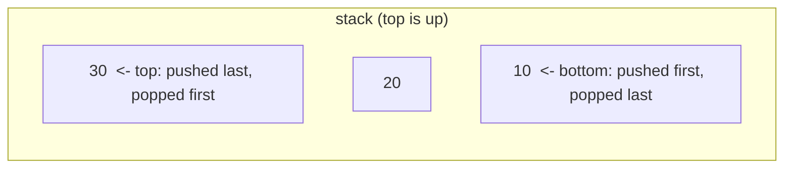

# Chapter 11 · Stacks & Monotonic Stacks

> Every time you press Ctrl+Z, your editor undoes the *last* thing you did, not the first. Every time you hit the browser's back button, you return to the page you visited *most recently*. Behind both is the humblest data structure there is: a pile where you only touch the top. It's so simple you'll learn it in five minutes, and then spend the rest of this chapter discovering how much power it hides.

**You will learn:**
- What **LIFO** means and why a Python list is already a perfect stack
- How to implement a stack yourself (on a list and on a linked list)
- The **matching** pattern: valid parentheses, decode string, simplify path, calculators
- Stacks that remember extra info: **min stack**, stock span
- The **monotonic stack**: a template that finds the "next greater / smaller element" for everyone in O(n)
- The big monotonic-stack problems: daily temperatures, largest rectangle in histogram, maximal rectangle, trapping rain water, remove k digits
- How a stack replaces recursion (it's what your computer does anyway)

**Before this:** [Lists](../part-1-python/07-lists.md) · [Big-O](01-big-o-complexity.md) · [Linked Lists](10-linked-lists.md)

---

## 🧠 The Big Idea

Picture a stack of plates in a canteen. You can only:
- **push**: put a plate on top,
- **pop**: take the top plate off,
- **peek**: look at the top plate without taking it.

You can't pull a plate from the middle without the whole pile crashing. The last plate you put on is the first one you take off: **LIFO**, Last In, First Out.



Why would anyone want such a restricted structure? Because a huge number of problems have a **"most recent unfinished thing"** shape:

- In `( [ { } ] )`, the bracket that must close next is the **most recently opened** one.
- When function A calls B and B calls C, the function that must finish first is C, the **most recently called** one.
- When you're reading temperatures day by day, the days still "waiting for a warmer day" get answered from **most recent** to oldest.

Whenever the thing you need right now is the most recent unfinished thing, a stack hands it to you in O(1).

> 💡 **The core insight:** a stack is a memory of "things I've started but not finished", and it always gives you the newest one first. Spot "most recent unfinished" in a problem and you've spotted a stack.

---

## 🔨 Building It Up

### 1. A Python list is a stack

The **end** of a Python list is a perfect stack top: `append` pushes, `pop()` pops, `[-1]` peeks, all O(1).

```python
stack = []
stack.append(10)       # push
stack.append(20)
stack.append(30)
print("stack:", stack, "top:", stack[-1])

print("popped:", stack.pop())
print("popped:", stack.pop())
print("stack:", stack, "empty?", not stack)
print("popped:", stack.pop())
print("empty?", not stack)
```

```text
stack: [10, 20, 30] top: 30
popped: 30
popped: 20
stack: [10] empty? False
popped: 10
empty? True
```

What just happened: the list's **end** is the top. Never use the front (`insert(0, x)` / `pop(0)`) as the top: those shift every element and cost O(n). `not stack` is the Pythonic "is it empty?" test ([Truthiness](../part-1-python/05-conditionals.md)).

### 2. Implementing a stack yourself

Interviewers sometimes ask you to build one. Two classic implementations: on top of a list, and on top of a linked list ([Chapter 10](10-linked-lists.md)), where the head is the top.

```python
class ArrayStack:
    def __init__(self):
        self._items = []

    def push(self, x):
        self._items.append(x)

    def pop(self):
        if not self._items:
            raise IndexError("pop from empty stack")
        return self._items.pop()

    def peek(self):
        if not self._items:
            raise IndexError("peek at empty stack")
        return self._items[-1]

    def __len__(self):
        return len(self._items)


class _Node:
    def __init__(self, val, next=None):
        self.val, self.next = val, next

class LinkedStack:
    def __init__(self):
        self._head = None          # the head of the list is the top of the stack
        self._size = 0

    def push(self, x):
        self._head = _Node(x, self._head)   # new node points to the old top
        self._size += 1

    def pop(self):
        if self._head is None:
            raise IndexError("pop from empty stack")
        val = self._head.val
        self._head = self._head.next
        self._size -= 1
        return val

    def peek(self):
        if self._head is None:
            raise IndexError("peek at empty stack")
        return self._head.val

    def __len__(self):
        return self._size


for stack in (ArrayStack(), LinkedStack()):
    for x in "abc":
        stack.push(x)
    print(type(stack).__name__, stack.pop(), stack.peek(), len(stack))
    stack.pop(); stack.pop()
    try:
        stack.pop()
    except IndexError as e:
        print("error:", e)
```

```text
ArrayStack c b 2
error: pop from empty stack
LinkedStack c b 2
error: pop from empty stack
```

What just happened: both give O(1) push/pop/peek. The list version is faster in practice (contiguous memory); the linked version never needs to resize. Raising `IndexError` on an empty pop matches what Python's own `list.pop()` does.

### 3. Valid Parentheses: the matching pattern

**Problem:** is a string of `()[]{}` properly balanced? `"([]{})"` yes, `"([)]"` no.

Every closing bracket must match the **most recently opened, still unclosed** bracket. That's the top of a stack.

```python
def is_valid(s):
    pairs = {")": "(", "]": "[", "}": "{"}
    stack = []
    for ch in s:
        if ch in pairs:                              # a closer
            if not stack or stack[-1] != pairs[ch]:
                return False                         # nothing open, or wrong type
            stack.pop()                              # matched: that opener is done
        else:
            stack.append(ch)                         # an opener: remember it
    return not stack                                 # leftovers = unclosed openers

for s in ["()[]{}", "(]", "([)]", "{[]}", "(", ")"]:
    print(repr(s), is_valid(s))
```

```text
'()[]{}' True
'(]' False
'([)]' False
'{[]}' True
'(' False
')' False
```

**Dry run** for `"{[]}"`:

| char | action | stack after |
|---|---|---|
| `{` | push | `{` |
| `[` | push | `{ [` |
| `]` | top is `[` ✓ pop | `{` |
| `}` | top is `{` ✓ pop | (empty) |
| end | stack empty | ✅ valid |

What just happened: three ways to fail, one per check: a closer with an empty stack (`")"`), a closer of the wrong type (`"(]"`), or openers left over at the end (`"("`).

### 4. Min Stack: a stack that remembers extra info

**Problem:** design a stack with `push`, `pop`, `top` and `get_min`, **all O(1)**.

Scanning for the minimum is O(n). The trick: store, alongside every element, **the minimum of the stack at the moment it was pushed**. Since a stack only ever removes from the top, the elements below never change, so their saved minimums stay correct.

```python
class MinStack:
    def __init__(self):
        self.stack = []                    # pairs: (value, min of everything up to here)

    def push(self, val):
        current_min = min(val, self.stack[-1][1]) if self.stack else val
        self.stack.append((val, current_min))

    def pop(self):
        self.stack.pop()

    def top(self):
        return self.stack[-1][0]

    def get_min(self):
        return self.stack[-1][1]

ms = MinStack()
for x in [-2, 0, -3]:
    ms.push(x)
print(ms.get_min())
ms.pop()
print(ms.top(), ms.get_min())
```

```text
-3
0 -2
```

What just happened: after pushing -2, 0, -3 the stack is `[(-2, -2), (0, -2), (-3, -3)]`. Popping `(-3, -3)` exposes `(0, -2)`, whose saved minimum, -2, is the correct minimum of what remains. A stack's "history" is always just the elements beneath the top, and that's what makes this work.

### 5. Evaluate Reverse Polish Notation

In **Reverse Polish Notation (RPN)**, operators come *after* their operands: `3 4 +` means 3 + 4, and `2 1 + 3 *` means (2 + 1) × 3. No parentheses ever needed. Calculators and compilers love it because a stack evaluates it in one pass:

- Number → push it.
- Operator → pop two numbers, apply, push the result.

```python
def eval_rpn(tokens):
    stack = []
    for tok in tokens:
        if tok in {"+", "-", "*", "/"}:
            b = stack.pop()            # the SECOND operand is on top
            a = stack.pop()
            if tok == "+":
                stack.append(a + b)
            elif tok == "-":
                stack.append(a - b)
            elif tok == "*":
                stack.append(a * b)
            else:
                stack.append(int(a / b))   # truncate toward zero, as the problem requires
        else:
            stack.append(int(tok))
    return stack[0]

print(eval_rpn(["2", "1", "+", "3", "*"]))
print(eval_rpn(["4", "13", "5", "/", "+"]))
print(eval_rpn(["10", "6", "9", "3", "+", "-11", "*", "/", "*", "17", "+", "5", "+"]))
```

```text
9
6
22
```

What just happened: order matters for `-` and `/`: the top of the stack is the **right** operand. And `int(a / b)` truncates toward zero (`int(-6 / 4)` is -1), while `a // b` floors (`-6 // 4` is -2). The problem wants truncation.

### 6. The basic calculator idea

**Basic Calculator:** evaluate a string with `+`, `-`, parentheses and spaces, like `"(1+(4+5+2)-3)+(6+8)"`.

Without parentheses it's easy: keep a running `result`, read a number, add it with the current `sign`. Parentheses start a **fresh sub-calculation**. When we see `(`, we **push** the current result and sign (our "unfinished work"), and start fresh. When we see `)`, we finish the inner result and **pop** to combine it with what we saved.

```python
def calculate(s):
    stack = []
    result, number, sign = 0, 0, 1
    for ch in s:
        if ch.isdigit():
            number = number * 10 + int(ch)      # build multi-digit numbers
        elif ch in "+-":
            result += sign * number             # finish the previous number
            number = 0
            sign = 1 if ch == "+" else -1
        elif ch == "(":
            stack.append(result)                # save unfinished outer work
            stack.append(sign)
            result, sign = 0, 1                 # start a fresh inner calculation
        elif ch == ")":
            result += sign * number             # finish the inner calculation
            number = 0
            result *= stack.pop()               # sign before the "("
            result += stack.pop()               # outer result before the "("
    return result + sign * number

for expr in ["1 + 1", " 2-1 + 2 ", "(1+(4+5+2)-3)+(6+8)", "-(2+3)"]:
    print(repr(expr), "=", calculate(expr))
```

```text
'1 + 1' = 2
' 2-1 + 2 ' = 3
'(1+(4+5+2)-3)+(6+8)' = 23
'-(2+3)' = -5
```

What just happened: the stack holds exactly the "suspended" outer calculations, newest on top, which is exactly what nested parentheses need. Spaces fall through every `if` and are ignored. With `*` and `/` (Basic Calculator II, Interview Q10) the idea changes slightly: push signed terms, and apply `*` and `/` immediately to the top term.

### 7. Decode String

**Problem:** `"3[a2[c]]"` → `"accaccacc"`. A number `k` followed by `[...]` means "repeat the inside k times", and brackets nest.

Same shape as the calculator: on `[`, push the **string built so far** and the **repeat count**, then start a fresh string. On `]`, pop them and combine: `previous + inner * k`.

```python
def decode_string(s):
    stack = []                 # pairs: (string before the bracket, repeat count)
    current, k = "", 0
    for ch in s:
        if ch.isdigit():
            k = k * 10 + int(ch)
        elif ch == "[":
            stack.append((current, k))     # suspend the outer work
            current, k = "", 0
        elif ch == "]":
            prev, times = stack.pop()
            current = prev + current * times
        else:
            current += ch
    return current

print(decode_string("3[a]2[bc]"))
print(decode_string("3[a2[c]]"))
print(decode_string("2[abc]3[cd]ef"))
```

```text
aaabcbc
accaccacc
abcabccdcdcdef
```

**Dry run** for `"3[a2[c]]"`:

| char | current | k | stack |
|---|---|---|---|
| `3` | "" | 3 | |
| `[` | "" | 0 | ("", 3) |
| `a` | "a" | 0 | ("", 3) |
| `2` | "a" | 2 | ("", 3) |
| `[` | "" | 0 | ("", 3), ("a", 2) |
| `c` | "c" | 0 | ("", 3), ("a", 2) |
| `]` | "a" + "c"×2 = "acc" | 0 | ("", 3) |
| `]` | "" + "acc"×3 = "accaccacc" | 0 | |

### 8. Simplify Path

**Problem:** turn a Unix path into its simplest form. `"/a/./b/../../c/"` → `"/c"`. `.` means "this folder", `..` means "go up one folder".

Folders form a stack: going into a folder pushes, `..` pops.

```python
def simplify_path(path):
    stack = []
    for part in path.split("/"):
        if part == "..":
            if stack:
                stack.pop()          # go up (but never above root)
        elif part and part != ".":
            stack.append(part)       # a real folder name
        # empty parts (from "//") and "." are ignored
    return "/" + "/".join(stack)

for p in ["/home/", "/../", "/home//foo/", "/a/./b/../../c/", "/.../a/../b"]:
    print(p, "->", simplify_path(p))
```

```text
/home/ -> /home
/../ -> /
/home//foo/ -> /home/foo
/a/./b/../../c/ -> /c
/.../a/../b -> /.../b
```

What just happened: `split("/")` does the tokenising for us. Note `"..."` is a valid folder name, not a special symbol.

### 9. Asteroid Collision

**Problem:** asteroids move in a row; positive = moving right, negative = moving left, size = absolute value. When two meet, the smaller explodes; equal sizes both explode. What's left?

A collision only happens when a **left-moving** asteroid meets a **right-moving** one *before* it. The right-movers waiting to be hit sit on a stack; each new left-mover fights the top of the stack until it dies or the stack has no right-movers left.

```python
def asteroid_collision(asteroids):
    stack = []
    for a in asteroids:
        alive = True
        while alive and a < 0 and stack and stack[-1] > 0:   # head-on collision
            if stack[-1] < -a:
                stack.pop()              # top explodes; a keeps flying left
            elif stack[-1] == -a:
                stack.pop()              # both explode
                alive = False
            else:
                alive = False            # a explodes
        if alive:
            stack.append(a)
    return stack

print(asteroid_collision([5, 10, -5]))
print(asteroid_collision([8, -8]))
print(asteroid_collision([10, 2, -5]))
print(asteroid_collision([-2, -1, 1, 2]))
```

```text
[5, 10]
[]
[10]
[-2, -1, 1, 2]
```

What just happened: in the last example nothing collides: the left-movers are already to the left of the right-movers, so they fly apart. Each asteroid is pushed once and popped at most once: O(n).

### 10. The monotonic stack, decoded

Now the big one. **Next Greater Element:** for each element, find the first element to its **right** that is **bigger**. `[2, 1, 2, 4, 3]` → `[4, 2, 4, -1, -1]`.

Brute force: for each element, scan right. O(n²).

The insight: imagine people standing in a line, each looking right for someone taller. Walk through the line from left to right. Keep a stack of people **still waiting** for their answer. When a new person arrives, everyone shorter than them at the top of the stack has **just found their answer**: it's this new person. Pop them all and record it. Then the new person joins the waiting stack.

Notice what this does to the stack: we only push the newcomer after removing everyone shorter, so the stack is always **decreasing** from bottom to top. That's a **monotonic stack**: a stack whose contents are kept sorted by the rule of popping before pushing.

```python
def next_greater(nums):
    result = [-1] * len(nums)        # default: nobody greater on the right
    stack = []                       # indexes still waiting for an answer
    for i, x in enumerate(nums):
        while stack and nums[stack[-1]] < x:
            result[stack.pop()] = x  # x is the first greater element for that index
        stack.append(i)
    return result

print(next_greater([2, 1, 2, 4, 3]))
print(next_greater([1, 3, 2, 4]))
```

```text
[4, 2, 4, -1, -1]
[3, 4, 4, -1]
```

**Dry run** for `[2, 1, 2, 4, 3]` (stack shows values for readability; the code stores indexes):

| i | x | pops (and their answer) | stack after (values) | result |
|---|---|---|---|---|
| 0 | 2 | none | 2 | [-1, -1, -1, -1, -1] |
| 1 | 1 | none (2 > 1) | 2, 1 | |
| 2 | 2 | 1 → answer 2 | 2, 2 | [-1, 2, -1, -1, -1] |
| 3 | 4 | 2 → 4, 2 → 4 | 4 | [4, 2, 4, -1, -1] |
| 4 | 3 | none (4 > 3) | 4, 3 | |
| end | | 4 and 3 never answered | | stay -1 |

What just happened: each index is **pushed once and popped at most once**. So even though there's a `while` inside a `for`, the total work is O(n). That's the amortised argument, and you'll say it in every interview that uses this pattern.

> 💡 Store **indexes**, not values, in the stack. From an index you can get the value (`nums[i]`) *and* the distance (`i - j`), and you know where to write the answer.

### 11. The four flavours: next/previous, greater/smaller

Change two things, the comparison and the direction you read the answer, and you get all four classic questions:

| Question | Stack keeps... | Pop while | Answer comes from |
|---|---|---|---|
| **Next greater** | decreasing | `nums[top] < x` | the popped index gets `x` |
| **Next smaller** | increasing | `nums[top] > x` | the popped index gets `x` |
| **Previous greater** | decreasing | `nums[top] <= x` | after popping, `x` gets the top (if any) |
| **Previous smaller** | increasing | `nums[top] >= x` | after popping, `x` gets the top (if any) |

```python
def next_smaller(nums):
    res, stack = [-1] * len(nums), []
    for i, x in enumerate(nums):
        while stack and nums[stack[-1]] > x:
            res[stack.pop()] = x
        stack.append(i)
    return res

def previous_greater(nums):
    res, stack = [-1] * len(nums), []
    for i, x in enumerate(nums):
        while stack and nums[stack[-1]] <= x:
            stack.pop()                       # can never be anyone's previous greater again
        res[i] = nums[stack[-1]] if stack else -1
        stack.append(i)
    return res

def previous_smaller(nums):
    res, stack = [-1] * len(nums), []
    for i, x in enumerate(nums):
        while stack and nums[stack[-1]] >= x:
            stack.pop()
        res[i] = nums[stack[-1]] if stack else -1
        stack.append(i)
    return res

nums = [3, 7, 1, 7, 8, 4]
print("next smaller:    ", next_smaller(nums))
print("previous greater:", previous_greater(nums))
print("previous smaller:", previous_smaller(nums))
```

```text
next smaller:     [1, 1, -1, 4, 4, -1]
previous greater: [-1, -1, 7, -1, -1, 8]
previous smaller: [-1, 3, -1, 1, 7, 1]
```

What just happened: for "previous" questions, the answer for `x` is whatever survives on top **after** popping everything that can't be its answer. Elements popped are "shadowed" by `x`: anyone further right will see `x` first, so the popped ones are useless forever. That "useless forever" is why we can throw them away.

### 12. Daily Temperatures

**Problem:** for each day, how many days until a warmer temperature? 0 if never. This is "next greater", but the answer is the **distance** instead of the value, which is why we store indexes.

```python
def daily_temperatures(temps):
    answer = [0] * len(temps)
    stack = []                                   # indexes of days waiting for warmth
    for i, t in enumerate(temps):
        while stack and temps[stack[-1]] < t:
            j = stack.pop()
            answer[j] = i - j                    # days waited
        stack.append(i)
    return answer

print(daily_temperatures([73, 74, 75, 71, 69, 72, 76, 73]))
```

```text
[1, 1, 4, 2, 1, 1, 0, 0]
```

O(n) time, O(n) space.

### 13. Online Stock Span

**Problem:** prices arrive one per day. For each day, the **span** is the number of consecutive days up to today (including today) with price ≤ today's price.

That's "how far back until the previous **greater** price?". Keep a stack of `(price, span)` pairs. When today's price is ≥ the top, today's span **absorbs** the top's span: those days are covered and will never be needed separately again.

```python
class StockSpanner:
    def __init__(self):
        self.stack = []                       # (price, span), prices decreasing

    def next(self, price):
        span = 1
        while self.stack and self.stack[-1][0] <= price:
            span += self.stack.pop()[1]       # swallow the smaller day's whole span
        self.stack.append((price, span))
        return span

spanner = StockSpanner()
print([spanner.next(p) for p in [100, 80, 60, 70, 60, 75, 85]])
```

```text
[1, 1, 1, 2, 1, 4, 6]
```

What just happened: on the day priced 75, the stack holds `(100,1), (80,1), (70,2), (60,1)`. 75 pops `(60,1)` and `(70,2)`, giving span 1 + 1 + 2 = 4, and stops at 80. Each price is pushed and popped once in total: **amortised O(1)** per call.

### 14. Largest Rectangle in Histogram

**Problem:** bars of width 1 with given heights. Find the area of the largest rectangle that fits inside the histogram. `[2, 1, 5, 6, 2, 3]` → 10 (heights 5 and 6, width 2, height 5).

**Key idea:** in the best rectangle, some bar is the **shortest** one, and the rectangle stretches left and right from it until it hits a shorter bar. So for every bar we need its **previous smaller** and **next smaller** bar: the rectangle with that bar's height spans the gap between them.

Both come from one increasing stack. When bar `i` is shorter than the top bar, the top bar has found its **next smaller** (`i`). Its **previous smaller** is the bar now below it in the stack. Pop it and compute its rectangle.

```python
def largest_rectangle_area(heights):
    stack = []                                    # indexes, heights increasing
    best = 0
    for i, h in enumerate(heights + [0]):         # sentinel 0 flushes the stack at the end
        while stack and heights[stack[-1]] > h:
            height = heights[stack.pop()]         # this bar is the shortest in its rectangle
            left = stack[-1] if stack else -1     # previous smaller index
            width = i - left - 1                  # i is the next smaller index
            best = max(best, height * width)
        stack.append(i)
    return best

print(largest_rectangle_area([2, 1, 5, 6, 2, 3]))
print(largest_rectangle_area([2, 4]))
```

```text
10
4
```

**Dry run** for `[2, 1, 5, 6, 2, 3]` + sentinel `0`:

| i | h | popped bar (height) | left boundary | width | area | stack after (indexes) |
|---|---|---|---|---|---|---|
| 0 | 2 | | | | | 0 |
| 1 | 1 | idx 0 (2) | -1 | 1 | 2 | 1 |
| 2 | 5 | | | | | 1, 2 |
| 3 | 6 | | | | | 1, 2, 3 |
| 4 | 2 | idx 3 (6) | 2 | 1 | 6 | |
| | | idx 2 (5) | 1 | 2 | **10** | 1, 4 |
| 5 | 3 | | | | | 1, 4, 5 |
| 6 | 0 | idx 5 (3) | 4 | 1 | 3 | |
| | | idx 4 (2) | 1 | 4 | 8 | |
| | | idx 1 (1) | -1 | 6 | 6 | 6 |

Best = 10. O(n) time, O(n) space. This is one of the most-asked hard stack problems; the sentinel `0` is the trick that avoids a separate cleanup loop.

### 15. Maximal Rectangle

**Problem:** a grid of `"0"`/`"1"`. Find the largest rectangle containing only 1s.

**Idea:** treat each row as the **ground** of a histogram. `heights[c]` = how many consecutive 1s stand on top of each other ending at this row in column c. Then run the histogram algorithm on every row.

```python
def largest_rectangle_area(heights):
    stack, best = [], 0
    for i, h in enumerate(heights + [0]):
        while stack and heights[stack[-1]] > h:
            height = heights[stack.pop()]
            left = stack[-1] if stack else -1
            best = max(best, height * (i - left - 1))
        stack.append(i)
    return best

def maximal_rectangle(matrix):
    if not matrix:
        return 0
    heights = [0] * len(matrix[0])
    best = 0
    for row in matrix:
        for c, cell in enumerate(row):
            heights[c] = heights[c] + 1 if cell == "1" else 0   # a 0 resets the column
        best = max(best, largest_rectangle_area(heights))
    return best

grid = [list("10100"),
        list("10111"),
        list("11111"),
        list("10010")]
print(maximal_rectangle(grid))
```

```text
6
```

What just happened: after row 3, `heights = [3, 1, 3, 2, 2]`, and the best histogram rectangle there is height 2 × width 3 = 6. Time O(rows × cols).

### 16. Trapping Rain Water, the stack way

You solved this with two pointers in [Chapter 03](03-two-pointers.md). The stack view fills water **layer by layer**: keep a decreasing stack of bars. When a taller bar arrives, the bar on top is a **valley floor**; the new bar is its right wall and the bar below it in the stack is its left wall. Fill the horizontal slab between them.

```python
def trap(height):
    stack, water = [], 0
    for i, h in enumerate(height):
        while stack and height[stack[-1]] < h:
            floor = height[stack.pop()]
            if not stack:
                break                                  # no left wall: water escapes
            left = stack[-1]
            width = i - left - 1
            depth = min(height[left], h) - floor       # bounded by the shorter wall
            water += width * depth
        stack.append(i)
    return water

print(trap([0, 1, 0, 2, 1, 0, 1, 3, 2, 1, 2, 1]))
print(trap([4, 2, 0, 3, 2, 5]))
```

```text
6
9
```

What just happened: two-pointer adds water **column by column** (vertical strips); the stack adds it **slab by slab** (horizontal layers). Both O(n). The stack version uses O(n) space; two pointers uses O(1).

### 17. Remove K Digits

**Problem:** remove `k` digits from a number string to make the **smallest** possible number. `"1432219"`, k = 3 → `"1219"`.

**Greedy insight:** a number is smaller when its **leftmost** digits are smaller. So scanning left to right, whenever the current digit is smaller than the previous kept digit, deleting that previous digit helps. That's an **increasing** monotonic stack with a budget of k pops.

```python
def remove_k_digits(num, k):
    stack = []
    for d in num:
        while k and stack and stack[-1] > d:
            stack.pop()              # a bigger digit before a smaller one: delete it
            k -= 1
        stack.append(d)
    if k:
        stack = stack[:-k]           # still have deletions: drop from the end (largest tail)
    result = "".join(stack).lstrip("0")
    return result or "0"

print(remove_k_digits("1432219", 3))
print(remove_k_digits("10200", 1))
print(remove_k_digits("10", 2))
print(remove_k_digits("12345", 2))
```

```text
1219
200
0
123
```

What just happened: for `"12345"` the digits are already increasing, so the loop never pops; we spend the remaining k on the end. Leading zeros are stripped, and an empty result becomes `"0"`.

### 18. A stack can replace recursion

When a function calls itself, Python pushes a **frame** onto the **call stack**; when it returns, the frame is popped ([Recursion](../part-1-python/12-recursion.md)). So any recursion can be rewritten with your own explicit stack. Why bother? To avoid Python's ~1,000-frame recursion limit, and because interviewers ask for "iterative" versions of DFS and tree traversals ([Chapter 13](13-binary-trees.md)).

**Depth-first search** on a graph, recursive and iterative:

```python
graph = {"A": ["B", "C"], "B": ["D"], "C": ["D", "E"], "D": [], "E": []}

def dfs_recursive(node, seen, order):
    seen.add(node)
    order.append(node)
    for nb in graph[node]:
        if nb not in seen:
            dfs_recursive(nb, seen, order)
    return order

def dfs_iterative(start):
    seen, order = set(), []
    stack = [start]
    while stack:
        node = stack.pop()
        if node in seen:
            continue
        seen.add(node)
        order.append(node)
        for nb in reversed(graph[node]):    # reversed: so the first neighbour is popped first
            if nb not in seen:
                stack.append(nb)
    return order

print(dfs_recursive("A", set(), []))
print(dfs_iterative("A"))

def flatten(nested):
    """Flatten arbitrarily deep lists without recursion."""
    out, stack = [], [nested]
    while stack:
        item = stack.pop()
        if isinstance(item, list):
            stack.extend(reversed(item))    # process children left to right
        else:
            out.append(item)
    return out

print(flatten([1, [2, [3, 4], 5], [[6]]]))
deep = [0]
for i in range(1, 5000):
    deep = [deep, i]                        # 5000 levels: recursion would crash
print(len(flatten(deep)))
```

```text
['A', 'B', 'D', 'C', 'E']
['A', 'B', 'D', 'C', 'E']
[1, 2, 3, 4, 5, 6]
5000
```

What just happened: the explicit stack holds "things still to visit", exactly like the call stack holds "calls still to finish". Pushing children in **reverse** makes the first child come out first, so the visiting order matches the recursive version. The 5,000-deep list would hit `RecursionError` with a recursive flatten, but the explicit stack lives on the heap and can grow as large as memory allows.

---

## 🔬 Under the Hood

### Why `list.append` and `list.pop()` are O(1)

A Python list is a dynamic array: a block of memory with some **spare capacity** at the end. `append` writes into the next spare slot: O(1). When the block is full, CPython allocates a bigger block (about 12.5% larger plus a little) and copies everything over: O(n), but rare. Averaged over many appends, that's **amortised O(1)** ([Arrays & Strings](02-arrays-strings.md)). `pop()` from the end just shrinks the length: O(1).

`pop(0)` and `insert(0, x)` must shift every other element one slot: O(n). That's why the top of a list-stack is the **end**, and why queues use `collections.deque` instead ([Chapter 12](12-queues-deques.md)).

### The call stack is a real stack

Every running function has a **frame** holding its local variables and where to resume. Calling a function pushes a frame; returning pops it. A `RecursionError` is literally a stack overflow guard: CPython refuses to push more than `sys.getrecursionlimit()` frames (1,000 by default) to avoid crashing the C stack underneath. When you convert recursion to an explicit stack, your stack is an ordinary list on the heap, limited only by memory.

### Why the monotonic stack is O(n): the amortised argument

The code has a `while` loop inside a `for` loop, which *looks* like O(n²). But count the total work differently: **each index is pushed exactly once and popped at most once**. Total pushes ≤ n, total pops ≤ n, so all the `while` iterations across the whole run add up to at most n. Total: **O(n)**.

### Why popped elements are never needed again (correctness)

In "next greater", when `x` arrives and pops a smaller element `y` sitting to its left, `y` has its answer (`x`), so it's done. In "previous greater", when `x` pops a smaller-or-equal `y`, any future element looking left will see `x` before `y`, and `x` is at least as big. So `y` can never be anyone's "previous greater" again. Throwing it away loses nothing. This "the newcomer **dominates** the old element" argument is the proof behind every monotonic stack.

### Why the stack stays sorted

We only push `x` after popping every element that violates the order with `x`. So right after the push, the top two elements are in order, and everything below was already in order. By induction, the stack is always monotonic. That sortedness is what lets the `while` loop stop at the first element that *doesn't* need popping.

---

## 🧩 Pattern Decoder

### Signals: when to reach for a stack

| You see in the problem... | Think |
|---|---|
| "valid parentheses", "balanced", "matching tags" | Matching stack |
| "nested", `k[...]`, "evaluate expression", "calculator" | Stack of suspended work (push on open, pop on close) |
| "undo", "back", "path with `..`", "backspace" | Plain stack |
| "collide", "cancel adjacent", "remove adjacent duplicates" | Stack where the new item fights the top |
| "next greater / smaller", "previous greater / smaller" | **Monotonic stack** |
| "how many days until warmer / higher", "span" | Monotonic stack storing indexes |
| "largest rectangle", "maximal area of bars" | Monotonic increasing stack + boundaries |
| "remove k digits / letters to get the smallest result" | Monotonic stack + greedy budget |
| "sum over all subarrays of min/max" | Previous & next smaller → contribution counting |
| "iterative DFS / inorder without recursion" | Explicit stack |
| "O(1) getMin / getMax" | Stack of pairs (value, running min) |

### Template A: matching / suspended work

```py
stack = []
for token in tokens:
    if opens(token):
        stack.append(state_to_resume_later)   # push unfinished work
    elif closes(token):
        if not stack or not matches(stack[-1], token):
            return invalid
        saved = stack.pop()
        combine(saved, current)               # finish the inner part
    else:
        update(current, token)
return not stack                              # or the final result
```

### Template B: monotonic stack (next greater)

```py
result = [default] * n
stack = []                                  # INDEXES; values are monotonic
for i in range(n):
    while stack and nums[stack[-1]] < nums[i]:   # flip < to > for "next smaller"
        j = stack.pop()
        result[j] = nums[i]                 # or i - j for a distance
    stack.append(i)
# indexes left in the stack never found an answer (keep default)
```

### Decoding the four knobs

| Knob | Options | Effect |
|---|---|---|
| Comparison | `<` vs `>` in the pop condition | greater vs smaller |
| Strictness | `<` vs `<=` | how equal values are treated ("strictly greater" vs "greater or equal") |
| When you read the answer | on **pop** vs after popping, from the **top** | next vs previous |
| Scan direction | left→right vs right→left | an alternative way to get "next" answers (read from the top after popping, scanning from the right) |

A memory trick: **"a decreasing stack finds greater elements; an increasing stack finds smaller elements."** (Whatever breaks the order is the answer.)

### Variation: Next Greater Element II (circular array)

**Problem:** the array is circular: after the last element, search continues from the start. `[1, 2, 1]` → `[2, -1, 2]`.

**Idea:** loop over the array **twice** (indexes `0 .. 2n-1`, using `i % n`), but only push indexes during the first pass. The second pass just lets the waiting elements see the beginning of the array.

```python
def next_greater_circular(nums):
    n = len(nums)
    result = [-1] * n
    stack = []
    for i in range(2 * n):
        x = nums[i % n]
        while stack and nums[stack[-1]] < x:
            result[stack.pop()] = x
        if i < n:
            stack.append(i)          # only real indexes need answers
    return result

print(next_greater_circular([1, 2, 1]))
print(next_greater_circular([1, 2, 3, 4, 3]))
```

```text
[2, -1, 2]
[2, 3, 4, -1, 4]
```

O(n) time, O(n) space.

### Variation: Sum of Subarray Minimums (contribution technique)

**Problem:** sum `min(subarray)` over **all** contiguous subarrays. `[3, 1, 2, 4]` → 17. Brute force is O(n²) or worse.

**Idea:** flip the question. Instead of "what's the min of each subarray?", ask "**in how many subarrays is `arr[i]` the minimum?**" If `left` = distance to the previous smaller element and `right` = distance to the next smaller-or-equal element, then `arr[i]` is the minimum of exactly `left × right` subarrays (choose any start in its left range, any end in its right range). Contribution: `arr[i] × left × right`.

(Using `<` on one side and `<=` on the other makes sure that with equal values, each subarray is counted for exactly one of them.)

```python
def sum_subarray_mins(arr):
    n = len(arr)
    left, right = [0] * n, [0] * n
    stack = []
    for i in range(n):                       # previous strictly smaller
        while stack and arr[stack[-1]] >= arr[i]:
            stack.pop()
        left[i] = i - stack[-1] if stack else i + 1
        stack.append(i)
    stack = []
    for i in range(n - 1, -1, -1):           # next smaller-or-equal (scan from the right)
        while stack and arr[stack[-1]] > arr[i]:
            stack.pop()
        right[i] = stack[-1] - i if stack else n - i
        stack.append(i)
    return sum(arr[i] * left[i] * right[i] for i in range(n)) % (10**9 + 7)

print(sum_subarray_mins([3, 1, 2, 4]))
print(sum_subarray_mins([11, 81, 94, 43, 3]))
```

```text
17
444
```

**Trace** for `[3, 1, 2, 4]`:

| i | arr[i] | left | right | subarrays where it's the min | contribution |
|---|---|---|---|---|---|
| 0 | 3 | 1 | 1 | [3] | 3 |
| 1 | 1 | 2 | 3 | 6 subarrays containing index 1 | 6 |
| 2 | 2 | 1 | 2 | [2], [2,4] | 4 |
| 3 | 4 | 1 | 1 | [4] | 4 |

Total = 3 + 6 + 4 + 4 = 17. ✓ O(n) time. The same technique solves "sum of subarray ranges" (do it for max and min) and appears in many hard problems.

### When NOT to use a stack

- **You need the oldest item first** (first come, first served, level-by-level BFS): that's a **queue** ([Chapter 12](12-queues-deques.md)).
- **You need the max/min of a sliding window** where items also leave from the old end: that's a **monotonic deque** ([Chapter 12](12-queues-deques.md)), not a stack.
- **You need the k-th largest or repeated "give me the smallest"** with arbitrary inserts: a **heap** ([Chapter 15](15-heaps.md)).
- **Next greater element over a few queries only**: a direct scan might be simpler. The monotonic stack shines when you need the answer for *every* element.

---

## ⚠️ Traps & Common Mistakes

1. **Popping or peeking an empty stack.** `stack[-1]` on `[]` raises `IndexError`. Always guard: `while stack and ...`, `if not stack: ...`.
2. **Forgetting leftovers at the end.** In Valid Parentheses, `"(("` passes every check inside the loop. Return `not stack`, not `True`.
3. **Using the front of a list as the top.**

```py
# ❌ wrong: O(n) per operation
stack.insert(0, x)
stack.pop(0)

# ✅ right: O(1)
stack.append(x)
stack.pop()
```

4. **Operand order in RPN.** `b = pop(); a = pop(); a - b`. Popping into `a` first computes `b - a`.
5. **`//` vs truncation.** `-7 // 2 == -4` but the problem wants -3. Use `int(a / b)`.
6. **Storing values when you need indexes.** Daily Temperatures needs distances; histograms need widths. Store indexes and look up values with `nums[i]`.
7. **Wrong strictness with duplicates.** In Sum of Subarray Minimums, using `>=` on both sides double-counts equal minimums; using `>` on both sides misses some. One side strict, the other not.
8. **Forgetting to flush the stack** in Largest Rectangle. Bars still on the stack at the end never got processed. Append a sentinel `0` (or loop once more after the main loop).
9. **Assuming nested `while` = O(n²).** It's O(n) when every element is pushed and popped at most once. Explain the amortised argument instead of panicking.
10. **Not stripping leading zeros** in Remove K Digits, or returning `""` instead of `"0"`.

---

## 💡 Tips & Tricks

- **"Most recent unfinished"** → stack. Say it out loud when you read a problem.
- **Push indexes, not values** in monotonic stacks. You can always recover values.
- **Sentinels** simplify code: a `0` bar at the end of a histogram, or a dummy element at the bottom of a stack, removes empty checks.
- For "previous X" problems, the answer is **the top after popping**. For "next X" problems, the answer is **the element doing the popping**.
- To get "next greater" by scanning **right to left**, pop everything ≤ x, then the top is the answer. Some people find this version easier because it reads like "previous greater" in a mirror.
- **Stacks of tuples** (value, extra info) solve "O(1) min", "span", and "decode string" style problems.
- **Iterative DFS:** push children in reverse to match the recursive order.
- In Python, `collections.deque` also works as a stack (`append` / `pop`), but plain `list` is the standard choice and slightly faster for stack use.

---

## 🎯 Interview Questions

### 1. Valid Parentheses 🔥🔥🔥

<details><summary>Answer</summary>

Push openers; on a closer, the top must be its matching opener; at the end the stack must be empty (section 3). O(n) time, O(n) space. A quick win to mention: an odd-length string can be rejected immediately.

</details>

### 2. Min Stack 🔥🔥🔥

<details><summary>Answer</summary>

Store `(value, min_so_far)` pairs (section 4). All operations O(1), space O(n). Alternative: a second stack that only pushes when the new value is ≤ the current min (saves space when the min rarely changes; note the `<=` so duplicate minimums are tracked).

</details>

### 3. Evaluate Reverse Polish Notation 🔥🔥

<details><summary>Answer</summary>

Numbers push; operators pop two (right operand first), compute, push (section 5). O(n) time, O(n) space. Mention truncation toward zero with `int(a / b)`.

</details>

### 4. Daily Temperatures 🔥🔥🔥

<details><summary>Answer</summary>

Monotonic decreasing stack of indexes; when a warmer day pops an index `j`, its answer is `i - j` (section 12). O(n) time thanks to each index being pushed and popped once.

</details>

### 5. Next Greater Element I 🔥🔥

`nums1` is a subset of `nums2`. For each `x` in `nums1`, find the next greater element of `x` in `nums2`.

<details><summary>Answer</summary>

Run the monotonic stack once over `nums2`, storing answers in a dict `value → next greater`, then look up each `nums1` value.

```python
def next_greater_element(nums1, nums2):
    nge = {}
    stack = []
    for x in nums2:
        while stack and stack[-1] < x:
            nge[stack.pop()] = x          # values are unique, so values work as keys
        stack.append(x)
    return [nge.get(x, -1) for x in nums1]

print(next_greater_element([4, 1, 2], [1, 3, 4, 2]), next_greater_element([2, 4], [1, 2, 3, 4]))
```

```text
[-1, 3, -1] [3, -1]
```

O(m + n) time, O(n) space.

</details>

### 6. Next Greater Element II 🔥🔥

<details><summary>Answer</summary>

Circular array: loop `2n` times with `i % n`, push only during the first pass (see the Pattern Decoder). O(n) time, O(n) space.

</details>

### 7. Largest Rectangle in Histogram 🔥🔥🔥

<details><summary>Answer</summary>

Increasing stack; when a shorter bar arrives, pop the taller bar and compute `height × (i - new_top - 1)`; sentinel 0 at the end (section 14, with dry run). O(n) time, O(n) space. Explain *why*: "each bar is the shortest bar of exactly one maximal rectangle, bounded by its previous and next smaller bars."

</details>

### 8. Trapping Rain Water 🔥🔥🔥

<details><summary>Answer</summary>

Either two pointers ([Chapter 03](03-two-pointers.md), O(1) space) or a decreasing stack that fills water in horizontal layers (section 16, O(n) space). Both O(n) time. Being able to explain both is a strong signal.

</details>

### 9. Decode String 🔥🔥🔥

<details><summary>Answer</summary>

On `[` push `(current_string, k)`; on `]` pop and set `current = prev + current * k` (section 7). Time O(length of the output), space O(output + nesting depth).

</details>

### 10. Basic Calculator II 🔥🔥

Evaluate a string with non-negative integers and `+ - * /` (no parentheses), division truncating toward zero.

<details><summary>Answer</summary>

Push **signed terms**. For `+`/`-` push `±number`. For `*`/`/` pop the last term, combine it with the number, push the result. The answer is the sum of the stack. The trick: act on the **previous** operator when a new operator (or the end) arrives.

```python
def calculate_ii(s):
    stack = []
    number, op = 0, "+"
    for i, ch in enumerate(s):
        if ch.isdigit():
            number = number * 10 + int(ch)
        if ch in "+-*/" or i == len(s) - 1:        # time to apply the previous operator
            if op == "+":
                stack.append(number)
            elif op == "-":
                stack.append(-number)
            elif op == "*":
                stack.append(stack.pop() * number)
            else:
                stack.append(int(stack.pop() / number))
            op, number = ch, 0
    return sum(stack)

print(calculate_ii("3+2*2"), calculate_ii(" 3/2 "), calculate_ii(" 3+5 / 2 "), calculate_ii("14-3/2"))
```

```text
7 1 5 13
```

O(n) time, O(n) space (O(1) is possible by keeping only the last term in a variable).

</details>

### 11. Asteroid Collision 🔥🔥

<details><summary>Answer</summary>

Stack of survivors; a negative asteroid fights positive tops until it dies or no positive top remains (section 9). O(n) time, O(n) space.

</details>

### 12. Simplify Path 🔥🔥

<details><summary>Answer</summary>

Split on `/`; skip `""` and `"."`; `".."` pops if possible; anything else pushes (section 8). O(n) time and space.

</details>

### 13. Remove K Digits 🔥🔥

<details><summary>Answer</summary>

Increasing stack with a budget of k pops; spend leftovers on the end; strip leading zeros (section 17). O(n) time. Explain the greedy: the leftmost position where a digit is bigger than its right neighbour is always worth deleting first.

</details>

### 14. Car Fleet 🔥🔥

Cars at `position[i]` with `speed[i]` drive toward `target` on a one-lane road; a faster car that catches a slower one joins its fleet. How many fleets arrive?

<details><summary>Answer</summary>

Sort cars by position, closest to the target first. Compute each car's arrival time. A car behind that would arrive **sooner or at the same time** as the fleet ahead catches it and merges. Use a stack of fleet arrival times.

```python
def car_fleet(target, position, speed):
    cars = sorted(zip(position, speed), reverse=True)    # closest to target first
    stack = []                                           # arrival times of fleets
    for pos, spd in cars:
        time = (target - pos) / spd
        if not stack or time > stack[-1]:
            stack.append(time)        # slower than the fleet ahead: a new fleet
        # else: catches up and merges, nothing to push
    return len(stack)

print(car_fleet(12, [10, 8, 0, 5, 3], [2, 4, 1, 1, 3]), car_fleet(10, [3], [3]))
```

```text
3 1
```

O(n log n) for sorting, O(n) space.

</details>

### 15. Longest Valid Parentheses 🔥🔥

Length of the longest well-formed parentheses substring. `")()())"` → 4.

<details><summary>Answer</summary>

Stack of **indexes**, starting with a base `-1` meaning "the position before the current valid run". Push `(` indexes. On `)`, pop; if the stack becomes empty, this `)` is unmatched, so it becomes the new base; otherwise the valid run length is `i - stack[-1]`.

```python
def longest_valid_parentheses(s):
    stack = [-1]
    best = 0
    for i, ch in enumerate(s):
        if ch == "(":
            stack.append(i)
        else:
            stack.pop()
            if not stack:
                stack.append(i)               # unmatched ")": new base
            else:
                best = max(best, i - stack[-1])
    return best

print(longest_valid_parentheses("(()"), longest_valid_parentheses(")()())"), longest_valid_parentheses(""))
```

```text
2 4 0
```

O(n) time, O(n) space.

</details>

---

## 🏋️ Practice

**🟢 1. Reverse a string using a stack** (then compare with slicing).

<details><summary>Solution</summary>

```python
def reverse_with_stack(s):
    stack = list(s)
    out = []
    while stack:
        out.append(stack.pop())
    return "".join(out)

print(reverse_with_stack("stack"), reverse_with_stack("stack") == "stack"[::-1])
```

```text
kcats True
```

</details>

**🟢 2. Remove All Adjacent Duplicates In String.** Repeatedly remove two adjacent equal letters. `"abbaca"` → `"ca"`.

<details><summary>Solution</summary>

The new letter "fights" the top: equal letters cancel.

```python
def remove_duplicates(s):
    stack = []
    for ch in s:
        if stack and stack[-1] == ch:
            stack.pop()
        else:
            stack.append(ch)
    return "".join(stack)

print(remove_duplicates("abbaca"), remove_duplicates("azxxzy"))
```

```text
ca ay
```

</details>

**🟡 3. Minimum Add to Make Parentheses Valid.** `"())"` → 1, `"((("` → 3.

<details><summary>Solution</summary>

You don't even need the stack itself, only its size: `open_count` is the stack height.

```python
def min_add_to_make_valid(s):
    open_count = added = 0
    for ch in s:
        if ch == "(":
            open_count += 1
        elif open_count:
            open_count -= 1          # matched
        else:
            added += 1               # unmatched ")": must add a "("
    return added + open_count        # plus a ")" for each unmatched "("

print(min_add_to_make_valid("())"), min_add_to_make_valid("((("), min_add_to_make_valid("()))(("))
```

```text
1 3 4
```

</details>

**🟡 4. Removing Stars From a String.** Each `*` removes the closest non-star character to its left. `"leet**cod*e"` → `"lecoe"`.

<details><summary>Solution</summary>

```python
def remove_stars(s):
    stack = []
    for ch in s:
        if ch == "*":
            stack.pop()
        else:
            stack.append(ch)
    return "".join(stack)

print(remove_stars("leet**cod*e"), repr(remove_stars("erase*****")))
```

```text
lecoe ''
```

</details>

**🟡 5. Previous smaller element, distance version.** For each day's price, how many days ago was a strictly lower price? 0 if never. `[5, 3, 4, 6, 2, 7]` → `[0, 0, 1, 1, 0, 1]`.

<details><summary>Solution</summary>

Increasing stack; after popping everything ≥ the current price, the top is the previous smaller.

```python
def days_since_lower(prices):
    res, stack = [], []
    for i, p in enumerate(prices):
        while stack and prices[stack[-1]] >= p:
            stack.pop()
        res.append(i - stack[-1] if stack else 0)
        stack.append(i)
    return res

print(days_since_lower([5, 3, 4, 6, 2, 7]))
```

```text
[0, 0, 1, 1, 0, 1]
```

</details>

**🔴 6. 132 Pattern.** Is there `i < j < k` with `nums[i] < nums[k] < nums[j]`?

<details><summary>Solution</summary>

Scan from the right with a decreasing stack. When a bigger value pops smaller ones, the largest popped value is the best candidate for `nums[k]` (the "2"), with the popping value as the "3". If we ever see a value smaller than that candidate, it's the "1".

```python
def find_132_pattern(nums):
    stack = []
    third = float("-inf")             # best "2" found so far (the nums[k])
    for x in reversed(nums):
        if x < third:
            return True               # x is the "1"
        while stack and stack[-1] < x:
            third = stack.pop()       # x is a "3" with this "2" to its right
        stack.append(x)
    return False

print(find_132_pattern([1, 2, 3, 4]), find_132_pattern([3, 1, 4, 2]), find_132_pattern([-1, 3, 2, 0]))
```

```text
False True True
```

O(n) time, O(n) space.

</details>

**🔴 7. Remove Duplicate Letters.** Remove duplicates so every letter appears once and the result is the lexicographically smallest possible. `"cbacdcbc"` → `"acdb"`.

<details><summary>Solution</summary>

Remove K Digits with a twist: you may only pop a letter if it **appears again later** (so you can take it then), and you skip letters already in the stack.

```python
def remove_duplicate_letters(s):
    last = {ch: i for i, ch in enumerate(s)}      # last position of each letter
    stack, in_stack = [], set()
    for i, ch in enumerate(s):
        if ch in in_stack:
            continue
        while stack and stack[-1] > ch and last[stack[-1]] > i:
            in_stack.remove(stack.pop())          # a smaller letter can go first; the popped one comes back later
        stack.append(ch)
        in_stack.add(ch)
    return "".join(stack)

print(remove_duplicate_letters("bcabc"), remove_duplicate_letters("cbacdcbc"))
```

```text
abc acdb
```

O(n) time, O(1) extra space for a fixed alphabet.

</details>

---

## 🧠 Never-Forget Summary

- A stack is **LIFO**: push, pop, peek, all O(1). In Python: `append`, `pop()`, `[-1]` on a list.
- Spot it by **"most recent unfinished thing"**: brackets, nested expressions, undo, back, collisions.
- **Matching / suspended work**: push on open, pop and combine on close (parentheses, decode string, calculator).
- **Stack of pairs** stores extra history: Min Stack `(val, min)`, Stock Span `(price, span)`.
- **Monotonic stack**: pop everything the newcomer dominates, then push it. Decreasing stack → greater elements; increasing stack → smaller elements.
- "Next" answers are given **when popped**; "previous" answers are **the top after popping**.
- Store **indexes**; get values and distances from them.
- Each element is pushed and popped once: **O(n) amortised**, despite the nested loop.
- Histogram: each bar is the shortest of one rectangle bounded by previous/next smaller. Sentinel 0 flushes.
- Contribution trick: `value × left × right` sums over all subarrays.
- Any recursion can be replaced by an explicit stack (iterative DFS).

**Memory hook: "The newcomer kicks out the weaklings."** In a monotonic stack, each arriving element evicts every element it beats, and those evicted elements have just learned their answer (it's the newcomer).

**One picture:**

| Problem | Stack holds | Pop when | Answer |
|---|---|---|---|
| Valid Parentheses | openers | closer matches top | empty at end |
| Decode String / Calculator | (outer state, count/sign) | `]` or `)` | combine inner with saved |
| Min Stack | (value, min so far) | pop() | `top[1]` |
| Next Greater / Daily Temps | indexes, decreasing | `nums[top] < x` | `x` or `i - j` for popped |
| Stock Span | (price, span), decreasing | `top.price <= price` | sum of absorbed spans |
| Largest Rectangle | indexes, increasing | `h[top] > h` | `h[top] × (i − new_top − 1)` |
| Trapping Rain Water | indexes, decreasing | `h[top] < h` | slab `width × depth` |
| Remove K Digits | digits, increasing | `top > d` and k > 0 | joined stack, no leading zeros |

> **If you remember only one thing:** a stack answers "what's the most recent unfinished thing?" in O(1), and a *monotonic* stack answers "who's the next bigger/smaller?" for everyone in O(n).

---
**Next:** [Chapter 12 · Queues, Deques & Monotonic Queues](12-queues-deques.md)  ·  **Back to** [Contents](../README.md)
