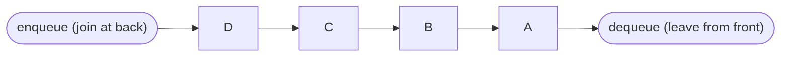
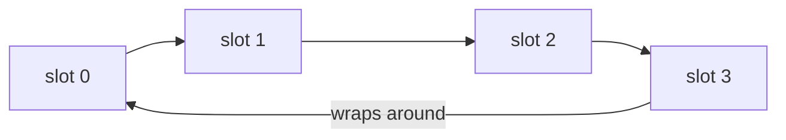
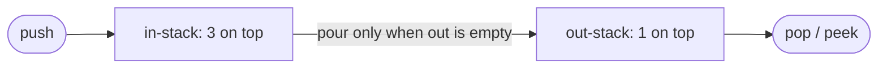

# Chapter 12 · Queues, Deques & Monotonic Queues

> The line at a railway ticket counter is fair: whoever came first gets served first. Nobody jumps the queue (in theory). That simple rule, first in, first out, runs your printer, your WhatsApp message delivery, every web server's request handling, and the most important graph algorithm you'll ever learn: breadth-first search.

**You will learn:**
- What **FIFO** means and when a problem needs it
- Why `list.pop(0)` is a performance trap, and how `collections.deque` fixes it
- How to build a **circular queue** in a fixed-size array (a classic design question)
- How to build a queue from **two stacks** (and why it's still O(1) on average)
- A first look at **BFS**, the reason queues matter so much
- The **deque** as a double-ended tool, and the **monotonic deque**: sliding window maximum in O(n)
- Hard deque problems: shortest subarray with sum at least K, longest subarray within a limit
- Design problems: hit counter, recent calls, task scheduler, plus a preview of priority queues

**Before this:** [Stacks & Monotonic Stacks](11-stacks.md) · [Sliding Window](04-sliding-window.md) · [Prefix Sums](06-prefix-sums.md) · [Linked Lists](10-linked-lists.md)

---

## 🧠 The Big Idea

A **queue** is a line of people. New people join at the **back** (enqueue). The person at the **front** gets served and leaves (dequeue). The first person to arrive is the first to leave: **FIFO**, First In, First Out.



Compare with a stack from [Chapter 11](11-stacks.md):

| | Stack | Queue |
|---|---|---|
| Rule | Last In, First Out | First In, First Out |
| Real life | pile of plates, undo | ticket line, printer jobs |
| Gives you | the **newest** unfinished thing | the **oldest** waiting thing |
| Graph search | DFS (go deep first) | BFS (go wide first, level by level) |

And a **deque** ("deck", **d**ouble-**e**nded **que**ue) is a line where you can join or leave at **both** ends. It can act as a stack, a queue, or something cleverer: a **monotonic deque**, which tracks the maximum of a moving window in O(1) per step.

> 💡 **The core insight:** use a queue when **order of arrival** matters (fairness, levels, time windows). Use a deque when things leave from **both ends**: old items expire from the front while the newest item fights with the back.

---

## 🔨 Building It Up

### 1. FIFO, and why `list.pop(0)` is a trap

You *can* use a Python list as a queue: `append` to join the back, `pop(0)` to leave the front. It gives correct answers.

```python
queue = []
queue.append("Asha")      # enqueue
queue.append("Ravi")
queue.append("Meera")
print("front:", queue[0])
print("served:", queue.pop(0))      # dequeue (correct, but slow!)
print("served:", queue.pop(0))
print("still waiting:", queue)
```

```text
front: Asha
served: Asha
served: Ravi
still waiting: ['Meera']
```

But a list is a contiguous array ([Chapter 02](02-arrays-strings.md)). Removing index 0 means **every other element shifts one slot left**: O(n) per dequeue. Process n items and it's O(n²). Here's a real measurement on 100,000 items (from the author's laptop; your numbers will differ, the ratio won't):

```py
import time
from collections import deque

n = 100_000
items = list(range(n))
start = time.perf_counter()
while items:
    items.pop(0)
list_time = time.perf_counter() - start

q = deque(range(n))
start = time.perf_counter()
while q:
    q.popleft()
deque_time = time.perf_counter() - start

print(f"list.pop(0):     {list_time:.3f} s")
print(f"deque.popleft(): {deque_time:.3f} s")
```

```text
list.pop(0):     1.215 s
deque.popleft(): 0.012 s
```

About **100 times** slower, and the gap grows with n. On a BFS over a million-node graph, `pop(0)` turns a one-second job into a coffee break.

> ⚠️ **Rule:** never use `list.pop(0)` or `list.insert(0, x)` in a loop. Use `collections.deque`.

### 2. `collections.deque`: the right tool

`deque` gives O(1) operations at **both** ends.

```python
from collections import deque

q = deque()
q.append(1)            # add to the right (back)
q.append(2)
q.append(3)
print(q, "front:", q[0], "back:", q[-1])
print("popleft:", q.popleft())     # remove from the left (front): this is dequeue
q.appendleft(0)                    # add to the left
print(q)
print("pop:", q.pop())             # remove from the right
print(q, "len:", len(q))

d = deque([1, 2, 3, 4, 5])
d.rotate(2)                        # shift right by 2 (the last 2 wrap to the front)
print("rotated:", d)

recent = deque(maxlen=3)           # bounded: old items fall off automatically
for x in [10, 20, 30, 40, 50]:
    recent.append(x)
print("last 3:", recent)
```

```text
deque([1, 2, 3]) front: 1 back: 3
popleft: 1
deque([0, 2, 3])
pop: 3
deque([0, 2]) len: 2
rotated: deque([4, 5, 1, 2, 3])
last 3: deque([30, 40, 50], maxlen=3)
```

What just happened: as a **queue** use `append` + `popleft`. As a **stack** use `append` + `pop`. `maxlen` turns it into a "remember the last k things" buffer. One caveat: indexing into the **middle** (`d[n // 2]`) is O(n), because a deque isn't one contiguous array (see Under the Hood).

| Operation | `list` | `deque` |
|---|---|---|
| append / pop at the right | O(1) | O(1) |
| append / pop at the **left** | **O(n)** | **O(1)** |
| index the middle `x[i]` | **O(1)** | O(n) |
| `len`, `[0]`, `[-1]` | O(1) | O(1) |

### 3. A queue built on a linked list

To understand what a queue needs, build one from the linked list of [Chapter 10](10-linked-lists.md): dequeue from the **head**, enqueue at the **tail**. Both O(1).

```python
class _Node:
    def __init__(self, val):
        self.val, self.next = val, None

class LinkedQueue:
    def __init__(self):
        self.head = self.tail = None
        self.size = 0

    def enqueue(self, val):
        node = _Node(val)
        if self.tail:
            self.tail.next = node
        else:
            self.head = node                # first element: it's also the head
        self.tail = node
        self.size += 1

    def dequeue(self):
        if not self.head:
            raise IndexError("dequeue from empty queue")
        val = self.head.val
        self.head = self.head.next
        if not self.head:
            self.tail = None                # queue became empty: reset tail too
        self.size -= 1
        return val

q = LinkedQueue()
for x in "abc":
    q.enqueue(x)
print(q.dequeue(), q.dequeue(), q.size)
q.enqueue("d")
print(q.dequeue(), q.dequeue(), q.size)
```

```text
a b 1
c d 0
```

What just happened: the classic bug here is forgetting `self.tail = None` when the last node leaves. Then the next `enqueue` attaches to a stale node that's no longer in the queue.

### 4. Circular queue: a queue in a fixed array

**Design Circular Queue** is a favourite design question, and it's how real systems (network card buffers, audio buffers, Kafka-like logs) implement queues: a fixed-size array where the front and back **wrap around**.

Keep a `head` index (the front) and a `count`. The back is `(head + count) % capacity`. The `%` (modulo) makes the index wrap from the last slot back to 0, so the array behaves like a ring.



```python
class MyCircularQueue:
    def __init__(self, k):
        self.data = [None] * k
        self.capacity = k
        self.head = 0                 # index of the front element
        self.count = 0

    def enqueue(self, value):
        if self.is_full():
            return False
        tail = (self.head + self.count) % self.capacity   # next free slot, wrapping
        self.data[tail] = value
        self.count += 1
        return True

    def dequeue(self):
        if self.is_empty():
            return False
        self.data[self.head] = None                        # optional: clear for readability
        self.head = (self.head + 1) % self.capacity
        self.count -= 1
        return True

    def front(self):
        return -1 if self.is_empty() else self.data[self.head]

    def rear(self):
        return -1 if self.is_empty() else self.data[(self.head + self.count - 1) % self.capacity]

    def is_empty(self):
        return self.count == 0

    def is_full(self):
        return self.count == self.capacity

q = MyCircularQueue(3)
print([q.enqueue(x) for x in [1, 2, 3, 4]])
print("rear:", q.rear(), "full:", q.is_full())
print("dequeue:", q.dequeue(), "enqueue 4:", q.enqueue(4))
print("front:", q.front(), "rear:", q.rear())
print("raw array:", q.data, "head index:", q.head)
```

```text
[True, True, True, False]
rear: 3 full: True
dequeue: True enqueue 4: True
front: 2 rear: 4
raw array: [4, 2, 3] head index: 1
```

What just happened: after dequeuing 1, slot 0 was free, so 4 went **there** (wrapping around), even though it's logically at the back. The raw array `[4, 2, 3]` with head at index 1 reads as the queue `2, 3, 4`. Storing `count` (instead of only head and tail) avoids the classic ambiguity where `head == tail` could mean either "empty" or "full".

### 5. A queue from two stacks

**Implement Queue using Stacks.** Only `append` and `pop` from the end are allowed. How do you get FIFO from LIFO?

Pour one stack into another and the order flips. Use an **in-stack** for pushes and an **out-stack** for pops. When the out-stack is empty, pour everything from the in-stack into it; now the oldest element is on top.



```python
class MyQueue:
    def __init__(self):
        self.in_stack = []
        self.out_stack = []

    def push(self, x):
        self.in_stack.append(x)

    def _move(self):
        if not self.out_stack:                 # pour ONLY when out is empty
            while self.in_stack:
                self.out_stack.append(self.in_stack.pop())

    def pop(self):
        self._move()
        return self.out_stack.pop()

    def peek(self):
        self._move()
        return self.out_stack[-1]

    def empty(self):
        return not self.in_stack and not self.out_stack

q = MyQueue()
q.push(1)
q.push(2)
print(q.peek(), q.pop(), q.empty())
q.push(3)
print(q.pop(), q.pop(), q.empty())
```

```text
1 1 False
2 3 True
```

What just happened: after `push(3)`, the out-stack still held `[2]`, so `pop` returned 2 (correct: 2 arrived before 3) without pouring. Pouring while the out-stack still has items would put newer elements on top of older ones and break FIFO.

**Why it's O(1) amortised:** each element is moved from in to out **at most once** in its life: pushed once, poured once, popped once. So n operations cost O(n) total, even though a single `pop` can occasionally take O(n).

### 6. BFS preview: why queues matter

**Breadth-first search (BFS)** explores a graph in rings: first the start, then everything 1 step away, then 2 steps away, and so on. A queue guarantees that order: nodes discovered earlier (closer) are processed before nodes discovered later (farther). That's why BFS finds **shortest paths** in unweighted graphs. Full treatment in [Chapter 16](16-graphs-bfs-dfs.md); here's the shape.

**Shortest path in a grid** (`.` = open, `#` = wall), moving up/down/left/right:

```python
from collections import deque

def shortest_path(grid, start, goal):
    rows, cols = len(grid), len(grid[0])
    queue = deque([(start, 0)])               # (cell, distance from start)
    seen = {start}
    while queue:
        (r, c), dist = queue.popleft()        # oldest = closest unprocessed cell
        if (r, c) == goal:
            return dist
        for dr, dc in ((1, 0), (-1, 0), (0, 1), (0, -1)):
            nr, nc = r + dr, c + dc
            if 0 <= nr < rows and 0 <= nc < cols and grid[nr][nc] == "." and (nr, nc) not in seen:
                seen.add((nr, nc))            # mark when ADDED, so it's never queued twice
                queue.append(((nr, nc), dist + 1))
    return -1

grid = ["..#.",
        "..#.",
        "....",
        "#..."]
print(shortest_path(grid, (0, 0), (0, 3)))
print(shortest_path([".#", "#."], (0, 0), (1, 1)))
```

```text
7
-1
```

**Level by level:** sometimes you need to know where one level ends and the next begins (e.g., "print each generation of a family tree"). Freeze the queue's length at the start of each level:

```python
from collections import deque

children = {"Dadi": ["Papa", "Chachu"], "Papa": ["Me", "Didi"], "Chachu": ["Cousin"],
            "Me": [], "Didi": [], "Cousin": []}

def generations(root):
    levels = []
    queue = deque([root])
    while queue:
        level = []
        for _ in range(len(queue)):           # exactly the nodes of the current level
            person = queue.popleft()
            level.append(person)
            queue.extend(children[person])    # the next level waits behind them
        levels.append(level)
    return levels

for depth, level in enumerate(generations("Dadi")):
    print(depth, level)
```

```text
0 ['Dadi']
1 ['Papa', 'Chachu']
2 ['Me', 'Didi', 'Cousin']
```

What just happened: `range(len(queue))` is evaluated **once**, before the loop starts, so the newly added children aren't processed in this round. This "level snapshot" trick is the basis of level-order tree traversal ([Chapter 13](13-binary-trees.md)).

### 7. The deque as a double-ended tool

Because a deque is fast at both ends, it handles problems where you take from either side.

**Palindrome check** by peeling both ends:

```python
from collections import deque

def is_palindrome(word):
    d = deque(ch.lower() for ch in word if ch.isalnum())
    while len(d) > 1:
        if d.popleft() != d.pop():          # compare the two ends
            return False
    return True

print(is_palindrome("Madam"), is_palindrome("Was it a car or a cat I saw?"), is_palindrome("deque"))
```

```text
True True False
```

**Moving Average from Data Stream:** average of the last `size` values, O(1) per value. A deque holds the window; a running sum avoids re-adding.

```python
from collections import deque

class MovingAverage:
    def __init__(self, size):
        self.size = size
        self.window = deque()
        self.total = 0

    def next(self, val):
        self.window.append(val)
        self.total += val
        if len(self.window) > self.size:
            self.total -= self.window.popleft()     # the oldest value expires
        return self.total / len(self.window)

m = MovingAverage(3)
print([round(m.next(v), 2) for v in [1, 10, 3, 5]])
```

```text
[1.0, 5.5, 4.67, 6.0]
```

What just happened: this is the sliding window of [Chapter 04](04-sliding-window.md), with the deque remembering *which* values to subtract when they expire.

### 8. The monotonic deque: Sliding Window Maximum

**Problem:** for each window of size k sliding across `nums`, report the maximum. `[1, 3, -1, -3, 5, 3, 6, 7]`, k = 3 → `[3, 3, 5, 5, 6, 7]`.

Recomputing `max` per window is O(n·k). A heap gives O(n log n). The deque gives **O(n)**.

**The insight**, as a story. Think of the window as a team, and the max as the team captain. When a new player joins who is **stronger** than some current players, those weaker players can **never** be captain again: the new player is stronger *and* will stay in the window longer (because they joined later). So kick them out immediately.

What's left is a deque of indexes whose values are **decreasing** from front to back:
- The **front** is always the current maximum.
- New elements pop weaker elements off the **back**, then join at the back (just like the monotonic stack of [Chapter 11](11-stacks.md)).
- When the front's index slides out of the window, pop it off the **front**. This is the part a stack can't do.

```python
from collections import deque

def max_sliding_window(nums, k):
    dq = deque()                     # indexes; nums[dq[0]] > ... > nums[dq[-1]] (non-increasing)
    result = []
    for i, x in enumerate(nums):
        if dq and dq[0] <= i - k:
            dq.popleft()             # front index fell out of the window
        while dq and nums[dq[-1]] <= x:
            dq.pop()                 # weaker AND older: can never be the max again
        dq.append(i)
        if i >= k - 1:               # the first full window ends at index k - 1
            result.append(nums[dq[0]])
    return result

print(max_sliding_window([1, 3, -1, -3, 5, 3, 6, 7], 3))
print(max_sliding_window([9, 8, 7, 6], 2))
```

```text
[3, 3, 5, 5, 6, 7]
[9, 8, 7]
```

**Dry run** for `[1, 3, -1, -3, 5, 3, 6, 7]`, k = 3 (deque shown as `index:value`):

| i | x | expire front? | pop back (weaker) | deque after | window max |
|---|---|---|---|---|---|
| 0 | 1 | | | 0:1 | |
| 1 | 3 | | 0:1 | 1:3 | |
| 2 | -1 | | | 1:3, 2:-1 | **3** |
| 3 | -3 | | | 1:3, 2:-1, 3:-3 | **3** |
| 4 | 5 | 1:3 (1 ≤ 4−3) | 3:-3, 2:-1 | 4:5 | **5** |
| 5 | 3 | | | 4:5, 5:3 | **5** |
| 6 | 6 | | 5:3, 4:5 | 6:6 | **6** |
| 7 | 7 | | 6:6 | 7:7 | **7** |

What just happened: each index enters the deque once and leaves once (from the front or the back), so the whole thing is **O(n)**, with O(k) extra space. For the **minimum**, flip the comparison: pop the back while `nums[dq[-1]] >= x`.

### 9. Shortest Subarray with Sum at Least K

**Problem:** shortest non-empty contiguous subarray with sum ≥ K. Values can be **negative**. `[84, -37, 32, 40, 95]`, K = 167 → 3 (`[32, 40, 95]`).

With only positive numbers, a sliding window works ([Chapter 04](04-sliding-window.md)). Negatives break it: shrinking the window can *increase* the sum. So use **prefix sums** ([Chapter 06](06-prefix-sums.md)): with `P[i]` = sum of the first i elements, the subarray `(j, i]` has sum `P[i] - P[j]`. We want the closest `j < i` with `P[j] <= P[i] - K`.

Keep a deque of candidate start indexes `j` with **increasing** `P[j]`:
1. **Front:** while `P[i] - P[front] >= K`, we found a valid subarray. Record its length and pop the front. (Any later `i` would give a *longer* subarray from this `j`, so `j` is used up.)
2. **Back:** while `P[back] >= P[i]`, pop the back. A later start with a smaller-or-equal prefix is better in every way: it gives a bigger sum *and* a shorter subarray.

```python
from collections import deque

def shortest_subarray(nums, k):
    prefix = [0]
    for x in nums:
        prefix.append(prefix[-1] + x)
    best = len(nums) + 1
    dq = deque()                                   # candidate starts, prefix increasing
    for i, p in enumerate(prefix):
        while dq and p - prefix[dq[0]] >= k:
            best = min(best, i - dq.popleft())     # valid; this start can't do better later
        while dq and prefix[dq[-1]] >= p:
            dq.pop()                               # i is a better start than dq[-1]
        dq.append(i)
    return best if best <= len(nums) else -1

print(shortest_subarray([1], 1), shortest_subarray([1, 2], 4), shortest_subarray([2, -1, 2], 3))
print(shortest_subarray([84, -37, 32, 40, 95], 167))
```

```text
1 -1 3
3
```

What just happened: this is the monotonic deque with **both** ends doing real work: the front produces answers, the back maintains the order. O(n) time. It's one of the hardest "standard" deque problems, and the two pruning arguments above are what the interviewer wants to hear.

### 10. Design Hit Counter

**Problem:** record hits at timestamps (seconds, non-decreasing). `get_hits(t)` returns hits in the past 300 seconds, i.e. timestamps in `(t - 300, t]`.

A queue of timestamps: hits arrive in time order, and the **oldest** ones expire first. FIFO is exactly right.

```python
from collections import deque

class HitCounter:
    WINDOW = 300

    def __init__(self):
        self.hits = deque()

    def hit(self, timestamp):
        self.hits.append(timestamp)

    def get_hits(self, timestamp):
        while self.hits and self.hits[0] <= timestamp - self.WINDOW:
            self.hits.popleft()                     # expired: older than 300 s
        return len(self.hits)

counter = HitCounter()
for t in [1, 2, 3]:
    counter.hit(t)
print(counter.get_hits(4))
counter.hit(300)
print(counter.get_hits(300), counter.get_hits(301))
```

```text
3
4 3
```

What just happened: at time 301, the hit at time 1 expires (1 ≤ 301 − 300). Each hit is appended and removed once: amortised O(1). **Follow-up** interviewers ask: "what if there are millions of hits per second?" Then store `(timestamp, count)` pairs, or use a fixed array of 300 buckets indexed by `timestamp % 300`, giving O(300) memory no matter the traffic. This is the seed of real **rate limiters** ([Case Studies I](../part-3-system-design/12-case-studies-1.md)).

### 11. Task Scheduler: the idea

**Problem:** CPU tasks labelled by letters; each takes one unit of time; identical tasks need at least `n` units of cooldown between them (the CPU can idle). Minimum total time?

**Greedy insight:** the most frequent task is the bottleneck. If task A appears `max_count` times, it creates `max_count - 1` gaps of length `n` between its copies, forming "frames" of size `n + 1`:

```text
n = 2, tasks A A A B B B
A B _ | A B _ | A B
frames: (max_count - 1) = 2 frames of size n + 1 = 3, plus a final partial frame
holding every task that ties for max_count (here A and B): 2 * 3 + 2 = 8
```

If there are so many different tasks that the frames overflow, there's no idling at all and the answer is just `len(tasks)`.

```python
from collections import Counter

def least_interval(tasks, n):
    counts = Counter(tasks).values()
    max_count = max(counts)
    num_max = sum(1 for c in counts if c == max_count)      # tasks tied for most frequent
    frames = (max_count - 1) * (n + 1) + num_max
    return max(frames, len(tasks))

print(least_interval(["A", "A", "A", "B", "B", "B"], 2))
print(least_interval(["A", "A", "A", "B", "B", "B"], 0))
print(least_interval(["A"] * 6 + list("BCDEFG"), 2))
```

```text
8
6
16
```

What just happened: an O(n) formula. The **simulation** version, which also tells you the actual order, uses a **priority queue** (always run the task with the most copies left) plus a regular **queue** of tasks cooling down, released when their cooldown ends. That version is in [Chapter 15](15-heaps.md).

### 12. Priority queue preview

A regular queue serves by **arrival time**. A **priority queue** serves by **priority**: the hospital emergency room treats the most critical patient first, no matter who arrived first. In Python it's the `heapq` module, which keeps a list arranged so the smallest item is always at index 0, with O(log n) push and pop.

```python
import heapq

er = []
heapq.heappush(er, (3, "sprained ankle"))      # (priority, patient): lower = more urgent
heapq.heappush(er, (1, "heart attack"))
heapq.heappush(er, (2, "broken arm"))
while er:
    priority, patient = heapq.heappop(er)
    print(priority, patient)
```

```text
1 heart attack
2 broken arm
3 sprained ankle
```

We'll build heaps from scratch and solve top-k, merge-k, median-of-stream and scheduling problems in [Chapter 15](15-heaps.md).

| Need | Structure | Core ops |
|---|---|---|
| oldest first | queue (`deque`) | `append`, `popleft`: O(1) |
| newest first | stack (`list`) | `append`, `pop`: O(1) |
| both ends | `deque` | O(1) at both ends |
| max/min of a sliding window | monotonic deque | O(1) amortised |
| most important first | priority queue (`heapq`) | O(log n) push/pop |

---

## 🔬 Under the Hood

### How `deque` is built in CPython

A `deque` is a **doubly linked list of blocks**, each block holding 64 item slots. Appending to the right fills the rightmost block; when it's full, a new block is linked on. Same on the left. So:
- Ends are O(1): just write into a slot of the end block (occasionally linking a new block).
- No shifting ever happens, unlike `list.pop(0)`.
- Indexing `d[i]` must walk block by block from the nearer end: O(n) in the worst case, so `d[len(d) // 2]` is slow on big deques.
- Blocks keep 64 items together, so memory locality is much better than one node per item.

Operations like `append`, `appendleft`, `pop` and `popleft` are also **thread-safe** in CPython, which is why `deque` is a common building block for producer-consumer code ([Internals & Concurrency](../part-1-python/18-internals-concurrency.md)).

### Why `list.pop(0)` is O(n)

A list is one contiguous array of pointers. Item `i` must live at slot `i`. Remove slot 0 and every pointer from slot 1 onward is copied one slot left (`memmove`). For n items, that's n − 1 copies. Do it n times and you've done about n²/2 copies.

### The circular buffer's modulo

`(head + count) % capacity` maps an ever-growing logical position onto a fixed ring of slots. No elements ever move; only two integers change. That's why fixed-size ring buffers are everywhere in systems software: O(1) operations, zero allocation after creation, and predictable memory.

### Amortised analysis of the two-stack queue

Give each element 3 "coins" when it's pushed: 1 pays for the push, 1 for its single move from in-stack to out-stack, 1 for its pop. No element ever needs a fourth coin, because it's moved at most once. So any sequence of n operations costs at most 3n: **O(1) amortised per operation**, even though one unlucky `pop` might move n elements.

### Why the monotonic deque is correct and O(n)

**Correctness**, for sliding window maximum: we pop `j` from the back when a newer `i` arrives with `nums[i] >= nums[j]`. From now on, every window containing `j` also contains `i` (since `i` is newer, it leaves later), and `nums[i]` is at least as big. So `j` can never be the unique maximum of any future window. Discarding it is safe. The front is the max because the deque is decreasing and contains every element that could still be a max.

**Complexity:** every index is appended exactly once and removed at most once (either from the back or the front). Total work across all iterations: O(n).

---

## 🧩 Pattern Decoder

### Signals: when to reach for a queue or deque

| You see in the problem... | Think |
|---|---|
| "first come first served", "in order of arrival", "process in rounds" | Queue (`deque`) |
| "shortest path / minimum steps" in an unweighted grid or graph | BFS with a queue ([Chapter 16](16-graphs-bfs-dfs.md)) |
| "level by level", "level order", "minimum depth" | BFS with `for _ in range(len(q))` |
| "in the last N seconds / last k items", "recent", "expire" | Queue of timestamps, pop expired from the front |
| "fixed-size buffer", "ring", "circular" | Circular array with modulo |
| "implement a queue with stacks" / "stack with queues" | Two-stack trick / rotate trick |
| "maximum / minimum of every window of size k" | **Monotonic deque** |
| "longest subarray where max − min ≤ limit" | Two monotonic deques + sliding window |
| "shortest subarray with sum ≥ K" with **negative** numbers | Prefix sums + monotonic deque |
| "dp[i] = best of dp[i−k..i−1] + something" | DP + monotonic deque (sliding window max over dp) |
| "the most urgent / largest / smallest first" | Priority queue ([Chapter 15](15-heaps.md)) |

### Template A: BFS

```py
from collections import deque

queue = deque([start])
seen = {start}
steps = 0
while queue:
    for _ in range(len(queue)):        # one full level
        node = queue.popleft()
        if node == goal:
            return steps
        for nxt in neighbours(node):
            if nxt not in seen:
                seen.add(nxt)          # mark when enqueued, not when dequeued
                queue.append(nxt)
    steps += 1
return -1
```

### Template B: time-window queue

```py
events = deque()
def record(t):
    events.append(t)
def count(t):
    while events and events[0] <= t - WINDOW:   # expire from the front
        events.popleft()
    return len(events)
```

### Template C: monotonic deque (sliding window max)

```py
from collections import deque

dq = deque()                               # indexes, values decreasing front -> back
for i, x in enumerate(nums):
    if dq and dq[0] <= i - k:              # 1. expire the front (out of the window)
        dq.popleft()
    while dq and nums[dq[-1]] <= x:        # 2. pop dominated elements from the back
        dq.pop()                           #    (use >= for a window MIN)
    dq.append(i)                           # 3. join at the back
    if i >= k - 1:
        answer.append(nums[dq[0]])         # 4. the front is the window's best
```

Four knobs to decode a variation:

| Knob | Options |
|---|---|
| What's stored | indexes (almost always), so you can check expiry |
| Back-pop rule | `<=` for max, `>=` for min (or strict, if ties matter) |
| Front-pop rule | out of the window by index, or "used up" (as in shortest subarray) |
| Where the answer is read | the front after updating (window max), or while popping the front (shortest subarray) |

### Variation: Longest Continuous Subarray With Absolute Diff ≤ Limit

**Problem:** longest subarray where `max - min <= limit`. `[10, 1, 2, 4, 7, 2]`, limit 5 → 4 (`[2, 4, 7, 2]`).

**Idea:** a variable-size sliding window ([Chapter 04](04-sliding-window.md)) needs the window's max **and** min at every step. Keep **two** monotonic deques: decreasing (for max) and increasing (for min). When `max - min > limit`, shrink from the left, expiring deque fronts that fall out of the window.

```python
from collections import deque

def longest_subarray(nums, limit):
    max_dq, min_dq = deque(), deque()       # values, decreasing / increasing
    left = best = 0
    for right, x in enumerate(nums):
        while max_dq and max_dq[-1] < x:
            max_dq.pop()
        max_dq.append(x)
        while min_dq and min_dq[-1] > x:
            min_dq.pop()
        min_dq.append(x)
        while max_dq[0] - min_dq[0] > limit:    # window invalid: shrink from the left
            if nums[left] == max_dq[0]:
                max_dq.popleft()
            if nums[left] == min_dq[0]:
                min_dq.popleft()
            left += 1
        best = max(best, right - left + 1)
    return best

print(longest_subarray([8, 2, 4, 7], 4), longest_subarray([10, 1, 2, 4, 7, 2], 5),
      longest_subarray([4, 2, 2, 2, 4, 4, 2, 2], 0))
```

```text
2 4 3
```

Here the deques store **values**, using strict `<` / `>` so duplicates are kept; then "does the leaving element equal the front?" correctly removes exactly one copy. O(n) time.

### Variation: Jump Game VI (DP + monotonic deque)

**Problem:** start at index 0, jump 1 to k steps forward each time, collect `nums[i]` at every index you land on. Maximise the total when you reach the last index.

**Idea:** `dp[i] = nums[i] + max(dp[i-k .. i-1])`. That's "max of a sliding window" over the dp array, so a monotonic deque turns O(n·k) into O(n).

```python
from collections import deque

def max_result(nums, k):
    dp = [0] * len(nums)
    dp[0] = nums[0]
    dq = deque([0])                       # indexes of dp, dp values decreasing
    for i in range(1, len(nums)):
        if dq[0] < i - k:
            dq.popleft()                  # too far back to jump from
        dp[i] = nums[i] + dp[dq[0]]       # best reachable previous score
        while dq and dp[dq[-1]] <= dp[i]:
            dq.pop()
        dq.append(i)
    return dp[-1]

print(max_result([1, -1, -2, 4, -7, 3], 2), max_result([10, -5, -2, 4, 0, 3], 3),
      max_result([1, -5, -20, 4, -1, 3, -6, -3], 2))
```

```text
7 17 0
```

O(n) time, O(n) space. You'll meet more of these "DP with a sliding window optimum" problems in [Chapter 20](20-dp-1d.md).

### When NOT to use a queue / deque

- **You need the newest item first:** stack ([Chapter 11](11-stacks.md)).
- **You need the best item by priority**, not by arrival or window position: heap ([Chapter 15](15-heaps.md)).
- **Weighted shortest paths** (edges with different costs): BFS is wrong; use Dijkstra with a priority queue ([Chapter 17](17-graphs-advanced.md)). (Special case: weights 0 and 1 only → "0-1 BFS" with a deque.)
- **Random access by position** in the middle: use a list.
- **Sliding window max over positive-only sums** where a simple running sum suffices: a plain sliding window is enough; don't over-engineer.

---

## ⚠️ Traps & Common Mistakes

1. **`list.pop(0)` in a BFS loop.** Correct, but O(n²). Use `deque.popleft()`.
2. **Marking BFS nodes as seen when dequeued instead of when enqueued.** The same node gets added many times before it's processed, wasting time and sometimes giving wrong distances.

```py
# ❌ wrong: a node can be queued several times
node = queue.popleft()
seen.add(node)
for nxt in neighbours(node):
    if nxt not in seen:
        queue.append(nxt)

# ✅ right: mark at enqueue time
for nxt in neighbours(node):
    if nxt not in seen:
        seen.add(nxt)
        queue.append(nxt)
```

3. **Two-stack queue: pouring when the out-stack isn't empty.** That buries older elements under newer ones. Pour only when out is empty.
4. **Circular queue: confusing full and empty.** If you track only `head` and `tail`, `head == tail` is ambiguous. Track `count` (or leave one slot unused).
5. **Monotonic deque storing values when you need expiry by index.** In sliding window max you must know *when* the front leaves the window: store indexes.
6. **Forgetting to expire the front** in sliding window max: you'll report a maximum from outside the window.
7. **Recording window answers too early.** The first full window ends at index `k - 1`; check `i >= k - 1`.
8. **Using a sliding window when numbers can be negative** (Shortest Subarray with Sum ≥ K). The "shrink while valid" logic assumes sums grow as the window grows. With negatives, use prefix sums + deque.
9. **Using `len(queue)` inside the level loop as if it were fixed.** `for _ in range(len(queue))` freezes it once; a `while` loop that rechecks `len(queue)` would mix levels.
10. **Indexing the middle of a deque in a loop** (`d[i]` for many i): that's O(n) each time. Convert to a list if you need random access.

---

## 💡 Tips & Tricks

- `from collections import deque` should be muscle memory for any BFS.
- **Queue = `append` + `popleft`. Stack = `append` + `pop`.** Same deque, different end.
- `deque(maxlen=k)` gives a self-trimming "last k items" buffer for free.
- `d.rotate(k)` rotates right by k (negative k rotates left): handy for round-robin and "Josephus" style problems.
- For BFS distances, either store `(node, dist)` in the queue or count levels with the `range(len(queue))` trick.
- Monotonic deque checklist: **expire front, pop dominated back, push, read front.**
- When a DP transition takes the best value over the last k states, think "sliding window max over dp" → monotonic deque.
- For time-window design questions, start with a deque of timestamps, then offer the bucket-array optimisation for scale.

---

## 🎯 Interview Questions

### 1. Implement Queue using Stacks 🔥🔥🔥

<details><summary>Answer</summary>

In-stack for pushes, out-stack for pops; pour only when out is empty (section 5). `push` O(1); `pop`/`peek` O(1) amortised, because each element is moved at most once. Space O(n). Be ready to explain the amortised argument with the "3 coins per element" story.

</details>

### 2. Implement Stack using Queues 🔥🔥

<details><summary>Answer</summary>

One queue: after appending a new element, **rotate** all older elements behind it (popleft and append them `len - 1` times). Now the newest element is at the front, so `pop` is `popleft`.

```python
from collections import deque

class MyStack:
    def __init__(self):
        self.q = deque()

    def push(self, x):
        self.q.append(x)
        for _ in range(len(self.q) - 1):     # move older elements behind x
            self.q.append(self.q.popleft())

    def pop(self):
        return self.q.popleft()

    def top(self):
        return self.q[0]

    def empty(self):
        return not self.q

s = MyStack()
s.push(1); s.push(2); s.push(3)
print(s.top(), s.pop(), s.pop(), s.empty())
```

```text
3 3 2 False
```

`push` O(n), `pop`/`top` O(1). (The reverse trade-off, O(1) push and O(n) pop, is also valid.)

</details>

### 3. Design Circular Queue 🔥🔥

<details><summary>Answer</summary>

Fixed array + `head` + `count`; tail is `(head + count) % k` (section 4). All operations O(1), space O(k). Explain why `count` avoids the empty-vs-full ambiguity. **Design Circular Deque** is the same plus `insert_front` at `(head - 1) % k` (Python's `%` is always non-negative for positive k, so this wraps correctly).

</details>

### 4. Number of Recent Calls 🔥🔥

`ping(t)` records a request at time `t` (increasing) and returns how many requests happened in `[t - 3000, t]`.

<details><summary>Answer</summary>

Queue of timestamps; pop from the front while older than `t - 3000`.

```python
from collections import deque

class RecentCounter:
    def __init__(self):
        self.q = deque()

    def ping(self, t):
        self.q.append(t)
        while self.q[0] < t - 3000:
            self.q.popleft()
        return len(self.q)

rc = RecentCounter()
print([rc.ping(t) for t in [1, 100, 3001, 3002]])
```

```text
[1, 2, 3, 3]
```

Amortised O(1) per ping. Note the boundary: here the window is inclusive `[t − 3000, t]`, so pop while `< t − 3000`; Hit Counter's window was `(t − 300, t]`. Read the boundaries carefully.

</details>

### 5. Moving Average from Data Stream 🔥

<details><summary>Answer</summary>

Deque window + running sum; subtract the value that falls off (section 7). O(1) per call, O(size) space.

</details>

### 6. Sliding Window Maximum 🔥🔥🔥

<details><summary>Answer</summary>

Monotonic decreasing deque of indexes: expire front, pop smaller-or-equal from the back, push, read front (section 8, with dry run). O(n) time, O(k) space. Mention alternatives: a max-heap with lazy deletion is O(n log n); the deque is optimal.

</details>

### 7. Shortest Subarray with Sum at Least K 🔥🔥

<details><summary>Answer</summary>

Prefix sums + increasing deque of start indexes. Front: while `P[i] - P[front] >= K`, record and pop (that start can't do better later). Back: pop while `P[back] >= P[i]` (the new index dominates). Section 9. O(n) time and space. The key sentence: "negatives break the sliding window, so I search over prefix sums instead."

</details>

### 8. Design Hit Counter 🔥🔥

<details><summary>Answer</summary>

Queue of timestamps; `get_hits` pops expired entries (section 10). Amortised O(1). Scalable version: 300 buckets `times[t % 300]`, `counts[t % 300]`; on a hit, if `times[slot] != t`, reset that bucket. `get_hits` sums buckets whose time is within the window: O(300) time, O(300) memory regardless of traffic.

</details>

### 9. Task Scheduler 🔥🔥🔥

<details><summary>Answer</summary>

`max((max_count - 1) * (n + 1) + num_max, len(tasks))` (section 11). O(N) time, O(1) space (26 letters). Explain the frame picture. The simulation answer uses a max-heap + cooldown queue ([Chapter 15](15-heaps.md)).

</details>

### 10. Rotting Oranges 🔥🔥🔥

Grid: 0 empty, 1 fresh, 2 rotten. Each minute, rotten oranges rot their 4 neighbours. Minutes until no fresh orange remains, or -1.

<details><summary>Answer</summary>

**Multi-source BFS**: put *all* rotten oranges in the queue at time 0, then spread level by level. Each level is one minute.

```python
from collections import deque

def oranges_rotting(grid):
    rows, cols = len(grid), len(grid[0])
    queue = deque()
    fresh = 0
    for r in range(rows):
        for c in range(cols):
            if grid[r][c] == 2:
                queue.append((r, c))
            elif grid[r][c] == 1:
                fresh += 1
    minutes = 0
    while queue and fresh:
        for _ in range(len(queue)):               # one minute = one BFS level
            r, c = queue.popleft()
            for dr, dc in ((1, 0), (-1, 0), (0, 1), (0, -1)):
                nr, nc = r + dr, c + dc
                if 0 <= nr < rows and 0 <= nc < cols and grid[nr][nc] == 1:
                    grid[nr][nc] = 2              # rot it (also marks it as seen)
                    fresh -= 1
                    queue.append((nr, nc))
        minutes += 1
    return minutes if fresh == 0 else -1

print(oranges_rotting([[2, 1, 1], [1, 1, 0], [0, 1, 1]]))
print(oranges_rotting([[2, 1, 1], [0, 1, 1], [1, 0, 1]]))
print(oranges_rotting([[0, 2]]))
```

```text
4
-1
0
```

O(rows × cols) time and space.

</details>

### 11. Dota2 Senate 🔥🔥

Senators from two parties (R and D) act in rounds; each can ban one opposing senator. Which party wins?

<details><summary>Answer</summary>

Two queues of indexes. Compare the fronts: the earlier senator bans the other, then goes to the back of the line for the next round (`index + n`).

```python
from collections import deque

def predict_party_victory(senate):
    n = len(senate)
    radiant = deque(i for i, s in enumerate(senate) if s == "R")
    dire = deque(i for i, s in enumerate(senate) if s == "D")
    while radiant and dire:
        r, d = radiant.popleft(), dire.popleft()
        if r < d:
            radiant.append(r + n)      # r bans d, and votes again next round
        else:
            dire.append(d + n)
    return "Radiant" if radiant else "Dire"

print(predict_party_victory("RD"), predict_party_victory("RDD"))
```

```text
Radiant Dire
```

O(n) time and space: each ban removes one senator for good.

</details>

### 12. Longest Continuous Subarray With Absolute Diff ≤ Limit 🔥🔥

<details><summary>Answer</summary>

Sliding window + a max-deque and a min-deque; shrink while `max - min > limit` (Pattern Decoder). O(n) time, O(n) space.

</details>

### 13. Jump Game VI 🔥🔥

<details><summary>Answer</summary>

`dp[i] = nums[i] + max(dp[i-k..i-1])`, with the window max kept in a monotonic deque (Pattern Decoder). O(n) time, O(n) space.

</details>

### 14. Reveal Cards In Increasing Order 🔥

Order a deck so that repeatedly "reveal the top card, move the next card to the bottom" reveals cards in increasing order.

<details><summary>Answer</summary>

Simulate the process on **positions**: a deque of indexes `0..n-1`. The first index popped receives the smallest card; then the next index is rotated to the back; repeat.

```python
from collections import deque

def deck_revealed_increasing(deck):
    n = len(deck)
    positions = deque(range(n))
    result = [0] * n
    for card in sorted(deck):
        result[positions.popleft()] = card        # this position is revealed next
        if positions:
            positions.append(positions.popleft()) # the following card goes to the bottom
    return result

print(deck_revealed_increasing([17, 13, 11, 2, 3, 5, 7]))
```

```text
[2, 13, 3, 11, 5, 17, 7]
```

O(n log n) for sorting.

</details>

---

## 🏋️ Practice

**🟢 1. Time Needed to Buy Tickets.** People in a line want `tickets[i]` tickets each; buying one takes 1 second, then the buyer goes to the back if they want more. How long until person `k` finishes?

<details><summary>Solution</summary>

Simulation with a deque works; the O(n) insight: people up to and including k buy at most `tickets[k]`; people after k buy at most `tickets[k] - 1` (k finishes before their last turn).

```python
from collections import deque

def time_required_sim(tickets, k):
    q = deque((t, i) for i, t in enumerate(tickets))
    time = 0
    while True:
        t, i = q.popleft()
        time += 1
        if i == k and t == 1:
            return time
        if t > 1:
            q.append((t - 1, i))

def time_required(tickets, k):
    return sum(min(t, tickets[k] if i <= k else tickets[k] - 1) for i, t in enumerate(tickets))

print(time_required_sim([2, 3, 2], 2), time_required([2, 3, 2], 2))
print(time_required_sim([5, 1, 1, 1], 0), time_required([5, 1, 1, 1], 0))
```

```text
6 6
8 8
```

</details>

**🟢 2. Reverse the first k elements of a queue**, leaving the rest in order. `[1, 2, 3, 4, 5]`, k = 3 → `[3, 2, 1, 4, 5]`.

<details><summary>Solution</summary>

Pop k items onto a stack (reverses them), put them back at the end, then rotate the remaining `n - k` items to the back.

```python
from collections import deque

def reverse_first_k(q, k):
    stack = [q.popleft() for _ in range(k)]
    while stack:
        q.append(stack.pop())
    for _ in range(len(q) - k):
        q.append(q.popleft())
    return q

print(list(reverse_first_k(deque([1, 2, 3, 4, 5]), 3)))
```

```text
[3, 2, 1, 4, 5]
```

</details>

**🟡 3. First negative number in every window of size k** (0 if none). `[12, -1, -7, 8, -15, 30, 16, 28]`, k = 3.

<details><summary>Solution</summary>

A queue of indexes of negative numbers; expire the front when it leaves the window.

```python
from collections import deque

def first_negatives(nums, k):
    negs = deque()
    out = []
    for i, x in enumerate(nums):
        if x < 0:
            negs.append(i)
        if negs and negs[0] <= i - k:
            negs.popleft()
        if i >= k - 1:
            out.append(nums[negs[0]] if negs else 0)
    return out

print(first_negatives([12, -1, -7, 8, -15, 30, 16, 28], 3))
```

```text
[-1, -1, -7, -15, -15, 0]
```

</details>

**🟡 4. Sliding Window Minimum.** Same as the maximum but for the minimum. `[4, 2, 12, 3, 8, 1, 7]`, k = 3.

<details><summary>Solution</summary>

Flip the back-pop comparison to `>=`.

```python
from collections import deque

def min_sliding_window(nums, k):
    dq, out = deque(), []
    for i, x in enumerate(nums):
        if dq and dq[0] <= i - k:
            dq.popleft()
        while dq and nums[dq[-1]] >= x:
            dq.pop()
        dq.append(i)
        if i >= k - 1:
            out.append(nums[dq[0]])
    return out

print(min_sliding_window([4, 2, 12, 3, 8, 1, 7], 3))
```

```text
[2, 2, 3, 1, 1]
```

</details>

**🟡 5. Open-ended BFS: minimum knight moves** on an 8 × 8 board from `(0, 0)` to `(7, 7)`.

<details><summary>Solution</summary>

BFS over board squares; 8 possible knight jumps.

```python
from collections import deque

def knight_moves(start, goal, size=8):
    jumps = [(1, 2), (2, 1), (2, -1), (1, -2), (-1, -2), (-2, -1), (-2, 1), (-1, 2)]
    queue = deque([(start, 0)])
    seen = {start}
    while queue:
        (r, c), d = queue.popleft()
        if (r, c) == goal:
            return d
        for dr, dc in jumps:
            nxt = (r + dr, c + dc)
            if 0 <= nxt[0] < size and 0 <= nxt[1] < size and nxt not in seen:
                seen.add(nxt)
                queue.append((nxt, d + 1))
    return -1

print(knight_moves((0, 0), (7, 7)), knight_moves((0, 0), (1, 2)), knight_moves((0, 0), (0, 0)))
```

```text
6 1 0
```

</details>

**🔴 6. Constrained Subsequence Sum.** Choose a non-empty subsequence where consecutive chosen indexes are at most k apart; maximise the sum. `[10, 2, -10, 5, 20]`, k = 2 → 37.

<details><summary>Solution</summary>

`dp[i] = nums[i] + max(0, max(dp[i-k..i-1]))` (you may also start fresh at i). Sliding window max over dp with a deque.

```python
from collections import deque

def constrained_subset_sum(nums, k):
    dp = nums[:]
    dq = deque()                              # indexes, dp decreasing
    for i in range(len(nums)):
        if dq and dq[0] < i - k:
            dq.popleft()
        if dq:
            dp[i] = nums[i] + max(0, dp[dq[0]])
        while dq and dp[dq[-1]] <= dp[i]:
            dq.pop()
        dq.append(i)
    return max(dp)

print(constrained_subset_sum([10, 2, -10, 5, 20], 2), constrained_subset_sum([-1, -2, -3], 1),
      constrained_subset_sum([10, -2, -10, -5, 20], 2))
```

```text
37 -1 23
```

</details>

**🔴 7. Max Value of Equation.** Points sorted by x. Maximise `yi + yj + |xi - xj|` over pairs `i < j` with `xj - xi <= k`.

<details><summary>Solution</summary>

For `i < j` the value is `(yi - xi) + (yj + xj)`. For each j, we want the max of `yi - xi` over earlier points within distance k: a sliding window max with a monotonic deque.

```python
from collections import deque

def find_max_value_of_equation(points, k):
    dq = deque()                     # (yi - xi, xi), first values decreasing
    best = float("-inf")
    for x, y in points:
        while dq and x - dq[0][1] > k:
            dq.popleft()             # too far to the left
        if dq:
            best = max(best, dq[0][0] + y + x)
        while dq and dq[-1][0] <= y - x:
            dq.pop()
        dq.append((y - x, x))
    return best

print(find_max_value_of_equation([[1, 3], [2, 0], [5, 10], [6, -10]], 1),
      find_max_value_of_equation([[0, 0], [3, 0], [9, 2]], 3))
```

```text
4 3
```

</details>

---

## 🧠 Never-Forget Summary

- A queue is **FIFO**: join at the back, leave from the front. It gives you the **oldest** waiting item.
- In Python use **`collections.deque`**: `append` + `popleft`, both O(1). **Never `list.pop(0)`** in a loop (O(n) each).
- `deque` = doubly linked list of 64-item blocks: O(1) at both ends, O(n) in the middle.
- **Circular queue**: fixed array, `head`, `count`, and `% capacity` to wrap.
- **Two stacks make a queue**: pour in → out only when out is empty; O(1) amortised.
- **BFS** uses a queue to explore level by level; it finds shortest paths in unweighted graphs. Mark nodes when enqueued.
- `for _ in range(len(queue))` processes exactly one level.
- **Time windows**: queue of timestamps, pop expired from the front.
- **Monotonic deque**: expire front, pop dominated back, push, read front. Sliding window max/min in O(n).
- With negatives, combine **prefix sums + monotonic deque** (Shortest Subarray with Sum ≥ K).
- "Most important first" → **priority queue** (`heapq`, [Chapter 15](15-heaps.md)).

**Memory hook: "Old leaves from the front, the weak leave from the back."** In a monotonic deque, elements that are too *old* (outside the window) leave from the front, and elements that are too *weak* (dominated by a newcomer) leave from the back.

**One picture:**

| Tool | Front | Back | Classic problems |
|---|---|---|---|
| Queue (`deque`) | `popleft` the oldest | `append` the newest | BFS, Rotting Oranges, Recent Calls, Hit Counter |
| Circular array | `head` | `(head + count) % k` | Design Circular Queue, ring buffers |
| Two stacks | out-stack top | in-stack top | Implement Queue using Stacks |
| Monotonic deque | expire old / read the best | pop dominated | Sliding Window Max, Jump Game VI |
| Prefix + deque | pop "used up" starts | pop worse starts | Shortest Subarray with Sum ≥ K |
| Priority queue | smallest priority | (heap order) | Task Scheduler simulation, ER triage (Ch 15) |

> **If you remember only one thing:** when order of arrival matters, use a queue (`deque`, never `pop(0)`); when you need the best of a moving window, use a deque where the old leave from the front and the weak leave from the back.

---
**Next:** [Chapter 13 · Binary Trees](13-binary-trees.md)  ·  **Back to** [Contents](../README.md)
