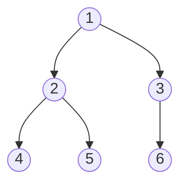
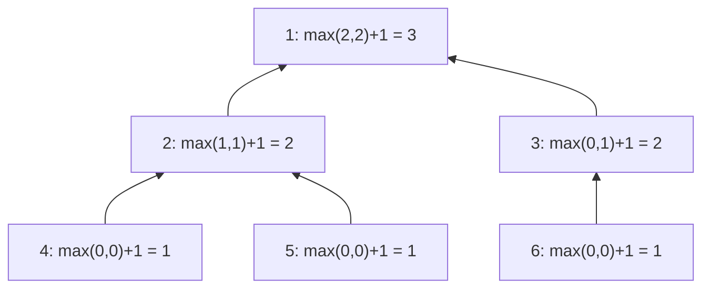
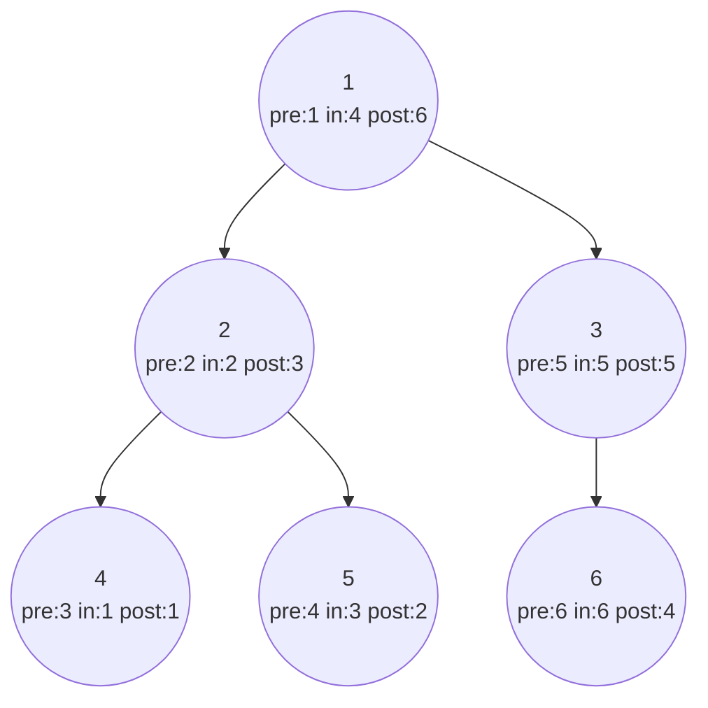
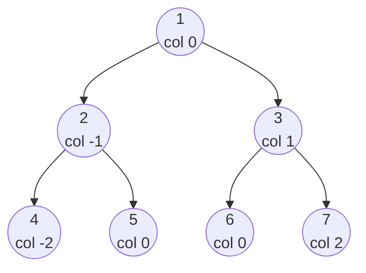

# Chapter 13 · Binary Trees

> Your family tree, your company's org chart, the folders on your laptop, the HTML of every web page, the way a compiler reads `2 + 3 * 4`: all trees. Trees are where recursion stops being an academic exercise and becomes the most natural way to think. Learn one question, "what do I need from my children?", and you'll solve most tree problems in under ten lines.

**You will learn:**
- Tree vocabulary (root, leaf, depth, height, ...) with pictures, and the kinds of binary trees
- How to build and print trees in Python, including from LeetCode's level-order format
- The **"ask your children"** recursion template that solves most tree problems
- DFS traversals (**preorder, inorder, postorder**), recursive and iterative, and BFS **level order**
- Classic problems: height, diameter, balanced, same/symmetric/subtree, invert, path sums I/II/III, maximum path sum
- Lowest common ancestor, right side view, zigzag, vertical/top/bottom views
- Building a tree from traversals, serializing and deserializing, counting nodes in a complete tree
- **Morris traversal**: inorder in O(1) extra space

**Before this:** [Recursion](../part-1-python/12-recursion.md) · [Recursion & Backtracking](09-backtracking.md) · [Stacks](11-stacks.md) · [Queues & Deques](12-queues-deques.md)

---

## 🧠 The Big Idea

Look at the folders on your computer. There's one top folder. Inside it are some folders, inside those are more folders, and at the very bottom are files with nothing inside. No folder lives inside two parents at once, and you never loop back to where you started.

That's a **tree**: a hierarchy where everything has exactly one parent except the top. A **binary tree** is a tree where every node has **at most two children**, called **left** and **right**.



Here's the magic. Look at node 2: it's the top of its own little tree (2, 4, 5). Node 3 is the top of another (3, 6). **Every node is the root of a smaller tree.** That makes trees *perfectly* recursive:

> A tree is either empty, or a node with a left tree and a right tree.

So almost every tree problem can be solved by asking one question at each node:

```text
"If my left child and my right child each told me the answer for THEIR subtree,
 how would I combine that into the answer for MY subtree?"
```

Want the height of the tree? Ask each child for its height, take the bigger one, add 1. Want the number of nodes? Ask each child for its count, add them, add 1 for yourself. You never think about the whole tree at once. You think about **one node and two answers**.

> 💡 **The core insight:** don't trace the whole tree in your head. Trust the recursive call to solve each child's subtree (it's the same problem, just smaller), and only decide how *one* node combines its children's answers.

---

## 🔨 Building It Up

### 1. Tree vocabulary

Using the tree from the Big Idea:

| Term | Meaning | Example |
|---|---|---|
| **Node** | one element, holding a value | each circle |
| **Root** | the top node, with no parent | 1 |
| **Parent / child** | a node directly above / below | 2 is the parent of 4 and 5 |
| **Siblings** | nodes with the same parent | 4 and 5 |
| **Leaf** | a node with no children | 4, 5, 6 |
| **Internal node** | a node with at least one child | 1, 2, 3 |
| **Edge** | the link between parent and child | 1–2 |
| **Subtree** | a node plus all its descendants | {2, 4, 5} |
| **Ancestor / descendant** | anything above / below on the path | 1 is an ancestor of 5 |
| **Depth of a node** | number of edges from the root down to it | depth(1) = 0, depth(5) = 2 |
| **Level** | all nodes at the same depth | level 1 = {2, 3} |
| **Height of a node** | number of edges on the longest path down to a leaf | height(2) = 1, height(1) = 2 |
| **Height of the tree** | height of the root | 2 |

> ⚠️ Some books (and LeetCode's "Maximum Depth" problem) count **nodes** instead of edges, so the tree above has "depth 3". Neither is wrong; just say which one you mean.

Kinds of binary trees you'll hear about:

| Kind | Rule | Why it matters |
|---|---|---|
| **Full** | every node has 0 or 2 children | expression trees |
| **Complete** | every level full except possibly the last, which is filled **left to right** | heaps ([Chapter 15](15-heaps.md)); can be stored in an array |
| **Perfect** | every level completely full | has exactly 2^(h+1) − 1 nodes |
| **Balanced** | at every node, left and right heights differ by at most 1 | height stays O(log n), so operations stay fast |
| **Degenerate / skewed** | every node has one child | it's basically a linked list; height n − 1 |
| **Binary Search Tree** | left < node < right everywhere | fast search ([Chapter 14](14-binary-search-trees.md)) |

### 2. Building trees in Python

A tree node is like a linked-list node ([Chapter 10](10-linked-lists.md)) with two pointers instead of one.

```python
class TreeNode:
    def __init__(self, val=0, left=None, right=None):
        self.val = val
        self.left = left
        self.right = right

#        1
#       / \
#      2   3
#     / \   \
#    4   5   6
root = TreeNode(1,
                TreeNode(2, TreeNode(4), TreeNode(5)),
                TreeNode(3, None, TreeNode(6)))

print(root.val, root.left.val, root.right.val)
print(root.left.left.val, root.right.right.val, root.right.left)

def show(node, depth=0):
    """Print the tree sideways: right subtree on top, root on the left."""
    if node:
        show(node.right, depth + 1)
        print("    " * depth + str(node.val))
        show(node.left, depth + 1)

show(root)
```

```text
1 2 3
4 6 None
        6
    3
1
        5
    2
        4
```

What just happened: tilt your head left and the sideways print *is* the tree. A missing child is just `None`.

LeetCode and most interview tools describe trees as a **level-order list** with `None` for missing children: the tree above is `[1, 2, 3, 4, 5, None, 6]`. This helper builds a tree from that format, and `to_level` converts back. We'll redefine `TreeNode` and `build_tree` in every runnable block so each one stands alone.

```python
from collections import deque

class TreeNode:
    def __init__(self, val=0, left=None, right=None):
        self.val, self.left, self.right = val, left, right

def build_tree(values):
    """Level-order list (None = missing child) -> root node."""
    if not values or values[0] is None:
        return None
    root = TreeNode(values[0])
    queue = deque([root])
    i = 1
    while queue and i < len(values):
        node = queue.popleft()
        if i < len(values) and values[i] is not None:      # left child
            node.left = TreeNode(values[i])
            queue.append(node.left)
        i += 1
        if i < len(values) and values[i] is not None:      # right child
            node.right = TreeNode(values[i])
            queue.append(node.right)
        i += 1
    return root

def to_level(root):
    """Root -> level-order list, trailing Nones removed."""
    out, queue = [], deque([root])
    while queue:
        node = queue.popleft()
        if node:
            out.append(node.val)
            queue.append(node.left)
            queue.append(node.right)
        else:
            out.append(None)
    while out and out[-1] is None:
        out.pop()
    return out

root = build_tree([1, 2, 3, 4, 5, None, 6])
print(root.left.right.val, root.right.right.val)
print(to_level(root))
print(to_level(build_tree([])))
```

```text
5 6
[1, 2, 3, 4, 5, None, 6]
[]
```

What just happened: the builder hands out values to children in exactly the order a BFS visits nodes, using a queue ([Chapter 12](12-queues-deques.md)). Missing children are skipped but still consume a slot in the list.

### 3. Recursion on trees: "ask your children"

The template, in words:

1. **Base case:** an empty tree (`None`). What's the answer for nothing? (Usually 0, `True`, or `None`.)
2. **Ask** the left child for its answer, and the right child for its answer.
3. **Combine** them with the current node's value.

```python
from collections import deque

class TreeNode:
    def __init__(self, val=0, left=None, right=None):
        self.val, self.left, self.right = val, left, right

def build_tree(values):
    if not values or values[0] is None:
        return None
    root = TreeNode(values[0])
    queue, i = deque([root]), 1
    while queue and i < len(values):
        node = queue.popleft()
        if i < len(values) and values[i] is not None:
            node.left = TreeNode(values[i]); queue.append(node.left)
        i += 1
        if i < len(values) and values[i] is not None:
            node.right = TreeNode(values[i]); queue.append(node.right)
        i += 1
    return root

def count_nodes(node):
    if node is None:
        return 0                                               # empty tree has 0 nodes
    return count_nodes(node.left) + count_nodes(node.right) + 1   # children + me

def tree_sum(node):
    if node is None:
        return 0
    return tree_sum(node.left) + tree_sum(node.right) + node.val

def max_value(node):
    if node is None:
        return float("-inf")                                   # neutral for max
    return max(node.val, max_value(node.left), max_value(node.right))

def max_depth(node):
    """Number of NODES on the longest root-to-leaf path (LeetCode's definition)."""
    if node is None:
        return 0
    return 1 + max(max_depth(node.left), max_depth(node.right))

def count_leaves(node):
    if node is None:
        return 0
    if node.left is None and node.right is None:
        return 1                                               # I am a leaf
    return count_leaves(node.left) + count_leaves(node.right)

root = build_tree([1, 2, 3, 4, 5, None, 6])
print(count_nodes(root), tree_sum(root), max_value(root), max_depth(root), count_leaves(root))
```

```text
6 21 6 3 3
```

What just happened: five different questions, one identical shape. Each function visits every node once, so each is **O(n) time** and **O(h) space**, where h is the tree's height (the recursion goes at most h levels deep).

Here's how `max_depth` answers flow **up** the tree, from the leaves to the root:



### 4. DFS traversals: preorder, inorder, postorder

A **traversal** visits every node once. **Depth-first** traversals go all the way down one branch before backing up. They differ only in **when you visit the node itself** relative to its children:

| Traversal | Order | Memory trick | Typical use |
|---|---|---|---|
| **Preorder** | **node**, left, right | visit on the way **down** | copy a tree, serialize, print a folder structure |
| **Inorder** | left, **node**, right | visit **between** children | BST → sorted order ([Chapter 14](14-binary-search-trees.md)) |
| **Postorder** | left, right, **node** | visit on the way **up** | delete a tree, compute sizes, evaluate expressions |

Picture walking around the outside of the tree, starting at the root and keeping the tree on your left. You pass every node three times: once on its left side (preorder), once underneath (inorder), once on its right side (postorder).



(Each node shows the **position** at which it's visited in each traversal.)

```python
from collections import deque

class TreeNode:
    def __init__(self, val=0, left=None, right=None):
        self.val, self.left, self.right = val, left, right

def build_tree(values):
    if not values or values[0] is None:
        return None
    root = TreeNode(values[0])
    queue, i = deque([root]), 1
    while queue and i < len(values):
        node = queue.popleft()
        if i < len(values) and values[i] is not None:
            node.left = TreeNode(values[i]); queue.append(node.left)
        i += 1
        if i < len(values) and values[i] is not None:
            node.right = TreeNode(values[i]); queue.append(node.right)
        i += 1
    return root

def preorder(node, out):
    if node:
        out.append(node.val)          # node first
        preorder(node.left, out)
        preorder(node.right, out)
    return out

def inorder(node, out):
    if node:
        inorder(node.left, out)
        out.append(node.val)          # node in the middle
        inorder(node.right, out)
    return out

def postorder(node, out):
    if node:
        postorder(node.left, out)
        postorder(node.right, out)
        out.append(node.val)          # node last
    return out

root = build_tree([1, 2, 3, 4, 5, None, 6])
print("pre: ", preorder(root, []))
print("in:  ", inorder(root, []))
print("post:", postorder(root, []))
```

```text
pre:  [1, 2, 4, 5, 3, 6]
in:   [4, 2, 5, 1, 3, 6]
post: [4, 5, 2, 6, 3, 1]
```

What just happened: the three functions are identical except for **where one line sits**. Notice the root is first in preorder and last in postorder. That fact is how we'll rebuild trees from traversals in section 15.

### 5. Iterative traversals with an explicit stack

Recursion uses the call stack; you can use your own stack instead ([Chapter 11](11-stacks.md)). Interviewers ask for this to check you understand what recursion really does, and it avoids Python's recursion limit on very deep trees.

```python
from collections import deque

class TreeNode:
    def __init__(self, val=0, left=None, right=None):
        self.val, self.left, self.right = val, left, right

def build_tree(values):
    if not values or values[0] is None:
        return None
    root = TreeNode(values[0])
    queue, i = deque([root]), 1
    while queue and i < len(values):
        node = queue.popleft()
        if i < len(values) and values[i] is not None:
            node.left = TreeNode(values[i]); queue.append(node.left)
        i += 1
        if i < len(values) and values[i] is not None:
            node.right = TreeNode(values[i]); queue.append(node.right)
        i += 1
    return root

def preorder_iter(root):
    out, stack = [], [root] if root else []
    while stack:
        node = stack.pop()
        out.append(node.val)
        if node.right:
            stack.append(node.right)      # push right FIRST so left is popped first
        if node.left:
            stack.append(node.left)
    return out

def inorder_iter(root):
    out, stack, node = [], [], root
    while stack or node:
        while node:                       # 1. slide down-left, remembering the path
            stack.append(node)
            node = node.left
        node = stack.pop()                # 2. leftmost unvisited node
        out.append(node.val)
        node = node.right                 # 3. then handle its right subtree
    return out

def postorder_iter(root):
    # preorder with children swapped gives node-right-left; reversed, that's left-right-node
    out, stack = [], [root] if root else []
    while stack:
        node = stack.pop()
        out.append(node.val)
        if node.left:
            stack.append(node.left)
        if node.right:
            stack.append(node.right)
    return out[::-1]

root = build_tree([1, 2, 3, 4, 5, None, 6])
print(preorder_iter(root), inorder_iter(root), postorder_iter(root))
```

```text
[1, 2, 4, 5, 3, 6] [4, 2, 5, 1, 3, 6] [4, 5, 2, 6, 3, 1]
```

**Dry run** of `inorder_iter` on the example tree:

| step | action | stack (bottom → top) | output |
|---|---|---|---|
| 1 | slide left from 1: push 1, 2, 4 | 1, 2, 4 | |
| 2 | pop 4, visit, go right (None) | 1, 2 | 4 |
| 3 | pop 2, visit, go right → 5 | 1 | 4, 2 |
| 4 | slide left from 5: push 5 | 1, 5 | |
| 5 | pop 5, visit, go right (None) | 1 | 4, 2, 5 |
| 6 | pop 1, visit, go right → 3 | | 4, 2, 5, 1 |
| 7 | push 3; pop 3, visit, go right → 6 | | ..., 3 |
| 8 | push 6; pop 6, visit; stack empty, node None → stop | | ..., 3, 6 |

What just happened: the iterative inorder is the one to memorise. Its stack holds exactly the ancestors whose left side we're still exploring, which is exactly what the recursive version's call stack holds.

### 6. Level-order traversal (BFS)

**Breadth-first** visits the tree level by level, left to right. A queue does it: process the oldest discovered node first ([Chapter 12](12-queues-deques.md)). Freeze `len(queue)` at the start of each level to group nodes by level.

```python
from collections import deque

class TreeNode:
    def __init__(self, val=0, left=None, right=None):
        self.val, self.left, self.right = val, left, right

def build_tree(values):
    if not values or values[0] is None:
        return None
    root = TreeNode(values[0])
    queue, i = deque([root]), 1
    while queue and i < len(values):
        node = queue.popleft()
        if i < len(values) and values[i] is not None:
            node.left = TreeNode(values[i]); queue.append(node.left)
        i += 1
        if i < len(values) and values[i] is not None:
            node.right = TreeNode(values[i]); queue.append(node.right)
        i += 1
    return root

def level_order(root):
    if not root:
        return []
    levels, queue = [], deque([root])
    while queue:
        level = []
        for _ in range(len(queue)):        # exactly this level's nodes
            node = queue.popleft()
            level.append(node.val)
            if node.left:
                queue.append(node.left)
            if node.right:
                queue.append(node.right)
        levels.append(level)
    return levels

def min_depth(root):
    """Nodes on the SHORTEST root-to-leaf path: BFS stops at the first leaf."""
    if not root:
        return 0
    queue, depth = deque([root]), 1
    while queue:
        for _ in range(len(queue)):
            node = queue.popleft()
            if not node.left and not node.right:
                return depth               # first leaf found = shallowest leaf
            if node.left:
                queue.append(node.left)
            if node.right:
                queue.append(node.right)
        depth += 1

print(level_order(build_tree([1, 2, 3, 4, 5, None, 6])))
print(level_order(build_tree([3, 9, 20, None, None, 15, 7])))
print(min_depth(build_tree([3, 9, 20, None, None, 15, 7])), min_depth(build_tree([2, None, 3, None, 4, None, 5])))
```

```text
[[1], [2, 3], [4, 5, 6]]
[[3], [9, 20], [15, 7]]
2 4
```

What just happened: for **minimum depth**, BFS is better than DFS because it can stop at the first leaf it meets. DFS would have to explore the whole tree. Note the second example: a "tree" that is just a chain `2 → 3 → 4 → 5` has minimum depth 4, not 1, because the root isn't a leaf (it has a child).

### 7. Diameter: when the answer isn't what you return

The **diameter** is the number of edges on the longest path between **any** two nodes. The path may not pass through the root.

At each node, the longest path that **bends** at that node goes down the left side as far as possible and down the right side as far as possible: `height(left) + height(right)` edges (counting heights in nodes). So:

- Each call **returns** its height (what the parent needs).
- Each call **records** `left + right` in a running best (the answer).

This "return one thing, record another" shape is one of the most important tree patterns.

```python
from collections import deque

class TreeNode:
    def __init__(self, val=0, left=None, right=None):
        self.val, self.left, self.right = val, left, right

def build_tree(values):
    if not values or values[0] is None:
        return None
    root = TreeNode(values[0])
    queue, i = deque([root]), 1
    while queue and i < len(values):
        node = queue.popleft()
        if i < len(values) and values[i] is not None:
            node.left = TreeNode(values[i]); queue.append(node.left)
        i += 1
        if i < len(values) and values[i] is not None:
            node.right = TreeNode(values[i]); queue.append(node.right)
        i += 1
    return root

def diameter_of_binary_tree(root):
    best = 0

    def height(node):                       # returns height in NODES
        nonlocal best
        if node is None:
            return 0
        left = height(node.left)
        right = height(node.right)
        best = max(best, left + right)      # longest path bending here (in edges)
        return 1 + max(left, right)         # what my parent needs

    height(root)
    return best

print(diameter_of_binary_tree(build_tree([1, 2, 3, 4, 5])))
print(diameter_of_binary_tree(build_tree([1, 2, None, 3, 4, 5, None, None, 6])))
```

```text
3
4
```

**Trace** for `[1, 2, 3, 4, 5]` (tree: 1 has children 2 and 3; 2 has children 4 and 5):

| node | left height | right height | path through node (edges) | best | returns |
|---|---|---|---|---|---|
| 4 | 0 | 0 | 0 | 0 | 1 |
| 5 | 0 | 0 | 0 | 0 | 1 |
| 2 | 1 | 1 | 2 | 2 | 2 |
| 3 | 0 | 0 | 0 | 2 | 1 |
| 1 | 2 | 1 | **3** | 3 | 3 |

The longest path is 4 → 2 → 1 → 3 (or 5 → 2 → 1 → 3): 3 edges. In the second example, the longest path (5 → 3 → 2 → 4 → 6) never touches the root, and the code still finds it because every node gets to be the "bend". `nonlocal best` lets the inner function update the outer variable ([Functions](../part-1-python/10-functions.md)).

### 8. Is the tree balanced?

A tree is **height-balanced** if at **every** node, the left and right subtree heights differ by at most 1.

The naive way calls `height()` at every node: O(n²) on a skewed tree. The smart way does it in one pass: each call returns its height, or **-1 as a signal** meaning "my subtree is already unbalanced". Once a -1 appears, it travels straight up.

```python
from collections import deque

class TreeNode:
    def __init__(self, val=0, left=None, right=None):
        self.val, self.left, self.right = val, left, right

def build_tree(values):
    if not values or values[0] is None:
        return None
    root = TreeNode(values[0])
    queue, i = deque([root]), 1
    while queue and i < len(values):
        node = queue.popleft()
        if i < len(values) and values[i] is not None:
            node.left = TreeNode(values[i]); queue.append(node.left)
        i += 1
        if i < len(values) and values[i] is not None:
            node.right = TreeNode(values[i]); queue.append(node.right)
        i += 1
    return root

def is_balanced(root):
    def check(node):                  # height, or -1 if unbalanced anywhere below
        if node is None:
            return 0
        left = check(node.left)
        if left == -1:
            return -1                 # stop early: already unbalanced
        right = check(node.right)
        if right == -1 or abs(left - right) > 1:
            return -1
        return 1 + max(left, right)

    return check(root) != -1

print(is_balanced(build_tree([3, 9, 20, None, None, 15, 7])))
print(is_balanced(build_tree([1, 2, 2, 3, 3, None, None, 4, 4])))
print(is_balanced(build_tree([])))
```

```text
True
False
True
```

What just happened: one return value carries **two** pieces of information (a height, or "failed"). This sentinel trick keeps the whole check O(n).

### 9. Same, symmetric, subtree: recursion on two trees at once

These problems walk **two** trees (or two halves of one tree) in lockstep.

- **Same Tree:** both empty → same. One empty → different. Otherwise values equal, and left matches left, and right matches right.
- **Symmetric Tree:** the tree is a mirror of itself. Compare the left subtree with the right subtree, but **crosswise**: outer with outer (`a.left` vs `b.right`), inner with inner (`a.right` vs `b.left`).
- **Subtree of Another Tree:** is `sub` identical to some subtree of `root`? Try "same tree" at every node.

```python
from collections import deque

class TreeNode:
    def __init__(self, val=0, left=None, right=None):
        self.val, self.left, self.right = val, left, right

def build_tree(values):
    if not values or values[0] is None:
        return None
    root = TreeNode(values[0])
    queue, i = deque([root]), 1
    while queue and i < len(values):
        node = queue.popleft()
        if i < len(values) and values[i] is not None:
            node.left = TreeNode(values[i]); queue.append(node.left)
        i += 1
        if i < len(values) and values[i] is not None:
            node.right = TreeNode(values[i]); queue.append(node.right)
        i += 1
    return root

def is_same_tree(p, q):
    if p is None and q is None:
        return True
    if p is None or q is None or p.val != q.val:
        return False
    return is_same_tree(p.left, q.left) and is_same_tree(p.right, q.right)

def is_symmetric(root):
    def mirror(a, b):
        if a is None and b is None:
            return True
        if a is None or b is None or a.val != b.val:
            return False
        return mirror(a.left, b.right) and mirror(a.right, b.left)   # crosswise
    return root is None or mirror(root.left, root.right)

def is_subtree(root, sub):
    if root is None:
        return sub is None
    return is_same_tree(root, sub) or is_subtree(root.left, sub) or is_subtree(root.right, sub)

print(is_same_tree(build_tree([1, 2, 3]), build_tree([1, 2, 3])),
      is_same_tree(build_tree([1, 2]), build_tree([1, None, 2])))
print(is_symmetric(build_tree([1, 2, 2, 3, 4, 4, 3])), is_symmetric(build_tree([1, 2, 2, None, 3, None, 3])))
print(is_subtree(build_tree([3, 4, 5, 1, 2]), build_tree([4, 1, 2])),
      is_subtree(build_tree([3, 4, 5, 1, 2, None, None, None, None, 0]), build_tree([4, 1, 2])))
```

```text
True False
True False
True False
```

What just happened: the order of the three checks in `is_same_tree` matters: first "both empty", then "exactly one empty or values differ", and only then recurse (when both nodes definitely exist). Complexities: same tree O(n), symmetric O(n), subtree O(m × n) worst case (an O(m + n) version serializes both trees and does string matching, see Interview Q15).

### 10. Invert a binary tree

Swap every node's left and right children: the tree's mirror image. (Famous because the creator of Homebrew tweeted that he was rejected by Google for not solving it on a whiteboard.)

```python
from collections import deque

class TreeNode:
    def __init__(self, val=0, left=None, right=None):
        self.val, self.left, self.right = val, left, right

def build_tree(values):
    if not values or values[0] is None:
        return None
    root = TreeNode(values[0])
    queue, i = deque([root]), 1
    while queue and i < len(values):
        node = queue.popleft()
        if i < len(values) and values[i] is not None:
            node.left = TreeNode(values[i]); queue.append(node.left)
        i += 1
        if i < len(values) and values[i] is not None:
            node.right = TreeNode(values[i]); queue.append(node.right)
        i += 1
    return root

def to_level(root):
    out, queue = [], deque([root])
    while queue:
        node = queue.popleft()
        if node:
            out.append(node.val); queue.append(node.left); queue.append(node.right)
        else:
            out.append(None)
    while out and out[-1] is None:
        out.pop()
    return out

def invert_tree(node):
    if node is None:
        return None
    node.left, node.right = invert_tree(node.right), invert_tree(node.left)
    return node

print(to_level(invert_tree(build_tree([4, 2, 7, 1, 3, 6, 9]))))
print(to_level(invert_tree(build_tree([2, 1, 3]))))
```

```text
[4, 7, 2, 9, 6, 3, 1]
[2, 3, 1]
```

What just happened: Python evaluates the whole right-hand side (both recursive calls) before assigning, so the swap is safe in one line. O(n) time, O(h) space.

### 11. Path Sum I, II and III: passing information down

So far, answers flowed **up** (children report to parents). Path problems often send information **down**: each call receives "what's happened on the path from the root to me".

- **Path Sum I:** is there a root-to-leaf path whose values add up to `target`? Pass the **remaining** target down; at a leaf, check if it's exactly the leaf's value.
- **Path Sum II:** return **all** such paths. Same idea plus a path list with backtracking: choose, explore, unchoose ([Chapter 09](09-backtracking.md)).
- **Path Sum III:** count paths with sum `target` that go **downward** but may start and end **anywhere**. This is "subarray sum equals k" ([Chapter 06](06-prefix-sums.md)) on every root-to-node path: keep a dict of prefix sums seen on the current path.

```python
from collections import deque, defaultdict

class TreeNode:
    def __init__(self, val=0, left=None, right=None):
        self.val, self.left, self.right = val, left, right

def build_tree(values):
    if not values or values[0] is None:
        return None
    root = TreeNode(values[0])
    queue, i = deque([root]), 1
    while queue and i < len(values):
        node = queue.popleft()
        if i < len(values) and values[i] is not None:
            node.left = TreeNode(values[i]); queue.append(node.left)
        i += 1
        if i < len(values) and values[i] is not None:
            node.right = TreeNode(values[i]); queue.append(node.right)
        i += 1
    return root

def has_path_sum(node, target):
    if node is None:
        return False
    if node.left is None and node.right is None:
        return target == node.val                     # at a leaf: is the rest exactly me?
    rest = target - node.val
    return has_path_sum(node.left, rest) or has_path_sum(node.right, rest)

def path_sum_ii(root, target):
    result, path = [], []

    def dfs(node, remaining):
        if node is None:
            return
        path.append(node.val)                         # choose
        if node.left is None and node.right is None and remaining == node.val:
            result.append(path[:])
        dfs(node.left, remaining - node.val)          # explore
        dfs(node.right, remaining - node.val)
        path.pop()                                    # unchoose

    dfs(root, target)
    return result

def path_sum_iii(root, target):
    seen = defaultdict(int)
    seen[0] = 1                                       # the empty prefix

    def dfs(node, running):
        if node is None:
            return 0
        running += node.val
        count = seen[running - target]                # paths ending here with sum target
        seen[running] += 1                            # this prefix is now on the path
        count += dfs(node.left, running) + dfs(node.right, running)
        seen[running] -= 1                            # leaving: remove it (backtrack)
        return count

    return dfs(root, 0)

t1 = build_tree([5, 4, 8, 11, None, 13, 4, 7, 2, None, None, None, 1])
print(has_path_sum(t1, 22), has_path_sum(t1, 100))
t2 = build_tree([5, 4, 8, 11, None, 13, 4, 7, 2, None, None, 5, 1])
print(path_sum_ii(t2, 22))
t3 = build_tree([10, 5, -3, 3, 2, None, 11, 3, -2, None, 1])
print(path_sum_iii(t3, 8))
```

```text
True False
[[5, 4, 11, 2], [5, 8, 4, 5]]
3
```

What just happened: in Path Sum III, `running - target` asks "was there an earlier point on **this** root-to-node path where the running sum was exactly `target` less than now?" If so, the stretch between there and here sums to `target`. The decrement on the way out is crucial: prefixes from a **different** branch must not count. The three paths summing to 8 are 5→3, 5→2→1, and -3→11. O(n) time (versus O(n²) for "try every starting node").

### 12. Binary Tree Maximum Path Sum

The hardest classic of the "return one thing, record another" family. A **path** is any sequence of connected nodes (each used once), not necessarily through the root, and values can be **negative**. Find the maximum sum.

Same shape as diameter:
- **Record** at each node the best path that **bends** here: `node.val + left_gain + right_gain`.
- **Return** to the parent the best path that **continues upward**, which can only use **one** side: `node.val + max(left_gain, right_gain)`.
- A child's gain below 0 would only hurt, so clamp it: `max(gain, 0)` (i.e. "don't take that branch").

```python
from collections import deque

class TreeNode:
    def __init__(self, val=0, left=None, right=None):
        self.val, self.left, self.right = val, left, right

def build_tree(values):
    if not values or values[0] is None:
        return None
    root = TreeNode(values[0])
    queue, i = deque([root]), 1
    while queue and i < len(values):
        node = queue.popleft()
        if i < len(values) and values[i] is not None:
            node.left = TreeNode(values[i]); queue.append(node.left)
        i += 1
        if i < len(values) and values[i] is not None:
            node.right = TreeNode(values[i]); queue.append(node.right)
        i += 1
    return root

def max_path_sum(root):
    best = float("-inf")

    def gain(node):
        nonlocal best
        if node is None:
            return 0
        left = max(gain(node.left), 0)        # negative branches are dropped
        right = max(gain(node.right), 0)
        best = max(best, node.val + left + right)    # path bending at this node
        return node.val + max(left, right)           # path continuing to my parent

    gain(root)
    return best

print(max_path_sum(build_tree([1, 2, 3])))
print(max_path_sum(build_tree([-10, 9, 20, None, None, 15, 7])))
print(max_path_sum(build_tree([-3])))
```

```text
6
42
-3
```

**Trace** for `[-10, 9, 20, None, None, 15, 7]`:

| node | left gain | right gain | bend here = val + L + R | best | returns val + max(L, R) |
|---|---|---|---|---|---|
| 9 | 0 | 0 | 9 | 9 | 9 |
| 15 | 0 | 0 | 15 | 15 | 15 |
| 7 | 0 | 0 | 7 | 15 | 7 |
| 20 | 15 | 7 | **42** | 42 | 35 |
| -10 | 9 | 35 | 34 | 42 | 25 |

The best path is 15 → 20 → 7 = 42, which skips the root entirely. `best` starts at `-inf` (not 0) so that an all-negative tree like `[-3]` returns -3.

### 13. Lowest Common Ancestor

The **lowest common ancestor (LCA)** of nodes p and q is the deepest node that has both p and q in its subtree (a node counts as its own descendant).

"Ask your children": search for p and q in each subtree.
- If this node **is** p or q, return it (no need to look deeper: whatever's below, this node is the answer or a part of it).
- Otherwise ask both children. If **both** sides found something, p and q are on different sides, so **this** node is the LCA. If only one side found something, pass that result up.

```python
from collections import deque

class TreeNode:
    def __init__(self, val=0, left=None, right=None):
        self.val, self.left, self.right = val, left, right

def build_tree(values):
    if not values or values[0] is None:
        return None
    root = TreeNode(values[0])
    queue, i = deque([root]), 1
    while queue and i < len(values):
        node = queue.popleft()
        if i < len(values) and values[i] is not None:
            node.left = TreeNode(values[i]); queue.append(node.left)
        i += 1
        if i < len(values) and values[i] is not None:
            node.right = TreeNode(values[i]); queue.append(node.right)
        i += 1
    return root

def find(node, val):
    if node is None or node.val == val:
        return node
    return find(node.left, val) or find(node.right, val)

def lowest_common_ancestor(node, p, q):
    if node is None or node is p or node is q:
        return node
    left = lowest_common_ancestor(node.left, p, q)
    right = lowest_common_ancestor(node.right, p, q)
    if left and right:
        return node                  # p and q split here
    return left or right             # both on one side (or neither: None)

root = build_tree([3, 5, 1, 6, 2, 0, 8, None, None, 7, 4])
p, q = find(root, 5), find(root, 1)
print(lowest_common_ancestor(root, p, q).val)
p, q = find(root, 5), find(root, 4)
print(lowest_common_ancestor(root, p, q).val)
p, q = find(root, 7), find(root, 8)
print(lowest_common_ancestor(root, p, q).val)
```

```text
3
5
3
```

What just happened: for (5, 4), the search returns node 5 as soon as it meets it, without ever seeing 4 below it. That's correct because the problem guarantees both nodes exist: if 4 isn't found elsewhere, it must be under 5, making 5 the LCA. O(n) time, O(h) space. (For a **BST** there's a faster O(h) method, [Chapter 14](14-binary-search-trees.md).)

### 14. Right side view and zigzag order: BFS variations

**Right Side View:** stand to the right of the tree; which nodes can you see? The **last** node of each level.

**Zigzag Level Order:** level order, but alternate direction: left→right, then right→left, and so on.

```python
from collections import deque

class TreeNode:
    def __init__(self, val=0, left=None, right=None):
        self.val, self.left, self.right = val, left, right

def build_tree(values):
    if not values or values[0] is None:
        return None
    root = TreeNode(values[0])
    queue, i = deque([root]), 1
    while queue and i < len(values):
        node = queue.popleft()
        if i < len(values) and values[i] is not None:
            node.left = TreeNode(values[i]); queue.append(node.left)
        i += 1
        if i < len(values) and values[i] is not None:
            node.right = TreeNode(values[i]); queue.append(node.right)
        i += 1
    return root

def right_side_view(root):
    view, queue = [], deque([root] if root else [])
    while queue:
        size = len(queue)
        for i in range(size):
            node = queue.popleft()
            if i == size - 1:
                view.append(node.val)          # last node of this level
            if node.left:
                queue.append(node.left)
            if node.right:
                queue.append(node.right)
    return view

def zigzag_level_order(root):
    result, queue = [], deque([root] if root else [])
    left_to_right = True
    while queue:
        level = deque()
        for _ in range(len(queue)):
            node = queue.popleft()
            if left_to_right:
                level.append(node.val)
            else:
                level.appendleft(node.val)     # build this level backwards
            if node.left:
                queue.append(node.left)
            if node.right:
                queue.append(node.right)
        result.append(list(level))
        left_to_right = not left_to_right
    return result

print(right_side_view(build_tree([1, 2, 3, None, 5, None, 4])), right_side_view(build_tree([1, 2, 3, 4])))
print(zigzag_level_order(build_tree([3, 9, 20, None, None, 15, 7])))
```

```text
[1, 3, 4] [1, 3, 4]
[[3], [20, 9], [15, 7]]
```

What just happened: in the second right-side example, node 4 hangs off the **left** side, but it's the only node on its level, so you see it from the right. That's why "just follow right children" is wrong. A DFS alternative for right side view: visit right before left, and record the first node seen at each new depth.

### 15. Construct a tree from preorder and inorder

Given the preorder and inorder traversals (with unique values), rebuild the tree.

The key facts:
- **Preorder's first value is the root.**
- In **inorder**, everything left of the root is the left subtree; everything right of it is the right subtree.
- So the left subtree has `k` nodes, where k is the root's position in the inorder slice. The next k values of preorder belong to the left subtree; the rest to the right.

```text
preorder: [3 | 9 | 20 15 7]        inorder: [9 | 3 | 15 20 7]
           root left  right                  left root right
```

```python
from collections import deque

class TreeNode:
    def __init__(self, val=0, left=None, right=None):
        self.val, self.left, self.right = val, left, right

def to_level(root):
    out, queue = [], deque([root])
    while queue:
        node = queue.popleft()
        if node:
            out.append(node.val); queue.append(node.left); queue.append(node.right)
        else:
            out.append(None)
    while out and out[-1] is None:
        out.pop()
    return out

def build_from_pre_in(preorder, inorder):
    index_in = {v: i for i, v in enumerate(inorder)}   # O(1) lookup of the root's position
    pre_iter = iter(preorder)                           # roots come out in preorder

    def build(lo, hi):                                  # inorder slice [lo, hi]
        if lo > hi:
            return None
        root_val = next(pre_iter)
        mid = index_in[root_val]
        node = TreeNode(root_val)
        node.left = build(lo, mid - 1)                  # must build LEFT first (preorder order)
        node.right = build(mid + 1, hi)
        return node

    return build(0, len(inorder) - 1)

print(to_level(build_from_pre_in([3, 9, 20, 15, 7], [9, 3, 15, 20, 7])))
print(to_level(build_from_pre_in([1, 2, 4, 5, 3, 6], [4, 2, 5, 1, 3, 6])))
```

```text
[3, 9, 20, None, None, 15, 7]
[1, 2, 3, 4, 5, None, 6]
```

What just happened: instead of slicing lists (which costs O(n) per call and O(n²) total), we pass index bounds into `inorder` and pull roots from a single preorder iterator. Because we build the left subtree completely before the right one, the iterator hands out exactly the right roots in order. O(n) time, O(n) space for the dict.

> 💡 Preorder + inorder, or postorder + inorder, determine a tree uniquely (with distinct values). Preorder + postorder alone do **not** (you can't tell whether a single child is left or right).

### 16. Serialize and deserialize

**Serialization** turns a tree into a string (to save to disk or send over a network); **deserialization** rebuilds it. Preorder with a marker for `None` (say `#`) is enough to rebuild the tree **uniquely**, because the markers tell you exactly where each subtree ends.

```python
from collections import deque

class TreeNode:
    def __init__(self, val=0, left=None, right=None):
        self.val, self.left, self.right = val, left, right

def build_tree(values):
    if not values or values[0] is None:
        return None
    root = TreeNode(values[0])
    queue, i = deque([root]), 1
    while queue and i < len(values):
        node = queue.popleft()
        if i < len(values) and values[i] is not None:
            node.left = TreeNode(values[i]); queue.append(node.left)
        i += 1
        if i < len(values) and values[i] is not None:
            node.right = TreeNode(values[i]); queue.append(node.right)
        i += 1
    return root

def serialize(root):
    out = []
    def dfs(node):
        if node is None:
            out.append("#")
            return
        out.append(str(node.val))
        dfs(node.left)
        dfs(node.right)
    dfs(root)
    return ",".join(out)

def deserialize(data):
    tokens = iter(data.split(","))
    def build():
        tok = next(tokens)
        if tok == "#":
            return None
        node = TreeNode(int(tok))
        node.left = build()          # same order as serialize: node, left, right
        node.right = build()
        return node
    return build()

s = serialize(build_tree([1, 2, 3, None, None, 4, 5]))
print(s)
print(serialize(deserialize(s)) == s)
print(repr(serialize(None)), deserialize("#"))
```

```text
1,2,#,#,3,4,#,#,5,#,#
True
'#' None
```

What just happened: `deserialize` mirrors `serialize` exactly: read a token; `#` means "empty subtree, done"; otherwise create a node and recursively read its left subtree, then its right. Both are O(n). This is also how you'd store a tree in a database or a file ([Storage, Search & Unique IDs](../part-3-system-design/10-storage-search-ids.md) talks about serialization formats at scale).

### 17. Count nodes in a complete tree faster than O(n)

In a **complete** tree, you can count nodes in **O(log² n)**. At any node, measure the height by walking only left edges, and by walking only right edges. If they're equal, the subtree is **perfect**, with `2^h − 1` nodes: no need to visit them. Otherwise recurse into both children; one of them will be perfect.

```python
from collections import deque

class TreeNode:
    def __init__(self, val=0, left=None, right=None):
        self.val, self.left, self.right = val, left, right

def build_tree(values):
    if not values or values[0] is None:
        return None
    root = TreeNode(values[0])
    queue, i = deque([root]), 1
    while queue and i < len(values):
        node = queue.popleft()
        if i < len(values) and values[i] is not None:
            node.left = TreeNode(values[i]); queue.append(node.left)
        i += 1
        if i < len(values) and values[i] is not None:
            node.right = TreeNode(values[i]); queue.append(node.right)
        i += 1
    return root

def count_complete(node):
    if node is None:
        return 0
    left_h, n = 0, node
    while n:
        left_h += 1
        n = n.left
    right_h, n = 0, node
    while n:
        right_h += 1
        n = n.right
    if left_h == right_h:
        return (1 << left_h) - 1          # perfect subtree: 2^h - 1 nodes
    return 1 + count_complete(node.left) + count_complete(node.right)

print(count_complete(build_tree([1, 2, 3, 4, 5, 6])))
print(count_complete(build_tree(list(range(1, 1001)))))
```

```text
6
1000
```

What just happened: each level of recursion does O(log n) work measuring heights, and only one child per level needs a full recursion (the other is perfect and returns immediately), so the depth is O(log n): **O(log² n)** total. For a million nodes that's about 400 steps instead of a million.

### 18. Vertical order, top view and bottom view

Give each node a **column**: the root is column 0, a left child is `column − 1`, a right child is `column + 1`. Also track the **row** (depth).

- **Vertical Order Traversal (LeetCode 987):** list nodes column by column, left to right; within a column, by row top to bottom; ties at the same row and column by value.
- **Top view:** the first node seen in each column from above (the smallest row).
- **Bottom view:** the last node in each column from above (the largest row; for ties, the one that comes later in level order).



```python
from collections import deque, defaultdict

class TreeNode:
    def __init__(self, val=0, left=None, right=None):
        self.val, self.left, self.right = val, left, right

def build_tree(values):
    if not values or values[0] is None:
        return None
    root = TreeNode(values[0])
    queue, i = deque([root]), 1
    while queue and i < len(values):
        node = queue.popleft()
        if i < len(values) and values[i] is not None:
            node.left = TreeNode(values[i]); queue.append(node.left)
        i += 1
        if i < len(values) and values[i] is not None:
            node.right = TreeNode(values[i]); queue.append(node.right)
        i += 1
    return root

def bfs_with_columns(root):
    """Yield (node, row, col) in level order."""
    queue = deque([(root, 0, 0)] if root else [])
    while queue:
        node, row, col = queue.popleft()
        yield node, row, col
        if node.left:
            queue.append((node.left, row + 1, col - 1))
        if node.right:
            queue.append((node.right, row + 1, col + 1))

def vertical_traversal(root):
    cells = sorted((col, row, node.val) for node, row, col in bfs_with_columns(root))
    columns = defaultdict(list)
    for col, row, val in cells:
        columns[col].append(val)
    return [columns[c] for c in sorted(columns)]

def top_view(root):
    first = {}
    for node, row, col in bfs_with_columns(root):
        if col not in first:
            first[col] = node.val          # BFS meets the topmost node of a column first
    return [first[c] for c in sorted(first)]

def bottom_view(root):
    last = {}
    for node, row, col in bfs_with_columns(root):
        last[col] = node.val               # keep overwriting: the deepest (latest) wins
    return [last[c] for c in sorted(last)]

t = build_tree([1, 2, 3, 4, 5, 6, 7])
print(vertical_traversal(t))
print(vertical_traversal(build_tree([3, 9, 20, None, None, 15, 7])))
print("top:", top_view(t), "bottom:", bottom_view(t))
```

```text
[[4], [2], [1, 5, 6], [3], [7]]
[[9], [3, 15], [20], [7]]
top: [4, 2, 1, 3, 7] bottom: [4, 2, 6, 3, 7]
```

What just happened: nodes 5 and 6 share row 2 and column 0, so vertical order sorts them by value. Top view uses BFS so the first node met in each column is the highest. (A DFS would also need to compare rows, because DFS can reach a deep node in a column before a shallow one.) Time O(n log n) for the sort.

---

## 🔬 Under the Hood

### Why tree recursion is O(n) time and O(h) space

Every node is visited exactly once, and each visit does O(1) work outside the recursive calls: **O(n) time**. The call stack only ever holds the nodes on the path from the root to the current node: **O(h) space**, where h is the height.

| Tree shape | Height h | Stack space |
|---|---|---|
| Balanced (complete, perfect, AVL...) | about log₂ n | O(log n): ~20 for a million nodes |
| Skewed (a chain) | n − 1 | O(n) |

This matters in Python: the default recursion limit is about 1,000 frames. A skewed tree with 5,000 nodes will crash a recursive traversal with `RecursionError`. Fixes: use the iterative versions (section 5), or raise the limit carefully with `sys.setrecursionlimit` (risky, since the C stack can still overflow).

### Why "ask your children" is correct: induction

Recursive tree algorithms are proved correct by **structural induction**:
1. **Base:** the function is right for the empty tree.
2. **Step:** assume it's right for the left and right subtrees (they're smaller). Show that combining their answers gives the right answer for the whole tree.

That's precisely the "trust the recursive call" mindset. If you can argue step 2 for a single node, your code is correct for every tree.

### How a tree sits in memory

Each `TreeNode` is a separate Python object holding three references (`val`, `left`, `right`), scattered around the heap. Contrast with a **complete** tree stored as an array: node at index i has children at `2i + 1` and `2i + 2` and parent at `(i − 1) // 2`. No pointers at all. That array layout is exactly how heaps work ([Chapter 15](15-heaps.md)).

### Morris traversal: inorder in O(1) extra space

The iterative inorder needs a stack of O(h). **Morris traversal** uses no stack at all. The trick: temporarily borrow the empty `right` pointers of leaves to create "threads" back to their inorder successor, then remove them.

For the current node:
- If it has no left child: visit it, go right.
- Otherwise, find its **predecessor** (the rightmost node of its left subtree).
  - If the predecessor's `right` is empty: point it back to the current node (create a thread), then go left.
  - If it already points to the current node: we've come back up through the thread. Remove the thread, visit the current node, go right.

```python
from collections import deque

class TreeNode:
    def __init__(self, val=0, left=None, right=None):
        self.val, self.left, self.right = val, left, right

def build_tree(values):
    if not values or values[0] is None:
        return None
    root = TreeNode(values[0])
    queue, i = deque([root]), 1
    while queue and i < len(values):
        node = queue.popleft()
        if i < len(values) and values[i] is not None:
            node.left = TreeNode(values[i]); queue.append(node.left)
        i += 1
        if i < len(values) and values[i] is not None:
            node.right = TreeNode(values[i]); queue.append(node.right)
        i += 1
    return root

def morris_inorder(root):
    out, curr = [], root
    while curr:
        if curr.left is None:
            out.append(curr.val)
            curr = curr.right                     # may follow a thread back up
        else:
            pred = curr.left
            while pred.right and pred.right is not curr:
                pred = pred.right                 # rightmost node of the left subtree
            if pred.right is None:
                pred.right = curr                 # create thread, go left
                curr = curr.left
            else:
                pred.right = None                 # thread used: remove it
                out.append(curr.val)
                curr = curr.right
    return out

root = build_tree([1, 2, 3, 4, 5, None, 6])
print(morris_inorder(root))
print(morris_inorder(root))       # the tree is restored, so it works twice
```

```text
[4, 2, 5, 1, 3, 6]
[4, 2, 5, 1, 3, 6]
```

Time is still O(n): each edge is walked a constant number of times (at most twice to find predecessors, once more to follow threads). Space O(1). It temporarily **modifies** the tree, which makes it unsafe if other code reads the tree concurrently. It's rarely required, but it's a great "can you do inorder in O(1) space?" follow-up answer.

---

## 🧩 Pattern Decoder

### Signals: what kind of tree problem is it?

| You see in the problem... | Think |
|---|---|
| "height", "depth", "count", "sum", "is it balanced" | **Bottom-up** recursion: ask children, combine |
| "longest path between any two nodes", "max path sum", "diameter" | Bottom-up, **return one thing, record another** (global best) |
| "root-to-leaf path", "path with sum", "depth of each node" | **Top-down**: pass info down as parameters |
| "all paths" | Top-down + backtracking (`path.append` / `path.pop`) |
| "paths anywhere going downward with sum k" | Top-down + prefix-sum dict (Path Sum III) |
| "level", "level by level", "right side view", "zigzag", "minimum depth" | **BFS** with `for _ in range(len(queue))` |
| "same", "mirror", "symmetric", "merge two trees" | **Two-pointer recursion** on two trees |
| "ancestor", "LCA", "distance between nodes" | Bottom-up search that returns found nodes |
| "construct from traversals" | Root from pre/postorder, split by inorder index |
| "serialize", "encode", "store the tree" | Preorder with `#` for None |
| "column", "vertical", "top/bottom view" | BFS with (row, col) coordinates |
| "complete tree" + "faster than O(n)" | Compare leftmost and rightmost heights |
| "O(1) space traversal" | Morris |

### Template A: bottom-up ("ask your children")

```py
def solve(node):
    if node is None:
        return BASE                     # answer for an empty tree
    left = solve(node.left)             # trust it
    right = solve(node.right)           # trust it
    return combine(node.val, left, right)
```

### Template B: bottom-up with a global answer

```py
def solve(root):
    best = INITIAL

    def dfs(node):
        nonlocal best
        if node is None:
            return BASE
        left, right = dfs(node.left), dfs(node.right)
        best = max(best, answer_through(node, left, right))   # path that BENDS here
        return value_for_parent(node, left, right)            # path that CONTINUES up
    dfs(root)
    return best
```

### Template C: top-down (pass state down)

```py
def dfs(node, state):
    if node is None:
        return
    new_state = update(state, node.val)
    if node.left is None and node.right is None:
        check_leaf(new_state)           # e.g. remaining sum == 0
    dfs(node.left, new_state)
    dfs(node.right, new_state)
```

### Template D: level order

```py
queue = deque([root])
while queue:
    for i in range(len(queue)):         # one level
        node = queue.popleft()
        # process node (i == 0 is leftmost, i == size - 1 is rightmost)
        if node.left:  queue.append(node.left)
        if node.right: queue.append(node.right)
```

### Decoding "what do I return?"

The question that unlocks every bottom-up problem: **what does my parent need from me?** It's often *not* the final answer.

| Problem | Returned to parent | Recorded globally | Base case |
|---|---|---|---|
| Max depth | my height | | 0 |
| Diameter | my height | `left + right` | 0 |
| Balanced | my height, or -1 = "failed" | | 0 |
| Max path sum | best downward path `val + max(L, R, 0)` | `val + L + R` | 0 |
| LCA | the p/q/LCA found in my subtree, or None | | None |
| Count good nodes (Interview Q14) | count in my subtree | | 0 (with max-so-far passed **down**) |
| Binary Tree Cameras (Practice 7) | my state: covered / has camera / needs cover | camera count | "covered" |

### Variation: All Nodes Distance K in Binary Tree (tree → graph)

**Problem:** return all nodes exactly `k` edges from a `target` node. Distances go **up** through parents too, but tree nodes don't know their parents.

**Idea:** one DFS to record each node's parent, turning the tree into an undirected graph. Then BFS from `target` for k levels ([Chapter 16](16-graphs-bfs-dfs.md) previews this).

```python
from collections import deque

class TreeNode:
    def __init__(self, val=0, left=None, right=None):
        self.val, self.left, self.right = val, left, right

def build_tree(values):
    if not values or values[0] is None:
        return None
    root = TreeNode(values[0])
    queue, i = deque([root]), 1
    while queue and i < len(values):
        node = queue.popleft()
        if i < len(values) and values[i] is not None:
            node.left = TreeNode(values[i]); queue.append(node.left)
        i += 1
        if i < len(values) and values[i] is not None:
            node.right = TreeNode(values[i]); queue.append(node.right)
        i += 1
    return root

def distance_k(root, target_val, k):
    parent = {}
    target = None
    stack = [(root, None)]
    while stack:                                    # record parents, find target
        node, par = stack.pop()
        parent[node] = par
        if node.val == target_val:
            target = node
        for child in (node.left, node.right):
            if child:
                stack.append((child, node))

    queue, seen = deque([target]), {target}
    for _ in range(k):                              # BFS exactly k levels
        for _ in range(len(queue)):
            node = queue.popleft()
            for nb in (node.left, node.right, parent[node]):
                if nb and nb not in seen:
                    seen.add(nb)
                    queue.append(nb)
    return sorted(node.val for node in queue)

root = build_tree([3, 5, 1, 6, 2, 0, 8, None, None, 7, 4])
print(distance_k(root, 5, 2), distance_k(root, 5, 0), distance_k(root, 7, 3))
```

```text
[1, 4, 7] [5] [3, 6]
```

O(n) time and space. Recognising "this tree problem is really a graph problem" is a skill in itself.

### When NOT to use plain tree recursion

- **The tree is a BST and you're searching** for a value or range: use the ordering to go down only one side, O(h) instead of O(n) ([Chapter 14](14-binary-search-trees.md)).
- **The tree may be extremely deep** (skewed, 10⁴+ nodes) in Python: recursion hits the limit. Use an explicit stack or BFS.
- **You need repeated "k-th smallest" or "min" queries with updates**: a heap or balanced BST does better than re-traversing ([Chapter 15](15-heaps.md)).
- **Distances that go up and down**: convert to a graph with parent pointers (variation above) instead of forcing pure recursion.

---

## ⚠️ Traps & Common Mistakes

1. **Forgetting the `None` base case.** `node.left.val` crashes on a leaf. Every recursive tree function starts with `if node is None: return ...`.
2. **Confusing "leaf" with "None".** Path Sum must check the target **at a leaf** (`not node.left and not node.right`), not when reaching `None`. Otherwise a node with one child would count a "path" that stops halfway.

```py
# ❌ wrong: for tree 1 -> (left 2), target 1 returns True via the empty right side
def has_path_sum(node, target):
    if node is None:
        return target == 0
    return has_path_sum(node.left, target - node.val) or has_path_sum(node.right, target - node.val)

# ✅ right: only leaves end a path
def has_path_sum(node, target):
    if node is None:
        return False
    if not node.left and not node.right:
        return target == node.val
    rest = target - node.val
    return has_path_sum(node.left, rest) or has_path_sum(node.right, rest)
```

3. **Min depth with `min(left, right) + 1`.** If one child is missing, its depth 0 wins and you get a wrong answer. A missing child isn't a leaf. Use BFS, or handle one-child nodes explicitly.
4. **Edges vs nodes.** Diameter counts edges; LeetCode's max depth counts nodes. Say which one you're using and stay consistent.
5. **Starting a global max at 0 when values can be negative.** Max Path Sum must start at `-inf`.
6. **Not undoing state in top-down backtracking.** Path Sum II needs `path.pop()`; Path Sum III needs `seen[running] -= 1`. Forgetting this leaks one branch's state into another.
7. **Right side view by following only right children.** Left-side nodes can be visible when the right side is shorter.
8. **Slicing lists while building from traversals** (`preorder[1:k+1]`): correct but O(n²). Use index bounds plus a value → index dict.
9. **Using `==` to compare nodes in LCA.** Use `is`: two different nodes can hold the same value.
10. **Recursion depth on skewed trees** in Python. Know the iterative alternatives.

---

## 💡 Tips & Tricks

- **Start every tree problem by asking: "top-down or bottom-up?"** Does the node need info from its ancestors (pass it down) or from its descendants (return it up)?
- **"What does my parent need from me?"** decides the return value. The final answer may be a separate global.
- **Draw a 3-to-5-node tree** and trace your function on it, including a node with only one child. One-child nodes catch most bugs.
- **Keep a `build_tree` helper** for LeetCode-format lists; testing becomes painless.
- **Level-based questions → BFS** (`for _ in range(len(queue))`). Path-based questions → DFS.
- **Inorder of a BST is sorted.** You'll use this constantly in [Chapter 14](14-binary-search-trees.md).
- **Iterative inorder** (slide left, pop, go right) is worth memorising cold; it's the base of BST iterators and k-th smallest.
- **Use `nonlocal`** for a running best inside a nested function, or return a tuple of values from the helper.
- **Need parents?** Build a `parent` dict in one DFS and treat the tree as a graph.

---

## 🎯 Interview Questions

### 1. Maximum Depth of Binary Tree 🔥🔥🔥

<details><summary>Answer</summary>

`1 + max(depth(left), depth(right))`, base 0 (section 3). O(n) time, O(h) space. BFS counting levels is the iterative alternative.

</details>

### 2. Invert Binary Tree 🔥🔥🔥

<details><summary>Answer</summary>

Swap children recursively: `node.left, node.right = invert(node.right), invert(node.left)` (section 10). O(n) time, O(h) space. A BFS that swaps the children of each dequeued node works too.

</details>

### 3. Same Tree / Symmetric Tree 🔥🔥🔥

<details><summary>Answer</summary>

Lockstep recursion on two trees; symmetric compares crosswise: `(a.left, b.right)` and `(a.right, b.left)` (section 9). Both O(n) time, O(h) space.

</details>

### 4. Diameter of Binary Tree 🔥🔥🔥

<details><summary>Answer</summary>

Return height, record `left + right` at every node (section 7, with trace). O(n) time, O(h) space. The key sentence: "the longest path bends at some node, so I try every node as the bend."

</details>

### 5. Balanced Binary Tree 🔥🔥

<details><summary>Answer</summary>

Return height, or -1 as an "unbalanced" sentinel that propagates (section 8). O(n) time. The naive "check height at every node" is O(n²) on a skewed tree; mention why you avoided it.

</details>

### 6. Binary Tree Level Order Traversal 🔥🔥🔥

<details><summary>Answer</summary>

BFS with a queue and the `range(len(queue))` level snapshot (section 6). O(n) time, O(w) space where w is the maximum width (up to n/2 for the last level of a perfect tree).

</details>

### 7. Binary Tree Right Side View / Zigzag Level Order 🔥🔥

<details><summary>Answer</summary>

Both are level-order BFS variants (section 14): right view takes the last node of each level; zigzag alternates appending and `appendleft`-ing into a deque per level. O(n) time.

</details>

### 8. Lowest Common Ancestor of a Binary Tree 🔥🔥🔥

<details><summary>Answer</summary>

Return p/q when met; if both subtrees return something, the current node is the LCA; otherwise pass up the non-empty side (section 13). O(n) time, O(h) space. Follow-ups: if p or q might be missing, count how many were actually found; for a BST, walk down using the ordering in O(h).

</details>

### 9. Path Sum II / Path Sum III 🔥🔥

<details><summary>Answer</summary>

II: top-down with the remaining sum, backtracking path list, record at leaves (O(n²) worst case due to copying paths). III: prefix-sum dict along the current root-to-node path, increment on entry and decrement on exit, O(n) (section 11).

</details>

### 10. Binary Tree Maximum Path Sum 🔥🔥🔥

<details><summary>Answer</summary>

Return `val + max(L, R)` with negative gains clamped to 0; record `val + L + R` globally; start best at `-inf` (section 12, with trace). O(n) time, O(h) space.

</details>

### 11. Construct Binary Tree from Preorder and Inorder Traversal 🔥🔥🔥

<details><summary>Answer</summary>

Preorder gives roots in order; inorder index of the root splits left/right. Use a value → index dict and an iterator over preorder; build left before right (section 15). O(n) time and space.

</details>

### 12. Serialize and Deserialize Binary Tree 🔥🔥🔥

<details><summary>Answer</summary>

Preorder with `#` markers; deserialize by consuming tokens recursively in the same order (section 16). O(n) both ways. BFS level-order with `#` (like LeetCode's own format) is an equally valid alternative; mention that the markers are what make the encoding unambiguous.

</details>

### 13. Count Complete Tree Nodes 🔥🔥

<details><summary>Answer</summary>

Compare leftmost and rightmost heights; equal → perfect → `2^h − 1`; otherwise `1 + count(left) + count(right)` (section 17). O(log² n) time, O(log n) space.

</details>

### 14. Count Good Nodes in Binary Tree 🔥🔥

A node is "good" if no node on the path from the root to it has a greater value.

<details><summary>Answer</summary>

Top-down: pass the maximum seen so far; bottom-up: return the count from each subtree. A nice mix of both directions.

```python
from collections import deque

class TreeNode:
    def __init__(self, val=0, left=None, right=None):
        self.val, self.left, self.right = val, left, right

def build_tree(values):
    if not values or values[0] is None:
        return None
    root = TreeNode(values[0])
    queue, i = deque([root]), 1
    while queue and i < len(values):
        node = queue.popleft()
        if i < len(values) and values[i] is not None:
            node.left = TreeNode(values[i]); queue.append(node.left)
        i += 1
        if i < len(values) and values[i] is not None:
            node.right = TreeNode(values[i]); queue.append(node.right)
        i += 1
    return root

def good_nodes(root):
    def dfs(node, max_so_far):
        if node is None:
            return 0
        good = 1 if node.val >= max_so_far else 0
        new_max = max(max_so_far, node.val)
        return good + dfs(node.left, new_max) + dfs(node.right, new_max)
    return dfs(root, float("-inf"))

print(good_nodes(build_tree([3, 1, 4, 3, None, 1, 5])), good_nodes(build_tree([3, 3, None, 4, 2])))
```

```text
4 3
```

O(n) time, O(h) space.

</details>

### 15. Subtree of Another Tree 🔥🔥

<details><summary>Answer</summary>

Try `is_same_tree` at every node of `root` (section 9): O(m × n) worst case. Faster O(m + n): serialize both trees in preorder with null markers **and delimiters on both sides of each value** (e.g. `",4,1,#,#,2,#,#"`), then check substring containment with KMP ([Chapter 24](24-advanced-structures.md)). The delimiters prevent false matches like "2" inside "12".

</details>

### 16. Vertical Order Traversal of a Binary Tree 🔥🔥

<details><summary>Answer</summary>

Assign (row, col) during BFS/DFS, sort by (col, row, value), group by column (section 18). O(n log n) time. Top view = first node per column in BFS; bottom view = last node per column in BFS.

</details>

---

## 🏋️ Practice

**🟢 1. Sum of Left Leaves.** `[3, 9, 20, None, None, 15, 7]` → 24 (9 + 15).

<details><summary>Solution</summary>

Pass down whether the current node is a left child.

```python
from collections import deque

class TreeNode:
    def __init__(self, val=0, left=None, right=None):
        self.val, self.left, self.right = val, left, right

def build_tree(values):
    if not values or values[0] is None:
        return None
    root = TreeNode(values[0])
    queue, i = deque([root]), 1
    while queue and i < len(values):
        node = queue.popleft()
        if i < len(values) and values[i] is not None:
            node.left = TreeNode(values[i]); queue.append(node.left)
        i += 1
        if i < len(values) and values[i] is not None:
            node.right = TreeNode(values[i]); queue.append(node.right)
        i += 1
    return root

def sum_of_left_leaves(node, is_left=False):
    if node is None:
        return 0
    if not node.left and not node.right:
        return node.val if is_left else 0
    return sum_of_left_leaves(node.left, True) + sum_of_left_leaves(node.right, False)

print(sum_of_left_leaves(build_tree([3, 9, 20, None, None, 15, 7])), sum_of_left_leaves(build_tree([1])))
```

```text
24 0
```

</details>

**🟢 2. Merge Two Binary Trees.** Overlapping nodes add their values; otherwise take whichever node exists.

<details><summary>Solution</summary>

```python
from collections import deque

class TreeNode:
    def __init__(self, val=0, left=None, right=None):
        self.val, self.left, self.right = val, left, right

def build_tree(values):
    if not values or values[0] is None:
        return None
    root = TreeNode(values[0])
    queue, i = deque([root]), 1
    while queue and i < len(values):
        node = queue.popleft()
        if i < len(values) and values[i] is not None:
            node.left = TreeNode(values[i]); queue.append(node.left)
        i += 1
        if i < len(values) and values[i] is not None:
            node.right = TreeNode(values[i]); queue.append(node.right)
        i += 1
    return root

def to_level(root):
    out, queue = [], deque([root])
    while queue:
        node = queue.popleft()
        if node:
            out.append(node.val); queue.append(node.left); queue.append(node.right)
        else:
            out.append(None)
    while out and out[-1] is None:
        out.pop()
    return out

def merge_trees(a, b):
    if a is None:
        return b
    if b is None:
        return a
    return TreeNode(a.val + b.val, merge_trees(a.left, b.left), merge_trees(a.right, b.right))

print(to_level(merge_trees(build_tree([1, 3, 2, 5]), build_tree([2, 1, 3, None, 4, None, 7]))))
```

```text
[3, 4, 5, 5, 4, None, 7]
```

</details>

**🟡 3. Flatten Binary Tree to Linked List** in place, in preorder, using `right` pointers (all `left` become None).

<details><summary>Solution</summary>

Process in reverse preorder (right, left, node), keeping the previously processed node: each node's `right` becomes that node.

```python
from collections import deque

class TreeNode:
    def __init__(self, val=0, left=None, right=None):
        self.val, self.left, self.right = val, left, right

def build_tree(values):
    if not values or values[0] is None:
        return None
    root = TreeNode(values[0])
    queue, i = deque([root]), 1
    while queue and i < len(values):
        node = queue.popleft()
        if i < len(values) and values[i] is not None:
            node.left = TreeNode(values[i]); queue.append(node.left)
        i += 1
        if i < len(values) and values[i] is not None:
            node.right = TreeNode(values[i]); queue.append(node.right)
        i += 1
    return root

def flatten(root):
    prev = None
    def dfs(node):
        nonlocal prev
        if node is None:
            return
        dfs(node.right)
        dfs(node.left)
        node.right, node.left = prev, None
        prev = node
    dfs(root)

root = build_tree([1, 2, 5, 3, 4, None, 6])
flatten(root)
out, node = [], root
while node:
    out.append(node.val)
    node = node.right
print(out)
```

```text
[1, 2, 3, 4, 5, 6]
```

</details>

**🟡 4. Maximum Width of Binary Tree.** Width of a level = distance between its leftmost and rightmost non-null nodes, counting the null gaps between them. `[1, 3, 2, 5, 3, None, 9]` → 4.

<details><summary>Solution</summary>

Number nodes like a heap array: children of position p are `2p` and `2p + 1`. Width of a level = last position − first position + 1. Re-base positions per level to keep numbers small.

```python
from collections import deque

class TreeNode:
    def __init__(self, val=0, left=None, right=None):
        self.val, self.left, self.right = val, left, right

def build_tree(values):
    if not values or values[0] is None:
        return None
    root = TreeNode(values[0])
    queue, i = deque([root]), 1
    while queue and i < len(values):
        node = queue.popleft()
        if i < len(values) and values[i] is not None:
            node.left = TreeNode(values[i]); queue.append(node.left)
        i += 1
        if i < len(values) and values[i] is not None:
            node.right = TreeNode(values[i]); queue.append(node.right)
        i += 1
    return root

def width_of_binary_tree(root):
    best, queue = 0, deque([(root, 0)])
    while queue:
        first = queue[0][1]
        last = queue[-1][1]
        best = max(best, last - first + 1)
        for _ in range(len(queue)):
            node, pos = queue.popleft()
            pos -= first                              # re-base to avoid huge numbers
            if node.left:
                queue.append((node.left, 2 * pos))
            if node.right:
                queue.append((node.right, 2 * pos + 1))
    return best

print(width_of_binary_tree(build_tree([1, 3, 2, 5, 3, None, 9])),
      width_of_binary_tree(build_tree([1, 3, 2, 5, None, None, 9, 6, None, 7])))
```

```text
4 7
```

</details>

**🟡 5. Construct Binary Tree from Inorder and Postorder Traversal.**

<details><summary>Solution</summary>

Postorder's **last** value is the root. Pop roots from the end, and build the **right** subtree first (because reading postorder backwards gives node, right, left).

```python
from collections import deque

class TreeNode:
    def __init__(self, val=0, left=None, right=None):
        self.val, self.left, self.right = val, left, right

def to_level(root):
    out, queue = [], deque([root])
    while queue:
        node = queue.popleft()
        if node:
            out.append(node.val); queue.append(node.left); queue.append(node.right)
        else:
            out.append(None)
    while out and out[-1] is None:
        out.pop()
    return out

def build_from_in_post(inorder, postorder):
    index_in = {v: i for i, v in enumerate(inorder)}
    post = list(postorder)

    def build(lo, hi):
        if lo > hi:
            return None
        node = TreeNode(post.pop())                 # roots from the end
        mid = index_in[node.val]
        node.right = build(mid + 1, hi)             # right first!
        node.left = build(lo, mid - 1)
        return node

    return build(0, len(inorder) - 1)

print(to_level(build_from_in_post([9, 3, 15, 20, 7], [9, 15, 7, 20, 3])))
```

```text
[3, 9, 20, None, None, 15, 7]
```

</details>

**🔴 6. Distance between two nodes.** Return the number of edges between nodes with values `a` and `b`.

<details><summary>Solution</summary>

distance(a, b) = depth(a) + depth(b) − 2 × depth(LCA). Find the LCA, then measure depths from it.

```python
from collections import deque

class TreeNode:
    def __init__(self, val=0, left=None, right=None):
        self.val, self.left, self.right = val, left, right

def build_tree(values):
    if not values or values[0] is None:
        return None
    root = TreeNode(values[0])
    queue, i = deque([root]), 1
    while queue and i < len(values):
        node = queue.popleft()
        if i < len(values) and values[i] is not None:
            node.left = TreeNode(values[i]); queue.append(node.left)
        i += 1
        if i < len(values) and values[i] is not None:
            node.right = TreeNode(values[i]); queue.append(node.right)
        i += 1
    return root

def lca(node, a, b):
    if node is None or node.val in (a, b):
        return node
    left, right = lca(node.left, a, b), lca(node.right, a, b)
    return node if left and right else left or right

def depth_of(node, val, d=0):
    if node is None:
        return -1
    if node.val == val:
        return d
    left = depth_of(node.left, val, d + 1)
    return left if left != -1 else depth_of(node.right, val, d + 1)

def distance(root, a, b):
    anc = lca(root, a, b)
    return depth_of(anc, a) + depth_of(anc, b)

root = build_tree([3, 5, 1, 6, 2, 0, 8, None, None, 7, 4])
print(distance(root, 7, 8), distance(root, 5, 4), distance(root, 6, 6))
```

```text
5 2 0
```

</details>

**🔴 7. Binary Tree Cameras.** A camera at a node covers its parent, itself and its children. Minimum cameras to cover every node.

<details><summary>Solution</summary>

Greedy, bottom-up. Each node returns a state: 0 = "not covered, needs my parent to help", 1 = "has a camera", 2 = "covered, no camera". A `None` child counts as covered (2). If any child needs cover, place a camera here. If any child has a camera, this node is covered. Otherwise this node needs cover from its parent. Leaves never get cameras (their parent covers more).

```python
from collections import deque

class TreeNode:
    def __init__(self, val=0, left=None, right=None):
        self.val, self.left, self.right = val, left, right

def build_tree(values):
    if not values or values[0] is None:
        return None
    root = TreeNode(values[0])
    queue, i = deque([root]), 1
    while queue and i < len(values):
        node = queue.popleft()
        if i < len(values) and values[i] is not None:
            node.left = TreeNode(values[i]); queue.append(node.left)
        i += 1
        if i < len(values) and values[i] is not None:
            node.right = TreeNode(values[i]); queue.append(node.right)
        i += 1
    return root

def min_camera_cover(root):
    cameras = 0
    NEEDS, CAMERA, COVERED = 0, 1, 2

    def dfs(node):
        nonlocal cameras
        if node is None:
            return COVERED
        left, right = dfs(node.left), dfs(node.right)
        if left == NEEDS or right == NEEDS:
            cameras += 1
            return CAMERA
        if left == CAMERA or right == CAMERA:
            return COVERED
        return NEEDS

    if dfs(root) == NEEDS:
        cameras += 1                     # the root has no parent to help it
    return cameras

print(min_camera_cover(build_tree([0, 0, None, 0, 0])),
      min_camera_cover(build_tree([0, 0, None, 0, None, 0, None, None, 0])),
      min_camera_cover(build_tree([0])))
```

```text
1 2 1
```

O(n) time. This is the "return a state" row of the decoder table.

</details>

---

## 🧠 Never-Forget Summary

- A tree is a node with a left tree and a right tree, so **every tree problem is recursive**.
- **Ask your children**: base case for `None`, get left and right answers, combine. O(n) time, O(h) space.
- **Preorder** = node first (copy, serialize). **Inorder** = node in the middle (BST sorted). **Postorder** = node last (sizes, delete).
- Iterative inorder: **slide left, pop, go right**. Preorder: stack, push right then left. Postorder: reversed "node, right, left".
- **Level order** = BFS with a queue and `for _ in range(len(queue))`; min depth, right view, zigzag are variations.
- **Return one thing, record another**: diameter (`L + R`), max path sum (`val + L + R`, return `val + max(L, R)`).
- **Sentinels** carry extra info: -1 = unbalanced.
- **Top-down** for root-to-leaf paths; add backtracking for "all paths", a prefix-sum dict for "any downward path".
- **LCA**: if both sides found something, I'm the answer.
- Build from **preorder + inorder** with a value→index dict; **serialize** with preorder + `#`.
- Complete tree count in **O(log² n)**; **Morris** gives O(1)-space inorder.

**Memory hook: "Ask, Combine, Return"**
- **Ask** your children (trust the recursion)
- **Combine** their answers with your value
- **Return** what your *parent* needs (record the real answer globally if it's different)

**One picture:**

```text
            pre: N L R   (node on the way down)
   N        in:  L N R   (node between children)
  / \       post: L R N  (node on the way up)
 L   R      level: row by row with a queue
```

| Problem | Direction | Returns | Records |
|---|---|---|---|
| Max depth / count / sum | bottom-up | value for subtree | |
| Diameter | bottom-up | height | `L + R` |
| Balanced | bottom-up | height or -1 | |
| Max path sum | bottom-up | `val + max(L, R, 0)` | `val + L + R` |
| LCA | bottom-up | found node | |
| Path Sum I/II | top-down | bool / nothing | paths at leaves |
| Path Sum III | top-down | count | prefix-sum dict |
| Right view / zigzag / min depth | BFS | | per-level results |
| Same / symmetric | two trees | bool | |
| Construct / serialize | preorder order | node | |

> **If you remember only one thing:** at each node, ask "what do I need from my children, and what does my parent need from me?" Answer that, write the `None` base case, and the recursion does the rest.

---
**Next:** [Chapter 14 · Binary Search Trees](14-binary-search-trees.md)  ·  **Back to** [Contents](../README.md)
