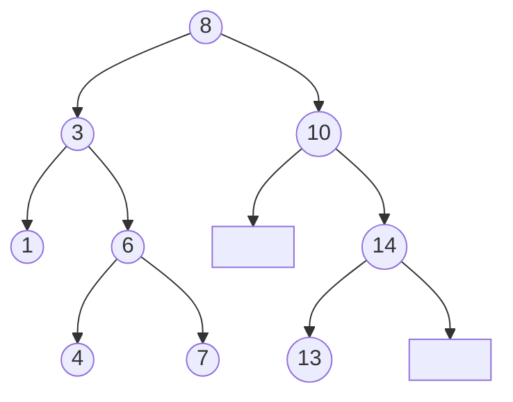
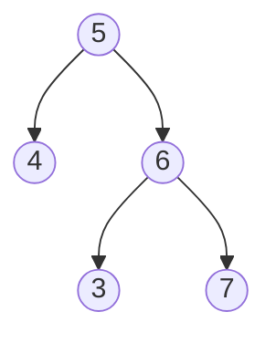
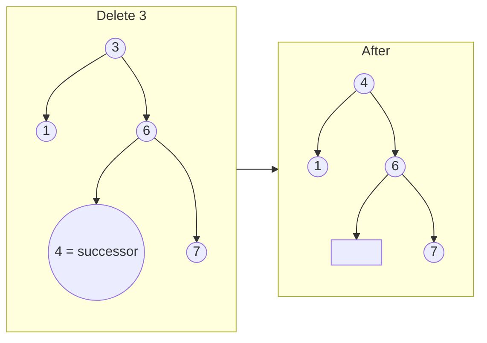
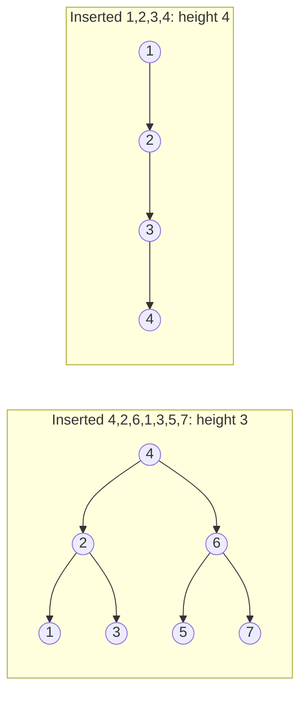

# Chapter 14 · Binary Search Trees

> Remember the "guess my number" game? "Is it 50?" "Lower." "25?" "Higher." Every answer throws away half of what's left. A binary search tree is that game frozen into a data structure: every node asks "lower or higher?", and you walk straight to your answer.

**You will learn:**
- The **BST property** (and the subtle way most people get it wrong)
- Search, insert and **delete** with all three delete cases
- Why an **inorder traversal of a BST comes out sorted**, and how that one fact solves half the interview problems
- Floor, ceil, k-th smallest, LCA, BST iterator, two sum, recover a broken BST
- Why trees go "bad" (skewed) and how **AVL** and **red-black** trees keep them balanced
- What to use in real Python code, since Python has no built-in BST
- A Pattern Decoder that tells you which of four BST templates a problem wants

**Before this:** [Recursion](../part-1-python/12-recursion.md) · [Binary Search](08-binary-search.md) · [Stacks](11-stacks.md) · [Binary Trees](13-binary-trees.md)

---

## 🧠 The Big Idea

In [Chapter 08](08-binary-search.md) you did binary search on a **sorted array**: look at the middle, then throw away half. It's O(log n), which is wonderful, but sorted arrays have one big weakness: **inserting** a new value means shifting everything after it. That's O(n).

What if we stored the "middles" as a tree instead? Put the middle value at the top. Everything smaller goes into the left branch, everything bigger into the right branch, and each branch is organised the same way. Now:

- Searching is still "look, then go left or right", so O(height).
- Inserting is just "walk down until you fall off the tree, hang the new node there". No shifting!

Here is a BST built by inserting `8, 3, 10, 1, 6, 14, 4, 7, 13` in that order. We'll use this tree for the whole chapter:



(The blank boxes are empty children: 10 has no left child, 14 has no right child.)

To find 7: start at 8. 7 < 8, go left. 7 > 3, go right. 7 > 6, go right. Found 7. Three steps, and we never even looked at the 10/14/13 side.

> 💡 **The core insight:** a BST is a sorted array that has been "folded" into a tree so that inserting and deleting are cheap too. Every node is a fork in the road labelled "smaller ← → bigger".

---

## 🔨 Building It Up

### 1. The BST property (the real one)

A binary tree is a **binary search tree** if, for **every** node:

- **every** value in its left subtree is **smaller** than the node, and
- **every** value in its right subtree is **bigger** than the node.

Read that twice: it says *every value in the subtree*, not *the child*. This tree is **not** a BST, even though each parent-child pair looks fine:



3 is in the right subtree of 5, so it must be bigger than 5. It isn't. Keep this picture in mind; it's the number one BST bug in interviews (we'll fix it in section 7).

> 💡 **Duplicates:** in this chapter values are **distinct**, which is what most interview problems assume. If you need duplicates, pick one rule and stick to it (for example "equal goes right"), or store a `count` field in each node.

Let's write the node class. It's the same `TreeNode` you met in [Chapter 13](13-binary-trees.md):

```python
class TreeNode:
    def __init__(self, val, left=None, right=None):
        self.val = val
        self.left = left
        self.right = right

# Build the "not a BST" tree from above by hand
root = TreeNode(5, TreeNode(4), TreeNode(6, TreeNode(3), TreeNode(7)))
print(root.val, root.left.val, root.right.val, root.right.left.val)
```

```text
5 4 6 3
```

What just happened: a BST is not a new kind of node. It's an ordinary binary tree whose values obey a rule. All the power comes from that rule.

### 2. Search: walk down, never back up

At each node there are only three possibilities: found it, go left, or go right.

```python
class TreeNode:
    def __init__(self, val, left=None, right=None):
        self.val, self.left, self.right = val, left, right

def insert(root, val):
    if root is None:
        return TreeNode(val)
    if val < root.val:
        root.left = insert(root.left, val)
    else:
        root.right = insert(root.right, val)
    return root

def search_recursive(node, target):
    if node is None or node.val == target:
        return node
    if target < node.val:
        return search_recursive(node.left, target)
    return search_recursive(node.right, target)

def search_iterative(node, target):
    while node and node.val != target:
        node = node.left if target < node.val else node.right
    return node

root = None
for v in [8, 3, 10, 1, 6, 14, 4, 7, 13]:
    root = insert(root, v)

print(search_recursive(root, 7).val)
print(search_iterative(root, 13).val)
print(search_iterative(root, 5))
```

```text
7
13
None
```

What just happened: each step goes **one level down**, so the number of steps is at most the tree's **height** `h`. The iterative version is preferred in practice: same speed, O(1) memory instead of O(h) stack frames.

### 3. Insert: search until you fall off, then hang the node there

We already used `insert` above. Let's look at it slowly, because the pattern `root.left = insert(root.left, val); return root` appears in insert, delete, trim and more.

```python
class TreeNode:
    def __init__(self, val, left=None, right=None):
        self.val, self.left, self.right = val, left, right

def insert(root, val):
    if root is None:              # fell off the tree: this is the spot
        return TreeNode(val)
    if val < root.val:
        root.left = insert(root.left, val)    # re-attach (maybe new) left subtree
    else:
        root.right = insert(root.right, val)
    return root                   # hand my (unchanged) self back to my parent

def insert_iterative(root, val):
    new = TreeNode(val)
    if root is None:
        return new
    node = root
    while True:
        if val < node.val:
            if node.left is None:
                node.left = new
                return root
            node = node.left
        else:
            if node.right is None:
                node.right = new
                return root
            node = node.right

def preorder(node, out):
    if node:
        out.append(node.val)
        preorder(node.left, out)
        preorder(node.right, out)
    return out

a = None
for v in [8, 3, 10, 1, 6, 14, 4, 7, 13]:
    a = insert(a, v)
b = None
for v in [8, 3, 10, 1, 6, 14, 4, 7, 13]:
    b = insert_iterative(b, v)
print(preorder(a, []))
print(preorder(b, []))
```

```text
[8, 3, 1, 6, 4, 7, 10, 14, 13]
[8, 3, 1, 6, 4, 7, 10, 14, 13]
```

What just happened: both versions build the identical tree. The recursive one uses the **"return the new subtree root"** trick: each call returns the root of its subtree, and the parent re-attaches it. For most nodes nothing changes (they return themselves), but at the bottom the `None` gets replaced by the new node. Learn this trick once and delete becomes easy.

> ⚠️ **The order of insertion decides the shape.** Insert `1, 2, 3, 4, 5` and you get a straight line leaning right (a "stick"). Height 5, so search becomes O(n). We'll fix this in section 14.

### 4. The magic fact: inorder traversal is sorted

Inorder means **left subtree, node, right subtree** ([Chapter 13](13-binary-trees.md)). In a BST, everything on the left is smaller and everything on the right is bigger, so inorder visits values in **increasing order**.

```python
class TreeNode:
    def __init__(self, val, left=None, right=None):
        self.val, self.left, self.right = val, left, right

def insert(root, val):
    if root is None:
        return TreeNode(val)
    if val < root.val:
        root.left = insert(root.left, val)
    else:
        root.right = insert(root.right, val)
    return root

def inorder(node, out):
    if node:
        inorder(node.left, out)
        out.append(node.val)
        inorder(node.right, out)
    return out

root = None
for v in [8, 3, 10, 1, 6, 14, 4, 7, 13]:
    root = insert(root, v)
print(inorder(root, []))
```

```text
[1, 3, 4, 6, 7, 8, 10, 13, 14]
```

**Why it's always true (a 3-line proof by induction):** for a tree of size 0 or 1, it's trivially sorted. For a bigger tree, inorder outputs `inorder(left)`, then `root`, then `inorder(right)`. By induction, each part is sorted. Every left value < root < every right value, so gluing them in that order stays sorted. Done.

This gives you a superpower: **any question about a sorted array can be asked about a BST**, and the answer is "do it during inorder". k-th smallest? The k-th value inorder. Validate? Check inorder is strictly increasing. Two sum? Two pointers on the inorder sequence. Hold on to this.

> 💡 Bonus: insert n values into a BST, then read them inorder, and you've sorted them. That's called **tree sort**: O(n log n) on average, O(n²) if the tree goes skewed.

### 5. Min, max, floor and ceil

The **minimum** is the leftmost node (keep going left). The **maximum** is the rightmost.

**Floor(x)** = the biggest value ≤ x. **Ceil(x)** = the smallest value ≥ x. These are the BST versions of `bisect` from [Chapter 08](08-binary-search.md), with the same "candidate" idea: whenever a node could be the answer, remember it, then keep looking for a better one.

```python
class TreeNode:
    def __init__(self, val, left=None, right=None):
        self.val, self.left, self.right = val, left, right

def insert(root, val):
    if root is None:
        return TreeNode(val)
    if val < root.val:
        root.left = insert(root.left, val)
    else:
        root.right = insert(root.right, val)
    return root

def bst_min(node):
    while node.left:
        node = node.left
    return node.val

def bst_max(node):
    while node.right:
        node = node.right
    return node.val

def floor(node, x):
    best = None
    while node:
        if node.val == x:
            return x
        if node.val < x:
            best = node.val       # a valid floor; maybe a bigger one is to the right
            node = node.right
        else:
            node = node.left      # too big, can't be the floor
    return best

def ceil(node, x):
    best = None
    while node:
        if node.val == x:
            return x
        if node.val > x:
            best = node.val       # a valid ceil; maybe a smaller one is to the left
            node = node.left
        else:
            node = node.right
    return best

root = None
for v in [8, 3, 10, 1, 6, 14, 4, 7, 13]:
    root = insert(root, v)
print(bst_min(root), bst_max(root))
print(floor(root, 5), ceil(root, 5))
print(floor(root, 9), ceil(root, 9))
print(floor(root, 0), ceil(root, 15))
```

```text
1 14
4 6
8 10
None None
```

**Dry run: `floor(root, 5)`**

| step | node | compare | best | move |
|---|---|---|---|---|
| 1 | 8 | 8 > 5, too big | None | left |
| 2 | 3 | 3 < 5, candidate | 3 | right (look for bigger) |
| 3 | 6 | 6 > 5, too big | 3 | left |
| 4 | 4 | 4 < 5, candidate | 4 | right |
| 5 | None | stop | **4** | |

### 6. Delete: the three cases

Deleting is the only BST operation that needs real thought. Find the node first, then:

| Case | Picture | What to do |
|---|---|---|
| **1. Leaf** (no children) | delete 1 | just remove it: return `None` to the parent |
| **2. One child** | delete 10 (only child 14) | replace the node by its child: return the child |
| **3. Two children** | delete 3 (children 1 and 6) | copy in the **inorder successor** (smallest value in the right subtree), then delete that successor from the right subtree |

Why the successor? We need a value that's bigger than everything on the left and smaller than everything on the right. The successor (smallest on the right) is exactly that. And the successor has **no left child** (otherwise that child would be smaller), so deleting it is case 1 or 2. Easy. (The **inorder predecessor**, the biggest on the left, works equally well.)



```python
class TreeNode:
    def __init__(self, val, left=None, right=None):
        self.val, self.left, self.right = val, left, right

def insert(root, val):
    if root is None:
        return TreeNode(val)
    if val < root.val:
        root.left = insert(root.left, val)
    else:
        root.right = insert(root.right, val)
    return root

def inorder(node, out):
    if node:
        inorder(node.left, out)
        out.append(node.val)
        inorder(node.right, out)
    return out

def preorder(node, out):
    if node:
        out.append(node.val)
        preorder(node.left, out)
        preorder(node.right, out)
    return out

def delete(root, key):
    if root is None:
        return None                       # key not found: nothing to do
    if key < root.val:
        root.left = delete(root.left, key)
    elif key > root.val:
        root.right = delete(root.right, key)
    else:
        # Found it. Cases 1 and 2: at most one child.
        if root.left is None:
            return root.right
        if root.right is None:
            return root.left
        # Case 3: two children. Find the inorder successor.
        succ = root.right
        while succ.left:
            succ = succ.left
        root.val = succ.val                          # copy successor's value up
        root.right = delete(root.right, succ.val)    # remove the successor below
    return root

root = None
for v in [8, 3, 10, 1, 6, 14, 4, 7, 13]:
    root = insert(root, v)

root = delete(root, 3)     # case 3: two children
print(preorder(root, []))
root = delete(root, 1)     # case 1: leaf
print(preorder(root, []))
root = delete(root, 10)    # case 2: one child
print(preorder(root, []))
root = delete(root, 8)     # deleting the root (two children)
print(preorder(root, []))
print(inorder(root, []))   # still sorted!
```

```text
[8, 4, 1, 6, 7, 10, 14, 13]
[8, 4, 6, 7, 10, 14, 13]
[8, 4, 6, 7, 14, 13]
[13, 4, 6, 7, 14]
[4, 6, 7, 13, 14]
```

What just happened: when we deleted 3, its successor 4 moved up, and 4's old spot was cleaned up by a recursive call (a leaf delete). Notice that cases 1 and 2 are handled by the *same* two lines: a leaf has `left is None`, so we return `root.right`, which is also `None`. Neat. When we deleted 8, its successor was 13 (smallest in the right subtree `14 → 13`).

Time: O(h). We walk down once to find the node and once more to find and delete the successor.

### 7. Validate a BST: pass down the allowed range

Remember the trap tree from section 1. Checking `left.val < node.val < right.val` at each node is **not enough**. The fix: every node lives inside an **allowed range** `(low, high)` decided by its ancestors.

- The root can be anything: `(-inf, +inf)`.
- Going **left** from a node with value v: the new upper bound becomes v.
- Going **right**: the new lower bound becomes v.

```python
import math

class TreeNode:
    def __init__(self, val, left=None, right=None):
        self.val, self.left, self.right = val, left, right

def is_valid_bst(node, low=-math.inf, high=math.inf):
    if node is None:
        return True
    if not (low < node.val < high):
        return False
    return (is_valid_bst(node.left, low, node.val) and
            is_valid_bst(node.right, node.val, high))

def children_only_check(node):          # the WRONG way, for comparison
    if node is None:
        return True
    if node.left and node.left.val >= node.val:
        return False
    if node.right and node.right.val <= node.val:
        return False
    return children_only_check(node.left) and children_only_check(node.right)

good = TreeNode(5, TreeNode(3, TreeNode(1), TreeNode(4)), TreeNode(8))
trap = TreeNode(5, TreeNode(4), TreeNode(6, TreeNode(3), TreeNode(7)))
print(is_valid_bst(good), is_valid_bst(trap))
print(children_only_check(trap))   # fooled!
```

```text
True False
True
```

**Dry run on the trap tree:**

| node | allowed range | ok? |
|---|---|---|
| 5 | (-inf, inf) | ✅ |
| 4 | (-inf, 5) | ✅ |
| 6 | (5, inf) | ✅ |
| 3 | (5, 6) | ❌ 3 is not > 5 |

The other way to validate: do an inorder traversal and check every value is **strictly bigger** than the previous one. Both are O(n) time.

### 8. k-th smallest: stop the inorder walk early

Inorder is sorted, so the k-th value visited is the k-th smallest. Use the **iterative inorder with a stack** from [Chapter 13](13-binary-trees.md), and stop as soon as you've popped k nodes. You don't have to walk the whole tree.

```python
class TreeNode:
    def __init__(self, val, left=None, right=None):
        self.val, self.left, self.right = val, left, right

def insert(root, val):
    if root is None:
        return TreeNode(val)
    if val < root.val:
        root.left = insert(root.left, val)
    else:
        root.right = insert(root.right, val)
    return root

def kth_smallest(root, k):
    stack, node = [], root
    while stack or node:
        while node:                 # dive left, saving the path
            stack.append(node)
            node = node.left
        node = stack.pop()          # smallest unvisited value
        k -= 1
        if k == 0:
            return node.val
        node = node.right           # then its right subtree

root = None
for v in [8, 3, 10, 1, 6, 14, 4, 7, 13]:
    root = insert(root, v)
print([kth_smallest(root, k) for k in range(1, 10)])
```

```text
[1, 3, 4, 6, 7, 8, 10, 13, 14]
```

Time O(h + k), space O(h). For the k-th **largest**, do a reverse inorder (right, node, left).

> 💡 **Follow-up interviewers love:** "What if the tree is modified often and you're asked k-th smallest many times?" Store in each node the **size of its subtree**. Then at a node with `left_size` nodes on its left: if `k == left_size + 1` it's this node; if `k <= left_size` go left; otherwise go right with `k -= left_size + 1`. That's O(h) per query. This is called an **order-statistic tree**.

### 9. Lowest Common Ancestor in a BST

The **LCA** of two nodes p and q is the deepest node that has both of them in its subtree. In a general binary tree this needs a full search ([Chapter 13](13-binary-trees.md)). In a BST it's a simple walk:

- If both p and q are **smaller** than the node, the LCA is on the left.
- If both are **bigger**, it's on the right.
- Otherwise they **split** here (or one of them *is* this node), so this node is the LCA.

```python
class TreeNode:
    def __init__(self, val, left=None, right=None):
        self.val, self.left, self.right = val, left, right

def insert(root, val):
    if root is None:
        return TreeNode(val)
    if val < root.val:
        root.left = insert(root.left, val)
    else:
        root.right = insert(root.right, val)
    return root

def lca(root, p, q):
    node = root
    while node:
        if p < node.val and q < node.val:
            node = node.left
        elif p > node.val and q > node.val:
            node = node.right
        else:
            return node.val      # the split point

root = None
for v in [8, 3, 10, 1, 6, 14, 4, 7, 13]:
    root = insert(root, v)
print(lca(root, 4, 7), lca(root, 4, 14), lca(root, 1, 4), lca(root, 13, 14))
```

```text
6 8 3 14
```

What just happened: for (13, 14), at node 14 neither "both smaller" nor "both bigger" holds, because q *equals* 14. A node is its own ancestor, so 14 is the LCA. O(h) time, O(1) space.

### 10. Build a balanced BST from a sorted array

Take the **middle** element as the root (so left and right halves are equal-sized), then recursively do the same for each half. It's binary search, building as it goes.

```python
class TreeNode:
    def __init__(self, val, left=None, right=None):
        self.val, self.left, self.right = val, left, right

def sorted_array_to_bst(nums):
    def build(lo, hi):                # build from nums[lo..hi] inclusive
        if lo > hi:
            return None
        mid = (lo + hi) // 2
        node = TreeNode(nums[mid])
        node.left = build(lo, mid - 1)
        node.right = build(mid + 1, hi)
        return node
    return build(0, len(nums) - 1)

def preorder(node, out):
    if node:
        out.append(node.val)
        preorder(node.left, out)
        preorder(node.right, out)
    return out

def height(node):
    return 0 if node is None else 1 + max(height(node.left), height(node.right))

print(preorder(sorted_array_to_bst([-10, -3, 0, 5, 9]), []))
big = sorted_array_to_bst(list(range(1, 1024)))     # 1023 values
print(height(big))
```

```text
[0, -10, -3, 5, 9]
10
```

What just happened: 1023 = 2¹⁰ − 1 values gave a **perfect** tree of height 10. Compare with inserting 1..1023 one by one into a plain BST: height 1023. We pass indexes `lo, hi` instead of slicing (`nums[:mid]`) so we don't copy the array: O(n) total time, O(log n) recursion depth.

### 11. BST Iterator: inorder, one step at a time

Sometimes you want to pull values from a BST **lazily**, one per call, like a Python iterator ([Chapter 16 of Part 1](../part-1-python/16-iterators-generators-decorators.md)). The trick: run the iterative inorder from section 8, but **pause** between pops. The stack *is* the paused state.

```python
class TreeNode:
    def __init__(self, val, left=None, right=None):
        self.val, self.left, self.right = val, left, right

def insert(root, val):
    if root is None:
        return TreeNode(val)
    if val < root.val:
        root.left = insert(root.left, val)
    else:
        root.right = insert(root.right, val)
    return root

class BSTIterator:
    def __init__(self, root):
        self.stack = []
        self._push_left(root)

    def _push_left(self, node):        # save the path to the smallest value
        while node:
            self.stack.append(node)
            node = node.left

    def next(self):
        node = self.stack.pop()
        self._push_left(node.right)    # successor lives in the right subtree
        return node.val

    def has_next(self):
        return bool(self.stack)

root = None
for v in [8, 3, 10, 1, 6, 14, 4, 7, 13]:
    root = insert(root, v)
it = BSTIterator(root)
print(it.next(), it.next(), it.next())
print(it.has_next())
rest = []
while it.has_next():
    rest.append(it.next())
print(rest)
```

```text
1 3 4
True
[6, 7, 8, 10, 13, 14]
```

**Cost:** one `next()` call can push many nodes, but across all n calls each node is pushed once and popped once. So the **amortised** cost is O(1) per call, and memory is O(h) (only one root-to-leaf path is on the stack). That's exactly what the LeetCode problem asks for.

> 💡 The Pythonic version is a generator: `def inorder(node): if node: yield from inorder(node.left); yield node.val; yield from inorder(node.right)`. Generators pause automatically. Interviewers usually want the explicit stack, though, since it shows you understand the state.

### 12. Two Sum in a BST

"Is there a pair of values summing to k?" On a sorted array that's two pointers ([Chapter 03](03-two-pointers.md)). A BST *is* a sorted array in disguise, so we can:

- **Simple:** walk the tree, keep a set of seen values, check `k - val in seen` ([Chapter 05](05-hashing.md)). O(n) time, O(n) space.
- **Clever:** run a forward iterator (smallest first) and a backward iterator (largest first) and do two pointers. O(n) time, **O(h) space**.

```python
class TreeNode:
    def __init__(self, val, left=None, right=None):
        self.val, self.left, self.right = val, left, right

def insert(root, val):
    if root is None:
        return TreeNode(val)
    if val < root.val:
        root.left = insert(root.left, val)
    else:
        root.right = insert(root.right, val)
    return root

class Iter:
    """Inorder iterator; reverse=True walks from largest to smallest."""
    def __init__(self, root, reverse):
        self.stack, self.reverse = [], reverse
        self._push(root)

    def _push(self, node):
        while node:
            self.stack.append(node)
            node = node.right if self.reverse else node.left

    def next(self):
        node = self.stack.pop()
        self._push(node.left if self.reverse else node.right)
        return node.val

def find_target(root, k):
    lo_it, hi_it = Iter(root, False), Iter(root, True)
    lo, hi = lo_it.next(), hi_it.next()
    while lo < hi:                    # values are distinct, so lo < hi means two nodes
        s = lo + hi
        if s == k:
            return True
        if s < k:
            lo = lo_it.next()
        else:
            hi = hi_it.next()
    return False

root = None
for v in [8, 3, 10, 1, 6, 14, 4, 7, 13]:
    root = insert(root, v)
print(find_target(root, 17), find_target(root, 28), find_target(root, 2))
```

```text
True False False
```

What just happened: 17 = 3 + 14 (or 4 + 13, or 7 + 10). 28 would need 14 + 14, and we can't use the same node twice. 2 would need 1 + 1. The pointers stop when they meet, exactly like opposite-end two pointers.

### 13. Recover a BST where two values were swapped

Someone swapped the values of two nodes by mistake. Fix the tree without changing its shape.

**Idea:** the inorder sequence of a correct BST is sorted. Swapping two values creates "descents" (a value smaller than the one before it):

- Swapped values **not adjacent** in inorder: `1 3 [7] 6 4 [8]`... let's take sorted `1 3 4 6 7 8` and swap 3 and 7: `1 7 4 6 3 8`. Descents: `7 > 4` and `6 > 3`. The wrong values are the **first element of the first descent** (7) and the **second element of the last descent** (3).
- Swapped values **adjacent**: `1 3 6 4 7 8` has one descent `6 > 4`. Both come from that one descent.

The same rule ("first = first descent's left, second = latest descent's right") handles both cases.

```python
class TreeNode:
    def __init__(self, val, left=None, right=None):
        self.val, self.left, self.right = val, left, right

def insert(root, val):
    if root is None:
        return TreeNode(val)
    if val < root.val:
        root.left = insert(root.left, val)
    else:
        root.right = insert(root.right, val)
    return root

def inorder_nodes(node, out):
    if node:
        inorder_nodes(node.left, out)
        out.append(node)
        inorder_nodes(node.right, out)
    return out

def recover_tree(root):
    first = second = prev = None
    stack, node = [], root
    while stack or node:
        while node:
            stack.append(node)
            node = node.left
        node = stack.pop()
        if prev and prev.val > node.val:     # a descent
            if first is None:
                first = prev                 # left side of the FIRST descent
            second = node                    # right side of the LATEST descent
        prev = node
        node = node.right
    first.val, second.val = second.val, first.val

root = None
for v in [8, 3, 10, 1, 6, 14, 4, 7, 13]:
    root = insert(root, v)
nodes = inorder_nodes(root, [])
nodes[1].val, nodes[4].val = nodes[4].val, nodes[1].val   # break it: swap 3 and 7
print([n.val for n in inorder_nodes(root, [])])
recover_tree(root)
print([n.val for n in inorder_nodes(root, [])])
```

```text
[1, 7, 4, 6, 3, 8, 10, 13, 14]
[1, 3, 4, 6, 7, 8, 10, 13, 14]
```

O(n) time, O(h) space. (There's an O(1)-space version using **Morris traversal**, which temporarily rewires right pointers. Mention it in an interview; you rarely need to code it.)

### 14. Why trees go bad, and how balanced trees fix it

Everything so far costs **O(h)**. If the tree is bushy, h ≈ log₂ n. But insert sorted data and the tree becomes a stick:



A **self-balancing BST** fixes its own shape after each insert/delete so that h stays O(log n) no matter what order data arrives in. The tool they use is the **rotation**: a local rearrangement of three pointers that changes the shape but **keeps the inorder order**.

```text
        y                         x
       / \     rotate_right      / \
      x   C    ------------>    A   y
     / \       <------------       / \
    A   B       rotate_left       B   C

Inorder both sides: A  x  B  y  C   (unchanged!)
```

**AVL tree** (Adelson-Velsky and Landis, 1962): every node stores its height, and the rule is: *the heights of the left and right subtrees differ by at most 1*. The difference is the **balance factor**. After an insert, walk back up; if a node's balance factor becomes +2 or −2, rotate:

| Case | Shape | Fix |
|---|---|---|
| **LL** | new key went into left child's left | rotate_right(node) |
| **RR** | right child's right | rotate_left(node) |
| **LR** | left child's right | rotate_left(left child), then rotate_right(node) |
| **RL** | right child's left | rotate_right(right child), then rotate_left(node) |

Here's a complete AVL insert. Watch how inserting 1 to 7 in sorted order (the worst case for a plain BST) gives a perfect tree:

```python
class Node:
    def __init__(self, key):
        self.key, self.left, self.right, self.height = key, None, None, 1

def h(n):
    return n.height if n else 0

def update(n):
    n.height = 1 + max(h(n.left), h(n.right))

def rotate_right(y):
    x = y.left
    y.left = x.right       # subtree B changes parent
    x.right = y
    update(y)              # y is now lower, so update it first
    update(x)
    return x

def rotate_left(x):
    y = x.right
    x.right = y.left
    y.left = x
    update(x)
    update(y)
    return y

def avl_insert(node, key):
    if node is None:
        return Node(key)
    if key < node.key:
        node.left = avl_insert(node.left, key)
    elif key > node.key:
        node.right = avl_insert(node.right, key)
    else:
        return node                        # ignore duplicates
    update(node)
    balance = h(node.left) - h(node.right)
    if balance > 1:                        # left-heavy
        if key > node.left.key:            # LR: straighten first
            node.left = rotate_left(node.left)
        return rotate_right(node)          # LL
    if balance < -1:                       # right-heavy
        if key < node.right.key:           # RL: straighten first
            node.right = rotate_right(node.right)
        return rotate_left(node)           # RR
    return node

def plain_insert(node, key):
    if node is None:
        return Node(key)
    if key < node.key:
        node.left = plain_insert(node.left, key)
    else:
        node.right = plain_insert(node.right, key)
    return node

def preorder(n, out):
    if n:
        out.append(n.key)
        preorder(n.left, out)
        preorder(n.right, out)
    return out

def height(n):
    return 0 if n is None else 1 + max(height(n.left), height(n.right))

avl = plain = None
for k in range(1, 8):
    avl = avl_insert(avl, k)
    plain = plain_insert(plain, k)
print("AVL  :", preorder(avl, []), "height", height(avl))
print("plain:", preorder(plain, []), "height", height(plain))

big = None
for k in range(1, 1001):
    big = avl_insert(big, k)
print("AVL with 1000 sorted inserts, height", height(big))
```

```text
AVL  : [4, 2, 1, 3, 6, 5, 7] height 3
plain: [1, 2, 3, 4, 5, 6, 7] height 7
AVL with 1000 sorted inserts, height 10
```

What just happened: after inserting 1, 2, 3, node 1 was right-heavy by 2 (RR case), so it rotated left and 2 became the root. This keeps happening, and the tree stays perfectly balanced. 1000 sorted inserts give height 10 instead of 1000. (log₂ 1000 ≈ 10.)

**Red-black tree** (high level only; nobody asks you to code one in an interview). Every node is coloured red or black, with rules:

1. The root is black.
2. A red node can't have a red child.
3. Every path from a node down to an empty spot has the **same number of black nodes**.

Rules 2 and 3 together mean the longest path is at most twice the shortest, so the height is at most about **2 log₂(n+1)**. When an insert/delete breaks a rule, the tree recolours nodes and does at most a few rotations.

| | AVL | Red-black |
|---|---|---|
| Balance rule | heights differ by ≤ 1 | colour rules |
| Height bound | ≈ 1.44 log₂ n | ≈ 2 log₂ n |
| Lookups | slightly faster (shorter) | slightly slower |
| Inserts/deletes | more rotations | fewer rotations (≤ 2 per insert, ≤ 3 per delete) |
| Used in | some databases and in-memory indexes | Java `TreeMap`, C++ `std::map`, Linux kernel scheduler |

> 💡 Interview one-liner: "A plain BST can degrade to O(n). Self-balancing trees like AVL or red-black use rotations to keep the height O(log n), so search, insert and delete are all O(log n) worst case."

Databases use a cousin called the **B-tree**: each node holds hundreds of keys, so the tree is very short and each level is one disk read. You'll meet it in [System Design Chapter 03](../part-3-system-design/03-databases.md).

### 15. BSTs in real Python code

Python has **no built-in balanced BST**. In practice:

- **`dict` / `set`** ([Chapter 09](../part-1-python/09-dictionaries.md)) if you only need lookup. O(1) average, beats any tree.
- **A sorted list + `bisect`** if you need order but few inserts. Search O(log n), but `insort` is O(n) because of shifting.
- **`sortedcontainers`** (a popular third-party package, `pip install sortedcontainers`, and available on LeetCode) if you need a sorted collection with fast inserts, deletes and "floor/ceil/k-th" queries:

```py
from sortedcontainers import SortedList   # third-party package

sl = SortedList([8, 3, 10])
sl.add(6)                       # ~O(log n)
sl.remove(10)                   # ~O(log n)
print(sl)                       # SortedList([3, 6, 8])
print(sl[0], sl[-1])            # min, max, k-th by index
i = sl.bisect_right(7)          # floor(7) is sl[i-1] if i > 0
print(sl[i - 1])                # 6
```

(Internally it's not a tree at all: it's a list of smaller sorted lists. In Python, that's faster than a pointer-based tree.)

The standard-library version of floor/ceil with `bisect`:

```python
import bisect

data = [1, 3, 4, 6, 7, 8, 10, 13, 14]          # sorted, like a BST's inorder

def floor(x):
    i = bisect.bisect_right(data, x)          # first index with value > x
    return data[i - 1] if i > 0 else None

def ceil(x):
    i = bisect.bisect_left(data, x)           # first index with value >= x
    return data[i] if i < len(data) else None

print(floor(5), ceil(5), floor(0), ceil(15))
bisect.insort(data, 5)                        # O(n): shifts elements
print(data)
```

```text
4 6 None None
[1, 3, 4, 5, 6, 7, 8, 10, 13, 14]
```

---

## 🔬 Under the Hood

### Everything is O(h), so h is everything

Search, insert, delete, floor, ceil, LCA and min/max all walk **one root-to-leaf path**. Their cost is O(h), where h is the height. The height of a tree with n nodes is somewhere between:

- **Best (balanced):** ⌈log₂(n+1)⌉, because level d holds at most 2^d nodes, so a tree of height h holds at most 2^h − 1 nodes.
- **Worst (stick):** n.

For **random insertion order**, the expected height is O(log n) (the analysis is the same one as quicksort's average case, [Chapter 07](07-sorting.md): the root is like a random pivot). But real data is often sorted or nearly sorted (IDs, timestamps), which is precisely the worst case. That's why production libraries always use self-balancing trees.

### Complexity table

| Operation | Balanced BST | Unbalanced worst case | Sorted array | Hash set |
|---|---|---|---|---|
| Search | O(log n) | O(n) | O(log n) | O(1) avg |
| Insert | O(log n) | O(n) | O(n) | O(1) avg |
| Delete | O(log n) | O(n) | O(n) | O(1) avg |
| Min / max | O(log n) | O(n) | O(1) | O(n) |
| Floor / ceil | O(log n) | O(n) | O(log n) | O(n) |
| Sorted iteration | O(n) | O(n) | O(n) | O(n log n) (must sort) |
| k-th smallest | O(log n) with sizes, else O(h + k) | O(n) | O(1) | O(n log n) |
| Space | O(n) | O(n) | O(n) | O(n) |

The BST's selling point: it's the only structure in the table that's fast at **both** "change the data" and "ask order questions".

### Why rotations are safe

A rotation moves three subtrees A, B, C and two nodes x, y. Before: inorder is `A x B y C`. After: still `A x B y C`. Since the inorder order is unchanged, the BST property still holds. And it only touches a constant number of pointers, so it's O(1). An AVL insert does at most one single or double rotation (O(1)) plus O(log n) height updates on the way up.

### Why AVL height is O(log n)

Let N(h) be the **fewest** nodes an AVL tree of height h can have. The skinniest AVL tree of height h has a root, one subtree of height h−1 and one of height h−2 (as skinny as allowed). So N(h) = 1 + N(h−1) + N(h−2). That's the Fibonacci recurrence! Fibonacci numbers grow like 1.618^h, so n ≥ 1.618^h, which means h ≤ log₁.₆₁₈ n ≈ 1.44 log₂ n.

### Memory

Each node is a Python object with a value and two pointers. In CPython that's on the order of 50–100 bytes per node (an object header plus three references, more with `__dict__`). Compare 8 bytes per slot in a list. Adding `__slots__ = ("val", "left", "right")` to the class ([Chapter 18 of Part 1](../part-1-python/18-internals-concurrency.md)) noticeably cuts memory. Pointer-chasing is also less cache-friendly than scanning an array, which is one reason `sortedcontainers` uses lists.

### Recursion depth

Recursive BST code uses O(h) stack frames. On a skewed tree with 10,000 nodes, that's 10,000 frames, which exceeds Python's default limit of 1,000 ([Chapter 12](../part-1-python/12-recursion.md)). Iterative versions (search, insert, floor, LCA, the stack-based inorder) don't have this problem.

---

## 🧩 Pattern Decoder

### Signals: when it's a BST problem

| You see in the problem... | Think |
|---|---|
| "binary search tree", "BST" | Use the ordering! Never write a solution that ignores it. |
| "k-th smallest / largest", "sorted order", "median of BST" | **Inorder walk** (Template B) |
| "validate", "is it a BST" | **Bounds passing** (Template C) or inorder increasing |
| "closest value", "floor", "ceil", "successor", "predecessor" | **Guided walk with a candidate** (Template A) |
| "LCA in a BST", "search / insert / delete" | **Guided walk** (Template A) |
| "range [low, high]", "trim", "range sum" | Guided walk with **pruning** (Template A) |
| "sorted array/list → tree", "balance a BST" | **Divide at the middle** (Template D) |
| "two values swapped", "pair with sum in BST", "iterator" | Inorder as a **sorted stream** (Template B) |
| "construct BST from preorder / postorder" | Bounds passing (Template C) |
| "maintain sorted data under inserts, ask floor/rank" | Balanced BST / `SortedList` |

### Template A: Guided walk (one path, O(h))

```py
def guided_walk(root, target):
    node, best = root, None
    while node:
        if node.val == target:
            return node.val               # exact hit (if the problem allows it)
        if <node could be the answer>:
            best = node.val               # remember the candidate
        if target < node.val:
            node = node.left              # answer (or a better one) is on the left
        else:
            node = node.right
    return best
```

Used by: search, insert, floor, ceil, closest value, inorder successor, LCA.

### Template B: Inorder as a sorted stream

```py
def inorder_stream(root):
    stack, node, prev = [], root, None
    while stack or node:
        while node:
            stack.append(node)
            node = node.left
        node = stack.pop()
        # ---- "visit": node.val arrives in increasing order ----
        # compare with prev (validate, min diff, recover),
        # count down k (k-th smallest), or stop early
        prev = node
        node = node.right
```

Used by: k-th smallest, validate, recover, minimum absolute difference, BST iterator, two sum (two streams).

### Template C: Pass the allowed range down

```py
def with_bounds(node, low=-inf, high=inf):
    if node is None:
        return BASE
    if not (low < node.val < high):
        return FAIL
    left  = with_bounds(node.left,  low, node.val)    # going left caps the max
    right = with_bounds(node.right, node.val, high)   # going right raises the min
    return combine(left, right)
```

Used by: validate BST, construct BST from preorder, count nodes in range.

### Template D: Divide at the middle

```py
def build(lo, hi):
    if lo > hi:
        return None
    mid = (lo + hi) // 2
    node = TreeNode(values[mid])
    node.left  = build(lo, mid - 1)
    node.right = build(mid + 1, hi)
    return node
```

Used by: sorted array → BST, sorted list → BST, balance a BST (inorder to a list, then build).

### Variation: Closest value in a BST (Template A)

**Problem:** return the value in the BST closest to a float `target`. Our tree, target 5.4 → 6.

**Idea:** the closest value is on the search path for `target`. Why? Any node off the path is separated from `target` by some node on the path that is closer. Walk the path, keep the best.

```python
class TreeNode:
    def __init__(self, val, left=None, right=None):
        self.val, self.left, self.right = val, left, right

def insert(root, val):
    if root is None:
        return TreeNode(val)
    if val < root.val:
        root.left = insert(root.left, val)
    else:
        root.right = insert(root.right, val)
    return root

def closest_value(root, target):
    node, best = root, root.val
    while node:
        if abs(node.val - target) < abs(best - target):
            best = node.val
        node = node.left if target < node.val else node.right
    return best

root = None
for v in [8, 3, 10, 1, 6, 14, 4, 7, 13]:
    root = insert(root, v)
print(closest_value(root, 5.4), closest_value(root, 11.2), closest_value(root, 100))
```

```text
6 10 14
```

**Dry run: target 5.4**

| node | distance | best | move |
|---|---|---|---|
| 8 | 2.6 | 8 | 5.4 < 8 → left |
| 3 | 2.4 | 3 | 5.4 > 3 → right |
| 6 | 0.6 | 6 | 5.4 < 6 → left |
| 4 | 1.4 | 6 | 5.4 > 4 → right |
| None | | **6** | stop |

O(h) time, O(1) space.

### Variation: Range Sum of BST (Template A with pruning)

**Problem:** sum all values in `[low, high]`. Our tree, `[4, 10]` → 4 + 6 + 7 + 8 + 10 = 35.

**Idea:** a plain tree traversal visits everything. The BST lets us **prune**: if `node.val < low`, the whole left subtree is even smaller, so skip it. If `node.val > high`, skip the right subtree.

```python
class TreeNode:
    def __init__(self, val, left=None, right=None):
        self.val, self.left, self.right = val, left, right

def insert(root, val):
    if root is None:
        return TreeNode(val)
    if val < root.val:
        root.left = insert(root.left, val)
    else:
        root.right = insert(root.right, val)
    return root

def range_sum(node, low, high):
    if node is None:
        return 0
    if node.val < low:
        return range_sum(node.right, low, high)     # left side is all too small
    if node.val > high:
        return range_sum(node.left, low, high)      # right side is all too big
    return node.val + range_sum(node.left, low, high) + range_sum(node.right, low, high)

root = None
for v in [8, 3, 10, 1, 6, 14, 4, 7, 13]:
    root = insert(root, v)
print(range_sum(root, 4, 10), range_sum(root, 13, 100))
```

```text
35 27
```

O(h + m) where m is the number of nodes in range (plus the boundary paths). Worst case O(n).

### Variation: Construct BST from Preorder Traversal (Template C)

**Problem:** given the preorder of a BST, rebuild it. `[8, 5, 1, 7, 10, 12]`.

**Idea:** preorder is "root first". Read values left to right with a shared index. A value belongs in the current subtree only if it fits the current `(low, high)` range. If it doesn't fit, return `None` and let an ancestor take it. Each value is consumed once: O(n). (The naive "insert one by one" is O(n²) on skewed input.)

```python
import math

class TreeNode:
    def __init__(self, val, left=None, right=None):
        self.val, self.left, self.right = val, left, right

def bst_from_preorder(preorder):
    i = 0
    def build(low, high):
        nonlocal i
        if i == len(preorder) or not (low < preorder[i] < high):
            return None
        node = TreeNode(preorder[i])
        i += 1
        node.left = build(low, node.val)
        node.right = build(node.val, high)
        return node
    return build(-math.inf, math.inf)

def inorder(n, out):
    if n:
        inorder(n.left, out); out.append(n.val); inorder(n.right, out)
    return out

root = bst_from_preorder([8, 5, 1, 7, 10, 12])
print(root.val, root.left.val, root.right.val, root.left.left.val, root.left.right.val)
print(inorder(root, []))
```

```text
8 5 10 1 7
[1, 5, 7, 8, 10, 12]
```

### Variation: Balance a BST (Template B + D)

**Problem:** given any BST (maybe a stick), return a balanced BST with the same values.

**Idea:** inorder gives the sorted list (Template B), then build from the middle (Template D). O(n) time, O(n) space. Full code is Practice 🟡 5.

### When NOT to use BST thinking

- **The tree is a general binary tree**, not a BST. Pruning and guided walks will silently give wrong answers. Check the problem statement!
- **You only need membership / lookup.** A `set` or `dict` is O(1) and simpler.
- **You only need the min or max repeatedly** (not floor/ceil or deletes of arbitrary items). A **heap** is simpler and faster ([Chapter 15](15-heaps.md)).
- **The data is static.** A sorted list + `bisect` is smaller and faster than any tree.
- **Prefix/word queries on strings.** That's a **trie** ([Chapter 19](19-tries.md)).

---

## ⚠️ Traps & Common Mistakes

1. **Validating by checking only the children.** The trap tree in section 1 passes the children check but isn't a BST. Pass bounds down, or check inorder is strictly increasing.

```py
# ❌ wrong: only compares with direct children
def valid(node):
    if node is None: return True
    if node.left and node.left.val >= node.val: return False
    if node.right and node.right.val <= node.val: return False
    return valid(node.left) and valid(node.right)

# ✅ right: every node must fit the range set by ALL its ancestors
def valid(node, low=-inf, high=inf):
    if node is None: return True
    if not (low < node.val < high): return False
    return valid(node.left, low, node.val) and valid(node.right, node.val, high)
```

2. **Using `0` or `float('-inf')` carelessly as the initial "prev".** If you validate with "prev value", start with `None` (or `-math.inf`), not `0`. Trees can contain negative numbers, and `0` would wrongly reject them.
3. **Forgetting to re-attach in recursive insert/delete.** `insert(root.left, val)` without `root.left = ...` throws the new node away. And forgetting `return root` at the end makes the parent attach `None`.
4. **Delete case 3: deleting the successor from the wrong subtree.** After copying the successor's value into the node, delete it from `root.right`, not from `root` (that would find the node you just overwrote first).
5. **Assuming the tree is balanced.** Saying "search is O(log n)" for a plain BST is wrong. Say "O(h): O(log n) if balanced, O(n) worst case".
6. **Using `<=` vs `<` inconsistently with duplicates.** If insert sends equal values right, search must also go right on equal values. Decide once.
7. **Recursion on deep skewed trees.** 10,000 sorted inserts → recursion depth error. Prefer iterative walks.
8. **Two Sum in BST using the same node twice.** For k = 2 × val, a set-based solution must check *before* adding the current value; a two-iterator solution must stop when the pointers meet.

---

## 💡 Tips & Tricks

- First question to ask yourself on any tree problem: **"Is it a BST?"** If yes, the intended solution almost certainly uses the ordering (pruning, guided walk, or inorder).
- "Sorted" + "tree" in the same sentence = inorder.
- Memorise the iterative inorder (`while stack or node: dive left, pop, visit, go right`). It powers the iterator, k-th smallest, validate, recover, and two sum.
- For "k-th largest" use **reverse inorder**: right, node, left.
- When code needs "the root of the modified subtree", use the **return-the-subtree** style: `node.left = f(node.left)`.
- Inorder successor of a node **with** a right child = leftmost node of the right subtree. **Without** one = the last ancestor where you went left.
- Use `math.inf` and `-math.inf` as initial bounds. They compare correctly with any int.
- In real Python projects, reach for `bisect` or `sortedcontainers.SortedList` before writing your own tree.

---

## 🎯 Interview Questions

### 1. Validate Binary Search Tree 🔥🔥🔥

Given the root of a binary tree, determine if it's a valid BST.

<details><summary>Answer</summary>

Pass `(low, high)` bounds down (section 7), or do an inorder walk and check strictly increasing. Here's the inorder version, which avoids recursion limits:

```python
class TreeNode:
    def __init__(self, val, left=None, right=None):
        self.val, self.left, self.right = val, left, right

def is_valid_bst(root):
    stack, node, prev = [], root, None
    while stack or node:
        while node:
            stack.append(node)
            node = node.left
        node = stack.pop()
        if prev is not None and node.val <= prev:
            return False
        prev = node.val
        node = node.right
    return True

print(is_valid_bst(TreeNode(2, TreeNode(1), TreeNode(3))))
print(is_valid_bst(TreeNode(5, TreeNode(1), TreeNode(4, TreeNode(3), TreeNode(6)))))
```

```text
True
False
```

Time O(n), space O(h). Note `<=`: equal values are not allowed in this problem.

</details>

### 2. Kth Smallest Element in a BST 🔥🔥🔥

<details><summary>Answer</summary>

Iterative inorder, stop at the k-th pop (section 8). Time O(h + k), space O(h).

Follow-up "the BST is modified often": store subtree sizes in each node for O(h) queries (order-statistic tree), or keep the data in a `SortedList`.

</details>

### 3. Lowest Common Ancestor of a Binary Search Tree 🔥🔥🔥

<details><summary>Answer</summary>

Walk from the root: both smaller → left, both bigger → right, otherwise this is the split point (section 9). Time O(h), space O(1). (LeetCode passes nodes `p` and `q`, so compare `p.val` and `q.val`.)

Interviewers often ask this right after the general-binary-tree LCA. Point out that the BST version doesn't need to search both subtrees.

</details>

### 4. Convert Sorted Array to Binary Search Tree 🔥🔥

<details><summary>Answer</summary>

Middle element as root, recurse on both halves with indexes (section 10). O(n) time, O(log n) recursion depth. Any choice of middle (`(lo+hi)//2` or `(lo+hi+1)//2`) gives a valid height-balanced answer.

</details>

### 5. Delete Node in a BST 🔥🔥

<details><summary>Answer</summary>

Three cases (section 6): leaf → return `None`; one child → return that child; two children → copy the inorder successor's value, then delete the successor from the right subtree. Time O(h), space O(h) for recursion.

The key sentence: "The successor has no left child, so deleting it is always the easy case."

</details>

### 6. Insert into a Binary Search Tree 🔥

<details><summary>Answer</summary>

Walk down as in search until you hit `None`, and hang the new node there (section 3). Iterative: O(h) time, O(1) space. Any valid BST is accepted, so no rebalancing is needed.

</details>

### 7. Binary Search Tree Iterator 🔥🔥

Implement `next()` (returns the next smallest) and `hasNext()` with O(1) amortised time and O(h) memory.

<details><summary>Answer</summary>

Keep a stack holding the path of "left-dive" nodes (section 11). `next()` pops one node, then pushes the left spine of its right subtree. Each node is pushed and popped once overall, so n calls cost O(n) total: O(1) amortised. Memory is O(h).

</details>

### 8. Two Sum IV – Input is a BST 🔥🔥

<details><summary>Answer</summary>

Option A: DFS with a hash set (`if k - val in seen: return True`), O(n) time and space.

```python
class TreeNode:
    def __init__(self, val, left=None, right=None):
        self.val, self.left, self.right = val, left, right

def find_target(root, k):
    seen, stack = set(), [root]
    while stack:
        node = stack.pop()
        if node is None:
            continue
        if k - node.val in seen:      # check BEFORE adding: no reusing a node
            return True
        seen.add(node.val)
        stack.append(node.left)
        stack.append(node.right)
    return False

root = TreeNode(5, TreeNode(3, TreeNode(2), TreeNode(4)), TreeNode(6, None, TreeNode(7)))
print(find_target(root, 9), find_target(root, 28))
```

```text
True False
```

Option B (uses the BST property, better space): forward and backward inorder iterators as two pointers (section 12). O(n) time, O(h) space.

</details>

### 9. Recover Binary Search Tree 🔥

<details><summary>Answer</summary>

Inorder walk, find descents (`prev.val > node.val`). `first` = `prev` of the first descent, `second` = `node` of the last descent. Swap their values (section 13). O(n) time, O(h) space; O(1) with Morris traversal.

</details>

### 10. Inorder Successor in BST 🔥🔥

Given a node p, return the node with the smallest value greater than p's value.

<details><summary>Answer</summary>

It's **ceil** with a strict `>`: walk from the root; whenever `node.val > p`, record it as a candidate and go left (try to find a smaller one); otherwise go right.

```py
def inorder_successor(root, p):
    node, best = root, None
    while node:
        if node.val > p.val:
            best = node            # candidate; look for a smaller one on the left
            node = node.left
        else:
            node = node.right
    return best
# On the chapter's tree: successor of 7 -> 8, of 4 -> 6, of 14 -> None
```

O(h) time, O(1) space. The predecessor is the mirror image.

</details>

### 11. Range Sum of BST 🔥🔥

<details><summary>Answer</summary>

DFS with pruning (Pattern Decoder): skip the left subtree when `node.val < low`, skip the right when `node.val > high`. O(n) worst case but usually far less; O(h) space.

</details>

### 12. Trim a Binary Search Tree 🔥

Remove all nodes outside `[low, high]`, keeping the relative structure.

<details><summary>Answer</summary>

Return-the-subtree style. If `node.val < low`, the node and its whole left subtree go; the answer is the trimmed right subtree. Mirror for `> high`. Otherwise trim both children and keep the node.

```py
def trim_bst(node, low, high):
    if node is None:
        return None
    if node.val < low:
        return trim_bst(node.right, low, high)   # node + left subtree are all too small
    if node.val > high:
        return trim_bst(node.left, low, high)    # node + right subtree are all too big
    node.left = trim_bst(node.left, low, high)
    node.right = trim_bst(node.right, low, high)
    return node
# Chapter's tree trimmed to [3, 8] -> preorder [8, 3, 6, 4, 7]
```

O(n) time, O(h) space.

</details>

### 13. Construct Binary Search Tree from Preorder Traversal 🔥🔥

<details><summary>Answer</summary>

Bounds passing with a shared index (Pattern Decoder, Template C). Each value is placed once: O(n) time, O(h) space. Mention the O(n²) worst-case "insert one by one" alternative and why the bounds version is better.

</details>

### 14. Minimum Absolute Difference in BST 🔥

<details><summary>Answer</summary>

In a sorted sequence the closest pair is always **adjacent**. So do an inorder walk and track `node.val - prev`.

```py
def get_minimum_difference(root):
    best, prev = float("inf"), None
    stack, node = [], root
    while stack or node:
        while node:
            stack.append(node)
            node = node.left
        node = stack.pop()
        if prev is not None:
            best = min(best, node.val - prev)
        prev = node.val
        node = node.right
    return best
# Tree 4 -> (2 -> (1, 3), 6): inorder 1 2 3 4 6, answer 1
```

O(n) time, O(h) space.

</details>

### 15. Why not always use a BST instead of a hash map? 🔥🔥 (conceptual)

<details><summary>Answer</summary>

A hash map gives O(1) average lookup/insert/delete but **no ordering**: no min/max, floor/ceil, range queries, or sorted iteration without sorting. A balanced BST gives O(log n) for everything **including** order queries. Choose the hash map when you only need exact-key lookup; choose a balanced BST (Java `TreeMap`, C++ `std::map`, Python `SortedDict`) when you need order. Also: hash maps have O(n) worst cases with bad hashing, while balanced BSTs guarantee O(log n).

</details>

---

## 🏋️ Practice

**🟢 1. Search in a Binary Search Tree.** Return the subtree rooted at the node with value `val`, or `None`.

<details><summary>Solution</summary>

```python
class TreeNode:
    def __init__(self, val, left=None, right=None):
        self.val, self.left, self.right = val, left, right

def search_bst(node, val):
    while node and node.val != val:
        node = node.left if val < node.val else node.right
    return node

root = TreeNode(4, TreeNode(2, TreeNode(1), TreeNode(3)), TreeNode(7))
found = search_bst(root, 2)
print(found.val, found.left.val, found.right.val)
print(search_bst(root, 5))
```

```text
2 1 3
None
```

</details>

**🟢 2. k-th largest** value in a BST (use reverse inorder).

<details><summary>Solution</summary>

Section 8's code with `left` and `right` swapped:

```py
def kth_largest(root, k):
    stack, node = [], root
    while True:
        while node:
            stack.append(node)
            node = node.right            # dive RIGHT first
        node = stack.pop()
        k -= 1
        if k == 0:
            return node.val
        node = node.left
# Chapter's tree: k=1 -> 14, k=3 -> 10
```

</details>

**🟡 3. Count nodes in range** `[low, high]` using pruning.

<details><summary>Solution</summary>

Range Sum with `1` instead of `node.val`:

```py
def count_in_range(node, low, high):
    if node is None:
        return 0
    if node.val < low:
        return count_in_range(node.right, low, high)
    if node.val > high:
        return count_in_range(node.left, low, high)
    return 1 + count_in_range(node.left, low, high) + count_in_range(node.right, low, high)
# Chapter's tree, [4, 10] -> 5  (4, 6, 7, 8, 10)
```

</details>

**🟡 4. Inorder predecessor:** the largest value strictly smaller than x.

<details><summary>Solution</summary>

Mirror of the successor: when `node.val < x`, record and go right.

```py
def predecessor(root, x):
    node, best = root, None
    while node:
        if node.val < x:
            best = node.val          # candidate; look for a bigger one on the right
            node = node.right
        else:
            node = node.left
    return best
# Chapter's tree: predecessor(8) -> 7, predecessor(6) -> 4, predecessor(1) -> None
```

</details>

**🟡 5. Balance a Binary Search Tree.** Turn a skewed BST into a balanced one.

<details><summary>Solution</summary>

Inorder → sorted list → build from the middle.

```python
class TreeNode:
    def __init__(self, val, left=None, right=None):
        self.val, self.left, self.right = val, left, right

def height(n):
    return 0 if n is None else 1 + max(height(n.left), height(n.right))

def balance_bst(root):
    values, stack, node = [], [], root
    while stack or node:                  # iterative inorder (safe for sticks)
        while node:
            stack.append(node)
            node = node.left
        node = stack.pop()
        values.append(node.val)
        node = node.right

    def build(lo, hi):
        if lo > hi:
            return None
        mid = (lo + hi) // 2
        return TreeNode(values[mid], build(lo, mid - 1), build(mid + 1, hi))
    return build(0, len(values) - 1)

stick = TreeNode(1)                       # a right-leaning stick 1 -> 2 -> ... -> 100
cur = stick
for v in range(2, 101):
    cur.right = TreeNode(v)
    cur = cur.right
print(height(stick), height(balance_bst(stick)))
```

```text
100 7
```

O(n) time and space. 2⁷ − 1 = 127 ≥ 100, so height 7 is optimal.

</details>

**🔴 6. Serialize and Deserialize BST** as compactly as possible (no `null` markers needed).

<details><summary>Solution</summary>

Preorder is enough for a BST, because the bounds tell you where each value goes (Template C).

```python
import math

class TreeNode:
    def __init__(self, val, left=None, right=None):
        self.val, self.left, self.right = val, left, right

def serialize(root):
    out, stack = [], [root]
    while stack:
        node = stack.pop()
        if node:
            out.append(str(node.val))
            stack.append(node.right)      # push right first so left pops first
            stack.append(node.left)
    return ",".join(out)

def deserialize(data):
    values = [int(x) for x in data.split(",")] if data else []
    i = 0
    def build(low, high):
        nonlocal i
        if i == len(values) or not (low < values[i] < high):
            return None
        node = TreeNode(values[i])
        i += 1
        node.left = build(low, node.val)
        node.right = build(node.val, high)
        return node
    return build(-math.inf, math.inf)

root = TreeNode(8, TreeNode(3, TreeNode(1), TreeNode(6)), TreeNode(10, None, TreeNode(14)))
s = serialize(root)
print(s)
print(serialize(deserialize(s)) == s)
```

```text
8,3,1,6,10,14
True
```

O(n) both ways.

</details>

**🔴 7. Largest BST Subtree:** in a general binary tree, find the size of the largest subtree that is a BST.

<details><summary>Solution</summary>

Postorder: each call returns `(is_bst, size, min, max)` of its subtree. A node is a BST root if both children are BSTs and `left.max < node.val < right.min`. O(n) time.

```python
import math

class TreeNode:
    def __init__(self, val, left=None, right=None):
        self.val, self.left, self.right = val, left, right

def largest_bst_subtree(root):
    best = 0
    def post(node):
        nonlocal best
        if node is None:
            return True, 0, math.inf, -math.inf
        lb, ls, lmin, lmax = post(node.left)
        rb, rs, rmin, rmax = post(node.right)
        if lb and rb and lmax < node.val < rmin:
            size = ls + rs + 1
            best = max(best, size)
            return True, size, min(lmin, node.val), max(rmax, node.val)
        return False, 0, -math.inf, math.inf
    post(root)
    return best

root = TreeNode(10, TreeNode(5, TreeNode(1), TreeNode(8)), TreeNode(15, None, TreeNode(7)))
print(largest_bst_subtree(root))
```

```text
3
```

The subtree `5 → (1, 8)` is the largest BST. Returning `(-inf, +inf)` as min/max for a non-BST guarantees no ancestor can be a BST.

</details>

---

## 🧠 Never-Forget Summary

- **BST property:** for every node, *all* left values < node < *all* right values. Not just the children.
- Search / insert / delete / floor / ceil / LCA are a **single walk down**: O(h).
- h is O(log n) if balanced, **O(n)** if skewed (e.g. sorted inserts).
- **Inorder of a BST is sorted.** k-th smallest, validate, recover, min difference, iterator, two sum all ride on it.
- **Delete:** leaf → remove; one child → splice; two children → copy successor, delete successor.
- **Validate** by passing `(low, high)` bounds down.
- **Floor/ceil/closest/successor:** guided walk + remember the best candidate.
- **Sorted array → BST:** middle as root, recurse.
- **Balanced trees** (AVL, red-black) use O(1) rotations that preserve inorder order to guarantee O(log n).
- Python: `dict`/`set` for lookup, `bisect` for static sorted data, `SortedList` for dynamic ordered data.

**Memory hook: "LEFT LESS, RIGHT MORE, INORDER IN ORDER"**
- **Left less, right more** → every operation is "go left or go right".
- **Inorder in order** → anything about sorted order is an inorder walk.

**One picture:**

| Template | Shape | Cost | Problems |
|---|---|---|---|
| A · Guided walk | one root-to-leaf path, keep a candidate | O(h) | search, insert, floor/ceil, closest, successor, LCA, range prune |
| B · Inorder stream | stack-based inorder, visit in sorted order | O(n) or O(h + k) | k-th smallest, validate, recover, min diff, iterator, two sum |
| C · Bounds down | pass `(low, high)` | O(n) | validate, build from preorder, serialize BST |
| D · Middle split | middle = root, recurse halves | O(n) | sorted array → BST, balance BST |

> **If you remember only one thing:** a BST is a sorted array shaped like a tree. Walk *down* it for single-value questions, walk it *inorder* for sorted-order questions.

---
**Next:** [Chapter 15 · Heaps & Priority Queues](15-heaps.md)  ·  **Back to** [Contents](../README.md)
