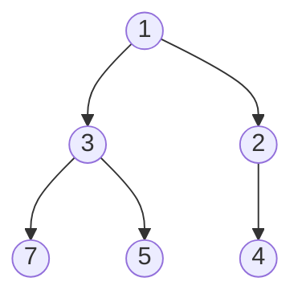

# Chapter 15 · Heaps & Priority Queues

> A hospital emergency room doesn't treat patients in arrival order. A heart attack that walks in at 10:05 goes before the sprained ankle from 9:30. The receptionist only ever needs one answer: "who is the most urgent person *right now*?" A heap answers exactly that question, in O(1), and absorbs each new arrival in O(log n).

**You will learn:**
- What a **priority queue** is and why a sorted list is the wrong way to build one
- How a **binary heap** hides a tree inside a plain Python list (the index maths)
- **Sift up** and **sift down**, traced step by step
- Why building a heap from n items takes only **O(n)**, and how **heap sort** works
- Python's `heapq` module: tuples, tie-breakers, and the **max-heap trick**
- The five heap patterns: **top-k**, **k-way merge**, **two heaps**, **greedy scheduling**, **lazy deletion**
- 13 classic interview problems: k-th largest, merge k lists, median of a stream, meeting rooms, task scheduler, and more

**Before this:** [Big-O](01-big-o-complexity.md) · [Sorting](07-sorting.md) · [Binary Trees](13-binary-trees.md) · [Binary Search Trees](14-binary-search-trees.md)

---

## 🧠 The Big Idea

A **priority queue** is a waiting line where each item carries a priority, and the item that leaves next is always the one with the best (smallest, by convention) priority. Three operations matter:

| Operation | Meaning |
|---|---|
| `push(item)` | someone new arrives |
| `peek()` | who is most urgent? (don't remove) |
| `pop()` | serve the most urgent person |

How would you build it with what you know?

| Idea | push | pop min | Problem |
|---|---|---|---|
| Unsorted list | O(1) append | O(n) scan | every pop scans everyone |
| Sorted list | O(n) insert (shifting) | O(1) | every push shifts everyone |
| Balanced BST ([Ch 14](14-binary-search-trees.md)) | O(log n) | O(log n) | works, but heavy: pointers, rotations, and it keeps a *full* order we don't need |
| **Binary heap** | **O(log n)** | **O(log n)**, peek O(1) | none, for this job |

The insight: we don't need everything sorted. We only need to know the **minimum**. A heap keeps a much weaker, cheaper order: **every parent is smaller than or equal to its children**. That's it. Siblings can be in any order. Cousins can be in any order. But the smallest element is guaranteed to sit at the top.



Think of a company org chart where every boss is "more urgent" than the people under them. The CEO is the most urgent person in the company, but you can't say anything about whether a manager in Sales is more urgent than a manager in Marketing. You don't need to.

> 💡 **The core insight:** a heap is "lazily sorted". It does the minimum amount of ordering work needed to always know the minimum, which is why it's faster than keeping everything sorted.

---

## 🔨 Building It Up

### 1. The shape: a complete binary tree

A binary heap is a **complete binary tree**: every level is full except possibly the last, and the last level is filled **left to right** with no gaps. That shape has a beautiful consequence: we can store the tree in a plain list, level by level, with **no pointers at all**.

```text
            index 0: 1
          /            \
    index 1: 3       index 2: 2
     /      \         /
 idx 3: 7  idx 4: 5  idx 5: 4

list:  [1, 3, 2, 7, 5, 4]
index:  0  1  2  3  4  5
```

The index maths (memorise these three lines):

| From index `i` | Formula |
|---|---|
| left child | `2*i + 1` |
| right child | `2*i + 2` |
| parent | `(i - 1) // 2` |

```python
heap = [1, 3, 2, 7, 5, 4]

for i in range(len(heap)):
    left, right = 2 * i + 1, 2 * i + 2
    kids = [heap[c] for c in (left, right) if c < len(heap)]
    parent = heap[(i - 1) // 2] if i > 0 else None
    print(f"i={i} value={heap[i]} parent={parent} children={kids}")
```

```text
i=0 value=1 parent=None children=[3, 2]
i=1 value=3 parent=1 children=[7, 5]
i=2 value=2 parent=1 children=[4]
i=3 value=7 parent=3 children=[]
i=4 value=5 parent=3 children=[]
i=5 value=4 parent=2 children=[]
```

What just happened: the "tree" exists only in our heads. Moving to a child or parent is one multiplication or division. Because the tree is complete, there are no holes in the list, and its height is ⌊log₂ n⌋. That height is why every operation is O(log n).

**The heap property (min-heap):** `heap[parent(i)] <= heap[i]` for every i > 0. Check it on the example: 1 ≤ 3, 1 ≤ 2, 3 ≤ 7, 3 ≤ 5, 2 ≤ 4. ✅ A **max-heap** flips it: every parent ≥ its children.

### 2. Push: append, then sift up

To add a value we must keep both the **shape** (complete) and the **order** (parent ≤ child):

1. Append it at the end of the list. Shape ✅. Order might be broken: the new value could be smaller than its parent.
2. **Sift up** (also called *bubble up*): while the value is smaller than its parent, swap them.

Push 0 into `[1, 3, 2, 7, 5, 4]`:

| step | list | new value at | parent (index, value) | action |
|---|---|---|---|---|
| append | `[1, 3, 2, 7, 5, 4, 0]` | 6 | (2, 2) | 0 < 2 → swap |
| 1 | `[1, 3, 0, 7, 5, 4, 2]` | 2 | (0, 1) | 0 < 1 → swap |
| 2 | `[0, 3, 1, 7, 5, 4, 2]` | 0 | none | at root, stop |

At most one swap per level, so O(log n).

### 3. Pop: swap root with last, then sift down

The minimum is `heap[0]`. But we can't just delete index 0, that would leave a hole and shift every index. Instead:

1. Remember `heap[0]` (the answer).
2. Move the **last** element into the root and shorten the list. Shape ✅.
3. **Sift down**: while the value is bigger than its smaller child, swap with the **smaller** child.

Why the *smaller* child? After the swap, that child becomes the parent of the other child, so it must be the smaller of the two.

Pop from `[0, 3, 1, 7, 5, 4, 2]`:

| step | list | value at | children (index: value) | action |
|---|---|---|---|---|
| take 0, move 2 to root | `[2, 3, 1, 7, 5, 4]` | 0 | 1: 3, 2: 1 | smaller child 1 < 2 → swap |
| 1 | `[1, 3, 2, 7, 5, 4]` | 2 | 5: 4 | 2 ≤ 4, stop |

Returned 0, and the heap is back to `[1, 3, 2, 7, 5, 4]`.

### 4. A min-heap from scratch

Now the code. Write this once by hand; it makes everything else obvious.

```python
class MinHeap:
    def __init__(self):
        self.data = []

    def __len__(self):
        return len(self.data)

    def peek(self):
        return self.data[0]

    def push(self, value):
        self.data.append(value)
        self._sift_up(len(self.data) - 1)

    def pop(self):
        data = self.data
        last = data.pop()               # shape: remove the last slot
        if not data:
            return last                 # it was the only element
        top, data[0] = data[0], last    # last element goes to the root
        self._sift_down(0)
        return top

    def _sift_up(self, i):
        data = self.data
        while i > 0:
            parent = (i - 1) // 2
            if data[i] >= data[parent]:
                break                   # order restored
            data[i], data[parent] = data[parent], data[i]
            i = parent

    def _sift_down(self, i):
        data, n = self.data, len(self.data)
        while True:
            smallest = i
            left, right = 2 * i + 1, 2 * i + 2
            if left < n and data[left] < data[smallest]:
                smallest = left
            if right < n and data[right] < data[smallest]:
                smallest = right
            if smallest == i:
                break                   # both children are bigger: done
            data[i], data[smallest] = data[smallest], data[i]
            i = smallest

h = MinHeap()
for x in [1, 3, 2, 7, 5, 4]:
    h.push(x)
print(h.data)
h.push(0)
print(h.data)
print(h.pop(), h.data)
print([h.pop() for _ in range(len(h))])
```

```text
[1, 3, 2, 7, 5, 4]
[0, 3, 1, 7, 5, 4, 2]
0 [1, 3, 2, 7, 5, 4]
[1, 2, 3, 4, 5, 7]
```

What just happened: popping everything gave the values in sorted order. Pushing n items then popping n items is a sorting algorithm, O(n log n). That's the seed of heap sort.

### 5. Heapify: build a heap in O(n)

Given a whole list at once, you could push items one by one: O(n log n). But there's a faster way, **bottom-up heapify**: sift down every non-leaf node, starting from the last one and moving backwards to the root.

Why does it work? Leaves (the second half of the list) are already tiny valid heaps of size 1. Sifting down node i, when both of its subtrees are already valid heaps, makes the subtree at i a valid heap. Going backwards guarantees the subtrees are always done first.

```python
def sift_down(data, i, n):
    while True:
        smallest, left, right = i, 2 * i + 1, 2 * i + 2
        if left < n and data[left] < data[smallest]:
            smallest = left
        if right < n and data[right] < data[smallest]:
            smallest = right
        if smallest == i:
            return
        data[i], data[smallest] = data[smallest], data[i]
        i = smallest

def heapify(data):
    n = len(data)
    for i in range(n // 2 - 1, -1, -1):     # last non-leaf down to the root
        sift_down(data, i, n)
        print(f"after sifting index {i}: {data}")

nums = [9, 5, 7, 2, 8, 1, 3]
heapify(nums)
```

```text
after sifting index 2: [9, 5, 1, 2, 8, 7, 3]
after sifting index 1: [9, 2, 1, 5, 8, 7, 3]
after sifting index 0: [1, 2, 3, 5, 8, 7, 9]
```

What just happened: index `n // 2 - 1` is the last node that has a child. Indexes 3 to 6 are leaves and were skipped. Each sift-down fixed one subtree, and the last one fixed the whole tree. The proof that this is O(n), not O(n log n), is in Under the Hood. It's a favourite interview follow-up.

### 6. Heap sort

Heap sort sorts **in place** with O(1) extra memory and a guaranteed O(n log n):

1. Build a **max**-heap of the whole array (heapify, O(n)).
2. Repeatedly swap the max (index 0) with the last element of the heap region, shrink the heap by one, and sift the new root down.

The sorted part grows from the right, like selection sort, but each "find the max" costs O(log n) instead of O(n).

```python
def sift_down_max(a, i, n):
    while True:
        largest, left, right = i, 2 * i + 1, 2 * i + 2
        if left < n and a[left] > a[largest]:
            largest = left
        if right < n and a[right] > a[largest]:
            largest = right
        if largest == i:
            return
        a[i], a[largest] = a[largest], a[i]
        i = largest

def heap_sort(a):
    n = len(a)
    for i in range(n // 2 - 1, -1, -1):     # 1. build a max-heap
        sift_down_max(a, i, n)
    for end in range(n - 1, 0, -1):         # 2. move max to the back, shrink
        a[0], a[end] = a[end], a[0]
        sift_down_max(a, 0, end)
    return a

print(heap_sort([9, 5, 7, 2, 8, 1, 3]))
print(heap_sort([5, -1, 5, 0, 2]))
```

```text
[1, 2, 3, 5, 7, 8, 9]
[-1, 0, 2, 5, 5]
```

| Property | Heap sort |
|---|---|
| Time (best/avg/worst) | O(n log n) / O(n log n) / O(n log n) |
| Extra space | O(1) |
| Stable? | No (long-distance swaps reorder equal items) |
| In practice | slower than quicksort/Timsort: it jumps around memory (poor cache use) |

Compare with the sorts in [Chapter 07](07-sorting.md): heap sort is the one to name when someone asks for "O(n log n) worst case **and** O(1) extra space".

### 7. Python's `heapq`: the heap you'll actually use

Python's standard library ships a fast (C-implemented) min-heap that works on a **plain list**. There's no Heap class: you pass the list to functions.

```python
import heapq

h = []
for x in [5, 1, 8, 3, 2]:
    heapq.heappush(h, x)          # O(log n)
print(h)                          # a valid heap, NOT a sorted list
print(h[0])                       # peek at the min: O(1)
print(heapq.heappop(h), h)        # O(log n)

nums = [9, 5, 7, 2, 8, 1, 3]
heapq.heapify(nums)               # in place, O(n)
print(nums)

# push then pop in one step (faster than doing both)
print(heapq.heappushpop(nums, 0))     # pushes 0, pops the min -> 0 comes right back
# pop then push in one step (the heap size stays the same)
print(heapq.heapreplace(nums, 6), nums)

data = [4, 1, 7, 3, 8, 5]
print(heapq.nlargest(3, data), heapq.nsmallest(2, data))
words = ["kiwi", "fig", "banana", "apple"]
print(heapq.nsmallest(2, words, key=len))
print(list(heapq.merge([1, 4, 9], [2, 3, 10], [5])))   # merge sorted iterables
```

```text
[1, 2, 8, 5, 3]
1
1 [2, 3, 8, 5]
[1, 2, 3, 5, 8, 7, 9]
0
1 [2, 5, 3, 6, 8, 7, 9]
[8, 7, 5] [1, 3]
['fig', 'kiwi']
[1, 2, 3, 4, 5, 9, 10]
```

| Function | What it does | Cost |
|---|---|---|
| `heappush(h, x)` | add x | O(log n) |
| `heappop(h)` | remove and return the min | O(log n) |
| `h[0]` | peek at the min | O(1) |
| `heapify(lst)` | turn a list into a heap in place | O(n) |
| `heappushpop(h, x)` | push x, then pop the min | O(log n) |
| `heapreplace(h, x)` | pop the min, then push x | O(log n) |
| `nlargest(k, it, key=)` / `nsmallest` | top k items | O(n log k) |
| `merge(*sorted_its)` | lazily merge sorted inputs | O(N log k) |

> ⚠️ A heap is **not** sorted. `print(h)` shows `[1, 2, 8, 5, 3]`, and `h[1]` is not necessarily the second smallest. Only `h[0]` has a guaranteed meaning.

### 8. Tuples as entries: priority + data

Usually you want to store *things* with a priority, like `(priority, task)`. Python compares tuples element by element ([Chapter 08 of Part 1](../part-1-python/08-tuples-sets.md)), so the first element acts as the priority.

But what if two priorities tie? Python then compares the **second** element. If that's something that can't be compared (a dict, a custom object), you get a `TypeError`. The standard fix is a **tie-breaker counter** in the middle:

```python
import heapq
import itertools

class Task:                       # no __lt__: Tasks can't be compared
    def __init__(self, name):
        self.name = name

counter = itertools.count()       # 0, 1, 2, ... a unique, increasing tie-breaker
h = []
for priority, name in [(2, "write tests"), (1, "fix prod bug"), (2, "code review")]:
    heapq.heappush(h, (priority, next(counter), Task(name)))

while h:
    priority, _, task = heapq.heappop(h)
    print(priority, task.name)
```

```text
1 fix prod bug
2 write tests
2 code review
```

What just happened: the two priority-2 tasks were compared by the counter (0 vs 2), never by the `Task` objects. As a bonus, ties come out in **insertion order** (first in, first out), which is usually what you want.

### 9. The max-heap trick: negate

`heapq` only does min-heaps. For a max-heap, push **negated** keys, and negate again when you pop:

```python
import heapq

nums = [3, 1, 4, 1, 5, 9, 2, 6]
max_heap = [-x for x in nums]
heapq.heapify(max_heap)
print(-max_heap[0])                                   # peek at the max
print([-heapq.heappop(max_heap) for _ in range(3)])   # three largest

# With tuples, negate only the priority part
scores = [("asha", 82), ("ravi", 95), ("meera", 88)]
h = [(-score, name) for name, score in scores]
heapq.heapify(h)
neg, name = heapq.heappop(h)
print(name, -neg)
```

```text
9
[9, 6, 5]
ravi 95
```

For values that can't be negated (like strings), wrap them in a small class whose `__lt__` is reversed ([Chapter 15 of Part 1](../part-1-python/15-oop-inheritance-magic.md)), or use `heapq.nlargest`. (Python 3.14 added public max-heap functions such as `heapq.heappush_max`, but the negation trick works in every version and is what interviewers expect.)

### 10. Removing an arbitrary item: lazy deletion

A heap can only remove the top efficiently. What if a task gets **cancelled** while it's somewhere in the middle? Finding it is O(n). The trick is **lazy deletion**: don't remove it now. Just remember that it's dead, and when it eventually reaches the top, throw it away.

```python
import heapq

class LazyHeap:
    def __init__(self):
        self.heap = []
        self.dead = {}                 # value -> how many copies are deleted

    def push(self, x):
        heapq.heappush(self.heap, x)

    def remove(self, x):               # O(1): just mark it
        self.dead[x] = self.dead.get(x, 0) + 1

    def _clean_top(self):              # discard dead items sitting on top
        while self.heap and self.dead.get(self.heap[0], 0):
            self.dead[self.heap[0]] -= 1
            heapq.heappop(self.heap)

    def peek(self):
        self._clean_top()
        return self.heap[0]

    def pop(self):
        self._clean_top()
        return heapq.heappop(self.heap)

lh = LazyHeap()
for x in [5, 1, 8, 3]:
    lh.push(x)
lh.remove(1)                           # 1 is the min, but we don't touch the heap
lh.remove(8)
print(lh.peek())
print(lh.pop(), lh.pop())
print(lh.heap)                         # 8 is still physically inside!
```

```text
3
3 5
[8]
```

What just happened: removals cost O(1); the cleanup cost is paid later, and each item is popped at most once overall, so the total stays O(n log n). The catch: dead items take up space until they surface. And if you need the heap's **size**, track the number of live items yourself (`len(self.heap)` includes the dead). This trick powers Sliding Window Median and Dijkstra's algorithm ([Chapter 17](17-graphs-advanced.md)).

---

## 🔬 Under the Hood

### Why push and pop are O(log n)

A complete binary tree with n nodes has height ⌊log₂ n⌋, because level d holds 2^d nodes and every level except the last is full. Sift up moves one level up per swap; sift down moves one level down per swap. So each is at most ⌊log₂ n⌋ swaps. For a million items, that's about 20 swaps.

### Why heapify is O(n), not O(n log n)

The intuition: **most nodes are near the bottom, and nodes near the bottom are cheap**.

In a heap of n nodes, about n/2 nodes are leaves (sift-down cost 0), about n/4 are one level above (cost ≤ 1), about n/8 are two levels up (cost ≤ 2), and so on. Total work:

```text
  (n/4)·1 + (n/8)·2 + (n/16)·3 + ...  =  n · (1/4 + 2/8 + 3/16 + ...)  =  n · 1  =  O(n)
```

The series Σ h/2^(h+1) converges to 1. Compare with pushing one by one: there, the *many* nodes at the bottom are the ones that travel the *furthest* (up to log n each), giving O(n log n). Heapify flips this around: the expensive long trips are made only by the few nodes near the top.

> 💡 This is why `heapq.heapify(list)` beats a loop of `heappush` calls. If you have all the data up front, heapify it.

### Why the list layout works so well

- **No pointers:** a node's children are found by arithmetic, so each element costs one list slot instead of a node object with two references (compare the BST in [Chapter 14](14-binary-search-trees.md)).
- **Completeness = no gaps:** the list is dense, so memory is contiguous.
- **`heapq` is written in C**, so in practice it's much faster than the hand-written class above.

### Heap vs BST, honestly

| Need | Heap | Balanced BST |
|---|---|---|
| min (or max) only | ✅ O(1) peek, O(log n) pop | O(log n) |
| both min and max | two heaps or min-max heap | ✅ O(log n) |
| search for any value | ❌ O(n) | ✅ O(log n) |
| delete an arbitrary value | lazy deletion trick | ✅ O(log n) |
| sorted iteration | ❌ (pop everything, O(n log n)) | ✅ O(n) |
| build from n items | ✅ O(n) | O(n log n) |
| memory / speed in practice | ✅ compact list | pointer-heavy |

Rule: if the question is only ever "what's the smallest/biggest right now?", use a heap.

### Stability and ties

`heapq` is not stable: equal priorities come out in an unspecified order unless you add a tie-breaker counter (section 8). Many problems (task scheduler, Dijkstra) don't care; some (event simulation, LRU-like ordering) do.

---

## 🧩 Pattern Decoder

### Signals: when to reach for a heap

| You see in the problem... | Think |
|---|---|
| "k-th largest / smallest", "top k", "k most frequent", "k closest" | **Top-K**: a heap of size k (Template A) |
| "merge k sorted lists/arrays", "smallest range across k lists", "k-th smallest in sorted matrix" | **K-way merge** (Template B) |
| "median", "middle", "balance two halves" of a stream | **Two heaps** (Template C) |
| "minimum number of rooms / machines", "schedule", "maximise profit with limited picks", "greedy: always take the best available" | **Sort + heap greedy** (Template D) |
| "repeatedly take the two largest / smallest" (stones, ropes, sticks) | Heap simulation |
| "remove an arbitrary element", "sliding window + max/median" | **Lazy deletion** (Template E) |
| "shortest path with weights" | Dijkstra = BFS with a heap ([Chapter 17](17-graphs-advanced.md)) |
| "data arrives one at a time" + any of the above | Heap (you can't sort a stream that isn't finished) |

### Template A: Top-K with a heap of size k

To keep the k **largest**, use a **min**-heap of size k. Its top is the *smallest of the big ones*, the gatekeeper: a new item only gets in if it beats the gatekeeper.

```py
import heapq

def top_k_largest(items, k):
    heap = []                              # min-heap holding the k largest so far
    for x in items:
        if len(heap) < k:
            heapq.heappush(heap, x)
        elif x > heap[0]:                  # beats the weakest of the top k
            heapq.heapreplace(heap, x)     # pop weakest, push x
    return heap                            # heap[0] is the k-th largest
```

Cost: O(n log k) time, **O(k) space**. Better than sorting (O(n log n)) when k is small, and it works on a stream.

> 💡 The counter-intuitive bit: **k largest → min-heap; k smallest → max-heap.** The heap holds the *keepers*, and its top is the one most likely to be kicked out.

### Template B: K-way merge

```py
import heapq

def k_way_merge(lists):
    heap = [(lst[0], i, 0) for i, lst in enumerate(lists) if lst]   # (value, list id, index)
    heapq.heapify(heap)
    out = []
    while heap:
        val, i, j = heapq.heappop(heap)    # smallest front among all lists
        out.append(val)
        if j + 1 < len(lists[i]):          # replace it with the next from the same list
            heapq.heappush(heap, (lists[i][j + 1], i, j + 1))
    return out
```

The heap never holds more than k items (one "front" per list). Total O(N log k) for N total elements.

### Template C: Two heaps (median of a stream)

```py
small = []   # max-heap (store negatives): the smaller half
large = []   # min-heap: the larger half
# Invariants: every value in small <= every value in large
#             len(small) == len(large) or len(small) == len(large) + 1
def add(x):
    heapq.heappush(small, -x)
    heapq.heappush(large, -heapq.heappop(small))   # move small's max across
    if len(large) > len(small):
        heapq.heappush(small, -heapq.heappop(large))
def median():
    if len(small) > len(large):
        return -small[0]
    return (-small[0] + large[0]) / 2
```

### Template D: Sort by one key, heap by another (greedy)

```py
items.sort(key=when_it_becomes_available)          # e.g. start time, capital needed
heap = []
for item in items (or: while picking):
    release / add everything that has become available into the heap
    use heap[0] (the best available by the OTHER key: end time, profit, ...)
```

### Template E: Lazy deletion

```py
dead = Counter()
def remove(x): dead[x] += 1                         # O(1), don't touch the heap
def clean_top(heap):
    while heap and dead[heap[0]]:
        dead[heap[0]] -= 1
        heapq.heappop(heap)
# call clean_top before every peek/pop; track the live size yourself
```

### Variation: K Closest Points to Origin (Template A)

**Problem:** return the k points closest to (0, 0). `[[3,3],[5,-1],[-2,4]]`, k = 2 → `[[3,3],[-2,4]]`.

**Idea:** k **smallest** distances → **max**-heap of size k (negate the distance). Compare squared distances; no `sqrt` needed since it doesn't change the order.

```python
import heapq

def k_closest(points, k):
    heap = []                                   # (-dist², x, y): a max-heap by distance
    for x, y in points:
        d = x * x + y * y
        if len(heap) < k:
            heapq.heappush(heap, (-d, x, y))
        elif d < -heap[0][0]:                   # closer than the farthest keeper
            heapq.heapreplace(heap, (-d, x, y))
    return sorted([x, y] for _, x, y in heap)

print(k_closest([[3, 3], [5, -1], [-2, 4]], 2))
print(k_closest([[1, 3], [-2, 2]], 1))
```

```text
[[-2, 4], [3, 3]]
[[-2, 2]]
```

O(n log k) time, O(k) space. (Quickselect gives O(n) average; mention it as a follow-up.)

### Variation: Merge k Sorted Lists (Template B)

**Problem:** merge k sorted linked lists into one sorted list.

**Idea:** the heap holds the current head of each list. Pop the smallest, attach it, push its `next`. The list index `i` is the tie-breaker so we never compare two `ListNode` objects.

```python
import heapq

class ListNode:
    def __init__(self, val, next=None):
        self.val, self.next = val, next

def build(values):
    head = None
    for v in reversed(values):
        head = ListNode(v, head)
    return head

def merge_k_lists(lists):
    heap = [(node.val, i, node) for i, node in enumerate(lists) if node]
    heapq.heapify(heap)
    dummy = tail = ListNode(0)
    while heap:
        _, i, node = heapq.heappop(heap)
        tail.next = node
        tail = node
        if node.next:
            heapq.heappush(heap, (node.next.val, i, node.next))
    return dummy.next

merged = merge_k_lists([build([1, 4, 5]), build([1, 3, 4]), build([2, 6])])
out = []
while merged:
    out.append(merged.val)
    merged = merged.next
print(out)
```

```text
[1, 1, 2, 3, 4, 4, 5, 6]
```

O(N log k) time, O(k) heap space. (Each list contributes at most one entry at a time, so `(val, i)` is always unique and the node is never compared.)

### Variation: Find Median from Data Stream (Template C)

**Problem:** numbers arrive one at a time; after each, report the median.

**Idea:** split the numbers into a **smaller half** (max-heap) and a **larger half** (min-heap). The median lives at the tops. Each new number goes into `small`, then `small`'s biggest moves to `large` (so the halves stay ordered), then we rebalance sizes.

```python
import heapq

class MedianFinder:
    def __init__(self):
        self.small = []      # max-heap via negatives
        self.large = []      # min-heap

    def add_num(self, num):
        heapq.heappush(self.small, -num)
        heapq.heappush(self.large, -heapq.heappop(self.small))
        if len(self.large) > len(self.small):
            heapq.heappush(self.small, -heapq.heappop(self.large))

    def find_median(self):
        if len(self.small) > len(self.large):
            return -self.small[0]
        return (-self.small[0] + self.large[0]) / 2

mf = MedianFinder()
for x in [5, 15, 1, 3]:
    mf.add_num(x)
    print(x, "->", mf.find_median(), " small:", sorted(-v for v in mf.small), "large:", sorted(mf.large))
```

```text
5 -> 5  small: [5] large: []
15 -> 10.0  small: [5] large: [15]
1 -> 5  small: [1, 5] large: [15]
3 -> 4.0  small: [1, 3] large: [5, 15]
```

**Dry run** of `add_num(3)` (before: small = {1, 5}, large = {15}):

| step | small (max-heap) | large (min-heap) | why |
|---|---|---|---|
| push 3 into small | {1, 3, 5} | {15} | always enter via small |
| move small's max (5) to large | {1, 3} | {5, 15} | keeps every small ≤ every large |
| sizes 2 vs 2 | {1, 3} | {5, 15} | balanced, no move |
| median | top 3 | top 5 | (3 + 5) / 2 = **4.0** |

`add_num` is O(log n), `find_median` is O(1).

### Variation: Meeting Rooms II (Template D)

**Problem:** given meeting intervals, find the minimum number of rooms. `[[0,30],[5,10],[15,20]]` → 2.

**Idea:** process meetings by **start time** (sort). Keep a min-heap of **end times** of rooms in use. If the earliest-ending room is free by the time this meeting starts (`heap[0] <= start`), reuse it (replace its end time); otherwise open a new room.

```python
import heapq

def min_meeting_rooms(intervals):
    intervals.sort()                        # by start time
    ends = []                               # end times of rooms in use
    for start, end in intervals:
        if ends and ends[0] <= start:
            heapq.heapreplace(ends, end)    # reuse the room that frees up first
        else:
            heapq.heappush(ends, end)       # need a new room
    return len(ends)

print(min_meeting_rooms([[0, 30], [5, 10], [15, 20]]))
print(min_meeting_rooms([[7, 10], [2, 4]]))
print(min_meeting_rooms([[1, 5], [2, 6], [3, 7], [6, 8]]))
```

```text
2
1
3
```

**Dry run** for `[[1,5],[2,6],[3,7],[6,8]]`:

| meeting | heap before | earliest end ≤ start? | heap after | rooms |
|---|---|---|---|---|
| [1,5] | [] | no rooms yet | [5] | 1 |
| [2,6] | [5] | 5 ≤ 2? no | [5, 6] | 2 |
| [3,7] | [5, 6] | 5 ≤ 3? no | [5, 6, 7] | 3 |
| [6,8] | [5, 6, 7] | 5 ≤ 6? yes, reuse | [6, 7, 8] | 3 |

O(n log n) time, O(n) space. The heap never shrinks, so its final size is the peak number of simultaneous meetings.

### Variation: IPO (Template D, "unlock then pick the best")

**Problem:** you start with capital `w` and can do at most `k` projects. Project i needs `capital[i]` to start and adds `profits[i]` to your capital. Maximise final capital. k = 2, w = 0, profits `[1,2,3]`, capital `[0,1,1]` → 4.

**Idea:** sort projects by required capital. Before each pick, push every project you can now afford into a **max-heap of profits**, then take the most profitable one. Greedy is safe: taking the biggest available profit never hurts, since it only increases capital and unlocks more.

```python
import heapq

def find_maximized_capital(k, w, profits, capital):
    projects = sorted(zip(capital, profits))      # by capital needed
    available = []                                # max-heap of profits (negated)
    i = 0
    for _ in range(k):
        while i < len(projects) and projects[i][0] <= w:
            heapq.heappush(available, -projects[i][1])   # now affordable
            i += 1
        if not available:
            break                                 # nothing affordable: stuck
        w += -heapq.heappop(available)
    return w

print(find_maximized_capital(2, 0, [1, 2, 3], [0, 1, 1]))
print(find_maximized_capital(3, 0, [1, 2, 3], [0, 1, 2]))
```

```text
4
6
```

O(n log n) time.

### Variation: Task Scheduler (heap simulation, and the formula)

**Problem:** CPU tasks (letters) each take 1 unit; the same task needs `n` units of cooldown between runs. Minimum total time? `["A","A","A","B","B","B"]`, n = 2 → 8 (`A B idle A B idle A B`).

**Idea (simulation):** greedily run the task with the **most remaining copies** (max-heap of counts). Tasks that just ran wait in a cooldown queue ([Chapter 12](12-queues-deques.md)) until `time + n`.

```python
import heapq
from collections import Counter, deque

def least_interval(tasks, n):
    heap = [-c for c in Counter(tasks).values()]     # max-heap of remaining counts
    heapq.heapify(heap)
    cooling = deque()                                # (time it's ready again, -count)
    time = 0
    while heap or cooling:
        time += 1
        if heap:
            remaining = heapq.heappop(heap) + 1      # run one copy (counts are negative)
            if remaining:
                cooling.append((time + n, remaining))
        if cooling and cooling[0][0] == time:        # cooldown over: back in the heap
            heapq.heappush(heap, cooling.popleft()[1])
    return time

def least_interval_formula(tasks, n):
    counts = Counter(tasks).values()
    max_f = max(counts)
    num_max = sum(1 for c in counts if c == max_f)
    return max(len(tasks), (max_f - 1) * (n + 1) + num_max)

tasks = ["A", "A", "A", "B", "B", "B"]
print(least_interval(tasks, 2), least_interval_formula(tasks, 2))
print(least_interval(tasks, 0), least_interval_formula(tasks, 0))
t2 = list("AAAAAABCDEFG")
print(least_interval(t2, 2), least_interval_formula(t2, 2))
```

```text
8 8
6 6
16 16
```

The formula: the most frequent task forms `max_f − 1` full "frames" of length `n + 1`, plus a final partial frame holding every task tied for the max. If there are enough other tasks to fill all gaps, no idle time is needed and the answer is just `len(tasks)`. O(n) time. Interviewers accept either; the heap version generalises to variants.

### Variation: Reorganize String (greedy with a "hold back" slot)

**Problem:** rearrange a string so no two adjacent characters are equal, or return `""`. `"aab"` → `"aba"`, `"aaab"` → `""`.

**Idea:** always place the most frequent remaining character, but you can't place the same one twice in a row. So after using a character, **hold it out** for one round, then push it back.

```python
import heapq
from collections import Counter

def reorganize_string(s):
    heap = [(-c, ch) for ch, c in Counter(s).items()]
    heapq.heapify(heap)
    out = []
    held = None                              # the char we just used, sitting out one turn
    while heap:
        count, ch = heapq.heappop(heap)
        out.append(ch)
        if held:
            heapq.heappush(heap, held)       # previous char may be used again
        held = (count + 1, ch) if count + 1 < 0 else None
    return "".join(out) if len(out) == len(s) else ""

print(reorganize_string("aab"), repr(reorganize_string("aaab")), reorganize_string("aaabbc"))
```

```text
aba '' ababac
```

O(n log 26) = O(n). If the most frequent letter appears more than ⌈n/2⌉ times, it's impossible; the loop discovers this when the heap runs dry with a character still held.

### Variation: Sliding Window Median (two heaps + lazy deletion, the idea)

**Problem:** report the median of every window of size k.

**Idea:** Template C keeps the median of a growing set. Here elements also **leave** the window, and heaps can't remove from the middle. Combine Templates C and E: mark the leaving value as dead, adjust the "live size" of whichever half it belonged to, rebalance, and clean dead values whenever they reach a top. Each step is O(log n). The full code is Practice 🔴 6.

### When NOT to use a heap

- **You need the whole thing sorted once.** Just call `sorted()`. Timsort is faster than n heap pops.
- **k is close to n.** Top-k with a heap is O(n log k) ≈ O(n log n): just sort. Or use quickselect for O(n) average.
- **You need to search for or delete arbitrary items often.** Use a balanced BST / `SortedList` ([Chapter 14](14-binary-search-trees.md)), or a hash map plus lazy deletion.
- **Sliding window maximum** (not median). A monotonic deque is O(n) total, beating a heap's O(n log n) ([Chapter 12](12-queues-deques.md)).
- **Priorities are small integers** (e.g. 0 to 100). An array of buckets (bucket queue) is O(1) per operation.

---

## ⚠️ Traps & Common Mistakes

1. **Expecting the heap list to be sorted.** `h = [1, 2, 8, 5, 3]` is a valid heap. Only `h[0]` is meaningful. To see items in order, pop them (or `sorted(h)`).
2. **Forgetting `heapq` is a min-heap.** For "largest", negate. And remember to negate back when you read the value.
3. **Using the wrong heap type for top-k.** k largest → min-heap of size k. Using a max-heap of all n items works, but it's O(n) space and O(n + k log n) time, which defeats the purpose on a stream.
4. **Comparing un-comparable objects on ties.**

```py
# ❌ TypeError when two priorities are equal: '<' not supported between ListNode
heapq.heappush(h, (node.val, node))

# ✅ add a unique tie-breaker before the object
heapq.heappush(h, (node.val, i, node))          # i = list index or itertools.count()
```

5. **Modifying an item's priority in place.** Changing `h[3] = 0` breaks the heap property silently. Push a new entry and lazily delete the old one (or call `heapify` again, O(n)).
6. **`heapq.heapify` returns `None`.** `h = heapq.heapify(nums)` sets `h` to `None`. It works in place: `heapq.heapify(nums)`, then use `nums`.
7. **`len(heap)` with lazy deletion.** The list still contains dead items; keep your own live counter.
8. **Peeking an empty heap.** `h[0]` on `[]` raises `IndexError`. Guard with `if h:`.
9. **Pushing all n items when only k matter.** `nlargest(k, data)` and the size-k heap exist for a reason: O(n log k) instead of O(n log n).

---

## 💡 Tips & Tricks

- **Say the heap's job out loud:** "This heap holds the k best so far, and its top is the weakest of them." Then the code writes itself.
- `heapq.heappushpop(h, x)` is a fast "push then pop"; `heapreplace(h, x)` is "pop then push". Both are one O(log n) operation instead of two.
- For small k on big data, `heapq.nlargest(k, data, key=...)` is a clean one-liner. For k = 1 just use `max()`/`min()`.
- Tuples sort lexicographically: `(priority, tie_breaker, payload)` is the universal heap entry.
- Need both the smallest and largest at once? Two heaps (with lazy deletion if items can leave), or a `SortedList`.
- If all data is available up front, `heapify` it (O(n)) instead of pushing one at a time (O(n log n)).
- "Interval + minimum number of resources" → sort by start, min-heap of end times.
- "Choose k items greedily while new options unlock" → sort by unlock condition, max-heap by value.

---

## 🎯 Interview Questions

### 1. Kth Largest Element in an Array 🔥🔥🔥

<details><summary>Answer</summary>

Min-heap of size k (Template A); the top at the end is the answer. O(n log k) time, O(k) space.

```python
import heapq

def find_kth_largest(nums, k):
    heap = nums[:k]
    heapq.heapify(heap)
    for x in nums[k:]:
        if x > heap[0]:
            heapq.heapreplace(heap, x)
    return heap[0]

print(find_kth_largest([3, 2, 1, 5, 6, 4], 2), find_kth_largest([3, 2, 3, 1, 2, 4, 5, 5, 6], 4))
```

```text
5 4
```

Follow-up: **quickselect** is O(n) on average (O(n²) worst case), partitioning as in quicksort ([Chapter 07](07-sorting.md)) but recursing into only one side. Mention both; the heap is safer and works on streams.

</details>

### 2. Top K Frequent Elements 🔥🔥🔥

<details><summary>Answer</summary>

Count with `Counter`, then take the k keys with the largest counts: `heapq.nlargest(k, counts, key=counts.get)`, O(n log k). An O(n) alternative is **bucket sort**: bucket i holds the numbers that appear i times; read buckets from high to low.

```python
import heapq
from collections import Counter

def top_k_frequent(nums, k):
    counts = Counter(nums)
    return heapq.nlargest(k, counts, key=counts.get)

print(top_k_frequent([1, 1, 1, 2, 2, 3], 2), top_k_frequent([4], 1))
```

```text
[1, 2] [4]
```

</details>

### 3. K Closest Points to Origin 🔥🔥🔥

<details><summary>Answer</summary>

Max-heap of size k keyed by squared distance (Pattern Decoder). O(n log k) time, O(k) space. Shortcut answer: `heapq.nsmallest(k, points, key=lambda p: p[0]**2 + p[1]**2)`.

</details>

### 4. Merge k Sorted Lists 🔥🔥🔥

<details><summary>Answer</summary>

Heap of current heads with a tie-breaker index (Pattern Decoder, Template B). O(N log k) time, O(k) space. Alternative: divide and conquer, merging lists in pairs (like merge sort), also O(N log k) with O(1) extra space besides recursion.

</details>

### 5. Find Median from Data Stream 🔥🔥🔥

<details><summary>Answer</summary>

Two heaps (Template C): max-heap for the lower half, min-heap for the upper half, sizes differ by at most 1. `addNum` O(log n), `findMedian` O(1). Follow-ups: "if all numbers are in 0..100" → a count array of 101 buckets; "if 99% are in 0..100" → buckets plus two overflow counters.

</details>

### 6. Meeting Rooms II 🔥🔥🔥

<details><summary>Answer</summary>

Sort by start, min-heap of end times (Pattern Decoder). O(n log n). Alternative without a heap: sort starts and ends separately and sweep with two pointers, counting `+1` at a start and `-1` at an end ([Chapter 22](22-greedy-intervals.md) covers intervals in depth).

</details>

### 7. Task Scheduler 🔥🔥

<details><summary>Answer</summary>

Max-heap of counts + cooldown queue simulation, or the formula `max(len(tasks), (max_f − 1)(n + 1) + num_max)` (Pattern Decoder). Explain the "frames" picture for the formula: the most frequent task sets the skeleton, and other tasks fill the gaps.

</details>

### 8. Reorganize String 🔥🔥

<details><summary>Answer</summary>

Max-heap by count, always place the most frequent char, hold the last used char out for one turn (Pattern Decoder). O(n). Impossible exactly when some char appears more than `(n + 1) // 2` times.

</details>

### 9. Last Stone Weight 🔥🔥

Smash the two heaviest stones each turn; if they differ, the difference goes back. Return the last stone's weight (or 0).

<details><summary>Answer</summary>

Max-heap simulation.

```python
import heapq

def last_stone_weight(stones):
    heap = [-s for s in stones]
    heapq.heapify(heap)
    while len(heap) > 1:
        y = -heapq.heappop(heap)          # heaviest
        x = -heapq.heappop(heap)          # second heaviest
        if y != x:
            heapq.heappush(heap, -(y - x))
    return -heap[0] if heap else 0

print(last_stone_weight([2, 7, 4, 1, 8, 1]), last_stone_weight([5, 5]))
```

```text
1 0
```

O(n log n) time, O(n) space.

</details>

### 10. Kth Largest Element in a Stream 🔥🔥

Design a class that, after each `add(val)`, returns the k-th largest so far.

<details><summary>Answer</summary>

Keep a min-heap of the k largest; the top is the answer.

```python
import heapq

class KthLargest:
    def __init__(self, k, nums):
        self.k = k
        self.heap = []
        for x in nums:
            self.add(x)

    def add(self, val):
        if len(self.heap) < self.k:
            heapq.heappush(self.heap, val)
        elif val > self.heap[0]:
            heapq.heapreplace(self.heap, val)
        return self.heap[0]

kl = KthLargest(3, [4, 5, 8, 2])
print([kl.add(v) for v in [3, 5, 10, 9, 4]])
```

```text
[4, 5, 5, 8, 8]
```

Each `add` is O(log k).

</details>

### 11. IPO 🔥

<details><summary>Answer</summary>

Sort by capital, push affordable projects into a max-heap of profits, take the best k times (Pattern Decoder). O(n log n). The greedy argument: picking the most profitable affordable project can only increase capital, so it never closes off options.

</details>

### 12. Kth Smallest Element in a Sorted Matrix 🔥🔥

Each row and column is sorted ascending. Find the k-th smallest.

<details><summary>Answer</summary>

K-way merge over the rows: start with the first element of each row (up to k rows), pop k − 1 times, each time pushing the next element in the popped row. The top is then the k-th smallest.

```python
import heapq

def kth_smallest(matrix, k):
    n = len(matrix)
    heap = [(matrix[r][0], r, 0) for r in range(min(n, k))]
    heapq.heapify(heap)
    for _ in range(k - 1):
        val, r, c = heapq.heappop(heap)
        if c + 1 < n:
            heapq.heappush(heap, (matrix[r][c + 1], r, c + 1))
    return heap[0][0]

m = [[1, 5, 9], [10, 11, 13], [12, 13, 15]]
print(kth_smallest(m, 8), kth_smallest(m, 1))
```

```text
13 1
```

O(k log min(n, k)). Follow-up: binary search on the value range with a counting walk is O(n log(max − min)) ([Chapter 08](08-binary-search.md)).

</details>

### 13. Why is building a heap O(n)? 🔥🔥 (conceptual)

<details><summary>Answer</summary>

Bottom-up heapify sifts down each non-leaf. Half the nodes are leaves (0 work), a quarter do at most 1 swap, an eighth at most 2, and so on: n·Σ h/2^(h+1) = O(n). The key point: the expensive sifts (height log n) happen only for the few nodes near the root. Pushing one at a time is O(n log n) because then the many bottom nodes are the ones that may travel far.

</details>

---

## 🏋️ Practice

**🟢 1. Minimum cost to connect ropes.** Joining ropes of lengths a and b costs a + b and makes a rope of length a + b. Find the minimum total cost to join all. `[4, 3, 2, 6]` → 29.

<details><summary>Solution</summary>

Always join the two shortest (like Huffman coding): long ropes should be added as few times as possible.

```python
import heapq

def connect_ropes(ropes):
    heapq.heapify(ropes)
    cost = 0
    while len(ropes) > 1:
        a, b = heapq.heappop(ropes), heapq.heappop(ropes)
        cost += a + b
        heapq.heappush(ropes, a + b)
    return cost

print(connect_ropes([4, 3, 2, 6]))
```

```text
29
```

</details>

**🟢 2. Sort an array of n items where every item is at most k positions from its sorted place** ("nearly sorted"). `[6, 5, 3, 2, 8, 10, 9]`, k = 3.

<details><summary>Solution</summary>

The smallest remaining item must be among the next k + 1 items. Keep a heap of size k + 1: O(n log k).

```python
import heapq

def sort_k_sorted(nums, k):
    heap = nums[:k + 1]
    heapq.heapify(heap)
    out = []
    for x in nums[k + 1:]:
        out.append(heapq.heappushpop(heap, x))
    while heap:
        out.append(heapq.heappop(heap))
    return out

print(sort_k_sorted([6, 5, 3, 2, 8, 10, 9], 3))
```

```text
[2, 3, 5, 6, 8, 9, 10]
```

</details>

**🟡 3. Sort Characters By Frequency.** `"tree"` → `"eert"` (or `"eetr"`).

<details><summary>Solution</summary>

```python
import heapq
from collections import Counter

def frequency_sort(s):
    heap = [(-c, ch) for ch, c in Counter(s).items()]
    heapq.heapify(heap)
    parts = []
    while heap:
        c, ch = heapq.heappop(heap)
        parts.append(ch * -c)
    return "".join(parts)

print(frequency_sort("tree"), frequency_sort("cccaaa"))
```

```text
eert aaaccc
```

Ties are broken alphabetically here because the tuple's second element is the character.

</details>

**🟡 4. Find K Pairs with Smallest Sums** from two sorted arrays. `[1,7,11]`, `[2,4,6]`, k = 3 → `[[1,2],[1,4],[1,6]]`.

<details><summary>Solution</summary>

K-way merge: think of row i as the pairs `(a[i], b[0]), (a[i], b[1]), ...`, each row sorted. Start with column 0 of the first k rows.

```python
import heapq

def k_smallest_pairs(a, b, k):
    heap = [(a[i] + b[0], i, 0) for i in range(min(k, len(a)))]
    heapq.heapify(heap)
    out = []
    while heap and len(out) < k:
        _, i, j = heapq.heappop(heap)
        out.append([a[i], b[j]])
        if j + 1 < len(b):
            heapq.heappush(heap, (a[i] + b[j + 1], i, j + 1))
    return out

print(k_smallest_pairs([1, 7, 11], [2, 4, 6], 3))
print(k_smallest_pairs([1, 1, 2], [1, 2, 3], 2))
```

```text
[[1, 2], [1, 4], [1, 6]]
[[1, 1], [1, 1]]
```

O(k log k).

</details>

**🔴 5. Smallest Range Covering Elements from K Lists.** Find the smallest `[lo, hi]` that includes at least one number from each list.

<details><summary>Solution</summary>

K-way merge while tracking the current maximum. The heap holds one element per list, so `[heap min, current max]` always covers all lists. Advance the list that owns the minimum (the only way to possibly shrink the range).

```python
import heapq

def smallest_range(lists):
    heap = [(lst[0], i, 0) for i, lst in enumerate(lists)]
    heapq.heapify(heap)
    cur_max = max(lst[0] for lst in lists)
    best = [heap[0][0], cur_max]
    while True:
        val, i, j = heapq.heappop(heap)
        if cur_max - val < best[1] - best[0]:
            best = [val, cur_max]
        if j + 1 == len(lists[i]):
            return best                     # this list is used up: can't cover it anymore
        nxt = lists[i][j + 1]
        cur_max = max(cur_max, nxt)
        heapq.heappush(heap, (nxt, i, j + 1))

print(smallest_range([[4, 10, 15, 24, 26], [0, 9, 12, 20], [5, 18, 22, 30]]))
```

```text
[20, 24]
```

O(N log k).

</details>

**🔴 6. Sliding Window Median.** Return the median of every window of size k. `[1,3,-1,-3,5,3,6,7]`, k = 3 → `[1.0, -1.0, -1.0, 3.0, 5.0, 6.0]`.

<details><summary>Solution</summary>

Two heaps + lazy deletion. `small_size`/`large_size` count **live** elements; tops are always kept live by `prune`.

```python
import heapq
from collections import defaultdict

def median_sliding_window(nums, k):
    small, large = [], []                 # small: max-heap (negated), large: min-heap
    dead = defaultdict(int)
    sizes = {"small": 0, "large": 0}      # live counts

    def prune(heap, sign):
        while heap and dead[sign * heap[0]]:
            dead[sign * heap[0]] -= 1
            heapq.heappop(heap)

    def rebalance():
        if sizes["small"] > sizes["large"] + 1:
            heapq.heappush(large, -heapq.heappop(small))
            sizes["small"] -= 1; sizes["large"] += 1
            prune(small, -1)
        elif sizes["small"] < sizes["large"]:
            heapq.heappush(small, -heapq.heappop(large))
            sizes["large"] -= 1; sizes["small"] += 1
            prune(large, 1)

    def add(x):
        if not small or x <= -small[0]:
            heapq.heappush(small, -x); sizes["small"] += 1
        else:
            heapq.heappush(large, x); sizes["large"] += 1
        rebalance()

    def remove(x):
        dead[x] += 1
        if x <= -small[0]:
            sizes["small"] -= 1
            if x == -small[0]:
                prune(small, -1)
        else:
            sizes["large"] -= 1
            if large and x == large[0]:
                prune(large, 1)
        rebalance()

    def median():
        return float(-small[0]) if k % 2 else (-small[0] + large[0]) / 2

    for x in nums[:k]:
        add(x)
    out = [median()]
    for i in range(k, len(nums)):
        add(nums[i])
        remove(nums[i - k])
        out.append(median())
    return out

print(median_sliding_window([1, 3, -1, -3, 5, 3, 6, 7], 3))
print(median_sliding_window([1, 2, 3, 4, 2, 3, 1, 4, 2], 3))
```

```text
[1.0, -1.0, -1.0, 3.0, 5.0, 6.0]
[2.0, 3.0, 3.0, 3.0, 2.0, 3.0, 2.0]
```

O(n log n) time. (With `SortedList` the code is far shorter: add, remove, and read the middle index.)

</details>

---

## 🧠 Never-Forget Summary

- A **priority queue** answers "what's the most urgent item?"; a **binary heap** is its standard implementation.
- Heap = **complete binary tree** stored in a list. Children of i: `2i+1`, `2i+2`. Parent: `(i−1)//2`.
- **Heap property:** parent ≤ children (min-heap). Only the root is "sorted".
- **Push** = append + sift up. **Pop** = move last to root + sift down (swap with the *smaller* child). Both O(log n). Peek O(1).
- **Heapify** bottom-up is **O(n)**: most nodes are near the bottom and barely move.
- **Heap sort:** max-heapify, then swap the max to the back repeatedly. O(n log n), O(1) space, not stable.
- `heapq` is a **min-heap** on plain lists. Max-heap → **negate**. Ties → `(priority, counter, item)`.
- **Top-k largest → min-heap of size k** (and vice versa). O(n log k).
- **K-way merge:** one entry per list in the heap. O(N log k).
- **Two heaps** → running median. **Sort + heap** → greedy scheduling. **Lazy deletion** → removing from the middle.

**Memory hook: "TOP, MERGE, MIDDLE, SCHEDULE, LAZY"**
- **Top** k → size-k heap of the opposite type
- **Merge** k sorted → heap of fronts
- **Middle** (median) → two heaps
- **Schedule** → sort by start, heap by end/profit
- **Lazy** → mark dead, clean when it surfaces

**One picture:**

| Pattern | Heap holds | Top means | Classic problems |
|---|---|---|---|
| Top-K | the k best so far | the weakest keeper (gatekeeper) | Kth Largest, Top K Frequent, K Closest |
| K-way merge | one front per list | global next smallest | Merge k Lists, Sorted Matrix, Smallest Range |
| Two heaps | lower half / upper half | the two middle values | Median Stream, Sliding Window Median |
| Greedy schedule | currently available options | best option now | Meeting Rooms II, IPO, Task Scheduler |
| Lazy deletion | live + dead items | live best (after cleaning) | Sliding Window Median, Dijkstra |

> **If you remember only one thing:** a heap gives you the best item now, cheaply, forever. When a problem keeps asking "what's the smallest/largest *at this moment*?", reach for a heap.

---
**Next:** [Chapter 16 · Graphs I: BFS, DFS & Grids](16-graphs-bfs-dfs.md)  ·  **Back to** [Contents](../README.md)
