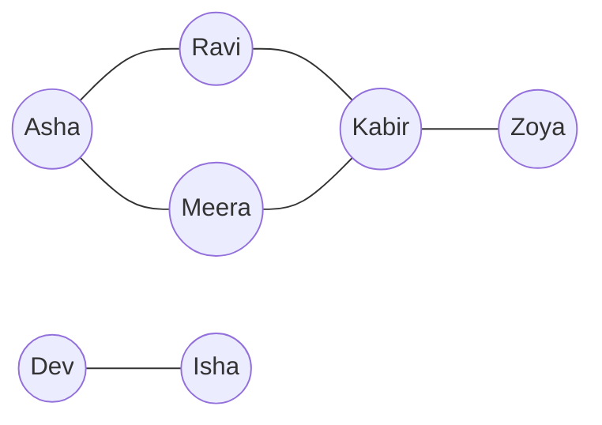
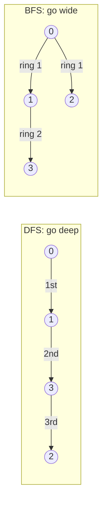

# Chapter 16 · Graphs I: BFS, DFS & Grids

> Google Maps, Instagram's "people you may know", the Delhi Metro, the prerequisites for your college courses, a maze, a Sudoku: all of them are the same thing wearing different clothes. Learn two ways of walking a graph, **DFS** and **BFS**, and an enormous number of problems suddenly become the same problem.

**You will learn:**
- Graph vocabulary in plain words: vertices, edges, directed, weighted, degree, path, cycle, component
- The three ways to store a graph (**adjacency list**, **matrix**, **edge list**) and when to use each
- **DFS** (recursive and iterative) and **BFS**, and exactly when to mark a node visited
- Why BFS finds **shortest paths** in unweighted graphs (the proof is three sentences)
- **Grids as graphs**: the 4/8-direction template that solves islands, flood fill, rotting oranges and friends
- **Multi-source BFS**, **boundary-first** thinking, **state-space BFS** (Word Ladder) and **0-1 BFS**
- Cloning a graph, bipartite checks, and **cycle detection** in undirected and directed graphs

**Before this:** [Recursion](../part-1-python/12-recursion.md) · [Hashing](05-hashing.md) · [Stacks](11-stacks.md) · [Queues & Deques](12-queues-deques.md) · [Binary Trees](13-binary-trees.md)

---

## 🧠 The Big Idea

A **graph** is just **things** and **connections between things**. The things are called **vertices** (or **nodes**), the connections are **edges**.



That's a friendship network. Asha and Kabir aren't friends, but they're connected through Ravi (or Meera). Dev and Isha live in their own little world: nobody else can reach them.

A tree from [Chapter 13](13-binary-trees.md) is a special graph: connected, with no loops. General graphs can have **cycles** (Asha → Ravi → Kabir → Meera → Asha), so the one new danger is **walking in circles forever**. The cure is equally simple: remember where you've been (a `visited` set).

There are two classic ways to explore a graph:

- **DFS (Depth-First Search):** the maze explorer. Take a path and go as **deep** as possible; when you hit a dead end, back up to the last junction and try the next path. Uses a **stack** (or recursion).
- **BFS (Breadth-First Search):** the ripple in a pond. Visit everything 1 step away, then everything 2 steps away, then 3... Uses a **queue**.



> 💡 **The core insight:** almost every graph problem is "walk the graph with DFS or BFS, and do a little bookkeeping on the way". The bookkeeping changes; the walk doesn't.

---

## 🔨 Building It Up

### 1. Vocabulary in one table

| Term | Meaning | Example |
|---|---|---|
| **Vertex / node** | a thing | a person, a city, a grid cell |
| **Edge** | a connection between two vertices | friendship, road, "is next to" |
| **Undirected** | edges go both ways | friendship |
| **Directed** (digraph) | edges have a direction, `u → v` | Instagram "follows", course prerequisites |
| **Weighted** | each edge has a number (cost, distance, time) | road length in km |
| **Neighbours** (adjacent) | vertices joined to v by an edge | Asha's friends |
| **Degree** | number of edges at a vertex; directed graphs have **in-degree** and **out-degree** | followers vs following |
| **Path** | a sequence of vertices joined by edges | Asha → Ravi → Kabir |
| **Cycle** | a path that returns to its start | Asha → Ravi → Kabir → Meera → Asha |
| **Connected** | every vertex can reach every other (undirected) | |
| **Connected component** | a maximal group of mutually reachable vertices | {Asha, Ravi, Meera, Kabir, Zoya} and {Dev, Isha} |
| **DAG** | Directed Acyclic Graph: directed, no cycles | task dependencies ([Chapter 17](17-graphs-advanced.md)) |
| **Sparse / dense** | few edges (E ≈ V) / many edges (E ≈ V²) | road map / everyone-knows-everyone |

We write **V** for the number of vertices and **E** for the number of edges. Graph complexities are written with both, like O(V + E).

### 2. Three ways to store a graph

Take the undirected graph with vertices 0..6 and edges `0-1, 0-2, 1-3, 2-3, 3-4, 5-6`. (It's the friendship picture with numbers.)

```python
from collections import defaultdict

n = 7
edges = [(0, 1), (0, 2), (1, 3), (2, 3), (3, 4), (5, 6)]   # 1. edge list: what you're given

# 2. Adjacency list: for each vertex, the list of its neighbours
adj = defaultdict(list)
for u, v in edges:
    adj[u].append(v)
    adj[v].append(u)            # undirected: add both directions
print(dict(adj))

# 3. Adjacency matrix: matrix[u][v] == 1 if there is an edge u-v
matrix = [[0] * n for _ in range(n)]
for u, v in edges:
    matrix[u][v] = matrix[v][u] = 1
for row in matrix[:4]:
    print(row)

print("neighbours of 3:", adj[3])
print("edge 1-2?", matrix[1][2] == 1, " edge 1-3?", matrix[1][3] == 1)
```

```text
{0: [1, 2], 1: [0, 3], 2: [0, 3], 3: [1, 2, 4], 4: [3], 5: [6], 6: [5]}
[0, 1, 1, 0, 0, 0, 0]
[1, 0, 0, 1, 0, 0, 0]
[1, 0, 0, 1, 0, 0, 0]
[0, 1, 1, 0, 1, 0, 0]
neighbours of 3: [1, 2, 4]
edge 1-2? False  edge 1-3? True
```

| | Adjacency list | Adjacency matrix | Edge list |
|---|---|---|---|
| Space | **O(V + E)** | O(V²) | O(E) |
| "Is u–v an edge?" | O(deg u) (O(1) with sets) | **O(1)** | O(E) |
| Loop over neighbours of u | **O(deg u)** | O(V) | O(E) |
| Best for | almost everything: BFS, DFS, sparse graphs | dense graphs, Floyd-Warshall ([Ch 17](17-graphs-advanced.md)) | Kruskal's MST, Bellman-Ford, union-find |

> 💡 **Default to the adjacency list.** Interview inputs usually arrive as an edge list; your first three lines of code convert it. Real-world graphs (roads, social networks) are sparse: a million users each with ~200 friends would need a 10¹² cell matrix, but only ~2×10⁸ list entries.

### 3. Building graphs in Python: the recipes

```py
# Vertices are 0..n-1: a list of lists is fastest
adj = [[] for _ in range(n)]          # NOT [[]] * n (that's n references to ONE list!)
for u, v in edges:
    adj[u].append(v)                  # directed: only this line
    adj[v].append(u)                  # undirected: add this too

# Vertices are strings or arbitrary labels: defaultdict
adj = defaultdict(list)

# Weighted: store (neighbour, weight) pairs
for u, v, w in weighted_edges:
    adj[u].append((v, w))

# Implicit graph: don't build anything! Generate neighbours on the fly.
def neighbours(r, c):                 # a grid cell's neighbours (section 10)
    ...
```

> ⚠️ With `defaultdict`, a vertex with **no edges** never appears in `adj`. If the problem says "n nodes", loop over `range(n)`, not over `adj`.

### 4. DFS, recursive: the maze explorer with chalk

Enter a vertex, mark it with chalk ("visited"), then for each neighbour not yet marked, explore it fully before trying the next neighbour.

```python
adj = {0: [1, 2], 1: [0, 3], 2: [0, 3], 3: [1, 2, 4], 4: [3], 5: [6], 6: [5]}

def dfs(node, visited, order):
    visited.add(node)                 # chalk mark on entry
    order.append(node)
    for nxt in adj[node]:
        if nxt not in visited:
            dfs(nxt, visited, order)

order = []
dfs(0, set(), order)
print(order)
```

```text
[0, 1, 3, 2, 4]
```

**Trace:** at 0, go to the first neighbour 1. At 1, neighbour 0 is marked, go to 3. At 3, neighbour 1 is marked, go to 2. At 2, both neighbours are marked: dead end, back up to 3. At 3, try 4. Back up all the way. 5 and 6 are never reached (different component).

Each vertex is entered once, and each edge is looked at twice (once from each end): **O(V + E)** time, **O(V)** space for `visited` plus the recursion stack.

### 5. DFS, iterative: same idea, explicit stack

Python's recursion limit (~1000) can break recursive DFS on big graphs ([Chapter 12 of Part 1](../part-1-python/12-recursion.md)). Replace the call stack with your own list:

```python
adj = {0: [1, 2], 1: [0, 3], 2: [0, 3], 3: [1, 2, 4], 4: [3], 5: [6], 6: [5]}

def dfs_iterative(start):
    visited, order = set(), []
    stack = [start]
    while stack:
        node = stack.pop()
        if node in visited:
            continue                          # it was pushed twice; skip the stale copy
        visited.add(node)
        order.append(node)
        for nxt in reversed(adj[node]):       # reversed: so the first neighbour is popped first
            if nxt not in visited:
                stack.append(nxt)
    return order

print(dfs_iterative(0))
```

```text
[0, 1, 3, 2, 4]
```

What just happened: we mark a node when it's **popped**, not when it's pushed, so a node can sit in the stack more than once (that's why we skip it if already visited). This reproduces the recursive order exactly. If you don't care about the exact order (you usually don't), you can drop `reversed`. Stack size is O(E) in the worst case, still fine.

### 6. BFS: ripples in a pond

Use a **queue** ([Chapter 12](12-queues-deques.md)): first in, first out. The start goes in. Repeatedly take the front vertex, and add its unvisited neighbours to the back.

```python
from collections import deque

adj = {0: [1, 2], 1: [0, 3], 2: [0, 3], 3: [1, 2, 4], 4: [3], 5: [6], 6: [5]}

def bfs(start):
    dist = {start: 0}                 # doubles as the visited set
    queue = deque([start])
    order = []
    while queue:
        node = queue.popleft()
        order.append(node)
        for nxt in adj[node]:
            if nxt not in dist:       # mark when ENQUEUED, not when popped
                dist[nxt] = dist[node] + 1
                queue.append(nxt)
    return order, dist

order, dist = bfs(0)
print(order)
print(dist)
```

```text
[0, 1, 2, 3, 4]
{0: 0, 1: 1, 2: 1, 3: 2, 4: 3}
```

**Trace:**

| pop | queue after adding new neighbours | dist learned |
|---|---|---|
| 0 | [1, 2] | 1→1, 2→1 |
| 1 | [2, 3] | 3→2 (0 already seen) |
| 2 | [3] | (0 and 3 already seen) |
| 3 | [4] | 4→3 |
| 4 | [] | |

What just happened: `dist` gives the **fewest edges** from 0 to every reachable vertex. That's BFS's superpower, proven in Under the Hood. O(V + E) time, O(V) space.

### 7. Visited: when to mark (this matters)

| Algorithm | Mark visited when... | Why |
|---|---|---|
| Recursive DFS | entering the node | standard |
| Iterative DFS | popping (and skip if already marked) | gives true DFS order |
| **BFS** | **enqueuing** (pushing) | if you wait until popping, the same node can be enqueued many times by different neighbours: wasted work, and on dense graphs it blows up to O(E) queue entries of repeats |

> ⚠️ The classic BFS bug: marking on pop. It still gives right answers for distances, but can be dramatically slower (Time Limit Exceeded on grids).

### 8. Connected components: "how many separate islands of friends?"

Loop over **every** vertex. Each time you find an unvisited one, that's a new component: run DFS/BFS from it to mark its whole component.

```python
from collections import defaultdict

def count_components(n, edges):
    adj = defaultdict(list)
    for u, v in edges:
        adj[u].append(v)
        adj[v].append(u)
    visited = set()
    components = []
    for start in range(n):                # every vertex, including isolated ones
        if start in visited:
            continue
        group, stack = [], [start]
        visited.add(start)
        while stack:
            node = stack.pop()
            group.append(node)
            for nxt in adj[node]:
                if nxt not in visited:
                    visited.add(nxt)      # marking on push works fine when order doesn't matter
                    stack.append(nxt)
        components.append(sorted(group))
    return components

print(count_components(7, [(0, 1), (0, 2), (1, 3), (2, 3), (3, 4), (5, 6)]))
print(len(count_components(5, [(0, 1), (2, 3)])))
```

```text
[[0, 1, 2, 3, 4], [5, 6]]
3
```

What just happened: in the second call, vertex 4 has no edges at all, but it's still its own component, which is why we loop over `range(n)`. Total cost is still O(V + E): every vertex and edge is processed once across all the searches. (Union-Find solves this too: [Chapter 18](18-union-find.md).)

### 9. Getting the actual path, not just its length

Store each vertex's **parent** (the vertex it was discovered from). Then walk backwards from the target.

```python
from collections import deque

adj = {0: [1, 2], 1: [0, 3], 2: [0, 3], 3: [1, 2, 4], 4: [3], 5: [6], 6: [5]}

def shortest_path(start, target):
    parent = {start: None}
    queue = deque([start])
    while queue:
        node = queue.popleft()
        if node == target:
            path = []
            while node is not None:       # follow parents back to the start
                path.append(node)
                node = parent[node]
            return path[::-1]
        for nxt in adj[node]:
            if nxt not in parent:
                parent[nxt] = node
                queue.append(nxt)
    return None                           # unreachable

print(shortest_path(0, 4), shortest_path(4, 2), shortest_path(0, 6))
```

```text
[0, 1, 3, 4] [4, 3, 2] None
```

### 10. Grids are graphs in disguise

A 2D grid is a graph where each **cell** is a vertex and edges join cells that touch. You never build an adjacency list; you compute neighbours on the fly with **direction vectors**:

```text
4 directions (up, down, left, right):     8 directions (adds diagonals):
            (r-1, c)                       (r-1,c-1) (r-1,c) (r-1,c+1)
   (r, c-1)  (r, c)  (r, c+1)              (r, c-1)   (r,c)  (r, c+1)
            (r+1, c)                       (r+1,c-1) (r+1,c) (r+1,c+1)
```

```python
DIRS4 = [(-1, 0), (1, 0), (0, -1), (0, 1)]
DIRS8 = DIRS4 + [(-1, -1), (-1, 1), (1, -1), (1, 1)]

def neighbours(grid, r, c, dirs=DIRS4):
    rows, cols = len(grid), len(grid[0])
    for dr, dc in dirs:
        nr, nc = r + dr, c + dc
        if 0 <= nr < rows and 0 <= nc < cols:     # stay inside the grid
            yield nr, nc

grid = [[0] * 3 for _ in range(3)]
print(list(neighbours(grid, 0, 0)))
print(list(neighbours(grid, 1, 1)))
print(len(list(neighbours(grid, 1, 1, DIRS8))))
```

```text
[(1, 0), (0, 1)]
[(0, 1), (2, 1), (1, 0), (1, 2)]
8
```

A grid with R rows and C columns has V = R·C vertices and at most 4·R·C edges, so a full DFS/BFS is **O(R·C)**.

> 💡 **Visited on grids:** either a `set` of `(r, c)` pairs, a separate `visited` 2D list, or **overwrite the grid itself** (e.g. turn land `"1"` into water `"0"` once seen). Overwriting is fastest and uses no extra memory, but it destroys the input; say so in an interview.

Now the most famous grid problem, **Number of Islands**: count groups of `"1"`s connected horizontally/vertically. It's exactly "count connected components" (section 8) on a grid.

```python
def num_islands(grid):
    rows, cols = len(grid), len(grid[0])
    count = 0

    def sink(r, c):                              # DFS that turns the island into water
        if r < 0 or r >= rows or c < 0 or c >= cols or grid[r][c] != "1":
            return
        grid[r][c] = "0"                         # mark visited by sinking
        sink(r + 1, c); sink(r - 1, c); sink(r, c + 1); sink(r, c - 1)

    for r in range(rows):
        for c in range(cols):
            if grid[r][c] == "1":
                count += 1                       # found a new island
                sink(r, c)                       # erase it so we don't count it again
    return count

grid = [list("11000"),
        list("11000"),
        list("00100"),
        list("00011")]
print(num_islands(grid))
```

```text
3
```

What just happened: the outer double loop finds an unvisited land cell, counts it, and DFS "sinks" every connected land cell. This "check at the top of the recursive call" style (return early if out of bounds or not land) is the shortest grid-DFS you can write. O(R·C) time; O(R·C) recursion depth in the worst case (a snake-shaped island), so for huge grids use BFS or an explicit stack.

### 11. Multi-source BFS: many ripples at once

What if there are **several** starting points spreading at the same speed, like fire starting in many places? Put **all** sources in the queue at distance 0, then run normal BFS. Each cell gets the distance to its **nearest** source, all in one O(R·C) pass.

**Rotting Oranges:** `2` = rotten, `1` = fresh, `0` = empty. Each minute, rotten oranges rot their 4 neighbours. How many minutes until no fresh orange remains (or −1 if impossible)?

```python
from collections import deque

def oranges_rotting(grid):
    rows, cols = len(grid), len(grid[0])
    queue, fresh = deque(), 0
    for r in range(rows):
        for c in range(cols):
            if grid[r][c] == 2:
                queue.append((r, c))          # every rotten orange is a source
            elif grid[r][c] == 1:
                fresh += 1
    minutes = 0
    while queue and fresh:
        for _ in range(len(queue)):           # process exactly one "minute" (one BFS level)
            r, c = queue.popleft()
            for dr, dc in [(-1, 0), (1, 0), (0, -1), (0, 1)]:
                nr, nc = r + dr, c + dc
                if 0 <= nr < rows and 0 <= nc < cols and grid[nr][nc] == 1:
                    grid[nr][nc] = 2          # mark on enqueue
                    fresh -= 1
                    queue.append((nr, nc))
        minutes += 1
    return minutes if fresh == 0 else -1

print(oranges_rotting([[2, 1, 1], [1, 1, 0], [0, 1, 1]]))
print(oranges_rotting([[2, 1, 1], [0, 1, 1], [1, 0, 1]]))
print(oranges_rotting([[0, 2]]))
```

```text
4
-1
0
```

**Dry run** for the first grid (`R` = rotten, `.` = empty, `f` = fresh):

| minute | grid (rows joined by `/`) | fresh left |
|---|---|---|
| 0 | `R f f / f f . / . f f` | 6 |
| 1 | `R R f / R f . / . f f` | 4 |
| 2 | `R R R / R R . / . f f` | 2 |
| 3 | `R R R / R R . / . R f` | 1 |
| 4 | `R R R / R R . / . R R` | 0 ✅ |

The `for _ in range(len(queue))` trick processes the queue **one level at a time**, which is how we count minutes. Remember it: "level-order BFS" from [Chapter 13](13-binary-trees.md) is the same trick.

### 12. Bipartite check: can you 2-colour the graph?

A graph is **bipartite** if you can colour every vertex red or blue so that every edge joins a red and a blue (e.g. "students and courses", or "split people into two teams so no enemies are on the same team"). BFS/DFS and colour each new vertex the **opposite** of its parent. If you ever see an edge between two same-coloured vertices, it's not bipartite. (Fact: a graph is bipartite exactly when it has **no odd-length cycle**.)

```python
from collections import deque

def is_bipartite(graph):                       # graph[u] = list of neighbours
    color = {}
    for start in range(len(graph)):            # the graph may be disconnected
        if start in color:
            continue
        color[start] = 0
        queue = deque([start])
        while queue:
            u = queue.popleft()
            for v in graph[u]:
                if v not in color:
                    color[v] = 1 - color[u]    # opposite colour
                    queue.append(v)
                elif color[v] == color[u]:
                    return False               # an edge inside one colour
    return True

print(is_bipartite([[1, 3], [0, 2], [1, 3], [0, 2]]))         # a square: even cycle
print(is_bipartite([[1, 2, 3], [0, 2], [0, 1, 3], [0, 2]]))   # has a triangle 0-1-2
```

```text
True
False
```

### 13. Cycle detection in an undirected graph

In an undirected graph, every edge looks like a "back to where I came from" edge (u–v is also v–u). So during DFS, seeing a visited neighbour means a cycle **unless** that neighbour is the **parent** we just came from.

```python
from collections import defaultdict

def has_cycle_undirected(n, edges):
    adj = defaultdict(list)
    for u, v in edges:
        adj[u].append(v)
        adj[v].append(u)
    visited = set()
    for start in range(n):
        if start in visited:
            continue
        visited.add(start)
        stack = [(start, -1)]                  # (node, the parent we came from)
        while stack:
            node, parent = stack.pop()
            for nxt in adj[node]:
                if nxt == parent:
                    continue                   # just the edge we arrived on
                if nxt in visited:
                    return True                # reached an already-seen node another way
                visited.add(nxt)
                stack.append((nxt, node))
    return False

print(has_cycle_undirected(4, [(0, 1), (1, 2), (2, 3)]))          # a line
print(has_cycle_undirected(4, [(0, 1), (1, 2), (2, 0), (2, 3)]))  # triangle 0-1-2
```

```text
False
True
```

(With parallel edges, e.g. two separate edges 0–1, skipping "the parent" by vertex would miss that 2-cycle; track the edge index instead if the input can contain duplicates. Union-Find gives another neat cycle check: [Chapter 18](18-union-find.md).)

### 14. Cycle detection in a directed graph: three colours

The parent trick fails for directed graphs. Picture `0 → 1`, `0 → 2`, `2 → 1`. DFS from 0 visits 1, then 2, and from 2 sees 1 already visited. That's **not** a cycle: 1 was fully finished in an earlier branch. A real cycle means reaching a vertex that is **still on the current path** (an ancestor in the DFS).

So use three states:

| Colour | Meaning |
|---|---|
| **WHITE** (0) | not visited yet |
| **GRAY** (1) | on the current DFS path (entered, not finished) |
| **BLACK** (2) | completely finished, all descendants explored |

Edge to a GRAY vertex → **cycle**. Edge to a BLACK vertex → harmless.

```python
def has_cycle_directed(n, edges):
    adj = [[] for _ in range(n)]
    for u, v in edges:
        adj[u].append(v)
    WHITE, GRAY, BLACK = 0, 1, 2
    color = [WHITE] * n

    def dfs(u):
        color[u] = GRAY                       # u is on the current path
        for v in adj[u]:
            if color[v] == GRAY:
                return True                   # back edge: v is an ancestor of u
            if color[v] == WHITE and dfs(v):
                return True
        color[u] = BLACK                      # done: leave the path
        return False

    return any(color[u] == WHITE and dfs(u) for u in range(n))

print(has_cycle_directed(3, [(0, 1), (0, 2), (2, 1)]))     # diamond-ish: no cycle
print(has_cycle_directed(3, [(0, 1), (1, 2), (2, 0)]))     # 0 -> 1 -> 2 -> 0
```

```text
False
True
```

This is the heart of **Course Schedule** and **topological sort** ([Chapter 17](17-graphs-advanced.md)).

### 15. 0-1 BFS: when edges cost 0 or 1

Plain BFS assumes every edge costs 1. If some edges cost **0** and others **1**, BFS breaks, but a tiny change fixes it: use a **deque**, and push a neighbour reached by a 0-edge to the **front** (it's just as close as the current node) and a 1-edge neighbour to the **back**. The deque stays sorted by distance, so it behaves like Dijkstra ([Chapter 17](17-graphs-advanced.md)) at BFS speed, O(V + E).

**Minimum Obstacle Removal to Reach Corner:** grid of `0` (empty) and `1` (obstacle you can remove). Moving into an obstacle costs 1, into an empty cell costs 0. Minimum removals from top-left to bottom-right?

```python
from collections import deque

def minimum_obstacles(grid):
    rows, cols = len(grid), len(grid[0])
    INF = float("inf")
    dist = [[INF] * cols for _ in range(rows)]
    dist[0][0] = 0
    dq = deque([(0, 0)])
    while dq:
        r, c = dq.popleft()
        for dr, dc in [(-1, 0), (1, 0), (0, -1), (0, 1)]:
            nr, nc = r + dr, c + dc
            if 0 <= nr < rows and 0 <= nc < cols:
                w = grid[nr][nc]                      # cost to step into that cell
                if dist[r][c] + w < dist[nr][nc]:
                    dist[nr][nc] = dist[r][c] + w
                    if w == 0:
                        dq.appendleft((nr, nc))       # same distance: front
                    else:
                        dq.append((nr, nc))           # one more: back
    return dist[rows - 1][cols - 1]

print(minimum_obstacles([[0, 1, 1], [1, 1, 0], [1, 1, 0]]))
print(minimum_obstacles([[0, 1, 0, 0, 0], [0, 1, 0, 1, 0], [0, 0, 0, 1, 0]]))
```

```text
2
0
```

What just happened: unlike plain BFS, a cell may be improved more than once (we check `dist + w < dist[...]` instead of "visited"), but each cell is finalised the first time it's popped with its smallest distance, so the total work stays O(R·C).

---

## 🔬 Under the Hood

### Why DFS and BFS are O(V + E)

Each vertex is marked once, so it enters the stack/queue at most once (BFS, or DFS marking on push), and is processed once: O(V). When a vertex is processed, we loop over its neighbour list. Summed over all vertices, those lists have total length E (directed) or 2E (undirected): O(E). Total **O(V + E)** with an adjacency list. With an adjacency matrix, finding neighbours costs O(V) per vertex, so it becomes **O(V²)**.

### Why BFS gives shortest paths (unweighted)

Claim: BFS pops vertices in non-decreasing order of distance, and the first time it reaches v, it's via a shortest path.

1. The queue always holds vertices from at most two consecutive "rings": some at distance d at the front, then some at d + 1 behind them. (Popping a ring-d vertex only appends ring-(d+1) vertices.)
2. So all ring-d vertices are popped before any ring-(d+1) vertex.
3. Any vertex at true distance d + 1 has a neighbour at distance d. That neighbour is popped during ring d, and it discovers v then, labelling it d + 1. It can't be discovered earlier (that would need a neighbour at distance < d, making v's distance < d + 1).

That's it. This is also why **marking on enqueue** is safe: the first discovery is already the best.

DFS gives **no** such guarantee. It may wander down a long path first and reach the target the "long way round". For shortest paths in unweighted graphs: BFS, always.

### DFS on a directed graph: edge types

During DFS every edge `u → v` is one of: a **tree edge** (v was WHITE), a **back edge** (v is GRAY, an ancestor: means a cycle), a **forward edge** (v is BLACK, a descendant), or a **cross edge** (v is BLACK, in another branch). Only back edges indicate cycles, which is why the three-colour method works.

### Recursion depth and memory

Recursive DFS uses one stack frame per vertex on the current path, up to V deep. A 1000×1000 grid that's one big snake-shaped island needs a million frames, far beyond Python's default limit of 1000. `sys.setrecursionlimit` raises the limit but can crash the interpreter on very deep recursion (the C stack overflows). For big inputs, write iterative DFS or BFS.

BFS memory is the width of the widest "ring". DFS memory is the length of the deepest path. On a grid both can be O(R·C).

### 0-1 BFS correctness in one line

The deque always contains vertices with distances `d` (front part) and `d + 1` (back part). A 0-edge produces distance d (goes to the front), a 1-edge produces d + 1 (goes to the back), so the deque stays sorted, just like Dijkstra's priority queue, without the log factor.

---

## 🧩 Pattern Decoder

### Signals: which walk, which template?

| You see in the problem... | Think |
|---|---|
| "number of islands / provinces / groups / connected components" | DFS/BFS from every unvisited node, count starts (Template A) |
| "flood fill", "paint", "area of", "size of region" | Grid DFS (Template A) |
| "shortest path", "minimum steps / moves", "fewest transformations", unweighted | **BFS** (Template B) |
| "minimum time for X to spread", "distance to nearest X", several starting points | **Multi-source BFS** (Template C) |
| "regions not connected to the border", "cells that can reach the edge/ocean" | **Boundary-first**: start the search from the border (Template D) |
| "transform word/state A into B, one change at a time" | **State-space BFS**: states are vertices (Template B) |
| "deep copy a graph" | DFS/BFS with an `old → new` dict |
| "two groups", "two colours", "no two adjacent the same" | **Bipartite** colouring |
| "detect cycle", "deadlock", "can all courses be finished?" | DFS colours (directed) or parent check / DSU (undirected) |
| edges cost 0 or 1 | **0-1 BFS** with a deque |
| edges have arbitrary positive weights | Dijkstra ([Chapter 17](17-graphs-advanced.md)) |

### Template A: Grid DFS (iterative, safe for big grids)

```py
def grid_dfs(grid, sr, sc):
    rows, cols = len(grid), len(grid[0])
    stack = [(sr, sc)]
    seen = {(sr, sc)}
    size = 0
    while stack:
        r, c = stack.pop()
        size += 1                                   # "visit": count, paint, collect...
        for dr, dc in ((-1, 0), (1, 0), (0, -1), (0, 1)):
            nr, nc = r + dr, c + dc
            if (0 <= nr < rows and 0 <= nc < cols  # 1. inside the grid
                    and (nr, nc) not in seen       # 2. not visited
                    and grid[nr][nc] == TARGET):   # 3. passable / same kind
                seen.add((nr, nc))
                stack.append((nr, nc))
    return size
```

### Template B: BFS shortest path (level by level)

```py
from collections import deque

def bfs_steps(start, is_goal, neighbours):
    queue, seen, steps = deque([start]), {start}, 0
    while queue:
        for _ in range(len(queue)):        # one whole level = one step
            state = queue.popleft()
            if is_goal(state):
                return steps
            for nxt in neighbours(state):
                if nxt not in seen:
                    seen.add(nxt)          # mark on enqueue!
                    queue.append(nxt)
        steps += 1
    return -1                              # unreachable
```

### Template C: Multi-source BFS

```py
queue = deque(all_sources)             # e.g. every rotten orange, every 0, every gate
seen = set(all_sources)                # all at distance 0
# ... then exactly Template B
```

### Template D: Boundary-first (reverse the question)

```py
# "Which cells can NOT reach the border?" is hard. "Which cells CAN?" is easy:
for every cell on the border that qualifies:
    dfs/bfs from it, marking everything it reaches
answer = cells that were NOT marked (or were marked, depending on the question)
```

### Variation: Flood Fill (Template A)

**Problem:** starting at `(sr, sc)`, recolour every cell connected to it (4-directionally) with the same original colour.

```python
def flood_fill(image, sr, sc, color):
    original = image[sr][sc]
    if original == color:
        return image                   # nothing to do (and avoids an infinite loop!)
    rows, cols = len(image), len(image[0])
    stack = [(sr, sc)]
    image[sr][sc] = color              # painting doubles as "visited"
    while stack:
        r, c = stack.pop()
        for dr, dc in ((-1, 0), (1, 0), (0, -1), (0, 1)):
            nr, nc = r + dr, c + dc
            if 0 <= nr < rows and 0 <= nc < cols and image[nr][nc] == original:
                image[nr][nc] = color
                stack.append((nr, nc))
    return image

print(flood_fill([[1, 1, 1], [1, 1, 0], [1, 0, 1]], 1, 1, 2))
```

```text
[[2, 2, 2], [2, 2, 0], [2, 0, 1]]
```

The bottom-right `1` isn't connected (only diagonally), so it stays. O(R·C).

### Variation: Max Area of Island (Template A, counting)

```python
def max_area_of_island(grid):
    rows, cols = len(grid), len(grid[0])
    best = 0
    for sr in range(rows):
        for sc in range(cols):
            if grid[sr][sc] != 1:
                continue
            grid[sr][sc] = 0                     # sink as we go
            stack, area = [(sr, sc)], 0
            while stack:
                r, c = stack.pop()
                area += 1
                for dr, dc in ((-1, 0), (1, 0), (0, -1), (0, 1)):
                    nr, nc = r + dr, c + dc
                    if 0 <= nr < rows and 0 <= nc < cols and grid[nr][nc] == 1:
                        grid[nr][nc] = 0
                        stack.append((nr, nc))
            best = max(best, area)
    return best

grid = [[1, 1, 0, 0, 0],
        [1, 1, 0, 0, 1],
        [0, 0, 0, 1, 1],
        [0, 0, 0, 1, 1]]
print(max_area_of_island(grid))
```

```text
5
```

### Variation: Surrounded Regions (Template D)

**Problem:** capture all `'O'` regions completely surrounded by `'X'` (flip them to `'X'`). An `'O'` region touching the border survives.

**Idea:** "is this region surrounded?" is awkward. Reverse it: from every border `'O'`, DFS and mark its region **safe** (`'S'`). Then flip every remaining `'O'` to `'X'`, and turn `'S'` back into `'O'`.

```python
def solve(board):
    rows, cols = len(board), len(board[0])

    def mark_safe(r, c):
        stack = [(r, c)]
        board[r][c] = "S"
        while stack:
            r, c = stack.pop()
            for dr, dc in ((-1, 0), (1, 0), (0, -1), (0, 1)):
                nr, nc = r + dr, c + dc
                if 0 <= nr < rows and 0 <= nc < cols and board[nr][nc] == "O":
                    board[nr][nc] = "S"
                    stack.append((nr, nc))

    for r in range(rows):
        for c in range(cols):
            on_border = r in (0, rows - 1) or c in (0, cols - 1)
            if on_border and board[r][c] == "O":
                mark_safe(r, c)
    for r in range(rows):
        for c in range(cols):
            board[r][c] = {"O": "X", "S": "O"}.get(board[r][c], board[r][c])
    return board

board = [list("XXXX"), list("XOOX"), list("XXOX"), list("XOXX")]
for row in solve(board):
    print("".join(row))
```

```text
XXXX
XXXX
XXXX
XOXX
```

The bottom `'O'` touches the border, so it lives. O(R·C).

### Variation: Pacific Atlantic Water Flow (Template D, twice)

**Problem:** water flows from a cell to a neighbour with **equal or lower** height. The Pacific touches the top and left edges, the Atlantic the bottom and right. Return cells from which water can reach **both** oceans.

**Idea:** running a search from every cell is O((R·C)²). Reverse the flow: start from each ocean's border and walk **uphill** (to neighbours with height ≥ current). That marks every cell that can drain into that ocean. Answer = intersection.

```python
def pacific_atlantic(heights):
    rows, cols = len(heights), len(heights[0])

    def reachable(starts):
        seen = set(starts)
        stack = list(starts)
        while stack:
            r, c = stack.pop()
            for dr, dc in ((-1, 0), (1, 0), (0, -1), (0, 1)):
                nr, nc = r + dr, c + dc
                if (0 <= nr < rows and 0 <= nc < cols and (nr, nc) not in seen
                        and heights[nr][nc] >= heights[r][c]):     # uphill in reverse
                    seen.add((nr, nc))
                    stack.append((nr, nc))
        return seen

    pacific = [(0, c) for c in range(cols)] + [(r, 0) for r in range(rows)]
    atlantic = [(rows - 1, c) for c in range(cols)] + [(r, cols - 1) for r in range(rows)]
    both = reachable(pacific) & reachable(atlantic)
    return sorted([r, c] for r, c in both)

heights = [[1, 2, 2, 3, 5],
           [3, 2, 3, 4, 4],
           [2, 4, 5, 3, 1],
           [6, 7, 1, 4, 5],
           [5, 1, 1, 2, 4]]
print(pacific_atlantic(heights))
```

```text
[[0, 4], [1, 3], [1, 4], [2, 2], [3, 0], [3, 1], [4, 0]]
```

O(R·C): two searches.

### Variation: Shortest Path in Binary Matrix (Template B, 8 directions)

**Problem:** shortest clear path (cells with 0) from top-left to bottom-right, moving in 8 directions. Path length counts cells. Return −1 if none.

```python
from collections import deque

def shortest_path_binary_matrix(grid):
    n = len(grid)
    if grid[0][0] or grid[n - 1][n - 1]:
        return -1
    queue = deque([(0, 0, 1)])                     # (row, col, path length so far)
    grid[0][0] = 1                                 # mark visited
    while queue:
        r, c, length = queue.popleft()
        if (r, c) == (n - 1, n - 1):
            return length
        for dr in (-1, 0, 1):
            for dc in (-1, 0, 1):
                nr, nc = r + dr, c + dc
                if 0 <= nr < n and 0 <= nc < n and grid[nr][nc] == 0:
                    grid[nr][nc] = 1
                    queue.append((nr, nc, length + 1))
    return -1

print(shortest_path_binary_matrix([[0, 1], [1, 0]]))
print(shortest_path_binary_matrix([[0, 0, 0], [1, 1, 0], [1, 1, 0]]))
print(shortest_path_binary_matrix([[1, 0, 0], [1, 1, 0], [1, 1, 0]]))
```

```text
2
4
-1
```

(`dr = dc = 0` is the cell itself, already marked, so it's skipped automatically.) Storing the distance inside the queue entry is an alternative to the level loop.

### Variation: Word Ladder (state-space BFS)

**Problem:** transform `beginWord` into `endWord`, changing one letter at a time, every intermediate word in `wordList`. Return the number of words in the shortest sequence (0 if impossible). `hit → hot → dot → dog → cog` = 5.

**Idea:** words are vertices; an edge joins words differing by one letter. Don't build all edges (O(N²·L)). Instead, group words by **wildcard patterns**: `hot` belongs to `*ot`, `h*t`, `ho*`. Two words are neighbours exactly when they share a pattern.

```python
from collections import defaultdict, deque

def ladder_length(begin, end, word_list):
    words = set(word_list)
    if end not in words:
        return 0
    buckets = defaultdict(list)                  # pattern -> words matching it
    for w in words:
        for i in range(len(w)):
            buckets[w[:i] + "*" + w[i + 1:]].append(w)

    queue, seen = deque([(begin, 1)]), {begin}
    while queue:
        word, steps = queue.popleft()
        if word == end:
            return steps
        for i in range(len(word)):
            pattern = word[:i] + "*" + word[i + 1:]
            for nxt in buckets[pattern]:
                if nxt not in seen:
                    seen.add(nxt)
                    queue.append((nxt, steps + 1))
            buckets[pattern] = []                # this bucket is fully used: never scan it again
    return 0

words = ["hot", "dot", "dog", "lot", "log", "cog"]
print(ladder_length("hit", "cog", words))
print(ladder_length("hit", "cog", ["hot", "dot", "dog", "lot", "log"]))
```

```text
5
0
```

O(N·L²) time for N words of length L (building patterns costs L per pattern). **Bidirectional BFS** (search from both ends, always expanding the smaller frontier) is a common follow-up that cuts the explored space dramatically.

### Variation: Clone Graph (DFS with an old → new map)

**Problem:** deep-copy a connected undirected graph given one node.

**Idea:** the dict `clones` maps each original node to its copy. It's both the visited set and the way to wire up neighbours (including cycles).

```python
class Node:
    def __init__(self, val, neighbors=None):
        self.val = val
        self.neighbors = neighbors if neighbors is not None else []

def clone_graph(node):
    if node is None:
        return None
    clones = {node: Node(node.val)}
    stack = [node]
    while stack:
        cur = stack.pop()
        for nb in cur.neighbors:
            if nb not in clones:
                clones[nb] = Node(nb.val)        # create copy on first sight
                stack.append(nb)
            clones[cur].neighbors.append(clones[nb])   # wire copy to copy
    return clones[node]

# Build the square 1-2-3-4-1 from an adjacency list (1-indexed)
adj = [[2, 4], [1, 3], [2, 4], [1, 3]]
nodes = [Node(i + 1) for i in range(4)]
for i, nbs in enumerate(adj):
    nodes[i].neighbors = [nodes[j - 1] for j in nbs]

copy = clone_graph(nodes[0])
seen, stack, result = {copy}, [copy], {}
while stack:
    cur = stack.pop()
    result[cur.val] = [nb.val for nb in cur.neighbors]
    for nb in cur.neighbors:
        if nb not in seen:
            seen.add(nb); stack.append(nb)
print(dict(sorted(result.items())))
print(copy is nodes[0], copy.neighbors[0] is nodes[1])
```

```text
{1: [2, 4], 2: [1, 3], 3: [2, 4], 4: [1, 3]}
False False
```

Same shape, brand-new objects. O(V + E).

### When NOT to use plain BFS/DFS

- **Weighted shortest paths** (arbitrary positive weights): BFS is wrong. Use Dijkstra ([Chapter 17](17-graphs-advanced.md)). Exception: weights 0/1 → 0-1 BFS.
- **Lots of "are these connected?" queries while edges keep being added**: rerunning BFS each time is slow. Use Union-Find ([Chapter 18](18-union-find.md)).
- **Ordering tasks with dependencies**: that's topological sort ([Chapter 17](17-graphs-advanced.md)), a DFS/BFS variant with its own template.
- **Counting paths / best path with choices that interact**: often DP over the graph or grid ([Chapter 20](20-dp-1d.md)), especially if movement is only right/down (no cycles).
- **All simple paths / every arrangement**: that's backtracking ([Chapter 09](09-backtracking.md)), exponential, and you un-mark visited on the way back.

---

## ⚠️ Traps & Common Mistakes

1. **Forgetting `visited` entirely** → infinite loop on the first cycle.
2. **Marking visited on pop in BFS** → the same node is enqueued many times. Mark on enqueue.
3. **Starting the search from only node 0** when the graph may be disconnected. Loop over all vertices.
4. **`[[]] * n` for adjacency lists** → all n entries are the *same* list.

```py
adj = [[]] * 3; adj[0].append(1); print(adj)    # ❌ [[1], [1], [1]]
adj = [[] for _ in range(3)]                    # ✅ three separate lists
```

5. **Adding only one direction for an undirected graph.** `adj[u].append(v)` without `adj[v].append(u)`.
6. **Grid bounds checks in the wrong order.** Check `0 <= r < rows` **before** reading `grid[r][c]`, or you'll get `IndexError` (or worse, Python's negative indexing silently wraps `grid[-1]` to the last row!).
7. **Recursive DFS on large grids** → `RecursionError`. Use an explicit stack.
8. **Using DFS for shortest paths.** DFS finds *a* path, not the shortest.
9. **Flood fill when the new colour equals the old colour** → infinite loop if you use the colour itself as the visited marker. Return early.
10. **Using the undirected parent trick on directed graphs** (or vice versa). Directed → three colours.

---

## 💡 Tips & Tricks

- First sentence in an interview: "I'll model this as a graph: vertices are ___, edges are ___." It shows structure and catches misunderstandings early.
- **Shortest + unweighted = BFS.** Burn it in.
- Keep a `DIRS = [(-1,0),(1,0),(0,-1),(0,1)]` constant for grids; loop over it rather than writing four calls.
- Use `for _ in range(len(queue))` when you need **levels** (minutes, steps); store `(node, dist)` in the queue when you don't.
- Mutating the input grid as a visited marker saves memory; mention it and offer a `seen` set if mutation isn't allowed.
- For "from every cell, can it reach X?", search **from X** instead (boundary-first / reverse search).
- Put all sources in the queue at once rather than running BFS from each one: O(R·C) instead of O(k·R·C).
- Grid DFS can encode visited state as `grid[r][c] = '#'` and restore it afterwards when backtracking (Word Search, [Chapter 09](09-backtracking.md)).

---

## 🎯 Interview Questions

### 1. Number of Islands 🔥🔥🔥

<details><summary>Answer</summary>

Scan every cell; on unvisited land, count +1 and DFS/BFS to sink the whole island (section 10). O(R·C) time, O(R·C) worst-case space. Follow-ups: "the grid is huge / streamed row by row" → Union-Find ([Chapter 18](18-union-find.md)); "land is added one cell at a time" → Number of Islands II, also Union-Find.

</details>

### 2. Flood Fill 🔥🔥

<details><summary>Answer</summary>

Grid DFS from `(sr, sc)` over cells with the original colour, painting as you go (Pattern Decoder). Return early if the new colour equals the original. O(R·C).

</details>

### 3. Max Area of Island 🔥🔥

<details><summary>Answer</summary>

Number of Islands, but each DFS returns the island's size; track the maximum (Pattern Decoder). O(R·C).

</details>

### 4. Rotting Oranges 🔥🔥🔥

<details><summary>Answer</summary>

Multi-source BFS from all rotten oranges, level by level; count levels; return −1 if any fresh orange remains (section 11). Key interview line: "Running BFS from each rotten orange separately would be O(k·R·C); seeding the queue with all of them handles simultaneous spreading in one O(R·C) pass."

</details>

### 5. 01 Matrix 🔥🔥

For each cell, the distance to the nearest 0.

<details><summary>Answer</summary>

Multi-source BFS from **every 0** at once. Distances fill outward.

```python
from collections import deque

def update_matrix(mat):
    rows, cols = len(mat), len(mat[0])
    dist = [[-1] * cols for _ in range(rows)]
    queue = deque()
    for r in range(rows):
        for c in range(cols):
            if mat[r][c] == 0:
                dist[r][c] = 0
                queue.append((r, c))
    while queue:
        r, c = queue.popleft()
        for dr, dc in ((-1, 0), (1, 0), (0, -1), (0, 1)):
            nr, nc = r + dr, c + dc
            if 0 <= nr < rows and 0 <= nc < cols and dist[nr][nc] == -1:
                dist[nr][nc] = dist[r][c] + 1
                queue.append((nr, nc))
    return dist

print(update_matrix([[0, 0, 0], [0, 1, 0], [1, 1, 1]]))
```

```text
[[0, 0, 0], [0, 1, 0], [1, 2, 1]]
```

O(R·C). (A two-pass DP also works: top-left sweep then bottom-right sweep.)

</details>

### 6. Surrounded Regions 🔥🔥

<details><summary>Answer</summary>

Boundary-first: mark `'O'`s reachable from the border as safe, flip the rest (Pattern Decoder). O(R·C).

</details>

### 7. Pacific Atlantic Water Flow 🔥🔥

<details><summary>Answer</summary>

Reverse flow: search uphill from each ocean's border, intersect the two reachable sets (Pattern Decoder). O(R·C). The key insight to say out loud: "Instead of asking where each cell's water goes, I ask which cells each ocean can be reached from."

</details>

### 8. Shortest Path in Binary Matrix 🔥🔥

<details><summary>Answer</summary>

BFS with 8 directions, path length counted in cells (Pattern Decoder). O(n²). Check that the start and end cells are open first.

</details>

### 9. Word Ladder 🔥🔥🔥

<details><summary>Answer</summary>

State-space BFS with wildcard buckets (Pattern Decoder). O(N·L²). Mention bidirectional BFS as the optimisation. Word Ladder II (return all shortest sequences) adds a parent map built level by level, then backtracking.

</details>

### 10. Clone Graph 🔥🔥🔥

<details><summary>Answer</summary>

DFS/BFS with a dict `original → copy` that doubles as the visited set (Pattern Decoder). O(V + E). Same trick as "Copy List with Random Pointer" ([Chapter 10](10-linked-lists.md)).

</details>

### 11. Is Graph Bipartite? 🔥🔥

<details><summary>Answer</summary>

BFS 2-colouring from every uncoloured vertex; a same-colour edge means not bipartite (section 12). O(V + E). Equivalent condition: no odd cycle. "Possible Bipartition" (split people who dislike each other into two groups) is the same problem with an edge list.

</details>

### 12. Number of Connected Components in an Undirected Graph 🔥🔥

<details><summary>Answer</summary>

Build an adjacency list, loop over all n vertices, start a DFS from each unvisited one and count (section 8). O(V + E). Alternative: Union-Find, start with n components and subtract 1 for each successful union ([Chapter 18](18-union-find.md)).

</details>

### 13. Find if Path Exists in Graph 🔥

<details><summary>Answer</summary>

BFS/DFS from `source`, return True if `destination` is reached.

```python
from collections import defaultdict, deque

def valid_path(n, edges, source, destination):
    adj = defaultdict(list)
    for u, v in edges:
        adj[u].append(v)
        adj[v].append(u)
    seen, queue = {source}, deque([source])
    while queue:
        node = queue.popleft()
        if node == destination:
            return True
        for nxt in adj[node]:
            if nxt not in seen:
                seen.add(nxt)
                queue.append(nxt)
    return False

print(valid_path(3, [[0, 1], [1, 2], [2, 0]], 0, 2))
print(valid_path(6, [[0, 1], [0, 2], [3, 5], [5, 4], [4, 3]], 0, 5))
```

```text
True
False
```

O(V + E).

</details>

### 14. Detect a cycle in a directed vs an undirected graph 🔥🔥 (conceptual)

<details><summary>Answer</summary>

**Undirected:** DFS; a visited neighbour that isn't the parent means a cycle (or Union-Find: an edge whose endpoints already share a root). **Directed:** DFS with three colours; an edge to a GRAY (on-the-current-path) vertex is a back edge, which means a cycle. Reaching a BLACK vertex is fine: it was finished in another branch. Kahn's algorithm (topological sort) also detects directed cycles: if not all vertices get processed, there's a cycle ([Chapter 17](17-graphs-advanced.md)).

</details>

---

## 🏋️ Practice

**🟢 1. Find the Town Judge** (a degree-counting warm-up). In a directed graph of n people where `trust[i] = [a, b]` means a trusts b, the judge trusts nobody and is trusted by everyone else. Return the judge or −1.

<details><summary>Solution</summary>

No traversal needed: just degrees. The judge has `in − out == n − 1`.

```python
def find_judge(n, trust):
    score = [0] * (n + 1)
    for a, b in trust:
        score[a] -= 1          # out-degree
        score[b] += 1          # in-degree
    for person in range(1, n + 1):
        if score[person] == n - 1:
            return person
    return -1

print(find_judge(3, [[1, 3], [2, 3]]), find_judge(3, [[1, 3], [2, 3], [3, 1]]))
```

```text
3 -1
```

</details>

**🟢 2. Island Perimeter.** One island of 1s; return its perimeter.

<details><summary>Solution</summary>

Each land cell contributes 4 sides, minus 2 for every pair of adjacent land cells (count each shared edge once by checking only up and left).

```python
def island_perimeter(grid):
    perimeter = 0
    for r, row in enumerate(grid):
        for c, cell in enumerate(row):
            if cell:
                perimeter += 4
                if r > 0 and grid[r - 1][c]:
                    perimeter -= 2
                if c > 0 and grid[r][c - 1]:
                    perimeter -= 2
    return perimeter

print(island_perimeter([[0, 1, 0, 0], [1, 1, 1, 0], [0, 1, 0, 0], [1, 1, 0, 0]]))
```

```text
16
```

</details>

**🟡 3. Number of Enclaves.** Count land cells from which you can't walk off the grid.

<details><summary>Solution</summary>

Boundary-first: sink all land reachable from the border, count what's left.

```python
def num_enclaves(grid):
    rows, cols = len(grid), len(grid[0])
    stack = [(r, c) for r in range(rows) for c in range(cols)
             if grid[r][c] == 1 and (r in (0, rows - 1) or c in (0, cols - 1))]
    for r, c in stack:
        grid[r][c] = 0
    while stack:
        r, c = stack.pop()
        for dr, dc in ((-1, 0), (1, 0), (0, -1), (0, 1)):
            nr, nc = r + dr, c + dc
            if 0 <= nr < rows and 0 <= nc < cols and grid[nr][nc] == 1:
                grid[nr][nc] = 0
                stack.append((nr, nc))
    return sum(map(sum, grid))

print(num_enclaves([[0, 0, 0, 0], [1, 0, 1, 0], [0, 1, 1, 0], [0, 0, 0, 0]]))
```

```text
3
```

</details>

**🟡 4. Minimum Knight Moves** on an infinite chessboard from (0, 0) to (x, y).

<details><summary>Solution</summary>

BFS over positions. By symmetry, solve for `(|x|, |y|)` and allow coordinates down to −2 (a few optimal paths dip slightly negative).

```python
from collections import deque

def min_knight_moves(x, y):
    x, y = abs(x), abs(y)
    moves = [(1, 2), (2, 1), (-1, 2), (-2, 1), (1, -2), (2, -1), (-1, -2), (-2, -1)]
    queue, seen = deque([(0, 0, 0)]), {(0, 0)}
    while queue:
        r, c, d = queue.popleft()
        if (r, c) == (x, y):
            return d
        for dr, dc in moves:
            nr, nc = r + dr, c + dc
            if (nr, nc) not in seen and nr >= -2 and nc >= -2:
                seen.add((nr, nc))
                queue.append((nr, nc, d + 1))

print(min_knight_moves(2, 1), min_knight_moves(5, 5), min_knight_moves(1, 1))
```

```text
1 4 2
```

</details>

**🟡 5. Possible Bipartition.** People 1..n; `dislikes[i] = [a, b]` means a and b can't be in the same group. Can you split everyone into two groups?

<details><summary>Solution</summary>

It's a bipartite check on the "dislike" graph.

```python
from collections import defaultdict, deque

def possible_bipartition(n, dislikes):
    adj = defaultdict(list)
    for a, b in dislikes:
        adj[a].append(b)
        adj[b].append(a)
    color = {}
    for start in range(1, n + 1):
        if start in color:
            continue
        color[start] = 0
        queue = deque([start])
        while queue:
            u = queue.popleft()
            for v in adj[u]:
                if v not in color:
                    color[v] = 1 - color[u]
                    queue.append(v)
                elif color[v] == color[u]:
                    return False
    return True

print(possible_bipartition(4, [[1, 2], [1, 3], [2, 4]]))
print(possible_bipartition(3, [[1, 2], [1, 3], [2, 3]]))
```

```text
True
False
```

</details>

**🔴 6. Shortest Bridge.** The grid has exactly two islands. Flip the fewest 0s to connect them.

<details><summary>Solution</summary>

DFS to find all cells of the first island and mark them; then **multi-source BFS** from that whole island until you touch the second one. The BFS level at that moment is the answer.

```python
from collections import deque

def shortest_bridge(grid):
    n = len(grid)
    dirs = ((-1, 0), (1, 0), (0, -1), (0, 1))
    start = next((r, c) for r in range(n) for c in range(n) if grid[r][c] == 1)
    queue = deque()
    stack = [start]
    grid[start[0]][start[1]] = 2                 # 2 = first island / visited
    while stack:                                 # DFS: collect island one
        r, c = stack.pop()
        queue.append((r, c))
        for dr, dc in dirs:
            nr, nc = r + dr, c + dc
            if 0 <= nr < n and 0 <= nc < n and grid[nr][nc] == 1:
                grid[nr][nc] = 2
                stack.append((nr, nc))
    flips = 0
    while queue:                                 # BFS outward from all of island one
        for _ in range(len(queue)):
            r, c = queue.popleft()
            for dr, dc in dirs:
                nr, nc = r + dr, c + dc
                if 0 <= nr < n and 0 <= nc < n:
                    if grid[nr][nc] == 1:
                        return flips             # touched island two
                    if grid[nr][nc] == 0:
                        grid[nr][nc] = 2
                        queue.append((nr, nc))
        flips += 1

print(shortest_bridge([[0, 1], [1, 0]]))
print(shortest_bridge([[0, 1, 0], [0, 0, 0], [0, 0, 1]]))
print(shortest_bridge([[1, 1, 1, 1, 1], [1, 0, 0, 0, 1], [1, 0, 1, 0, 1], [1, 0, 0, 0, 1], [1, 1, 1, 1, 1]]))
```

```text
1
2
1
```

O(n²).

</details>

**🔴 7. Minimum Cost to Make at Least One Valid Path in a Grid.** Each cell has an arrow (1 right, 2 left, 3 down, 4 up). Following an arrow is free; changing a cell's arrow costs 1. Minimum cost to get from top-left to bottom-right?

<details><summary>Solution</summary>

0-1 BFS: moving in the arrow's direction is a 0-edge, any other direction is a 1-edge.

```python
from collections import deque

def min_cost(grid):
    rows, cols = len(grid), len(grid[0])
    dirs = {1: (0, 1), 2: (0, -1), 3: (1, 0), 4: (-1, 0)}
    dist = [[float("inf")] * cols for _ in range(rows)]
    dist[0][0] = 0
    dq = deque([(0, 0)])
    while dq:
        r, c = dq.popleft()
        for arrow, (dr, dc) in dirs.items():
            nr, nc = r + dr, c + dc
            if 0 <= nr < rows and 0 <= nc < cols:
                w = 0 if grid[r][c] == arrow else 1
                if dist[r][c] + w < dist[nr][nc]:
                    dist[nr][nc] = dist[r][c] + w
                    if w == 0:
                        dq.appendleft((nr, nc))
                    else:
                        dq.append((nr, nc))
    return dist[rows - 1][cols - 1]

print(min_cost([[1, 1, 1, 1], [2, 2, 2, 2], [1, 1, 1, 1], [2, 2, 2, 2]]))
print(min_cost([[1, 1, 3], [3, 2, 2], [1, 1, 4]]))
```

```text
3
0
```

O(R·C).

</details>

---

## 🧠 Never-Forget Summary

- A graph = vertices + edges. Directed or not, weighted or not. Trees are graphs without cycles.
- **Adjacency list** by default: O(V + E) space. Matrix for dense graphs / O(1) edge checks. Edge list for Kruskal / Bellman-Ford.
- **DFS** = stack/recursion, go deep. **BFS** = queue, go wide. Both **O(V + E)**.
- Always keep **visited**. In BFS, **mark on enqueue**.
- **BFS = shortest path in unweighted graphs** (rings argument). DFS doesn't guarantee it.
- Loop over **all** vertices to handle disconnected graphs (components).
- **Grids:** cells are vertices, `DIRS` gives neighbours, check bounds first. O(R·C).
- **Multi-source BFS:** all sources in the queue at distance 0.
- **Boundary-first:** search from the border/ocean/exit instead of from every cell.
- **Bipartite** = 2-colourable = no odd cycle. **Directed cycle** = edge to a GRAY vertex. **Undirected cycle** = visited neighbour that isn't the parent.
- **0-1 BFS:** deque, 0-edges to the front, 1-edges to the back.

**Memory hook: "DEEP STACK, WIDE QUEUE"**
- DFS goes **deep** with a **stack**: explore, cycles, components, flood fill.
- BFS goes **wide** with a **queue**: shortest, nearest, minimum steps, spreading.

**One picture:**

| Problem shape | Walk | Trick | Classics |
|---|---|---|---|
| count / size regions | DFS | loop all cells, sink as you go | Islands, Max Area, Flood Fill, Components |
| fewest steps | BFS | mark on enqueue, levels | Binary Matrix, Word Ladder, Knight Moves |
| spreading from many | multi-source BFS | seed all sources | Rotting Oranges, 01 Matrix, Walls & Gates |
| "connected to the edge?" | DFS from border | reverse the question | Surrounded Regions, Pacific Atlantic, Enclaves |
| copy / colour / cycle | DFS/BFS + map | old→new dict, 2 colours, 3 colours | Clone Graph, Bipartite, Cycle Detection |
| weights 0/1 | 0-1 BFS | deque front/back | Obstacle Removal, Valid Path Cost |

> **If you remember only one thing:** model the problem as "what are the vertices, what are the edges?", then ask "do I need the *shortest* (BFS) or just *everything reachable* (DFS)?" That one question solves most graph problems.

---
**Next:** [Chapter 17 · Graphs II: Topological Sort, Shortest Paths & MST](17-graphs-advanced.md)  ·  **Back to** [Contents](../README.md)
