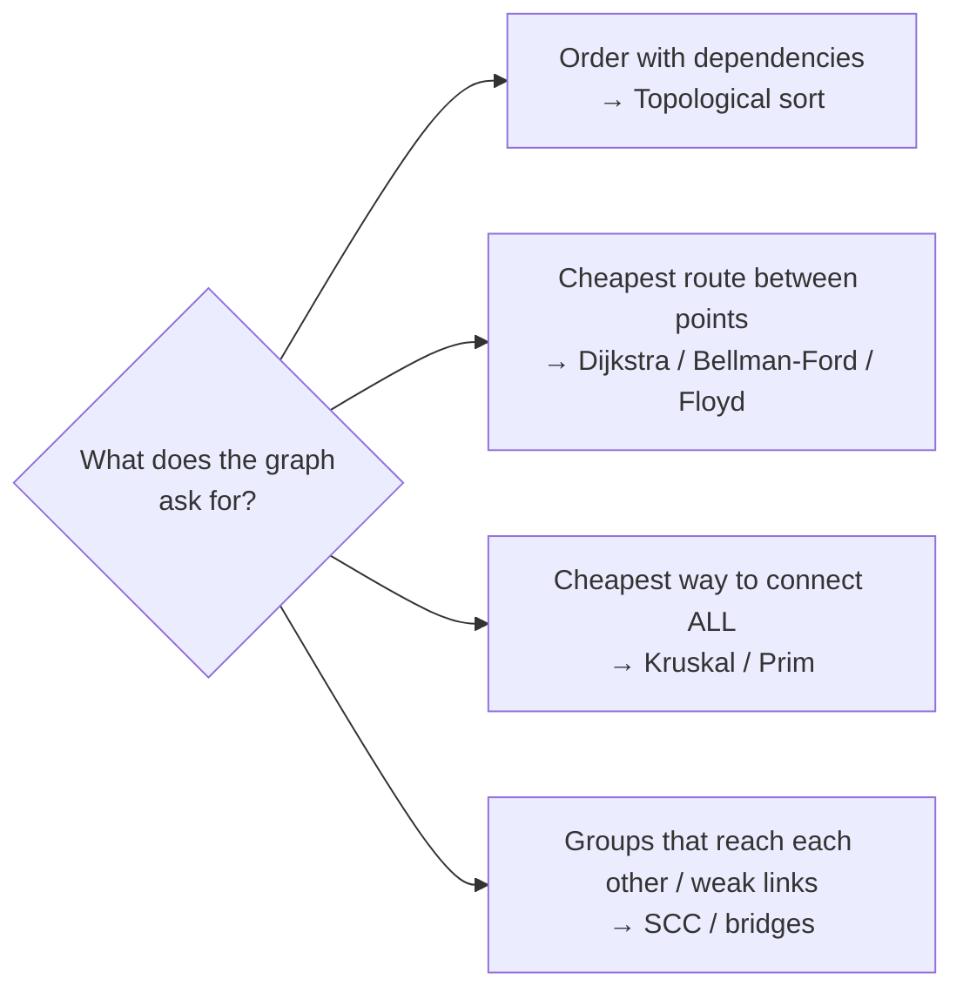
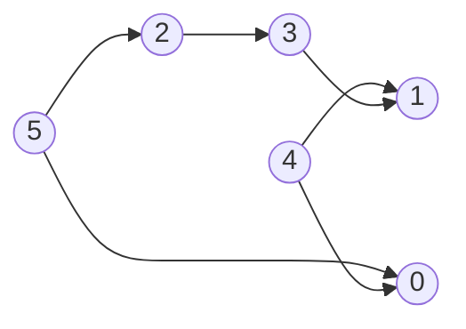
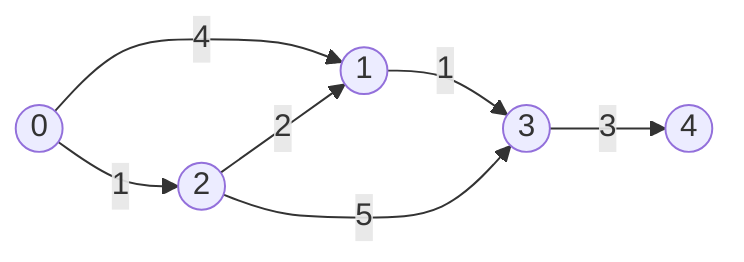
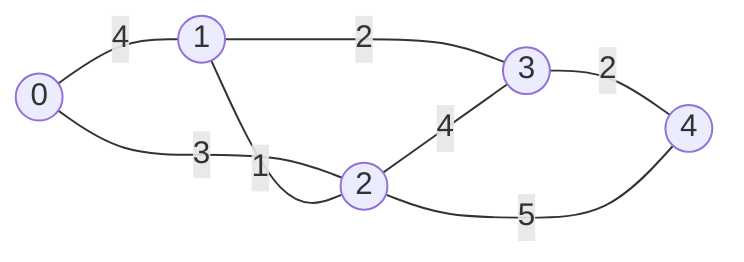

# Chapter 17 · Graphs II: Topological Sort, Shortest Paths & MST

> You want to get from Pune to Patna as cheaply as possible, the airline only lets you take two layovers, one route has a "cashback" that makes it negative-cost, and you also need to plan which courses to take first next semester. Different questions, different algorithms. This chapter gives you the whole toolbox, and a table that tells you which tool to pick in five seconds.

**You will learn:**
- **Topological sort** two ways (Kahn's BFS and DFS) and how it detects impossible schedules
- **Dijkstra's algorithm** with a heap, lazy (stale) entries, and *why* it's correct
- **Bellman-Ford** for negative edges and negative-cycle detection, and its "at most k edges" superpower
- **Floyd-Warshall** for all pairs in five lines
- **Minimum spanning trees** with **Kruskal** (sort + union-find) and **Prim** (heap)
- **Strongly connected components** (Kosaraju, Tarjan) and **bridges / articulation points**, at the level interviews need
- A decision table: "given this problem, which algorithm?"

**Before this:** [Heaps](15-heaps.md) · [Graphs I: BFS, DFS & Grids](16-graphs-bfs-dfs.md) · [Recursion](../part-1-python/12-recursion.md)

---

## 🧠 The Big Idea

In [Chapter 16](16-graphs-bfs-dfs.md), every edge was equal: one step is one step, and BFS ruled. Real graphs are pickier:

- **Edges have order** (you must take Data Structures before Algorithms). → **Topological sort**: line the vertices up so every arrow points forward.
- **Edges have costs** (roads have lengths, flights have prices). → **Shortest path** algorithms: Dijkstra, Bellman-Ford, Floyd-Warshall.
- **You must connect everything as cheaply as possible** (lay fibre-optic cable to every village). → **Minimum spanning tree**: Kruskal, Prim.



The good news: every algorithm here is a small twist on BFS/DFS plus one data structure you already know (a queue, a heap, or a 2D table).

> 💡 **The core insight:** Dijkstra is BFS where the queue is replaced by a heap. Kahn's algorithm is BFS where a vertex enters the queue only when all its prerequisites are done. Prim is Dijkstra with a different "distance". Learn the family resemblance and you've learned five algorithms for the price of one.

---

## 🔨 Building It Up

### 1. Topological sort: lining up tasks

A **topological order** of a directed graph lists every vertex so that for every edge `u → v`, u comes **before** v. Think "get dressed": socks before shoes, shirt before tie.

It exists **only for DAGs** (directed acyclic graphs). If A needs B and B needs A, no order works. So topological sort doubles as a **cycle detector**.

Our example (edges mean "must come before"):



### 2. Kahn's algorithm (BFS with in-degrees)

**Idea:** a vertex with **in-degree 0** has no remaining prerequisites, so it can go now. Take it, "delete" its outgoing edges (decrement the in-degree of its neighbours), and any neighbour that drops to 0 becomes ready.

```python
from collections import deque

def kahn_topo_sort(n, edges):
    adj = [[] for _ in range(n)]
    indegree = [0] * n
    for u, v in edges:
        adj[u].append(v)
        indegree[v] += 1
    queue = deque(v for v in range(n) if indegree[v] == 0)    # ready right now
    order = []
    while queue:
        u = queue.popleft()
        order.append(u)
        for v in adj[u]:
            indegree[v] -= 1                # u is done: one fewer prerequisite for v
            if indegree[v] == 0:
                queue.append(v)
    return order if len(order) == n else []   # some vertices never got ready -> cycle

edges = [(5, 2), (5, 0), (4, 0), (4, 1), (2, 3), (3, 1)]
print(kahn_topo_sort(6, edges))
print(kahn_topo_sort(3, [(0, 1), (1, 2), (2, 0)]))
```

```text
[4, 5, 2, 0, 3, 1]
[]
```

**Dry run:**

| pop | order so far | in-degree changes | newly ready (queue after) |
|---|---|---|---|
| start | | indeg: 0→2, 1→2, 2→1, 3→1, 4→0, 5→0 | [4, 5] |
| 4 | [4] | 0: 2→1, 1: 2→1 | [5] |
| 5 | [4, 5] | 2: 1→0, 0: 1→0 | [2, 0] |
| 2 | [4, 5, 2] | 3: 1→0 | [0, 3] |
| 0 | [4, 5, 2, 0] | (no out-edges) | [3] |
| 3 | [4, 5, 2, 0, 3] | 1: 1→0 | [1] |
| 1 | [4, 5, 2, 0, 3, 1] | | [] |

What just happened: in the cycle example, every vertex has in-degree 1, so nothing is ever ready, `order` stays short, and we return `[]`. **"Fewer than n vertices processed" = there's a cycle.** O(V + E) time.

> 💡 Topological orders are usually **not unique**. `[5, 4, 2, 3, 1, 0]` is also valid here. If a problem wants the lexicographically smallest order, swap the deque for a min-heap.

### 3. Topological sort with DFS (reverse postorder)

**Idea:** in DFS, a vertex **finishes** (all its descendants are explored) only after everything that depends on it has finished. So the **finish order reversed** is a topological order. Use the three colours from [Chapter 16](16-graphs-bfs-dfs.md) to catch cycles.

```python
def dfs_topo_sort(n, edges):
    adj = [[] for _ in range(n)]
    for u, v in edges:
        adj[u].append(v)
    WHITE, GRAY, BLACK = 0, 1, 2
    color = [WHITE] * n
    finished = []

    def dfs(u):
        color[u] = GRAY
        for v in adj[u]:
            if color[v] == GRAY:
                return False                  # back edge: cycle
            if color[v] == WHITE and not dfs(v):
                return False
        color[u] = BLACK
        finished.append(u)                    # u is done after all its dependents
        return True

    for u in range(n):
        if color[u] == WHITE and not dfs(u):
            return []
    return finished[::-1]

edges = [(5, 2), (5, 0), (4, 0), (4, 1), (2, 3), (3, 1)]
print(dfs_topo_sort(6, edges))
print(dfs_topo_sort(3, [(0, 1), (1, 2), (2, 0)]))
```

```text
[5, 4, 2, 3, 1, 0]
[]
```

| | Kahn (BFS) | DFS |
|---|---|---|
| Cycle detection | count processed < n | edge to a GRAY vertex |
| Recursion | none | yes (deep graphs → iterative or Kahn) |
| Natural extras | "levels" (minimum semesters), lexicographic order with a heap | finish times (used by Kosaraju's SCC) |
| Interview default | ✅ usually easier to get right | fine too |

### 4. Dijkstra: shortest paths with positive weights

BFS fails with weights: a path with 3 cheap edges can beat a path with 1 expensive edge. **Dijkstra's algorithm** fixes this with one change: instead of a queue (process in order of *number of edges*), use a **min-heap** keyed by **total distance so far** (process in order of *cost*).

Picture water poured at the source spreading through pipes whose lengths are the edge weights. The water reaches vertices in order of distance. Dijkstra simulates that: it always settles the closest unsettled vertex next.



```python
import heapq

def dijkstra(n, edges, source):
    adj = [[] for _ in range(n)]
    for u, v, w in edges:
        adj[u].append((v, w))
    dist = [float("inf")] * n
    dist[source] = 0
    heap = [(0, source)]                    # (distance so far, vertex)
    while heap:
        d, u = heapq.heappop(heap)
        if d > dist[u]:
            continue                        # stale entry: we already found better
        for v, w in adj[u]:
            nd = d + w
            if nd < dist[v]:                # "relax" the edge u -> v
                dist[v] = nd
                heapq.heappush(heap, (nd, v))
    return dist

edges = [(0, 1, 4), (0, 2, 1), (2, 1, 2), (1, 3, 1), (2, 3, 5), (3, 4, 3)]
print(dijkstra(5, edges, 0))
```

```text
[0, 3, 1, 4, 7]
```

**Dry run** (heap entries are `(dist, vertex)`):

| pop | stale? | relaxations | dist after | heap after |
|---|---|---|---|---|
| (0, 0) | no | 1: ∞→4, 2: ∞→1 | [0, 4, 1, ∞, ∞] | (1,2), (4,1) |
| (1, 2) | no | 1: 4→**3**, 3: ∞→6 | [0, 3, 1, 6, ∞] | (3,1), (4,1), (6,3) |
| (3, 1) | no | 3: 6→**4** | [0, 3, 1, 4, ∞] | (4,1), (4,3), (6,3) |
| (4, 1) | **yes** (4 > 3) | skip | | (4,3), (6,3) |
| (4, 3) | no | 4: ∞→7 | [0, 3, 1, 4, 7] | (6,3), (7,4) |
| (6, 3) | **yes** | skip | | (7,4) |
| (7, 4) | no | none | | empty |

**Lazy entries:** when we improve `dist[1]` from 4 to 3, the old entry `(4, 1)` stays in the heap (heaps can't update in place, [Chapter 15](15-heaps.md)). When it's popped later, `d > dist[u]` exposes it as stale and we skip it. That's lazy deletion, and it's how everyone writes Dijkstra in Python.

**Complexity:** each edge can push one entry, so the heap holds at most E entries: **O((V + E) log V)** time (log E ≤ 2 log V), O(V + E) space.

> ⚠️ **Dijkstra requires non-negative weights.** See Under the Hood for the counter-example.

### 5. Getting the path, and stopping early

Same parent trick as BFS ([Chapter 16](16-graphs-bfs-dfs.md)): record who relaxed each vertex last. And if you only need one target, you can **stop when the target is popped**, because a popped (non-stale) vertex's distance is final.

```python
import heapq

def dijkstra_path(adj, source, target):
    dist = {source: 0}
    parent = {source: None}
    heap = [(0, source)]
    while heap:
        d, u = heapq.heappop(heap)
        if u == target:                       # final once popped
            path = []
            while u is not None:
                path.append(u)
                u = parent[u]
            return d, path[::-1]
        if d > dist[u]:
            continue
        for v, w in adj[u]:
            if d + w < dist.get(v, float("inf")):
                dist[v] = d + w
                parent[v] = u
                heapq.heappush(heap, (d + w, v))
    return float("inf"), []

adj = {"Pune": [("Mumbai", 150), ("Nagpur", 700)],
       "Mumbai": [("Delhi", 1400), ("Nagpur", 800)],
       "Nagpur": [("Delhi", 1000), ("Patna", 1100)],
       "Delhi": [("Patna", 1000)],
       "Patna": []}
print(dijkstra_path(adj, "Pune", "Patna"))
print(dijkstra_path(adj, "Pune", "Delhi"))
```

```text
(1800, ['Pune', 'Nagpur', 'Patna'])
(1550, ['Pune', 'Mumbai', 'Delhi'])
```

### 6. Bellman-Ford: negative edges and negative cycles

Sometimes edges can be negative (a cashback, an energy gain, a currency exchange rate in log form). **Bellman-Ford** is slower but handles them:

> Repeat V − 1 times: for **every** edge `u → v` with weight w, if `dist[u] + w < dist[v]`, update `dist[v]`.

Why V − 1 rounds? A shortest path (with no cycles) uses at most V − 1 edges. After round 1, all shortest paths with 1 edge are correct; after round i, all with ≤ i edges are correct. So V − 1 rounds cover everything.

**Negative cycle detection:** if a **V-th** round still improves something, a cycle with negative total weight exists (you can loop around it forever, getting cheaper and cheaper), so "shortest path" is undefined.

```python
def bellman_ford(n, edges, source):
    INF = float("inf")
    dist = [INF] * n
    dist[source] = 0
    for _ in range(n - 1):
        changed = False
        for u, v, w in edges:
            if dist[u] != INF and dist[u] + w < dist[v]:
                dist[v] = dist[u] + w
                changed = True
        if not changed:
            break                              # early exit: already settled
    for u, v, w in edges:                      # one more round: any improvement = negative cycle
        if dist[u] != INF and dist[u] + w < dist[v]:
            return None
    return dist

print(bellman_ford(4, [(0, 1, 4), (0, 2, 5), (1, 2, -3), (2, 3, 4)], 0))
print(bellman_ford(3, [(0, 1, 1), (1, 2, -1), (2, 1, -1)], 0))
```

```text
[0, 4, 1, 5]
None
```

What just happened: in the first graph, going 0 → 1 → 2 costs 4 + (−3) = 1, cheaper than the direct 0 → 2 edge (5). In the second, the cycle 1 → 2 → 1 has total −2, so we report it. **O(V·E)** time, O(V) space.

### 7. Bellman-Ford's superpower: "at most k edges"

Since round i makes every path with ≤ i edges correct, running exactly k rounds gives the cheapest path using **at most k edges**. One subtlety: within a round, use the distances from the **previous** round (a copy), otherwise one round could chain several edges together.

This is exactly **Cheapest Flights Within K Stops** (k stops = k + 1 flights):

```python
def find_cheapest_price(n, flights, src, dst, k):
    INF = float("inf")
    prices = [INF] * n
    prices[src] = 0
    for _ in range(k + 1):                    # at most k+1 flights
        new_prices = prices[:]                # read old, write new
        for u, v, cost in flights:
            if prices[u] != INF and prices[u] + cost < new_prices[v]:
                new_prices[v] = prices[u] + cost
        prices = new_prices
    return prices[dst] if prices[dst] != INF else -1

flights = [[0, 1, 100], [1, 2, 100], [2, 0, 100], [1, 3, 600], [2, 3, 200]]
print(find_cheapest_price(4, flights, 0, 3, 1))
print(find_cheapest_price(3, [[0, 1, 100], [1, 2, 100], [0, 2, 500]], 0, 2, 0))
```

```text
700
500
```

**Dry run** (first example, k = 1, so 2 rounds):

| round | prices[0..3] | why |
|---|---|---|
| start | [0, ∞, ∞, ∞] | |
| 1 (1 flight) | [0, 100, ∞, ∞] | only 0 → 1 is reachable from a known price |
| 2 (2 flights) | [0, 100, 200, 700] | 1 → 2 = 200, 1 → 3 = 700 |

The path 0 → 1 → 2 → 3 costs only 400, but uses 3 flights (2 stops), so it's not allowed. Without the copy, round 2 could use the freshly updated price of 2 and wrongly report 400. O(k·E).

### 8. Floyd-Warshall: all pairs at once

Need the shortest distance between **every** pair of vertices? Run Floyd-Warshall:

> For each vertex k (as a possible "stopover"), for every pair (i, j): `dist[i][j] = min(dist[i][j], dist[i][k] + dist[k][j])`.

After processing stopover k, `dist[i][j]` is the shortest path from i to j using only stopovers from `{0..k}`. After all k, it's the true shortest path. It's dynamic programming ([Chapter 20](20-dp-1d.md)) over "which stopovers are allowed".

```python
def floyd_warshall(n, edges):
    INF = float("inf")
    dist = [[0 if i == j else INF for j in range(n)] for i in range(n)]
    for u, v, w in edges:
        dist[u][v] = min(dist[u][v], w)
    for k in range(n):                     # k MUST be the outer loop
        for i in range(n):
            for j in range(n):
                if dist[i][k] + dist[k][j] < dist[i][j]:
                    dist[i][j] = dist[i][k] + dist[k][j]
    return dist

edges = [(0, 1, 3), (1, 0, 3), (1, 2, 1), (2, 1, 1), (1, 3, 4), (3, 1, 4), (2, 3, 1), (3, 2, 1)]
for row in floyd_warshall(4, edges):
    print(row)
```

```text
[0, 3, 4, 5]
[3, 0, 1, 2]
[4, 1, 0, 1]
[5, 2, 1, 0]
```

**O(V³)** time, **O(V²)** space. Fine for V up to a few hundred. Handles negative edges (not negative cycles; a negative value on the diagonal `dist[i][i] < 0` reveals one).

### 9. Minimum Spanning Tree: connect everything cheaply

A **spanning tree** of a connected, undirected, weighted graph is a subset of edges that connects all V vertices with no cycle: exactly **V − 1 edges**. A **minimum spanning tree (MST)** is the one with the smallest total weight. Think: lay cable so every village is connected, spending as little as possible.

**The cut property** (why the greedy algorithms below work): split the vertices into any two groups. The **lightest edge crossing between the groups** is safe to include in an MST. (If an MST didn't use it, add it: that creates a cycle that must cross the split again via some other, heavier-or-equal edge. Remove that one: still spanning, no heavier. So some MST contains our edge.)



### 10. Kruskal: cheapest edges first, skip cycles

Sort all edges by weight. Walk through them; add an edge if it connects two **different** components (otherwise it would form a cycle). Stop at V − 1 edges.

"Are u and v already in the same component?" is answered instantly by a **Union-Find** (Disjoint Set Union). We use a tiny version here; [Chapter 18](18-union-find.md) explains exactly why it's so fast.

```python
def kruskal(n, edges):
    parent = list(range(n))

    def find(x):                               # root of x's component
        while parent[x] != x:
            parent[x] = parent[parent[x]]      # path compression (Chapter 18)
            x = parent[x]
        return x

    total, chosen = 0, []
    for w, u, v in sorted((w, u, v) for u, v, w in edges):
        ru, rv = find(u), find(v)
        if ru == rv:
            continue                           # same component: would form a cycle
        parent[ru] = rv                        # union the two components
        total += w
        chosen.append((u, v, w))
        if len(chosen) == n - 1:
            break
    return total, chosen

edges = [(0, 1, 4), (0, 2, 3), (1, 2, 1), (1, 3, 2), (2, 3, 4), (3, 4, 2), (2, 4, 5)]
print(kruskal(5, edges))
```

```text
(8, [(1, 2, 1), (1, 3, 2), (3, 4, 2), (0, 2, 3)])
```

Trace: take 1–2 (1), take 1–3 (2), take 3–4 (2), take 0–2 (3). Four edges for five vertices: done. Edges 0–1 (4), 2–3 (4), 2–4 (5) were never needed. **O(E log E)** for sorting; union-find work is nearly O(1) per edge.

### 11. Prim: grow one tree outward

Start from any vertex. Repeatedly add the **cheapest edge that leaves the tree** (the cut property with "tree vs rest" as the split). A min-heap of `(weight, vertex)` finds that edge. It looks almost exactly like Dijkstra; the only difference is the key: **edge weight**, not total distance.

```python
import heapq

def prim(n, edges):
    adj = [[] for _ in range(n)]
    for u, v, w in edges:
        adj[u].append((w, v))
        adj[v].append((w, u))
    in_tree = [False] * n
    heap = [(0, 0)]                      # (cost to attach, vertex): start at vertex 0
    total = 0
    while heap:
        w, u = heapq.heappop(heap)
        if in_tree[u]:
            continue                     # stale: already attached more cheaply
        in_tree[u] = True
        total += w
        for wv, v in adj[u]:
            if not in_tree[v]:
                heapq.heappush(heap, (wv, v))
    return total if all(in_tree) else None   # None: graph not connected

edges = [(0, 1, 4), (0, 2, 3), (1, 2, 1), (1, 3, 2), (2, 3, 4), (3, 4, 2), (2, 4, 5)]
print(prim(5, edges))
```

```text
8
```

| | Kruskal | Prim |
|---|---|---|
| Idea | global: cheapest edges anywhere | local: grow one tree |
| Data structure | sort + union-find | heap |
| Time | O(E log E) | O(E log V) (heap), O(V²) with an array |
| Best for | sparse graphs, edges given as a list | dense graphs (e.g. all pairs of points, use the O(V²) array version) |

### 12. Strongly connected components (overview + Kosaraju)

In a **directed** graph, a **strongly connected component (SCC)** is a maximal group where every vertex can reach every other. Example: on Twitter-like "follows", a group of people who all (indirectly) follow each other. Shrinking each SCC to one dot always leaves a DAG.

**Kosaraju's algorithm** (two DFS passes):
1. DFS the graph and record vertices in order of **finishing** time.
2. **Reverse** every edge. Process vertices in **decreasing** finish time; each DFS in the reversed graph collects exactly one SCC.

Why it works (intuition): the vertex that finishes last is in a "source" SCC. In the reversed graph, that SCC becomes a "sink", so a DFS from it can't escape and collects only its own SCC. Remove it and repeat.

```python
def kosaraju_scc(n, edges):
    adj = [[] for _ in range(n)]
    radj = [[] for _ in range(n)]
    for u, v in edges:
        adj[u].append(v)
        radj[v].append(u)                  # reversed graph

    seen, finish = [False] * n, []
    def dfs1(u):
        seen[u] = True
        for v in adj[u]:
            if not seen[v]:
                dfs1(v)
        finish.append(u)                   # record finishing order

    for u in range(n):
        if not seen[u]:
            dfs1(u)

    comp = [-1] * n
    def dfs2(u, label):
        comp[u] = label
        for v in radj[u]:
            if comp[v] == -1:
                dfs2(v, label)

    sccs = []
    for u in reversed(finish):            # latest finisher first
        if comp[u] == -1:
            dfs2(u, len(sccs))
            sccs.append(sorted(x for x in range(n) if comp[x] == len(sccs)))
    return sccs

edges = [(0, 1), (1, 2), (2, 0), (1, 3), (3, 4), (4, 5), (5, 3), (6, 5)]
print(kosaraju_scc(7, edges))
```

```text
[[6], [0, 1, 2], [3, 4, 5]]
```

O(V + E). **Tarjan's algorithm** finds SCCs in a **single** DFS using "low-link" values (the same idea as bridges in the next section) and a stack. Interviews rarely ask you to code either; know what an SCC is, that it's O(V + E), and the two names.

### 13. Bridges and articulation points (overview + code)

In an undirected graph, a **bridge** is an edge whose removal disconnects the graph (a single road connecting two towns). An **articulation point** is a vertex whose removal disconnects it (a single airport hub). Finding them = finding single points of failure in a network.

**Tarjan's low-link idea:** during DFS, give each vertex a discovery time `disc[u]`. Let `low[u]` = the earliest discovery time reachable from u's DFS subtree using **at most one back edge**. Then, for a tree edge `u → v`:

- `low[v] > disc[u]` → v's subtree can't reach u or above without this edge → **u–v is a bridge**.
- `low[v] >= disc[u]` (and u is not the root) → **u is an articulation point**. The root is one if it has 2+ DFS children.

```python
def bridges_and_cut_vertices(n, edges):
    adj = [[] for _ in range(n)]
    for u, v in edges:
        adj[u].append(v)
        adj[v].append(u)
    disc, low = [-1] * n, [0] * n
    time = 0
    bridges, cuts = [], set()

    def dfs(u, parent):
        nonlocal time
        disc[u] = low[u] = time
        time += 1
        children = 0
        for v in adj[u]:
            if v == parent:
                continue
            if disc[v] == -1:                      # tree edge
                children += 1
                dfs(v, u)
                low[u] = min(low[u], low[v])
                if low[v] > disc[u]:
                    bridges.append(sorted((u, v)))
                if parent != -1 and low[v] >= disc[u]:
                    cuts.add(u)
            else:                                  # back edge
                low[u] = min(low[u], disc[v])
        if parent == -1 and children > 1:
            cuts.add(u)

    for u in range(n):
        if disc[u] == -1:
            dfs(u, -1)
    return sorted(bridges), sorted(cuts)

print(bridges_and_cut_vertices(4, [(0, 1), (1, 2), (2, 0), (1, 3)]))
print(bridges_and_cut_vertices(5, [(0, 1), (1, 2), (2, 3), (3, 4), (4, 2)]))
```

```text
([[1, 3]], [1])
([[0, 1], [1, 2]], [1, 2])
```

What just happened: in the first graph, 0–1–2 is a triangle (any one edge can go and it stays connected), but 1–3 is the only link to 3. O(V + E). This is LeetCode's **Critical Connections in a Network**.

---

## 🔬 Under the Hood

### Why Dijkstra is correct (and why negatives break it)

**Claim:** when a vertex u is popped (non-stale) with distance d, d is the true shortest distance.

**Intuition:** suppose some cheaper path to u existed. It starts inside the set of already-settled vertices and must leave that set at some point, via an edge to some unsettled vertex x. That vertex x is already in the heap with a distance ≤ (the cost of that path up to x). Since all weights are **non-negative**, the rest of the path from x to u adds ≥ 0, so x's distance ≤ that path's total < d. Then x would have been popped **before** u. Contradiction.

The argument breaks exactly at "the rest of the path adds ≥ 0". With a negative edge:

```text
0 → 1 (weight 2),  0 → 2 (weight 5),  2 → 1 (weight -10)
```

Dijkstra pops 1 with distance 2 and declares it final. But 0 → 2 → 1 costs 5 − 10 = −5. Wrong answer. (The lazy version might later "fix" `dist[1]`, but anything already computed from the wrong value isn't revisited correctly in general, and the running time guarantee is gone.) Use Bellman-Ford.

### Complexity of each algorithm

| Algorithm | Time | Space | Weights | Answers |
|---|---|---|---|---|
| BFS | O(V + E) | O(V) | unweighted (or all equal) | single-source shortest |
| 0-1 BFS | O(V + E) | O(V) | 0 or 1 | single-source shortest |
| Dijkstra (binary heap) | O((V + E) log V) | O(V + E) | non-negative | single-source shortest |
| Bellman-Ford | O(V · E) | O(V) | any; detects negative cycles | single-source; "≤ k edges" |
| Floyd-Warshall | O(V³) | O(V²) | any (no negative cycles) | all pairs |
| Topological sort (Kahn/DFS) | O(V + E) | O(V) | n/a | order; DAG check |
| DAG shortest path (topo + relax) | O(V + E) | O(V) | any (DAG only) | single-source |
| Kruskal | O(E log E) | O(V + E) | any | MST |
| Prim (heap) | O(E log V) | O(V + E) | any | MST |
| Kosaraju / Tarjan SCC | O(V + E) | O(V) | n/a | SCCs |
| Tarjan bridges / cut vertices | O(V + E) | O(V) | n/a | single points of failure |

### Why Floyd-Warshall's loop order matters

The DP state is "shortest path from i to j using only stopovers in {0..k}". To compute layer k you need layer k − 1 **complete** for all pairs, so k must be the **outermost** loop. Put it inside and you combine half-updated values: wrong answers. (Updating in place is safe because row k and column k don't change during round k.)

### Why Kruskal and Prim are both correct

Both only ever add an edge that is the lightest edge crossing some cut:
- **Kruskal:** the edge connects two components A and B, and every lighter edge was either already used or inside a component. So it's the lightest edge crossing the cut "A vs everything else".
- **Prim:** the edge is the lightest leaving the current tree, i.e. crossing "tree vs rest".

By the cut property, each such edge belongs to some MST, so the final result is an MST. If all weights are distinct, the MST is unique.

### Dijkstra's heap: lazy vs decrease-key

Textbooks describe a "decrease-key" operation that updates an entry in the heap. Python's `heapq` has none, so we push duplicates and skip stale ones. The heap can grow to O(E) entries instead of O(V), which changes log V to log E, and log E ≤ log V² = 2 log V. Same Big-O, simpler code. (A Fibonacci heap gives O(E + V log V) in theory; it's slower in practice and never expected in interviews.)

---

## 🧩 Pattern Decoder

### Signals

| You see in the problem... | Think |
|---|---|
| "prerequisites", "dependencies", "must happen before", "build order", "can all tasks finish?" | **Topological sort** (Kahn) |
| "minimum number of semesters / rounds / levels" with dependencies | Kahn **level by level** |
| "derive an ordering from sorted examples" (alien dictionary) | Build edges from comparisons, then topo sort |
| "shortest / cheapest / fastest" + positive weights | **Dijkstra** |
| "minimum time for a signal to reach all nodes" | Dijkstra, answer = max distance |
| "minimise the **maximum** edge on a path" (effort, water level) | Dijkstra with `max` instead of `+` (minimax) |
| "maximise the **product** of probabilities" | Dijkstra with a max-heap and `*` |
| "negative weights", "detect arbitrage / negative cycle" | **Bellman-Ford** |
| "at most k stops / edges" | **Bellman-Ford with k rounds** (or BFS by levels with pruning) |
| "distance between every pair", small n (≤ ~400), "threshold distance from each city" | **Floyd-Warshall** |
| "connect all points / cities with minimum total cost" | **MST** (Kruskal or Prim) |
| "critical connection", "single point of failure" | **Bridges / articulation points** |
| "groups of mutually reachable nodes" in a directed graph | **SCC** |

### Template A: Kahn's topological sort

```py
indegree = [0] * n; adj = [[] for _ in range(n)]
for before, after in deps:
    adj[before].append(after); indegree[after] += 1
queue = deque(v for v in range(n) if indegree[v] == 0)
order = []
while queue:
    u = queue.popleft(); order.append(u)
    for v in adj[u]:
        indegree[v] -= 1
        if indegree[v] == 0: queue.append(v)
has_cycle = len(order) < n
```

### Template B: Dijkstra (lazy)

```py
dist = {src: 0}; heap = [(0, src)]
while heap:
    d, u = heapq.heappop(heap)
    if d > dist.get(u, inf): continue          # stale
    if u == target: return d                   # optional early exit
    for v, w in adj[u]:
        nd = COMBINE(d, w)                     # d + w, or max(d, w), or d * w ...
        if nd < dist.get(v, inf):              # "better" (flip for max-problems)
            dist[v] = nd; heapq.heappush(heap, (nd, v))
```

### Template C: Bellman-Ford with k rounds

```py
dist = [inf] * n; dist[src] = 0
for _ in range(ROUNDS):                         # n-1 for plain, k+1 for "k stops"
    new = dist[:]                               # copy only matters for the "k" variant
    for u, v, w in edges:
        if dist[u] + w < new[v]: new[v] = dist[u] + w
    dist = new
```

### Template D: Kruskal

```py
parent = list(range(n))
for w, u, v in sorted(edges_by_weight):
    if find(u) != find(v):
        union(u, v); total += w; used += 1
        if used == n - 1: break
```

### Variation: Course Schedule II (Template A)

**Problem:** `numCourses`, `prerequisites[i] = [a, b]` means take b before a. Return a valid order, or `[]` if impossible.

```python
from collections import deque

def find_order(num_courses, prerequisites):
    adj = [[] for _ in range(num_courses)]
    indegree = [0] * num_courses
    for course, pre in prerequisites:
        adj[pre].append(course)                  # edge: pre -> course
        indegree[course] += 1
    queue = deque(c for c in range(num_courses) if indegree[c] == 0)
    order = []
    while queue:
        c = queue.popleft()
        order.append(c)
        for nxt in adj[c]:
            indegree[nxt] -= 1
            if indegree[nxt] == 0:
                queue.append(nxt)
    return order if len(order) == num_courses else []

print(find_order(4, [[1, 0], [2, 0], [3, 1], [3, 2]]))
print(find_order(2, [[1, 0], [0, 1]]))
```

```text
[0, 1, 2, 3]
[]
```

Course Schedule I is the same code returning `len(order) == num_courses`. O(V + E).

### Variation: Alien Dictionary (build edges, then Template A)

**Problem:** words sorted in an unknown alphabet. Return a valid letter order, or `""` if the input is contradictory.

**Idea:** compare each pair of **adjacent** words. The first position where they differ gives one edge `a → b` (a comes before b). Nothing after that position tells us anything. Special case: if a longer word comes before its own prefix (`"abc"` before `"ab"`), the input is invalid.

```python
from collections import deque

def alien_order(words):
    adj = {ch: set() for w in words for ch in w}           # every letter is a vertex
    indegree = {ch: 0 for ch in adj}
    for first, second in zip(words, words[1:]):
        for a, b in zip(first, second):
            if a != b:
                if b not in adj[a]:
                    adj[a].add(b)
                    indegree[b] += 1
                break                                    # only the first difference counts
        else:
            if len(first) > len(second):
                return ""                                # "abc" before "ab": impossible
    queue = deque(ch for ch in indegree if indegree[ch] == 0)
    order = []
    while queue:
        ch = queue.popleft()
        order.append(ch)
        for nxt in sorted(adj[ch]):                      # sorted: deterministic output
            indegree[nxt] -= 1
            if indegree[nxt] == 0:
                queue.append(nxt)
    return "".join(order) if len(order) == len(adj) else ""

print(alien_order(["wrt", "wrf", "er", "ett", "rftt"]))
print(repr(alien_order(["z", "x", "z"])))
print(repr(alien_order(["abc", "ab"])))
```

```text
wertf
''
''
```

Edges found: t→f, w→e, r→t, e→r, giving w→e→r→t→f. The second example has z→x and x→z: a cycle, so `""`. O(total characters).

### Variation: Network Delay Time (Template B)

**Problem:** a signal starts at node k; `times[i] = (u, v, w)` is a directed edge taking w time. How long until all n nodes (1-indexed) receive it? −1 if some never do.

```python
import heapq
from collections import defaultdict

def network_delay_time(times, n, k):
    adj = defaultdict(list)
    for u, v, w in times:
        adj[u].append((v, w))
    dist = {}
    heap = [(0, k)]
    while heap:
        d, u = heapq.heappop(heap)
        if u in dist:
            continue                      # settled already (stale entry)
        dist[u] = d                       # first pop = final distance
        for v, w in adj[u]:
            if v not in dist:
                heapq.heappush(heap, (d + w, v))
    return max(dist.values()) if len(dist) == n else -1

print(network_delay_time([[2, 1, 1], [2, 3, 1], [3, 4, 1]], 4, 2))
print(network_delay_time([[1, 2, 1]], 2, 2))
```

```text
2
-1
```

This is a second common style of lazy Dijkstra: record the distance when a vertex is **first popped** (a "settled" dict) instead of when relaxed. Both are correct. O(E log V).

### Variation: Path With Minimum Effort (Template B, minimax)

**Problem:** in a height grid, a path's **effort** is the maximum absolute height difference between consecutive cells. Find the minimum effort from top-left to bottom-right.

**Idea:** Dijkstra still works if "path cost" is the **max** edge so far instead of the sum, because max, like sum, never decreases as the path gets longer. That's all Dijkstra's proof needs.

```python
import heapq

def minimum_effort_path(heights):
    rows, cols = len(heights), len(heights[0])
    best = [[float("inf")] * cols for _ in range(rows)]
    best[0][0] = 0
    heap = [(0, 0, 0)]                            # (effort so far, r, c)
    while heap:
        effort, r, c = heapq.heappop(heap)
        if (r, c) == (rows - 1, cols - 1):
            return effort
        if effort > best[r][c]:
            continue
        for dr, dc in ((-1, 0), (1, 0), (0, -1), (0, 1)):
            nr, nc = r + dr, c + dc
            if 0 <= nr < rows and 0 <= nc < cols:
                step = abs(heights[nr][nc] - heights[r][c])
                new_effort = max(effort, step)    # minimax: combine with max, not +
                if new_effort < best[nr][nc]:
                    best[nr][nc] = new_effort
                    heapq.heappush(heap, (new_effort, nr, nc))
    return 0

print(minimum_effort_path([[1, 2, 2], [3, 8, 2], [5, 3, 5]]))
print(minimum_effort_path([[1, 2, 3], [3, 8, 4], [5, 3, 5]]))
```

```text
2
1
```

O(R·C log(R·C)). Alternatives: binary search on the effort + BFS ([Chapter 08](08-binary-search.md)), or Kruskal-style union-find adding edges by increasing difference until start and end connect ([Chapter 18](18-union-find.md)).

### Variation: Min Cost to Connect All Points (MST, dense)

**Problem:** points on a plane; connecting two costs their Manhattan distance `|x1−x2| + |y1−y2|`. Minimum cost to connect all.

**Idea:** every pair is a possible edge (E ≈ V²/2), a dense graph. Use **array-based Prim**: keep `min_cost[v]` (cheapest edge from the tree to v) and pick the minimum by scanning. O(V²) with no heap and no edge list.

```python
def min_cost_connect_points(points):
    n = len(points)
    in_tree = [False] * n
    min_cost = [float("inf")] * n
    min_cost[0] = 0
    total = 0
    for _ in range(n):
        u = min((v for v in range(n) if not in_tree[v]), key=lambda v: min_cost[v])
        in_tree[u] = True
        total += min_cost[u]
        ux, uy = points[u]
        for v in range(n):                         # update attach costs via u
            if not in_tree[v]:
                d = abs(ux - points[v][0]) + abs(uy - points[v][1])
                if d < min_cost[v]:
                    min_cost[v] = d
    return total

print(min_cost_connect_points([[0, 0], [2, 2], [3, 10], [5, 2], [7, 0]]))
print(min_cost_connect_points([[3, 12], [-2, 5], [-4, 1]]))
```

```text
20
18
```

O(V²) time, O(V) space. Kruskal would need all V²/2 edges sorted: O(V² log V).

### Variation: shortest path in a DAG (topological order + relax)

If the graph is a DAG, you don't need a heap or V − 1 rounds: process vertices in **topological order** and relax their outgoing edges once. When you reach a vertex, all paths into it have already been considered. Works with **negative** weights too, in O(V + E). It's also how you get the **longest** path in a DAG (negate weights, or use max): the "critical path" of a project plan. See Practice 🟢 2.

### Choose-the-algorithm decision table

| Situation | Algorithm | Time |
|---|---|---|
| Unweighted, single source | BFS | O(V + E) |
| Weights 0/1 | 0-1 BFS | O(V + E) |
| Non-negative weights, single source | **Dijkstra** | O((V + E) log V) |
| Negative weights, single source / detect negative cycle | **Bellman-Ford** | O(V·E) |
| At most k edges / stops | Bellman-Ford with k rounds (copy per round) | O(k·E) |
| DAG, any weights (shortest or longest) | Topological order + relax | O(V + E) |
| All pairs, n ≤ ~400 | **Floyd-Warshall** | O(V³) |
| All pairs, sparse, non-negative | Dijkstra from every vertex | O(V·(V + E) log V) |
| Ordering with dependencies / cycle in directed graph | **Topological sort** (Kahn) | O(V + E) |
| Connect everything at minimum total cost | **Kruskal** (sparse) / **Prim** (dense) | O(E log E) / O(V²) |
| Minimise the maximum edge on a path | Dijkstra (max) or union-find by weight | O(E log V) |
| Single points of failure | Tarjan bridges / articulation points | O(V + E) |
| Mutually reachable groups (directed) | Kosaraju / Tarjan SCC | O(V + E) |

### When NOT to use these

- **Unweighted graph?** Don't reach for Dijkstra. BFS is simpler and faster.
- **Negative edges?** Never Dijkstra.
- **Large n (10⁴+) and you think "all pairs"?** Floyd-Warshall's V³ = 10¹² operations. Rethink: you probably only need single-source.
- **"Shortest path that visits every node"** is the travelling salesman problem: none of these work; it's bitmask DP ([Chapter 21](21-dp-2d-advanced.md)) for small n.
- **MST on a directed graph** isn't what Kruskal/Prim solve (that's a different problem, "minimum arborescence").

---

## ⚠️ Traps & Common Mistakes

1. **Edge direction in prerequisites.** `[a, b]` = "to take a you need b" means the edge is `b → a`. Getting it backwards gives a reversed order (or a wrong cycle answer).
2. **Forgetting the stale-entry check in Dijkstra.** Without `if d > dist[u]: continue`, the code still gives correct answers but can blow up to O(E·V) on adversarial inputs.
3. **Marking Dijkstra vertices visited when pushed** (BFS habit). A vertex's distance is final only when **popped**.

```py
# ❌ BFS habit: settles a vertex too early
if v not in seen: seen.add(v); heapq.heappush(heap, (d + w, v))

# ✅ relax freely, settle on pop
if d + w < dist[v]: dist[v] = d + w; heapq.heappush(heap, (d + w, v))
```

4. **Using Dijkstra with negative weights.** Silent wrong answers.
5. **Bellman-Ford "k stops" without copying the previous round.** One round chains several edges, breaking the "≤ k edges" guarantee.
6. **Floyd-Warshall with k as an inner loop.** Must be the outermost.
7. **Kruskal without checking for cycles** (or with a slow "is connected?" BFS each time). Use union-find.
8. **Alien Dictionary: comparing non-adjacent words or using all differing positions.** Only the first difference between neighbouring words is information. And don't forget the invalid-prefix case.
9. **Assuming the graph is connected** for MST or "time to reach all". Check that you reached n vertices; return −1 / None otherwise.
10. **Infinity arithmetic in Bellman-Ford.** `float('inf') + (-5)` is still inf (fine), but if you use a big integer like `10**9` as infinity, check `dist[u] != INF` before relaxing, or "infinity minus 5" becomes a fake distance.

---

## 💡 Tips & Tricks

- Ask three questions: **Directed? Weighted? Negative?** They pick the algorithm almost on their own.
- In Dijkstra, the heap entry is `(distance, vertex)`, distance **first** so the heap orders by it.
- To get the k-th shortest path or "shortest with a constraint" (fuel, stops, keys), make the **state** richer: `(cost, node, stops_used)`. Dijkstra/BFS over states.
- Max-product or max-probability paths: Dijkstra with a **max-heap** (negate) and `*` instead of `+`, valid because probabilities ≤ 1 never increase along a path.
- For "minimum semesters", run Kahn **level by level** (`for _ in range(len(queue))`) and count levels.
- Kahn + a min-heap instead of a deque gives the **lexicographically smallest** topological order.
- MST total weight is unique even when the MST itself isn't.
- If `n ≤ 100` and you're unsure, Floyd-Warshall is often the simplest correct answer for distance questions.

---

## 🎯 Interview Questions

### 1. Course Schedule 🔥🔥🔥

Can you finish all courses given the prerequisite pairs?

<details><summary>Answer</summary>

This is "does the directed graph have a cycle?" Kahn's algorithm: return `len(order) == numCourses` (Pattern Decoder, Course Schedule II code). Or DFS with three colours. O(V + E). Say: "If some courses never reach in-degree 0, they're stuck in a cycle of prerequisites."

</details>

### 2. Course Schedule II 🔥🔥🔥

<details><summary>Answer</summary>

Return Kahn's `order` if it has all courses, else `[]` (Pattern Decoder). O(V + E). Watch the edge direction: `[a, b]` means `b → a`.

</details>

### 3. Alien Dictionary 🔥🔥

<details><summary>Answer</summary>

Adjacent word pairs → first differing letter gives an edge; invalid if a word precedes its own prefix; topological sort; `""` on a cycle (Pattern Decoder). O(C) where C is the total number of characters.

</details>

### 4. Network Delay Time 🔥🔥🔥

<details><summary>Answer</summary>

Dijkstra from k; answer is the largest distance, or −1 if some node is unreachable (Pattern Decoder). O(E log V).

</details>

### 5. Cheapest Flights Within K Stops 🔥🔥🔥

<details><summary>Answer</summary>

Bellman-Ford for k + 1 rounds, reading from the previous round's copy (section 7). O(k·E). Alternative: Dijkstra/BFS over states `(cost, city, stops)`, keeping the best stops-count seen per city to prune. Explain why plain Dijkstra fails: the cheapest path to an intermediate city might use too many stops, while a pricier one with fewer stops leads to the only valid answer.

</details>

### 6. Path With Minimum Effort 🔥🔥

<details><summary>Answer</summary>

Minimax Dijkstra on the grid: path cost = max edge so far (Pattern Decoder). O(R·C log(R·C)).

</details>

### 7. Min Cost to Connect All Points 🔥🔥

<details><summary>Answer</summary>

MST on the complete graph of points. O(V²) array-based Prim is best since the graph is dense (Pattern Decoder). Kruskal also passes: O(V² log V).

</details>

### 8. Swim in Rising Water 🔥🔥

At time t you can swim through cells with elevation ≤ t. Minimum time to go from top-left to bottom-right?

<details><summary>Answer</summary>

Minimax again: the answer is the minimum over paths of the **maximum** elevation on the path. Dijkstra keyed by "max elevation so far".

```python
import heapq

def swim_in_water(grid):
    n = len(grid)
    seen = {(0, 0)}
    heap = [(grid[0][0], 0, 0)]
    while heap:
        t, r, c = heapq.heappop(heap)
        if (r, c) == (n - 1, n - 1):
            return t
        for dr, dc in ((-1, 0), (1, 0), (0, -1), (0, 1)):
            nr, nc = r + dr, c + dc
            if 0 <= nr < n and 0 <= nc < n and (nr, nc) not in seen:
                seen.add((nr, nc))   # safe here: a cell's key is max(t, its height), fixed once reached from the smallest t
                heapq.heappush(heap, (max(t, grid[nr][nc]), nr, nc))

print(swim_in_water([[0, 2], [1, 3]]))
print(swim_in_water([[0, 1, 2, 3, 4], [24, 23, 22, 21, 5], [12, 13, 14, 15, 16],
                     [11, 17, 18, 19, 20], [10, 9, 8, 7, 6]]))
```

```text
3
16
```

O(n² log n). Marking on push is safe here because the heap pops times in non-decreasing order and the cost to enter a cell is `max(current time, its height)`: the first time we can reach a cell is already optimal.

</details>

### 9. Find the City With the Smallest Number of Neighbors at a Threshold Distance 🔥

<details><summary>Answer</summary>

Floyd-Warshall for all pairs, count reachable cities within the threshold for each; pick the smallest count, ties to the larger index.

```python
def find_the_city(n, edges, threshold):
    INF = float("inf")
    d = [[0 if i == j else INF for j in range(n)] for i in range(n)]
    for u, v, w in edges:
        d[u][v] = d[v][u] = w
    for k in range(n):
        for i in range(n):
            for j in range(n):
                if d[i][k] + d[k][j] < d[i][j]:
                    d[i][j] = d[i][k] + d[k][j]
    best_city, best_count = -1, INF
    for i in range(n):
        count = sum(1 for j in range(n) if j != i and d[i][j] <= threshold)
        if count <= best_count:               # <= : ties go to the larger index
            best_city, best_count = i, count
    return best_city

print(find_the_city(4, [[0, 1, 3], [1, 2, 1], [1, 3, 4], [2, 3, 1]], 4))
```

```text
3
```

O(n³).

</details>

### 10. Path with Maximum Probability 🔥🔥

<details><summary>Answer</summary>

Dijkstra with a max-heap on probability (push `-p`) and multiplication. Valid because multiplying by a probability ≤ 1 never increases the value, mirroring "adding a non-negative weight never decreases the sum".

```python
import heapq
from collections import defaultdict

def max_probability(n, edges, succ_prob, start, end):
    adj = defaultdict(list)
    for (u, v), p in zip(edges, succ_prob):
        adj[u].append((v, p))
        adj[v].append((u, p))
    best = [0.0] * n
    best[start] = 1.0
    heap = [(-1.0, start)]
    while heap:
        neg_p, u = heapq.heappop(heap)
        p = -neg_p
        if u == end:
            return p
        if p < best[u]:
            continue
        for v, pv in adj[u]:
            if p * pv > best[v]:
                best[v] = p * pv
                heapq.heappush(heap, (-best[v], v))
    return 0.0

print(max_probability(3, [[0, 1], [1, 2], [0, 2]], [0.5, 0.5, 0.2], 0, 2))
```

```text
0.25
```

O(E log V).

</details>

### 11. Critical Connections in a Network 🔥

<details><summary>Answer</summary>

Tarjan's bridges: an edge `u–v` (v a DFS child of u) is critical iff `low[v] > disc[u]` (section 13). O(V + E). For large inputs, write the DFS iteratively or raise the recursion limit.

</details>

### 12. Minimum Height Trees 🔥🔥

Given a tree, return all roots that give the minimum height.

<details><summary>Answer</summary>

"Topological peeling": repeatedly remove all current **leaves** (degree 1), like Kahn's algorithm on an undirected tree. The last 1 or 2 vertices left are the centres.

```python
from collections import deque

def find_min_height_trees(n, edges):
    if n <= 2:
        return list(range(n))
    adj = [set() for _ in range(n)]
    for u, v in edges:
        adj[u].add(v)
        adj[v].add(u)
    leaves = deque(v for v in range(n) if len(adj[v]) == 1)
    remaining = n
    while remaining > 2:
        remaining -= len(leaves)
        for _ in range(len(leaves)):
            leaf = leaves.popleft()
            nb = adj[leaf].pop()
            adj[nb].remove(leaf)
            if len(adj[nb]) == 1:
                leaves.append(nb)
    return sorted(leaves)

print(find_min_height_trees(4, [[1, 0], [1, 2], [1, 3]]))
print(find_min_height_trees(6, [[3, 0], [3, 1], [3, 2], [3, 4], [5, 4]]))
```

```text
[1]
[3, 4]
```

O(V).

</details>

### 13. Dijkstra vs Bellman-Ford vs Floyd-Warshall: when to use which? 🔥🔥 (conceptual)

<details><summary>Answer</summary>

Dijkstra: single source, non-negative weights, O((V + E) log V); the default. Bellman-Ford: single source with negative weights, detects negative cycles, handles "at most k edges", O(VE). Floyd-Warshall: all pairs, small V, O(V³), simplest code. Add: BFS for unweighted, 0-1 BFS for 0/1 weights, topo-order relaxation for DAGs.

</details>

---

## 🏋️ Practice

**🟢 1. Find All Possible Recipes from Given Supplies.** Each recipe needs ingredients (which may be other recipes). Which recipes can you make?

<details><summary>Solution</summary>

Kahn's algorithm: supplies are the initial in-degree-0 items; a recipe becomes ready when all its ingredients are ready.

```python
from collections import defaultdict, deque

def find_all_recipes(recipes, ingredients, supplies):
    needs = {r: len(ing) for r, ing in zip(recipes, ingredients)}
    used_by = defaultdict(list)
    for r, ing in zip(recipes, ingredients):
        for item in ing:
            used_by[item].append(r)
    queue, made = deque(supplies), []
    while queue:
        item = queue.popleft()
        for r in used_by[item]:
            needs[r] -= 1
            if needs[r] == 0:
                made.append(r)
                queue.append(r)
    return made

print(find_all_recipes(["bread", "sandwich", "burger"],
                       [["yeast", "flour"], ["bread", "meat"], ["sandwich", "meat", "bread"]],
                       ["yeast", "flour", "meat"]))
```

```text
['bread', 'sandwich', 'burger']
```

</details>

**🟢 2. Longest path in a DAG** (critical path): each task has a duration, edges are dependencies. Minimum project time?

<details><summary>Solution</summary>

Topological order, then `finish[v] = max(finish[v], finish[u] + duration[v])`.

```python
from collections import deque

def project_time(durations, deps):
    n = len(durations)
    adj, indeg = [[] for _ in range(n)], [0] * n
    for u, v in deps:
        adj[u].append(v)
        indeg[v] += 1
    finish = durations[:]                     # earliest finish if started at time 0
    queue = deque(v for v in range(n) if indeg[v] == 0)
    while queue:
        u = queue.popleft()
        for v in adj[u]:
            finish[v] = max(finish[v], finish[u] + durations[v])
            indeg[v] -= 1
            if indeg[v] == 0:
                queue.append(v)
    return max(finish)

print(project_time([3, 2, 4, 1], [(0, 1), (0, 2), (1, 3), (2, 3)]))
```

```text
8
```

Path 0 → 2 → 3: 3 + 4 + 1 = 8. This is LeetCode's **Parallel Courses III**.

</details>

**🟡 3. Parallel Courses:** minimum semesters to take all courses (any number per semester), or −1 if impossible.

<details><summary>Solution</summary>

Kahn level by level.

```python
from collections import deque

def minimum_semesters(n, relations):
    adj, indeg = [[] for _ in range(n + 1)], [0] * (n + 1)
    for pre, nxt in relations:
        adj[pre].append(nxt)
        indeg[nxt] += 1
    queue = deque(c for c in range(1, n + 1) if indeg[c] == 0)
    semesters = taken = 0
    while queue:
        semesters += 1
        for _ in range(len(queue)):
            c = queue.popleft()
            taken += 1
            for nxt in adj[c]:
                indeg[nxt] -= 1
                if indeg[nxt] == 0:
                    queue.append(nxt)
    return semesters if taken == n else -1

print(minimum_semesters(3, [[1, 3], [2, 3]]), minimum_semesters(3, [[1, 2], [2, 3], [3, 1]]))
```

```text
2 -1
```

</details>

**🟡 4. Detect arbitrage.** Given exchange rates, can you start with 1 unit of a currency and end with more than 1 by trading in a loop?

<details><summary>Solution</summary>

A loop with product of rates > 1 ⇔ sum of `−log(rate)` < 0: a **negative cycle**. Bellman-Ford from a virtual source (start every distance at 0).

```python
import math

def has_arbitrage(n, rates):
    edges = [(u, v, -math.log(r)) for u, v, r in rates]
    dist = [0.0] * n                          # virtual source connected to all
    for _ in range(n - 1):
        for u, v, w in edges:
            if dist[u] + w < dist[v] - 1e-12:
                dist[v] = dist[u] + w
    return any(dist[u] + w < dist[v] - 1e-12 for u, v, w in edges)

print(has_arbitrage(3, [(0, 1, 0.9), (1, 2, 0.8), (2, 0, 1.5)]))   # 0.9*0.8*1.5 = 1.08
print(has_arbitrage(2, [(0, 1, 0.5), (1, 0, 1.9)]))                 # 0.95
```

```text
True
False
```

The small epsilon guards against floating-point noise.

</details>

**🟡 5. Number of Ways to Arrive at Destination:** count shortest paths from 0 to n − 1 (mod 10⁹ + 7).

<details><summary>Solution</summary>

Dijkstra, plus a `ways` array: a strictly better distance resets the count; an equal distance adds to it.

```python
import heapq

def count_paths(n, roads):
    MOD = 10**9 + 7
    adj = [[] for _ in range(n)]
    for u, v, t in roads:
        adj[u].append((v, t))
        adj[v].append((u, t))
    dist = [float("inf")] * n
    ways = [0] * n
    dist[0], ways[0] = 0, 1
    heap = [(0, 0)]
    while heap:
        d, u = heapq.heappop(heap)
        if d > dist[u]:
            continue
        for v, t in adj[u]:
            if d + t < dist[v]:
                dist[v], ways[v] = d + t, ways[u]
                heapq.heappush(heap, (d + t, v))
            elif d + t == dist[v]:
                ways[v] = (ways[v] + ways[u]) % MOD
    return ways[n - 1]

roads = [[0, 6, 7], [0, 1, 2], [1, 2, 3], [1, 3, 3], [6, 3, 3], [3, 5, 1], [6, 5, 1],
         [2, 5, 1], [0, 4, 5], [4, 6, 2]]
print(count_paths(7, roads))
```

```text
4
```

Correct because a vertex's `ways` is final when it's popped: all its shortest-path predecessors have smaller distances and were popped earlier.

</details>

**🔴 6. Kosaraju in practice:** given a directed graph, how many edges must you add (at minimum) to make it strongly connected? (Hint: condense SCCs into a DAG.)

<details><summary>Solution</summary>

Condense each SCC to one node. In the resulting DAG, let `s` = number of sources (in-degree 0) and `t` = sinks (out-degree 0). The answer is `max(s, t)`, or 0 if there's only one SCC (a known theorem).

```python
def min_edges_to_strongly_connect(n, edges):
    adj = [[] for _ in range(n)]
    radj = [[] for _ in range(n)]
    for u, v in edges:
        adj[u].append(v)
        radj[v].append(u)
    seen, order = [False] * n, []
    for s in range(n):                        # pass 1, iterative DFS for finish order
        if seen[s]:
            continue
        seen[s] = True
        stack = [(s, iter(adj[s]))]
        while stack:
            u, it = stack[-1]
            nxt = next(it, None)
            if nxt is None:
                order.append(u)
                stack.pop()
            elif not seen[nxt]:
                seen[nxt] = True
                stack.append((nxt, iter(adj[nxt])))
    comp, c = [-1] * n, 0
    for s in reversed(order):                 # pass 2 on the reversed graph
        if comp[s] != -1:
            continue
        comp[s], stack = c, [s]
        while stack:
            u = stack.pop()
            for v in radj[u]:
                if comp[v] == -1:
                    comp[v] = c
                    stack.append(v)
        c += 1
    if c == 1:
        return 0
    has_in, has_out = [False] * c, [False] * c
    for u, v in edges:
        if comp[u] != comp[v]:
            has_out[comp[u]] = True
            has_in[comp[v]] = True
    sources = sum(1 for i in range(c) if not has_in[i])
    sinks = sum(1 for i in range(c) if not has_out[i])
    return max(sources, sinks)

print(min_edges_to_strongly_connect(7, [(0, 1), (1, 2), (2, 0), (1, 3), (3, 4), (4, 5), (5, 3), (6, 5)]))
print(min_edges_to_strongly_connect(3, [(0, 1), (1, 2), (2, 0)]))
```

```text
2
0
```

SCCs {0,1,2}, {3,4,5}, {6}: sources are {0,1,2} and {6}, the sink is {3,4,5}, so max(2, 1) = 2. O(V + E), iterative so it's safe for big graphs.

</details>

---

## 🧠 Never-Forget Summary

- **Topological sort** orders a DAG so arrows point forward. **Kahn:** repeatedly take in-degree-0 vertices. Fewer than n taken ⇒ **cycle**.
- **DFS topo:** reverse of finishing order; GRAY neighbour ⇒ cycle.
- **Dijkstra** = BFS with a min-heap on distance. Non-negative weights only. Skip **stale** entries. O((V + E) log V).
- A popped vertex's distance is **final** (that's the proof, and why you settle on pop, not push).
- **Bellman-Ford:** relax every edge V − 1 times; a V-th improvement ⇒ **negative cycle**. k rounds (with a copy) ⇒ "at most k edges".
- **Floyd-Warshall:** `dist[i][j] = min(dist[i][j], dist[i][k] + dist[k][j])`, **k outermost**. O(V³).
- **MST:** V − 1 edges, minimum total. **Kruskal** = sorted edges + union-find. **Prim** = grow a tree with a heap. Both rely on the **cut property**.
- **Minimax / max-probability paths** are still Dijkstra with a different combine.
- **SCC** (Kosaraju: two DFS passes, one on the reversed graph) and **bridges/articulation points** (Tarjan low-link) are O(V + E).

**Memory hook: "ORDER, ROUTE, CONNECT"**
- **Order** → topological sort (Kahn: "peel the zeros")
- **Route** → Dijkstra (positive), Bellman (negative / k stops), Floyd (all pairs)
- **Connect** → Kruskal (cheap edges first) or Prim (grow a tree)

And for Dijkstra: **"Pop it, it's final."**

**One picture:**

| Question | Algorithm | Engine | Cost |
|---|---|---|---|
| order with dependencies? | Kahn / DFS topo | queue of in-degree 0 | O(V + E) |
| cheapest route, weights ≥ 0 | Dijkstra | min-heap | O((V + E) log V) |
| negative weights / ≤ k edges | Bellman-Ford | V−1 (or k) rounds over all edges | O(V·E) |
| every pair | Floyd-Warshall | 3 nested loops, k outside | O(V³) |
| connect all, min cost | Kruskal / Prim | union-find / heap | O(E log E) |
| weak links / tight groups | Tarjan / Kosaraju | DFS with low-link / two passes | O(V + E) |

> **If you remember only one thing:** ask *directed? weighted? negative?* and look up the row. Most "hard" graph problems are a standard algorithm with a slightly unusual definition of vertex, edge, or cost.

---
**Next:** [Chapter 18 · Union-Find (Disjoint Set Union)](18-union-find.md)  ·  **Back to** [Contents](../README.md)
