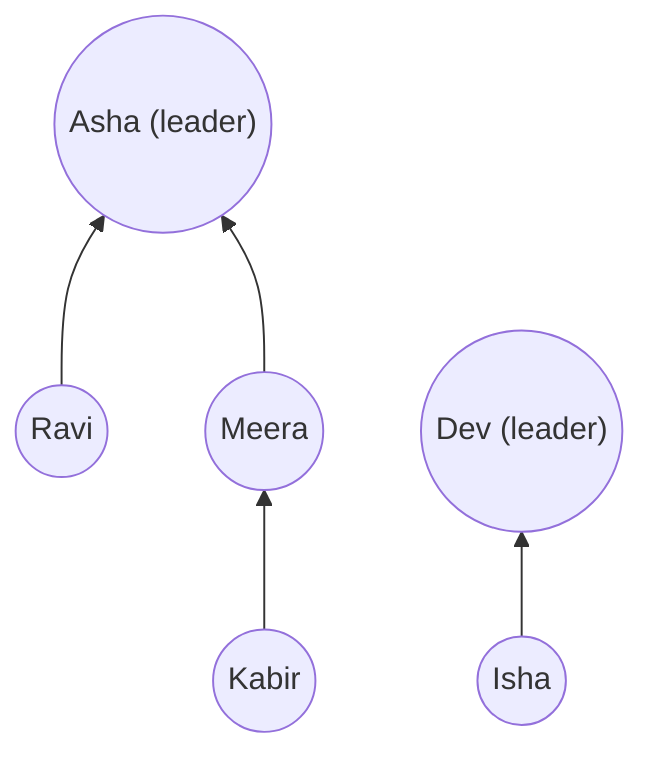

# Chapter 18 · Union-Find (Disjoint Set Union)

> At a wedding, guests arrive in little groups. Every time two people discover they're related ("Your mother's cousin is my uncle!"), their two family groups merge into one. Halfway through, someone asks: "Are Priya and Arjun from the same family?" Union-Find answers that in practically O(1), no matter how many merges have happened.

**You will learn:**
- What **disjoint sets** are, and the two operations: **find** and **union**
- The naive version, and the exact input that makes it slow
- **Union by rank/size** and **path compression**, with the intuition for why together they're nearly O(1) (the inverse Ackermann function)
- A clean, reusable **DSU template class**
- Classic problems: provinces, redundant connection, valid tree, accounts merge, islands II, equality equations, smallest string with swaps
- How DSU powers **Kruskal's MST**, and when DSU beats BFS/DFS (and when it doesn't)

**Before this:** [Hashing](05-hashing.md) · [Graphs I: BFS, DFS & Grids](16-graphs-bfs-dfs.md) · [Graphs II](17-graphs-advanced.md) (Kruskal)

---

## 🧠 The Big Idea

Imagine every group has a **leader**. Every person knows exactly one thing: who they report to. Leaders report to themselves.

- **find(x):** "Who's the leader of x's group?" Follow the chain of "who do you report to?" until you reach someone who reports to themselves.
- **union(x, y):** "Merge x's group and y's group." Find both leaders. If they differ, make one leader report to the other. Done: everyone in both groups now has the same ultimate leader.
- **Same group?** `find(x) == find(y)`.



Kabir → Meera → Asha: Kabir's leader is Asha. Isha's leader is Dev. Different leaders, different groups. Now `union(Kabir, Isha)`: leaders are Asha and Dev; point Dev at Asha. One arrow changed, and suddenly five people are in one family.

Notice what we **don't** store: the actual edges or who-met-whom. Only "who do you report to". That's why it's so fast, and also its limitation: Union-Find can tell you **whether** two things are connected, never **how**.

> 💡 **The core insight:** represent each group as a tree pointing **upward** to a root. Merging two groups = one pointer change. Checking membership = walk up to the root. Two tricks keep the trees so flat that walking up is practically instant.

---

## 🔨 Building It Up

### 1. Disjoint sets

**Disjoint sets** are groups that never overlap: every element belongs to exactly one set. At the start, each element is alone: `{0} {1} {2} {3} {4}`. Unions only ever **merge** sets; they never split.

We store it in one list: `parent[i]` = the element i reports to. A root has `parent[i] == i`.

```python
parent = list(range(5))          # everyone is their own leader
print(parent)

def find(x):
    while parent[x] != x:        # climb until we reach a root
        x = parent[x]
    return x

def union(x, y):
    rx, ry = find(x), find(y)
    if rx != ry:
        parent[rx] = ry          # x's leader now reports to y's leader

union(0, 1)
union(2, 3)
union(1, 3)
print(parent)
print(find(0), find(2), find(4))
print("0 and 2 together?", find(0) == find(2), "| 0 and 4?", find(0) == find(4))
```

```text
[0, 1, 2, 3, 4]
[1, 3, 3, 3, 4]
3 3 4
0 and 2 together? True | 0 and 4? False
```

What just happened: after `union(0, 1)`, 0 points to 1. After `union(2, 3)`, 2 points to 3. `union(1, 3)` finds leaders 1 and 3 and points 1 at 3. Now 0 → 1 → 3 and 2 → 3: one group {0, 1, 2, 3} with leader 3, and {4} alone.

### 2. The problem with the naive version

`find` costs as much as the **height** of the tree. With unlucky unions, the tree becomes a long chain:

```python
n = 10
parent = list(range(n))

def find(x):
    steps = 0
    while parent[x] != x:
        x = parent[x]
        steps += 1
    return x, steps

def union(x, y):
    rx, _ = find(x)
    ry, _ = find(y)
    if rx != ry:
        parent[rx] = ry

for i in range(n - 1):
    union(i, i + 1)              # 0 -> 1 -> 2 -> ... -> 9: a chain
print(parent)
print(find(0))                   # (leader, steps taken)
```

```text
[1, 2, 3, 4, 5, 6, 7, 8, 9, 9]
(9, 9)
```

With a million elements, one `find` could take a million steps, and m operations cost O(m·n). That's no better than running BFS every time. Two fixes, each simple, together magical.

### 3. Fix #1: union by size (or rank)

When merging, attach the **smaller** tree under the **larger** one's root. Then a tall-ish tree never gets pushed down under a tiny one.

```python
n = 10
parent = list(range(n))
size = [1] * n

def find(x):
    steps = 0
    while parent[x] != x:
        x = parent[x]
        steps += 1
    return x, steps

def union(x, y):
    rx, _ = find(x)
    ry, _ = find(y)
    if rx == ry:
        return
    if size[rx] < size[ry]:
        rx, ry = ry, rx              # make rx the bigger tree
    parent[ry] = rx                  # small tree goes under big tree
    size[rx] += size[ry]

for i in range(n - 1):
    union(i, i + 1)                  # the same "evil" sequence as before
print(parent)
print(max(find(i)[1] for i in range(n)))     # the deepest find
```

```text
[0, 0, 0, 0, 0, 0, 0, 0, 0, 0]
1
```

What just happened: each time, the growing group {0, 1, ..., i} was bigger than the lone `i + 1`, so `i + 1` was attached directly under root 0. Every find is now 1 step.

**Why the height is always ≤ log₂ n:** a node only gets deeper when its tree is attached under a tree **at least as big**. So every time a node's depth grows by 1, the size of its group at least **doubles**. You can't double more than log₂ n times before exceeding n. So with union by size, find is **O(log n) worst case**.

**Union by rank** is the same idea using an upper bound on height ("rank") instead of size: attach the lower-rank root under the higher-rank root; if equal, pick one and increase its rank by 1. Both give the same guarantees. Size is handier because you often need group sizes anyway ("largest group", "max area").

### 4. Fix #2: path compression

While walking up to the root in `find`, make the nodes you passed point **directly at the root** (or closer to it). You did the work of finding the leader; cache it so the next find is instant.

```python
parent = [1, 2, 3, 4, 4]           # a chain: 0 -> 1 -> 2 -> 3 -> 4

def find_recursive(x):             # full compression: everyone on the path -> root
    if parent[x] != x:
        parent[x] = find_recursive(parent[x])
    return parent[x]

print(find_recursive(0), parent)

parent = [1, 2, 3, 4, 4]
def find_halving(x):               # path halving: iterative, no recursion
    while parent[x] != x:
        parent[x] = parent[parent[x]]   # skip a level: point to grandparent
        x = parent[x]
    return x

print(find_halving(0), parent)
print(find_halving(0), parent)     # a second find flattens it more
```

```text
4 [4, 4, 4, 4, 4]
4 [2, 2, 4, 4, 4]
4 [4, 2, 4, 4, 4]
```

What just happened: the recursive version flattened the whole path in one go. **Path halving** makes every node on the path point to its grandparent, halving the path length each time; it needs no recursion (safe for huge inputs) and has the same amortised guarantee. Either is fine; we'll use halving in the template.

### 5. Both together: nearly constant time

With **union by rank/size + path compression**, any sequence of m operations on n elements costs **O(m · α(n))**, where α is the **inverse Ackermann function**. α grows so absurdly slowly that α(n) ≤ 4 for any n you could ever store (the number of atoms in the universe is far, far below the point where it reaches 5). So in practice: **O(1) amortised per operation**.

| Version | find (worst / amortised) |
|---|---|
| Naive | O(n) |
| Union by size/rank only | O(log n) |
| Path compression only | O(log n) amortised |
| **Both** | **O(α(n)) amortised ≈ O(1)** |

### 6. The template

Memorise this class. Almost every DSU problem is this plus 5–10 lines.

```python
class DSU:
    def __init__(self, n):
        self.parent = list(range(n))
        self.size = [1] * n
        self.count = n                         # number of separate groups

    def find(self, x):
        while self.parent[x] != x:
            self.parent[x] = self.parent[self.parent[x]]   # path halving
            x = self.parent[x]
        return x

    def union(self, a, b):
        ra, rb = self.find(a), self.find(b)
        if ra == rb:
            return False                       # already together: tells you "this edge makes a cycle"
        if self.size[ra] < self.size[rb]:
            ra, rb = rb, ra
        self.parent[rb] = ra                   # smaller under bigger
        self.size[ra] += self.size[rb]
        self.count -= 1
        return True

    def connected(self, a, b):
        return self.find(a) == self.find(b)

d = DSU(6)
for a, b in [(0, 1), (2, 3), (1, 3), (4, 5)]:
    d.union(a, b)
    print(f"union({a},{b}) -> parent={d.parent} groups={d.count}")
print(d.connected(0, 2), d.connected(0, 4), d.size[d.find(0)])
print(d.union(0, 3))                           # already connected
```

```text
union(0,1) -> parent=[0, 0, 2, 3, 4, 5] groups=5
union(2,3) -> parent=[0, 0, 2, 2, 4, 5] groups=4
union(1,3) -> parent=[0, 0, 0, 2, 4, 5] groups=3
union(4,5) -> parent=[0, 0, 0, 2, 4, 4] groups=2
True False 4
False
```

Three details that pay off again and again:
- `union` **returns False** when the two were already connected. That single bit detects cycles (sections 8, 9).
- `count` tracks the number of components without any extra pass.
- `size[find(x)]` is the size of x's group.

**For arbitrary keys** (strings, coordinates), use dicts and create elements lazily:

```py
class DSUDict:
    def __init__(self):
        self.parent, self.size = {}, {}
    def find(self, x):
        if x not in self.parent:              # first time we see x: its own group
            self.parent[x], self.size[x] = x, 1
        while self.parent[x] != x:
            self.parent[x] = self.parent[self.parent[x]]
            x = self.parent[x]
        return x
    # union / connected: identical to DSU
```

### 7. Number of Provinces: counting groups

**Problem:** `isConnected[i][j] = 1` if cities i and j are directly connected. A province is a group of directly or indirectly connected cities. How many provinces?

```python
class DSU:
    def __init__(self, n):
        self.parent, self.size, self.count = list(range(n)), [1] * n, n
    def find(self, x):
        while self.parent[x] != x:
            self.parent[x] = self.parent[self.parent[x]]
            x = self.parent[x]
        return x
    def union(self, a, b):
        ra, rb = self.find(a), self.find(b)
        if ra == rb:
            return False
        if self.size[ra] < self.size[rb]:
            ra, rb = rb, ra
        self.parent[rb] = ra
        self.size[ra] += self.size[rb]
        self.count -= 1
        return True

def find_circle_num(is_connected):
    n = len(is_connected)
    dsu = DSU(n)
    for i in range(n):
        for j in range(i + 1, n):              # upper triangle: the matrix is symmetric
            if is_connected[i][j]:
                dsu.union(i, j)
    return dsu.count

print(find_circle_num([[1, 1, 0], [1, 1, 0], [0, 0, 1]]))
print(find_circle_num([[1, 0, 0], [0, 1, 0], [0, 0, 1]]))
```

```text
2
3
```

Start with n groups; every successful union merges two into one. O(n² · α(n)). (DFS from [Chapter 16](16-graphs-bfs-dfs.md) also solves it in O(n²).)

### 8. Redundant Connection: the edge that makes a cycle

**Problem:** a tree with n nodes plus **one extra edge** is given as an edge list. Return the edge that can be removed to make it a tree again (if several, the one that appears last).

**Idea:** add edges one by one. The first edge whose endpoints are **already connected** closes a cycle. Since there's exactly one extra edge, the first such edge is also the last edge of the cycle in input order, which is what's asked.

```python
class DSU:
    def __init__(self, n):
        self.parent, self.size = list(range(n)), [1] * n
    def find(self, x):
        while self.parent[x] != x:
            self.parent[x] = self.parent[self.parent[x]]
            x = self.parent[x]
        return x
    def union(self, a, b):
        ra, rb = self.find(a), self.find(b)
        if ra == rb:
            return False
        if self.size[ra] < self.size[rb]:
            ra, rb = rb, ra
        self.parent[rb] = ra
        self.size[ra] += self.size[rb]
        return True

def find_redundant_connection(edges):
    dsu = DSU(len(edges) + 1)                   # nodes are 1..n
    for u, v in edges:
        if not dsu.union(u, v):
            return [u, v]

print(find_redundant_connection([[1, 2], [1, 3], [2, 3]]))
print(find_redundant_connection([[1, 2], [2, 3], [3, 4], [1, 4], [1, 5]]))
```

```text
[2, 3]
[1, 4]
```

**Dry run** for the second input:

| edge | find(u), find(v) | same? | action |
|---|---|---|---|
| [1, 2] | 1, 2 | no | union → {1,2} |
| [2, 3] | 1, 3 | no | union → {1,2,3} |
| [3, 4] | 1, 4 | no | union → {1,2,3,4} |
| [1, 4] | 1, 1 | **yes** | **cycle! answer [1, 4]** |

O(n · α(n)).

### 9. Graph Valid Tree

**Problem:** n nodes and an edge list. Is it a valid tree?

A graph is a tree exactly when it is **connected** and has **no cycle**. Equivalent and easier to check: **exactly n − 1 edges and no cycle** (n − 1 edges with no cycle forces connectivity).

```python
class DSU:
    def __init__(self, n):
        self.parent, self.size = list(range(n)), [1] * n
    def find(self, x):
        while self.parent[x] != x:
            self.parent[x] = self.parent[self.parent[x]]
            x = self.parent[x]
        return x
    def union(self, a, b):
        ra, rb = self.find(a), self.find(b)
        if ra == rb:
            return False
        if self.size[ra] < self.size[rb]:
            ra, rb = rb, ra
        self.parent[rb] = ra
        self.size[ra] += self.size[rb]
        return True

def valid_tree(n, edges):
    if len(edges) != n - 1:
        return False                        # too few: disconnected; too many: a cycle
    dsu = DSU(n)
    return all(dsu.union(u, v) for u, v in edges)

print(valid_tree(5, [[0, 1], [0, 2], [0, 3], [1, 4]]))
print(valid_tree(5, [[0, 1], [1, 2], [2, 3], [1, 3], [1, 4]]))
print(valid_tree(4, [[0, 1], [2, 3]]))
```

```text
True
False
False
```

### 10. Accounts Merge: union by shared items

**Problem:** each account is `[name, email1, email2, ...]`. Two accounts belong to the same person if they share **any** email. Merge them; output each person's emails sorted.

**Idea:** union **accounts** (by index) whenever they share an email. A dict `email → first account index that had it` detects the sharing.

```python
class DSU:
    def __init__(self, n):
        self.parent, self.size = list(range(n)), [1] * n
    def find(self, x):
        while self.parent[x] != x:
            self.parent[x] = self.parent[self.parent[x]]
            x = self.parent[x]
        return x
    def union(self, a, b):
        ra, rb = self.find(a), self.find(b)
        if ra == rb:
            return False
        if self.size[ra] < self.size[rb]:
            ra, rb = rb, ra
        self.parent[rb] = ra
        self.size[ra] += self.size[rb]
        return True

def accounts_merge(accounts):
    dsu = DSU(len(accounts))
    owner = {}                                     # email -> an account index
    for i, (_, *emails) in enumerate(accounts):
        for email in emails:
            if email in owner:
                dsu.union(i, owner[email])         # shared email: same person
            else:
                owner[email] = i
    groups = {}                                    # root account -> set of emails
    for email, i in owner.items():
        groups.setdefault(dsu.find(i), set()).add(email)
    return sorted([accounts[root][0]] + sorted(emails) for root, emails in groups.items())

accounts = [["John", "johnsmith@mail.com", "john_newyork@mail.com"],
            ["John", "johnsmith@mail.com", "john00@mail.com"],
            ["Mary", "mary@mail.com"],
            ["John", "johnnybravo@mail.com"]]
for acc in accounts_merge(accounts):
    print(acc)
```

```text
['John', 'john00@mail.com', 'john_newyork@mail.com', 'johnsmith@mail.com']
['John', 'johnnybravo@mail.com']
['Mary', 'mary@mail.com']
```

What just happened: accounts 0 and 1 share `johnsmith@mail.com`, so they merged. Account 3 is a different John: same name, no shared email. (Names are **not** identities!) O(N·α + N log N) for N total emails, the sorting dominates.

### 11. Number of Islands II: the online version

**Problem:** an m × n grid starts as all water. Land is added one cell at a time. After each addition, report the number of islands.

Rerunning BFS after every addition costs O(m·n) each time. DSU handles each addition in ~O(1): the new cell is a new island (`count += 1`); then union it with each land neighbour (each successful union does `count -= 1`).

```python
def num_islands2(m, n, positions):
    parent, size = {}, {}
    count = 0
    result = []

    def find(x):
        while parent[x] != x:
            parent[x] = parent[parent[x]]
            x = parent[x]
        return x

    for r, c in positions:
        if (r, c) in parent:                   # already land: nothing changes
            result.append(count)
            continue
        parent[(r, c)], size[(r, c)] = (r, c), 1
        count += 1                             # a brand-new island...
        for dr, dc in ((-1, 0), (1, 0), (0, -1), (0, 1)):
            nb = (r + dr, c + dc)
            if nb in parent:                   # ...that may merge with neighbours
                ra, rb = find((r, c)), find(nb)
                if ra != rb:
                    if size[ra] < size[rb]:
                        ra, rb = rb, ra
                    parent[rb] = ra
                    size[ra] += size[rb]
                    count -= 1
        result.append(count)
    return result

print(num_islands2(3, 3, [[0, 0], [0, 1], [1, 2], [2, 1], [1, 1]]))
```

```text
[1, 1, 2, 3, 1]
```

The last cell (1, 1) touches three separate islands and fuses them all: 3 + 1 − 3 = 1. O(k · α) for k additions. This "things only ever get merged, and I need answers after each step" shape is DSU's home turf.

### 12. Satisfiability of Equality Equations

**Problem:** equations like `"a==b"` and `"b!=c"` over single letters. Can all be true at once?

**Idea:** two passes. First, union every `==` pair (equalities are transitive: groups). Then check every `!=` pair: if both sides are in the same group, contradiction.

```python
def equations_possible(equations):
    parent = list(range(26))

    def find(x):
        while parent[x] != x:
            parent[x] = parent[parent[x]]
            x = parent[x]
        return x

    for eq in equations:
        if eq[1] == "=":                              # "a==b"
            parent[find(ord(eq[0]) - 97)] = find(ord(eq[3]) - 97)
    for eq in equations:
        if eq[1] == "!" and find(ord(eq[0]) - 97) == find(ord(eq[3]) - 97):
            return False
    return True

print(equations_possible(["a==b", "b!=a"]), equations_possible(["b==a", "a==b"]))
print(equations_possible(["a==b", "b==c", "a==c"]), equations_possible(["a==b", "b!=c", "c==a"]))
```

```text
False True
True False
```

(With only 26 elements, skipping union-by-size is harmless.) The **order** matters: process all `==` before any `!=`, because a later equality could connect two letters an earlier `!=` mentioned.

### 13. Smallest String With Swaps

**Problem:** you may swap characters at index pairs `pairs[i] = [a, b]` any number of times. Return the lexicographically smallest string possible.

**Idea:** swaps are transitive. If you can swap 0↔3 and 3↔2, you can arrange the characters at {0, 2, 3} in **any** order. So: group indices with DSU, then within each group, sort the characters and place them into the sorted indices.

```python
from collections import defaultdict

def smallest_string_with_swaps(s, pairs):
    n = len(s)
    parent = list(range(n))

    def find(x):
        while parent[x] != x:
            parent[x] = parent[parent[x]]
            x = parent[x]
        return x

    for a, b in pairs:
        parent[find(a)] = find(b)
    groups = defaultdict(list)
    for i in range(n):
        groups[find(i)].append(i)              # indices come out already sorted
    result = list(s)
    for indices in groups.values():
        chars = sorted(s[i] for i in indices)
        for i, ch in zip(indices, chars):      # smallest char -> smallest index
            result[i] = ch
    return "".join(result)

print(smallest_string_with_swaps("dcab", [[0, 3], [1, 2]]))
print(smallest_string_with_swaps("dcab", [[0, 3], [1, 2], [0, 2]]))
print(smallest_string_with_swaps("cba", [[0, 1], [1, 2]]))
```

```text
bacd
abcd
abc
```

O(n log n). The insight to say aloud: "Any permutation is achievable within a connected component of swap pairs, because adjacent swaps generate all permutations."

### 14. Kruskal's MST: DSU's most famous job

In [Chapter 17](17-graphs-advanced.md), Kruskal's algorithm sorted edges by weight and added each edge **unless it would form a cycle**. "Would it form a cycle?" = "are its endpoints already connected?" = `not dsu.union(u, v)`. That's the whole connection:

```py
dsu = DSU(n)
total = 0
for w, u, v in sorted(edges):
    if dsu.union(u, v):          # True only when u and v were in different trees
        total += w
```

Without DSU, each cycle check would need a BFS: O(E · (V + E)) instead of O(E log E).

---

## 🔬 Under the Hood

### Why union by size gives O(log n) height (the doubling argument)

Take any element x. Its depth increases by 1 only when the root of x's tree is attached under another root. With union by size, that happens only if the other tree is **at least as large**, so the merged tree containing x is **at least twice** the size of x's old tree. Sizes can't exceed n, so this happens at most log₂ n times. Hence depth ≤ log₂ n.

### Why path compression helps so much

Path compression alone makes any long path pay once: after a find, every node on the path is much closer to the root, and future finds through them are cheap. The total cost over m operations is O(m log n) amortised even without union by size.

Combined with union by rank, Tarjan (1975) proved O(m · α(n)) total, and later work showed this bound is **tight**: no union-find structure can do asymptotically better in the worst case. You don't need the proof for interviews; you need this sentence: *"With path compression and union by rank, the amortised cost per operation is O(α(n)), the inverse Ackermann function, which is at most 4 for any realistic n, so it's effectively constant."*

### What α(n) looks like

The Ackermann function A(k) explodes: A(1) = 3, A(2) = 7, A(3) = 61, A(4) is a tower of 2s about 65,536 levels high. α(n) is the smallest k with A(k) ≥ n (roughly; definitions vary slightly). So:

| n | α(n) |
|---|---|
| up to 3 | ≤ 1 |
| up to 7 | ≤ 2 |
| up to 61 | ≤ 3 |
| up to an unimaginably huge number | ≤ 4 |

### Rank vs size

- **Rank** = an upper bound on tree height. It isn't updated by path compression (heights shrink, ranks don't), which is fine; it's still a valid bound.
- **Size** = number of elements. Always exact, useful for "largest group" questions.
Both give identical complexity. Use size.

### What DSU can't do

- **Split / delete** a union. There's no efficient "un-union" (pointers from many nodes may lead through the link). If edges are removed over time, a common trick is to process events **in reverse** (removals become additions). Advanced variants (DSU with rollback, used in offline algorithms) undo the most recent unions, but only in stack order and without path compression.
- **Paths:** DSU knows "same group?", not "how?" or "how far?".
- **Directed reachability:** "a can reach b" isn't symmetric; DSU only models symmetric, transitive relations (equivalence relations).

### Memory

Two integer lists of length n: O(n). Tiny compared with an adjacency list's O(V + E). DSU never stores the edges at all, which is why it suits streams of edges you can't keep.

---

## 🧩 Pattern Decoder

### Signals

| You see in the problem... | Think |
|---|---|
| "number of connected components / groups / provinces / friend circles" | DSU `count` (or DFS) |
| "is it a valid tree?", "find the redundant edge", "detect cycle in undirected graph" | `union` returns False ⇒ cycle |
| "merge accounts / groups that share X" | union items that share X (map X → first owner) |
| "elements added one by one; after each step report groups/islands" | **DSU (online)**, BFS would redo work |
| "a == b", "a is similar to b", "can be swapped" (**transitive**, **symmetric** relations) | DSU over equivalence classes |
| "minimum cost to connect everything" | Kruskal = sort edges + DSU |
| "earliest time when everyone is connected" | sort events by time, union until `count == 1` |
| "minimise the maximum edge on a path" / "can reach with threshold t" | sort edges by weight, union until start ~ end |
| "ratios a/b = k, query x/y" | **weighted DSU** (see Evaluate Division) |

### Template

```py
class DSU:
    def __init__(self, n):
        self.parent = list(range(n)); self.size = [1] * n; self.count = n
    def find(self, x):
        while self.parent[x] != x:
            self.parent[x] = self.parent[self.parent[x]]   # path halving
            x = self.parent[x]
        return x
    def union(self, a, b):
        ra, rb = self.find(a), self.find(b)
        if ra == rb: return False                          # already connected (cycle!)
        if self.size[ra] < self.size[rb]: ra, rb = rb, ra
        self.parent[rb] = ra; self.size[ra] += self.size[rb]; self.count -= 1
        return True
```

How to use it, in three questions:
1. **What are the elements?** (nodes, cells `r*cols + c`, letters, accounts, stones' rows/cols)
2. **What causes a union?** (an edge, sharing an email, an `==`, a swap pair)
3. **What's the answer made of?** (`count`, a failed union, sizes, group contents)

### Variation: Number of Operations to Make Network Connected

**Problem:** n computers, cable connections. You may move a cable from anywhere to anywhere. Minimum moves to connect all computers, or −1.

**Idea:** you need at least n − 1 cables (else −1). Each **redundant** cable (a failed union) is a spare. To join `count` components you need `count − 1` moves, and you're guaranteed enough spares when cables ≥ n − 1.

```python
class DSU:
    def __init__(self, n):
        self.parent, self.size, self.count = list(range(n)), [1] * n, n
    def find(self, x):
        while self.parent[x] != x:
            self.parent[x] = self.parent[self.parent[x]]
            x = self.parent[x]
        return x
    def union(self, a, b):
        ra, rb = self.find(a), self.find(b)
        if ra == rb:
            return False
        if self.size[ra] < self.size[rb]:
            ra, rb = rb, ra
        self.parent[rb] = ra
        self.size[ra] += self.size[rb]
        self.count -= 1
        return True

def make_connected(n, connections):
    if len(connections) < n - 1:
        return -1
    dsu = DSU(n)
    for a, b in connections:
        dsu.union(a, b)
    return dsu.count - 1

print(make_connected(4, [[0, 1], [0, 2], [1, 2]]))
print(make_connected(6, [[0, 1], [0, 2], [0, 3], [1, 2], [1, 3]]))
print(make_connected(6, [[0, 1], [0, 2], [0, 3], [1, 2]]))
```

```text
1
2
-1
```

### Variation: Most Stones Removed with Same Row or Column

**Problem:** stones on a grid; you can remove a stone if another stone shares its row or column. Maximum removable?

**Idea:** stones sharing a row/column form groups; each group can be reduced to **one** stone. Answer = stones − groups. The clever modelling: union the stone's **row** with its **column** (treat rows and columns as elements; offset columns so they don't clash with rows, e.g. `~c` or `c + 10001`).

```python
def remove_stones(stones):
    parent = {}

    def find(x):
        parent.setdefault(x, x)
        while parent[x] != x:
            parent[x] = parent[parent[x]]
            x = parent[x]
        return x

    for r, c in stones:
        parent[find(r)] = find(~c)           # ~c = -c-1: columns live in negative numbers
    groups = len({find(x) for x in parent})
    return len(stones) - groups

print(remove_stones([[0, 0], [0, 1], [1, 0], [1, 2], [2, 1], [2, 2]]))
print(remove_stones([[0, 0], [0, 2], [1, 1], [2, 0], [2, 2]]))
```

```text
5
3
```

O(n · α). Modelling rows/columns as the elements avoids O(n²) stone-to-stone comparisons.

### Variation: Evaluate Division (weighted DSU)

**Problem:** `a / b = 2.0`, `b / c = 3.0`. Answer queries like `a / c` (6.0), `b / a` (0.5), unknown variable → −1.0.

**Idea:** each node stores `weight[x] = x / parent[x]`. Then `x / root` = product of weights along the path, and `find` can compress while multiplying. For a query `x / y` with the same root: `(x / root) / (y / root)`.

```python
def calc_equation(equations, values, queries):
    parent, weight = {}, {}                  # weight[x] = x / parent[x]

    def find(x):
        if parent[x] != x:
            root = find(parent[x])           # after this, weight[parent[x]] = parent[x] / root
            weight[x] *= weight[parent[x]]   # x/root = x/parent * parent/root
            parent[x] = root                 # path compression
        return parent[x]

    for (a, b), val in zip(equations, values):
        for v in (a, b):
            if v not in parent:
                parent[v], weight[v] = v, 1.0
        ra, rb = find(a), find(b)
        if ra != rb:
            parent[ra] = rb
            weight[ra] = val * weight[b] / weight[a]   # ra/rb = (a/b) * (b/rb) / (a/ra)

    out = []
    for x, y in queries:
        if x not in parent or y not in parent or find(x) != find(y):
            out.append(-1.0)
        else:
            out.append(weight[x] / weight[y])
    return out

print(calc_equation([["a", "b"], ["b", "c"]], [2.0, 3.0],
                    [["a", "c"], ["b", "a"], ["a", "e"], ["a", "a"], ["x", "x"]]))
```

```text
[6.0, 0.5, -1.0, 1.0, -1.0]
```

(Recursive find is fine here: inputs are small. A BFS/DFS over a graph with edge weights `a→b: 2`, `b→a: 0.5` is the other standard solution.)

### Variation: "earliest moment everyone is connected"

**Problem (The Earliest Moment When Everyone Become Friends):** logs `[time, a, b]` mean a and b became friends at `time`. When were all n people first connected?

**Idea:** sort logs by time, union, and return the time at which `count` hits 1.

```python
def earliest_acq(logs, n):
    parent = list(range(n))
    count = n

    def find(x):
        while parent[x] != x:
            parent[x] = parent[parent[x]]
            x = parent[x]
        return x

    for t, a, b in sorted(logs):
        ra, rb = find(a), find(b)
        if ra != rb:
            parent[ra] = rb
            count -= 1
            if count == 1:
                return t
    return -1

logs = [[20190101, 0, 1], [20190104, 3, 4], [20190107, 2, 3], [20190211, 1, 5],
        [20190224, 2, 4], [20190301, 0, 3], [20190312, 1, 2], [20190322, 4, 5]]
print(earliest_acq(logs, 6))
```

```text
20190301
```

### When DSU beats BFS/DFS (and when it doesn't)

| Situation | Better choice | Why |
|---|---|---|
| Edges arrive over time, query connectivity after each | **DSU** | BFS would redo O(V + E) work per query |
| Many "same group?" queries on a fixed graph | **DSU** (or one BFS labelling components) | near-O(1) per query |
| You can't store all edges (streaming) | **DSU** | stores only O(V) |
| Kruskal / "sort edges, add until connected" | **DSU** | cycle check in ~O(1) |
| Equivalence relations (==, similar, swappable) | **DSU** | models transitivity directly |
| Need the **path** or **shortest distance** | BFS / Dijkstra | DSU forgets how things connect |
| **Directed** graphs, cycles in directed graphs | DFS colours / Kahn | DSU is for symmetric relations |
| Edges get **deleted** | BFS/DFS (or offline reverse trick) | DSU can't split |
| Grid problems answered once (one Number of Islands) | either; DFS is shorter | no repeated queries to amortise |

---

## ⚠️ Traps & Common Mistakes

1. **Comparing elements instead of roots.**

```py
# ❌ wrong: x and y may be in the same set without pointing at each other
if parent[x] == parent[y]: ...

# ✅ right: compare their roots
if find(x) == find(y): ...
```

2. **Linking the elements instead of the roots.** `parent[a] = b` throws away a's old link and can break groups. Always `parent[find(a)] = find(b)`.
3. **Reading `parent[x]` as "the leader" after unions.** Without compression on that exact path, `parent[x]` may be an intermediate node. Always call `find(x)` when you need the group, e.g. when grouping indices at the end.
4. **Forgetting to initialise dict-based DSU entries** (KeyError). Use `setdefault` or a lazy check in `find`.
5. **Off-by-one with 1-indexed nodes.** Problems like Redundant Connection use nodes 1..n: create `DSU(n + 1)`.
6. **Recursive find on long chains** before compression → `RecursionError` on 10⁵ elements. Use the iterative halving version.
7. **Processing `!=` before all `==`** in equation problems. Do all unions first, then all checks.
8. **Updating size/rank of the wrong root** (adding to `size[rb]` after attaching rb under ra).
9. **Trying to use DSU for directed cycles.** `0 → 1, 1 → 2, 0 → 2` has no directed cycle, but DSU would flag the third edge.

---

## 💡 Tips & Tricks

- `union` returning a boolean is the single most useful line: "already connected" is the cycle detector, the redundant-edge finder and the spare-cable counter.
- Keep a `count` field; many answers are just `dsu.count` or `dsu.count - 1`.
- **Grid cells → integers:** `index = r * cols + c`. Add one extra virtual node (e.g. index `rows * cols`) to represent "the border" or "the ocean" and union border cells with it (Surrounded Regions via DSU).
- **Rows and columns as nodes** (Most Stones) and **letters as nodes** (equations, smallest equivalent string) turn O(n²) comparisons into O(n).
- For "minimise the maximum edge" or "earliest time", **sort edges/events** first, then union until the condition holds.
- If deletions appear, ask: "can I process the events backwards?"
- In interviews, write the DSU class first (90 seconds), then the problem logic. It shows structure and avoids bugs.

---

## 🎯 Interview Questions

### 1. Number of Provinces 🔥🔥🔥

<details><summary>Answer</summary>

DSU over n cities, union every `isConnected[i][j] == 1` pair (upper triangle), answer `count` (section 7). O(n² α(n)). DFS is equally good; mention both.

</details>

### 2. Redundant Connection 🔥🔥

<details><summary>Answer</summary>

Add edges in order; the first edge whose `union` fails is the answer (section 8). O(n α(n)). Follow-up **Redundant Connection II** (directed, one node may have two parents) is harder: check for a node with two parents, then try removing each candidate.

</details>

### 3. Graph Valid Tree 🔥🔥

<details><summary>Answer</summary>

`len(edges) == n - 1` and every union succeeds (section 9). O(n α(n)). Alternative: BFS/DFS checks that all n nodes are reached and there are n − 1 edges.

</details>

### 4. Accounts Merge 🔥🔥🔥

<details><summary>Answer</summary>

Union accounts that share an email (map email → first account index), then group emails by root and sort (section 10). O(N α + N log N). Say explicitly: "Same name doesn't mean same person; only a shared email does."

</details>

### 5. Number of Islands II 🔥

<details><summary>Answer</summary>

Online DSU over cells: each new land cell adds an island, each successful union with a land neighbour removes one (section 11). O(k α) for k positions, versus O(k·m·n) for repeated BFS. Handle duplicate positions.

</details>

### 6. Satisfiability of Equality Equations 🔥🔥

<details><summary>Answer</summary>

Union all `==` pairs first, then fail if any `!=` pair shares a root (section 12). O(n) with 26 elements.

</details>

### 7. Smallest String With Swaps 🔥🔥

<details><summary>Answer</summary>

Group indices by DSU, sort characters within each group, put them back in sorted index order (section 13). O(n log n).

</details>

### 8. Number of Operations to Make Network Connected 🔥🔥

<details><summary>Answer</summary>

If cables < n − 1 → −1; else answer = components − 1 (Pattern Decoder). O((n + E) α).

</details>

### 9. Most Stones Removed with Same Row or Column 🔥🔥

<details><summary>Answer</summary>

Union each stone's row with its (offset) column; answer = stones − number of groups (Pattern Decoder). O(n α).

</details>

### 10. Evaluate Division 🔥🔥

<details><summary>Answer</summary>

Weighted DSU where `weight[x] = x / parent[x]`, multiplied during path compression (Pattern Decoder). Queries: different roots or unknown variable → −1.0; else `weight[x] / weight[y]`. Alternatively BFS on a graph with reciprocal edge weights, O(Q·(V + E)).

</details>

### 11. Longest Consecutive Sequence 🔥🔥🔥

Given an unsorted array, the length of the longest run of consecutive integers, in O(n).

<details><summary>Answer</summary>

The standard answer is a hash set: start counting only from numbers whose `x − 1` is absent ([Chapter 05](05-hashing.md)). The DSU answer: union `x` with `x + 1` whenever both are present; the answer is the largest group size.

```python
def longest_consecutive(nums):
    parent, size = {}, {}

    def find(x):
        while parent[x] != x:
            parent[x] = parent[parent[x]]
            x = parent[x]
        return x

    for x in set(nums):
        parent[x], size[x] = x, 1
    for x in parent:
        if x + 1 in parent:
            ra, rb = find(x), find(x + 1)
            if ra != rb:
                if size[ra] < size[rb]:
                    ra, rb = rb, ra
                parent[rb] = ra
                size[ra] += size[rb]
    return max(size[find(x)] for x in parent) if parent else 0

print(longest_consecutive([100, 4, 200, 1, 3, 2]), longest_consecutive([0, 3, 7, 2, 5, 8, 4, 6, 0, 1]))
```

```text
4 9
```

O(n α(n)).

</details>

### 12. Why is union-find "almost O(1)"? 🔥🔥 (conceptual)

<details><summary>Answer</summary>

Union by size keeps trees at height ≤ log n (a node gets deeper only when its group at least doubles). Path compression flattens every path it walks. Together, m operations cost O(m · α(n)) (Tarjan), where α is the inverse Ackermann function, ≤ 4 for any practical n. So each operation is effectively constant time, amortised.

</details>

---

## 🏋️ Practice

**🟢 1. Find if Path Exists in Graph** using DSU.

<details><summary>Solution</summary>

```python
def valid_path(n, edges, source, destination):
    parent = list(range(n))

    def find(x):
        while parent[x] != x:
            parent[x] = parent[parent[x]]
            x = parent[x]
        return x

    for u, v in edges:
        parent[find(u)] = find(v)
    return find(source) == find(destination)

print(valid_path(3, [[0, 1], [1, 2], [2, 0]], 0, 2))
print(valid_path(6, [[0, 1], [0, 2], [3, 5], [5, 4], [4, 3]], 0, 5))
```

```text
True
False
```

</details>

**🟢 2. Size of the largest group:** given n people and friend pairs, return the size of the biggest friend circle.

<details><summary>Solution</summary>

```python
def largest_group(n, pairs):
    parent, size = list(range(n)), [1] * n

    def find(x):
        while parent[x] != x:
            parent[x] = parent[parent[x]]
            x = parent[x]
        return x

    for a, b in pairs:
        ra, rb = find(a), find(b)
        if ra != rb:
            if size[ra] < size[rb]:
                ra, rb = rb, ra
            parent[rb] = ra
            size[ra] += size[rb]
    return max(size[find(i)] for i in range(n))

print(largest_group(7, [(0, 1), (1, 2), (3, 4), (5, 6), (6, 4)]))
```

```text
4
```

</details>

**🟡 3. Lexicographically Smallest Equivalent String.** `s1[i]` and `s2[i]` are equivalent (equivalence is transitive). Replace each letter of `baseStr` with the smallest equivalent letter.

<details><summary>Solution</summary>

Union letters, always making the **smaller** letter the root.

```python
def smallest_equivalent_string(s1, s2, base):
    parent = list(range(26))

    def find(x):
        while parent[x] != x:
            parent[x] = parent[parent[x]]
            x = parent[x]
        return x

    for a, b in zip(s1, s2):
        ra, rb = find(ord(a) - 97), find(ord(b) - 97)
        if ra != rb:
            parent[max(ra, rb)] = min(ra, rb)      # smaller letter becomes the root
    return "".join(chr(find(ord(ch) - 97) + 97) for ch in base)

print(smallest_equivalent_string("parker", "morris", "parser"))
print(smallest_equivalent_string("hello", "world", "hold"))
```

```text
makkek
hdld
```

</details>

**🟡 4. Similar String Groups.** Two strings (anagrams of each other) are similar if equal or if swapping two letters of one gives the other. How many groups?

<details><summary>Solution</summary>

Union every similar pair: O(n² · L).

```python
def num_similar_groups(strs):
    n = len(strs)
    parent = list(range(n))
    count = n

    def find(x):
        while parent[x] != x:
            parent[x] = parent[parent[x]]
            x = parent[x]
        return x

    def similar(a, b):
        diff = [i for i in range(len(a)) if a[i] != b[i]]
        return len(diff) == 0 or (len(diff) == 2 and a[diff[0]] == b[diff[1]] and a[diff[1]] == b[diff[0]])

    for i in range(n):
        for j in range(i + 1, n):
            if similar(strs[i], strs[j]):
                ri, rj = find(i), find(j)
                if ri != rj:
                    parent[ri] = rj
                    count -= 1
    return count

print(num_similar_groups(["tars", "rats", "arts", "star"]), num_similar_groups(["omv", "ovm"]))
```

```text
2 1
```

</details>

**🔴 5. Regions Cut By Slashes.** An n × n grid of `' '`, `'/'`, `'\'`. Count regions.

<details><summary>Solution</summary>

Split each cell into 4 triangles (top 0, right 1, bottom 2, left 3). `'/'` joins top+left and right+bottom; `'\'` joins top+right and bottom+left; `' '` joins all four. Then join each cell's right triangle with the right neighbour's left, and bottom with the lower neighbour's top. Answer = number of groups.

```python
def regions_by_slashes(grid):
    n = len(grid)
    parent = list(range(4 * n * n))
    count = 4 * n * n

    def find(x):
        while parent[x] != x:
            parent[x] = parent[parent[x]]
            x = parent[x]
        return x

    def union(a, b):
        nonlocal count
        ra, rb = find(a), find(b)
        if ra != rb:
            parent[ra] = rb
            count -= 1

    for r in range(n):
        for c in range(n):
            base = 4 * (r * n + c)
            ch = grid[r][c]
            if ch == "/":
                union(base + 0, base + 3); union(base + 1, base + 2)
            elif ch == "\\":
                union(base + 0, base + 1); union(base + 2, base + 3)
            else:
                union(base + 0, base + 1); union(base + 1, base + 2); union(base + 2, base + 3)
            if c + 1 < n:
                union(base + 1, 4 * (r * n + c + 1) + 3)     # my right ~ neighbour's left
            if r + 1 < n:
                union(base + 2, 4 * ((r + 1) * n + c) + 0)   # my bottom ~ lower's top
    return count

print(regions_by_slashes([" /", "/ "]), regions_by_slashes([" /", "  "]), regions_by_slashes(["/\\", "\\/"]))
```

```text
2 1 5
```

O(n² α).

</details>

**🔴 6. Remove Max Number of Edges to Keep Graph Fully Traversable.** Edge types: 1 = Alice only, 2 = Bob only, 3 = both. Remove as many edges as possible while both can still reach every node; −1 if impossible.

<details><summary>Solution</summary>

Greedy with two DSUs: add type-3 edges first (they serve both), then type 1 to Alice's DSU, type 2 to Bob's. Every edge whose union fails is removable.

```python
class DSU:
    def __init__(self, n):
        self.parent, self.count = list(range(n + 1)), n
    def find(self, x):
        while self.parent[x] != x:
            self.parent[x] = self.parent[self.parent[x]]
            x = self.parent[x]
        return x
    def union(self, a, b):
        ra, rb = self.find(a), self.find(b)
        if ra == rb:
            return False
        self.parent[ra] = rb
        self.count -= 1
        return True

def max_num_edges_to_remove(n, edges):
    alice, bob = DSU(n), DSU(n)
    used = 0
    for t, u, v in edges:
        if t == 3:
            a, b = alice.union(u, v), bob.union(u, v)
            used += a or b                     # useful if it helped either
    for t, u, v in edges:
        if t == 1:
            used += alice.union(u, v)
        elif t == 2:
            used += bob.union(u, v)
    if alice.count != 1 or bob.count != 1:
        return -1
    return len(edges) - used

print(max_num_edges_to_remove(4, [[3, 1, 2], [3, 2, 3], [1, 1, 3], [1, 2, 4], [1, 1, 2], [2, 3, 4]]))
print(max_num_edges_to_remove(4, [[3, 1, 2], [3, 2, 3], [1, 1, 4], [2, 1, 4]]))
print(max_num_edges_to_remove(4, [[3, 2, 3], [1, 1, 2], [2, 3, 4]]))
```

```text
2
0
-1
```

O(E α). (Type-3 edges are processed in both DSUs together, so in each DSU the same unions happen, and either both succeed or both fail; `a or b` is just defensive.)

</details>

---

## 🧠 Never-Forget Summary

- Union-Find keeps **disjoint groups** under **merging**. Each group is an upward tree; the **root** is the group's ID.
- **find(x):** climb to the root. **union(a, b):** link one root under the other. **connected:** compare roots.
- Naive trees can become chains → O(n) per find.
- **Union by size/rank:** small under big → height ≤ log₂ n (doubling argument).
- **Path compression / halving:** flatten as you climb.
- Both together: **O(α(n)) amortised ≈ O(1)**, α(n) ≤ 4 for any real input.
- `union` returning **False** = "already connected" = **cycle** / redundant edge / spare cable.
- Keep a **`count`** of groups: provinces, islands, "everyone connected?".
- Works for **symmetric, transitive** relations only; can't split, can't give paths, not for directed graphs.
- Kruskal = sort edges + DSU.

**Memory hook: "FIND THE BOSS, MERGE THE BOSSES"**
- Never link employees, always link **bosses** (roots).
- **Small team joins big team** (union by size).
- **Shortcut to the boss** after asking once (path compression).

**One picture:**

| Problem | Elements | Union when | Answer |
|---|---|---|---|
| Provinces / components | nodes | edge | `count` |
| Redundant connection / valid tree | nodes | edge | first failed union / all succeed + n−1 edges |
| Accounts merge | accounts | shared email | group emails by root |
| Islands II | cells | adjacent land | `count` after each add |
| Equality equations | letters | `==` | any `!=` within a group? |
| Smallest string with swaps | indices | swap pair | sort chars per group |
| Most stones | rows + columns | a stone at (r, c) | stones − groups |
| Kruskal MST | nodes | edge in weight order | total of successful unions |

> **If you remember only one thing:** when things only ever **merge** and you keep asking **"same group?"**, use Union-Find, and always link **roots**, small under big, compressing on the way up.

---
**Next:** [Chapter 19 · Tries](19-tries.md)  ·  **Back to** [Contents](../README.md)
