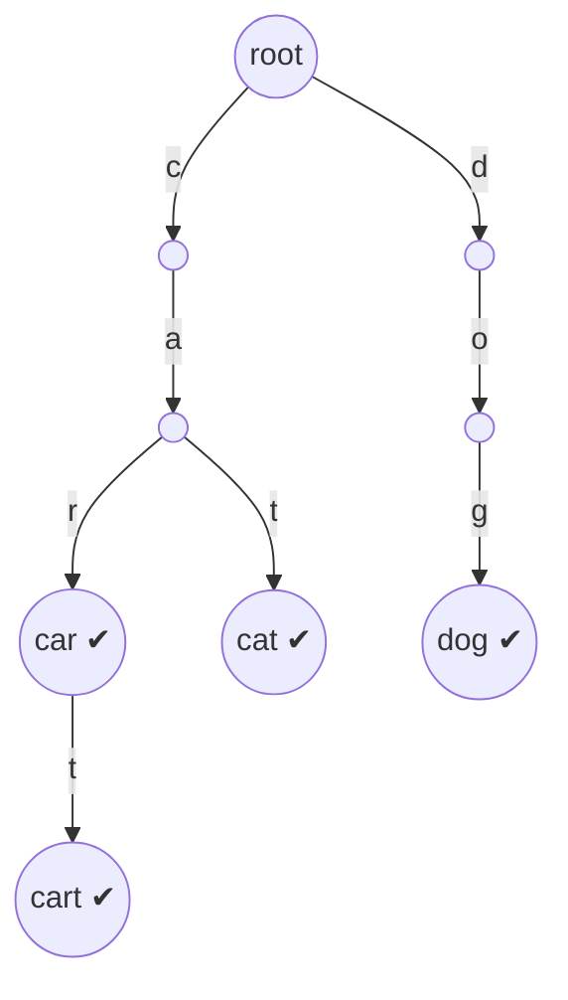

# Chapter 19 · Tries

> You type "pyt" into a search box and before your finger lifts, it suggests "python", "python tutorial", "pytorch". It didn't scan a billion search terms. It walked three steps down a tree where every word that starts with "pyt" lives in the same branch. That tree is a **trie**, and it's the data structure built for one job: **prefixes**.

**You will learn:**
- Why a hash set can't answer "which words start with...?" efficiently, and a trie can
- The trie node: **dict of children vs array of 26**, and the end-of-word flag
- Insert, search, startsWith, **delete**, and **count words with a prefix**, traced step by step
- Wildcard search (`.` matches any letter) and **Word Search II** (trie + grid backtracking)
- Longest common prefix, replace words, **autocomplete / search suggestions**
- The **bitwise trie** for **maximum XOR** problems
- Space/time trade-offs, and when a trie is overkill

**Before this:** [Strings](../part-1-python/04-strings.md) · [Dictionaries](../part-1-python/09-dictionaries.md) · [Backtracking](09-backtracking.md) · [Binary Trees](13-binary-trees.md) · [Graphs I](16-graphs-bfs-dfs.md) (grid DFS)

---

## 🧠 The Big Idea

Look at a printed dictionary. All words starting with "ca" sit together: cab, cake, car, card, care, cart, cat. Nobody writes "c-a" seven times on a tab; the shared start is the **path** to that section.

A **trie** (from re**trie**val; most people say "try" to avoid confusing it with "tree") stores words exactly like that: each **edge** is a letter, each **path from the root** spells a prefix, and words that share a prefix share the path. A flag on a node says "a complete word ends here".

Here's the trie for `car, cart, cat, dog`:



- **"car"** is a word: the node after c → a → r is marked ✔.
- **"ca"** is a prefix but not a word: the node exists, no ✔.
- **"cap"** isn't even a prefix: there's no `p` edge after "ca". We know that after 3 steps, whether the trie holds 4 words or 4 million.

> 💡 **The core insight:** in a trie, the cost of any lookup depends on the **length of the word** (L), not on **how many words** are stored (n). And every prefix question ("anything starting with X?", "all words under X", "how many under X?") becomes "walk to X, then look below".

---

## 🔨 Building It Up

### 1. Why not just use a set?

| Question | `set` of words | Sorted list + `bisect` | **Trie** |
|---|---|---|---|
| Is "cart" a word? | O(L) average (hash the word) | O(L log n) | O(L) |
| Any word starting with "ca"? | O(n · L): check every word | O(L log n) | **O(L)** |
| All words starting with "ca"? | O(n · L) | O(L log n + output) | **O(L + output)** |
| How many start with "ca"? | O(n · L) | O(L log n) (two bisects) | **O(L)** with counts |
| Insert a word | O(L) | O(n) (shifting) | O(L) |
| Wildcards, "c.t" | O(n · L) | awkward | branch at the `.` only |
| Find words hidden in a letter grid | check every path against the set | | **prune paths that aren't prefixes** |

A set is great at **exact** membership. The moment the question is about **prefixes**, the trie wins, and in grid-search problems the win is enormous (section 10).

### 2. The node

Each node needs two things: its **children** (letter → child node), and whether a word **ends** here.

```python
class TrieNode:
    def __init__(self):
        self.children = {}        # letter -> TrieNode
        self.is_end = False       # does a complete word end at this node?

root = TrieNode()
root.children["c"] = TrieNode()
root.children["c"].children["a"] = TrieNode()
root.children["c"].children["a"].is_end = True     # the word "ca" (just to show the shape)
print(list(root.children), list(root.children["c"].children), root.children["c"].children["a"].is_end)
```

```text
['c'] ['a'] True
```

**Dict vs array of 26:**

| | `dict` children | `[None] * 26` children |
|---|---|---|
| Child lookup | `node.children.get(ch)` | `node.children[ord(ch) - 97]` |
| Memory | only stores existing children | 26 slots per node, mostly empty |
| Alphabet | anything (Unicode, digits, words) | fixed, small alphabet |
| Iterating children in sorted order | `sorted(node.children)` | free: index order *is* alphabetical |
| Typical use in Python | ✅ default | when you want built-in alphabetical order, or in C++/Java for speed |

```py
class TrieNodeArray:
    __slots__ = ("children", "is_end")
    def __init__(self):
        self.children = [None] * 26      # children[0] is 'a', children[25] is 'z'
        self.is_end = False
```

In Python, use the dict version unless you need alphabetical traversal for free. (`__slots__` stops Python creating a per-object `__dict__`, cutting memory noticeably: [Chapter 18 of Part 1](../part-1-python/18-internals-concurrency.md).)

### 3. Insert

Walk down letter by letter; **create** a child when it's missing. Mark the last node as a word end.

```python
class TrieNode:
    def __init__(self):
        self.children = {}
        self.is_end = False

def insert(root, word):
    node = root
    for ch in word:
        if ch not in node.children:
            node.children[ch] = TrieNode()     # new branch
        node = node.children[ch]
    node.is_end = True

def count_nodes(node):
    return 1 + sum(count_nodes(child) for child in node.children.values())

root = TrieNode()
for w in ["car", "cart", "cat", "dog"]:
    insert(root, w)
    print(f"after {w!r}: {count_nodes(root)} nodes")
```

```text
after 'car': 4 nodes
after 'cart': 5 nodes
after 'cat': 6 nodes
after 'dog': 9 nodes
```

**Trace of inserting "cat"** (after "car" and "cart" are in):

| char | at node for | child exists? | action |
|---|---|---|---|
| c | "" (root) | yes | move to "c" |
| a | "c" | yes | move to "ca" |
| t | "ca" | **no** | create "cat", move there |
| end | "cat" | | `is_end = True` |

What just happened: "cart" cost only **one** new node because "car" already built the path. "cat" cost one more. Shared prefixes are stored once: that's the trie's compression. Insert is **O(L)**.

### 4. Search and startsWith

Both walk down the same way. The difference is the last check:
- **search(word):** the path must exist **and** end on a node with `is_end`.
- **starts_with(prefix):** the path must exist. That's all.

```python
class TrieNode:
    def __init__(self):
        self.children = {}
        self.is_end = False

def insert(root, word):
    node = root
    for ch in word:
        node = node.children.setdefault(ch, TrieNode())   # get or create in one line
    node.is_end = True

def walk(root, s):
    """Return the node at the end of path s, or None if the path breaks."""
    node = root
    for ch in s:
        node = node.children.get(ch)
        if node is None:
            return None
    return node

def search(root, word):
    node = walk(root, word)
    return node is not None and node.is_end

def starts_with(root, prefix):
    return walk(root, prefix) is not None

root = TrieNode()
for w in ["car", "cart", "cat", "dog"]:
    insert(root, w)
print(search(root, "car"), search(root, "ca"), search(root, "cap"))
print(starts_with(root, "ca"), starts_with(root, "do"), starts_with(root, "cap"))
```

```text
True False False
True True False
```

**Trace of `search("ca")`:** c ✓ → a ✓ → end of input. The node exists but `is_end` is False, so "ca" is not a word. `starts_with("ca")` returns True from the same walk. Both are **O(L)**.

> 💡 `walk` is the workhorse. Almost every trie operation is "walk to a node, then do something there". Writing it once keeps your code short.

### 5. Counting: how many words start with a prefix?

To answer in O(L) (instead of exploring the whole subtree), store in each node how many words **pass through** it (`prefix_count`), and how many **end** at it (`end_count`, which also handles duplicate words).

```python
class TrieNode:
    def __init__(self):
        self.children = {}
        self.prefix_count = 0      # words that pass through (or end at) this node
        self.end_count = 0         # words that end exactly here

class CountingTrie:
    def __init__(self):
        self.root = TrieNode()

    def insert(self, word):
        node = self.root
        for ch in word:
            node = node.children.setdefault(ch, TrieNode())
            node.prefix_count += 1
        node.end_count += 1

    def _walk(self, s):
        node = self.root
        for ch in s:
            node = node.children.get(ch)
            if node is None:
                return None
        return node

    def count_words_equal_to(self, word):
        node = self._walk(word)
        return node.end_count if node else 0

    def count_words_starting_with(self, prefix):
        node = self._walk(prefix)
        return node.prefix_count if node else 0

t = CountingTrie()
for w in ["apple", "apple", "app", "apply", "bat"]:
    t.insert(w)
print(t.count_words_starting_with("app"), t.count_words_starting_with("appl"))
print(t.count_words_equal_to("apple"), t.count_words_equal_to("ap"), t.count_words_starting_with("z"))
```

```text
4 3
2 0 0
```

What just happened: "app" is a prefix of apple, apple, app, apply: 4 (duplicates count). Each query is O(L). This is LeetCode's **Implement Trie II** (minus `erase`, which is the next section).

### 6. Delete

Deleting "car" must not destroy "cart" or "cat", which share its nodes. Two jobs:
1. Unmark the end flag (or decrement a count).
2. **Prune** nodes that are now useless: no children **and** not the end of another word. Prune bottom-up, stopping at the first node still in use.

Recursion makes the bottom-up pruning natural: each call returns "you can delete me".

```python
class TrieNode:
    def __init__(self):
        self.children = {}
        self.is_end = False

def insert(root, word):
    node = root
    for ch in word:
        node = node.children.setdefault(ch, TrieNode())
    node.is_end = True

def search(root, word):
    node = root
    for ch in word:
        node = node.children.get(ch)
        if node is None:
            return False
    return node.is_end

def delete(node, word, i=0):
    """Remove word; return True if `node` itself has become useless."""
    if i == len(word):
        if not node.is_end:
            return False                    # word wasn't there: change nothing
        node.is_end = False
    else:
        child = node.children.get(word[i])
        if child is None:
            return False                    # word wasn't there
        if delete(child, word, i + 1):
            del node.children[word[i]]      # prune the dead child
    return not node.is_end and not node.children

def count_nodes(node):
    return 1 + sum(count_nodes(c) for c in node.children.values())

root = TrieNode()
for w in ["car", "cart", "cat"]:
    insert(root, w)
print(count_nodes(root))
delete(root, "car")
print(search(root, "car"), search(root, "cart"), count_nodes(root))   # no node freed: "cart" needs them
delete(root, "cart")
print(search(root, "cart"), search(root, "cat"), count_nodes(root))   # 'r' and 't' pruned
delete(root, "dog")                                                   # not present: harmless
print(count_nodes(root))
```

```text
6
False True 6
False True 4
4
```

O(L) time, O(L) recursion depth. (The root itself is never deleted, even if the function says it's empty.)

### 7. Collecting words under a prefix: autocomplete

Walk to the prefix's node, then **DFS** below it, building each word as you go ([Chapter 09](09-backtracking.md) style: append a letter, recurse, pop it).

```python
class TrieNode:
    def __init__(self):
        self.children = {}
        self.is_end = False

def insert(root, word):
    node = root
    for ch in word:
        node = node.children.setdefault(ch, TrieNode())
    node.is_end = True

def words_with_prefix(root, prefix):
    node = root
    for ch in prefix:
        node = node.children.get(ch)
        if node is None:
            return []
    results, path = [], list(prefix)

    def dfs(n):
        if n.is_end:
            results.append("".join(path))
        for ch in sorted(n.children):          # sorted: alphabetical output
            path.append(ch)
            dfs(n.children[ch])
            path.pop()                         # backtrack

    dfs(node)
    return results

root = TrieNode()
for w in ["python", "pytorch", "pyramid", "pycharm", "java", "py"]:
    insert(root, w)
print(words_with_prefix(root, "py"))
print(words_with_prefix(root, "pyt"))
print(words_with_prefix(root, "go"))
```

```text
['py', 'pycharm', 'pyramid', 'python', 'pytorch']
['python', 'pytorch']
[]
```

Cost: O(L) to reach the prefix, plus the size of the subtree below it. A real autocomplete wants only the **top few** suggestions, not all of them; section 12 shows how.

### 8. The full Trie class (Implement Trie)

Put it together: the exact interface LeetCode **208. Implement Trie (Prefix Tree)** asks for.

```python
class TrieNode:
    __slots__ = ("children", "is_end")
    def __init__(self):
        self.children = {}
        self.is_end = False

class Trie:
    def __init__(self):
        self.root = TrieNode()

    def insert(self, word):
        node = self.root
        for ch in word:
            node = node.children.setdefault(ch, TrieNode())
        node.is_end = True

    def _walk(self, s):
        node = self.root
        for ch in s:
            node = node.children.get(ch)
            if node is None:
                return None
        return node

    def search(self, word):
        node = self._walk(word)
        return node is not None and node.is_end

    def startsWith(self, prefix):
        return self._walk(prefix) is not None

trie = Trie()
trie.insert("apple")
print(trie.search("apple"), trie.search("app"), trie.startsWith("app"))
trie.insert("app")
print(trie.search("app"))
```

```text
True False True
True
```

| Operation | Time | Extra space |
|---|---|---|
| insert | O(L) | up to L new nodes |
| search | O(L) | O(1) |
| startsWith | O(L) | O(1) |

### 9. Wildcards: Add and Search Word

**Problem:** support `addWord(word)` and `search(pattern)` where `.` matches **any one** letter. `search(".ad")` should find "bad", "dad", "mad".

**Idea:** walk normally on letters. At a `.`, you don't know which branch to take, so **try every child** (DFS). Letters prune instantly; only dots branch.

```python
class TrieNode:
    __slots__ = ("children", "is_end")
    def __init__(self):
        self.children = {}
        self.is_end = False

class WordDictionary:
    def __init__(self):
        self.root = TrieNode()

    def addWord(self, word):
        node = self.root
        for ch in word:
            node = node.children.setdefault(ch, TrieNode())
        node.is_end = True

    def search(self, pattern):
        def dfs(node, i):
            if i == len(pattern):
                return node.is_end
            ch = pattern[i]
            if ch == ".":
                return any(dfs(child, i + 1) for child in node.children.values())
            child = node.children.get(ch)
            return child is not None and dfs(child, i + 1)
        return dfs(self.root, 0)

wd = WordDictionary()
for w in ["bad", "dad", "mad"]:
    wd.addWord(w)
print(wd.search("pad"), wd.search("bad"), wd.search(".ad"), wd.search("b.."), wd.search("b."))
```

```text
False True True True False
```

Cost: O(L) without dots. With dots, worst case O(26^d · L) for d dots (`"..."` explores every 3-letter path), but in practice letters prune the search hard. `any(...)` stops at the first success.

### 10. Word Search II: trie + grid backtracking

**Problem:** given a letter grid and a list of words, return every word that can be traced by moving between 4-directionally adjacent cells without reusing a cell in the same word.

The naive way: run the single-word grid backtracking ([Chapter 09](09-backtracking.md)) once per word: O(words × cells × 4^L). With 10,000 words, hopeless.

**Trie idea:** put all words in a trie, then backtrack over the grid **once**, walking the trie in parallel. The moment the path so far isn't a prefix of **any** word, stop. One search hunts for all words at once.

```python
class TrieNode:
    __slots__ = ("children", "word")
    def __init__(self):
        self.children = {}
        self.word = None             # store the whole word at its end node

def find_words(board, words):
    root = TrieNode()
    for w in words:
        node = root
        for ch in w:
            node = node.children.setdefault(ch, TrieNode())
        node.word = w

    rows, cols = len(board), len(board[0])
    found = []

    def dfs(r, c, parent):
        ch = board[r][c]
        node = parent.children[ch]
        if node.word:
            found.append(node.word)
            node.word = None                       # don't report the same word twice
        board[r][c] = "#"                          # mark as used on this path
        for dr, dc in ((-1, 0), (1, 0), (0, -1), (0, 1)):
            nr, nc = r + dr, c + dc
            if 0 <= nr < rows and 0 <= nc < cols and board[nr][nc] in node.children:
                dfs(nr, nc, node)
        board[r][c] = ch                           # un-mark (backtrack)
        if not node.children and node.word is None:
            del parent.children[ch]                # prune: this branch is exhausted

    for r in range(rows):
        for c in range(cols):
            if board[r][c] in root.children:
                dfs(r, c, root)
    return sorted(found)

board = [list("oaan"), list("etae"), list("ihkr"), list("iflv")]
print(find_words(board, ["oath", "pea", "eat", "rain"]))
print(find_words([list("ab"), list("cd")], ["abdc", "abcd", "acdb", "ba"]))
```

```text
['eat', 'oath']
['abdc', 'acdb', 'ba']
```

Three tricks make it fast:
1. **Prefix pruning:** we only step to a neighbour whose letter is a child of the current trie node.
2. **Store the word at its end node:** no need to rebuild strings while searching.
3. **Prune found branches:** once a leaf's word is found, delete it from the trie, so later searches don't re-walk dead ends. This turns many "Time Limit Exceeded" solutions into accepted ones.

Worst case is still exponential (O(cells × 4 × 3^(L−1))), but the trie pruning makes it practical.

### 11. Longest Common Prefix

**Problem:** the longest prefix shared by all strings. `["flower","flow","flight"]` → `"fl"`.

**Trie view:** insert all words; walk from the root while the current node has **exactly one child** and is **not** the end of a word. (A word ending there limits the prefix: "flow" can't share more than 4 letters.)

```python
def longest_common_prefix(strs):
    root = {}
    END = "$"                                   # end-of-word marker key
    for w in strs:
        node = root
        for ch in w:
            node = node.setdefault(ch, {})
        node[END] = True
    prefix, node = [], root
    while len(node) == 1 and END not in node:
        ch = next(iter(node))
        prefix.append(ch)
        node = node[ch]
    return "".join(prefix)

print(repr(longest_common_prefix(["flower", "flow", "flight"])))
print(repr(longest_common_prefix(["dog", "racecar", "car"])))
print(repr(longest_common_prefix(["interview", "internet", "interval"])))
```

```text
'fl'
''
'inter'
```

What just happened: this uses the **dict-of-dicts** trie: each node is just a `dict`, and a special key `"$"` marks a word end. It's the shortest way to write a trie in Python, and perfectly fine in interviews (as long as `"$"` can't appear in the words).

> 💡 For this specific problem, the simplest solution doesn't need a trie: compare characters column by column, or compare only `min(strs)` and `max(strs)` (the lexicographically extreme strings share the least). The trie shines when you need the LCP **repeatedly** as words are added.

### 12. Search Suggestions System (autocomplete, top 3)

**Problem:** given `products` and a `searchWord`, after each typed character return up to 3 products (lexicographically smallest) that start with what's typed so far.

**Idea:** store, at **every** node, a list of up to 3 suggestions. If we insert products in **sorted order**, the first 3 to pass through a node are exactly its 3 smallest. Then each query is just "walk one more step, read the list".

```python
class TrieNode:
    __slots__ = ("children", "suggestions")
    def __init__(self):
        self.children = {}
        self.suggestions = []

def suggested_products(products, search_word):
    root = TrieNode()
    for p in sorted(products):                  # sorted: first 3 seen are the smallest
        node = root
        for ch in p:
            node = node.children.setdefault(ch, TrieNode())
            if len(node.suggestions) < 3:
                node.suggestions.append(p)
    result, node = [], root
    for ch in search_word:
        node = node.children.get(ch) if node else None
        result.append(node.suggestions if node else [])
    return result

products = ["mobile", "mouse", "moneypot", "monitor", "mousepad"]
for typed, sugg in zip("mouse", suggested_products(products, "mouse")):
    print(typed, sugg)
print(suggested_products(["havana"], "tatiana"))
```

```text
m ['mobile', 'moneypot', 'monitor']
o ['mobile', 'moneypot', 'monitor']
u ['mouse', 'mousepad']
s ['mouse', 'mousepad']
e ['mouse', 'mousepad']
[[], [], [], [], [], [], []]
```

Build O(total characters + sort), each keystroke O(1). This is exactly how real autocomplete precomputes top-k per prefix (with popularity scores instead of alphabetical order). The system-design version (sharding the trie, caching hot prefixes) is in [System Design Chapter 13](../part-3-system-design/13-case-studies-2.md).

(Alternative without a trie: sort products, and for each prefix use `bisect_left` to jump to the first match and take up to 3 that still match. O(L log n) per keystroke. Mention it.)

### 13. Replace Words: shortest root wins

**Problem:** a dictionary of **roots** (`"cat"`, `"bat"`, `"rat"`). In a sentence, replace each word that starts with some root by the **shortest** such root. `"the cattle was rattled by the battery"` → `"the cat was rat by the bat"`.

**Idea:** put roots in a trie. For each word, walk down; **stop at the first end-of-root** node you meet (that's the shortest root). If the path breaks first, keep the word.

```python
def replace_words(dictionary, sentence):
    root = {}
    for r in dictionary:
        node = root
        for ch in r:
            node = node.setdefault(ch, {})
        node["$"] = r                              # store the root itself at its end

    def shortest_root(word):
        node = root
        for ch in word:
            if ch not in node:
                return word                        # no root is a prefix of this word
            node = node[ch]
            if "$" in node:
                return node["$"]                   # first (shortest) root found
        return word

    return " ".join(shortest_root(w) for w in sentence.split())

print(replace_words(["cat", "bat", "rat"], "the cattle was rattled by the battery"))
print(replace_words(["a", "b", "c"], "aadsfasf absbs bbab cadsfafs"))
```

```text
the cat was rat by the bat
a a b c
```

**Dry run for "cattle":**

| char | in trie? | end of a root here? | action |
|---|---|---|---|
| c | yes | no | continue |
| a | yes | no | continue |
| t | yes | **yes ("cat")** | return "cat" |

O(total characters). Compare a set-based solution that tries every prefix of every word: O(L²) per word, since each prefix slice costs O(L).

### 14. The bitwise trie: Maximum XOR of Two Numbers

**XOR** (`^`) gives 1 in a bit position where the two bits **differ** ([Chapter 23](23-bits-math.md) goes deep on bits; here you only need that rule). To make `a ^ b` as large as possible, you want the bits to differ in the **highest** positions first, because one high bit is worth more than all lower bits combined (2⁴ = 16 > 8 + 4 + 2 + 1).

**Idea:** store every number as a 32-letter "word" of bits, most significant bit first, in a trie with only two children: `0` and `1`. For each number x, walk down greedily: at each bit, **try to go to the opposite bit** (that makes this XOR bit 1); if that branch doesn't exist, take the same bit.

```python
def find_maximum_xor(nums):
    HIGH = max(nums).bit_length()               # bits we actually need
    root = {}
    for x in nums:                              # insert each number's bits, high to low
        node = root
        for i in range(HIGH - 1, -1, -1):
            bit = (x >> i) & 1
            node = node.setdefault(bit, {})
    best = 0
    for x in nums:
        node, xor = root, 0
        for i in range(HIGH - 1, -1, -1):
            bit = (x >> i) & 1
            want = 1 - bit                      # the opposite bit makes this position 1
            if want in node:
                xor |= 1 << i
                node = node[want]
            else:
                node = node[bit]
        best = max(best, xor)
    return best

print(find_maximum_xor([3, 10, 5, 25, 2, 8]))
print(find_maximum_xor([14, 70, 53, 83, 49, 91, 36, 80, 92, 51, 66, 70]))
print(bin(5), bin(25), 5 ^ 25)
```

```text
28
127
0b101 0b11001 28
```

**Trace** for x = 5 (`00101`) against the trie of `[3, 10, 5, 25, 2, 8]` (5 bits each):

| bit position | x's bit | want | exists? | xor so far |
|---|---|---|---|---|
| 4 (16) | 0 | 1 | yes (25 = 11001) | 10000 |
| 3 (8) | 0 | 1 | yes (25) | 11000 |
| 2 (4) | 1 | 0 | yes (25) | 11100 |
| 1 (2) | 0 | 1 | no (only 25 is left on this path, its bit is 0) | 11100 |
| 0 (1) | 1 | 0 | no (25's bit is 1) | 11100 = **28** |

Time **O(n · B)** for B bits (B ≤ 32), versus O(n²) for checking every pair. The greedy is correct because choosing a 1 at a higher bit beats any combination of lower bits.

---

## 🔬 Under the Hood

### Complexity, precisely

Let L = word length, n = number of words, N = total characters across all words, Σ = alphabet size.

| Operation | Time | Notes |
|---|---|---|
| insert / search / startsWith | **O(L)** | independent of n |
| delete | O(L) | plus pruning on the way back |
| count with prefix (stored counts) | O(L) | |
| list all words with prefix | O(L + size of subtree) | output-sensitive |
| wildcard search | O(L) to O(Σ^d · L) | d = number of dots |
| build | O(N) | |
| space | **O(N)** nodes worst case | far fewer with shared prefixes |

A hash set lookup is also "O(L)" (it must hash the whole string), so for **exact** lookups tries aren't faster. Their advantage is entirely in **prefix** operations and in **early termination** (a search for a missing word stops at the first missing letter; a hash must read the whole word).

### Space: the trie's real cost

Each node in Python is an object plus a dict: easily 100–200+ bytes, even with `__slots__`. A trie of 100,000 English words can have a few hundred thousand nodes and use tens of megabytes, while a `set` of the same words uses a few MB. With an array of 26 per node (common in C++/Java), the waste is worse: most of the 26 slots are empty, especially deep in the tree.

Ways real systems shrink tries:
- **Compressed trie / radix tree (Patricia trie):** merge chains of single-child nodes into one edge labelled with a whole string (`"c" → "a" → "r"` becomes `"car"`). Used in IP routing tables and in some databases and key-value stores.
- **Ternary search tree:** each node holds one character and three pointers (less, equal, greater), a middle ground between a BST and a trie.
- **DAWG / FST** (directed acyclic word graph, finite-state transducer): share **suffixes** too, not just prefixes. Search engines such as Lucene use FSTs for their term dictionaries.

### Where tries live in the real world

- **Autocomplete** and search suggestions (top-k cached per node).
- **Spell checkers** (walk the trie allowing a few edits).
- **IP routing:** routers find the **longest prefix match** of a destination address in a binary trie of network prefixes.
- **T9 / phone keypads**, word games (Boggle solvers are Word Search II).

### Dict-of-dicts vs node class

`root = {}; node = node.setdefault(ch, {})` with an end marker like `"$"` is compact and fast to write. A class with `children` and `is_end` is clearer, easier to extend (counts, stored words, suggestions), and avoids marker collisions. Interviews accept both; the class reads better when the trie stores extra data.

---

## 🧩 Pattern Decoder

### Signals

| You see in the problem... | Think |
|---|---|
| "prefix", "starts with", "autocomplete", "suggestions", "type-ahead" | **Trie** (walk + DFS / stored top-k) |
| "implement a dictionary with search and prefix search" | Implement Trie |
| "`.` matches any letter", wildcard search | Trie + DFS branching at wildcards |
| "find all words from a list in a grid / board" | **Trie + grid backtracking** (Word Search II) |
| "replace with shortest root", "word made of prefixes" | Walk the trie, stop at the first end flag |
| "longest word built one character at a time" | Trie, follow only end-marked nodes |
| "maximum XOR of a pair", "XOR with a query", bits | **Bitwise trie**, greedy opposite bit |
| "count how many words have prefix P", many queries | Trie with `prefix_count` |
| "stream of characters, does a suffix match a word?" | Trie of **reversed** words |
| only exact lookups, no prefixes | **Not a trie** → `set`/`dict` |

### Template A: Trie with walk

```py
class TrieNode:
    __slots__ = ("children", "is_end")      # add: count, word, suggestions... as needed
    def __init__(self):
        self.children = {}
        self.is_end = False

def insert(root, word):
    node = root
    for ch in word:
        node = node.children.setdefault(ch, TrieNode())
        # (update per-node data here: prefix_count += 1, suggestions, ...)
    node.is_end = True

def walk(root, s):
    node = root
    for ch in s:
        node = node.children.get(ch)
        if node is None:
            return None
    return node
```

### Template B: DFS below a node (collect / wildcard)

```py
def dfs(node, path):
    if node.is_end:
        record("".join(path))
    for ch, child in node.children.items():   # or only the matching child for non-wildcards
        path.append(ch)
        dfs(child, path)
        path.pop()
```

### Template C: Trie-guided grid backtracking

```py
def dfs(r, c, parent):
    ch = board[r][c]
    node = parent.children[ch]
    if node.word: found.append(node.word); node.word = None
    board[r][c] = "#"
    for nr, nc in neighbours(r, c):
        if board[nr][nc] in node.children:     # prefix pruning
            dfs(nr, nc, node)
    board[r][c] = ch
    if not node.children and node.word is None:
        del parent.children[ch]                # prune exhausted branches
```

### Template D: Bitwise trie (max XOR)

```py
for i in range(B - 1, -1, -1):                 # most significant bit first
    bit = (x >> i) & 1
    if (1 - bit) in node:  xor |= 1 << i; node = node[1 - bit]   # go opposite if possible
    else:                  node = node[bit]
```

### Variation: Longest Word in Dictionary (only follow end-marked nodes)

**Problem:** return the longest word that can be built **one character at a time** by other words in the list (every prefix must also be a word). Ties → lexicographically smallest.

**Idea:** build the trie; DFS from the root, but only step into children that are **ends of words**. The deepest reachable node is the answer.

```python
def longest_word(words):
    root = {}
    for w in words:
        node = root
        for ch in w:
            node = node.setdefault(ch, {})
        node["$"] = w
    best = ""
    stack = [root]
    while stack:
        node = stack.pop()
        for ch, child in node.items():
            if ch != "$" and "$" in child:            # only through complete words
                w = child["$"]
                if len(w) > len(best) or (len(w) == len(best) and w < best):
                    best = w
                stack.append(child)
    return best

print(longest_word(["w", "wo", "wor", "worl", "world"]))
print(longest_word(["a", "banana", "app", "appl", "ap", "apply", "apple"]))
```

```text
world
apple
```

O(N). "apply" and "apple" are both length 5; "apple" wins the tie.

### Variation: Map Sum Pairs (per-node aggregates)

**Problem:** `insert(key, val)` (overwriting old values), and `sum(prefix)` = total of values whose keys start with prefix.

**Idea:** each node stores the sum of values below it. On insert, add the **difference** between the new and old value of that key along the path.

```python
class MapSum:
    def __init__(self):
        self.root = {"#": 0}             # "#" holds the running sum at this node
        self.values = {}

    def insert(self, key, val):
        delta = val - self.values.get(key, 0)
        self.values[key] = val
        node = self.root
        node["#"] += delta
        for ch in key:
            node = node.setdefault(ch, {"#": 0})
            node["#"] += delta

    def sum(self, prefix):
        node = self.root
        for ch in prefix:
            if ch not in node:
                return 0
            node = node[ch]
        return node["#"]

ms = MapSum()
ms.insert("apple", 3)
print(ms.sum("ap"))
ms.insert("app", 2)
print(ms.sum("ap"))
ms.insert("apple", 5)             # overwrite: +2
print(ms.sum("ap"), ms.sum("appl"), ms.sum("b"))
```

```text
3
5
7 5 0
```

Both operations O(L).

### Variation: Stream of Characters (trie of reversed words)

**Problem:** letters arrive one at a time; after each, report whether some **suffix** of the stream so far is a word from the list.

**Idea:** suffixes of the stream are prefixes of the **reversed** stream. Insert every word **reversed**, keep the recent characters, and on each query walk the trie from the newest character backwards. Stop at the first end marker (found) or broken path (not found). Only the last `max_len` characters ever matter.

```python
from collections import deque

class StreamChecker:
    def __init__(self, words):
        self.root = {}
        for w in words:
            node = self.root
            for ch in reversed(w):
                node = node.setdefault(ch, {})
            node["$"] = True
        self.recent = deque(maxlen=max(map(len, words)))

    def query(self, letter):
        self.recent.appendleft(letter)        # newest first = reversed stream
        node = self.root
        for ch in self.recent:
            if ch not in node:
                return False
            node = node[ch]
            if "$" in node:
                return True
        return False

sc = StreamChecker(["cd", "f", "kl"])
print([sc.query(ch) for ch in "abcdefghijkl"])
```

```text
[False, False, False, True, False, True, False, False, False, False, False, True]
```

Each query is O(max word length).

### When NOT to use a trie

- **Only exact membership** ("is this word in the list?"). A `set` is simpler, uses far less memory, and is just as fast.
- **A one-off prefix check** on a small list: `any(w.startswith(p) for w in words)` is fine. Build a trie only when there are **many** queries or **many** words.
- **Static word list + prefix counting/listing:** a sorted list + `bisect` gives O(L log n) with tiny memory. Good enough unless queries are extremely frequent.
- **Substring (not prefix) search** inside one long text: use string algorithms like KMP or a suffix structure ([Chapter 24](24-advanced-structures.md)), or Python's `in`.
- **Memory-tight environments** with huge vocabularies: a plain trie in Python is memory-hungry; consider compressed tries or sorted arrays.

---

## ⚠️ Traps & Common Mistakes

1. **Forgetting the end-of-word flag.** Without it, "app" looks like a word just because "apple" was inserted.

```py
# ❌ wrong: any existing path counts as a word
def search(word): return walk(word) is not None

# ✅ right: the path must exist AND end on a word boundary
def search(word):
    node = walk(word)
    return node is not None and node.is_end
```

2. **Mixing up `search` and `startsWith`.** They differ only in that final `is_end` check.
3. **Sharing one mutable default for children**: `def __init__(self, children={})` makes every node share one dict ([Chapter 10 of Part 1](../part-1-python/10-functions.md)). Create a fresh `{}` inside `__init__`.
4. **Deleting by removing the whole path.** That destroys other words sharing the prefix. Only prune nodes with no children and no end flag.
5. **Word Search II: not un-marking the cell after DFS**, or reporting the same word twice (clear `node.word` after finding it).
6. **Using `"$"` (or `"#"`) as an end marker when it can appear in the input.** Pick a marker outside the alphabet, or use a node class.
7. **Bitwise trie with inconsistent bit lengths.** Every number must be inserted and queried with the **same** number of bits (pad with leading zeros), most significant bit first.
8. **Recursion depth with very long words** (10⁴+ characters): iterative walks are safer for insert/search; recursion is fine for normal word lengths.
9. **Rebuilding strings in DFS with `path + ch`** at every step: O(L²) work. Append/pop on a list and `"".join` only at word ends.

---

## 💡 Tips & Tricks

- Write `walk(s)` first; most methods become one or two lines on top of it.
- `node = node.children.setdefault(ch, TrieNode())` is insert in one line.
- **Store what you'll need at the node:** the full word (Word Search II), a counter (prefix counts), a top-3 list (suggestions), a running sum (Map Sum).
- Insert in **sorted** order if you need "smallest k under each prefix".
- For suffix questions, insert **reversed** words.
- For XOR maximisation, think "trie of bits, greedily choose the opposite bit".
- In interviews, a dict-of-dicts trie (`{}` nodes, `"$"` end marker) is quick to write; say you'd use a class in production for clarity.
- When asked about scale ("billions of queries"), mention precomputed top-k per node, caching hot prefixes, and sharding by first letters ([System Design Chapter 13](../part-3-system-design/13-case-studies-2.md)).

---

## 🎯 Interview Questions

### 1. Implement Trie (Prefix Tree) 🔥🔥🔥

<details><summary>Answer</summary>

Node with `children` dict and `is_end`; `insert`, `search` (path exists **and** `is_end`), `startsWith` (path exists), all via a shared walk (section 8). Each O(L) time; space O(total characters inserted). Be ready to discuss dict vs array-of-26 children.

</details>

### 2. Design Add and Search Words Data Structure 🔥🔥🔥

<details><summary>Answer</summary>

Trie; `search` is a DFS that follows the exact child for letters and tries **all** children for `.` (section 9). O(L) without dots; worst case O(26^d · L) with d dots. Optimisation: keep separate tries (or buckets) by word length, so a pattern only searches words of its length.

</details>

### 3. Word Search II 🔥🔥🔥

<details><summary>Answer</summary>

Build a trie of all words; backtrack from every cell, moving only into neighbours whose letter is a child of the current trie node; record `node.word` at ends; mark cells `#` during the path; prune exhausted trie branches (section 10). The trie lets one grid search look for all words at once instead of one search per word.

</details>

### 4. Longest Common Prefix 🔥🔥

<details><summary>Answer</summary>

Simplest: vertical scanning, or compare `min(strs)` and `max(strs)` character by character, O(total characters).

```python
def longest_common_prefix(strs):
    if not strs:
        return ""
    lo, hi = min(strs), max(strs)        # lexicographic extremes share the least
    i = 0
    while i < len(lo) and lo[i] == hi[i]:
        i += 1
    return lo[:i]

print(repr(longest_common_prefix(["flower", "flow", "flight"])), repr(longest_common_prefix(["dog", "racecar", "car"])))
```

```text
'fl' ''
```

Trie version: walk while there's exactly one child and no word ends (section 11). Mention the trie when the interviewer asks "what if we keep adding strings and ask the LCP each time?"

</details>

### 5. Replace Words 🔥🔥

<details><summary>Answer</summary>

Trie of roots; for each sentence word, walk and return at the first end-of-root (the shortest), else keep the word (section 13). O(total characters).

</details>

### 6. Search Suggestions System 🔥🔥

<details><summary>Answer</summary>

Insert sorted products into a trie, each node keeping its first 3 products; each typed character is one step down (section 12). Alternative: sort + `bisect_left` for each prefix and take the next 3 that match. Both are accepted; the trie version is O(1) per keystroke after building.

</details>

### 7. Maximum XOR of Two Numbers in an Array 🔥🔥

<details><summary>Answer</summary>

Bitwise trie, most significant bit first; for each number, greedily go to the opposite bit when it exists (section 14). O(n · 32). (There's also a clever prefix-set solution that builds the answer bit by bit with a hash set; same complexity.)

</details>

### 8. Longest Word in Dictionary 🔥

<details><summary>Answer</summary>

Trie; DFS/BFS only through nodes that are word ends; keep the longest (ties: smallest) (Pattern Decoder). O(N). Alternative: sort words, keep a set of "buildable" words, add w if `w[:-1]` is in the set.

</details>

### 9. Map Sum Pairs 🔥

<details><summary>Answer</summary>

Each node stores the sum of values below it; inserting adds `new − old` along the path (Pattern Decoder). O(L) per operation.

</details>

### 10. Implement Trie II (Prefix Tree) 🔥

`insert`, `countWordsEqualTo`, `countWordsStartingWith`, `erase` (the word is guaranteed present).

<details><summary>Answer</summary>

Per-node `prefix_count` and `end_count` (section 5); `erase` walks the path decrementing `prefix_count` and finally `end_count`.

```python
class Node:
    __slots__ = ("children", "prefix_count", "end_count")
    def __init__(self):
        self.children, self.prefix_count, self.end_count = {}, 0, 0

class Trie:
    def __init__(self):
        self.root = Node()

    def insert(self, word):
        node = self.root
        for ch in word:
            node = node.children.setdefault(ch, Node())
            node.prefix_count += 1
        node.end_count += 1

    def _walk(self, s):
        node = self.root
        for ch in s:
            node = node.children.get(ch)
            if node is None:
                return None
        return node

    def countWordsEqualTo(self, word):
        node = self._walk(word)
        return node.end_count if node else 0

    def countWordsStartingWith(self, prefix):
        node = self._walk(prefix)
        return node.prefix_count if node else 0

    def erase(self, word):                   # word is guaranteed to exist
        node = self.root
        for ch in word:
            child = node.children[ch]
            child.prefix_count -= 1
            if child.prefix_count == 0:
                del node.children[ch]        # nothing else uses this branch
                return
            node = child
        node.end_count -= 1

t = Trie()
t.insert("apple"); t.insert("apple")
print(t.countWordsEqualTo("apple"), t.countWordsStartingWith("app"))
t.erase("apple")
print(t.countWordsEqualTo("apple"), t.countWordsStartingWith("app"))
t.erase("apple")
print(t.countWordsStartingWith("app"), t.root.children)
```

```text
2 2
1 1
0 {}
```

All operations O(L). Deleting a branch as soon as its `prefix_count` hits 0 frees memory automatically.

</details>

### 11. Stream of Characters 🔥

<details><summary>Answer</summary>

Trie of reversed words; keep the last `max_len` letters; walk from the newest letter backwards, stopping at an end marker (Pattern Decoder). O(max_len) per query.

</details>

### 12. Concatenated Words 🔥

Find all words in the list that are made of at least two shorter words from the list.

<details><summary>Answer</summary>

Sort by length; for each word, check if it can be split into words already inserted (a word-break DP, [Chapter 20](20-dp-1d.md), where the "is this piece a word?" checks walk a trie from each start position), then insert it.

```python
def find_all_concatenated_words(words):
    root = {}
    def add(w):
        node = root
        for ch in w:
            node = node.setdefault(ch, {})
        node["$"] = True

    def can_split(w):
        n = len(w)
        ok = [False] * (n + 1)              # ok[i]: w[:i] splits into known words
        ok[0] = True
        for i in range(n):
            if not ok[i]:
                continue
            node = root
            for j in range(i, n):           # walk the trie from position i
                node = node.get(w[j])
                if node is None:
                    break
                if "$" in node:
                    ok[j + 1] = True
        return ok[n]

    result = []
    for w in sorted(words, key=len):
        if w and root and can_split(w):     # only shorter words are in the trie so far
            result.append(w)
        add(w)
    return sorted(result)

words = ["cat", "cats", "catsdogcats", "dog", "dogcatsdog", "hippopotamuses", "rat", "ratcatdogcat"]
print(find_all_concatenated_words(words))
```

```text
['catsdogcats', 'dogcatsdog', 'ratcatdogcat']
```

O(Σ L²) in the worst case. Because only strictly shorter (already inserted) words are in the trie, a word can't "split" into just itself.

</details>

### 13. How would you design autocomplete for a search engine? 🔥🔥 (conceptual)

<details><summary>Answer</summary>

Core structure: a trie of popular queries where each node caches the **top-k** completions by frequency, so a keystroke is O(1) after walking to the prefix. Build it offline from query logs (e.g. hourly), and serve it from memory. Scale: shard by prefix, put a cache in front for hot prefixes, debounce keystrokes on the client, and update frequencies with a separate pipeline rather than in the request path. The DSA piece is section 12; the full design is a case study in [System Design Chapter 13](../part-3-system-design/13-case-studies-2.md).

</details>

---

## 🏋️ Practice

**🟢 1. Counting Words With a Given Prefix.** Count words in a list that start with `pref`.

<details><summary>Solution</summary>

One-off query: no trie needed. (With many queries, use the counting trie from section 5.)

```python
def prefix_count(words, pref):
    return sum(w.startswith(pref) for w in words)

print(prefix_count(["pay", "attention", "practice", "attend"], "at"))
print(prefix_count(["leetcode", "win", "loops", "success"], "code"))
```

```text
2
0
```

Knowing when *not* to build a trie is part of the skill.

</details>

**🟢 2. Insert and search with an array-of-26 trie.** Rewrite Implement Trie with `[None] * 26` children, and list all stored words in alphabetical order without sorting.

<details><summary>Solution</summary>

```python
class Node:
    __slots__ = ("kids", "end")
    def __init__(self):
        self.kids = [None] * 26
        self.end = False

class ArrayTrie:
    def __init__(self):
        self.root = Node()

    def insert(self, word):
        node = self.root
        for ch in word:
            i = ord(ch) - 97
            if node.kids[i] is None:
                node.kids[i] = Node()
            node = node.kids[i]
        node.end = True

    def search(self, word):
        node = self.root
        for ch in word:
            node = node.kids[ord(ch) - 97]
            if node is None:
                return False
        return node.end

    def all_words(self):
        out, path = [], []
        def dfs(node):
            if node.end:
                out.append("".join(path))
            for i, kid in enumerate(node.kids):   # index order = alphabetical order
                if kid:
                    path.append(chr(97 + i))
                    dfs(kid)
                    path.pop()
        dfs(self.root)
        return out

t = ArrayTrie()
for w in ["pear", "apple", "peach", "app"]:
    t.insert(w)
print(t.search("app"), t.search("pea"), t.all_words())
```

```text
True False ['app', 'apple', 'peach', 'pear']
```

</details>

**🟡 3. Short Encoding of Words.** Encode words as one string like `"time#bell#"` where a word that is a **suffix** of another shares its encoding (`"me"` is inside `"time#"`). Return the minimum length.

<details><summary>Solution</summary>

Insert reversed words; only words ending at **leaves** need their own `word#` segment.

```python
def minimum_length_encoding(words):
    root = {}
    leaves = []
    for w in set(words):
        node = root
        for ch in reversed(w):
            node = node.setdefault(ch, {})
        leaves.append((node, len(w)))
    return sum(length + 1 for node, length in leaves if not node)   # empty dict = leaf

print(minimum_length_encoding(["time", "me", "bell"]), minimum_length_encoding(["t"]))
```

```text
10 2
```

</details>

**🟡 4. Count distinct substrings** of a string using a trie of all suffixes.

<details><summary>Solution</summary>

Every distinct substring is a prefix of some suffix, i.e. a path from the root. So the number of trie nodes (excluding the root) = number of distinct non-empty substrings. O(n²) time and space (fine for n up to a few thousand; suffix automata do it in O(n)).

```python
def count_distinct_substrings(s):
    root, count = {}, 0
    for i in range(len(s)):
        node = root
        for ch in s[i:]:
            if ch not in node:
                node[ch] = {}
                count += 1                 # a new node = a new distinct substring
            node = node[ch]
    return count

print(count_distinct_substrings("abab"), count_distinct_substrings("aaa"))
```

```text
7 3
```

("abab": a, b, ab, ba, aba, bab, abab. "aaa": a, aa, aaa.)

</details>

**🔴 5. Maximum XOR With an Element From Array.** For each query `[x, m]`, return the max of `x ^ num` over `num <= m`, or −1 if none.

<details><summary>Solution</summary>

**Offline trick:** sort `nums` and sort queries by `m`. Before answering a query, insert every num ≤ m into the bitwise trie. Then query as in section 14.

```python
def maximize_xor(nums, queries):
    nums.sort()
    order = sorted(range(len(queries)), key=lambda q: queries[q][1])
    ans = [-1] * len(queries)
    root, i, B = {}, 0, 30
    for q in order:
        x, m = queries[q]
        while i < len(nums) and nums[i] <= m:      # insert everything allowed for this m
            node = root
            for b in range(B - 1, -1, -1):
                node = node.setdefault((nums[i] >> b) & 1, {})
            i += 1
        if not root:
            continue                                # nothing <= m: stays -1
        node, xor = root, 0
        for b in range(B - 1, -1, -1):
            bit = (x >> b) & 1
            if 1 - bit in node:
                xor |= 1 << b
                node = node[1 - bit]
            else:
                node = node[bit]
        ans[q] = xor
    return ans

print(maximize_xor([0, 1, 2, 3, 4], [[3, 1], [1, 3], [5, 6]]))
print(maximize_xor([5, 2, 4, 6, 6, 3], [[12, 4], [8, 1], [6, 3]]))
```

```text
[3, 3, 7]
[15, -1, 5]
```

O((n + q) · 30 + sorting).

</details>

**🔴 6. Palindrome Pairs:** return all pairs `(i, j)` such that `words[i] + words[j]` is a palindrome.

<details><summary>Solution</summary>

For each word, split it at every position into `left + right`. If `left` is a palindrome and `reverse(right)` is another word, then `reverse(right) + word` is a palindrome. If `right` is a palindrome and `reverse(left)` is another word, then `word + reverse(left)` is a palindrome. A hash map of reversed words does the lookups (a trie of reversed words is the alternative with the same idea). The `j != len(w)` guard avoids counting the empty split twice.

```python
def palindrome_pairs(words):
    index = {w: i for i, w in enumerate(words)}
    result = set()
    for i, w in enumerate(words):
        for j in range(len(w) + 1):
            left, right = w[:j], w[j:]
            if left == left[::-1]:                       # pal(left): X + w where X = rev(right)
                k = index.get(right[::-1])
                if k is not None and k != i:
                    result.add((k, i))
            if j != len(w) and right == right[::-1]:     # pal(right): w + Y where Y = rev(left)
                k = index.get(left[::-1])
                if k is not None and k != i:
                    result.add((i, k))
    return sorted(result)

print(palindrome_pairs(["abcd", "dcba", "lls", "s", "sssll"]))
print(palindrome_pairs(["a", ""]))
```

```text
[(0, 1), (1, 0), (2, 4), (3, 2)]
[(0, 1), (1, 0)]
```

O(n · L²).

</details>

---

## 🧠 Never-Forget Summary

- A **trie** stores strings as paths from the root; shared prefixes are stored once.
- Node = **children** (dict, or array of 26) + **is_end** flag. Forgetting `is_end` is the #1 bug.
- insert / search / startsWith are all **O(L)**, independent of how many words are stored.
- `search` = path exists **and** `is_end`; `startsWith` = path exists.
- Store extras at nodes: **counts** (prefix counting), **the word** (Word Search II), **top-k** (suggestions), **sums** (Map Sum).
- **Delete** = unmark, then prune childless non-end nodes bottom-up.
- **Wildcards** branch only at `.`; **Word Search II** walks grid and trie together and prunes.
- **Reversed** words turn suffix questions into prefix questions.
- **Bitwise trie:** numbers as bit strings, greedily choose the opposite bit → max XOR in O(n · 32).
- Tries cost lots of memory in Python; for exact lookups use a `set`.

**Memory hook: "WALK, CHECK, BRANCH"**
- **Walk** down one letter at a time (every operation starts here)
- **Check** the end flag (word) or not (prefix)
- **Branch** with DFS when you need everything below (autocomplete, wildcards, grids)

**One picture:**

| Problem | Trie stores | Query does | Cost |
|---|---|---|---|
| Implement Trie | children + is_end | walk, check flag | O(L) |
| Prefix counting | + prefix_count | walk, read count | O(L) |
| Autocomplete / suggestions | + top-k list | walk one step per key | O(1) per key |
| Add & Search (wildcards) | children + is_end | DFS, branch at `.` | O(L) to O(26^d · L) |
| Word Search II | + word at end | grid DFS guided by trie | pruned exponential |
| Replace Words | roots | stop at first end | O(L) |
| Stream of Characters | reversed words | walk newest → oldest | O(max L) |
| Max XOR | bits, MSB first | greedy opposite bit | O(32) per number |

> **If you remember only one thing:** when the problem says **prefix**, think **trie**: walk down the letters, and everything that starts with them is waiting in the branch below.

---
**Next:** [Chapter 20 · Dynamic Programming I: The Framework & 1D DP](20-dp-1d.md)  ·  **Back to** [Contents](../README.md)
