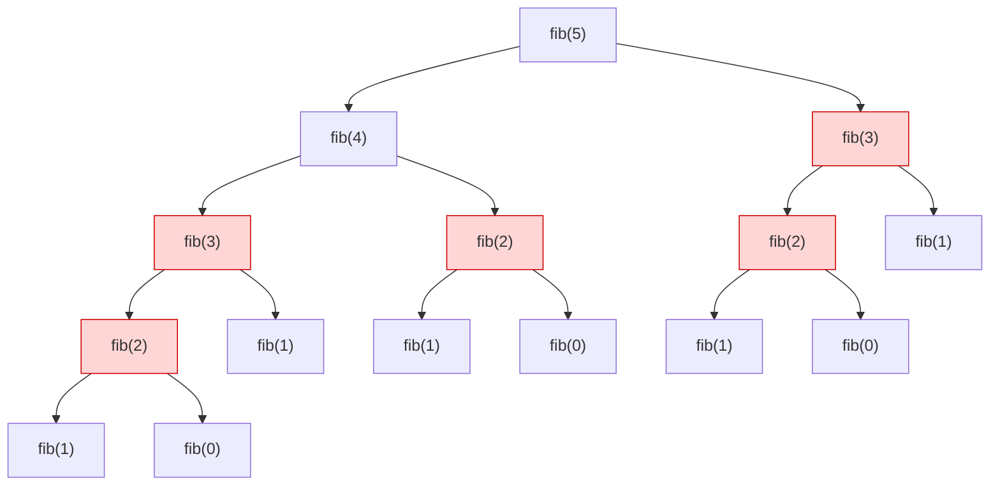
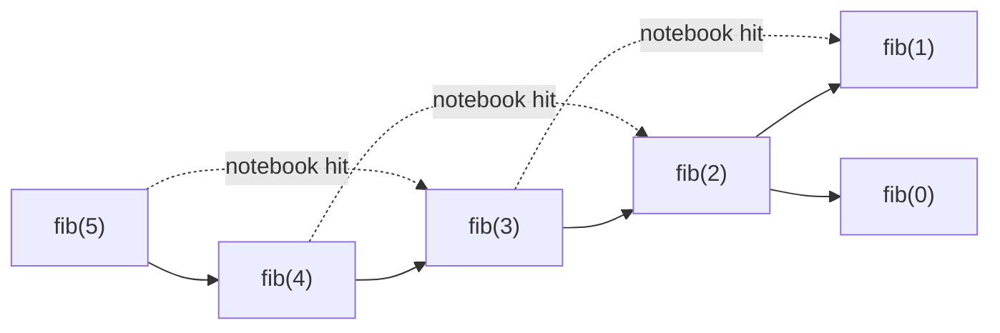
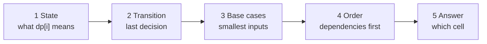
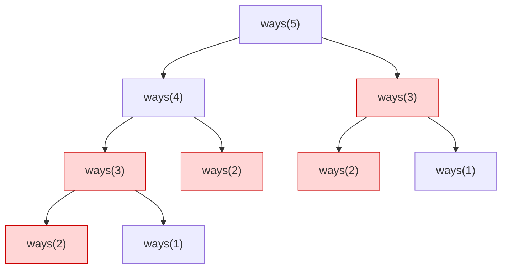

# Chapter 20 · Dynamic Programming I: The Framework & 1D DP

> Write `1+1+1+1+1+1+1+1` on a sheet of paper and ask a friend what it equals. "Eight." Now write another `+1` at the end. "Nine," they say instantly. They didn't recount: they **remembered** the 8. That tiny moment of not-redoing-work is all dynamic programming is. The rest is learning to spot when you're about to redo work, and deciding what to write down.

**You will learn:**
- What DP really is: **overlapping subproblems** + **optimal substructure**, explained without any magic
- The four forms of every DP solution, shown on the **same problem**: plain recursion → memoization → tabulation → space-optimised
- The **5-step framework** (state, transition, base case, order, answer) that turns "I have no idea" into a solution
- How to **find the state** (the hardest part) with a repeatable recipe
- How to draw recursion trees to *see* overlapping work
- 12+ classic 1D problems: Fibonacci, Climbing Stairs, Min Cost Climbing Stairs, House Robber I & II, Decode Ways, Coin Change I & II (and why loop order changes the answer), Word Break, LIS in O(n²) and O(n log n), Maximum Product Subarray, Jump Game II, Perfect Squares
- **Counting DP vs optimisation DP**, and why their base cases differ

**Before this:** [Recursion](../part-1-python/12-recursion.md) · [Big-O](01-big-o-complexity.md) · [Hashing Patterns](05-hashing.md) · [Recursion & Backtracking](09-backtracking.md) · [Binary Search](08-binary-search.md) (for the fast LIS)

---

## 🧠 The Big Idea

Here's the Fibonacci sequence: each number is the sum of the two before it.

```text
F(0)=0  F(1)=1  F(2)=1  F(3)=2  F(4)=3  F(5)=5  F(6)=8 ...
```

The obvious recursive code is `fib(n) = fib(n-1) + fib(n-2)`. Let's draw what it actually does for `fib(5)`. Every box is one function call:



Look at the red boxes. `fib(3)` is computed **twice**. `fib(2)` is computed **three times**. The whole right half of the tree is a carbon copy of something already done on the left. For `fib(50)` the tree has about 40 billion boxes, yet there are only **51 different questions** (`fib(0)` to `fib(50)`). We're answering the same 51 questions billions of times.

The fix is a notebook. Before computing `fib(k)`, check the notebook. If the answer is there, use it. If not, compute it once and write it down. Now the tree collapses into a straight line:



That's **dynamic programming (DP)**: *solve each distinct subproblem once, store the answer, reuse it.* It turns exponential time into polynomial time.

> 💡 **The one-sentence definition:** DP = recursion + a notebook. If you can write a recursive solution where the same calls repeat, you can make it DP.

Two conditions make a problem DP-friendly:

| Ingredient | Plain meaning | Fibonacci example |
|---|---|---|
| **Overlapping subproblems** | The same smaller question is asked again and again | `fib(3)` is needed by both `fib(5)` and `fib(4)` |
| **Optimal substructure** | The best answer to the big question is built from the best answers to smaller questions | `fib(5)` is built directly from `fib(4)` and `fib(3)` |

If there's no overlap (like merge sort, whose halves never repeat), a notebook doesn't help: that's plain divide and conquer. If there's no optimal substructure (like "longest *simple* path in a graph", where the best path to a middle node might use nodes you need later), DP gives wrong answers.

> 💡 **Why the scary name?** Richard Bellman coined "dynamic programming" in the 1950s partly because it sounded impressive to funding committees. "Programming" here means "filling a table", like a TV programme schedule, not writing code. Don't let the name intimidate you.

---

## 🔨 Building It Up

### 1. Feel the pain: counting calls in naive recursion

Let's measure how wasteful plain recursion is.

```python
calls = 0

def fib(n):
    global calls
    calls += 1
    if n < 2:
        return n
    return fib(n - 1) + fib(n - 2)

for n in (10, 20, 25):
    calls = 0
    value = fib(n)
    print(f"fib({n}) = {value:>6}   calls = {calls}")
```

```text
fib(10) =     55   calls = 177
fib(20) =   6765   calls = 21891
fib(25) =  75025   calls = 242785
```

What just happened: every +5 to `n` multiplies the work by about 11. The number of calls grows like φⁿ where φ ≈ 1.618 (the golden ratio). That's **O(1.618ⁿ)**, exponential. `fib(50)` would take hours. `fib(100)` would outlive the sun.

Now with a notebook (a dictionary):

```python
calls = 0
memo = {}

def fib(n):
    global calls
    calls += 1
    if n < 2:
        return n
    if n in memo:                 # already solved? reuse it
        return memo[n]
    memo[n] = fib(n - 1) + fib(n - 2)
    return memo[n]

print(fib(25), "calls =", calls)
calls = 0
memo.clear()
print(fib(90), "calls =", calls)
```

```text
75025 calls = 49
2880067194370816120 calls = 179
```

What just happened: 242,785 calls became 49. And `fib(90)`, which would be impossible naively, takes 179 calls. Each `fib(k)` is *computed* once and *looked up* at most once more, so the total is about 2n calls: **O(n)**.

### 2. Our running example: House Robber

Fibonacci is too simple to show real decisions, so we'll use one problem for the next five sections and watch it evolve through all four forms of DP.

**House Robber:** houses stand in a row, `nums[i]` is the money in house i. You can't rob two **adjacent** houses (the alarms are linked). What's the most money you can take?

```text
nums = [2, 7, 9, 3, 1]
best = 2 + 9 + 1 = 12   (houses 0, 2, 4)
```

Greedy ideas fail. "Take the biggest house first" picks 9, then can't take 7 or 3, then takes 2 and 1: 12. Fine here, but try `[5, 9, 5]`: greedy takes 9 and stops (9), but 5 + 5 = 10 is better. "Take every other house" fails on `[10, 1, 1, 10]` (best is 20, taking houses 0 and 3). We need to consider choices properly.

### 3. Form 1: Plain recursion (the brute force that thinks clearly)

Think about the **last house**. Either you rob it or you don't.

- **Skip** the last house → the answer is the best you can do with all the houses before it.
- **Rob** the last house → you get its money, but its neighbour is off-limits, so add the best you can do with the houses *two* back.

Define `best(i)` = the most money from the **first i houses** (houses `0 .. i-1`). Then:

```text
best(0) = 0                              (no houses, no money)
best(1) = nums[0]                        (one house: rob it)
best(i) = max( best(i-1),                (skip house i-1)
               best(i-2) + nums[i-1] )   (rob house i-1)
```

```python
calls = 0

def rob(nums):
    def best(i):
        global calls
        calls += 1
        if i == 0:
            return 0
        if i == 1:
            return nums[0]
        return max(best(i - 1), best(i - 2) + nums[i - 1])
    return best(len(nums))

print(rob([2, 7, 9, 3, 1]), "calls =", calls)
calls = 0
print(rob(list(range(1, 26))), "calls =", calls)
```

```text
12 calls = 15
169 calls = 242785
```

What just happened: the recursion is *correct*, and it reads like the English argument above. But it calls `best` 242,785 times for just 25 houses: the same explosion as Fibonacci, because `best(i)` calls `best(i-1)` and `best(i-2)`, exactly like `fib`.

> 💡 **Never skip this step.** The recursion is where the thinking happens. Every later form is a mechanical transformation of it. If you can't write the recursion, you can't write the DP.

### 4. Form 2: Memoization (top-down DP)

**Memoization** = recursion + a cache of answers. Same code, plus two lines. Python gives us a ready-made notebook: `functools.cache` (an unlimited `lru_cache`) remembers the return value for each distinct argument.

```python
from functools import cache

calls = 0

def rob(nums):
    @cache
    def best(i):
        global calls
        calls += 1
        if i == 0:
            return 0
        if i == 1:
            return nums[0]
        return max(best(i - 1), best(i - 2) + nums[i - 1])
    return best(len(nums))

print(rob([2, 7, 9, 3, 1]), "calls =", calls)
calls = 0
print(rob(list(range(1, 26))), "calls =", calls)
```

```text
12 calls = 6
169 calls = 26
```

What just happened: `calls` now only counts real computations (cache hits never enter the function body). 26 distinct states (`best(0)` to `best(25)`) were each computed once. **O(n) time, O(n) space** (the cache plus the recursion stack).

The same thing with an explicit dictionary, which is what you'd write in an interview if you want to show you understand what `@cache` does:

```python
def rob(nums):
    memo = {}

    def best(i):
        if i == 0:
            return 0
        if i == 1:
            return nums[0]
        if i not in memo:
            memo[i] = max(best(i - 1), best(i - 2) + nums[i - 1])
        return memo[i]

    return best(len(nums))

print(rob([2, 7, 9, 3, 1]), rob([5, 9, 5]), rob([10, 1, 1, 10]))
```

```text
12 10 20
```

It's called **top-down** because you start at the big question (`best(n)`) and recursion digs *down* to the small ones.

### 5. Form 3: Tabulation (bottom-up DP)

Look at the memo after it's filled: it's just a list where entry `i` holds `best(i)`. Why not fill that list directly, **smallest first**, with a loop? Then every value we need is already there when we need it. No recursion at all.

```python
def rob(nums):
    n = len(nums)
    if n == 0:
        return 0
    dp = [0] * (n + 1)          # dp[i] = best money from the first i houses
    dp[0] = 0
    dp[1] = nums[0]
    for i in range(2, n + 1):
        dp[i] = max(dp[i - 1], dp[i - 2] + nums[i - 1])
    print("dp table:", dp)
    return dp[n]

print(rob([2, 7, 9, 3, 1]))
```

```text
dp table: [0, 2, 7, 11, 11, 12]
12
```

**DP table trace** for `nums = [2, 7, 9, 3, 1]`:

| i | house i-1 | skip: dp[i-1] | rob: dp[i-2] + nums[i-1] | dp[i] |
|---|---|---|---|---|
| 0 | - | - | - | 0 (base) |
| 1 | 2 | - | - | 2 (base) |
| 2 | 7 | 2 | 0 + 7 = 7 | **7** |
| 3 | 9 | 7 | 2 + 9 = 11 | **11** |
| 4 | 3 | 11 | 7 + 3 = 10 | **11** |
| 5 | 1 | 11 | 11 + 1 = 12 | **12** |

What just happened: the `dp` list is the notebook, filled left to right. This is **bottom-up**: start from the base cases and build *up* to the answer. The recurrence line inside the loop is *identical* to the recursive one, with `best(...)` replaced by `dp[...]`.

### 6. Form 4: Space optimisation

Look at the loop: `dp[i]` only reads `dp[i-1]` and `dp[i-2]`. Everything older is dead weight. Keep just two variables and slide them forward.

```python
def rob(nums):
    prev2, prev1 = 0, 0          # dp[i-2], dp[i-1]
    for money in nums:
        prev2, prev1 = prev1, max(prev1, prev2 + money)
    return prev1

print(rob([2, 7, 9, 3, 1]), rob([5, 9, 5]), rob([10, 1, 1, 10]), rob([]))
```

```text
12 10 20 0
```

What just happened: **O(n) time, O(1) space**. Starting both at 0 also handles the empty list and the one-house case for free (`max(0, 0 + nums[0])`). The tuple assignment updates both variables at once, so `prev2` gets the *old* `prev1`.

### 7. The four forms side by side

| Form | Code shape | Time | Extra space | When to use |
|---|---|---|---|---|
| Plain recursion | `f(i)` calls `f(i-1)`, `f(i-2)` | O(2ⁿ)-ish | O(n) stack | Only to *think*. Never submit. |
| Memoization (top-down) | recursion + `@cache` | O(states × work) | O(states) + stack | Fastest to write; great when many states are never needed |
| Tabulation (bottom-up) | loop fills `dp[]` | O(states × work) | O(states) | No recursion limit; easy to space-optimise |
| Space-optimised | loop + a few variables | same | O(1) or one row | When dp[i] only looks a fixed distance back |

> 💡 **The interview move:** say the recursion out loud, code it with memoization (fast and safe), then say "this can be converted to bottom-up and the space reduced to O(1) because each state only depends on the previous two." That one sentence earns serious points.

### 8. The 5-step framework

Every DP problem, from the easiest to the scariest, is answered by filling in these five blanks. Write them down *before* coding.

| Step | Question to ask | House Robber |
|---|---|---|
| **1. State** | What does `dp[i]` *mean*, in one English sentence? | `dp[i]` = max money from the first `i` houses |
| **2. Transition** | How is `dp[i]` built from smaller states? (Think about the **last decision**.) | `dp[i] = max(dp[i-1], dp[i-2] + nums[i-1])` |
| **3. Base cases** | Which states are answered directly, without the transition? | `dp[0] = 0`, `dp[1] = nums[0]` |
| **4. Order** | In what order must states be filled so dependencies are ready? | `i` from 2 up to n |
| **5. Answer** | Which state (or combination of states) is the final answer? | `dp[n]` |



The two that cause 90% of the struggle are **state** and **transition**. The other three follow from them almost automatically.

> ⚠️ If you can't say what `dp[i]` means in a plain English sentence, stop. Don't code. Every bug in DP comes from a fuzzy state definition.

### 9. How to find the state (the recipe)

The state is the **set of facts you need about the past to make the remaining decisions optimally**. Here's how to find it without inspiration:

1. **Write the brute-force recursion** that makes one decision at a time (take/skip, which coin, where to cut).
2. **List the parameters** that change between calls. Those parameters *are* the state.
3. **Shrink them.** If a parameter is something big (a list of chosen items, a whole path), ask: "what's the *minimum* I need to remember to decide the rest?" Usually it's an index, a remaining amount, or the last thing chosen.
4. **Count the states.** If the number of distinct parameter combinations is polynomial (like n, or n × amount), DP will work.

Applying it:

| Problem | Naive "memory of the past" | What you really need | State |
|---|---|---|---|
| House Robber | which houses I robbed | how many houses I've considered | `i` |
| Climbing Stairs | the exact steps taken | which stair I'm on | `i` |
| Coin Change | which coins I used | how much amount is left | `amount` |
| Longest Increasing Subsequence | the whole subsequence so far | the **last** element chosen (to compare the next) | index of last element |
| Word Break | how I split the string so far | where the unsplit part starts | `i` |

**Two shapes cover almost every 1D state:**

- **Prefix / suffix shape:** `dp[i]` = answer for the first `i` items (or from item `i` to the end). Used by House Robber, Decode Ways, Word Break.
- **"Ending exactly at i" shape:** `dp[i]` = best answer that **must end at** index `i`. Used when the answer is a contiguous or chained piece (LIS, Maximum Subarray, Max Product). The final answer is then `max(dp)`, not `dp[n-1]`.
- (A third, the **value shape**: `dp[x]` = answer for a target value `x`, like an amount of money. Coin Change, Perfect Squares.)

### 10. Seeing overlap: drawing recursion trees

Before you reach for DP, you should be able to *prove to yourself* there's overlap. Draw the recursion tree for a small input and look for repeated labels.

**Climbing Stairs:** you can climb 1 or 2 steps at a time. How many distinct ways to reach step `n`? The last move was either a 1-step (from `n-1`) or a 2-step (from `n-2`), so `ways(n) = ways(n-1) + ways(n-2)`. The tree for `n = 5`:



`ways(3)` appears twice, `ways(2)` three times. Overlap confirmed: memoize.

**How to read a tree quickly:**
- **Labels** = states. The number of *distinct* labels is the size of your DP table.
- **Branching factor** = how many choices per state = the work per state.
- **DP time ≈ (distinct labels) × (branching factor).** Here: n labels × 2 = O(n).
- If no label ever repeats (e.g. generating all permutations, where every node has a unique "used set"), memoization won't help: it's backtracking territory ([Chapter 09](09-backtracking.md)).

### 11. Climbing Stairs and Min Cost Climbing Stairs

Climbing Stairs is Fibonacci in a costume. Bottom-up, space-optimised:

```python
def climb_stairs(n):
    if n <= 2:
        return n
    one_back, two_back = 2, 1        # ways(2), ways(1)
    for _ in range(3, n + 1):
        one_back, two_back = one_back + two_back, one_back
    return one_back

print([climb_stairs(n) for n in range(1, 8)], climb_stairs(45))
```

```text
[1, 2, 3, 5, 8, 13, 21] 1836311903
```

**Min Cost Climbing Stairs:** `cost[i]` is what you pay when you step *on* stair i. You may start on stair 0 or 1, and you want to reach the top (one past the last stair). Minimise the total cost.

The 5 steps:
1. **State:** `dp[i]` = minimum cost to *stand on* position i (before paying `cost[i]`), where position `n` is the top.
2. **Transition:** you arrived from i-1 (paid `cost[i-1]`) or from i-2 (paid `cost[i-2]`): `dp[i] = min(dp[i-1] + cost[i-1], dp[i-2] + cost[i-2])`.
3. **Base:** `dp[0] = dp[1] = 0` (you may start there for free).
4. **Order:** i from 2 to n.
5. **Answer:** `dp[n]`.

```python
def min_cost_climbing_stairs(cost):
    n = len(cost)
    dp = [0] * (n + 1)
    for i in range(2, n + 1):
        dp[i] = min(dp[i - 1] + cost[i - 1], dp[i - 2] + cost[i - 2])
    return dp[n]

print(min_cost_climbing_stairs([10, 15, 20]))
print(min_cost_climbing_stairs([1, 100, 1, 1, 1, 100, 1, 1, 100, 1]))
```

```text
15
6
```

What just happened: for `[10, 15, 20]` the best is to start on stair 1, pay 15, and jump two steps to the top. Notice how *defining the state precisely* ("cost to stand on i, before paying for i") made the base case obvious.

### 12. House Robber II: the circular street

Now the houses are in a **circle**: the first and last are neighbours. You can't rob both.

**Idea:** break the circle by cases. Either house 0 is *not* robbed (solve the line `nums[1:]`) or the last house is *not* robbed (solve `nums[:-1]`). Every valid plan falls into at least one case. Reuse House Robber I.

```python
def rob_line(nums):
    prev2 = prev1 = 0
    for money in nums:
        prev2, prev1 = prev1, max(prev1, prev2 + money)
    return prev1

def rob_circle(nums):
    if len(nums) == 1:
        return nums[0]
    return max(rob_line(nums[1:]), rob_line(nums[:-1]))

print(rob_circle([2, 3, 2]), rob_circle([1, 2, 3, 1]), rob_circle([1, 2, 3]), rob_circle([7]))
```

```text
3 4 3 7
```

What just happened: a trick you'll use again and again: **when a constraint breaks the simple structure, split into cases that each have the simple structure.** The single-house check matters because both slices would be empty.

### 13. Decode Ways

Letters are encoded as `A=1, B=2, ..., Z=26`. Given a string of digits, how many ways can it be decoded? `"226"` → `"BZ"` (2 26), `"VF"` (22 6), `"BBF"` (2 2 6) → 3 ways. Zeros are tricky: `"06"` can't be decoded (no letter is `0` or `06`).

The 5 steps:
1. **State:** `dp[i]` = number of ways to decode the first `i` characters.
2. **Transition (last decision):** the last letter used either **one digit** (`s[i-1]`, valid if it's not `'0'`) or **two digits** (`s[i-2:i]`, valid if it's between 10 and 26). Add the ways for each valid option.
3. **Base:** `dp[0] = 1`. The empty string has exactly one decoding: the empty decoding. (This "1 way to do nothing" base case is the heart of every counting DP.)
4. **Order:** i from 1 to n.
5. **Answer:** `dp[n]`.

```python
def num_decodings(s):
    n = len(s)
    dp = [0] * (n + 1)
    dp[0] = 1
    for i in range(1, n + 1):
        if s[i - 1] != "0":                       # last letter is one digit
            dp[i] += dp[i - 1]
        if i >= 2 and 10 <= int(s[i - 2:i]) <= 26:  # last letter is two digits
            dp[i] += dp[i - 2]
    return dp[n]

for s in ["12", "226", "06", "11106", "2101"]:
    print(s, num_decodings(s))
```

```text
12 2
226 3
06 0
11106 2
2101 1
```

**Trace** for `"226"`:

| i | prefix | one digit `s[i-1]` | two digits `s[i-2:i]` | dp[i] |
|---|---|---|---|---|
| 0 | "" | - | - | 1 (base) |
| 1 | "2" | '2' ok → +dp[0]=1 | - | 1 |
| 2 | "22" | '2' ok → +dp[1]=1 | "22" ok → +dp[0]=1 | 2 |
| 3 | "226" | '6' ok → +dp[2]=2 | "26" ok → +dp[1]=1 | 3 |

What just happened: `10 <= int(...)` automatically rejects two-digit chunks starting with `0` like `"06"`. Note that `dp[i]` only depends on `dp[i-1]` and `dp[i-2]`, so this also space-optimises to O(1).

### 14. Coin Change (minimum coins): the "value" state

Given coin denominations (unlimited supply of each) and an `amount`, return the **fewest coins** that make the amount, or -1 if impossible.

Greedy ("take the biggest coin that fits") fails: coins `[1, 3, 4]`, amount 6. Greedy: 4 + 1 + 1 = 3 coins. Best: 3 + 3 = 2 coins.

1. **State:** `dp[x]` = fewest coins that make exactly amount `x`.
2. **Transition (last decision):** the last coin was some coin `c`. Before it, you made `x - c` optimally. So `dp[x] = 1 + min(dp[x - c])` over all coins `c <= x`.
3. **Base:** `dp[0] = 0`. Unreachable amounts start at infinity.
4. **Order:** x from 1 to amount (each `dp[x]` needs smaller amounts).
5. **Answer:** `dp[amount]`, or -1 if it's still infinity.

```python
def coin_change(coins, amount):
    INF = float("inf")
    dp = [0] + [INF] * amount
    for x in range(1, amount + 1):
        for c in coins:
            if c <= x and dp[x - c] + 1 < dp[x]:
                dp[x] = dp[x - c] + 1
    return dp[amount] if dp[amount] != INF else -1

print(coin_change([1, 2, 5], 11), coin_change([1, 3, 4], 6), coin_change([2], 3), coin_change([1], 0))
```

```text
3 2 -1 0
```

**DP table** for coins `[1, 2, 5]`, amount 11:

| x | 0 | 1 | 2 | 3 | 4 | 5 | 6 | 7 | 8 | 9 | 10 | 11 |
|---|---|---|---|---|---|---|---|---|---|---|---|---|
| dp[x] | 0 | 1 | 1 | 2 | 2 | 1 | 2 | 2 | 3 | 3 | 2 | 3 |

Check one cell, `dp[11]`: last coin 1 → `dp[10]+1 = 3`; last coin 2 → `dp[9]+1 = 4`; last coin 5 → `dp[6]+1 = 3`. Minimum 3 (5 + 5 + 1). Time **O(amount × coins)**, space O(amount).

### 15. Coin Change II (number of ways): why loop order matters

Same coins, but now **count** how many different *combinations* make the amount. `coins = [1, 2, 5]`, `amount = 5` → 4 ways: `5`, `2+2+1`, `2+1+1+1`, `1+1+1+1+1`.

Here's the twist that confuses everyone. These two programs differ *only in which loop is outside*:

```python
def ways_coins_outside(coins, amount):
    dp = [1] + [0] * amount          # 1 way to make 0: use no coins
    for c in coins:                  # OUTER: coins
        for x in range(c, amount + 1):
            dp[x] += dp[x - c]
    return dp[amount]

def ways_amount_outside(coins, amount):
    dp = [1] + [0] * amount
    for x in range(1, amount + 1):   # OUTER: amounts
        for c in coins:
            if c <= x:
                dp[x] += dp[x - c]
    return dp[amount]

print(ways_coins_outside([1, 2, 5], 5), ways_amount_outside([1, 2, 5], 5))
```

```text
4 9
```

Same coins, same amount, different answers. Which is right? **Both**, for different questions:

- **Coins outside → combinations** (order doesn't matter: `1+2` and `2+1` are the same). Answer 4. This is **Coin Change II**.
- **Amount outside → permutations** (order matters: `1+2` and `2+1` are different sequences). Answer 9. This is **Combination Sum IV** (badly named, it counts sequences).

**Why?** With coins outside, we finish using all the 1s before *any* 2 is allowed in. So every combination is built in exactly one canonical order: "all 1s, then all 2s, then all 5s". `2+1` can never be formed, because once we're processing coin 2, coin 1 is never added again after it. With amount outside, at every amount we try *every* coin as the last one, so `...+1` then `+2` and `...+2` then `+1` are both counted.

**Trace (coins outside)** for coins `[1, 2, 5]`, amount 5:

| after processing | dp[0] | dp[1] | dp[2] | dp[3] | dp[4] | dp[5] | meaning |
|---|---|---|---|---|---|---|---|
| start | 1 | 0 | 0 | 0 | 0 | 0 | only "use nothing" |
| coin 1 | 1 | 1 | 1 | 1 | 1 | 1 | using only 1s |
| coin 2 | 1 | 1 | 2 | 2 | 3 | 3 | using 1s and 2s |
| coin 5 | 1 | 1 | 2 | 2 | 3 | **4** | using 1s, 2s, 5s |

Row "coin 2" at `dp[4] = 3`: `1+1+1+1`, `2+1+1`, `2+2`. Each written once, in one order.

> 💡 **Memory hook:** "**C**oins outside = **C**ombinations. **A**mount outside = **A**rrangements."

### 16. Word Break

Given a string `s` and a dictionary of words, can `s` be split into a sequence of dictionary words? `"leetcode"`, `["leet", "code"]` → True.

1. **State:** `dp[i]` = True if the first `i` characters `s[:i]` can be split into words.
2. **Transition (last decision = the last word):** `dp[i]` is True if there's some `j < i` with `dp[j]` True and `s[j:i]` a dictionary word.
3. **Base:** `dp[0] = True` (empty prefix: zero words, valid).
4. **Order:** i from 1 to n.
5. **Answer:** `dp[n]`.

```python
def word_break(s, word_dict):
    words = set(word_dict)
    max_len = max(map(len, words), default=0)
    n = len(s)
    dp = [False] * (n + 1)
    dp[0] = True
    for i in range(1, n + 1):
        for j in range(max(0, i - max_len), i):   # last word can't be longer than max_len
            if dp[j] and s[j:i] in words:
                dp[i] = True
                break
    return dp[n]

print(word_break("leetcode", ["leet", "code"]))
print(word_break("applepenapple", ["apple", "pen"]))
print(word_break("catsandog", ["cats", "dog", "sand", "and", "cat"]))
```

```text
True
True
False
```

What just happened: this is a **feasibility DP** (combine with "or" instead of `+` or `min`). Limiting `j` to the last `max_len` positions turns O(n²) substring checks into O(n × L), where L is the longest word (each check also costs O(L) for slicing and hashing). For `"catsandog"`, `dp` becomes True at 3 ("cat"), 4 ("cats"), 7 ("cats|and" or "cat|sand"), but nothing in the dictionary ends exactly at 9.

### 17. Longest Increasing Subsequence (LIS), O(n²)

Given an array, find the length of the longest **strictly increasing subsequence** (elements in order, not necessarily adjacent). `[10, 9, 2, 5, 3, 7, 101, 18]` → 4 (e.g. `2, 3, 7, 18`).

Here the prefix state "best in the first i elements" doesn't work, because to extend a subsequence you need to know its **last element**. So we use the "ending at i" shape.

1. **State:** `dp[i]` = length of the longest increasing subsequence that **ends exactly at index i**.
2. **Transition:** the element before `nums[i]` is some `nums[j]` with `j < i` and `nums[j] < nums[i]`: `dp[i] = 1 + max(dp[j])` over those j (or 1 if there are none).
3. **Base:** every `dp[i]` starts at 1 (the element alone).
4. **Order:** i from left to right.
5. **Answer:** `max(dp)`: the LIS can end anywhere.

We'll also rebuild the actual subsequence using a **parent** array: `parent[i]` remembers which `j` gave the best value. This is how you recover *the solution*, not just its size, in any DP.

```python
def lis(nums):
    n = len(nums)
    dp = [1] * n
    parent = [-1] * n
    for i in range(n):
        for j in range(i):
            if nums[j] < nums[i] and dp[j] + 1 > dp[i]:
                dp[i] = dp[j] + 1
                parent[i] = j
    end = max(range(n), key=lambda k: dp[k])
    seq = []
    while end != -1:              # walk the parent pointers backwards
        seq.append(nums[end])
        end = parent[end]
    return dp, seq[::-1]

dp, seq = lis([10, 9, 2, 5, 3, 7, 101, 18])
print("dp :", dp)
print("LIS:", seq, "length", len(seq))
```

```text
dp : [1, 1, 1, 2, 2, 3, 4, 4]
LIS: [2, 5, 7, 101] length 4
```

Time O(n²), space O(n).

### 18. LIS in O(n log n): the patience trick

Imagine dealing cards into piles. Each new card goes on the **leftmost pile whose top card is ≥ it**; if there's none, start a new pile on the right. The number of piles equals the LIS length. In code we only keep the top of each pile in a list called `tails`:

> `tails[k]` = the **smallest possible last element** of an increasing subsequence of length `k + 1` seen so far.

A small tail is good: it's easier to extend. For each number `x`, find the first tail `>= x` with binary search ([Chapter 08](08-binary-search.md)) and replace it with `x`. If `x` is bigger than all tails, append it (we just found a longer subsequence).

```python
from bisect import bisect_left

def lis_length(nums):
    tails = []
    for x in nums:
        k = bisect_left(tails, x)     # first tail >= x
        if k == len(tails):
            tails.append(x)           # x extends the longest subsequence
        else:
            tails[k] = x              # x is a smaller tail for length k+1
        print(f"x={x:>3}  tails={tails}")
    return len(tails)

print("LIS length:", lis_length([10, 9, 2, 5, 3, 7, 101, 18]))
```

```text
x= 10  tails=[10]
x=  9  tails=[9]
x=  2  tails=[2]
x=  5  tails=[2, 5]
x=  3  tails=[2, 3]
x=  7  tails=[2, 3, 7]
x=101  tails=[2, 3, 7, 101]
x= 18  tails=[2, 3, 7, 18]
LIS length: 4
```

What just happened: `tails` is always sorted (proof in Under the Hood), so binary search works, giving **O(n log n)**. Careful: `tails` is **not** an actual subsequence in general (e.g. `[2, 3, 7, 18]` happens to be valid here, but on `[3, 4, 1]` tails ends as `[1, 4]`, which isn't a subsequence in order). Only its *length* is meaningful.

> ⚠️ `bisect_left` gives **strictly** increasing. For **non-decreasing** subsequences (equal values allowed), use `bisect_right`.

### 19. Maximum Product Subarray: carrying two states

Find the contiguous subarray with the largest product. `[2, 3, -2, 4]` → 6 (`[2, 3]`).

For sums (Maximum Subarray / Kadane's algorithm), the state is "best sum of a subarray ending at i": `cur = max(x, cur + x)`. For products, negatives ruin that: a hugely **negative** product becomes hugely **positive** when multiplied by another negative. So the smallest product ending at i-1 might become the largest at i.

1. **State:** two values per index: `hi[i]` = max product of a subarray ending at i, `lo[i]` = min product of a subarray ending at i.
2. **Transition:** the subarray ending at i is either `[x]` alone, or extends the one ending at i-1: `hi = max(x, hi*x, lo*x)`, `lo = min(x, hi*x, lo*x)` (using the *old* hi and lo).
3. **Base:** `hi = lo = nums[0]`.
4. **Order:** left to right.
5. **Answer:** max of all `hi` values.

```python
def max_product(nums):
    hi = lo = best = nums[0]
    for x in nums[1:]:
        candidates = (x, hi * x, lo * x)
        hi, lo = max(candidates), min(candidates)
        best = max(best, hi)
    return best

print(max_product([2, 3, -2, 4]), max_product([-2, 0, -1]), max_product([-2, 3, -4]))
```

```text
6 0 24
```

**Trace** for `[-2, 3, -4]`:

| x | candidates (x, hi·x, lo·x) | hi | lo | best |
|---|---|---|---|---|
| -2 | start | -2 | -2 | -2 |
| 3 | (3, -6, -6) | 3 | -6 | 3 |
| -4 | (-4, -12, 24) | 24 | -12 | **24** |

What just happened: the "worst" product `-6` turned into the best one `24`. The lesson: **when a single number isn't enough to decide the future, add more numbers to the state.** That's the same idea that powers the stock problems in [Chapter 21](21-dp-2d-advanced.md).

### 20. Jump Game II (DP version)

`nums[i]` is the maximum jump length from index i. Starting at index 0, find the minimum number of jumps to reach the last index (it's guaranteed reachable).

1. **State:** `dp[i]` = fewest jumps to reach index i.
2. **Transition:** you jumped into i from some j < i with `j + nums[j] >= i`: `dp[i] = 1 + min(dp[j])`.
3. **Base:** `dp[0] = 0`.
4. **Order:** left to right.
5. **Answer:** `dp[n-1]`.

```python
def jump_dp(nums):
    n = len(nums)
    INF = float("inf")
    dp = [0] + [INF] * (n - 1)
    for i in range(1, n):
        for j in range(i):
            if j + nums[j] >= i:
                dp[i] = min(dp[i], dp[j] + 1)
    return dp[n - 1]

print(jump_dp([2, 3, 1, 1, 4]), jump_dp([2, 3, 0, 1, 4]), jump_dp([1, 1, 1, 1]))
```

```text
2 2 3
```

This is O(n²). It's correct, but this problem has a special structure (reachable positions always form one contiguous range) that allows an O(n) **greedy** solution. We'll do it in [Chapter 22](22-greedy-intervals.md). DP is always a safe first answer; sometimes greedy is the faster second one.

### 21. Perfect Squares: Coin Change in disguise

Find the fewest perfect squares (1, 4, 9, 16, ...) that sum to `n`. `12 = 4 + 4 + 4` → 3. `13 = 4 + 9` → 2.

Recognise it? The squares are the coins, `n` is the amount. Same state, same transition.

```python
def num_squares(n):
    squares = [k * k for k in range(1, int(n ** 0.5) + 1)]
    dp = [0] + [float("inf")] * n
    for x in range(1, n + 1):
        for sq in squares:
            if sq > x:
                break
            dp[x] = min(dp[x], dp[x - sq] + 1)
    return dp[n]

print(num_squares(12), num_squares(13), num_squares(1), num_squares(43))
```

```text
3 2 1 3
```

Time O(n √n). (Bonus: a theorem by Lagrange says every number is a sum of at most 4 squares, so the answer is always 1 to 4.)

### 22. Counting DP vs optimisation DP

You've now seen three "flavours" of DP. They share a framework but differ in **how you combine** options and **what the empty case is worth**:

| | Counting DP | Optimisation DP | Feasibility DP |
|---|---|---|---|
| Question | "How many ways?" | "What's the min / max?" | "Is it possible?" |
| Combine options with | `+` | `min` / `max` | `or` |
| Value of "nothing possible" | `0` | `+inf` (for min) / `-inf` (for max) | `False` |
| Typical base case | `dp[0] = 1` (one way to do nothing) | `dp[0] = 0` (doing nothing costs nothing) | `dp[0] = True` |
| Examples | Climbing Stairs, Decode Ways, Coin Change II | Coin Change, House Robber, LIS, Perfect Squares | Word Break, Jump Game I |
| Extra danger | **double counting** (each way must be counted exactly once) | forgetting the "impossible" sentinel (-1 vs inf) | none, it's the gentlest |

> ⚠️ Optimisation DP is forgiving: considering the same option twice doesn't change a `min`. Counting DP is not: if two transition paths lead to the same arrangement, you count it twice. That's exactly why Coin Change II needs the coins-outside loop order.

---

## 🔬 Under the Hood

### Why DP is correct: it's just induction

Every DP correctness proof has the same shape, and knowing it helps you trust your own recurrences.

- **Base:** the base cases are correct by definition (`dp[0] = 0` money from zero houses).
- **Step:** assume every `dp[j]` with `j < i` is correct. The transition looks at **every possible last decision** (rob house i-1 or don't). For each, the rest of the solution must itself be optimal (if it weren't, swap in a better one and the total improves, contradiction: that's *optimal substructure*). So taking the best over all last decisions gives the true optimum for `dp[i]`.

The two things that can go wrong are therefore: (1) the transition **misses a possible last decision**, or (2) the subproblems **aren't independent** (choosing something in the sub-solution restricts the rest in a way the state doesn't capture). Fix (2) by adding information to the state (like `lo` in Maximum Product).

### Complexity: count states, multiply by work

> **Time = (number of states) × (work per state). Space = number of states (that you keep).**

| Problem | States | Work per state | Time | Space (optimised) |
|---|---|---|---|---|
| Fibonacci / Stairs / House Robber | n | O(1) | O(n) | O(1) |
| Decode Ways | n | O(1) | O(n) | O(1) |
| Coin Change I/II | amount | O(#coins) | O(amount × coins) | O(amount) |
| Word Break | n | O(L) checks, each O(L) | O(n × L²) | O(n) |
| LIS (DP) | n | O(n) | O(n²) | O(n) |
| LIS (tails) | n | O(log n) | O(n log n) | O(n) |
| Perfect Squares | n | O(√n) | O(n√n) | O(n) |

Note that Coin Change's O(amount × coins) is **pseudo-polynomial**: it depends on the *value* of `amount`, not the length of the input. With `amount = 10⁹` the table is too big; that's when you need a different idea.

### Top-down vs bottom-up, honestly

| | Memoization (top-down) | Tabulation (bottom-up) |
|---|---|---|
| Writing it | Easiest: add `@cache` to the recursion | Need to figure out fill order |
| States computed | Only those actually reachable | All of them, even unused ones |
| Speed in Python | Slower constant (function calls, hashing args) | Faster (plain list indexing) |
| Recursion limit | Python's default limit is 1000 frames: deep states crash | No recursion, no limit |
| Space optimisation | Hard | Natural (keep only the rows you need) |

The recursion limit bites in practice:

```py
from functools import cache

@cache
def stairs(n):
    return n if n <= 2 else stairs(n - 1) + stairs(n - 2)

stairs(5000)   # RecursionError: maximum recursion depth exceeded
```

You can raise it with `sys.setrecursionlimit(10**6)`, but very deep recursion can still crash the interpreter (the C stack overflows). In interviews with `n` up to 10⁴ or more, prefer bottom-up. A useful trick is to "warm up" the cache in increasing order (`for k in range(n): stairs(k)`) so each call only recurses one level.

### What `@cache` actually does

`functools.cache` wraps your function in a dictionary keyed by the arguments (as a tuple). So:
- Arguments must be **hashable**: ints, strings, tuples. A list argument raises `TypeError: unhashable type: 'list'`. Pass indexes, not slices.
- The cache lives as long as the function object. If you define the memoized function at module level and call it for different inputs (different `nums`), the old answers are **wrong** for the new input. Define it *inside* the solving function (as we did), or call `best.cache_clear()`.

### Why the LIS `tails` array stays sorted

Claim: `tails[0] < tails[1] < ... < tails[k]`. Suppose `tails[k] >= tails[k+1]`. The increasing subsequence of length k+2 ending at `tails[k+1]` contains, one position earlier, an element smaller than `tails[k+1]` that ends an increasing subsequence of length k+1. So the smallest tail for length k+1 is less than `tails[k+1] <= tails[k]`, contradicting that `tails[k]` is the smallest. Since it's sorted, "the first tail ≥ x" is a binary search, and replacing it with x keeps it sorted (x is bigger than the tail before it and no bigger than the one it replaces).

---

## 🧩 Pattern Decoder

### Signals: when to reach for DP

| You see in the problem... | Think |
|---|---|
| "number of ways", "how many distinct ways" | Counting DP |
| "minimum / maximum / longest / shortest / fewest" + choices at each step | Optimisation DP |
| "is it possible to...", "can you reach / form / split" | Feasibility DP (or greedy / BFS if structure allows) |
| A brute force that tries all subsets / sequences, with n ≤ ~5000 or amount ≤ ~10⁴ | Memoize the brute force |
| "can't pick adjacent", "cooldown", "at most k" | DP with the constraint in the state |
| Greedy has a counterexample you can find in 1 minute | DP |
| You wrote recursion and the same arguments repeat | DP, immediately |
| "subsequence" (not contiguous) | DP (LIS / LCS family) |
| "all possible combinations, list them" | **Not** DP: you must output them all, use backtracking ([Chapter 09](09-backtracking.md)) |

### The worksheet (fill it in before coding)

```text
STATE:       dp[i] = ______________________________ (one English sentence)
TRANSITION:  dp[i] = combine over last decisions of ( ________ )
BASE:        dp[__] = ____                  (empty case: 0 / 1 / True / inf)
ORDER:       i goes from ____ to ____       (dependencies first)
ANSWER:      dp[__]  or  max(dp)  or  ...
COMPLEXITY:  #states × work per state = ______
```

### Template A: Top-down (memoized recursion)

```py
from functools import cache

def solve(nums):
    n = len(nums)

    @cache
    def f(i):                       # f(i) = answer for the subproblem starting/ending at i
        if i == BASE:               # base case(s)
            return BASE_VALUE
        best = IDENTITY             # 0 for counting, inf for min, -inf for max
        for choice in choices(i):   # every possible "last" (or "next") decision
            best = COMBINE(best, cost(choice) + f(smaller_state(i, choice)))
        return best

    return f(n)
```

### Template B: Bottom-up (tabulation)

```py
def solve(nums):
    n = len(nums)
    dp = [IDENTITY] * (n + 1)
    dp[0] = BASE_VALUE
    for i in range(1, n + 1):           # order: dependencies are smaller indexes
        for choice in choices(i):
            dp[i] = COMBINE(dp[i], cost(choice) + dp[smaller_state(i, choice)])
    return dp[n]
```

### Template C: Space-optimised (fixed look-back)

```py
def solve(nums):
    prev2, prev1 = BASE_2, BASE_1        # dp[i-2], dp[i-1]
    for x in nums:
        prev2, prev1 = prev1, COMBINE(prev1, prev2 + x)
    return prev1
```

### Variation 1: Take or skip (adjacent constraint)

**Shape:** at each item, either take it (and jump past its neighbours) or skip it.
**Examples:** House Robber, Delete and Earn, Maximum sum of non-adjacent elements.
**Transition:** `dp[i] = max(dp[i-1], dp[i-2] + value[i])`. Covered in sections 3 to 6.

### Variation 2: Ways to reach (counting paths on a line)

**Shape:** count sequences of moves that land exactly on a target.
**Examples:** Climbing Stairs, Decode Ways, Combination Sum IV.
**Transition:** `dp[i] = sum(dp[i - step] for step in allowed_steps)` with `dp[0] = 1`.

### Variation 3: Unbounded items summing to a target ("value state")

**Shape:** reuse items any number of times to hit an amount.
**Examples:** Coin Change (min), Coin Change II (count combinations), Perfect Squares.
**Key decision:** for counting, *items outside* = combinations, *amount outside* = permutations.

### Variation 4: "Ending exactly at i"

**Shape:** the answer is a chain or contiguous piece; you must know where it ends to extend it.
**Examples:** LIS, Maximum Subarray (Kadane), Maximum Product Subarray, Longest String Chain.
**Answer:** `max(dp)`, never just `dp[n-1]`.

Kadane's algorithm for **Maximum Subarray** is the simplest member, and it *is* DP: `cur` = best sum of a subarray ending here.

```python
def max_subarray(nums):
    cur = best = nums[0]
    for x in nums[1:]:
        cur = max(x, cur + x)     # start fresh at x, or extend the run ending before x
        best = max(best, cur)
    return best

print(max_subarray([-2, 1, -3, 4, -1, 2, 1, -5, 4]), max_subarray([-3, -1, -2]))
```

```text
6 -1
```

### Variation 5: Partition the prefix ("where was the last cut?")

**Shape:** split an array/string into pieces; each piece has a value; optimise or count over all splittings.
**Transition:** `dp[i] = combine over j < i of ( dp[j] ⊕ value(piece j..i-1) )`.
**Examples:** Word Break, Palindrome Partitioning II (Chapter 21), **Partition Array for Maximum Sum**.

**Partition Array for Maximum Sum:** split `arr` into contiguous pieces of length at most `k`; every element in a piece becomes that piece's maximum. Maximise the total. `arr = [1, 15, 7, 9, 2, 5, 10]`, `k = 3` → 84 (`[15,15,15,9,10,10,10]`).

**Idea:** `dp[i]` = best total for the first i elements. The last piece is `arr[j:i]` with `i - j <= k`; it contributes `max(arr[j:i]) × (i - j)`. Grow the last piece leftwards while tracking its max.

```python
def max_sum_after_partitioning(arr, k):
    n = len(arr)
    dp = [0] * (n + 1)
    for i in range(1, n + 1):
        piece_max = 0
        for size in range(1, min(k, i) + 1):      # last piece = arr[i-size : i]
            piece_max = max(piece_max, arr[i - size])
            dp[i] = max(dp[i], dp[i - size] + piece_max * size)
    return dp[n]

print(max_sum_after_partitioning([1, 15, 7, 9, 2, 5, 10], 3))
print(max_sum_after_partitioning([1, 4, 1, 5, 7, 3, 6, 1, 9, 9, 3], 4))
```

```text
84
83
```

Time O(n × k), space O(n).

### Variation 6: Minimum steps to reach

**Shape:** fewest moves to reach a position/value.
**Examples:** Jump Game II, Coin Change, Perfect Squares, Minimum steps to reduce n to 1.
**Transition:** `dp[i] = 1 + min(dp[prev])` over positions that can move to i. (When every move costs 1 and the state space is a graph, BFS from [Chapter 16](16-graphs-bfs-dfs.md) is an equally valid view.)

### Full dry run: Decode Ways on "11106"

| i | prefix | one digit | two digits | dp[i] |
|---|---|---|---|---|
| 0 | "" | - | - | 1 |
| 1 | "1" | '1' → +dp[0]=1 | - | 1 |
| 2 | "11" | '1' → +dp[1]=1 | "11" → +dp[0]=1 | 2 |
| 3 | "111" | '1' → +dp[2]=2 | "11" → +dp[1]=1 | 3 |
| 4 | "1110" | '0' ✗ | "10" → +dp[2]=2 | 2 |
| 5 | "11106" | '6' → +dp[4]=2 | "06" ✗ | **2** |

The `'0'` at position 4 *forces* the pair `"10"`, so the ways from `dp[3]` don't carry over. The two decodings are `1 1 10 6` (AAJF) and `11 10 6` (KJF).

### When NOT to use DP

- **You must list every solution** (all subsets, all permutations, all palindrome partitions): the output itself is exponential. Use backtracking. (DP can still *count* them.)
- **No overlap**: the recursion tree has no repeated states (merge sort, binary search). Memoization only adds overhead.
- **A greedy choice is provably safe** (activity selection, Jump Game, interval scheduling): greedy is simpler and faster. See [Chapter 22](22-greedy-intervals.md).
- **The state is too big**: if the state needs a full set of chosen items with n = 50, that's 2⁵⁰ states. Either find a smaller state, or (for n ≤ ~20) use bitmask DP from [Chapter 21](21-dp-2d-advanced.md).
- **Shortest paths with positive weights on a general graph**: that's Dijkstra ([Chapter 17](17-graphs-advanced.md)), which is a kind of DP with a priority queue for the order.

---

## ⚠️ Traps & Common Mistakes

1. **Fuzzy state.** "dp[i] is the answer for i" isn't a definition. Say "dp[i] is the max money from the first i houses." Most wrong transitions come from a state that means two different things in two different lines of code.

2. **Wrong base case for counting.** The number of ways to make amount 0 is **1** (choose nothing), not 0. With `dp[0] = 0`, every count becomes 0.

```py
dp = [0] * (amount + 1)        # ❌ dp[0] = 0: nothing ever gets counted
dp = [1] + [0] * amount        # ✅ one way to make zero
```

3. **Mixing up the loop order in coin counting.** Coins outside = combinations (Coin Change II). Amount outside = permutations (Combination Sum IV). Know which one the question wants.

4. **Forgetting the "impossible" value.** In min-DP, initialise with `float("inf")`, not 0 (0 looks like "free"), and convert to `-1` at the end if the problem says so.

5. **Mutable default argument as a memo.** It survives between calls with *different inputs*.

```py
def climb(n, memo={}):          # ❌ the same dict is shared by every call, forever
    ...

def climb(n, memo=None):        # ✅ fresh memo per top-level call
    if memo is None:
        memo = {}
```

The same bug happens with a module-level `@cache` function that reads a global `nums`: answers from the previous test case leak into the next.

6. **Passing lists to a `@cache` function.** Lists aren't hashable, so you get `TypeError`. Pass an index (`i`) or convert to a tuple.

7. **Off-by-one between `dp` index and array index.** With `dp` of size `n + 1`, `dp[i]` is about the first `i` elements, so the "current" element is `nums[i - 1]`. Write that mapping in a comment.

8. **Space optimisation with the wrong update order.**

```py
prev1 = max(prev1, prev2 + x)   # ❌ prev1 is overwritten...
prev2 = prev1                   #    ...so prev2 gets the NEW value

prev2, prev1 = prev1, max(prev1, prev2 + x)   # ✅ both computed from old values
```

9. **Returning `dp[n-1]` for an "ending at i" state.** For LIS / Kadane the best subsequence can end anywhere: return `max(dp)`.

10. **Max Product: tracking only the max.** A negative times a negative is positive. Track `lo` too, and compute the new `hi` and `lo` from the **old** pair.

11. **LIS `bisect_right` vs `bisect_left`.** Strictly increasing needs `bisect_left`. Using `bisect_right` silently counts equal values as increasing.

---

## 💡 Tips & Tricks

- **Think about the last step.** "What was the last house / coin / word / jump?" turns almost any problem into a transition. If "last" doesn't work, try "first".
- **Start top-down in interviews.** Memoized recursion is the fastest correct code to write. Convert to bottom-up only if asked or if recursion depth is a risk.
- **Check the constraints for hints.** n ≤ 20 → bitmask or backtracking. n ≤ 1000 → O(n²) DP is fine. n ≤ 10⁵ → you need O(n) or O(n log n) (e.g. LIS with tails). amount ≤ 10⁴ → a value-indexed table is fine.
- **Draw the table for a 4 to 6 element input** and fill it by hand. If your hand-filled answer is right, your code will be too.
- **Use `float("inf")` as the "impossible" value** for min problems; `inf + 1` is still `inf`, so you don't need special cases.
- **`dp = [0] * (n + 1)`** (size n+1, with index 0 as the empty case) removes most edge cases.
- **When stuck, add a dimension.** If one number per index isn't enough to decide the future, store two (max and min, held and not held). This leads straight into Chapter 21.
- **Recovering the actual solution:** store a `parent` / `choice` array next to `dp` and walk it backwards from the answer.
- **Combination Sum IV, Decode Ways, Climbing Stairs** are all "count sequences" DP: once you see one, you've seen them all.

---

## 🎯 Interview Questions

### 1. Climbing Stairs 🔥🔥🔥

You can climb 1 or 2 steps. How many distinct ways to reach step n?

<details><summary>Answer</summary>

The last move was a 1-step (from n-1) or a 2-step (from n-2), and those sets of ways don't overlap, so `ways(n) = ways(n-1) + ways(n-2)` with `ways(1) = 1`, `ways(2) = 2`. Only the last two values are needed.

```python
def climb_stairs(n):
    a, b = 1, 1          # ways(0), ways(1)
    for _ in range(n - 1):
        a, b = b, a + b
    return b

print(climb_stairs(2), climb_stairs(3), climb_stairs(10))
```

```text
2 3 89
```

Time O(n), space O(1). Follow-up "steps of size 1, 3 or 5": `ways(n) = ways(n-1) + ways(n-3) + ways(n-5)`.

</details>

### 2. House Robber 🔥🔥🔥

Max money from non-adjacent houses.

<details><summary>Answer</summary>

`dp[i] = max(dp[i-1], dp[i-2] + nums[i-1])`: skip the last house, or rob it and fall back two. Space-optimised to two variables (see sections 3 to 6 for the full journey).

```python
def rob(nums):
    prev2 = prev1 = 0
    for money in nums:
        prev2, prev1 = prev1, max(prev1, prev2 + money)
    return prev1

print(rob([1, 2, 3, 1]), rob([2, 7, 9, 3, 1]))
```

```text
4 12
```

Time O(n), space O(1).

</details>

### 3. House Robber II 🔥🔥

The houses form a circle.

<details><summary>Answer</summary>

First and last can't both be robbed, so the answer is the better of "exclude the first" and "exclude the last", each solved as a line.

```python
def rob_circle(nums):
    def line(arr):
        prev2 = prev1 = 0
        for money in arr:
            prev2, prev1 = prev1, max(prev1, prev2 + money)
        return prev1
    if len(nums) == 1:
        return nums[0]
    return max(line(nums[1:]), line(nums[:-1]))

print(rob_circle([2, 3, 2]), rob_circle([1, 2, 3, 1]))
```

```text
3 4
```

Time O(n), space O(n) for the slices (O(1) if you pass index ranges instead).

</details>

### 4. Coin Change 🔥🔥🔥

Fewest coins to make `amount`, or -1.

<details><summary>Answer</summary>

`dp[x] = 1 + min(dp[x - c])` over coins c ≤ x, `dp[0] = 0`, others start at infinity. Greedy fails (coins [1,3,4], amount 6), which is the first thing to say.

```python
def coin_change(coins, amount):
    dp = [0] + [float("inf")] * amount
    for x in range(1, amount + 1):
        for c in coins:
            if c <= x:
                dp[x] = min(dp[x], dp[x - c] + 1)
    return -1 if dp[amount] == float("inf") else dp[amount]

print(coin_change([1, 2, 5], 11), coin_change([2], 3), coin_change([186, 419, 83, 408], 6249))
```

```text
3 -1 20
```

Time O(amount × coins), space O(amount). Alternative view: BFS over amounts, where each edge is one coin.

</details>

### 5. Coin Change II 🔥🔥🔥

Count the combinations of coins that make `amount`.

<details><summary>Answer</summary>

Counting DP with coins in the **outer** loop so each combination is built in one fixed coin order (see section 15 for the trace and the proof).

```python
def change(amount, coins):
    dp = [1] + [0] * amount
    for c in coins:
        for x in range(c, amount + 1):
            dp[x] += dp[x - c]
    return dp[amount]

print(change(5, [1, 2, 5]), change(3, [2]), change(10, [10]))
```

```text
4 0 1
```

Time O(amount × coins), space O(amount). Interviewers love asking "what if you swap the loops?" Answer: you count ordered sequences instead (Combination Sum IV).

</details>

### 6. Combination Sum IV 🔥🔥

Count the ordered sequences of numbers from `nums` (reuse allowed) that sum to `target`.

<details><summary>Answer</summary>

Same as Coin Change II but with the **amount** loop outside: at each total, every number may be the last one.

```python
def combination_sum4(nums, target):
    dp = [1] + [0] * target
    for t in range(1, target + 1):
        for x in nums:
            if x <= t:
                dp[t] += dp[t - x]
    return dp[target]

print(combination_sum4([1, 2, 3], 4), combination_sum4([9], 3))
```

```text
7 0
```

Time O(target × n), space O(target). Follow-up "negative numbers allowed?" Then there are infinitely many sequences (`+1 -1 +1 -1 ...`), so you must cap the length.

</details>

### 7. Decode Ways 🔥🔥🔥

Count the decodings of a digit string with A=1..Z=26.

<details><summary>Answer</summary>

`dp[i]` = ways for the first i chars. Add `dp[i-1]` if the last digit isn't '0'; add `dp[i-2]` if the last two digits form 10..26. Space-optimised:

```python
def num_decodings(s):
    prev2, prev1 = 1, 1                 # dp[i-2], dp[i-1]; dp[0] = 1
    for i in range(1, len(s) + 1):
        cur = 0
        if s[i - 1] != "0":
            cur += prev1
        if i >= 2 and 10 <= int(s[i - 2:i]) <= 26:
            cur += prev2
        prev2, prev1 = prev1, cur
    return prev1

print(num_decodings("226"), num_decodings("06"), num_decodings("10"), num_decodings("27"))
```

```text
3 0 1 1
```

Time O(n), space O(1). The traps are all zeros: "0", "06", "100" (=0, since "00" can't be decoded).

</details>

### 8. Word Break 🔥🔥🔥

Can `s` be segmented into dictionary words?

<details><summary>Answer</summary>

`dp[i]` = can the first i chars be segmented. `dp[i] = any(dp[j] and s[j:i] in words)`. Top-down version for variety:

```python
from functools import cache

def word_break(s, word_dict):
    words = set(word_dict)

    @cache
    def can(start):                      # can s[start:] be segmented?
        if start == len(s):
            return True
        return any(s[start:end] in words and can(end)
                   for end in range(start + 1, len(s) + 1))

    return can(0)

print(word_break("applepenapple", ["apple", "pen"]), word_break("catsandog", ["cats", "dog", "sand", "and", "cat"]))
```

```text
True False
```

Time O(n² × L) in the worst case (n starts, n ends, each slice up to L long), space O(n). Optimise by only trying lengths up to the longest word, or by walking a Trie ([Chapter 19](19-tries.md)) from each start.

</details>

### 9. Longest Increasing Subsequence 🔥🔥🔥

<details><summary>Answer</summary>

Give the O(n²) DP first (`dp[i]` = LIS ending at i), then improve to O(n log n) with the `tails` array and binary search.

```python
from bisect import bisect_left

def length_of_lis(nums):
    tails = []
    for x in nums:
        k = bisect_left(tails, x)
        if k == len(tails):
            tails.append(x)
        else:
            tails[k] = x
    return len(tails)

print(length_of_lis([10, 9, 2, 5, 3, 7, 101, 18]), length_of_lis([0, 1, 0, 3, 2, 3]), length_of_lis([7, 7, 7, 7]))
```

```text
4 4 1
```

Time O(n log n), space O(n). Be ready to explain *why* tails is sorted and that it isn't the actual subsequence.

</details>

### 10. Maximum Product Subarray 🔥🔥🔥

<details><summary>Answer</summary>

Track both the max and the min product ending at each index, because a negative number swaps them.

```python
def max_product(nums):
    hi = lo = best = nums[0]
    for x in nums[1:]:
        if x < 0:
            hi, lo = lo, hi          # a negative flips max and min
        hi = max(x, hi * x)
        lo = min(x, lo * x)
        best = max(best, hi)
    return best

print(max_product([2, 3, -2, 4]), max_product([-2, 0, -1]), max_product([-2, 3, -4]))
```

```text
6 0 24
```

Time O(n), space O(1). This version swaps first instead of taking max/min of three candidates; both are standard.

</details>

### 11. Maximum Subarray 🔥🔥🔥

<details><summary>Answer</summary>

Kadane's algorithm: `cur` = best sum of a subarray ending here = `max(x, cur + x)`. If the run so far is negative, it only hurts, so start fresh.

```python
def max_sub_array(nums):
    cur = best = nums[0]
    for x in nums[1:]:
        cur = max(x, cur + x)
        best = max(best, cur)
    return best

print(max_sub_array([-2, 1, -3, 4, -1, 2, 1, -5, 4]), max_sub_array([5, 4, -1, 7, 8]))
```

```text
6 23
```

Time O(n), space O(1). Mention that it's the "ending at i" DP with the array collapsed to one variable.

</details>

### 12. Jump Game II 🔥🔥

Minimum jumps to reach the last index.

<details><summary>Answer</summary>

DP: `dp[i] = 1 + min(dp[j])` for j that can reach i, O(n²). The optimal answer is greedy/BFS by levels: all indexes reachable with k jumps form a range; the next range ends at the farthest reach from it.

```python
def jump(nums):
    jumps = 0
    cur_end = farthest = 0
    for i in range(len(nums) - 1):
        farthest = max(farthest, i + nums[i])
        if i == cur_end:          # we've used up the range of the current jump count
            jumps += 1
            cur_end = farthest
    return jumps

print(jump([2, 3, 1, 1, 4]), jump([2, 3, 0, 1, 4]), jump([0]))
```

```text
2 2 0
```

Time O(n), space O(1). The proof of the greedy is in [Chapter 22](22-greedy-intervals.md).

</details>

### 13. Perfect Squares 🔥🔥

<details><summary>Answer</summary>

Unbounded "coin change" where the coins are 1, 4, 9, ... `dp[x] = 1 + min(dp[x - k²])`.

```python
def num_squares(n):
    dp = [0] + [n] * n               # n ones always works, so n is a safe upper bound
    for x in range(1, n + 1):
        k = 1
        while k * k <= x:
            dp[x] = min(dp[x], dp[x - k * k] + 1)
            k += 1
    return dp[n]

print(num_squares(12), num_squares(13), num_squares(7))
```

```text
3 2 4
```

Time O(n√n), space O(n). BFS from n down to 0 also works and often stops early.

</details>

### 14. Min Cost Climbing Stairs 🔥🔥

<details><summary>Answer</summary>

`dp[i]` = cheapest way to stand on position i; `dp[i] = min(dp[i-1] + cost[i-1], dp[i-2] + cost[i-2])`, with `dp[0] = dp[1] = 0`.

```python
def min_cost_climbing_stairs(cost):
    a = b = 0                        # dp[i-2], dp[i-1]
    for i in range(2, len(cost) + 1):
        a, b = b, min(b + cost[i - 1], a + cost[i - 2])
    return b

print(min_cost_climbing_stairs([10, 15, 20]), min_cost_climbing_stairs([1, 100, 1, 1, 1, 100, 1, 1, 100, 1]))
```

```text
15 6
```

Time O(n), space O(1).

</details>

---

## 🏋️ Practice

**🟢 1. N-th Tribonacci number.** `T0 = 0, T1 = 1, T2 = 1`, `Tn = Tn-1 + Tn-2 + Tn-3`. Return `T25`.

<details><summary>Solution</summary>

Three rolling variables.

```python
def tribonacci(n):
    if n == 0:
        return 0
    a, b, c = 0, 1, 1
    for _ in range(n - 2):
        a, b, c = b, c, a + b + c
    return c if n >= 2 else b

print(tribonacci(4), tribonacci(25))
```

```text
4 1389537
```

</details>

**🟢 2. Ways to climb with steps 1, 3 or 5.** How many ways to reach step 10?

<details><summary>Solution</summary>

Counting DP: `dp[i] = dp[i-1] + dp[i-3] + dp[i-5]`, `dp[0] = 1`.

```python
def ways(n, steps=(1, 3, 5)):
    dp = [1] + [0] * n
    for i in range(1, n + 1):
        dp[i] = sum(dp[i - s] for s in steps if s <= i)
    return dp[n]

print([ways(i) for i in range(8)], ways(10))
```

```text
[1, 1, 1, 2, 3, 5, 8, 12] 47
```

</details>

**🟡 3. Delete and Earn.** Picking a value `x` earns `x` points but deletes every `x - 1` and `x + 1`. `[2, 2, 3, 3, 3, 4]` → 9. Hint: it's House Robber.

<details><summary>Solution</summary>

Sum the points per value: `points[v] = v × count(v)`. Taking value v forbids its "neighbours" v-1 and v+1: exactly House Robber over `points[0..max]`.

```python
from collections import Counter

def delete_and_earn(nums):
    count = Counter(nums)
    prev2 = prev1 = 0
    for v in range(max(nums) + 1):
        prev2, prev1 = prev1, max(prev1, prev2 + v * count[v])
    return prev1

print(delete_and_earn([3, 4, 2]), delete_and_earn([2, 2, 3, 3, 3, 4]))
```

```text
6 9
```

O(n + max value) time.

</details>

**🟡 4. Integer Break.** Split `n ≥ 2` into at least two positive integers and maximise their product. `10 = 3 + 3 + 4` → 36.

<details><summary>Solution</summary>

`dp[i]` = best product for i (split into ≥ 2 parts). The last part is `j`; the rest `i - j` is either kept whole or split further: `dp[i] = max(j × (i-j), j × dp[i-j])`.

```python
def integer_break(n):
    dp = [0] * (n + 1)
    for i in range(2, n + 1):
        for j in range(1, i):
            dp[i] = max(dp[i], j * (i - j), j * dp[i - j])
    return dp[n]

print(integer_break(2), integer_break(10), integer_break(20))
```

```text
1 36 1458
```

(The math shortcut: use as many 3s as possible. 20 = 3×6 + 2, so 3⁶ × 2 = 1458.)

</details>

**🟡 5. Longest String Chain.** Word A is a predecessor of B if inserting one letter into A gives B. Find the longest chain. `["a","b","ba","bca","bda","bdca"]` → 4.

<details><summary>Solution</summary>

"Ending at" DP over words sorted by length: `dp[w] = 1 + max(dp[w with one letter removed])`.

```python
def longest_str_chain(words):
    dp = {}
    for w in sorted(words, key=len):
        dp[w] = 1 + max((dp.get(w[:i] + w[i + 1:], 0) for i in range(len(w))), default=0)
    return max(dp.values())

print(longest_str_chain(["a", "b", "ba", "bca", "bda", "bdca"]))
print(longest_str_chain(["xbc", "pcxbcf", "xb", "cxbc", "pcxbc"]))
```

```text
4
5
```

O(n × L²) time.

</details>

**🔴 6. Russian Doll Envelopes.** Envelope (w, h) fits in another if both are strictly smaller. Max nesting? `[[5,4],[6,4],[6,7],[2,3]]` → 3.

<details><summary>Solution</summary>

Sort by width ascending and, for equal widths, **height descending**; then the answer is the LIS of heights. The descending tie-break stops two envelopes of the same width from both being chosen (their heights would be decreasing, so LIS can't take both).

```python
from bisect import bisect_left

def max_envelopes(envelopes):
    envelopes.sort(key=lambda e: (e[0], -e[1]))
    tails = []
    for _, h in envelopes:
        k = bisect_left(tails, h)
        if k == len(tails):
            tails.append(h)
        else:
            tails[k] = h
    return len(tails)

print(max_envelopes([[5, 4], [6, 4], [6, 7], [2, 3]]), max_envelopes([[1, 1], [1, 1], [1, 1]]))
```

```text
3 1
```

O(n log n).

</details>

**🔴 7. Number of Longest Increasing Subsequences.** `[1, 3, 5, 4, 7]` → 2 (`1,3,5,7` and `1,3,4,7`).

<details><summary>Solution</summary>

Keep two arrays: `length[i]` (LIS ending at i) and `count[i]` (how many LIS of that length end at i). When `j` gives a longer length, *replace* the count; when it ties, *add* it. A counting DP layered on an optimisation DP.

```python
def find_number_of_lis(nums):
    n = len(nums)
    length = [1] * n
    count = [1] * n
    for i in range(n):
        for j in range(i):
            if nums[j] < nums[i]:
                if length[j] + 1 > length[i]:
                    length[i] = length[j] + 1
                    count[i] = count[j]
                elif length[j] + 1 == length[i]:
                    count[i] += count[j]
    best = max(length)
    return sum(c for l, c in zip(length, count) if l == best)

print(find_number_of_lis([1, 3, 5, 4, 7]), find_number_of_lis([2, 2, 2, 2, 2]))
```

```text
2 5
```

O(n²).

</details>

---

## 🧠 Never-Forget Summary

- **DP = recursion + a notebook.** Solve each distinct subproblem once, store it, reuse it.
- It needs **overlapping subproblems** (repeats in the recursion tree) and **optimal substructure** (best answer built from best sub-answers).
- Every DP has four forms: **recursion → memoization → tabulation → space-optimised**. The thinking happens in the first; the rest is mechanical.
- The **5 steps:** state, transition, base, order, answer. If you can't say the state in one sentence, don't code.
- **Find the state** by writing the brute-force recursion and shrinking its changing parameters to the minimum you need.
- **Transition = think about the last decision** (last house, last coin, last word, last element).
- **Time = states × work per state.** Draw the recursion tree: distinct labels = states.
- **Counting** uses `+` and `dp[0] = 1`; **optimisation** uses min/max and `inf`; **feasibility** uses `or` and `True`.
- **Coins outside = combinations; amount outside = arrangements.**
- "Ending at i" states (LIS, Kadane, Max Product) answer with `max(dp)`.
- When one number isn't enough, **add to the state** (max *and* min).
- LIS: O(n²) DP, or O(n log n) with `tails` + `bisect_left`.

**Memory hook: "S-T-B-O-A: Smart Thieves Break Open Alarms"**
- **S**tate, **T**ransition, **B**ase, **O**rder, **A**nswer. (And the thief from House Robber reminds you of the first DP you mastered.)

**Second hook: "Last step, smaller problem."** Ask what the last move was; whatever is left is a smaller copy of the same problem.

**One picture:**

| Pattern | State | Transition | Base | Examples |
|---|---|---|---|---|
| Take or skip | `dp[i]` first i items | `max(dp[i-1], dp[i-2] + v)` | `dp[0]=0` | House Robber I/II, Delete and Earn |
| Ways to reach | `dp[i]` ways to i | `sum(dp[i-s])` | `dp[0]=1` | Stairs, Decode Ways, Comb. Sum IV |
| Value / unbounded | `dp[x]` for amount x | `1 + min(dp[x-c])` or `+= dp[x-c]` | `dp[0]=0` / `1` | Coin Change I/II, Perfect Squares |
| Ending at i | `dp[i]` ends at i | `1 + max(dp[j])`, j valid | all 1 | LIS, Kadane, Max Product |
| Last cut | `dp[i]` first i chars | over j: `dp[j]` ⊕ piece(j, i) | `dp[0]` | Word Break, Partition for Max Sum |
| Min steps | `dp[i]` steps to i | `1 + min(dp[j])` | `dp[0]=0` | Jump Game II |

> **If you remember only one thing:** DP isn't magic. Write the honest recursion that tries every *last* decision, notice the repeated calls, and write the answers down. Everything else is bookkeeping.

---
**Next:** [Chapter 21 · Dynamic Programming II: 2D, Knapsack, Strings & Beyond](21-dp-2d-advanced.md)  ·  **Back to** [Contents](../README.md)
