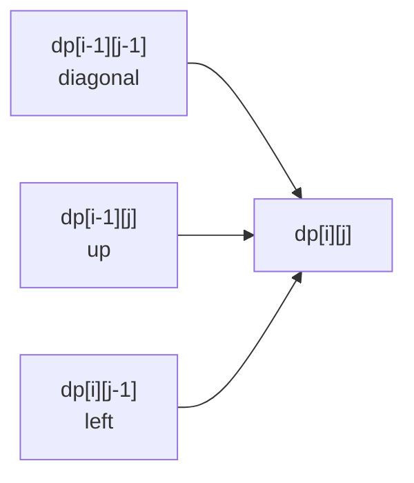
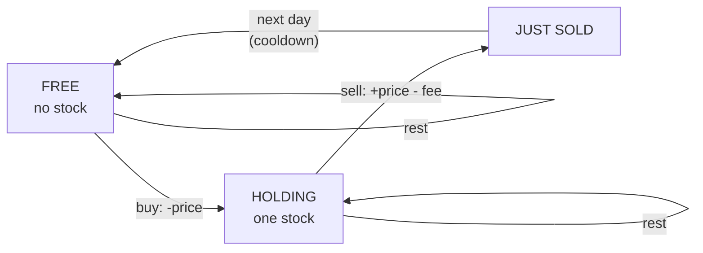

# Chapter 21 · Dynamic Programming II: 2D, Knapsack, Strings & Beyond

> In Chapter 20, every question was "what's the answer for the first *i* things?" But a thief with a backpack needs to know two things: which items he's considered **and** how much space is left. Two strings need two positions. A grid needs a row and a column. The moment one number can't describe "where you are", DP grows a second dimension. The good news: the 5-step framework doesn't change at all. Only the table gets wider.

**You will learn:**
- How to tell when a DP needs **two (or more) indexes**, and how to fill a 2D table in the right order
- **Grid DP**: Unique Paths I & II, Minimum Path Sum, and why Dungeon Game must be solved *backwards*
- The **knapsack family** decoded: 0/1 knapsack (2D → 1D, and *why* the loop runs backwards), unbounded knapsack, Subset Sum, Partition Equal Subset Sum, Target Sum, Last Stone Weight II
- **Two-string DP**: LCS, Edit Distance, Longest Common Substring, Distinct Subsequences, Interleaving String, Regex & Wildcard Matching
- **Palindrome DP**, **interval DP** (Burst Balloons, Matrix Chain Multiplication)
- All **6 stock problems** with one state-machine framework
- **DP on trees**, **bitmask DP** (TSP, Shortest Path Visiting All Nodes, Partition to K Equal Subsets) and a taste of **digit DP**
- A **pattern identification table** that maps problem wording to the right DP family

**Before this:** [Dynamic Programming I](20-dp-1d.md) (essential: read it first) · [Binary Trees](13-binary-trees.md) · [Graphs I: BFS, DFS & Grids](16-graphs-bfs-dfs.md) · [Recursion & Backtracking](09-backtracking.md)

---

## 🧠 The Big Idea

A 1D DP is a row of boxes; each box is filled from boxes to its left. A 2D DP is a **grid of boxes**, and each box is filled from boxes above it, to its left, or diagonally up-left. That's it.

Here's the most famous 2D table in computer science, the **Longest Common Subsequence** of `"abcde"` and `"ace"`. Cell `(i, j)` answers "what's the LCS of the first `i` letters of the first word and the first `j` letters of the second?":

```text
          ""   a   c   e
     ""    0   0   0   0
     a     0   1   1   1
     b     0   1   1   1
     c     0   1   2   2
     d     0   1   2   2
     e     0   1   2   3   <- answer
```

Every cell looks at most three neighbours:



So if you fill **row by row, left to right**, every neighbour you need is already done. That single picture covers grids, knapsack, and almost every two-string problem.

> 💡 **When does DP go 2D?** When the honest brute-force recursion has **two parameters that change independently**: (row, col), (item, capacity), (position in string A, position in string B), (left end, right end), (day, holding-a-stock?). The state is just the list of changing parameters, exactly like Chapter 20.

The second big idea of this chapter: many "different" problems are **the same DP wearing a disguise**. Partition Equal Subset Sum, Target Sum and Last Stone Weight II are all knapsack. Edit Distance, Distinct Subsequences and Regex Matching are all "two pointers into two strings". Six stock problems are one state machine. Learn the families, then learn to see through the costumes.

---

## 🔨 Building It Up

### 1. Unique Paths: your first grid DP

A robot sits in the top-left of an `m × n` grid. It can only move **right** or **down**. How many different paths reach the bottom-right?

**5 steps:**
1. **State:** `dp[r][c]` = number of paths from the start to cell (r, c).
2. **Transition (last move):** you arrived from above or from the left: `dp[r][c] = dp[r-1][c] + dp[r][c-1]`.
3. **Base:** the whole first row and first column are 1 (only one way: straight along the edge).
4. **Order:** row by row, left to right.
5. **Answer:** `dp[m-1][n-1]`.

```python
def unique_paths(m, n):
    dp = [[1] * n for _ in range(m)]          # first row/col already 1
    for r in range(1, m):
        for c in range(1, n):
            dp[r][c] = dp[r - 1][c] + dp[r][c - 1]
    for row in dp:
        print(row)
    return dp[m - 1][n - 1]

print("paths:", unique_paths(3, 4))
```

```text
[1, 1, 1, 1]
[1, 2, 3, 4]
[1, 3, 6, 10]
paths: 10
```

**Space optimisation:** row r only needs row r-1. And within a row, `dp[c-1]` is already the new value while `dp[c]` is still the old (above) value. So **one row** is enough: `row[c] += row[c-1]`.

```python
def unique_paths(m, n):
    row = [1] * n
    for _ in range(1, m):
        for c in range(1, n):
            row[c] += row[c - 1]     # old row[c] = from above, row[c-1] = from left
    return row[-1]

print(unique_paths(3, 7), unique_paths(3, 2), unique_paths(1, 1))
```

```text
28 3 1
```

What just happened: O(m × n) time, O(n) space. (There's also a math answer: you make `m-1` downs and `n-1` rights in some order, so it's `C(m+n-2, m-1)`. See [Chapter 23](23-bits-math.md) for nCr.)

### 2. Unique Paths II: obstacles

Same robot, but some cells are blocked (`1`). A blocked cell has **0** paths through it. That's the only change, but now the first row and column aren't automatically 1 (a rock blocks everything after it), so we let the general rule handle them.

```python
def unique_paths_with_obstacles(grid):
    n = len(grid[0])
    row = [0] * n
    row[0] = 1                              # one way to stand at the start (if it's free)
    for r in range(len(grid)):
        for c in range(n):
            if grid[r][c] == 1:
                row[c] = 0                  # rock: no path ends here
            elif c > 0:
                row[c] += row[c - 1]
    return row[-1]

print(unique_paths_with_obstacles([[0, 0, 0], [0, 1, 0], [0, 0, 0]]))
print(unique_paths_with_obstacles([[0, 1], [0, 0]]))
print(unique_paths_with_obstacles([[1, 0]]))
```

```text
2
1
0
```

What just happened: seeding `row[0] = 1` and running the normal rule for every cell (including row 0 and column 0) handles rocks on the edges automatically.

### 3. Minimum Path Sum: optimisation on a grid

Each cell has a cost. Move right or down from top-left to bottom-right, minimising the total.

`dp[r][c] = grid[r][c] + min(dp[r-1][c], dp[r][c-1])`, with the edges having only one option.

```python
def min_path_sum(grid):
    m, n = len(grid), len(grid[0])
    dp = [[0] * n for _ in range(m)]
    for r in range(m):
        for c in range(n):
            if r == 0 and c == 0:
                dp[r][c] = grid[0][0]
            elif r == 0:
                dp[r][c] = dp[r][c - 1] + grid[r][c]
            elif c == 0:
                dp[r][c] = dp[r - 1][c] + grid[r][c]
            else:
                dp[r][c] = min(dp[r - 1][c], dp[r][c - 1]) + grid[r][c]
    for row in dp:
        print(row)
    return dp[-1][-1]

print("min sum:", min_path_sum([[1, 3, 1], [1, 5, 1], [4, 2, 1]]))
```

```text
[1, 4, 5]
[2, 7, 6]
[6, 8, 7]
min sum: 7
```

The path is 1 → 3 → 1 → 1 → 1. Follow the table backwards from 7: it came from the smaller of 6 (above) and 8 (left), and so on. That's how you **reconstruct** any grid path.

### 4. Dungeon Game: when you must go backwards

A knight starts top-left and must reach the princess bottom-right, moving right or down. Each cell adds (potions, positive) or subtracts (demons, negative) health. If health ever drops to 0 or below, he dies. What's the **minimum starting health**?

```text
-2  -3   3
-5 -10   1
10  30  -5
```

**Why forward DP fails:** going forward, each cell would need to remember *two* things: the current health **and** the lowest health so far. A path with high current health but a scary dip earlier might beat or lose to a path with lower health but no dip, depending on what comes later. One number per cell isn't enough.

**Flip the question:** solve from the princess backwards. Define:
1. **State:** `need[r][c]` = minimum health you must have **when entering** cell (r, c) to survive to the end.
2. **Transition:** after this cell you'll go right or down; pick the one that needs less. You need `min(need_right, need_down) - dungeon[r][c]` on entry, but never less than 1 (you must be alive): `need[r][c] = max(1, min(need[r+1][c], need[r][c+1]) - dungeon[r][c])`.
3. **Base:** at the princess, `need = max(1, 1 - dungeon[last][last])`.
4. **Order:** from bottom-right to top-left.
5. **Answer:** `need[0][0]`.

```python
def calculate_minimum_hp(dungeon):
    m, n = len(dungeon), len(dungeon[0])
    INF = float("inf")
    need = [[INF] * (n + 1) for _ in range(m + 1)]   # extra row/col of INF as walls
    need[m][n - 1] = need[m - 1][n] = 1              # "after" the princess you need 1
    for r in range(m - 1, -1, -1):
        for c in range(n - 1, -1, -1):
            after = min(need[r + 1][c], need[r][c + 1])
            need[r][c] = max(1, after - dungeon[r][c])
    for row in need[:m]:
        print(row[:n])
    return need[0][0]

print("start with:", calculate_minimum_hp([[-2, -3, 3], [-5, -10, 1], [10, 30, -5]]))
```

```text
[7, 5, 2]
[6, 11, 5]
[1, 1, 6]
start with: 7
```

What just happened: going backwards, "what I need from here on" is a single number, so the state is clean. The `max(1, ...)` is the key: a huge potion can't let you enter with 0 health.

> 💡 **Rule of thumb:** if the forward state needs to remember "the worst point so far", try running the DP **backwards** so that the future is summarised by one number.

### 5. The 0/1 Knapsack: the mother of all subset DPs

You have items, each with a **weight** and a **value**, and a bag that holds at most `W` weight. Each item can be taken **at most once** (that's the "0/1": take it or leave it). Maximise the total value.

```text
weights = [1, 3, 4, 5]
values  = [1, 4, 5, 7]
W = 7   ->  best = 9 (items of weight 3 and 4)
```

Greedy by value/weight ratio fails: ratios are 1, 1.33, 1.25, 1.4. Greedy takes weight 5 (value 7), then weight 1 (value 1): total 8. But 3 + 4 gives 9.

**The 5 steps:**
1. **State:** `dp[i][c]` = best value using only the **first i items** with capacity **c**. Two changing parameters → 2D.
2. **Transition (decision about item i-1):**
   - skip it: `dp[i-1][c]`
   - take it (if it fits): `values[i-1] + dp[i-1][c - weights[i-1]]`. Note **i-1** in the second index: once taken, the item is gone.
   - `dp[i][c] = max(skip, take)`.
3. **Base:** `dp[0][c] = 0` (no items, no value).
4. **Order:** i from 1 to n; any order of c (row i only reads row i-1).
5. **Answer:** `dp[n][W]`.

```python
def knapsack_2d(weights, values, W):
    n = len(weights)
    dp = [[0] * (W + 1) for _ in range(n + 1)]
    for i in range(1, n + 1):
        w, v = weights[i - 1], values[i - 1]
        for c in range(W + 1):
            dp[i][c] = dp[i - 1][c]                        # skip item i-1
            if w <= c:
                dp[i][c] = max(dp[i][c], v + dp[i - 1][c - w])   # take it
    for i, row in enumerate(dp):
        print(f"items<{i}:", row)
    return dp[n][W]

print("best:", knapsack_2d([1, 3, 4, 5], [1, 4, 5, 7], 7))
```

```text
items<0: [0, 0, 0, 0, 0, 0, 0, 0]
items<1: [0, 1, 1, 1, 1, 1, 1, 1]
items<2: [0, 1, 1, 4, 5, 5, 5, 5]
items<3: [0, 1, 1, 4, 5, 6, 6, 9]
items<4: [0, 1, 1, 4, 5, 7, 8, 9]
best: 9
```

Read one cell: row `items<3`, capacity 7 (item 2 has weight 4, value 5). Skip → `dp[2][7] = 5`. Take → `5 + dp[2][3] = 5 + 4 = 9`. Max 9.

### 6. Knapsack in 1D, and why the loop runs **backwards**

Row i only reads row i-1. So keep one row and overwrite it in place. But in which direction?

`dp[c]` needs the **old** (row i-1) value of `dp[c - w]`, which is to its **left**. If we go left to right, by the time we reach `c`, `dp[c - w]` has already been overwritten with row i's value, which may *already include this item*. We'd take the item twice!

Going **right to left**, the cells to the left are still from row i-1 when we read them. Each item is used at most once. Watch the bug happen with one item (weight 2, value 3) and capacity 6:

```python
def knapsack_forward_bug(weights, values, W):
    dp = [0] * (W + 1)
    for w, v in zip(weights, values):
        for c in range(w, W + 1):                 # LEFT -> RIGHT  (wrong for 0/1)
            dp[c] = max(dp[c], v + dp[c - w])
    return dp

def knapsack_01(weights, values, W):
    dp = [0] * (W + 1)
    for w, v in zip(weights, values):
        for c in range(W, w - 1, -1):             # RIGHT -> LEFT  (each item once)
            dp[c] = max(dp[c], v + dp[c - w])
    return dp

print("forward :", knapsack_forward_bug([2], [3], 6))
print("backward:", knapsack_01([2], [3], 6))
print("example :", knapsack_01([1, 3, 4, 5], [1, 4, 5, 7], 7)[-1])
```

```text
forward : [0, 0, 3, 3, 6, 6, 9]
backward: [0, 0, 3, 3, 3, 3, 3]
example : 9
```

What just happened: going forward, `dp[4]` read the *new* `dp[2] = 3` and added the item again (6), then `dp[6]` added it a third time (9). We only own one item! Going backward, `dp[6]` reads `dp[4]` before it's updated (still 0), so the item is counted once.

> 💡 **Memory hook:** "**Backwards = once. Forwards = forever.**" A reverse capacity loop is 0/1 knapsack; a forward loop lets items repeat, which is exactly the unbounded knapsack.

### 7. Unbounded Knapsack: same code, loop forwards

Each item may be taken **any number of times**. Now the "forward bug" is the feature: reading the already-updated `dp[c - w]` means "this item may be in there already, take another".

2D view: `dp[i][c] = max(dp[i-1][c], v + dp[i][c - w])`. Note `dp[i]` (same row) in the take branch: after taking item i-1, you may still take it again.

```python
def knapsack_unbounded(weights, values, W):
    dp = [0] * (W + 1)
    for w, v in zip(weights, values):
        for c in range(w, W + 1):                 # forward: reuse allowed
            dp[c] = max(dp[c], v + dp[c - w])
    return dp[W]

def knapsack_01(weights, values, W):
    dp = [0] * (W + 1)
    for w, v in zip(weights, values):
        for c in range(W, w - 1, -1):
            dp[c] = max(dp[c], v + dp[c - w])
    return dp[W]

wts, vals = [1, 3, 4, 5], [1, 4, 5, 7]
print("0/1 knapsack, W=10      :", knapsack_01(wts, vals, 10))
print("unbounded knapsack, W=10:", knapsack_unbounded(wts, vals, 10))
```

```text
0/1 knapsack, W=10      : 13
unbounded knapsack, W=10: 14
```

0/1: weights 1 + 4 + 5 → 1 + 5 + 7 = 13. Unbounded: weight 5 twice → 14. You've already met unbounded knapsack: **Coin Change** in Chapter 20 is unbounded knapsack with "min count" instead of "max value".

| Variant | Each item | 1D capacity loop | 2D "take" reads | Famous problems |
|---|---|---|---|---|
| 0/1 knapsack | at most once | **backward** | previous row `dp[i-1][c-w]` | Partition Equal Subset Sum, Target Sum, Last Stone Weight II, Ones and Zeroes |
| Unbounded knapsack | any number | **forward** | same row `dp[i][c-w]` | Coin Change I & II, Perfect Squares, Rod Cutting |

### 8. Subset Sum and Partition Equal Subset Sum

**Subset Sum:** is there a subset of `nums` that adds up exactly to `target`? This is 0/1 knapsack where we only care about feasibility: `dp[s]` = can some subset of the items seen so far make sum s.

**Partition Equal Subset Sum:** can the array be split into two parts with equal sums? If the total is odd, no. Otherwise, it's "is there a subset summing to total / 2?" (the rest automatically sums to the other half).

```python
def can_partition(nums):
    total = sum(nums)
    if total % 2:
        return False
    target = total // 2
    dp = [True] + [False] * target        # dp[s]: can we make sum s?
    for x in nums:
        for s in range(target, x - 1, -1):    # backwards: each number used once
            dp[s] = dp[s] or dp[s - x]
        if dp[target]:
            return True
    return dp[target]

print(can_partition([1, 5, 11, 5]), can_partition([1, 2, 3, 5]), can_partition([2, 2]))
```

```text
True False True
```

**Trace** for `[1, 5, 11, 5]`, target 11 (✓ = reachable sum):

| after number | reachable sums |
|---|---|
| start | {0} |
| 1 | {0, 1} |
| 5 | {0, 1, 5, 6} |
| 11 | {0, 1, 5, 6, 11} → target reached ✓ |

Time O(n × target), space O(target). A neat Python trick: represent the reachable set as the bits of one big integer, `bits |= bits << x`. It's the same DP, done 64 sums at a time by the CPU.

### 9. Target Sum: the algebra trick

Put a `+` or `-` in front of every number in `nums` so the expression equals `target`. Count the ways. `nums = [1, 1, 1, 1, 1]`, `target = 3` → 5.

The direct DP has state (index, running sum), which works but has negative sums. The elegant route is algebra. Split the numbers into the plus group P and the minus group N:

```text
sum(P) - sum(N) = target
sum(P) + sum(N) = total
---------------------------- add the two lines
2 × sum(P) = target + total   →   sum(P) = (target + total) / 2
```

So the question becomes: **how many subsets sum to `(target + total) / 2`?** That's counting 0/1 knapsack. If `target + total` is odd or `abs(target) > total`, the answer is 0.

```python
def find_target_sum_ways(nums, target):
    total = sum(nums)
    if abs(target) > total or (target + total) % 2:
        return 0
    goal = (target + total) // 2
    dp = [1] + [0] * goal                 # dp[s]: number of subsets with sum s
    for x in nums:
        for s in range(goal, x - 1, -1):
            dp[s] += dp[s - x]
    return dp[goal]

print(find_target_sum_ways([1, 1, 1, 1, 1], 3), find_target_sum_ways([1], 1), find_target_sum_ways([1, 0], 1))
```

```text
5 1 2
```

What just happened: `[1, 0]` gives 2 because `+1+0` and `+1-0` are different expressions. Zeros are handled correctly because the loop goes down to `s = 0` for `x = 0`, doubling `dp[0]`. (A common bug is `range(goal, x, -1)`, which skips that case.)

### 10. Last Stone Weight II: knapsack in a trench coat

Smash stones in pairs: two stones x ≤ y become one stone y - x. What's the smallest possible weight of the last stone (or 0)?

The insight: whatever order you smash in, the final weight is some `(sum of group A) - (sum of group B)`, where every stone is in group A or B. (Each smash puts one stone on the "plus" side and one on the "minus" side.) So: split the stones into two groups with sums as close as possible. Find the largest reachable subset sum `s ≤ total // 2`; the answer is `total - 2s`.

```python
def last_stone_weight_ii(stones):
    total = sum(stones)
    half = total // 2
    dp = [True] + [False] * half
    for x in stones:
        for s in range(half, x - 1, -1):
            dp[s] = dp[s] or dp[s - x]
    best = max(s for s in range(half + 1) if dp[s])
    return total - 2 * best

print(last_stone_weight_ii([2, 7, 4, 1, 8, 1]), last_stone_weight_ii([31, 26, 33, 21, 40]))
```

```text
1 5
```

> 💡 **Knapsack disguise detector:** "split into two groups", "assign + or -", "choose a subset with sum/size limit", "each item at most once" → 0/1 knapsack over **sums**.

### 11. Longest Common Subsequence (LCS): the two-string template

A **subsequence** keeps order but may skip characters. LCS of `"abcde"` and `"ace"` is `"ace"` (length 3).

**The two-string state:** `dp[i][j]` = answer for the **first i chars of a** and the **first j chars of b**. Think about the **last characters** `a[i-1]` and `b[j-1]`:

- If they're equal, they can be matched together: `dp[i][j] = dp[i-1][j-1] + 1`.
- If not, at least one of them isn't in the LCS. Drop one: `dp[i][j] = max(dp[i-1][j], dp[i][j-1])`.
- **Base:** `dp[0][j] = dp[i][0] = 0` (an empty string has nothing in common).

```python
def lcs(a, b):
    m, n = len(a), len(b)
    dp = [[0] * (n + 1) for _ in range(m + 1)]
    for i in range(1, m + 1):
        for j in range(1, n + 1):
            if a[i - 1] == b[j - 1]:
                dp[i][j] = dp[i - 1][j - 1] + 1
            else:
                dp[i][j] = max(dp[i - 1][j], dp[i][j - 1])
    # walk back from the corner to rebuild the subsequence
    i, j, out = m, n, []
    while i > 0 and j > 0:
        if a[i - 1] == b[j - 1]:
            out.append(a[i - 1]); i -= 1; j -= 1
        elif dp[i - 1][j] >= dp[i][j - 1]:
            i -= 1
        else:
            j -= 1
    return dp[m][n], "".join(reversed(out))

print(lcs("abcde", "ace"))
print(lcs("AGGTAB", "GXTXAYB"))
print(lcs("abc", "def"))
```

```text
(3, 'ace')
(4, 'GTAB')
(0, '')
```

The full table for `"abcde"` / `"ace"` is in The Big Idea. Diagonal steps (`+1`) happen exactly where letters match; that's what the walk-back follows. Time and space O(m × n); for the length only, keep two rows → O(min(m, n)) space.

**Why "drop one" is enough:** if `a[i-1] != b[j-1]`, they can't *both* be the last matched pair. So either `a[i-1]` is unused (answer is `dp[i-1][j]`) or `b[j-1]` is unused (`dp[i][j-1]`). We take the better of the two. Every two-string DP is this same argument with different rules.

### 12. Edit Distance

The minimum number of single-character **insert**, **delete**, or **replace** operations to turn `word1` into `word2`. `"horse"` → `"ros"` is 3 (replace h→r, delete r, delete e).

1. **State:** `dp[i][j]` = edits to turn `word1[:i]` into `word2[:j]`.
2. **Transition (last characters):**
   - equal → no edit needed: `dp[i-1][j-1]`
   - otherwise `1 + min(` **replace** `dp[i-1][j-1]`, **delete** from word1 `dp[i-1][j]`, **insert** into word1 `dp[i][j-1]` `)`
3. **Base:** `dp[i][0] = i` (delete everything), `dp[0][j] = j` (insert everything).
4. **Order:** row by row.
5. **Answer:** `dp[m][n]`.

```python
def min_distance(word1, word2):
    m, n = len(word1), len(word2)
    dp = [[0] * (n + 1) for _ in range(m + 1)]
    for i in range(m + 1):
        dp[i][0] = i
    for j in range(n + 1):
        dp[0][j] = j
    for i in range(1, m + 1):
        for j in range(1, n + 1):
            if word1[i - 1] == word2[j - 1]:
                dp[i][j] = dp[i - 1][j - 1]
            else:
                dp[i][j] = 1 + min(dp[i - 1][j - 1],   # replace
                                   dp[i - 1][j],       # delete word1[i-1]
                                   dp[i][j - 1])       # insert word2[j-1]
    print("      " + "  ".join(" " + word2))
    for i in range(m + 1):
        label = " " if i == 0 else word1[i - 1]
        print(f"  {label}  " + "  ".join(str(x) for x in dp[i]))
    return dp[m][n]

print("distance:", min_distance("horse", "ros"))
```

```text
         r  o  s
     0  1  2  3
  h  1  1  2  3
  o  2  2  1  2
  r  3  2  2  2
  s  4  3  3  2
  e  5  4  4  3
distance: 3
```

What just happened: the bottom-right cell is 3. Look at `dp[2][2] = 1` ("ho" → "ro"): the o's match, so it copies `dp[1][1] = 1` (h → r, one replace). The "delete" move goes **down**, "insert" goes **right**, "replace/match" goes **diagonally**.

> 💡 **Why these three moves?** Look at the last character of word1 after all edits. Either it was edited into `word2[j-1]` (replace), or it was thrown away (delete), or `word2[j-1]` was freshly created (insert). Three cases, three neighbours.

### 13. Longest Common Substring (contiguous!)

A **substring** must be contiguous. Change one line of LCS: if the last characters differ, the common substring *ending here* has length **0** (the chain breaks), and the answer is the **max over all cells**, not the corner.

```python
def longest_common_substring(a, b):
    m, n = len(a), len(b)
    dp = [[0] * (n + 1) for _ in range(m + 1)]
    best, end = 0, 0
    for i in range(1, m + 1):
        for j in range(1, n + 1):
            if a[i - 1] == b[j - 1]:
                dp[i][j] = dp[i - 1][j - 1] + 1
                if dp[i][j] > best:
                    best, end = dp[i][j], i
            # else: dp[i][j] stays 0 -> the streak is broken
    return best, a[end - best:end]

print(longest_common_substring("abcdxyz", "xyzabcd"))
print(longest_common_substring("zxabcdezy", "yzabcdezx"))
```

```text
(4, 'abcd')
(6, 'abcdez')
```

| | LCS (subsequence) | Longest Common Substring |
|---|---|---|
| State | first i of a, first j of b | substring **ending at** a[i-1] and b[j-1] |
| Mismatch | `max(up, left)` | `0` |
| Answer | `dp[m][n]` | `max` over all cells |

That's the "ending at" idea from Chapter 20 applied in 2D.

### 14. Distinct Subsequences

How many distinct ways can `t` appear as a subsequence of `s`? `s = "rabbbit"`, `t = "rabbit"` → 3 (which of the three b's to skip).

1. **State:** `dp[i][j]` = number of ways `t[:j]` appears as a subsequence of `s[:i]`.
2. **Transition:** the last char of `s` is either not used (`dp[i-1][j]`) or, if `s[i-1] == t[j-1]`, used to match `t`'s last char (`dp[i-1][j-1]`). Add both (counting!).
3. **Base:** `dp[i][0] = 1` (the empty `t` appears once in anything), `dp[0][j>0] = 0`.
4. **Answer:** `dp[m][n]`.

Using one row, iterating `j` **backwards** (same reason as 0/1 knapsack: we need the previous row's `dp[j-1]`):

```python
def num_distinct(s, t):
    n = len(t)
    dp = [1] + [0] * n                     # dp[j] for the current prefix of s
    for ch in s:
        for j in range(n, 0, -1):          # backwards: read old dp[j-1]
            if ch == t[j - 1]:
                dp[j] += dp[j - 1]
    return dp[n]

print(num_distinct("rabbbit", "rabbit"), num_distinct("babgbag", "bag"), num_distinct("abc", "abcd"))
```

```text
3 5 0
```

Time O(m × n), space O(n).

### 15. Interleaving String

Is `s3` formed by interleaving `s1` and `s2` (keeping each one's internal order)? `s1 = "aabcc"`, `s2 = "dbbca"`, `s3 = "aadbbcbcac"` → True.

1. **State:** `dp[i][j]` = can `s3[:i+j]` be formed from `s1[:i]` and `s2[:j]`. (No third index needed: the position in s3 is always `i + j`.)
2. **Transition:** the last char of `s3[:i+j]` came from s1 (`dp[i-1][j]` and `s1[i-1] == s3[i+j-1]`) or from s2 (`dp[i][j-1]` and `s2[j-1] == s3[i+j-1]`).
3. **Base:** `dp[0][0] = True`.

```python
def is_interleave(s1, s2, s3):
    m, n = len(s1), len(s2)
    if m + n != len(s3):
        return False
    dp = [[False] * (n + 1) for _ in range(m + 1)]
    dp[0][0] = True
    for i in range(m + 1):
        for j in range(n + 1):
            if i > 0 and dp[i - 1][j] and s1[i - 1] == s3[i + j - 1]:
                dp[i][j] = True
            if j > 0 and dp[i][j - 1] and s2[j - 1] == s3[i + j - 1]:
                dp[i][j] = True
    return dp[m][n]

print(is_interleave("aabcc", "dbbca", "aadbbcbcac"))
print(is_interleave("aabcc", "dbbca", "aadbbbaccc"))
print(is_interleave("", "", ""))
```

```text
True
False
True
```

> 💡 **State compression insight:** whenever one index is fully determined by the others (`k = i + j`), drop it. Fewer dimensions = smaller table.

### 16. Regular Expression Matching and Wildcard Matching

These look terrifying but they're just two-string DP with special characters.

**Regex Matching:** `.` matches any one char; `x*` matches **zero or more of the preceding element x**. The pattern must match the **whole** string.

Top-down is clearest. `match(i, j)` = does `s[i:]` match `p[j:]`?

- If the pattern is used up, the string must be too.
- `first` = does `s[i]` match `p[j]` (equal or `.`)?
- If `p[j+1] == '*'`: either use **zero** copies (skip `x*`: `match(i, j+2)`), or use **one more** copy (`first` and `match(i+1, j)`: stay on `x*` because it can eat more).
- Otherwise: `first` and `match(i+1, j+1)`.

```python
from functools import cache

def is_match_regex(s, p):
    @cache
    def match(i, j):
        if j == len(p):
            return i == len(s)
        first = i < len(s) and p[j] in (s[i], ".")
        if j + 1 < len(p) and p[j + 1] == "*":
            return match(i, j + 2) or (first and match(i + 1, j))
        return first and match(i + 1, j + 1)
    return match(0, 0)

tests = [("aa", "a"), ("aa", "a*"), ("ab", ".*"), ("aab", "c*a*b"), ("mississippi", "mis*is*p*.")]
for s, p in tests:
    print(f"{s!r:14} {p!r:14} {is_match_regex(s, p)}")
```

```text
'aa'           'a'            False
'aa'           'a*'           True
'ab'           '.*'           True
'aab'          'c*a*b'        True
'mississippi'  'mis*is*p*.'   False
```

**Wildcard Matching:** `?` matches any one char; `*` matches **any sequence** (including empty), on its own. Bottom-up this time, `dp[i][j]` = does `s[:i]` match `p[:j]`:

- `p[j-1] == '*'`: the star matches empty (`dp[i][j-1]`) **or** it swallows `s[i-1]` and stays available (`dp[i-1][j]`).
- `p[j-1] == '?'` or equals `s[i-1]`: `dp[i-1][j-1]`.
- **Base:** `dp[0][0] = True`; `dp[0][j]` is True only while the pattern is all stars.

```python
def is_match_wildcard(s, p):
    m, n = len(s), len(p)
    dp = [[False] * (n + 1) for _ in range(m + 1)]
    dp[0][0] = True
    for j in range(1, n + 1):
        dp[0][j] = dp[0][j - 1] and p[j - 1] == "*"
    for i in range(1, m + 1):
        for j in range(1, n + 1):
            if p[j - 1] == "*":
                dp[i][j] = dp[i][j - 1] or dp[i - 1][j]
            elif p[j - 1] == "?" or p[j - 1] == s[i - 1]:
                dp[i][j] = dp[i - 1][j - 1]
    return dp[m][n]

tests = [("aa", "a"), ("aa", "*"), ("cb", "?a"), ("adceb", "*a*b"), ("acdcb", "a*c?b")]
for s, p in tests:
    print(f"{s!r:8} {p!r:8} {is_match_wildcard(s, p)}")
```

```text
'aa'     'a'      False
'aa'     '*'      True
'cb'     '?a'     False
'adceb'  '*a*b'   True
'acdcb'  'a*c?b'  False
```

| | Regex `*` | Wildcard `*` |
|---|---|---|
| Meaning | zero or more of the **previous** char | any sequence on its own |
| "zero" option | skip two pattern chars (`j+2`) | skip one pattern char |
| "one more" option | only if `s[i]` matches the previous char | always |

### 17. Palindrome DP: substring, subsequence, partitioning

Palindromes give us a new kind of state: **(left end, right end) of the same string**.

**Longest Palindromic Substring.** `is_pal[i][j]` = is `s[i..j]` a palindrome. It is if the ends match and the inside `s[i+1..j-1]` is a palindrome (or is length ≤ 1). The inside is a **shorter** interval, so fill by **increasing length**. In practice, the simpler O(1)-space approach is **expand around centre**: every palindrome has a centre (a char, or a gap between two chars), so try all 2n - 1 centres and grow outwards.

```python
def longest_palindrome_dp(s):
    n = len(s)
    is_pal = [[False] * n for _ in range(n)]
    start, best = 0, 1
    for length in range(1, n + 1):                 # shorter intervals first
        for i in range(n - length + 1):
            j = i + length - 1
            if s[i] == s[j] and (length <= 2 or is_pal[i + 1][j - 1]):
                is_pal[i][j] = True
                if length > best:
                    start, best = i, length
    return s[start:start + best]

def longest_palindrome_expand(s):
    def grow(lo, hi):
        while lo >= 0 and hi < len(s) and s[lo] == s[hi]:
            lo -= 1
            hi += 1
        return lo + 1, hi                         # s[lo+1:hi] is the palindrome
    best = (0, 0)
    for c in range(len(s)):
        for lo, hi in (grow(c, c), grow(c, c + 1)):   # odd centre, even centre
            if hi - lo > best[1] - best[0]:
                best = (lo, hi)
    return s[best[0]:best[1]]

for s in ["babad", "cbbd", "forgeeksskeegfor"]:
    print(s, longest_palindrome_dp(s), longest_palindrome_expand(s))
```

```text
babad bab bab
cbbd bb bb
forgeeksskeegfor geeksskeeg geeksskeeg
```

Both are O(n²) time; the DP uses O(n²) space, expand-around-centre O(1). (An O(n) algorithm, Manacher's, is in [Chapter 24](24-advanced-structures.md).)

**Longest Palindromic Subsequence.** `dp[i][j]` = length of the longest palindromic subsequence inside `s[i..j]`:
- ends equal: `dp[i+1][j-1] + 2`
- else: `max(dp[i+1][j], dp[i][j-1])` (drop one end)
- base: `dp[i][i] = 1`.

Fill `i` from right to left (so `dp[i+1][...]` is ready) and `j` from left to right.

```python
def longest_palindrome_subseq(s):
    n = len(s)
    dp = [[0] * n for _ in range(n)]
    for i in range(n - 1, -1, -1):
        dp[i][i] = 1
        for j in range(i + 1, n):
            if s[i] == s[j]:
                dp[i][j] = dp[i + 1][j - 1] + 2
            else:
                dp[i][j] = max(dp[i + 1][j], dp[i][j - 1])
    return dp[0][n - 1]

print(longest_palindrome_subseq("bbbab"), longest_palindrome_subseq("cbbd"), longest_palindrome_subseq("character"))
```

```text
4 2 5
```

(Shortcut fact: the LPS of `s` equals the LCS of `s` and `reversed(s)`.)

**Palindrome Partitioning II.** Cut `s` into pieces that are all palindromes, with the fewest cuts. `"aab"` → 1 (`"aa" | "b"`). This is the "last cut" DP from Chapter 20 on top of an `is_pal` table:

`cuts[i]` = min cuts for `s[:i]` = `min(cuts[j] + 1)` over `j` where `s[j:i]` is a palindrome. Setting `cuts[0] = -1` makes a whole-string palindrome cost `-1 + 1 = 0` cuts.

```python
def min_cut(s):
    n = len(s)
    is_pal = [[False] * n for _ in range(n)]
    for i in range(n - 1, -1, -1):
        for j in range(i, n):
            if s[i] == s[j] and (j - i <= 2 or is_pal[i + 1][j - 1]):
                is_pal[i][j] = True
    cuts = [-1] + [0] * n
    for i in range(1, n + 1):
        cuts[i] = min(cuts[j] + 1 for j in range(i) if is_pal[j][i - 1])
    return cuts[n]

print(min_cut("aab"), min_cut("a"), min_cut("ab"), min_cut("abccbc"))
```

```text
1 0 1 2
```

O(n²) time and space. (`"abccbc"` → `"a" | "bccb" | "c"`.)

### 18. Interval DP: Burst Balloons and Matrix Chain Multiplication

**Interval DP** is for problems on a sequence where you repeatedly **merge or remove** things, and the cost of a step depends on its neighbours *at that moment*. State: `dp[l][r]` = best answer for the sub-range l..r. Fill by **increasing length**. Transition: try every split point `k` inside.

**Burst Balloons.** Bursting balloon i earns `nums[left] × nums[i] × nums[right]`, where left/right are its *current* neighbours (a missing neighbour counts as 1). Maximise coins. `[3, 1, 5, 8]` → 167.

The trap: if you pick the **first** balloon to burst in a range, its neighbours change and the two sides become entangled. Instead pick the **last** balloon `k` to burst in the open interval (l, r). When k bursts last, everything else in (l, r) is gone, so its neighbours are exactly `l` and `r`. The two sides (l, k) and (k, r) are now independent. That's the whole trick.

```python
def max_coins(nums):
    a = [1] + nums + [1]                       # padding: virtual balloons worth 1
    n = len(a)
    dp = [[0] * n for _ in range(n)]           # dp[l][r]: best for balloons strictly between l and r
    for length in range(2, n):                 # distance between l and r
        for l in range(n - length):
            r = l + length
            for k in range(l + 1, r):          # k is the LAST balloon burst in (l, r)
                dp[l][r] = max(dp[l][r], dp[l][k] + a[l] * a[k] * a[r] + dp[k][r])
    return dp[0][n - 1]

print(max_coins([3, 1, 5, 8]), max_coins([1, 5]))
```

```text
167 10
```

O(n³) time, O(n²) space.

**Matrix Chain Multiplication.** Multiplying a `p × q` matrix by a `q × r` matrix costs `p × q × r` scalar multiplications. Given a chain of matrices, choose where to put brackets to minimise the total. Matrix i has shape `dims[i] × dims[i+1]`.

`dp[i][j]` = min cost to multiply matrices i..j. Try every split `k`: `(i..k)(k+1..j)`, cost `dp[i][k] + dp[k+1][j] + dims[i] × dims[k+1] × dims[j+1]`.

```python
def matrix_chain(dims):
    n = len(dims) - 1                          # number of matrices
    dp = [[0] * n for _ in range(n)]
    for length in range(2, n + 1):
        for i in range(n - length + 1):
            j = i + length - 1
            dp[i][j] = min(dp[i][k] + dp[k + 1][j] + dims[i] * dims[k + 1] * dims[j + 1]
                           for k in range(i, j))
    return dp[0][n - 1]

print(matrix_chain([10, 30, 5, 60]), matrix_chain([40, 20, 30, 10, 30]))
```

```text
4500 26000
```

`[10, 30, 5, 60]`: `(AB)C` costs `10·30·5 + 10·5·60 = 1500 + 3000 = 4500`; `A(BC)` costs `30·5·60 + 10·30·60 = 27000`. Bracketing matters a lot!

### 19. Stock problems: six problems, one state machine

There are six famous "Best Time to Buy and Sell Stock" problems. Most people memorise six solutions. Instead, see them as **one** machine: on each day you're in a state, and you take an action.



**State:** `(day i, transactions left k, holding?)`. **Value:** the best profit from day i onward.

- Free: `max(rest → f(i+1, k, free), buy → -price[i] + f(i+1, k-1, holding))` (a buy uses one transaction)
- Holding: `max(rest → f(i+1, k, holding), sell → price[i] - fee + f(i+1+cooldown, k, free))`

The six problems are just six settings of three knobs:

| Problem | k (transactions) | cooldown | fee |
|---|---|---|---|
| I: one transaction | 1 | 0 | 0 |
| II: unlimited | ∞ | 0 | 0 |
| III: at most two | 2 | 0 | 0 |
| IV: at most k | k | 0 | 0 |
| with Cooldown | ∞ | 1 | 0 |
| with Transaction Fee | ∞ | 0 | fee |

One function solves all six:

```python
from functools import cache

def max_profit(prices, k=None, cooldown=0, fee=0):
    n = len(prices)
    if k is None:
        k = n // 2 + 1                # "unlimited": you can't do more than n/2 useful trades

    @cache
    def f(i, left, holding):
        if i >= n:
            return 0
        rest = f(i + 1, left, holding)
        if holding:
            sell = prices[i] - fee + f(i + 1 + cooldown, left, False)
            return max(rest, sell)
        if left == 0:
            return rest
        buy = -prices[i] + f(i + 1, left - 1, True)
        return max(rest, buy)

    return f(0, k, False)

print("I   :", max_profit([7, 1, 5, 3, 6, 4], k=1))
print("II  :", max_profit([7, 1, 5, 3, 6, 4]))
print("III :", max_profit([3, 3, 5, 0, 0, 3, 1, 4], k=2))
print("IV  :", max_profit([3, 2, 6, 5, 0, 3], k=2))
print("cool:", max_profit([1, 2, 3, 0, 2], cooldown=1))
print("fee :", max_profit([1, 3, 2, 8, 4, 9], fee=2))
```

```text
I   : 5
II  : 7
III : 6
IV  : 7
cool: 3
fee : 8
```

What just happened: one recurrence, six answers. The state machine view also gives the O(1)-space bottom-up versions; each is a handful of variables that track "best profit if I'm in state X today":

```python
def stock_i(prices):                   # one transaction
    best_buy, profit = float("-inf"), 0
    for p in prices:
        best_buy = max(best_buy, -p)           # cheapest buy so far (as negative cash)
        profit = max(profit, best_buy + p)
    return profit

def stock_ii(prices):                  # unlimited
    free, hold = 0, float("-inf")
    for p in prices:
        free, hold = max(free, hold + p), max(hold, free - p)
    return free

def stock_iii(prices):                 # at most two
    b1 = b2 = float("-inf")
    s1 = s2 = 0
    for p in prices:
        b1 = max(b1, -p)               # after 1st buy
        s1 = max(s1, b1 + p)           # after 1st sell
        b2 = max(b2, s1 - p)           # after 2nd buy
        s2 = max(s2, b2 + p)           # after 2nd sell
    return s2

def stock_iv(k, prices):               # at most k
    buy = [float("-inf")] * (k + 1)
    sell = [0] * (k + 1)
    for p in prices:
        for t in range(1, k + 1):
            buy[t] = max(buy[t], sell[t - 1] - p)
            sell[t] = max(sell[t], buy[t] + p)
    return sell[k]

def stock_cooldown(prices):
    free, hold, cooling = 0, float("-inf"), 0
    for p in prices:
        free, hold, cooling = max(free, cooling), max(hold, free - p), hold + p
    return max(free, cooling)

def stock_fee(prices, fee):
    free, hold = 0, float("-inf")
    for p in prices:
        free, hold = max(free, hold + p - fee), max(hold, free - p)
    return free

print(stock_i([7, 1, 5, 3, 6, 4]), stock_ii([7, 1, 5, 3, 6, 4]), stock_iii([3, 3, 5, 0, 0, 3, 1, 4]),
      stock_iv(2, [3, 2, 6, 5, 0, 3]), stock_cooldown([1, 2, 3, 0, 2]), stock_fee([1, 3, 2, 8, 4, 9], 2))
```

```text
5 7 6 7 3 8
```

**Trace** of `stock_cooldown([1, 2, 3, 0, 2])` (values at the end of each day; `cooling` = "sold today"):

| day | price | free | hold | cooling |
|---|---|---|---|---|
| start | - | 0 | -inf | 0 |
| 0 | 1 | 0 | -1 | -inf |
| 1 | 2 | 0 | -1 | 1 |
| 2 | 3 | 1 | -1 | 2 |
| 3 | 0 | 2 | 1 | -1 |
| 4 | 2 | 2 | 1 | 3 |

Answer `max(2, 3) = 3`: buy at 1, sell at 2, cool down, buy at 0, sell at 2.

### 20. DP on trees

On a tree, the natural order is **post-order**: solve both children, then combine at the parent ([Chapter 13](13-binary-trees.md)). Each node returns a small tuple of answers ("the state"), and the parent combines them. No table needed: the recursion *is* the table, and each node is visited once.

**House Robber III.** Houses form a binary tree; you can't rob a node and its direct child. Each node returns **two** numbers: `(best if I rob this node, best if I don't)`.

- rob this node: `node.val + (children not robbed)`
- don't rob: each child independently picks its better option.

```python
class TreeNode:
    def __init__(self, val, left=None, right=None):
        self.val, self.left, self.right = val, left, right

def build(values):
    """Build a tree from a level-order list (None = missing child)."""
    if not values:
        return None
    nodes = [None if v is None else TreeNode(v) for v in values]
    kids = iter(nodes[1:])
    for node in nodes:
        if node:
            node.left = next(kids, None)
            node.right = next(kids, None)
    return nodes[0]

def rob_tree(root):
    def dfs(node):
        if not node:
            return 0, 0                              # (rob, skip)
        l_rob, l_skip = dfs(node.left)
        r_rob, r_skip = dfs(node.right)
        rob = node.val + l_skip + r_skip
        skip = max(l_rob, l_skip) + max(r_rob, r_skip)
        return rob, skip
    return max(dfs(root))

print(rob_tree(build([3, 2, 3, None, 3, None, 1])), rob_tree(build([3, 4, 5, 1, 3, None, 1])))
```

```text
7 9
```

**Diameter-style DP: Binary Tree Maximum Path Sum.** A path can bend at one node. Each node returns "the best **downward** path starting here" (one branch, usable by the parent), while a global `best` records "the best path **bending** here" (both branches, not usable by the parent). This "return one thing, record another" shape solves Diameter of Binary Tree, Longest Univalue Path, and Max Path Sum.

```python
class TreeNode:
    def __init__(self, val, left=None, right=None):
        self.val, self.left, self.right = val, left, right

def build(values):
    if not values:
        return None
    nodes = [None if v is None else TreeNode(v) for v in values]
    kids = iter(nodes[1:])
    for node in nodes:
        if node:
            node.left = next(kids, None)
            node.right = next(kids, None)
    return nodes[0]

def max_path_sum(root):
    best = float("-inf")
    def down(node):
        nonlocal best
        if not node:
            return 0
        left = max(down(node.left), 0)           # a negative branch is better dropped
        right = max(down(node.right), 0)
        best = max(best, node.val + left + right)    # path bending at this node
        return node.val + max(left, right)           # parent may extend one branch only
    down(root)
    return best

def diameter(root):
    best = 0
    def height(node):
        nonlocal best
        if not node:
            return 0
        l, r = height(node.left), height(node.right)
        best = max(best, l + r)                      # edges through this node
        return 1 + max(l, r)
    height(root)
    return best

print(max_path_sum(build([-10, 9, 20, None, None, 15, 7])), max_path_sum(build([1, 2, 3])))
print(diameter(build([1, 2, 3, 4, 5])))
```

```text
42 6
3
```

Time O(n), space O(height) for the recursion.

### 21. Bitmask DP: when the state is a set

Some problems need to remember **which items have been used**, and order matters only through that set. If n ≤ ~20, encode the set as an integer **mask**: bit i is 1 if item i is used. There are 2ⁿ masks (about a million for n = 20). (Bit tricks are explained fully in [Chapter 23](23-bits-math.md); here you need `mask & (1 << i)` to test bit i and `mask | (1 << i)` to set it.)

**Travelling Salesman (Held-Karp).** Visit every city exactly once starting and ending at city 0, minimising the distance. Brute force tries (n-1)! orders. DP state: `dp[mask][j]` = shortest path that starts at 0, visits exactly the cities in `mask`, and ends at `j`. Transition: extend to an unvisited city `nxt`.

```python
def tsp(dist):
    n = len(dist)
    INF = float("inf")
    full = (1 << n) - 1
    dp = [[INF] * n for _ in range(1 << n)]
    dp[1][0] = 0                                    # visited {0}, standing at 0
    for mask in range(1 << n):
        for j in range(n):
            if dp[mask][j] == INF or not mask & (1 << j):
                continue
            for nxt in range(n):
                if mask & (1 << nxt):
                    continue                        # already visited
                new_mask = mask | (1 << nxt)
                cand = dp[mask][j] + dist[j][nxt]
                if cand < dp[new_mask][nxt]:
                    dp[new_mask][nxt] = cand
    return min(dp[full][j] + dist[j][0] for j in range(1, n))

dist = [[0, 10, 15, 20],
        [10, 0, 35, 25],
        [15, 35, 0, 30],
        [20, 25, 30, 0]]
print(tsp(dist))
```

```text
80
```

O(2ⁿ × n²) time instead of O(n!). For n = 15, that's about 7 million steps versus 87 billion orders. (Route: 0 → 1 → 3 → 2 → 0 = 10 + 25 + 30 + 15.)

**Shortest Path Visiting All Nodes.** In an unweighted graph, find the shortest walk that visits every node (you may revisit nodes and start anywhere). Every edge costs 1, so use **BFS** ([Chapter 16](16-graphs-bfs-dfs.md)) where a "node" in the BFS is the pair `(current node, mask of visited nodes)`. Start from every node at once.

```python
from collections import deque

def shortest_path_length(graph):
    n = len(graph)
    full = (1 << n) - 1
    queue = deque((v, 1 << v, 0) for v in range(n))
    seen = {(v, 1 << v) for v in range(n)}
    while queue:
        node, mask, dist = queue.popleft()
        if mask == full:
            return dist
        for nxt in graph[node]:
            state = (nxt, mask | (1 << nxt))
            if state not in seen:
                seen.add(state)
                queue.append((nxt, state[1], dist + 1))
    return 0

print(shortest_path_length([[1, 2, 3], [0], [0], [0]]))
print(shortest_path_length([[1], [0, 2, 4], [1, 3, 4], [2], [1, 2]]))
```

```text
4
4
```

O(2ⁿ × n²) in the worst case. The lesson: **"DP state" and "BFS node" are the same idea**. When all transitions cost 1, BFS fills the DP in the right order for free.

**Partition to K Equal Sum Subsets.** Can `nums` be split into k groups with equal sums? `dp[mask]` = after placing the numbers in `mask` (filling buckets one at a time), how full is the current bucket (or -1 if this mask is unreachable).

```python
def can_partition_k_subsets(nums, k):
    total = sum(nums)
    if total % k:
        return False
    side = total // k
    if max(nums) > side:
        return False
    n = len(nums)
    dp = [-1] * (1 << n)
    dp[0] = 0
    for mask in range(1 << n):
        if dp[mask] == -1:
            continue
        for i in range(n):
            if not mask & (1 << i) and dp[mask] + nums[i] <= side:
                nxt = mask | (1 << i)
                if dp[nxt] == -1:
                    dp[nxt] = (dp[mask] + nums[i]) % side    # bucket full -> start a new one at 0
    return dp[(1 << n) - 1] == 0

print(can_partition_k_subsets([4, 3, 2, 3, 5, 2, 1], 4), can_partition_k_subsets([1, 2, 3, 4], 3))
```

```text
True False
```

O(2ⁿ × n). It works because the order of filling doesn't matter: any mask reachable at all reaches the same "current bucket fill" (`sum(mask) % side`).

### 22. Digit DP (a short taste)

"Count the integers from 0 to N that have property P" with N up to 10¹⁸: you can't loop. Instead, build the number **digit by digit** from the left, with state:

- `pos`: which digit we're choosing,
- some summary of the digits chosen so far (here, their sum),
- `tight`: are we still equal to N's prefix? If yes, the next digit can't exceed N's digit at this position.

Example: count integers in [0, N] whose digits sum to S. We check it against brute force.

```python
from functools import cache

def count_digit_sum(N, S):
    digits = list(map(int, str(N)))

    @cache
    def f(pos, total, tight):
        if total > S:
            return 0
        if pos == len(digits):
            return 1 if total == S else 0
        limit = digits[pos] if tight else 9
        return sum(f(pos + 1, total + d, tight and d == limit) for d in range(limit + 1))

    return f(0, 0, True)

def brute(N, S):
    return sum(1 for x in range(N + 1) if sum(map(int, str(x))) == S)

for N, S in [(100, 5), (2024, 10), (99999, 20)]:
    print(N, S, count_digit_sum(N, S), brute(N, S))
print(count_digit_sum(10 ** 18, 50))
```

```text
100 5 6 6
2024 10 120 120
99999 20 5631 5631
1264175877686580
```

States: about 19 positions × 51 possible sums (we stop past S) × 2 tight values, each with 10 choices. Instant even for N = 10¹⁸. That's the power of digit DP. Classic problems: Count Numbers with Unique Digits, Numbers At Most N Given Digit Set, Number of Digit One, Non-negative Integers without Consecutive Ones.

---

## 🔬 Under the Hood

### Fill order is a dependency graph

Every DP table is secretly a **directed acyclic graph**: cells are nodes, "cell X reads cell Y" is an edge. A valid fill order is any **topological order** of that graph ([Chapter 17](17-graphs-advanced.md)). That's why the order changes by family:

| Family | Cell reads | Valid order |
|---|---|---|
| Grid / two-string | up, left, up-left | row by row, left to right |
| Dungeon (backwards) | down, right | bottom-up, right to left |
| Palindrome / interval | inner, shorter ranges | by increasing length, or i descending + j ascending |
| 0/1 knapsack 1D | old `dp[c-w]` (to the left) | items outer, capacity **descending** |
| Bitmask | masks with one fewer bit (always numerically smaller) | mask ascending |
| Tree | children | post-order DFS |

Memoization finds this order automatically (recursion naturally visits dependencies first), which is why top-down is the safest way to write an unfamiliar DP.

### Why the reverse knapsack loop is correct (a precise argument)

In the 1D array during item i's pass, at the moment we compute `dp[c]`, the cells with index **> c** already hold row i values and cells with index **≤ c** still hold row i-1 values (we're going downward). The transition reads `dp[c]` and `dp[c - w]`, both ≤ c, so both are row i-1 values: exactly the 2D recurrence `max(dp[i-1][c], v + dp[i-1][c-w])`. Going upward flips it: `dp[c-w]` already holds row i, which gives `v + dp[i][c-w]`, the **unbounded** recurrence. Same code, two meanings, decided by one loop direction.

### Pseudo-polynomial time and NP-hardness

Knapsack and Subset Sum are **NP-hard**: no known algorithm is polynomial in the *number of bits* of the input. Our O(n × W) DP is called **pseudo-polynomial**: it's polynomial in the *value* W. With W = 10⁴ it's instant; with W = 10¹⁵ the table can't exist. When an interviewer gives huge weights but n ≤ 40, the expected answer is **meet in the middle** (split items into two halves of 20, enumerate 2²⁰ sums each, sort and two-pointer), not DP.

### Complexity of each family

| Family | States | Work per state | Time | Space (optimised) |
|---|---|---|---|---|
| Grid m × n | mn | O(1) | O(mn) | O(n) |
| 0/1 or unbounded knapsack | n × W | O(1) | O(nW) | O(W) |
| Two strings m, n | mn | O(1) | O(mn) | O(min(m, n)) |
| Palindromes / interval (split) | n² | O(1) / O(n) | O(n²) / O(n³) | O(n²) |
| Stock with k | n × k × 2 | O(1) | O(nk) | O(k) |
| Tree | n nodes | O(1) | O(n) | O(height) |
| Bitmask (TSP) | 2ⁿ × n | O(n) | O(2ⁿ n²) | O(2ⁿ n) |
| Digit DP | digits × summary × 2 | O(10) | tiny | tiny |

### Python memory for 2D tables

A list of lists of ints: each row is a list object holding pointers to int objects (small ints -5..256 are shared). A 5000 × 5000 table is 25 million pointers ≈ 200 MB. That's why reducing to one or two rows isn't just elegance: on large inputs it's the difference between passing and a Memory Limit Exceeded.

---

## 🧩 Pattern Decoder

### Signals: which DP family?

| You see in the problem... | Family | State |
|---|---|---|
| grid, robot, move right/down, paths, min cost path | Grid DP | `dp[r][c]` |
| "need at least X to survive", path minimum matters | Grid DP **backwards** | `need[r][c]` |
| items with weight/cost, capacity/budget, each once | 0/1 knapsack | `dp[i][cap]` → `dp[cap]` (reverse loop) |
| "unlimited supply", "reuse allowed", coins | Unbounded knapsack | `dp[cap]` (forward loop) |
| "split into two groups", "assign + / −", "equal sum" | Subset-sum knapsack | `dp[sum]` |
| two strings: "common", "transform", "match", "interleave", "subsequence of" | Two-string DP | `dp[i][j]` on prefixes |
| "palindrome" + substring / subsequence | Palindrome (interval on one string) | `dp[i][j]` on `s[i..j]` |
| "burst", "merge stones", "cut", "bracket", cost depends on neighbours | Interval DP | `dp[l][r]`, split k, by length |
| buy/sell, cooldown, at most k times, fee | State-machine DP | `(day, k, holding)` |
| tree + "can't pick parent and child", "max path" | Tree DP | tuple returned from DFS |
| n ≤ 20, "visit all", "assign each to one", permutations of a small set | Bitmask DP | `dp[mask][last]` |
| "count numbers ≤ N with digit property", N up to 10¹⁸ | Digit DP | `(pos, summary, tight)` |

### Template: Grid DP

```py
dp = [[0] * n for _ in range(m)]
for r in range(m):
    for c in range(n):
        if r == 0 and c == 0: dp[r][c] = START
        else:
            from_up   = dp[r-1][c] if r > 0 else IDENTITY
            from_left = dp[r][c-1] if c > 0 else IDENTITY
            dp[r][c] = COMBINE(from_up, from_left) ⊕ grid[r][c]
answer = dp[m-1][n-1]
```

### Template: 0/1 and unbounded knapsack (1D)

```py
dp = [BASE_AT_0] + [IDENTITY] * W
for weight, value in items:
    for cap in range(W, weight - 1, -1):          # 0/1: backwards
    # for cap in range(weight, W + 1):            # unbounded: forwards
        dp[cap] = COMBINE(dp[cap], dp[cap - weight] ⊕ value)
answer = dp[W]
```

Fill in `COMBINE`/`⊕`/`IDENTITY`: max value (`max`, `+`, `0`), feasibility (`or`, ignore value, `False` with `dp[0]=True`), counting (`+`, ignore value, `0` with `dp[0]=1`), min count (`min`, `+1`, `inf` with `dp[0]=0`).

### Template: Two-string DP

```py
dp = [[0] * (n + 1) for _ in range(m + 1)]
# base row/col: what does an empty prefix mean? (0 for LCS, i/j for edit distance, 1 for counting)
for i in range(1, m + 1):
    for j in range(1, n + 1):
        if a[i-1] == b[j-1]:
            dp[i][j] = MATCH_RULE(dp[i-1][j-1])
        else:
            dp[i][j] = MISMATCH_RULE(dp[i-1][j], dp[i][j-1], dp[i-1][j-1])
answer = dp[m][n]
```

### Template: Interval DP

```py
dp = [[0] * n for _ in range(n)]
for length in range(2, n + 1):                 # shorter intervals first
    for l in range(n - length + 1):
        r = l + length - 1
        dp[l][r] = BEST(dp[l][k] ⊕ dp[k+1][r] ⊕ cost(l, k, r) for k in range(l, r))
answer = dp[0][n-1]
```

### Template: State machine

```py
states = {s: INITIAL[s] for s in STATES}       # e.g. free=0, hold=-inf
for x in sequence:
    states = {s: best over (prev_state --action--> s) of states[prev_state] + gain(action, x)
              for s in STATES}                  # compute all from OLD values
answer = best of the accepting states
```

### Template: Tree DP

```py
def dfs(node):
    if not node:
        return EMPTY_TUPLE
    left, right = dfs(node.left), dfs(node.right)
    # maybe update a global answer using BOTH children (bend here)
    return COMBINE(node.val, left, right)    # what the parent can use (one branch / per-state)
```

### Template: Bitmask DP

```py
dp = [[INF] * n for _ in range(1 << n)]
dp[START_MASK][START] = 0
for mask in range(1 << n):
    for last in range(n):
        if dp[mask][last] == INF: continue
        for nxt in range(n):
            if mask & (1 << nxt): continue
            new = mask | (1 << nxt)
            dp[new][nxt] = min(dp[new][nxt], dp[mask][last] + cost(last, nxt))
```

### The DP Pattern Identification Table (Chapters 20 + 21)

| Problem | Family | State | Transition (sketch) | Time |
|---|---|---|---|---|
| Climbing Stairs | 1D ways | `i` | `dp[i-1]+dp[i-2]` | O(n) |
| House Robber I/II | 1D take/skip | `i` | `max(dp[i-1], dp[i-2]+v)` | O(n) |
| Decode Ways | 1D ways | `i` | 1-digit + 2-digit | O(n) |
| Coin Change / II | unbounded knapsack | amount | `min(dp[x-c]+1)` / `+= dp[x-c]` | O(A·C) |
| Word Break | last cut | `i` | `dp[j] and s[j:i] in words` | O(n·L²) |
| LIS | ending at i | `i` | `1+max(dp[j])` / tails | O(n log n) |
| Max Product Subarray | ending at i, 2 values | `i` | hi/lo | O(n) |
| Unique Paths / Min Path Sum | grid | `(r,c)` | up + left | O(mn) |
| Dungeon Game | grid backwards | `(r,c)` | `max(1, min(down,right)-cell)` | O(mn) |
| 0/1 Knapsack | knapsack | `(i,cap)` → `cap` | reverse loop | O(nW) |
| Partition Equal Subset Sum | subset sum | `sum` | `dp[s] or dp[s-x]` | O(n·S) |
| Target Sum | subset count | `sum` | algebra → `(T+S)/2` | O(n·S) |
| Last Stone Weight II | subset sum | `sum` | closest to S/2 | O(n·S) |
| LCS | two strings | `(i,j)` | match diag+1 / max(up,left) | O(mn) |
| Edit Distance | two strings | `(i,j)` | 1+min(3 neighbours) | O(mn) |
| Distinct Subsequences | two strings, count | `(i,j)` | skip + match | O(mn) |
| Interleaving String | two strings | `(i,j)` | from s1 or s2 | O(mn) |
| Regex / Wildcard | two strings | `(i,j)` | star: zero or one-more | O(mn) |
| Longest Palindromic Subseq. | interval on one string | `(i,j)` | ends equal +2 / drop one | O(n²) |
| Palindrome Partitioning II | last cut + is_pal | `i` | `min(cuts[j]+1)` | O(n²) |
| Burst Balloons / Matrix Chain | interval | `(l,r)` | last/split k | O(n³) |
| Stock I-IV, cooldown, fee | state machine | `(day,k,hold)` | buy/sell/rest | O(nk) |
| House Robber III / Max Path Sum | tree | node → tuple | post-order combine | O(n) |
| TSP / Visit All Nodes | bitmask | `(mask,last)` | add one unvisited | O(2ⁿn²) |
| Count numbers ≤ N with property | digit | `(pos,summary,tight)` | try each digit | O(D·S·10) |

### When NOT to use these DPs

- **Weights/targets are huge** (10⁹+) but n is small (≤ 40) → meet in the middle, not knapsack.
- **n is large (≥ 25) and the state is a set** → bitmask DP explodes (2²⁵ × 25 is too much). Look for a smarter state, a greedy, or a graph algorithm.
- **Fractional items allowed** → greedy by value/weight ratio is optimal ([Chapter 22](22-greedy-intervals.md)). Only the 0/1 version needs DP.
- **Two strings, but you only need an exact substring search** → KMP / Rabin-Karp ([Chapter 24](24-advanced-structures.md)), O(n + m).
- **Grid with moves in all four directions** → cycles appear, so the table has no valid fill order. Use BFS / Dijkstra ([Chapters 16](16-graphs-bfs-dfs.md) and [17](17-graphs-advanced.md)).
- **Interval problems with a simple greedy rule** (merging intervals, non-overlapping intervals) → sort + greedy, Chapter 22.

---

## ⚠️ Traps & Common Mistakes

1. **Creating a 2D list with `*`.** Every row becomes the *same* list object.

```py
dp = [[0] * n] * m                    # ❌ m references to ONE row: writing dp[0][0] changes every row
dp = [[0] * n for _ in range(m)]      # ✅ m independent rows
```

2. **Forward loop in 0/1 knapsack.** Items get reused silently and answers come out too big. Backwards = once.

3. **Backward loop in unbounded knapsack / Coin Change.** Each coin can then only be used once. Forwards = forever.

4. **Solving Dungeon Game forwards.** The forward state needs both "current health" and "minimum so far". Go backwards.

5. **Target Sum: forgetting the impossible cases.** If `target + total` is odd or `|target| > total`, return 0 before computing `goal` (otherwise `goal` may be negative or fractional).

6. **LCS vs Longest Common Substring confusion.** Subsequence → mismatch takes `max(up, left)`, answer in the corner. Substring → mismatch resets to 0, answer is the max cell.

7. **Wrong base row in two-string DPs.** Edit distance needs `dp[i][0] = i`, `dp[0][j] = j`, not zeros. Distinct Subsequences needs `dp[i][0] = 1`. Ask: "what's the answer when one string is empty?"

8. **Regex: treating `*` as standalone.** In regex, `*` belongs to the character before it. Always check `p[j+1] == '*'` *before* processing `p[j]`.

9. **Interval DP filled in the wrong order.** `for l in range(n): for r in range(l, n)` reads `dp[l+1][...]` before it's computed. Loop over **length** first (or `l` descending).

10. **Burst Balloons: choosing the first balloon to burst.** The subproblems aren't independent then. Choose the **last** balloon in the range.

11. **Stock DP: updating states in place in the wrong order.** If `hold` is updated using the *new* `free` from the same day, you may buy and sell on the same day twice. Use tuple assignment (all from old values) unless you've reasoned that the order is harmless (as in `stock_iii`, where same-day buy-then-sell just adds 0).

12. **Operator precedence with bits.** Arithmetic binds tighter than shifts, so `1 << n - 1` means `1 << (n - 1)` (a single bit), **not** the full mask `(1 << n) - 1`. Bracket every bit expression: `full = (1 << n) - 1`, `if mask & (1 << i):`. Brackets cost nothing and save an hour of debugging.

---

## 💡 Tips & Tricks

- **Name the dimensions out loud:** "dp[i][j] is the edit distance between the first i letters of A and the first j letters of B". If you can't, the state is wrong.
- **Pad the table** with an extra row/column for the empty prefix (`m + 1` by `n + 1`). It removes most edge cases.
- **Two-string DP: always look at the last characters.** Equal → diagonal. Not equal → try every way to drop or transform one of them.
- **Space-optimise only after it works.** Two rows (`prev`, `cur`) is the safe version; one row needs careful loop direction.
- **Knapsack detector:** "each at most once" + "capacity/target" → reverse loop. "Unlimited" → forward loop.
- **Interval DP detector:** the cost of an action depends on what's *currently adjacent*. Think "which one happens **last**?"
- **When the forward state needs history, go backwards** (Dungeon Game) or **add a dimension** (stock `holding`).
- **Memoize first for scary problems** (regex, stock IV, digit DP). `@cache` with the state as arguments is hard to get wrong.
- **n ≤ 20 is a loud hint for bitmask DP.** n ≤ 500 hints O(n³) interval DP. n, m ≤ 1000 hints O(nm) two-string DP.
- **Reconstruct by walking back** from the answer cell, choosing the neighbour that produced the value.

---

## 🎯 Interview Questions

### 1. Unique Paths 🔥🔥🔥

<details><summary>Answer</summary>

`dp[r][c] = dp[r-1][c] + dp[r][c-1]`, edges are 1. One row of space. Mention the combinatorics answer C(m+n-2, m-1).

```python
from math import comb

def unique_paths(m, n):
    row = [1] * n
    for _ in range(m - 1):
        for c in range(1, n):
            row[c] += row[c - 1]
    return row[-1]

print(unique_paths(3, 7), comb(3 + 7 - 2, 3 - 1))
```

```text
28 28
```

Time O(mn), space O(n).

</details>

### 2. Minimum Path Sum 🔥🔥

<details><summary>Answer</summary>

Grid DP with `min`. Can be done in place on the grid (if modifying input is allowed) or with one row.

```python
def min_path_sum(grid):
    n = len(grid[0])
    row = [float("inf")] * n
    row[0] = 0
    for r in range(len(grid)):
        row[0] += grid[r][0]
        for c in range(1, n):
            row[c] = min(row[c], row[c - 1]) + grid[r][c]
    return row[-1]

print(min_path_sum([[1, 3, 1], [1, 5, 1], [4, 2, 1]]), min_path_sum([[1, 2, 3], [4, 5, 6]]))
```

```text
7 12
```

Time O(mn), space O(n).

</details>

### 3. Longest Common Subsequence 🔥🔥🔥

<details><summary>Answer</summary>

Two-string DP: match → diagonal + 1; mismatch → max(up, left). Two rows of space.

```python
def longest_common_subsequence(a, b):
    prev = [0] * (len(b) + 1)
    for ch in a:
        cur = [0]
        for j, ch2 in enumerate(b, 1):
            cur.append(prev[j - 1] + 1 if ch == ch2 else max(prev[j], cur[j - 1]))
        prev = cur
    return prev[-1]

print(longest_common_subsequence("abcde", "ace"), longest_common_subsequence("abc", "def"))
```

```text
3 0
```

Time O(mn), space O(n). Follow-ups: print the LCS (walk back on a full table), Shortest Common Supersequence (length `m + n - LCS`).

</details>

### 4. Edit Distance 🔥🔥🔥

<details><summary>Answer</summary>

`dp[i][j]` = edits for prefixes. Equal last chars → `dp[i-1][j-1]`; else `1 + min(replace, delete, insert)`. Base row/col are 0..n and 0..m. Two-row version:

```python
def min_distance(a, b):
    prev = list(range(len(b) + 1))
    for i in range(1, len(a) + 1):
        cur = [i] + [0] * len(b)
        for j in range(1, len(b) + 1):
            if a[i - 1] == b[j - 1]:
                cur[j] = prev[j - 1]
            else:
                cur[j] = 1 + min(prev[j - 1], prev[j], cur[j - 1])
        prev = cur
    return prev[-1]

print(min_distance("horse", "ros"), min_distance("intention", "execution"))
```

```text
3 5
```

Time O(mn), space O(n). This is the algorithm behind spell checkers and `diff`-like tools (Levenshtein distance).

</details>

### 5. Partition Equal Subset Sum 🔥🔥🔥

<details><summary>Answer</summary>

Odd total → False. Else 0/1 subset-sum to `total // 2` with a reverse loop. The bitset version is a neat bonus:

```python
def can_partition(nums):
    total = sum(nums)
    if total % 2:
        return False
    bits = 1                         # bit s is set if sum s is reachable
    for x in nums:
        bits |= bits << x
    return bool(bits >> (total // 2) & 1)

print(can_partition([1, 5, 11, 5]), can_partition([1, 2, 3, 5]))
```

```text
True False
```

Time O(n × total / 64) with bitsets (O(n × total) for the list DP), space O(total).

</details>

### 6. Target Sum 🔥🔥

<details><summary>Answer</summary>

Algebra: `sum(P) = (target + total) / 2`; count subsets with that sum (0/1 counting knapsack, reverse loop). Check parity and `|target| <= total` first. See section 9 for the full derivation.

```python
def find_target_sum_ways(nums, target):
    total = sum(nums)
    if abs(target) > total or (target + total) % 2:
        return 0
    goal = (target + total) // 2
    dp = [1] + [0] * goal
    for x in nums:
        for s in range(goal, x - 1, -1):
            dp[s] += dp[s - x]
    return dp[goal]

print(find_target_sum_ways([1, 1, 1, 1, 1], 3), find_target_sum_ways([1, 2, 1], 0))
```

```text
5 2
```

Time O(n × goal), space O(goal).

</details>

### 7. Longest Palindromic Substring 🔥🔥🔥

<details><summary>Answer</summary>

Expand around each of the 2n - 1 centres: O(n²) time, O(1) space. (DP table version also O(n²) but O(n²) space; Manacher is O(n).)

```python
def longest_palindrome(s):
    start, end = 0, 0
    for c in range(len(s)):
        for lo, hi in ((c, c), (c, c + 1)):
            while lo >= 0 and hi < len(s) and s[lo] == s[hi]:
                lo -= 1
                hi += 1
            if hi - lo - 1 > end - start:
                start, end = lo + 1, hi
    return s[start:end]

print(longest_palindrome("babad"), longest_palindrome("cbbd"), longest_palindrome("a"))
```

```text
bab bb a
```

</details>

### 8. Palindromic Substrings (count) 🔥🔥

<details><summary>Answer</summary>

Same expansion, but count every successful step: each one is a distinct palindromic substring (by position).

```python
def count_substrings(s):
    count = 0
    for c in range(len(s)):
        for lo, hi in ((c, c), (c, c + 1)):
            while lo >= 0 and hi < len(s) and s[lo] == s[hi]:
                count += 1
                lo -= 1
                hi += 1
    return count

print(count_substrings("abc"), count_substrings("aaa"))
```

```text
3 6
```

Time O(n²), space O(1).

</details>

### 9. Best Time to Buy and Sell Stock with Cooldown 🔥🔥

<details><summary>Answer</summary>

Three states: `free` (can buy), `hold`, `cooling` (sold today). Transitions: `free ← max(free, cooling)`, `hold ← max(hold, free - p)`, `cooling ← hold + p`, all from yesterday's values.

```python
def max_profit_cooldown(prices):
    free, hold, cooling = 0, float("-inf"), 0
    for p in prices:
        free, hold, cooling = max(free, cooling), max(hold, free - p), hold + p
    return max(free, cooling)

print(max_profit_cooldown([1, 2, 3, 0, 2]), max_profit_cooldown([1]))
```

```text
3 0
```

Time O(n), space O(1). Explain it as the state machine diagram in section 19; interviewers love it.

</details>

### 10. Best Time to Buy and Sell Stock III / IV 🔥🔥

<details><summary>Answer</summary>

`buy[t]` = best cash after the t-th buy, `sell[t]` = best cash after the t-th sell. Each day: `buy[t] = max(buy[t], sell[t-1] - p)`, `sell[t] = max(sell[t], buy[t] + p)`. III is k = 2. If `k >= n // 2`, it's the unlimited problem (sum every upward step).

```python
def max_profit_k(k, prices):
    if k >= len(prices) // 2:
        return sum(max(0, b - a) for a, b in zip(prices, prices[1:]))
    buy = [float("-inf")] * (k + 1)
    sell = [0] * (k + 1)
    for p in prices:
        for t in range(1, k + 1):
            buy[t] = max(buy[t], sell[t - 1] - p)
            sell[t] = max(sell[t], buy[t] + p)
    return sell[k]

print(max_profit_k(2, [3, 3, 5, 0, 0, 3, 1, 4]), max_profit_k(2, [3, 2, 6, 5, 0, 3]), max_profit_k(1, [7, 6, 4, 3, 1]))
```

```text
6 7 0
```

Time O(nk), space O(k).

</details>

### 11. Burst Balloons 🔥🔥

<details><summary>Answer</summary>

Interval DP with the **last** balloon to burst in (l, r) as the split. Pad with 1s. See section 18 for code and the "why last" argument. Top-down version:

```python
from functools import cache

def max_coins(nums):
    a = [1] + nums + [1]

    @cache
    def best(l, r):                       # balloons strictly between l and r
        return max((best(l, k) + a[l] * a[k] * a[r] + best(k, r) for k in range(l + 1, r)), default=0)

    return best(0, len(a) - 1)

print(max_coins([3, 1, 5, 8]))
```

```text
167
```

Time O(n³), space O(n²).

</details>

### 12. Regular Expression Matching 🔥🔥

<details><summary>Answer</summary>

Two-string DP on suffixes `match(i, j)`. If `p[j+1] == '*'`: skip `x*` (`j+2`) or consume one char if it matches (`i+1`, stay on `j`). Otherwise match one char.

```python
from functools import cache

def is_match(s, p):
    @cache
    def match(i, j):
        if j == len(p):
            return i == len(s)
        first = i < len(s) and p[j] in (s[i], ".")
        if j + 1 < len(p) and p[j + 1] == "*":
            return match(i, j + 2) or (first and match(i + 1, j))
        return first and match(i + 1, j + 1)
    return match(0, 0)

print(is_match("aab", "c*a*b"), is_match("mississippi", "mis*is*p*."), is_match("ab", ".*c"))
```

```text
True False False
```

Time O(mn), space O(mn).

</details>

### 13. House Robber III 🔥🔥

<details><summary>Answer</summary>

Tree DP: each node returns `(rob_it, skip_it)`. `rob = val + left.skip + right.skip`; `skip = max(left) + max(right)`. See section 20 for the full program. Time O(n), space O(height). The key line for the interviewer: "a greedy level-by-level approach fails because the best choice can mix levels; returning two values per node captures both possibilities."

</details>

### 14. Interleaving String 🔥🔥

<details><summary>Answer</summary>

`dp[i][j]`: can `s1[:i]` and `s2[:j]` form `s3[:i+j]`. One-row version:

```python
def is_interleave(s1, s2, s3):
    m, n = len(s1), len(s2)
    if m + n != len(s3):
        return False
    dp = [False] * (n + 1)
    for i in range(m + 1):
        for j in range(n + 1):
            if i == 0 and j == 0:
                dp[j] = True
            else:
                from_s1 = i > 0 and dp[j] and s1[i - 1] == s3[i + j - 1]
                from_s2 = j > 0 and dp[j - 1] and s2[j - 1] == s3[i + j - 1]
                dp[j] = from_s1 or from_s2
    return dp[n]

print(is_interleave("aabcc", "dbbca", "aadbbcbcac"), is_interleave("aabcc", "dbbca", "aadbbbaccc"))
```

```text
True False
```

Time O(mn), space O(n).

</details>

### 15. Shortest Path Visiting All Nodes 🔥

<details><summary>Answer</summary>

Multi-source BFS over states `(node, visited_mask)`; the first time a state has the full mask, its distance is the answer. n ≤ 12 in the real problem, so 2¹² × 12 states is tiny. Code in section 21. Time O(2ⁿ × n²), space O(2ⁿ × n).

</details>

---

## 🏋️ Practice

**🟢 1. Triangle.** Find the minimum path sum from top to bottom of a triangle, moving to an adjacent number on the row below. `[[2],[3,4],[6,5,7],[4,1,8,3]]` → 11.

<details><summary>Solution</summary>

Go **bottom-up**: each cell becomes its value plus the smaller of its two children. The top is the answer; no edge cases.

```python
def minimum_total(triangle):
    row = triangle[-1][:]
    for r in range(len(triangle) - 2, -1, -1):
        for c in range(r + 1):
            row[c] = triangle[r][c] + min(row[c], row[c + 1])
    return row[0]

print(minimum_total([[2], [3, 4], [6, 5, 7], [4, 1, 8, 3]]))
```

```text
11
```

</details>

**🟢 2. Delete Operation for Two Strings.** Minimum deletions (from either string) to make them equal. `"sea"`, `"eat"` → 2.

<details><summary>Solution</summary>

What survives is a common subsequence; keep the longest. Answer = `m + n - 2 × LCS`.

```python
def min_deletions(a, b):
    prev = [0] * (len(b) + 1)
    for ch in a:
        cur = [0]
        for j, ch2 in enumerate(b, 1):
            cur.append(prev[j - 1] + 1 if ch == ch2 else max(prev[j], cur[j - 1]))
        prev = cur
    return len(a) + len(b) - 2 * prev[-1]

print(min_deletions("sea", "eat"), min_deletions("leetcode", "etco"))
```

```text
2 4
```

</details>

**🟡 3. Maximal Square.** In a 0/1 matrix, find the area of the largest square of 1s.

<details><summary>Solution</summary>

`dp[r][c]` = side of the largest square whose **bottom-right corner** is (r, c) = `1 + min(up, left, diagonal)` if the cell is 1. (The square is limited by the smallest of the three squares it overlaps.)

```python
def maximal_square(matrix):
    m, n = len(matrix), len(matrix[0])
    dp = [[0] * (n + 1) for _ in range(m + 1)]
    side = 0
    for r in range(1, m + 1):
        for c in range(1, n + 1):
            if matrix[r - 1][c - 1] == "1":
                dp[r][c] = 1 + min(dp[r - 1][c], dp[r][c - 1], dp[r - 1][c - 1])
                side = max(side, dp[r][c])
    return side * side

grid = [["1", "0", "1", "0", "0"],
        ["1", "0", "1", "1", "1"],
        ["1", "1", "1", "1", "1"],
        ["1", "0", "0", "1", "0"]]
print(maximal_square(grid))
```

```text
4
```

</details>

**🟡 4. Ones and Zeroes.** Given binary strings, find the largest subset with at most `m` zeros and `n` ones in total. `["10","0001","111001","1","0"]`, m=5, n=3 → 4.

<details><summary>Solution</summary>

0/1 knapsack with a **two-dimensional capacity** (zeros, ones). Both capacity loops go backwards.

```python
def find_max_form(strs, m, n):
    dp = [[0] * (n + 1) for _ in range(m + 1)]
    for s in strs:
        zeros, ones = s.count("0"), s.count("1")
        for z in range(m, zeros - 1, -1):
            for o in range(n, ones - 1, -1):
                dp[z][o] = max(dp[z][o], 1 + dp[z - zeros][o - ones])
    return dp[m][n]

print(find_max_form(["10", "0001", "111001", "1", "0"], 5, 3), find_max_form(["10", "0", "1"], 1, 1))
```

```text
4 2
```

</details>

**🟡 5. Coin Change II as a 2D table.** Rewrite Coin Change II with `dp[i][x]` = ways using the first i coins, and print the table for coins `[1, 2, 5]`, amount 5.

<details><summary>Solution</summary>

`dp[i][x] = dp[i-1][x] + dp[i][x - coin]` (skip this coin entirely, or use it once more: same row). Seeing it in 2D shows why the 1D version is a forward loop.

```python
def change_2d(amount, coins):
    n = len(coins)
    dp = [[0] * (amount + 1) for _ in range(n + 1)]
    for i in range(n + 1):
        dp[i][0] = 1
    for i in range(1, n + 1):
        c = coins[i - 1]
        for x in range(1, amount + 1):
            dp[i][x] = dp[i - 1][x] + (dp[i][x - c] if x >= c else 0)
    for row in dp:
        print(row)
    return dp[n][amount]

print("ways:", change_2d(5, [1, 2, 5]))
```

```text
[1, 0, 0, 0, 0, 0]
[1, 1, 1, 1, 1, 1]
[1, 1, 2, 2, 3, 3]
[1, 1, 2, 2, 3, 4]
ways: 4
```

</details>

**🔴 6. Minimum Cost to Cut a Stick.** A stick of length `n` must be cut at the given positions; each cut costs the length of the piece being cut. Minimise the total. `n = 7`, `cuts = [1, 3, 4, 5]` → 16.

<details><summary>Solution</summary>

Interval DP on the sorted cut positions with the ends 0 and n added. `dp[i][j]` = min cost to make all cuts strictly between positions `p[i]` and `p[j]`; try each cut `k` as the **first** cut in that piece (it costs `p[j] - p[i]`, and then the two sides are independent).

```python
from functools import cache

def min_cost(n, cuts):
    p = [0] + sorted(cuts) + [n]

    @cache
    def best(i, j):
        if j - i < 2:
            return 0
        return p[j] - p[i] + min(best(i, k) + best(k, j) for k in range(i + 1, j))

    return best(0, len(p) - 1)

print(min_cost(7, [1, 3, 4, 5]), min_cost(9, [5, 6, 1, 4, 2]))
```

```text
16 22
```

O(c³) where c is the number of cuts. (Here "first cut" works, unlike Burst Balloons, because a cut's cost depends only on the current piece's ends, which are fixed by the interval.)

</details>

**🔴 7. Number of Digit One.** Count the digit `1` appearing in all integers from 0 to n. `n = 13` → 6 (1, 10, 11, 12, 13 contain six 1s).

<details><summary>Solution</summary>

Digit DP where the state carries how many 1s we've placed so far; at the end, return that count (summed over all numbers).

```python
from functools import cache

def count_digit_one(n):
    digits = list(map(int, str(n)))

    @cache
    def f(pos, ones, tight):
        if pos == len(digits):
            return ones
        limit = digits[pos] if tight else 9
        return sum(f(pos + 1, ones + (d == 1), tight and d == limit) for d in range(limit + 1))

    return f(0, 0, True)

print(count_digit_one(13), count_digit_one(0), count_digit_one(1000))
print(sum(str(x).count("1") for x in range(1001)))      # brute-force check
```

```text
6 0 301
301
```

</details>

---

## 🧠 Never-Forget Summary

- DP goes 2D when **two parameters change independently**: (row, col), (item, capacity), (i in A, j in B), (left, right), (day, holding).
- Fill order = a topological order of the "reads from" arrows. When unsure, **memoize** and let recursion find the order.
- **Grid DP:** from up + left. If the forward state needs history (Dungeon), go **backwards**.
- **0/1 knapsack:** reverse capacity loop (**backwards = once**). **Unbounded:** forward loop (**forwards = forever**).
- Partition / Target Sum / Last Stone Weight II are **subset sum in disguise**: rewrite with algebra into "reach sum S".
- **Two strings:** look at the **last characters**: equal → diagonal; else drop or edit one. Base row = "one string empty".
- LCS uses `max` on mismatch; **common substring** resets to 0 and takes the max cell.
- **Palindromes & intervals:** `dp[l][r]`, fill by **length**. Burst Balloons: choose the **last** to burst.
- **Stocks:** one state machine `(day, transactions left, holding)`; six problems are knob settings.
- **Trees:** post-order, return a small tuple; record "bend here" answers in a global.
- **Bitmask:** n ≤ 20, state `(mask, last)`. **Digit DP:** `(pos, summary, tight)`.

**Memory hook: "GKS-PIST-TBD"** (read it as "Go Kill Some PISTachios, To Be Done")
- **G**rid, **K**napsack, **S**trings
- **P**alindromes, **I**ntervals, **S**tocks (state machines), **T**rees
- **B**itmask, **D**igits

**One picture:**

| Family | State | Look at | Order | Signature line |
|---|---|---|---|---|
| Grid | `(r, c)` | up, left | row-major | `dp[r][c] = f(dp[r-1][c], dp[r][c-1])` |
| Knapsack 0/1 | `cap` | `dp[cap - w]` (old) | cap **descending** | `dp[c] = max(dp[c], v + dp[c-w])` |
| Unbounded | `cap` | `dp[cap - w]` (new) | cap ascending | same line, forward |
| Two strings | `(i, j)` prefixes | last chars | row-major | equal → diag; else min/max of neighbours |
| Interval | `(l, r)` | split / last k | by length | `best(dp[l][k] ⊕ dp[k][r] ⊕ cost)` |
| State machine | `(i, state)` | yesterday's states | by day | `hold = max(hold, free - p)` |
| Tree | node → tuple | children | post-order | `rob = val + skips` |
| Bitmask | `(mask, last)` | mask minus one bit | mask ascending | `dp[mask | 1<<nxt][nxt] = min(...)` |

> **If you remember only one thing:** every DP here is "look at the **last** decision, and let the leftover be a smaller copy of the same question". The only new thing in 2D is that the leftover is described by two numbers instead of one.

---
**Next:** [Chapter 22 · Greedy Algorithms & Intervals](22-greedy-intervals.md)  ·  **Back to** [Contents](../README.md)
