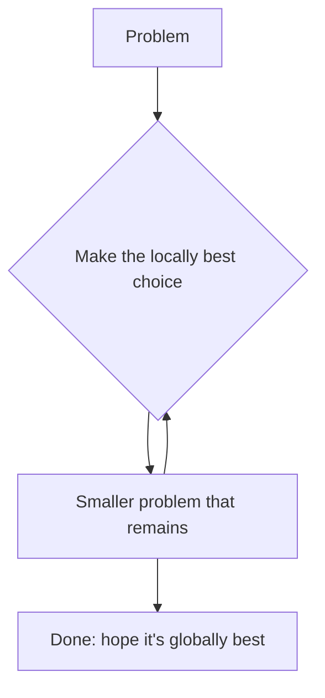
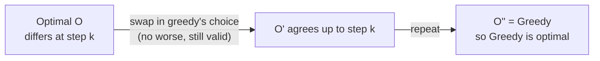
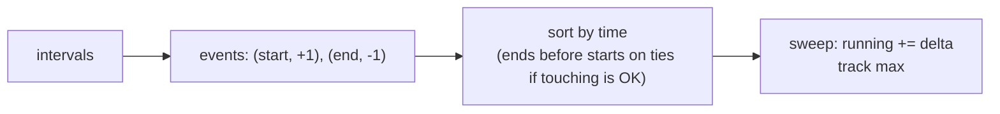
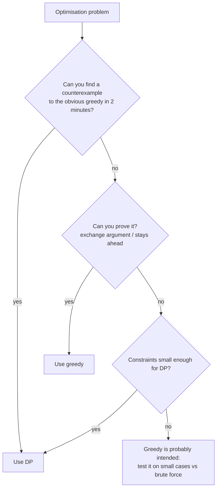

# Chapter 22 · Greedy Algorithms & Intervals

> A shopkeeper owes you ₹38. Without thinking, she hands you a ₹20, a ₹10, a ₹5, a ₹2 and a ₹1. Biggest note first, every time, never reconsidering. Five notes, and it happens to be the fewest possible. That's a **greedy algorithm**: grab the best-looking option right now and never look back. Sometimes it's brilliant. Sometimes it's a trap. This chapter teaches you to tell which, and to *prove* it.

**You will learn:**
- What a greedy algorithm is, and the two properties that make it correct
- The **exchange argument** and **"greedy stays ahead"**: the two proofs that turn "it feels right" into "it is right"
- When greedy **fails**, with concrete counterexamples you can produce in an interview
- The interval toolkit: activity selection, non-overlapping intervals, merge, insert, meeting rooms I & II, minimum arrows
- Classic greedy problems: Jump Game I & II, Gas Station, Candy, Task Scheduler, Partition Labels, Assign Cookies, fractional knapsack, Huffman coding
- The **sweep-line** technique for "how many things overlap at once?"
- A decision guide: greedy or DP?

**Before this:** [Sorting Algorithms](07-sorting.md) · [Heaps & Priority Queues](15-heaps.md) · [Dynamic Programming I](20-dp-1d.md) · [Dynamic Programming II](21-dp-2d-advanced.md) · [Two Pointers](03-two-pointers.md)

---

## 🧠 The Big Idea

DP (Chapters 20 and 21) is careful: at every step it tries **every** choice and keeps the best. Greedy is bold: at every step it makes **one** choice, the one that looks best right now, and commits forever.



Greedy is fast (often just a sort plus one pass: O(n log n)) and short to code. The catch is that word "hope". Greedy is only correct when two things are true:

| Property | Plain meaning |
|---|---|
| **Greedy choice property** | Some optimal solution *begins with* the greedy choice. So committing to it never closes the door on the best answer. |
| **Optimal substructure** | After the greedy choice, what's left is a smaller copy of the same problem, and its optimal solution plus the greedy choice is optimal overall. |

DP needs only the second. Greedy needs both. That's why greedy is faster (it doesn't explore) and why it's riskier (if the first property is false, it confidently gives a wrong answer).

**The shopkeeper example fails with different coins.** Suppose a country had coins 1, 3 and 4, and you owe 6:

```text
Greedy:  4 + 1 + 1  = 3 coins
Best  :  3 + 3      = 2 coins
```

Taking the 4 first closed the door on the best answer. With Indian/US denominations greedy happens to be optimal (such coin systems are called *canonical*), but that's a property of those particular coins, not a law of nature. For arbitrary coins you need the Coin Change DP from Chapter 20.

> 💡 **The mindset:** greedy is an *idea* that must be *proved*. In interviews, say your greedy rule, then say *why* it can't miss the best answer (usually in one or two sentences). If you can't, try a small counterexample. If you find one, switch to DP.

---

## 🔨 Building It Up

### 1. A first greedy: Assign Cookies

Each child i is content with a cookie of size at least `g[i]` (their greed). Each cookie j has size `s[j]`. Each child gets at most one cookie. Maximise the number of content children.

**Greedy rule:** sort both. Give each cookie, smallest first, to the least greedy child it can satisfy. Equivalently: walk through children from least greedy, and give each the smallest cookie that works.

```python
def find_content_children(greed, sizes):
    greed, sizes = sorted(greed), sorted(sizes)
    child = 0
    for cookie in sizes:
        if child < len(greed) and cookie >= greed[child]:
            child += 1                 # this cookie satisfies the least greedy child left
    return child

print(find_content_children([1, 2, 3], [1, 1]), find_content_children([1, 2], [1, 2, 3]))
```

```text
1 2
```

**Why it's right (an exchange argument in miniature):** take any optimal assignment. If the least greedy child isn't given the smallest usable cookie, swap: give them the smallest usable cookie and give their old cookie to whoever had the small one (if anyone). The old cookie is at least as big, so that other child is still happy. The count never drops. So some optimal answer agrees with greedy's first move, and by repeating the argument, with every move.

### 2. The exchange argument (the proof you'll use most)

Here's the recipe, step by step. You'll see it applied to almost every problem in this chapter.

1. Let **G** be the greedy solution and **O** any optimal solution.
2. Find the **first place** where they differ: greedy chose `g`, optimal chose `o`.
3. Show you can **exchange** `o` for `g` inside O without making O worse (still valid, still at least as good).
4. Now O agrees with G for one more step. Repeat until O = G. Since O never got worse, **G is optimal too**.



The second proof style, **greedy stays ahead**, shows that after every step, greedy's partial solution is at least as good as *any* other solution's partial solution (measured by some yardstick like "how far can I reach" or "when does my last chosen interval end"). If greedy is never behind, it can't lose at the finish line. Jump Game uses this.

### 3. When greedy fails: keep counterexamples handy

The fastest way to kill a wrong greedy is a tiny counterexample. These are worth memorising:

| Problem | Tempting greedy | Counterexample | Correct tool |
|---|---|---|---|
| Coin Change (any coins) | biggest coin first | coins {1, 3, 4}, amount 6: greedy 3 coins, best 2 | DP (Ch. 20) |
| 0/1 Knapsack | best value/weight ratio first | W=7, items (w5, v7), (w3, v4), (w4, v5), (w1, v1): greedy 8, best 9 | DP (Ch. 21) |
| House Robber | take the biggest house first | [5, 9, 5]: greedy 9, best 10 | DP (Ch. 20) |
| Activity selection | shortest activity first | (1,5), (4,7), (6,10): greedy picks (4,7) → 1, best 2 | earliest **finish** first |
| Activity selection | earliest start first | (1,10), (2,3), (4,5): greedy picks (1,10) → 1, best 2 | earliest **finish** first |
| Longest path in a graph | always take the heaviest edge | almost any graph | DP on DAGs / NP-hard in general |
| Triangle min path | go to the smaller child | `[[1],[2,3],[9,9,1]]`: greedy 1+2+9 = 12, best 1+3+1 = 5 | DP |

```python
def greedy_coins(coins, amount):
    count = 0
    for c in sorted(coins, reverse=True):
        count += amount // c
        amount %= c
    return count if amount == 0 else -1

def dp_coins(coins, amount):
    dp = [0] + [float("inf")] * amount
    for x in range(1, amount + 1):
        dp[x] = min((dp[x - c] + 1 for c in coins if c <= x), default=float("inf"))
    return dp[amount]

print("Indian coins, 38:", greedy_coins([1, 2, 5, 10, 20], 38), dp_coins([1, 2, 5, 10, 20], 38))
print("coins 1,3,4, 6  :", greedy_coins([1, 3, 4], 6), dp_coins([1, 3, 4], 6))
```

```text
Indian coins, 38: 5 5
coins 1,3,4, 6  : 3 2
```

What just happened: on canonical coins greedy and DP agree; on {1, 3, 4} greedy loses. Same algorithm, different input, different verdict. That's why greedy needs proof.

### 4. Activity Selection: the mother of interval greedy

You have activities with start and finish times. You can attend one at a time. Attend as many as possible. (Intervals are half-open in spirit: one ending at 4 and another starting at 4 don't clash.)

**Greedy rule: always pick the activity that finishes earliest** among those that start after your last chosen one finishes.

**Why earliest finish? (exchange argument)** Let `g` be the activity with the earliest finish time overall. Take any optimal schedule O and its first activity `o`. Since `g` finishes no later than `o`, replacing `o` with `g` can't create a clash with O's second activity (which starts after `o` ends, so after `g` ends too). The count is the same. So some optimal schedule starts with `g`. Remove everything that clashes with `g` and repeat on the rest.

The intuition: finishing early **leaves the most room** for the future.

```python
def max_activities(intervals):
    chosen = []
    last_end = float("-inf")
    for start, end in sorted(intervals, key=lambda x: x[1]):   # by finish time
        if start >= last_end:          # doesn't clash with the last chosen one
            chosen.append((start, end))
            last_end = end
    return chosen

acts = [(1, 4), (3, 5), (0, 6), (5, 7), (3, 9), (5, 9), (6, 10), (8, 11), (8, 12), (2, 14), (12, 16)]
print(max_activities(acts))
```

```text
[(1, 4), (5, 7), (8, 11), (12, 16)]
```

**Dry run** (sorted by end time):

| activity | start ≥ last_end? | action | last_end |
|---|---|---|---|
| (1, 4) | 1 ≥ -inf ✓ | take | 4 |
| (3, 5) | 3 ≥ 4 ✗ | skip | 4 |
| (0, 6) | 0 ≥ 4 ✗ | skip | 4 |
| (5, 7) | 5 ≥ 4 ✓ | take | 7 |
| (3, 9) | ✗ | skip | 7 |
| (5, 9) | ✗ | skip | 7 |
| (6, 10) | ✗ | skip | 7 |
| (8, 11) | 8 ≥ 7 ✓ | take | 11 |
| (8, 12) | ✗ | skip | 11 |
| (2, 14) | ✗ | skip | 11 |
| (12, 16) | 12 ≥ 11 ✓ | take | 16 |

Time O(n log n) for the sort, O(n) for the scan.

### 5. Non-overlapping Intervals

Given intervals, find the **minimum number to remove** so the rest don't overlap. Touching (`[1,2]` and `[2,3]`) is fine.

This is activity selection in a mirror: keep the maximum number of non-overlapping intervals; remove the rest. **Removed = total − kept.**

```python
def erase_overlap_intervals(intervals):
    kept = 0
    last_end = float("-inf")
    for start, end in sorted(intervals, key=lambda x: x[1]):
        if start >= last_end:
            kept += 1
            last_end = end
    return len(intervals) - kept

print(erase_overlap_intervals([[1, 2], [2, 3], [3, 4], [1, 3]]),
      erase_overlap_intervals([[1, 2], [1, 2], [1, 2]]),
      erase_overlap_intervals([[1, 2], [2, 3]]))
```

```text
1 2 0
```

### 6. Merge Intervals

Merge all overlapping intervals. `[[1,3],[2,6],[8,10],[15,18]]` → `[[1,6],[8,10],[15,18]]`.

**Rule:** sort by **start**. Walk through; if the current interval starts before (or exactly when) the last merged one ends, they overlap: extend the last one's end. Otherwise start a new merged interval.

Why sort by start here (not end)? After sorting by start, any interval that overlaps the current group must come *right after* it: there's nothing in between that could start earlier. So one comparison with the last merged interval is enough.

```python
def merge(intervals):
    merged = []
    for start, end in sorted(intervals):            # sorts by start, then end
        if merged and start <= merged[-1][1]:       # overlaps (or touches) the last one
            merged[-1][1] = max(merged[-1][1], end) # extend; max handles nesting
        else:
            merged.append([start, end])
    return merged

print(merge([[1, 3], [2, 6], [8, 10], [15, 18]]))
print(merge([[1, 4], [4, 5]]))
print(merge([[1, 10], [2, 3], [4, 5]]))
```

```text
[[1, 6], [8, 10], [15, 18]]
[[1, 5]]
[[1, 10]]
```

What just happened: the `max` matters for **nested** intervals: `[2, 3]` inside `[1, 10]` must not shrink the end to 3.

| Question | Sort by | Why |
|---|---|---|
| Merge / union / cover | **start** | neighbours in start order are the only possible overlaps |
| Keep the most non-overlapping / remove the fewest / arrows | **end** | finishing early leaves the most room (exchange argument) |

### 7. Insert Interval

The list is already sorted and non-overlapping. Insert a new interval and merge as needed, in O(n).

Three phases: copy everything that ends **before** the new one starts; merge everything that **overlaps** it into one; copy everything that starts **after** it ends.

```python
def insert(intervals, new):
    result = []
    i, n = 0, len(intervals)
    start, end = new
    while i < n and intervals[i][1] < start:        # entirely to the left
        result.append(intervals[i])
        i += 1
    while i < n and intervals[i][0] <= end:         # overlapping: absorb into new
        start = min(start, intervals[i][0])
        end = max(end, intervals[i][1])
        i += 1
    result.append([start, end])
    result.extend(intervals[i:])                    # entirely to the right
    return result

print(insert([[1, 3], [6, 9]], [2, 5]))
print(insert([[1, 2], [3, 5], [6, 7], [8, 10], [12, 16]], [4, 8]))
print(insert([], [5, 7]))
```

```text
[[1, 5], [6, 9]]
[[1, 2], [3, 10], [12, 16]]
[[5, 7]]
```

### 8. Meeting Rooms I

Can one person attend all meetings? Only if no two overlap. Sort by start and check each neighbour pair.

```python
def can_attend_meetings(intervals):
    intervals = sorted(intervals)
    for (s1, e1), (s2, e2) in zip(intervals, intervals[1:]):
        if s2 < e1:                  # next starts before the previous ends
            return False
    return True

print(can_attend_meetings([[0, 30], [5, 10], [15, 20]]), can_attend_meetings([[7, 10], [2, 4]]))
```

```text
False True
```

### 9. Meeting Rooms II: how many rooms?

What's the minimum number of rooms so all meetings can happen? This equals the **maximum number of meetings happening at the same moment**.

**Method A: min-heap of end times** ([Chapter 15](15-heaps.md)). Process meetings by start time. The heap holds the end times of rooms in use. If the earliest-ending room is free by the time this meeting starts, reuse it (pop); then push this meeting's end. The heap's size is the number of rooms.

```python
import heapq

def min_meeting_rooms(intervals):
    ends = []                                # end times of rooms in use
    for start, end in sorted(intervals):
        if ends and ends[0] <= start:        # earliest room is free again
            heapq.heappop(ends)
        heapq.heappush(ends, end)
    return len(ends)

print(min_meeting_rooms([[0, 30], [5, 10], [15, 20]]), min_meeting_rooms([[7, 10], [2, 4]]),
      min_meeting_rooms([[1, 5], [2, 6], [3, 7], [5, 8]]))
```

```text
2 1 3
```

**Method B: chronological sweep** (two sorted lists). Sort all starts and all ends separately. Walk through time: each start needs a room; each end frees one. Starts and ends are compared with `<`, so a meeting ending at 5 frees its room before one starting at 5 needs it.

```python
def min_meeting_rooms_sweep(intervals):
    starts = sorted(s for s, _ in intervals)
    ends = sorted(e for _, e in intervals)
    rooms = best = 0
    j = 0
    for s in starts:
        while j < len(ends) and ends[j] <= s:   # free every room that ended by time s
            rooms -= 1
            j += 1
        rooms += 1
        best = max(best, rooms)
    return best

print(min_meeting_rooms_sweep([[0, 30], [5, 10], [15, 20]]), min_meeting_rooms_sweep([[1, 5], [2, 6], [3, 7], [5, 8]]))
```

```text
2 3
```

Both are O(n log n). Method B is the **sweep line** idea, which we'll generalise in section 18.

### 10. Minimum Number of Arrows to Burst Balloons

Balloons are intervals on the x-axis. An arrow shot at x bursts every balloon with `start <= x <= end` (touching counts). Minimum arrows?

**Rule:** sort by **end**. Shoot an arrow at the end of the first balloon (as far right as possible while still hitting it: that hits the most others). Skip every balloon that arrow hits; the first one it misses gets the next arrow at *its* end.

```python
def find_min_arrow_shots(points):
    arrows = 0
    arrow_x = float("-inf")
    for start, end in sorted(points, key=lambda p: p[1]):
        if start > arrow_x:              # this balloon wasn't hit by the last arrow
            arrows += 1
            arrow_x = end                # shoot at its right edge
    return arrows

print(find_min_arrow_shots([[10, 16], [2, 8], [1, 6], [7, 12]]),
      find_min_arrow_shots([[1, 2], [3, 4], [5, 6], [7, 8]]),
      find_min_arrow_shots([[1, 2], [2, 3], [3, 4], [4, 5]]))
```

```text
2 4 2
```

It's activity selection again: the number of arrows equals the maximum number of pairwise-disjoint balloons. Note `start > arrow_x` (strict), because touching balloons share an arrow. In Non-overlapping Intervals we used `>=` because touching intervals *don't* overlap there. **Always check what "overlap" means in the statement.**

### 11. Jump Game I & II: greedy stays ahead

**Jump Game I:** `nums[i]` is the max jump from i. Can you reach the last index?

**Rule:** track `farthest`, the farthest index reachable so far. Walk i from left to right; if you ever stand at an `i > farthest`, you're stuck.

```python
def can_jump(nums):
    farthest = 0
    for i, step in enumerate(nums):
        if i > farthest:                   # this index is unreachable
            return False
        farthest = max(farthest, i + step)
    return True

print(can_jump([2, 3, 1, 1, 4]), can_jump([3, 2, 1, 0, 4]), can_jump([0]))
```

```text
True False True
```

**Why it works:** the set of reachable indexes is always a contiguous block `[0, farthest]` (if you can reach i, you can reach everything before it on the way). So one number describes everything.

**Jump Game II:** minimum number of jumps. Chapter 20 did O(n²) DP. Greedy is **BFS by levels**: all indexes reachable with `k` jumps form a range `[level_start, level_end]`. The next range ends at the farthest index reachable from any index in the current range.

```python
def jump(nums):
    jumps = 0
    level_end = 0          # last index reachable with `jumps` jumps
    farthest = 0
    for i in range(len(nums) - 1):          # no need to jump from the last index
        farthest = max(farthest, i + nums[i])
        if i == level_end:                  # finished scanning this level
            jumps += 1
            level_end = farthest
    return jumps

print(jump([2, 3, 1, 1, 4]), jump([2, 3, 0, 1, 4]), jump([1]))
```

```text
2 2 0
```

**Trace** for `[2, 3, 1, 1, 4]`:

| i | nums[i] | farthest | i == level_end? | jumps | level_end |
|---|---|---|---|---|---|
| start | | 0 | | 0 | 0 |
| 0 | 2 | 2 | yes → jump | 1 | 2 |
| 1 | 3 | 4 | no | 1 | 2 |
| 2 | 1 | 4 | yes → jump | 2 | 4 |
| 3 | 1 | 4 | no | 2 | 4 |

**Greedy stays ahead:** after k jumps, `level_end` is the farthest index *any* strategy can reach with k jumps (proof by induction: anything reachable in k+1 jumps comes from some index within k jumps, and we took the max over all of them). So the first k with `level_end >= n-1` is optimal. O(n) time, O(1) space.

### 12. Gas Station

Stations on a circle: `gas[i]` fuel available at station i, `cost[i]` fuel to drive to station i+1. Start with an empty tank. Return the start index from which you can complete the circle, or -1. (The answer is unique if it exists.)

Two greedy facts:

1. **If `sum(gas) >= sum(cost)`, a solution exists**; otherwise it's impossible.
2. **If you start at s and first run dry trying to reach j+1, then no station between s and j can be the start either.** Why? You arrived at each station k in `(s, j]` with a tank ≥ 0. Starting fresh at k means arriving at k with 0, which is no better. You'd run dry at j+1 again. So jump the start to j+1.

```python
def can_complete_circuit(gas, cost):
    if sum(gas) < sum(cost):
        return -1
    start, tank = 0, 0
    for i in range(len(gas)):
        tank += gas[i] - cost[i]
        if tank < 0:            # can't reach i+1 from `start`, nor from anything in between
            start = i + 1
            tank = 0
    return start

print(can_complete_circuit([1, 2, 3, 4, 5], [3, 4, 5, 1, 2]), can_complete_circuit([2, 3, 4], [3, 4, 3]))
```

```text
3 -1
```

**Trace** for gas `[1,2,3,4,5]`, cost `[3,4,5,1,2]` (net = `[-2,-2,-2,3,3]`):

| i | net | tank | action | start |
|---|---|---|---|---|
| 0 | -2 | -2 | dry → restart at 1 | 1 |
| 1 | -2 | -2 | dry → restart at 2 | 2 |
| 2 | -2 | -2 | dry → restart at 3 | 3 |
| 3 | +3 | 3 | ok | 3 |
| 4 | +3 | 6 | ok | 3 |

The total is 0 ≥ 0, so start 3 completes the circle. O(n) time, O(1) space.

### 13. Candy: two passes

Children stand in a line with ratings. Each gets at least one candy; a child with a **higher rating than a neighbour** gets more candy than that neighbour. Minimise total candy.

One pass can't see both neighbours. So do **two greedy passes**, each enforcing one side:
- Left to right: if `rating[i] > rating[i-1]`, give `left[i] = left[i-1] + 1`, else 1.
- Right to left: if `rating[i] > rating[i+1]`, give `right[i] = right[i+1] + 1`, else 1.
- Each child needs `max(left[i], right[i])` to satisfy both sides, and that's also the minimum that does.

```python
def candy(ratings):
    n = len(ratings)
    left = [1] * n
    for i in range(1, n):
        if ratings[i] > ratings[i - 1]:
            left[i] = left[i - 1] + 1
    right = [1] * n
    for i in range(n - 2, -1, -1):
        if ratings[i] > ratings[i + 1]:
            right[i] = right[i + 1] + 1
    return sum(max(a, b) for a, b in zip(left, right))

print(candy([1, 0, 2]), candy([1, 2, 2]), candy([1, 3, 4, 5, 2]))
```

```text
5 4 11
```

For `[1, 3, 4, 5, 2]`: left = `[1,2,3,4,1]`, right = `[1,1,1,2,1]`, max = `[1,2,3,4,1]`, sum 11. O(n) time, O(n) space.

> 💡 **Two-pass greedy** is a pattern: when a constraint involves both neighbours, satisfy the left constraints in one sweep, the right constraints in another, and combine. (Trapping Rain Water and Product of Array Except Self have the same shape.)

### 14. Task Scheduler

CPU tasks are letters; identical tasks need at least `n` time units between them. Each unit runs one task or idles. Minimum total time?

**Think about the most frequent task.** Say A appears `max_count` times. The A's must be at least `n+1` apart, which creates `max_count - 1` "frames" of length `n + 1`, plus a final partial frame:

```text
n = 2, tasks = AAABBB
A B _ | A B _ | A B
frame   frame   last row: every task that ties for the max count
```

Length = `(max_count - 1) × (n + 1) + (number of tasks with count == max_count)`. Other tasks fill the idle slots. If there are so many tasks that no idle is needed, the answer is just `len(tasks)`. So:

```python
from collections import Counter

def least_interval(tasks, n):
    counts = Counter(tasks).values()
    max_count = max(counts)
    num_max = sum(1 for c in counts if c == max_count)
    return max(len(tasks), (max_count - 1) * (n + 1) + num_max)

print(least_interval(list("AAABBB"), 2), least_interval(list("AAABBB"), 0),
      least_interval(list("AAAAAABCDEFG"), 2))
```

```text
8 6 16
```

O(n) time (counting), O(1) space (26 letters). A heap simulation also works (always run the most frequent available task) but the formula is what interviewers love.

### 15. Partition Labels

Split a string into as many parts as possible so that each letter appears in at most one part. Return the part sizes. `"ababcbacadefegdehijhklij"` → `[9, 7, 8]`.

**Rule:** record the **last index** of each letter. Walk the string, extending the current part's end to the last occurrence of every letter you see. When `i` reaches that end, nothing in this part appears later: cut.

```python
def partition_labels(s):
    last = {ch: i for i, ch in enumerate(s)}
    sizes = []
    start = end = 0
    for i, ch in enumerate(s):
        end = max(end, last[ch])      # this part must reach ch's last occurrence
        if i == end:                  # everything inside closes here: cut
            sizes.append(end - start + 1)
            start = i + 1
    return sizes

print(partition_labels("ababcbacadefegdehijhklij"), partition_labels("eccbbbbdec"))
```

```text
[9, 7, 8] [10]
```

It's merge intervals in disguise: each letter is the interval `[first, last]`; parts are the merged groups.

### 16. Fractional Knapsack: where greedy *does* work

Same as 0/1 knapsack (Chapter 21), but you may take **fractions** of items (gold dust, not gold bars). Now greedy by **value per weight** is optimal: fill up with the richest stuff first.

**Exchange argument:** if an optimal solution holds some weight of a lower-ratio item while a higher-ratio item isn't fully taken, swap an equal weight. Value goes up (or stays equal). So the optimum takes items in ratio order.

```python
def fractional_knapsack(values, weights, capacity):
    items = sorted(zip(values, weights), key=lambda vw: vw[0] / vw[1], reverse=True)
    total = 0.0
    for value, weight in items:
        if capacity == 0:
            break
        take = min(weight, capacity)
        total += value * take / weight
        capacity -= take
    return total

print(fractional_knapsack([60, 100, 120], [10, 20, 30], 50))
```

```text
240.0
```

(60 + 100 + two-thirds of 120.) Why does this fail for 0/1? Because you can't take "two-thirds of an item": the swap in the proof needs divisibility. That one detail is the difference between O(n log n) greedy and an NP-hard problem.

### 17. Huffman Coding (the idea)

To compress text, give frequent characters **short** bit codes and rare characters long ones. Codes must be **prefix-free** (no code is the start of another) so decoding is unambiguous. Huffman's greedy builds the optimal such code:

1. Put every character in a min-heap keyed by frequency.
2. Repeatedly pop the **two least frequent**, merge them into a node whose frequency is their sum, and push it back.
3. When one node remains, it's the root of a binary tree. Left edges are `0`, right edges are `1`; each character's code is its root-to-leaf path.

**Why greedy works (sketch):** in some optimal tree, the two rarest characters are siblings at the deepest level (if a rarer character were higher, swapping it with a deeper, more frequent one wouldn't increase total bits: exchange argument). Merging them reduces the problem to one with n-1 symbols.

```python
import heapq
from itertools import count

def huffman_codes(freq):
    tie = count()                      # tie-breaker so heap never compares the trees
    heap = [(f, next(tie), ch) for ch, f in freq.items()]
    heapq.heapify(heap)
    while len(heap) > 1:
        f1, _, left = heapq.heappop(heap)
        f2, _, right = heapq.heappop(heap)
        heapq.heappush(heap, (f1 + f2, next(tie), (left, right)))
    codes = {}
    def walk(node, path):
        if isinstance(node, str):
            codes[node] = path or "0"
        else:
            walk(node[0], path + "0")
            walk(node[1], path + "1")
    walk(heap[0][2], "")
    return codes

freq = {"a": 5, "b": 9, "c": 12, "d": 13, "e": 16, "f": 45}
codes = huffman_codes(freq)
for ch in sorted(codes):
    print(ch, freq[ch], codes[ch])
print("total bits:", sum(freq[ch] * len(codes[ch]) for ch in freq), "vs fixed 3-bit:", 3 * sum(freq.values()))
```

```text
a 5 1100
b 9 1101
c 12 100
d 13 101
e 16 111
f 45 0
total bits: 224 vs fixed 3-bit: 300
```

What just happened: `f` (45% of the text) gets a 1-bit code. Total size drops from 300 to 224 bits (25% smaller). The same idea, merging the two cheapest, solves **Minimum Cost to Connect Sticks**. Time O(n log n).

### 18. Sweep line: how many overlap at once?

Many interval questions are really "what's the maximum (or total) overlap at any moment?" The **sweep line** turns each interval into two **events**: `+1` at its start, `-1` at its end. Sort events by time and sweep left to right, keeping a running count.



**Car Pooling:** a car with `capacity` seats drives east. `trips[i] = [passengers, from, to]`. Can it carry everyone? Passengers leave at `to` before new ones board there.

```python
def car_pooling(trips, capacity):
    events = []
    for passengers, start, end in trips:
        events.append((start, passengers))
        events.append((end, -passengers))
    events.sort()                         # at equal time, negative (drop-off) sorts first
    load = 0
    for _, delta in events:
        load += delta
        if load > capacity:
            return False
    return True

print(car_pooling([[2, 1, 5], [3, 3, 7]], 4), car_pooling([[2, 1, 5], [3, 3, 7]], 5),
      car_pooling([[2, 1, 5], [3, 5, 7]], 3))
```

```text
False True True
```

What just happened: sorting the tuples `(time, delta)` puts `-passengers` before `+passengers` at the same time, which encodes "drop off before pick up". **The tie-break rule is the whole subtlety of sweep line.** If touching intervals *should* count as overlapping, sort `+1` before `-1` instead.

When the coordinates are small integers, you can skip sorting and use a **difference array** ([Chapter 06](06-prefix-sums.md)): `diff[start] += p`, `diff[end] -= p`, then a prefix sum gives the load at every point. O(n + range).

### 19. Greedy or DP? A decision guide



| Clue | Leans greedy | Leans DP |
|---|---|---|
| Items can be split (fractions) | ✓ | |
| Each item is all-or-nothing (0/1) | | ✓ |
| Intervals, deadlines, "maximum non-overlapping" | ✓ (sort by end) | |
| "Number of ways" | | ✓ (greedy never counts) |
| Choice now affects which choices remain in complex ways | | ✓ |
| A clear "best next move" with a one-line swap proof | ✓ | |
| n up to 10⁵ to 10⁶ and an O(n²) DP is the only DP you see | ✓ (a greedy is probably intended) | |
| Coin systems, arbitrary weights/values | | ✓ |

> 💡 A practical trick from competitive programmers: when unsure, write the greedy **and** a brute force (or DP), run both on a few hundred small random inputs, and compare. If they always agree, the greedy is very likely right. Then think about why.

---

## 🔬 Under the Hood

### The two proof styles, compared

| | Exchange argument | Greedy stays ahead |
|---|---|---|
| Claim | Any optimal solution can be transformed into the greedy one without getting worse | After every step, greedy is at least as good as any other solution (by some measure) |
| Measure | Total objective | A partial progress metric: "end of last chosen interval", "farthest reachable index" |
| Used for | Activity selection, cookies, fractional knapsack, Huffman, Two City Scheduling | Jump Game I/II, activity selection (alt.), Dijkstra |

Both are induction in disguise, just like the DP correctness proof in [Chapter 20](20-dp-1d.md).

### Why greedy is a special case of DP

DP computes `best(state) = best over all choices c of combine(c, best(next_state))`. Greedy computes `best(state) = combine(g, best(next_state_after_g))` for **one** precomputed choice g. The greedy choice property says the max over all c is always achieved at g, so the other branches are dead weight. That's why greedy is so much faster: it explores **one** path through the DP's state graph instead of all of them.

### Matroids (one paragraph for the curious)

There's a deep theory explaining *exactly* when "sort by weight and take whatever fits" is optimal for **every** choice of weights: the structure of valid sets must be a **matroid** (roughly: subsets of valid sets are valid, and a smaller valid set can always be grown with some element of a bigger one). Kruskal's MST ([Chapter 17](17-graphs-advanced.md)) is the famous example: forests in a graph form a matroid. You won't be asked about matroids in interviews, but it's satisfying to know greedy's success isn't luck.

### Complexity

Almost every greedy here is **sort + one linear scan**: O(n log n) time, dominated by sorting, with O(1) to O(n) extra space. Heap-based greedies (Meeting Rooms II, Huffman, IPO) are O(n log n) because each of n elements is pushed and popped once at O(log n). Pure scans with no sort (Jump Game, Gas Station, Candy, Partition Labels) are O(n).

Python's `sort` is **stable** (Timsort, [Chapter 07](07-sorting.md)), which matters when you sort by one key and rely on the original order to break ties. When ties matter for correctness (like sweep-line events), make the tie-break **explicit** in the key, don't rely on stability by accident.

---

## 🧩 Pattern Decoder

### Signals: when to reach for greedy / intervals

| You see in the problem... | Think |
|---|---|
| intervals + "maximum number that don't overlap", "minimum to remove" | sort by **end**, take if `start >= last_end` |
| intervals + "merge", "union", "total covered length" | sort by **start**, extend the last |
| "minimum rooms / platforms / resources at the same time" | heap of end times, or sweep line |
| "minimum arrows / points to hit all intervals" | sort by end, shoot at the end |
| "can you reach the end?", "fewest jumps" | farthest-reach greedy / BFS levels |
| circular route + fuel/cost | Gas Station (total ≥ 0 + reset start) |
| constraints with both neighbours (ratings, heights) | two passes |
| "cooldown n between identical tasks" | count the most frequent; frames |
| "split into max parts so each X appears in one part" | last-occurrence greedy |
| pair small with small / big with small | sort + two pointers ([Chapter 03](03-two-pointers.md)) |
| repeatedly combine the two smallest/largest | heap (Huffman, connect sticks, last stone weight) |
| "fractional", "you may take part of" | ratio greedy |
| "at each step choose the best available project/station" | heap greedy (IPO, refueling stops) |

### Template A: Interval scheduling (keep max non-overlapping)

```py
def max_non_overlapping(intervals):
    count, last_end = 0, float("-inf")
    for start, end in sorted(intervals, key=lambda x: x[1]):   # by END
        if start >= last_end:          # use > if touching counts as overlap
            count += 1
            last_end = end
    return count            # removals = len(intervals) - count; arrows: same idea with '>'
```

### Template B: Merge (sort by start)

```py
def merge_all(intervals):
    out = []
    for start, end in sorted(intervals):                     # by START
        if out and start <= out[-1][1]:                       # overlaps last group
            out[-1][1] = max(out[-1][1], end)
        else:
            out.append([start, end])
    return out
```

### Template C: Sweep line (max simultaneous)

```py
def max_overlap(intervals):
    events = []
    for start, end in intervals:
        events.append((start, +1))
        events.append((end, -1))
    events.sort()                         # (t, -1) before (t, +1): end frees before start uses
    cur = best = 0
    for _, delta in events:
        cur += delta
        best = max(best, cur)
    return best
```

### Template D: Heap greedy (process in order, keep the best available)

```py
import heapq
def heap_greedy(items):
    items.sort(key=ORDER_KEY)            # e.g. by start time, by required capital
    heap = []
    for item in items:
        while heap and CAN_RELEASE(heap[0], item):
            heapq.heappop(heap)
        heapq.heappush(heap, KEY(item))
    return ANSWER_FROM(heap)
```

### Variation: Interval List Intersections (two pointers on two sorted lists)

**Problem:** two lists of disjoint sorted intervals; return their intersections.

**Idea:** the overlap of `a` and `b` is `[max(starts), min(ends)]` if non-empty. Then advance whichever interval **ends first** (it can't overlap anything further in the other list).

```python
def interval_intersection(first, second):
    i = j = 0
    out = []
    while i < len(first) and j < len(second):
        lo = max(first[i][0], second[j][0])
        hi = min(first[i][1], second[j][1])
        if lo <= hi:
            out.append([lo, hi])
        if first[i][1] < second[j][1]:
            i += 1
        else:
            j += 1
    return out

print(interval_intersection([[0, 2], [5, 10], [13, 23], [24, 25]], [[1, 5], [8, 12], [15, 24], [25, 26]]))
```

```text
[[1, 2], [5, 5], [8, 10], [15, 23], [24, 24], [25, 25]]
```

O(m + n).

### Variation: Two City Scheduling (sort by a difference)

**Problem:** 2n people; `costs[i] = [costA, costB]`. Send exactly n to each city, minimising total cost.

**Idea:** everyone "costs" A by default; sending person i to B instead changes the bill by `costB - costA`. Send the n people with the **most negative** differences to B. (Exchange argument: if someone with a bigger difference went to B while a smaller one went to A, swapping them saves money.)

```python
def two_city_sched_cost(costs):
    costs = sorted(costs, key=lambda c: c[0] - c[1])     # most "prefer A" first
    n = len(costs) // 2
    return sum(c[0] for c in costs[:n]) + sum(c[1] for c in costs[n:])

print(two_city_sched_cost([[10, 20], [30, 200], [400, 50], [30, 20]]))
```

```text
110
```

### Variation: Minimum Platforms (sweep with two sorted arrays)

**Problem:** train arrival and departure times; how many platforms are needed? (A train arriving at the same minute another departs needs its own platform: the departing train is still there.)

```python
def min_platforms(arrivals, departures):
    arr, dep = sorted(arrivals), sorted(departures)
    i = j = cur = best = 0
    while i < len(arr):
        if arr[i] <= dep[j]:          # arrival first (tie: still occupied)
            cur += 1
            i += 1
            best = max(best, cur)
        else:
            cur -= 1
            j += 1
    return best

print(min_platforms([900, 940, 950, 1100, 1500, 1800], [910, 1200, 1120, 1130, 1900, 2000]))
```

```text
3
```

Compare with Meeting Rooms II, where a meeting ending at 10 frees the room for one starting at 10. Same algorithm, opposite tie-break. **Read the tie rule in the statement every time.**

### Dry run: Merge Intervals on `[[1,3],[8,10],[2,6],[15,18],[9,12]]`

Sorted: `[1,3], [2,6], [8,10], [9,12], [15,18]`.

| interval | last merged | overlap? (start ≤ last end) | merged list after |
|---|---|---|---|
| [1,3] | - | - | [[1,3]] |
| [2,6] | [1,3] | 2 ≤ 3 ✓ → end = max(3,6) | [[1,6]] |
| [8,10] | [1,6] | 8 ≤ 6 ✗ | [[1,6],[8,10]] |
| [9,12] | [8,10] | 9 ≤ 10 ✓ → end = 12 | [[1,6],[8,12]] |
| [15,18] | [8,12] | ✗ | [[1,6],[8,12],[15,18]] |

### When NOT to use greedy

- **Counting** ("how many ways"): greedy produces one answer, not a count. DP.
- **0/1 choices with weights/values** (knapsack, subset sum): DP.
- **Arbitrary coin systems:** DP.
- **You found a counterexample.** Don't patch the greedy with special cases: that's a sign the problem needs DP.
- **The choice now changes the *structure* of future choices in a non-monotonic way** (Burst Balloons, House Robber): DP.

---

## ⚠️ Traps & Common Mistakes

1. **Sorting by the wrong key.** Max non-overlapping / min removals / arrows → sort by **end**. Merge / insert / meeting rooms → sort by **start**. Sorting by start for activity selection gives wrong answers:

```py
sorted(intervals)                              # ❌ for activity selection: (1,10) blocks (2,3),(4,5)
sorted(intervals, key=lambda x: x[1])          # ✅ earliest finish first
```

2. **Touching intervals.** `[1,2]` and `[2,3]`: overlapping for arrows (`<=`), not overlapping for Non-overlapping Intervals and Meeting Rooms. Use `>` vs `>=` deliberately, and test a touching pair.

3. **Forgetting `max` when merging nested intervals.** `merged[-1][1] = end` turns `[1,10] + [2,3]` into `[1,3]`.

```py
merged[-1][1] = end                            # ❌ shrinks on nested intervals
merged[-1][1] = max(merged[-1][1], end)        # ✅
```

4. **Mutating input while iterating** (deleting merged intervals from the list you're looping over). Build a new list.

5. **Greedy without proof.** "Pick the biggest" feels right and is often wrong. Always try {1, 3, 4} style counterexamples.

6. **Gas Station: restarting at `i` instead of `i + 1`.** Station i is the one you couldn't leave; the next candidate is i + 1.

7. **Candy in one pass.** You can't satisfy both neighbours in a single sweep; descending runs need the right-to-left pass.

8. **Task Scheduler: forgetting `max(len(tasks), ...)`.** With many distinct tasks no idling is needed and the formula underestimates.

9. **Sweep-line tie order.** `(time, +1)` and `(time, -1)` at the same time: decide which comes first from the problem statement. Tuples sort `-1` first by default.

10. **Heap of tuples with uncomparable payloads.** `heapq` compares the second element on ties. If it's a tree node or dict, Python raises `TypeError`. Add a counter as a tie-breaker (as in Huffman).

11. **Jump Game II loop bound.** Loop to `len(nums) - 1`, not `len(nums)`: if you're standing on the last index, you don't need another jump.

---

## 💡 Tips & Tricks

- **Say the rule, then the swap.** "I'll sort by end time. If an optimal schedule starts with a later-ending interval, swapping in the earliest-ending one keeps it valid." Two sentences = a proof.
- **Sort first, think second.** Nearly every greedy starts with a sort; ask "sorted by *what* makes the next choice obvious?"
- **Intervals: draw them on a number line.** Five seconds of drawing catches most off-by-one tie issues.
- **Use `float("-inf")` as the initial `last_end`** so the first interval is always taken, even with negative coordinates.
- **"Minimum number of X to cover/hit everything"** is often the same as **"maximum number of disjoint things"** (arrows ↔ disjoint balloons). Duality is a powerful shortcut.
- **Heap = "the best available so far".** When options *become available* over time (by capital, by position), push them into a heap and pop the best when you need to choose.
- **Two passes** for left/right neighbour constraints.
- **Test greedy against brute force** on random small inputs if you have time; it's how strong competitive programmers validate.
- Python helpers: `sorted(..., key=lambda x: (x[1], x[0]))` for multi-key, `heapq` for min-heap (negate for max), `itertools.pairwise(lst)` (3.10+) for neighbour pairs.

---

## 🎯 Interview Questions

### 1. Merge Intervals 🔥🔥🔥

<details><summary>Answer</summary>

Sort by start; extend the last merged interval while the next starts at or before its end (use `max` for nesting).

```python
def merge(intervals):
    out = []
    for s, e in sorted(intervals):
        if out and s <= out[-1][1]:
            out[-1][1] = max(out[-1][1], e)
        else:
            out.append([s, e])
    return out

print(merge([[1, 3], [2, 6], [8, 10], [15, 18]]), merge([[1, 4], [0, 4]]))
```

```text
[[1, 6], [8, 10], [15, 18]] [[0, 4]]
```

Time O(n log n), space O(n) for the output.

</details>

### 2. Insert Interval 🔥🔥🔥

<details><summary>Answer</summary>

Input is sorted, so no re-sort: copy the left part, absorb overlaps, copy the right part. Code in section 7. Time O(n), space O(n). Interviewers check that you *don't* sort again (that would be O(n log n)) and that you handle insertion at the very start or end.

```python
def insert(intervals, new):
    left = [iv for iv in intervals if iv[1] < new[0]]
    right = [iv for iv in intervals if iv[0] > new[1]]
    middle = [iv for iv in intervals if not (iv[1] < new[0] or iv[0] > new[1])]
    if middle:
        new = [min(new[0], middle[0][0]), max(new[1], middle[-1][1])]
    return left + [new] + right

print(insert([[1, 2], [3, 5], [6, 7], [8, 10], [12, 16]], [4, 8]), insert([[3, 5]], [1, 2]))
```

```text
[[1, 2], [3, 10], [12, 16]] [[1, 2], [3, 5]]
```

This three-list version is O(n) too and very readable.

</details>

### 3. Non-overlapping Intervals 🔥🔥🔥

<details><summary>Answer</summary>

Keep the max number of non-overlapping intervals (sort by end, take if `start >= last_end`); answer = n − kept. Exchange argument: the earliest-ending interval can replace the first interval of any optimal solution.

```python
def erase_overlap_intervals(intervals):
    kept, last_end = 0, float("-inf")
    for s, e in sorted(intervals, key=lambda x: x[1]):
        if s >= last_end:
            kept += 1
            last_end = e
    return len(intervals) - kept

print(erase_overlap_intervals([[1, 2], [2, 3], [3, 4], [1, 3]]))
```

```text
1
```

Time O(n log n), space O(1) beyond sorting.

</details>

### 4. Meeting Rooms II 🔥🔥🔥

<details><summary>Answer</summary>

Min-heap of end times, processing meetings by start; reuse the room that frees earliest if it's free. Heap size at the end = rooms. (Or the two-sorted-arrays sweep.)

```python
import heapq

def min_meeting_rooms(intervals):
    ends = []
    for s, e in sorted(intervals):
        if ends and ends[0] <= s:
            heapq.heapreplace(ends, e)       # pop + push in one step
        else:
            heapq.heappush(ends, e)
    return len(ends)

print(min_meeting_rooms([[0, 30], [5, 10], [15, 20]]), min_meeting_rooms([[1, 10], [2, 7], [3, 19], [8, 12], [10, 20], [11, 30]]))
```

```text
2 4
```

Time O(n log n), space O(n).

</details>

### 5. Minimum Number of Arrows to Burst Balloons 🔥🔥

<details><summary>Answer</summary>

Sort by end; shoot at the end of the first unburst balloon; skip all balloons with `start <= arrow`. Touching counts as hit, so the new-arrow condition is `start > arrow`.

```python
def find_min_arrow_shots(points):
    arrows, x = 0, float("-inf")
    for s, e in sorted(points, key=lambda p: p[1]):
        if s > x:
            arrows += 1
            x = e
    return arrows

print(find_min_arrow_shots([[10, 16], [2, 8], [1, 6], [7, 12]]))
```

```text
2
```

Time O(n log n), space O(1).

</details>

### 6. Jump Game 🔥🔥🔥

<details><summary>Answer</summary>

Track the farthest reachable index; fail if the current index is beyond it. Reachable indexes always form a prefix, so one number suffices. A neat alternative walks backwards, moving the "goal" left whenever an index can reach it.

```python
def can_jump(nums):
    goal = len(nums) - 1
    for i in range(len(nums) - 2, -1, -1):
        if i + nums[i] >= goal:
            goal = i                 # reaching i is now enough
    return goal == 0

print(can_jump([2, 3, 1, 1, 4]), can_jump([3, 2, 1, 0, 4]))
```

```text
True False
```

Time O(n), space O(1).

</details>

### 7. Jump Game II 🔥🔥🔥

<details><summary>Answer</summary>

BFS by levels: `level_end` is the farthest index reachable with the current number of jumps; when `i` reaches it, take a jump and extend to `farthest`. Greedy stays ahead: no strategy reaches further with the same number of jumps. Code and trace in section 11.

```python
def jump(nums):
    jumps = level_end = farthest = 0
    for i in range(len(nums) - 1):
        farthest = max(farthest, i + nums[i])
        if i == level_end:
            jumps += 1
            level_end = farthest
    return jumps

print(jump([2, 3, 1, 1, 4]))
```

```text
2
```

Time O(n), space O(1).

</details>

### 8. Gas Station 🔥🔥🔥

<details><summary>Answer</summary>

If total gas < total cost → -1. Otherwise scan; whenever the tank goes negative at i, no start in `[start, i]` works, so set `start = i + 1` and reset the tank. Code and trace in section 12.

```python
def can_complete_circuit(gas, cost):
    total = tank = start = 0
    for i, (g, c) in enumerate(zip(gas, cost)):
        total += g - c
        tank += g - c
        if tank < 0:
            start, tank = i + 1, 0
    return start if total >= 0 else -1

print(can_complete_circuit([1, 2, 3, 4, 5], [3, 4, 5, 1, 2]), can_complete_circuit([5, 1, 2, 3, 4], [4, 4, 1, 5, 1]))
```

```text
3 4
```

Time O(n), space O(1).

</details>

### 9. Candy 🔥🔥

<details><summary>Answer</summary>

Two passes: left-to-right enforces the left neighbour, right-to-left the right neighbour; each child takes the max. Can be done with one array:

```python
def candy(ratings):
    n = len(ratings)
    c = [1] * n
    for i in range(1, n):
        if ratings[i] > ratings[i - 1]:
            c[i] = c[i - 1] + 1
    for i in range(n - 2, -1, -1):
        if ratings[i] > ratings[i + 1]:
            c[i] = max(c[i], c[i + 1] + 1)
    return sum(c)

print(candy([1, 0, 2]), candy([1, 2, 2]), candy([1, 2, 87, 87, 87, 2, 1]))
```

```text
5 4 13
```

Time O(n), space O(n). (An O(1)-space slope-counting version exists but is rarely expected.)

</details>

### 10. Task Scheduler 🔥🔥

<details><summary>Answer</summary>

Frames from the most frequent task: `(max_count - 1) × (n + 1) + num_max`, but never less than `len(tasks)`. Explain with the frame drawing (section 14).

```python
from collections import Counter

def least_interval(tasks, n):
    counts = Counter(tasks)
    max_count = max(counts.values())
    num_max = list(counts.values()).count(max_count)
    return max(len(tasks), (max_count - 1) * (n + 1) + num_max)

print(least_interval(["A", "A", "A", "B", "B", "B"], 2), least_interval(["A", "C", "A", "B", "D", "B"], 1))
```

```text
8 6
```

Time O(n), space O(1).

</details>

### 11. Partition Labels 🔥🔥

<details><summary>Answer</summary>

Last index of each char; extend the current part's end to the last occurrence of every char seen; cut when `i == end`.

```python
def partition_labels(s):
    last = {c: i for i, c in enumerate(s)}
    out, start, end = [], 0, 0
    for i, c in enumerate(s):
        end = max(end, last[c])
        if i == end:
            out.append(i - start + 1)
            start = i + 1
    return out

print(partition_labels("ababcbacadefegdehijhklij"))
```

```text
[9, 7, 8]
```

Time O(n), space O(1) (alphabet size).

</details>

### 12. Two City Scheduling 🔥

<details><summary>Answer</summary>

Sort by `costA - costB`; the first half goes to A, the rest to B. Exchange argument on the differences (see the Pattern Decoder). Time O(n log n), space O(1).

```python
def two_city_sched_cost(costs):
    costs = sorted(costs, key=lambda c: c[0] - c[1])
    half = len(costs) // 2
    return sum(a for a, _ in costs[:half]) + sum(b for _, b in costs[half:])

print(two_city_sched_cost([[259, 770], [448, 54], [926, 667], [184, 139], [840, 118], [577, 469]]))
```

```text
1859
```

</details>

### 13. Interval List Intersections 🔥🔥

<details><summary>Answer</summary>

Two pointers: intersect `[max(starts), min(ends)]`, then advance the interval that ends first. Code in the Pattern Decoder. Time O(m + n), space O(1) besides output.

</details>

---

## 🏋️ Practice

**🟢 1. Lemonade Change.** Lemonade costs $5. Customers pay with $5, $10 or $20, in order. You start with no change. Can you give everyone correct change?

<details><summary>Solution</summary>

Greedy: for a $20, prefer giving $10 + $5 over $5 × 3, because $5 bills are more flexible (they can change both $10s and $20s).

```python
def lemonade_change(bills):
    fives = tens = 0
    for b in bills:
        if b == 5:
            fives += 1
        elif b == 10:
            if not fives:
                return False
            fives -= 1
            tens += 1
        else:
            if tens and fives:
                tens -= 1
                fives -= 1
            elif fives >= 3:
                fives -= 3
            else:
                return False
    return True

print(lemonade_change([5, 5, 5, 10, 20]), lemonade_change([5, 5, 10, 10, 20]))
```

```text
True False
```

</details>

**🟢 2. Maximum Units on a Truck.** `boxTypes[i] = [count, units_per_box]`; the truck holds `truck_size` boxes. Maximise units.

<details><summary>Solution</summary>

Fractional-knapsack style (boxes are identical within a type): take boxes with the most units first.

```python
def maximum_units(box_types, truck_size):
    total = 0
    for count, units in sorted(box_types, key=lambda b: -b[1]):
        take = min(count, truck_size)
        total += take * units
        truck_size -= take
        if truck_size == 0:
            break
    return total

print(maximum_units([[1, 3], [2, 2], [3, 1]], 4), maximum_units([[5, 10], [2, 5], [4, 7], [3, 9]], 10))
```

```text
8 91
```

</details>

**🟡 3. Total length covered by intervals.** Given intervals on a line (possibly overlapping), return the total covered length. `[[1,3],[2,5],[7,8]]` → 5.

<details><summary>Solution</summary>

Merge (sort by start), then sum the lengths of merged intervals. Or sweep: add the gap between events whenever the active count is positive.

```python
def covered_length(intervals):
    total = 0
    cur_start = cur_end = None
    for s, e in sorted(intervals):
        if cur_end is None or s > cur_end:
            if cur_end is not None:
                total += cur_end - cur_start
            cur_start, cur_end = s, e
        else:
            cur_end = max(cur_end, e)
    if cur_end is not None:
        total += cur_end - cur_start
    return total

print(covered_length([[1, 3], [2, 5], [7, 8]]), covered_length([]))
```

```text
5 0
```

</details>

**🟡 4. Queue Reconstruction by Height.** People `[h, k]`: height h, with exactly k people in front who are at least as tall. Reconstruct the queue.

<details><summary>Solution</summary>

Sort by height **descending** (ties: k ascending), then insert each person at index k. When you insert someone, everyone already placed is at least as tall, so index k is exactly right; shorter people inserted later don't affect taller people's counts.

```python
def reconstruct_queue(people):
    queue = []
    for h, k in sorted(people, key=lambda p: (-p[0], p[1])):
        queue.insert(k, [h, k])
    return queue

print(reconstruct_queue([[7, 0], [4, 4], [7, 1], [5, 0], [6, 1], [5, 2]]))
```

```text
[[5, 0], [7, 0], [5, 2], [6, 1], [4, 4], [7, 1]]
```

O(n²) because of list inserts; fine for n ≤ 2000.

</details>

**🟡 5. Car Pooling with a difference array.** Same as section 18, but stops are integers in `[0, 1000]`. Solve without sorting.

<details><summary>Solution</summary>

```python
from itertools import accumulate

def car_pooling(trips, capacity):
    diff = [0] * 1001
    for p, start, end in trips:
        diff[start] += p
        diff[end] -= p              # drop-off at `end` frees the seats there
    return all(load <= capacity for load in accumulate(diff))

print(car_pooling([[2, 1, 5], [3, 3, 7]], 4), car_pooling([[2, 1, 5], [3, 3, 7]], 5))
```

```text
False True
```

O(n + range). This is the prefix-sum idea from [Chapter 06](06-prefix-sums.md).

</details>

**🔴 6. IPO.** You start with capital `w` and may finish at most `k` projects. Project i needs `capital[i]` to start and adds `profits[i]` to your capital when done. Maximise final capital.

<details><summary>Solution</summary>

Heap greedy: sort projects by required capital. Before each pick, push every project you can now afford into a **max-heap of profits**; take the most profitable. Taking the max-profit affordable project is safe because it only increases what you can afford later (exchange argument).

```python
import heapq

def find_maximized_capital(k, w, profits, capital):
    projects = sorted(zip(capital, profits))
    available = []                         # max-heap via negative profits
    i = 0
    for _ in range(k):
        while i < len(projects) and projects[i][0] <= w:
            heapq.heappush(available, -projects[i][1])
            i += 1
        if not available:
            break
        w -= heapq.heappop(available)
    return w

print(find_maximized_capital(2, 0, [1, 2, 3], [0, 1, 1]), find_maximized_capital(3, 0, [1, 2, 3], [0, 1, 2]))
```

```text
4 6
```

O(n log n).

</details>

**🔴 7. Minimum Number of Refueling Stops.** A car starts with `start_fuel` and needs to reach `target`. Stations `[position, fuel]` are sorted by position. Return the fewest stops, or -1.

<details><summary>Solution</summary>

Drive as far as you can; remember the fuel of every station you've passed in a max-heap. When you can't reach the next point, **retroactively** refuel at the biggest station passed (as if you had stopped there). Greedy stays ahead: after k stops, you've reached the farthest point possible with k stops.

```python
import heapq

def min_refuel_stops(target, start_fuel, stations):
    heap = []                     # fuel of passed stations (negated)
    fuel, stops, i = start_fuel, 0, 0
    while fuel < target:
        while i < len(stations) and stations[i][0] <= fuel:
            heapq.heappush(heap, -stations[i][1])
            i += 1
        if not heap:
            return -1
        fuel -= heapq.heappop(heap)   # refuel at the best station already passed
        stops += 1
    return stops

print(min_refuel_stops(100, 10, [[10, 60], [20, 30], [30, 30], [60, 40]]), min_refuel_stops(100, 1, [[10, 100]]),
      min_refuel_stops(1, 1, []))
```

```text
2 -1 0
```

Here `fuel` means "farthest position reachable", which works because the car starts at 0. O(n log n).

</details>

---

## 🧠 Never-Forget Summary

- **Greedy = choose the locally best option and never look back.** Fast (sort + scan), but must be **proved**.
- Correct when the **greedy choice property** (some optimal solution starts with the greedy choice) and **optimal substructure** both hold.
- **Proof tools:** the **exchange argument** (swap greedy's choice into an optimal solution, no worse) and **greedy stays ahead** (greedy's progress is never behind).
- **Kill bad greedies with counterexamples:** coins {1,3,4} for 6; shortest-first and earliest-start activity selection.
- **Sort by end** to keep the most non-overlapping (activity selection, removals, arrows). **Sort by start** to merge / insert / schedule rooms.
- **Rooms / platforms / max overlap:** heap of end times, or **sweep line** with +1/−1 events. **Tie-break rules decide correctness.**
- **Jump Game:** farthest reach. **Jump Game II:** BFS levels. **Gas Station:** total ≥ 0, restart after failure. **Candy:** two passes. **Task Scheduler:** frames of the most frequent task. **Partition Labels:** last occurrence.
- **Fractional knapsack** is greedy; **0/1 knapsack** is DP. **Huffman:** merge the two smallest, repeatedly.
- Counting, all-or-nothing items, or a found counterexample → **DP**.

**Memory hook: "End to keep, Start to merge, Sweep to count."**

**Second hook: "Greedy is a promise. The exchange argument is the receipt."**

**One picture:**

| Problem | Sort / structure | Greedy rule | Proof |
|---|---|---|---|
| Activity selection / Non-overlapping | by end | take if `start >= last_end` | exchange |
| Min arrows | by end | new arrow if `start > arrow` | exchange |
| Merge / Insert | by start | extend last with `max` | neighbours in order |
| Meeting Rooms II | by start + heap | reuse earliest-free room | max overlap = rooms |
| Sweep line | events (t, ±1) | running sum | counting |
| Jump Game I/II | none | farthest reach / levels | stays ahead |
| Gas Station | none | reset start after deficit | arrive with ≥ 0 |
| Candy | none | two passes, take max | each side minimal |
| Task Scheduler | counts | frames of max task | lower bound achieved |
| Partition Labels | last index | cut when `i == end` | intervals merge |
| Fractional knapsack | by value/weight | richest first | exchange |
| Huffman | min-heap | merge two smallest | exchange (siblings) |

> **If you remember only one thing:** before you trust a greedy, try to break it with a tiny example. If you can't break it and you can say the swap argument in one sentence, ship it. Otherwise, it's DP.

---
**Next:** [Chapter 23 · Bit Manipulation & Math](23-bits-math.md)  ·  **Back to** [Contents](../README.md)
