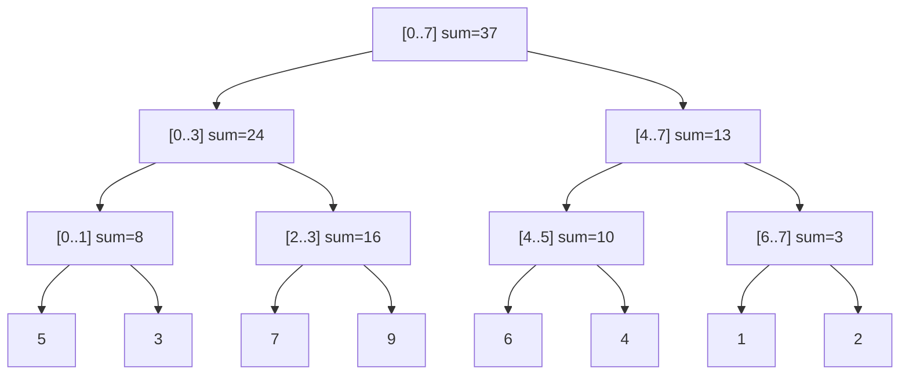
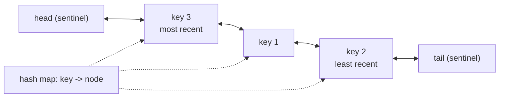

# Chapter 24 · Advanced: Segment Trees, Fenwick Trees & String Algorithms

> A cricket scoreboard shows the total runs. Easy: keep a running sum. Now the third umpire reviews ball 37 of over 12 and changes a four into a six, and the commentator asks "how many runs between overs 5 and 15?" every few seconds. Prefix sums break on every correction; recomputing from scratch is too slow. This chapter gives you the structures that handle **both** updates and range questions in O(log n), plus the string-search algorithms that find a needle in a haystack without ever stepping back.

**You will learn:**
- **Segment trees**: build, range query, point update, range sum and range min, and the idea of **lazy propagation** for range updates
- **Fenwick trees (Binary Indexed Trees)**: the `lowbit` trick, prefix sums with updates, and **Count of Smaller Numbers After Self**
- **Sparse tables** for O(1) range-minimum queries on static arrays
- String algorithms: **KMP** (the prefix function, decoded with a full trace), **Rabin-Karp** rolling hash, the **Z-algorithm**, and a **Manacher** overview
- Designing an **LRU cache** and an **LFU cache** with O(1) operations
- What a **skip list** is and why databases use it
- **When interviews actually ask these** (and when they don't)

**Before this:** [Prefix Sums & Difference Arrays](06-prefix-sums.md) · [Binary Trees](13-binary-trees.md) · [Bit Manipulation & Math](23-bits-math.md) · [Linked Lists](10-linked-lists.md) · [Hashing Patterns](05-hashing.md) · [Arrays & Strings Fundamentals](02-arrays-strings.md)

---

## 🧠 The Big Idea

You have an array and two kinds of operations, mixed together, many times:

- **update(i, value)**: change one element
- **query(l, r)**: what's the sum (or min, or max) of `nums[l..r]`?

The two obvious structures are each great at one thing and terrible at the other:

| Structure | update | range query | Why |
|---|---|---|---|
| Plain array | O(1) | O(n) | must add up the range every time |
| Prefix sums ([Chapter 06](06-prefix-sums.md)) | O(n) | O(1) | every prefix after i must be rebuilt |
| **Segment tree / Fenwick tree** | **O(log n)** | **O(log n)** | store sums of cleverly chosen blocks |

The trick is to precompute sums of **blocks**, organised so that any range is made of only O(log n) blocks, and any single element belongs to only O(log n) blocks. A segment tree uses blocks that halve at each level:



That's for `nums = [5, 3, 7, 9, 6, 4, 1, 2]`. To get `sum(nums[2..6])`, combine `[2..3]` (16) + `[4..5]` (10) + `[6]` (1) = 27: three blocks instead of five elements. To update `nums[5]`, fix the leaf and the 3 blocks above it. Both are O(log n).

The second half of the chapter is about **strings**. Searching for a pattern of length m in a text of length n naively costs O(n × m), because after a mismatch you slide the pattern by one and start comparing from scratch. KMP, Z and Rabin-Karp all do it in O(n + m) by **remembering what they've already matched**. Same spirit as DP: never redo work.

> 💡 **Honest framing:** these are the "advanced" topics. Most interviews at most companies won't need them; LRU Cache and KMP-style thinking are the exceptions. But when a problem says "update and query ranges 10⁵ times", nothing else works. The last section tells you exactly when to invest.

---

## 🔨 Building It Up

### 1. The problem, and why the simple fixes fail

```python
nums = [5, 3, 7, 9, 6, 4, 1, 2]

# Option 1: plain array -> query is O(n)
print(sum(nums[2:7]))

# Option 2: prefix sums -> query O(1), but an update means rebuilding O(n) prefixes
prefix = [0]
for x in nums:
    prefix.append(prefix[-1] + x)
print(prefix[7] - prefix[2])

nums[5] = 10                     # an update...
prefix = [0]                     # ...forces a full rebuild
for x in nums:
    prefix.append(prefix[-1] + x)
print(prefix[7] - prefix[2])
```

```text
27
27
33
```

With n = 10⁵ and 10⁵ mixed operations, both options cost about 10¹⁰ steps. We need O(log n) for both.

### 2. Segment tree: the structure

A **segment tree** is a binary tree where:
- each **leaf** holds one array element,
- each **internal node** holds the combined value (sum, min, max, ...) of its two children, which means it summarises a **contiguous segment** of the array,
- the root summarises the whole array.

We store it in a plain list, like a heap ([Chapter 15](15-heaps.md)): node 1 is the root, node `i` has children `2i` and `2i + 1`. A list of size `4n` is always enough (see Under the Hood).

Three operations, all recursive on `(node, l, r)` = "this node covers `nums[l..r]`":

- **build**: leaf → copy the element; otherwise build both halves and combine.
- **update(i, value)**: walk down to the leaf for i (go left if `i <= mid`), set it, then recombine every node on the way back up.
- **query(ql, qr)**: three cases per node:
  - node's segment is **completely outside** `[ql, qr]` → contributes nothing (return 0 for sums),
  - **completely inside** → return the node's stored value (don't go deeper!),
  - **partially overlapping** → ask both children and combine.

```python
class SegmentTree:
    def __init__(self, nums):
        self.n = len(nums)
        self.tree = [0] * (4 * self.n)
        self._build(nums, 1, 0, self.n - 1)

    def _build(self, nums, node, l, r):
        if l == r:
            self.tree[node] = nums[l]
            return
        mid = (l + r) // 2
        self._build(nums, 2 * node, l, mid)
        self._build(nums, 2 * node + 1, mid + 1, r)
        self.tree[node] = self.tree[2 * node] + self.tree[2 * node + 1]

    def update(self, i, value, node=1, l=0, r=None):
        if r is None:
            r = self.n - 1
        if l == r:
            self.tree[node] = value
            return
        mid = (l + r) // 2
        if i <= mid:
            self.update(i, value, 2 * node, l, mid)
        else:
            self.update(i, value, 2 * node + 1, mid + 1, r)
        self.tree[node] = self.tree[2 * node] + self.tree[2 * node + 1]

    def query(self, ql, qr, node=1, l=0, r=None):
        if r is None:
            r = self.n - 1
        if qr < l or r < ql:              # completely outside
            return 0
        if ql <= l and r <= qr:           # completely inside
            return self.tree[node]
        mid = (l + r) // 2                # partial overlap: split
        return (self.query(ql, qr, 2 * node, l, mid) +
                self.query(ql, qr, 2 * node + 1, mid + 1, r))

st = SegmentTree([5, 3, 7, 9, 6, 4, 1, 2])
print(st.query(2, 6), st.query(0, 7), st.query(4, 4))
st.update(5, 10)
print(st.query(2, 6), st.query(0, 7))
```

```text
27 37 6
33 43
```

**Trace** of `query(2, 6)` on the tree in the Big Idea:

| node covers | relation to [2, 6] | action | returns |
|---|---|---|---|
| [0..7] | partial | split | 16 + 11 = 27 |
| [0..3] | partial | split | 0 + 16 = 16 |
| [0..1] | outside | stop | 0 |
| [2..3] | inside | use stored | 16 |
| [4..7] | partial | split | 10 + 1 = 11 |
| [4..5] | inside | use stored | 10 |
| [6..7] | partial | split | 1 + 0 = 1 |
| [6] | inside | use stored | 1 |
| [7] | outside | stop | 0 |

Only 9 nodes visited, and that stays O(log n) no matter how big the array.

### 3. Range minimum (or max, gcd, ...): change two things

A segment tree works for any **associative** combine function: `combine(combine(a, b), c) == combine(a, b, c)`. To switch from sum to min, change:
1. the **combine** (`+` → `min`),
2. the **identity** returned for "outside" (`0` → `+inf`).

Here's a compact **iterative** version (bottom-up, size 2n) that takes the combine function as a parameter. Leaves live at `tree[n .. 2n-1]`; node i's parent is `i // 2`.

```python
class SegTree:
    def __init__(self, nums, combine, identity):
        self.n = len(nums)
        self.combine, self.identity = combine, identity
        self.tree = [identity] * self.n + list(nums)
        for i in range(self.n - 1, 0, -1):
            self.tree[i] = combine(self.tree[2 * i], self.tree[2 * i + 1])

    def update(self, i, value):
        i += self.n
        self.tree[i] = value
        while i > 1:
            i //= 2
            self.tree[i] = self.combine(self.tree[2 * i], self.tree[2 * i + 1])

    def query(self, l, r):                  # inclusive l..r
        res_left = res_right = self.identity
        l += self.n
        r += self.n + 1
        while l < r:
            if l & 1:                       # l is a right child: take it, move past
                res_left = self.combine(res_left, self.tree[l])
                l += 1
            if r & 1:                       # r-1 is a left child boundary: take it
                r -= 1
                res_right = self.combine(self.tree[r], res_right)
            l //= 2
            r //= 2
        return self.combine(res_left, res_right)

nums = [5, 3, 7, 9, 6, 4, 1, 2]
sums = SegTree(nums, lambda a, b: a + b, 0)
mins = SegTree(nums, min, float("inf"))
print(sums.query(2, 6), mins.query(0, 3), mins.query(4, 7))
mins.update(6, 50)
print(mins.query(4, 7))
```

```text
27 3 1
2
```

What just happened: the iterative version climbs from both ends of the range toward the root, picking up whole nodes when a boundary is a "lonely" child. It's shorter and faster, but the recursive version is easier to extend (lazy propagation) and to explain in an interview. Learn the recursive one first.

### 4. Lazy propagation (the concept, with code)

Now the update is a **range**: "add 5 to every element in `[2, 6]`". Updating each leaf is O(n log n). The fix is to be **lazy**:

> When an update fully covers a node's segment, update that node's sum (add `value × segment length`), write a **note** ("my children still owe +5") in a `lazy` array, and **stop**. Only when a later operation needs to go *inside* that node do we **push** the note down to its children.

It's like a manager who gets "everyone in your team gets a ₹500 bonus" and just updates the team total, telling individual members only when someone actually asks about them.

```python
class LazySegmentTree:
    """Range add, range sum."""
    def __init__(self, nums):
        self.n = len(nums)
        self.tree = [0] * (4 * self.n)
        self.lazy = [0] * (4 * self.n)
        self._build(nums, 1, 0, self.n - 1)

    def _build(self, nums, node, l, r):
        if l == r:
            self.tree[node] = nums[l]
            return
        mid = (l + r) // 2
        self._build(nums, 2 * node, l, mid)
        self._build(nums, 2 * node + 1, mid + 1, r)
        self.tree[node] = self.tree[2 * node] + self.tree[2 * node + 1]

    def _apply(self, node, l, r, value):
        self.tree[node] += value * (r - l + 1)     # whole segment gets +value
        self.lazy[node] += value                   # remember: children still owe this

    def _push(self, node, l, r):
        if self.lazy[node]:
            mid = (l + r) // 2
            self._apply(2 * node, l, mid, self.lazy[node])
            self._apply(2 * node + 1, mid + 1, r, self.lazy[node])
            self.lazy[node] = 0

    def range_add(self, ql, qr, value, node=1, l=0, r=None):
        if r is None:
            r = self.n - 1
        if qr < l or r < ql:
            return
        if ql <= l and r <= qr:
            self._apply(node, l, r, value)          # fully covered: stop here (lazy!)
            return
        self._push(node, l, r)                      # going inside: deliver old notes first
        mid = (l + r) // 2
        self.range_add(ql, qr, value, 2 * node, l, mid)
        self.range_add(ql, qr, value, 2 * node + 1, mid + 1, r)
        self.tree[node] = self.tree[2 * node] + self.tree[2 * node + 1]

    def query(self, ql, qr, node=1, l=0, r=None):
        if r is None:
            r = self.n - 1
        if qr < l or r < ql:
            return 0
        if ql <= l and r <= qr:
            return self.tree[node]
        self._push(node, l, r)
        mid = (l + r) // 2
        return self.query(ql, qr, 2 * node, l, mid) + self.query(ql, qr, 2 * node + 1, mid + 1, r)

lst = LazySegmentTree([5, 3, 7, 9, 6, 4, 1, 2])
lst.range_add(2, 6, 5)                     # five elements each get +5
print(lst.query(0, 7), lst.query(2, 6), lst.query(6, 7))
lst.range_add(0, 7, -1)
print(lst.query(0, 7), lst.query(3, 3))
```

```text
62 52 8
54 13
```

Both operations are O(log n). The pattern generalises to "range assign", "range min with range add", and so on: you just need to know how a pending note changes a node's summary and how two notes combine.

### 5. Fenwick tree (Binary Indexed Tree): the lowbit magic

A **Fenwick tree** (or **BIT**) does prefix sums with updates in O(log n), using **one array of size n + 1** and about ten lines of code. It's smaller and faster than a segment tree, but it handles fewer kinds of queries (sums and other invertible operations; not range min in general).

**The idea:** use 1-based indexes. Entry `tree[i]` stores the sum of a block of the array that **ends at i** and has length **`lowbit(i) = i & -i`** (the lowest set bit of i, from [Chapter 23](23-bits-math.md)).

| i | binary | lowbit(i) | tree[i] stores the sum of |
|---|---|---|---|
| 1 | 0001 | 1 | a[1] |
| 2 | 0010 | 2 | a[1..2] |
| 3 | 0011 | 1 | a[3] |
| 4 | 0100 | 4 | a[1..4] |
| 5 | 0101 | 1 | a[5] |
| 6 | 0110 | 2 | a[5..6] |
| 7 | 0111 | 1 | a[7] |
| 8 | 1000 | 8 | a[1..8] |

**Prefix sum up to i:** take `tree[i]` (covers `(i - lowbit(i), i]`), then jump to `i - lowbit(i)` and repeat until 0. Each jump removes the lowest set bit, so at most log n jumps. Example: `prefix(7)` = `tree[7]` (a[7]) + `tree[6]` (a[5..6]) + `tree[4]` (a[1..4]). Indexes 7 → 6 → 4 → 0, i.e. `111 → 110 → 100 → 0`.

**Update at i:** every block that **contains** i must change. Those are `i`, then `i + lowbit(i)`, and so on, up to n. Example: updating position 5 touches `tree[5]`, `tree[6]`, `tree[8]`: `0101 → 0110 → 1000`.

```python
class Fenwick:
    def __init__(self, n):
        self.n = n
        self.tree = [0] * (n + 1)             # index 0 unused

    def add(self, i, delta):                  # i is 0-based for the caller
        i += 1
        while i <= self.n:
            self.tree[i] += delta
            i += i & -i                       # climb to the next block containing i

    def prefix(self, i):                      # sum of the first i elements: a[0..i-1]
        total = 0
        while i > 0:
            total += self.tree[i]
            i -= i & -i                       # drop the block we just used
        return total

    def range_sum(self, l, r):                # inclusive, 0-based
        return self.prefix(r + 1) - self.prefix(l)

nums = [5, 3, 7, 9, 6, 4, 1, 2]
bit = Fenwick(len(nums))
for i, x in enumerate(nums):
    bit.add(i, x)
print(bit.tree)
print(bit.range_sum(2, 6), bit.prefix(8))
bit.add(5, 10 - nums[5])                      # point update: set nums[5] = 10
print(bit.range_sum(2, 6))
```

```text
[0, 5, 8, 7, 24, 6, 10, 1, 37]
27 37
33
```

Check the printed `tree` against the table: `tree[4] = 5+3+7+9 = 24`, `tree[6] = 6+4 = 10`, `tree[8] = 37`. ✓

**Dry run** of `prefix(7)` (the sum of the first 7 elements):

| i (binary) | tree[i] covers | add | total | next i = i − lowbit(i) |
|---|---|---|---|---|
| 7 (111) | a[7] | 1 | 1 | 6 |
| 6 (110) | a[5..6] | 10 | 11 | 4 |
| 4 (100) | a[1..4] | 24 | 35 | 0 → stop |

35 = 5+3+7+9+6+4+1. ✓ (Those positions are 1-based; in our 0-based array that's `nums[0..6]`.)

### 6. Count of Smaller Numbers After Self (the classic BIT problem)

For each `nums[i]`, count how many elements **to its right** are smaller. `[5, 2, 6, 1]` → `[2, 1, 1, 0]`.

**Idea:** walk from the **right**. Keep a Fenwick tree of "how many times have I seen each value so far". For `nums[i]`, the answer is the count of seen values **less than** `nums[i]`, which is a prefix sum. Then add `nums[i]` to the tree. Values can be huge or negative, so first map them to ranks 0..k-1 (**coordinate compression**).

```python
class Fenwick:
    def __init__(self, n):
        self.n, self.tree = n, [0] * (n + 1)
    def add(self, i, delta=1):
        i += 1
        while i <= self.n:
            self.tree[i] += delta
            i += i & -i
    def prefix(self, i):
        total = 0
        while i > 0:
            total += self.tree[i]
            i -= i & -i
        return total

def count_smaller(nums):
    rank = {v: r for r, v in enumerate(sorted(set(nums)))}   # coordinate compression
    bit = Fenwick(len(rank))
    result = []
    for x in reversed(nums):
        result.append(bit.prefix(rank[x]))     # how many seen values have rank < rank[x]
        bit.add(rank[x])
    return result[::-1]

print(count_smaller([5, 2, 6, 1]), count_smaller([-1, -1]), count_smaller([2, 0, 1, 7, -10**9, 3]))
```

```text
[2, 1, 1, 0] [0, 0] [3, 1, 1, 2, 0, 0]
```

O(n log n). The same technique counts **inversions** (pairs i < j with `nums[i] > nums[j]`): sum the answers. (Merge sort from [Chapter 07](07-sorting.md) also solves both.)

### 7. Sparse table: O(1) range minimum on a static array

If the array **never changes** and you need many range-min queries, you can beat O(log n). Precompute, for every start i and every power of two `2^k`, the min of `nums[i : i + 2^k]`:

`st[k][i] = min(st[k-1][i], st[k-1][i + 2^(k-1)])` (two halves of length `2^(k-1)`).

To answer `min(nums[l..r])`: let `k` be the largest power with `2^k <= length`. The two blocks `[l, l + 2^k)` and `(r - 2^k, r]` **overlap** but together cover exactly `[l, r]`. Because `min` doesn't care about counting an element twice (it's **idempotent**: `min(x, x) = x`), the answer is the min of the two blocks. O(1)!

```python
class SparseTable:
    def __init__(self, nums):
        n = len(nums)
        self.st = [list(nums)]
        k = 1
        while (1 << k) <= n:
            prev = self.st[-1]
            half = 1 << (k - 1)
            self.st.append([min(prev[i], prev[i + half]) for i in range(n - (1 << k) + 1)])
            k += 1

    def query(self, l, r):                     # inclusive
        k = (r - l + 1).bit_length() - 1       # largest k with 2^k <= length
        return min(self.st[k][l], self.st[k][r - (1 << k) + 1])

table = SparseTable([5, 3, 7, 9, 6, 4, 1, 2])
for row in table.st:
    print(row)
print(table.query(0, 3), table.query(2, 5), table.query(4, 7), table.query(3, 3))
```

```text
[5, 3, 7, 9, 6, 4, 1, 2]
[3, 3, 7, 6, 4, 1, 1]
[3, 3, 4, 1, 1]
[1]
3 4 1 9
```

Build O(n log n) time and space, query O(1). **No updates.** And it only works for idempotent operations (min, max, gcd, AND, OR). For **sum**, overlapping would double-count; use prefix sums for static sums instead.

| Structure | Build | Query | Update | Supports |
|---|---|---|---|---|
| Prefix sums | O(n) | O(1) | O(n) | sums (static) |
| Sparse table | O(n log n) | **O(1)** | ✗ | min/max/gcd (static) |
| Fenwick tree | O(n log n) or O(n) | O(log n) | O(log n) | prefix sums, counts |
| Segment tree | O(n) | O(log n) | O(log n) | anything associative, range updates with lazy |

### 8. String matching: why naive search is slow

Find the first index where `pattern` occurs in `text`. The naive way tries every start and compares character by character:

```python
def naive_search(text, pattern):
    n, m = len(text), len(pattern)
    comparisons = 0
    for start in range(n - m + 1):
        k = 0
        while k < m:
            comparisons += 1
            if text[start + k] != pattern[k]:
                break
            k += 1
        if k == m:
            return start, comparisons
    return -1, comparisons

print(naive_search("aaaaaaaaaaaaaaaaaaab", "aaaab"))
print("hello".find("ll"), "aaaaaaaaaaaaaaaaaaab".find("aaaab"))   # built-in for real code
```

```text
(15, 80)
2 15
```

What just happened: for each of the 16 starts, the naive search matched four `a`s and then failed on `b`: it re-read characters it had already seen. Worst case O(n × m). In real Python code use `str.find` / `in` (highly optimised C), but interviewers want you to know the linear-time algorithms behind such tools.

### 9. KMP: the prefix function, decoded

**Knuth-Morris-Pratt (KMP)** never moves backwards in the text. After a mismatch, it asks: "of the part of the pattern I've already matched, how much is *still* useful?"

The answer comes from the **prefix function** (also called the `lps` array, "longest proper prefix which is also a suffix"):

> `lps[i]` = the length of the longest **proper** prefix of `pattern[0..i]` that is **also a suffix** of `pattern[0..i]`. ("Proper" = not the whole string.)

Example, pattern `"aabaaab"`:

| i | pattern[0..i] | longest prefix that's also a suffix | lps[i] |
|---|---|---|---|
| 0 | a | (none; the whole string isn't allowed) | 0 |
| 1 | aa | "a" | 1 |
| 2 | aab | none | 0 |
| 3 | aaba | "a" | 1 |
| 4 | aabaa | "aa" | 2 |
| 5 | aabaaa | "aa" | 2 |
| 6 | aabaaab | "aab" | 3 |

**Why it helps:** suppose we've matched `pattern[0..j-1]` against the text and then hit a mismatch. The last `lps[j-1]` characters of what we matched are *also* the first `lps[j-1]` characters of the pattern. So we can slide the pattern so that its prefix sits on top of that suffix and **continue from `j = lps[j-1]`**, without re-reading the text.

**Computing lps** uses the same idea on the pattern itself. `j` is the length of the current matched prefix:
- if `pattern[i] == pattern[j]`: extend, `j += 1`, `lps[i] = j`.
- else if `j > 0`: fall back `j = lps[j-1]` and try again (a **while**, not an if).
- else: `lps[i] = 0`.

```python
def build_lps(pattern):
    lps = [0] * len(pattern)
    j = 0                                   # length of the current prefix-suffix match
    for i in range(1, len(pattern)):
        while j > 0 and pattern[i] != pattern[j]:
            print(f"  i={i}: '{pattern[i]}' != '{pattern[j]}' -> fall back j = lps[{j - 1}] = {lps[j - 1]}")
            j = lps[j - 1]
        if pattern[i] == pattern[j]:
            j += 1
        lps[i] = j
        print(f"i={i} char='{pattern[i]}' lps[{i}]={j}")
    return lps

print(build_lps("aabaaab"))
```

```text
i=1 char='a' lps[1]=1
  i=2: 'b' != 'a' -> fall back j = lps[0] = 0
i=2 char='b' lps[2]=0
i=3 char='a' lps[3]=1
i=4 char='a' lps[4]=2
  i=5: 'a' != 'b' -> fall back j = lps[1] = 1
i=5 char='a' lps[5]=2
i=6 char='b' lps[6]=3
[0, 1, 0, 1, 2, 2, 3]
```

Look at i = 5: we had matched `"aa"` (j = 2) and wanted `'b'`, but saw `'a'`. Fall back to `lps[1] = 1` (the "a" at the end of "aa" is also a prefix), compare `pattern[1] = 'a'` with `'a'`: match, so `lps[5] = 2`.

**Searching** is the same loop, walking the text instead of the pattern:

```python
def build_lps(pattern):
    lps = [0] * len(pattern)
    j = 0
    for i in range(1, len(pattern)):
        while j > 0 and pattern[i] != pattern[j]:
            j = lps[j - 1]
        if pattern[i] == pattern[j]:
            j += 1
        lps[i] = j
    return lps

def kmp_search(text, pattern):
    """Return every start index where pattern occurs in text."""
    if not pattern:
        return [0]
    lps = build_lps(pattern)
    matches, j = [], 0                   # j = how many pattern chars are matched
    for i, ch in enumerate(text):
        while j > 0 and ch != pattern[j]:
            j = lps[j - 1]               # reuse the matched part; text index never moves back
        if ch == pattern[j]:
            j += 1
        if j == len(pattern):
            matches.append(i - j + 1)
            j = lps[j - 1]               # keep going to find overlapping matches
    return matches

print(kmp_search("aabaacaabaaab", "aabaaab"))
print(kmp_search("abababab", "abab"))
print(kmp_search("aaaaaaaaaaaaaaaaaaab", "aaaab"))
```

```text
[6]
[0, 2, 4]
[15]
```

Time **O(n + m)**: O(m) to build lps, O(n) to search (proof in Under the Hood). Space O(m).

> 💡 **The lps array is useful on its own.** `lps[-1]` gives the longest prefix that's also a suffix (Longest Happy Prefix). If `n % (n - lps[-1]) == 0` and `lps[-1] > 0`, the string is a repetition of its first `n - lps[-1]` chars (Repeated Substring Pattern). Run it on `s + "#" + reversed(s)` to get the longest palindromic prefix (Shortest Palindrome).

### 10. Rabin-Karp: compare fingerprints, not strings

**Rabin-Karp** turns each window of length m into a number (a **hash**) and compares numbers. The magic is the **rolling hash**: sliding the window by one updates the hash in O(1) instead of recomputing it.

Treat a string as a number in base B (say 131), modulo a big prime M:

```text
hash("abc") = (a·B² + b·B + c) mod M
slide to "bcd":  remove a·B², multiply by B, add d
hash("bcd") = ((hash("abc") - a·B²)·B + d) mod M
```

Different strings can occasionally have the same hash (a **collision**), so when hashes match, **verify** with a direct comparison.

```python
def rabin_karp(text, pattern, base=131, mod=1_000_000_007):
    n, m = len(text), len(pattern)
    if m > n:
        return []
    high = pow(base, m - 1, mod)               # weight of the leftmost char: B^(m-1)
    p_hash = t_hash = 0
    for i in range(m):
        p_hash = (p_hash * base + ord(pattern[i])) % mod
        t_hash = (t_hash * base + ord(text[i])) % mod
    matches = []
    for start in range(n - m + 1):
        if t_hash == p_hash and text[start:start + m] == pattern:   # verify on hash match
            matches.append(start)
        if start + m < n:                       # roll: drop text[start], add text[start+m]
            t_hash = (t_hash - ord(text[start]) * high) % mod
            t_hash = (t_hash * base + ord(text[start + m])) % mod
    return matches

print(rabin_karp("abracadabra", "abra"), rabin_karp("aaaaa", "aa"), rabin_karp("abc", "d"))
```

```text
[0, 7] [0, 1, 2, 3] []
```

Expected O(n + m); worst case O(n × m) if every window collides (practically never with a good prime). Rabin-Karp's real superpower is comparing **many** substrings at once: "find any repeated substring of length L" becomes "put all window hashes in a set" (Longest Duplicate Substring, Repeated DNA Sequences).

### 11. The Z-algorithm

The **Z-array** of a string s: `z[i]` = the length of the longest substring starting at i that matches a **prefix** of s (with `z[0]` defined as 0 or n by convention).

```text
s = a a b x a a b
z = 0 1 0 0 3 1 0
              ^ "aab" at index 4 matches the prefix "aab"
```

**To search:** compute Z on `pattern + "$" + text` (with `$` not appearing in either). Any position with `z[i] == len(pattern)` is a match.

**How it's linear:** keep a window `[l, r)`, the rightmost segment found so far that matches a prefix. For a new i inside the window, `s[i..r)` is a copy of `s[i-l..r-l)`, so `z[i]` is at least `min(r - i, z[i - l])` for free. Only extend beyond r by direct comparison; r only moves right, so total work is O(n).

```python
def z_function(s):
    n = len(s)
    z = [0] * n
    l = r = 0                                # s[l:r] matches s[0:r-l]
    for i in range(1, n):
        if i < r:
            z[i] = min(r - i, z[i - l])      # reuse what we know from the window
        while i + z[i] < n and s[z[i]] == s[i + z[i]]:
            z[i] += 1                        # extend by direct comparison
        if i + z[i] > r:
            l, r = i, i + z[i]
    return z

def z_search(text, pattern):
    combined = pattern + "$" + text
    m = len(pattern)
    return [i - m - 1 for i, v in enumerate(z_function(combined)) if v == m]

print(z_function("aabxaab"))
print(z_search("abracadabra", "abra"), z_search("aabaacaabaaab", "aabaaab"))
```

```text
[0, 1, 0, 0, 3, 1, 0]
[0, 7] [6]
```

KMP and Z solve the same problems in O(n + m). Many people find Z easier to *remember*, KMP easier to *adapt* (streaming text, automata).

### 12. Manacher's algorithm (overview)

Longest Palindromic Substring is O(n²) with expand-around-centre ([Chapter 21](21-dp-2d-advanced.md)). **Manacher** does it in **O(n)** using the same "reuse the window" idea as Z:

1. Insert `#` between characters (`"aba"` → `"#a#b#a#"`), so every palindrome has odd length and a single centre.
2. `p[i]` = radius of the longest palindrome centred at i.
3. Keep the palindrome `[centre - radius, centre + radius]` that reaches furthest right. For i inside it, the **mirror** position `2·centre - i` has already been computed, and by symmetry `p[i] >= min(p[mirror], right_edge - i)`. Then try to expand. The right edge only moves right → O(n).

```python
def manacher(s):
    t = "#" + "#".join(s) + "#"
    n = len(t)
    p = [0] * n
    centre = right = 0
    for i in range(n):
        if i < right:
            p[i] = min(right - i, p[2 * centre - i])     # mirror trick
        while i - p[i] - 1 >= 0 and i + p[i] + 1 < n and t[i - p[i] - 1] == t[i + p[i] + 1]:
            p[i] += 1
        if i + p[i] > right:
            centre, right = i, i + p[i]
    best = max(range(n), key=lambda i: p[i])
    start = (best - p[best]) // 2                        # map back to the original string
    return s[start:start + p[best]]

print(manacher("babad"), manacher("cbbd"), manacher("forgeeksskeegfor"), manacher("a"))
```

```text
bab bb geeksskeeg a
```

In interviews, expand-around-centre is almost always enough. Know that Manacher exists, that it's O(n), and the mirror idea in one sentence.

### 13. LRU Cache: hash map + doubly linked list

An **LRU (Least Recently Used) cache** holds at most `capacity` items. `get(key)` returns the value (or -1) and marks it as recently used. `put(key, value)` inserts or updates; if the cache is full, it **evicts the least recently used** key. Both must be **O(1)**. This is one of the most asked design questions in interviews, and it's exactly how real caches (browser caches, Redis's approximate LRU, CPU caches) think. More on caching in [Part 3, Chapter 04](../part-3-system-design/04-caching-cdn.md).

**The design:**
- a **hash map** key → node, for O(1) lookup;
- a **doubly linked list** ordered by recency (most recent at the front), for O(1) move-to-front and remove-from-back. Doubly linked, because removing a node from the middle needs its `prev` pointer ([Chapter 10](10-linked-lists.md)).
- **sentinel** head and tail nodes so there are no `None` edge cases.



```python
class Node:
    def __init__(self, key=0, val=0):
        self.key, self.val = key, val
        self.prev = self.next = None

class LRUCache:
    def __init__(self, capacity):
        self.capacity = capacity
        self.map = {}
        self.head, self.tail = Node(), Node()        # sentinels
        self.head.next, self.tail.prev = self.tail, self.head

    def _remove(self, node):
        node.prev.next, node.next.prev = node.next, node.prev

    def _add_front(self, node):
        node.prev, node.next = self.head, self.head.next
        self.head.next.prev = node
        self.head.next = node

    def get(self, key):
        if key not in self.map:
            return -1
        node = self.map[key]
        self._remove(node)                           # mark as most recently used
        self._add_front(node)
        return node.val

    def put(self, key, val):
        if key in self.map:
            self._remove(self.map[key])
        node = Node(key, val)
        self.map[key] = node
        self._add_front(node)
        if len(self.map) > self.capacity:
            lru = self.tail.prev                     # least recently used
            self._remove(lru)
            del self.map[lru.key]                    # this is why nodes store their key

cache = LRUCache(2)
cache.put(1, 1)
cache.put(2, 2)
print(cache.get(1))       # 1 is now most recent
cache.put(3, 3)           # evicts 2
print(cache.get(2))
cache.put(4, 4)           # evicts 1
print(cache.get(1), cache.get(3), cache.get(4))
```

```text
1
-1
-1 3 4
```

In Python, `collections.OrderedDict` is a hash map with a built-in doubly linked list, so a production-quality LRU is a few lines. Mention it, but be ready to build the version above: that's what the interviewer is testing.

```python
from collections import OrderedDict

class LRUCache:
    def __init__(self, capacity):
        self.capacity = capacity
        self.data = OrderedDict()

    def get(self, key):
        if key not in self.data:
            return -1
        self.data.move_to_end(key)            # most recent at the end
        return self.data[key]

    def put(self, key, val):
        self.data[key] = val
        self.data.move_to_end(key)
        if len(self.data) > self.capacity:
            self.data.popitem(last=False)     # pop the least recent (front)

cache = LRUCache(2)
cache.put(1, 1); cache.put(2, 2); cache.get(1); cache.put(3, 3)
print(list(cache.data.items()))
```

```text
[(1, 1), (3, 3)]
```

### 14. LFU Cache: evict the least *frequently* used

An **LFU cache** evicts the key with the **fewest uses**; among ties, the least recently used. Still O(1) per operation.

**The design:**
- `key → (value, freq)`
- `freq → OrderedDict of keys` with that frequency, in recency order (an LRU list per frequency)
- `min_freq`: the smallest frequency currently present, so eviction knows which bucket to pop from.

On every access, move the key from bucket `f` to bucket `f + 1`. If bucket `min_freq` becomes empty, `min_freq` goes up by one. A **new** key always has frequency 1, so after an insert, `min_freq = 1`.

```python
from collections import OrderedDict, defaultdict

class LFUCache:
    def __init__(self, capacity):
        self.capacity = capacity
        self.key_info = {}                          # key -> [value, freq]
        self.buckets = defaultdict(OrderedDict)     # freq -> keys in LRU order
        self.min_freq = 0

    def _touch(self, key):
        value, freq = self.key_info[key]
        del self.buckets[freq][key]
        if not self.buckets[freq]:
            del self.buckets[freq]
            if self.min_freq == freq:
                self.min_freq += 1
        self.buckets[freq + 1][key] = None
        self.key_info[key][1] = freq + 1

    def get(self, key):
        if key not in self.key_info:
            return -1
        self._touch(key)
        return self.key_info[key][0]

    def put(self, key, value):
        if self.capacity == 0:
            return
        if key in self.key_info:
            self.key_info[key][0] = value
            self._touch(key)
            return
        if len(self.key_info) >= self.capacity:
            evict, _ = self.buckets[self.min_freq].popitem(last=False)   # LFU, then LRU
            if not self.buckets[self.min_freq]:
                del self.buckets[self.min_freq]
            del self.key_info[evict]
        self.key_info[key] = [value, 1]
        self.buckets[1][key] = None
        self.min_freq = 1

lfu = LFUCache(2)
lfu.put(1, 1); lfu.put(2, 2)
print(lfu.get(1))          # key 1 freq 2
lfu.put(3, 3)              # evicts key 2 (freq 1)
print(lfu.get(2), lfu.get(3))
lfu.put(4, 4)              # keys 1 and 3 both have freq 2; key 1 is less recent -> evicted
print(lfu.get(1), lfu.get(3), lfu.get(4))
```

```text
1
-1 3
-1 3 4
```

| | LRU | LFU |
|---|---|---|
| Evicts | least recently used | least frequently used (ties: least recent) |
| Structure | map + one recency list | map + one recency list **per frequency** + `min_freq` |
| Good for | recent items get reused (most workloads) | a few items are popular for a long time |
| Weakness | one big scan flushes the cache | old popular items linger ("cache pollution") |

### 15. Skip lists (overview)

A sorted linked list has O(n) search: you must walk node by node. A **skip list** adds **express lanes**: each node is also promoted to level 1 with probability 1/2, to level 2 with probability 1/4, and so on. Searching starts in the top lane, runs right while the next key is smaller, then drops down a lane. Like taking the metro's express line, then the local line for the last few stops.

```text
level 3: head ------------------------------> 50 -------------------> None
level 2: head ----------> 20 ---------------> 50 ---------> 80 -----> None
level 1: head --> 10 ---> 20 ---> 30 -------> 50 --> 60 --> 80 -----> None
level 0: head --> 10 ---> 20 ---> 30 --> 40 -> 50 --> 60 --> 80 -> 90 None
```

Expected O(log n) search, insert and delete, with no rotations or rebalancing (unlike balanced BSTs). That simplicity is why **Redis** uses skip lists for sorted sets and why LevelDB/RocksDB use them for their in-memory tables.

```python
import random

class SkipNode:
    def __init__(self, val, level):
        self.val = val
        self.next = [None] * (level + 1)

class Skiplist:
    MAX_LEVEL = 16

    def __init__(self, seed=0):
        self.head = SkipNode(float("-inf"), self.MAX_LEVEL)
        self.level = 0
        self.rng = random.Random(seed)            # seeded for reproducible output

    def _random_level(self):
        lvl = 0
        while lvl < self.MAX_LEVEL and self.rng.random() < 0.5:
            lvl += 1
        return lvl

    def search(self, target):
        node = self.head
        for lvl in range(self.level, -1, -1):        # express lanes first
            while node.next[lvl] and node.next[lvl].val < target:
                node = node.next[lvl]
        node = node.next[0]
        return node is not None and node.val == target

    def add(self, num):
        update = [self.head] * (self.MAX_LEVEL + 1)  # last node before num on each level
        node = self.head
        for lvl in range(self.level, -1, -1):
            while node.next[lvl] and node.next[lvl].val < num:
                node = node.next[lvl]
            update[lvl] = node
        lvl = self._random_level()
        self.level = max(self.level, lvl)
        new = SkipNode(num, lvl)
        for i in range(lvl + 1):                     # splice into each of its lanes
            new.next[i] = update[i].next[i]
            update[i].next[i] = new

    def erase(self, num):
        update = [None] * (self.MAX_LEVEL + 1)
        node = self.head
        for lvl in range(self.level, -1, -1):
            while node.next[lvl] and node.next[lvl].val < num:
                node = node.next[lvl]
            update[lvl] = node
        target = node.next[0]
        if not target or target.val != num:
            return False
        for i in range(len(target.next)):
            if update[i].next[i] is target:
                update[i].next[i] = target.next[i]
        return True

sl = Skiplist()
for x in [30, 10, 50, 20, 40]:
    sl.add(x)
print(sl.search(20), sl.search(25))
print(sl.erase(20), sl.erase(25), sl.search(20))
```

```text
True False
True False False
```

You'll rarely implement this in an interview (LeetCode has "Design Skiplist" if you want practice); knowing *what* it is and *why* Redis uses it is the system-design-relevant part.

### 16. When interviews actually ask these

Be strategic. Here's an honest map of how often each topic appears in typical software-engineering interviews (not competitive programming):

| Topic | How often | What's usually expected |
|---|---|---|
| **LRU Cache** | 🔥🔥🔥 very common | Full O(1) implementation with map + doubly linked list |
| LFU Cache | 🔥🔥 at some companies | The bucket design; code if time allows |
| KMP / prefix function | 🔥🔥 | Find First Occurrence, Shortest Palindrome, Repeated Substring Pattern; explaining lps |
| Rabin-Karp / rolling hash | 🔥🔥 | Repeated DNA Sequences, Longest Duplicate Substring (with binary search) |
| Fenwick tree | 🔥 | Count of Smaller Numbers After Self, Range Sum Query - Mutable |
| Segment tree | 🔥 | Range Sum Query - Mutable; harder rounds at top companies; lazy rarely coded |
| Z-algorithm | rare | Any linear string matching: KMP is the more common ask |
| Sparse table | rare | Mostly competitive programming |
| Manacher | rare | Know it exists; expand-around-centre is accepted |
| Skip list | rare (coding) / 🔥 (system design talk) | The idea and why Redis uses it |

> 💡 **Priority order for your preparation:** LRU Cache → KMP lps → rolling hash → Fenwick tree → segment tree → the rest. If you're short on time, the first three give the best return.

---

## 🔬 Under the Hood

### Why a segment tree query is O(log n)

Claim: at each level of the tree, a query visits at most **4** nodes, and recurses into at most **2**. Reason: the nodes that *partially* overlap `[ql, qr]` must contain one of the two boundaries ql or qr (a node strictly between them is fully inside; a node not touching them is fully outside). So at most two partial nodes per level, each with two children: ≤ 4 visits per level, times log n levels = O(log n). Updates touch exactly one node per level: O(log n).

### Why 4n space

The tree has height `h = ceil(log₂ n)`, so with heap numbering the largest index is below `2^(h+1)`. Since `2^h < 2n`, that's below `4n`. (When n is a power of two, `2n` suffices; the iterative 2n version works for any n because it doesn't need a perfectly shaped tree.)

### Why Fenwick jumps work

`i - lowbit(i)` removes the lowest set bit, so `prefix(i)` visits at most popcount(i) ≤ log n entries, and the blocks `(i - lowbit(i), i]` it collects are **disjoint and adjacent**, covering exactly `[1, i]`. `i + lowbit(i)` is the smallest index greater than i whose block contains i (adding the lowest bit carries into the next bit position, creating a block that's at least twice as long and ends after i). So updates visit exactly the blocks that contain i, also at most log n of them.

### Why KMP is O(n + m): amortised analysis

In the search loop, `i` advances n times. `j` increases by at most 1 per `i` (one `j += 1` per iteration), so **in total** j increases at most n times. Every fallback `j = lps[j-1]` strictly **decreases** j, and j never goes below 0. You can't decrease more than you've increased, so the total number of fallbacks over the whole run is at most n. Total work: O(n). The same argument gives O(m) for building lps. This "potential" argument is how you prove any algorithm with a `while` inside a `for` is linear.

### Rabin-Karp's collision probability

With a random-ish base and a prime modulus M around 10⁹, two different windows collide with probability about 1/M. Over n windows, the expected number of false alarms is about n/M, tiny. But adversarial inputs (e.g. on competitive-programming sites with known base/mod) can force collisions; use **two moduli** (double hashing) or a random base when it matters. Python's big ints let you skip the modulus entirely for short patterns, but then hashes grow with length and the "O(1) roll" stops being O(1).

### LRU/LFU: why O(1)

Every operation is a constant number of dictionary operations (average O(1), [Chapter 09 · Dictionaries](../part-1-python/09-dictionaries.md)) plus a constant number of pointer changes in a doubly linked list. No scanning, no sorting. The only subtle part of LFU is `min_freq`: it can only increase by 1 when its bucket empties during a touch, and it resets to 1 on insert, so it never needs a search.

---

## 🧩 Pattern Decoder

### Signals

| You see in the problem... | Think |
|---|---|
| "update element" + "sum/min/max of range", many times | Segment tree (or Fenwick for sums) |
| "add value to a range" + "query range" | Lazy segment tree, or Fenwick with a difference array |
| "count elements smaller/greater to the right/left", "inversions" | Fenwick tree + coordinate compression |
| many range-min queries, **no** updates | Sparse table (or prefix sums for static sums) |
| "find pattern in text", "first occurrence" | KMP / Z (or `str.find` in practice) |
| "longest prefix which is also suffix", "repeated substring pattern", "shortest palindrome by adding in front" | KMP's lps array |
| "repeated substring of length L", "longest duplicate substring", "compare many substrings" | Rolling hash (+ binary search on length) |
| "longest palindromic substring" with n ≤ 10⁶ | Manacher (n ≤ 1000: expand around centre) |
| "design a cache with capacity", "evict least recently used" | Hash map + doubly linked list (LRU) |
| "evict least frequently used" | LFU: freq buckets + `min_freq` |
| "sorted structure with fast insert/delete", "Redis sorted set" | Skip list / balanced BST (`sortedcontainers` in Python) |

### Template: Segment tree (recursive, any associative op)

```py
def query(node, l, r, ql, qr):
    if qr < l or r < ql:           return IDENTITY           # outside
    if ql <= l and r <= qr:        return tree[node]         # inside
    push(node, l, r)                                         # only if lazy
    mid = (l + r) // 2
    return COMBINE(query(2*node, l, mid, ql, qr), query(2*node+1, mid+1, r, ql, qr))

def update(node, l, r, i, value):
    if l == r: tree[node] = value; return
    mid = (l + r) // 2
    if i <= mid: update(2*node, l, mid, i, value)
    else:        update(2*node+1, mid+1, r, i, value)
    tree[node] = COMBINE(tree[2*node], tree[2*node+1])
```

### Template: Fenwick tree

```py
tree = [0] * (n + 1)
def add(i, delta):          # 1-based i
    while i <= n:
        tree[i] += delta
        i += i & -i
def prefix(i):              # sum of a[1..i]
    s = 0
    while i > 0:
        s += tree[i]
        i -= i & -i
    return s
```

### Template: KMP prefix function

```py
def lps_of(p):
    lps, j = [0] * len(p), 0
    for i in range(1, len(p)):
        while j and p[i] != p[j]:
            j = lps[j - 1]
        if p[i] == p[j]:
            j += 1
        lps[i] = j
    return lps
```

### Template: Rolling hash of all windows of length L

```py
def window_hashes(s, L, B=131, M=(1 << 61) - 1):
    h, high = 0, pow(B, L - 1, M)
    for i, ch in enumerate(s):
        if i >= L:
            h = (h - ord(s[i - L]) * high) % M      # drop the char leaving the window
        h = (h * B + ord(ch)) % M                   # add the char entering
        if i >= L - 1:
            yield i - L + 1, h
```

### Variation: Range Sum Query - Mutable (Fenwick in a class)

**Problem:** `NumArray(nums)`, `update(index, val)`, `sumRange(left, right)`.
**Idea:** keep a copy of nums to compute deltas; Fenwick for prefix sums. Build in O(n) by pushing each node's value to its parent once.

```python
class NumArray:
    def __init__(self, nums):
        self.n = len(nums)
        self.nums = list(nums)
        self.tree = [0] + list(nums)
        for i in range(1, self.n + 1):                 # O(n) build
            parent = i + (i & -i)
            if parent <= self.n:
                self.tree[parent] += self.tree[i]

    def update(self, index, val):
        delta, self.nums[index] = val - self.nums[index], val
        i = index + 1
        while i <= self.n:
            self.tree[i] += delta
            i += i & -i

    def _prefix(self, i):
        s = 0
        while i:
            s += self.tree[i]
            i -= i & -i
        return s

    def sum_range(self, left, right):
        return self._prefix(right + 1) - self._prefix(left)

arr = NumArray([1, 3, 5])
print(arr.sum_range(0, 2))
arr.update(1, 2)
print(arr.sum_range(0, 2))
```

```text
9
8
```

### Variation: Shortest Palindrome (KMP on s + "#" + reverse)

**Problem:** add the fewest characters **in front** of s to make it a palindrome.
**Idea:** find the longest palindromic **prefix** of s; reverse the rest and put it in front. The longest palindromic prefix = the longest prefix of s that is also a suffix of `reversed(s)` = `lps[-1]` of `s + "#" + reversed(s)` (the `#` stops matches from crossing over).

```python
def shortest_palindrome(s):
    combined = s + "#" + s[::-1]
    lps, j = [0] * len(combined), 0
    for i in range(1, len(combined)):
        while j and combined[i] != combined[j]:
            j = lps[j - 1]
        if combined[i] == combined[j]:
            j += 1
        lps[i] = j
    keep = lps[-1]                         # length of the longest palindromic prefix
    return s[keep:][::-1] + s

print(shortest_palindrome("aacecaaa"), shortest_palindrome("abcd"), repr(shortest_palindrome("")))
```

```text
aaacecaaa dcbabcd ''
```

O(n).

### Variation: Longest Duplicate Substring (binary search + rolling hash)

**Problem:** the longest substring that occurs at least twice. `"banana"` → `"ana"`.
**Idea:** if a duplicate of length L exists, one of length L - 1 does too (drop a char), so the answer is **monotonic**: binary search on L ([Chapter 08](08-binary-search.md)). For a fixed L, put every window's rolling hash in a dict; a repeat means a duplicate (verify to rule out collisions).

```python
def longest_dup_substring(s):
    B, M = 131, (1 << 61) - 1

    def find(L):
        if L == 0:
            return ""
        h, high, seen = 0, pow(B, L - 1, M), {}
        for i, ch in enumerate(s):
            if i >= L:
                h = (h - ord(s[i - L]) * high) % M
            h = (h * B + ord(ch)) % M
            if i >= L - 1:
                start = i - L + 1
                for prev in seen.get(h, []):
                    if s[prev:prev + L] == s[start:start + L]:
                        return s[start:start + L]
                seen.setdefault(h, []).append(start)
        return None

    lo, hi, best = 1, len(s) - 1, ""
    while lo <= hi:
        mid = (lo + hi) // 2
        found = find(mid)
        if found:
            best, lo = found, mid + 1
        else:
            hi = mid - 1
    return best

print(repr(longest_dup_substring("banana")), repr(longest_dup_substring("abcd")), repr(longest_dup_substring("aaaaa")))
```

```text
'ana' '' 'aaaa'
```

O(n log n) expected.

### Dry run: Fenwick `add(3, +5)` (1-based index 3, n = 8)

| i (binary) | tree[i] covers | action | next i = i + lowbit(i) |
|---|---|---|---|
| 3 (0011) | a[3] | += 5 | 4 |
| 4 (0100) | a[1..4] | += 5 | 8 |
| 8 (1000) | a[1..8] | += 5 | 16 > 8 → stop |

Exactly the three blocks that contain position 3.

### When NOT to use these

- **No updates?** Prefix sums (sum) or a sparse table (min/max) are simpler and faster.
- **Only a few queries?** A plain loop is fine. Don't build a segment tree for 10 queries.
- **Single pattern search in Python:** `text.find(pattern)` or `pattern in text` is optimised C, faster than any hand-written KMP. Implement KMP when asked, or when you need lps itself.
- **Range min with updates:** sparse tables can't update; use a segment tree. Fenwick can't do general range min either.
- **You need order statistics (k-th smallest) with inserts/deletes** and no interviewer constraints: a balanced BST or `sortedcontainers.SortedList` is simpler than a segment tree over values.
- **Cache with TTL / size in bytes / distributed nodes:** that's a system design problem (Part 3), not just LRU.

---

## ⚠️ Traps & Common Mistakes

1. **Fenwick with index 0.** `i += i & -i` with `i = 0` loops forever (`0 & -0 = 0`). Fenwick is **1-based**: always convert with `i + 1`.

```py
def add(i, delta):
    while i <= n:            # ❌ if i == 0, i never changes: infinite loop
        tree[i] += delta
        i += i & -i

def add(i, delta):
    i += 1                   # ✅ convert 0-based to 1-based first
    while i <= n:
        tree[i] += delta
        i += i & -i
```

2. **Segment tree array too small.** `2n` is enough only for the iterative version; the recursive heap-numbered version needs **4n**.

3. **Wrong identity for "outside".** Returning 0 for a **min** query makes every range minimum 0 (or less). Min → `inf`, max → `-inf`, gcd → 0, product → 1.

4. **Forgetting to push lazy notes** before going into children (in both update and query). Results will silently miss pending updates.

5. **Sparse table for sums.** The two overlapping blocks double-count. Only idempotent operations (min, max, gcd, and, or) work.

6. **KMP: `if` instead of `while` for the fallback.** One fallback may not be enough; keep falling back until a match or `j == 0`.

7. **KMP: forgetting `j = lps[j-1]` after a full match**, which misses overlapping occurrences (or runs off the end of the pattern).

8. **Rabin-Karp without verifying.** A hash match is "probably equal", not "equal". Compare the actual substrings (or use double hashing and accept a tiny risk knowingly).

9. **Negative hash after subtraction** in languages where `%` can be negative. In Python `%` with a positive modulus is always non-negative, but in Java/C++ add M before taking `% M`.

10. **LRU: not moving the key on `get`.** A read is a "use". Also: on `put` for an existing key, update the value **and** move it to the front.

11. **LRU: nodes without their key.** When evicting the tail node, you must delete it from the map, which needs the key. Store it in the node.

12. **LFU: forgetting to reset `min_freq = 1` on insert**, or not bumping `min_freq` when its bucket empties during a `get`.

---

## 💡 Tips & Tricks

- **Fenwick first, segment tree second.** If the query is a prefix-decomposable sum or count, Fenwick is shorter and less bug-prone.
- **Coordinate compression** (`rank = {v: i for i, v in enumerate(sorted(set(nums)))}`) makes value-indexed Fenwick/segment trees work for huge or negative values.
- **Range add + point query** with a Fenwick: add `+v` at l and `-v` at r+1 (a difference array), then the point value is a prefix sum.
- **Range add + range sum** with Fenwick: two BITs (see Practice 🔴 7). Or just use a lazy segment tree.
- **Remember lps by its meaning, not its code:** "how much of what I've matched can I keep?"
- **Use the separator trick** (`pattern + "#" + text`) for both Z and KMP to turn "match inside text" into "prefix-function values equal to m".
- **Rolling hash with a Mersenne prime** `(1 << 61) - 1` makes collisions astronomically unlikely, and Python's big ints handle the multiplication.
- **LRU in interviews:** start with the diagram (map + DLL with sentinels), then write `_remove` and `_add_front` helpers first. Everything else is three lines.
- **Say the trade-off out loud:** "OrderedDict gives me this in five lines; I'll implement the linked list to show the mechanics."

---

## 🎯 Interview Questions

### 1. LRU Cache 🔥🔥🔥

<details><summary>Answer</summary>

Hash map key → node plus a doubly linked list in recency order, with sentinel head and tail. `get`: look up, move to front. `put`: insert/update at front; if over capacity, remove the node before the tail and delete its key from the map. Full code in section 13. All operations O(1) time; O(capacity) space.

Follow-ups you should be ready for:
- *Thread safety?* Guard operations with a lock (or shard the cache by key hash).
- *TTL expiry?* Store an expiry timestamp per node; check on `get`, and evict expired items lazily or with a background sweep.
- *Why a doubly linked list?* Removing an arbitrary node in O(1) needs its predecessor.

</details>

### 2. LFU Cache 🔥🔥

<details><summary>Answer</summary>

`key → [value, freq]`, `freq → OrderedDict` of keys in recency order, and `min_freq`. Access moves a key to the next bucket (bump `min_freq` if its bucket emptied); insert evicts `buckets[min_freq].popitem(last=False)` when full, then sets `min_freq = 1`. Full code in section 14. O(1) per operation.

</details>

### 3. Find the Index of the First Occurrence in a String 🔥🔥🔥

<details><summary>Answer</summary>

`haystack.find(needle)` in real code. The interview wants KMP (O(n + m)) or at least the naive O(nm) with a clear explanation.

```python
def str_str(haystack, needle):
    if not needle:
        return 0
    lps, j = [0] * len(needle), 0
    for i in range(1, len(needle)):
        while j and needle[i] != needle[j]:
            j = lps[j - 1]
        if needle[i] == needle[j]:
            j += 1
        lps[i] = j
    j = 0
    for i, ch in enumerate(haystack):
        while j and ch != needle[j]:
            j = lps[j - 1]
        if ch == needle[j]:
            j += 1
        if j == len(needle):
            return i - j + 1
    return -1

print(str_str("sadbutsad", "sad"), str_str("leetcode", "leeto"), str_str("mississippi", "issip"))
```

```text
0 -1 4
```

O(n + m) time, O(m) space.

</details>

### 4. Repeated Substring Pattern 🔥🔥

Can s be built by repeating a substring? `"abab"` → True, `"aba"` → False.

<details><summary>Answer</summary>

Two famous answers:
- **Doubling trick:** s is a repetition iff s occurs in `(s + s)[1:-1]`. (Rotating a periodic string by its period gives itself.)
- **lps:** with `L = lps[-1]`, s is periodic iff `L > 0` and `n % (n - L) == 0`; the period is `n - L`.

```python
def repeated_substring_pattern(s):
    lps, j = [0] * len(s), 0
    for i in range(1, len(s)):
        while j and s[i] != s[j]:
            j = lps[j - 1]
        if s[i] == s[j]:
            j += 1
        lps[i] = j
    L, n = lps[-1], len(s)
    return L > 0 and n % (n - L) == 0

print(repeated_substring_pattern("abab"), repeated_substring_pattern("aba"),
      repeated_substring_pattern("abcabcabcabc"), "aba" in ("aba" + "aba")[1:-1])
```

```text
True False True False
```

O(n).

</details>

### 5. Shortest Palindrome 🔥🔥

<details><summary>Answer</summary>

Longest palindromic prefix via `lps` of `s + "#" + reversed(s)`; prepend the reverse of the remaining suffix. Code in the Pattern Decoder. O(n) time and space. The brute-force O(n²) (check each prefix for being a palindrome) is the starting point to mention.

</details>

### 6. Longest Happy Prefix 🔥🔥

The longest prefix that is also a suffix (excluding the whole string). `"level"` → `"l"`, `"ababab"` → `"abab"`.

<details><summary>Answer</summary>

That's literally `lps[-1]`.

```python
def longest_prefix(s):
    lps, j = [0] * len(s), 0
    for i in range(1, len(s)):
        while j and s[i] != s[j]:
            j = lps[j - 1]
        if s[i] == s[j]:
            j += 1
        lps[i] = j
    return s[:lps[-1]]

print(repr(longest_prefix("level")), repr(longest_prefix("ababab")), repr(longest_prefix("abc")))
```

```text
'l' 'abab' ''
```

O(n). A rolling-hash solution (compare prefix and suffix hashes for each length) also works.

</details>

### 7. Repeated DNA Sequences 🔥🔥

All 10-letter substrings that occur more than once in a DNA string.

<details><summary>Answer</summary>

Slide a window of length 10; track seen windows. A set of strings is fine (O(10n)); the rolling-hash version encodes each base in 2 bits so a window is a 20-bit integer updated in O(1).

```python
def find_repeated_dna_sequences(s):
    code = {"A": 0, "C": 1, "G": 2, "T": 3}
    L, mask = 10, (1 << 20) - 1
    h, seen, repeated = 0, set(), set()
    for i, ch in enumerate(s):
        h = ((h << 2) | code[ch]) & mask           # rolling: shift in 2 bits, keep 20
        if i >= L - 1:
            if h in seen:
                repeated.add(s[i - L + 1:i + 1])
            seen.add(h)
    return sorted(repeated)

print(find_repeated_dna_sequences("AAAAACCCCCAAAAACCCCCCAAAAAGGGTTT"))
print(find_repeated_dna_sequences("AAAAAAAAAAAAA"))
```

```text
['AAAAACCCCC', 'CCCCCAAAAA']
['AAAAAAAAAA']
```

O(n) time. No collisions here: 2 bits × 10 letters is an exact encoding.

</details>

### 8. Range Sum Query - Mutable 🔥🔥

<details><summary>Answer</summary>

Fenwick tree (or segment tree): update O(log n), sumRange O(log n). Code in the Pattern Decoder (`NumArray`). Mention why prefix sums fail (O(n) updates) and why sqrt decomposition (blocks of √n) is a simpler O(√n) alternative.

</details>

### 9. Count of Smaller Numbers After Self 🔥🔥

<details><summary>Answer</summary>

Walk from the right; a Fenwick tree over compressed ranks counts how many seen values are smaller (prefix sum), then insert the current value. O(n log n). Code in section 6. Alternative: merge sort counting how many elements from the right half jump over each left element.

</details>

### 10. Longest Duplicate Substring 🔥

<details><summary>Answer</summary>

Binary search the length (monotonic: a duplicate of length L implies one of length L - 1), checking each length with rolling hashes in a dict and verifying matches. O(n log n) expected. Code in the Pattern Decoder. (The optimal-but-heavy alternative is a suffix array or suffix automaton.)

</details>

### 11. Range Minimum Query (static) 🔥

Answer many `min(nums[l..r])` queries on an unchanging array.

<details><summary>Answer</summary>

Sparse table: O(n log n) build, O(1) query via two overlapping power-of-two blocks (works because `min` is idempotent). If updates are added, switch to a segment tree with `min` and identity `inf`.

```python
def build_sparse(nums):
    st = [nums[:]]
    k = 1
    while (1 << k) <= len(nums):
        prev, half = st[-1], 1 << (k - 1)
        st.append([min(prev[i], prev[i + half]) for i in range(len(nums) - (1 << k) + 1)])
        k += 1
    return st

def rmq(st, l, r):
    k = (r - l + 1).bit_length() - 1
    return min(st[k][l], st[k][r - (1 << k) + 1])

st = build_sparse([2, 7, 1, 8, 2, 8, 1, 8])
print([rmq(st, l, r) for l, r in [(0, 1), (1, 3), (3, 5), (0, 7), (7, 7)]])
```

```text
[2, 1, 2, 1, 8]
```

</details>

### 12. Design Skiplist 🔥

<details><summary>Answer</summary>

Multi-level sorted linked lists; each node gets a random height (coin flips). Search drops from the top lane; insert/erase record the last node before the target on every level and splice. Expected O(log n) per operation, O(n) expected space. Code in section 15. Mention: no rebalancing (unlike AVL/red-black trees), easy to make concurrent, used by Redis sorted sets and LSM-tree memtables.

</details>

---

## 🏋️ Practice

**🟢 1. Find all occurrences with the Z-function.** Print every index where `"aba"` occurs in `"abababa"` (overlaps allowed).

<details><summary>Solution</summary>

```python
def z_function(s):
    n, z, l, r = len(s), [0] * len(s), 0, 0
    for i in range(1, n):
        if i < r:
            z[i] = min(r - i, z[i - l])
        while i + z[i] < n and s[z[i]] == s[i + z[i]]:
            z[i] += 1
        if i + z[i] > r:
            l, r = i, i + z[i]
    return z

pattern, text = "aba", "abababa"
z = z_function(pattern + "$" + text)
print([i - len(pattern) - 1 for i, v in enumerate(z) if v == len(pattern)])
```

```text
[0, 2, 4]
```

</details>

**🟢 2. Build the lps array for `"abcabcab"` by hand, then check with code.**

<details><summary>Solution</summary>

By hand: a=0, b=0, c=0, a=1, b=2, c=3, a=4, b=5. (From index 3 on, the string repeats its own beginning, so lps just counts up.)

```python
def lps_of(p):
    lps, j = [0] * len(p), 0
    for i in range(1, len(p)):
        while j and p[i] != p[j]:
            j = lps[j - 1]
        if p[i] == p[j]:
            j += 1
        lps[i] = j
    return lps

print(lps_of("abcabcab"))
```

```text
[0, 0, 0, 1, 2, 3, 4, 5]
```

</details>

**🟡 3. Count inversions with a Fenwick tree.** `[8, 4, 2, 1]` has 6 inversions; `[3, 1, 2]` has 2.

<details><summary>Solution</summary>

Walk from the left; for each x, the number of earlier elements **greater** than x is `seen_so_far - (count of seen ≤ x)`.

```python
def count_inversions(nums):
    rank = {v: i + 1 for i, v in enumerate(sorted(set(nums)))}   # 1-based ranks
    n = len(rank)
    tree = [0] * (n + 1)
    inversions = 0
    for seen, x in enumerate(nums):
        i, not_greater = rank[x], 0
        while i > 0:                       # prefix count of values <= x
            not_greater += tree[i]
            i -= i & -i
        inversions += seen - not_greater
        i = rank[x]
        while i <= n:
            tree[i] += 1
            i += i & -i
    return inversions

print(count_inversions([8, 4, 2, 1]), count_inversions([3, 1, 2]), count_inversions([1, 2, 3]))
```

```text
6 2 0
```

</details>

**🟡 4. Segment tree for range maximum.** Support `update(i, v)` and `query(l, r)` returning the max.

<details><summary>Solution</summary>

Same structure as the sum tree, with `max` and identity `-inf`.

```python
class MaxSegTree:
    def __init__(self, nums):
        self.n = len(nums)
        self.t = [float("-inf")] * self.n + list(nums)
        for i in range(self.n - 1, 0, -1):
            self.t[i] = max(self.t[2 * i], self.t[2 * i + 1])

    def update(self, i, v):
        i += self.n
        self.t[i] = v
        while i > 1:
            i //= 2
            self.t[i] = max(self.t[2 * i], self.t[2 * i + 1])

    def query(self, l, r):
        res = float("-inf")
        l, r = l + self.n, r + self.n + 1
        while l < r:
            if l & 1:
                res = max(res, self.t[l]); l += 1
            if r & 1:
                r -= 1; res = max(res, self.t[r])
            l //= 2; r //= 2
        return res

mt = MaxSegTree([1, 3, 5, 7, 9, 11])
print(mt.query(1, 3), mt.query(0, 5))
mt.update(3, 100)
print(mt.query(1, 3), mt.query(4, 5))
```

```text
7 11
100 11
```

</details>

**🟡 5. Rolling-hash palindrome check.** Using forward and backward rolling hashes of s, answer "is `s[l..r]` a palindrome?" in O(1) per query after O(n) preprocessing.

<details><summary>Solution</summary>

Prefix hashes of s and of reversed(s). The substring `s[l..r]` reversed is `rev[n-1-r .. n-1-l]`; a palindrome has equal hashes for both.

```python
B, M = 131, (1 << 61) - 1

def prefix_hashes(s):
    h, pw = [0] * (len(s) + 1), [1] * (len(s) + 1)
    for i, ch in enumerate(s):
        h[i + 1] = (h[i] * B + ord(ch)) % M
        pw[i + 1] = pw[i] * B % M
    return h, pw

def sub_hash(h, pw, l, r):                 # hash of s[l..r] inclusive
    return (h[r + 1] - h[l] * pw[r - l + 1]) % M

s = "abacabad"
n = len(s)
fh, pw = prefix_hashes(s)
rh, _ = prefix_hashes(s[::-1])

def is_pal(l, r):
    return sub_hash(fh, pw, l, r) == sub_hash(rh, pw, n - 1 - r, n - 1 - l)

print([is_pal(l, r) for l, r in [(0, 2), (0, 6), (1, 3), (2, 4), (5, 7)]])
```

```text
[True, True, False, True, False]
```

</details>

**🔴 6. LRU Cache with TTL.** Extend LRU so each `put(key, val, now, ttl)` expires at `now + ttl`; `get(key, now)` returns -1 for expired keys (and removes them).

<details><summary>Solution</summary>

Store `(value, expires_at)` in the OrderedDict; check expiry on `get`. Expired items are removed lazily, which is what Redis does too (plus a periodic sampler).

```python
from collections import OrderedDict

class TTLCache:
    def __init__(self, capacity):
        self.capacity = capacity
        self.data = OrderedDict()             # key -> (value, expires_at)

    def get(self, key, now):
        if key not in self.data:
            return -1
        value, expires = self.data[key]
        if now >= expires:
            del self.data[key]                # lazy expiry
            return -1
        self.data.move_to_end(key)
        return value

    def put(self, key, value, now, ttl):
        self.data[key] = (value, now + ttl)
        self.data.move_to_end(key)
        if len(self.data) > self.capacity:
            self.data.popitem(last=False)

c = TTLCache(2)
c.put("a", 1, now=0, ttl=10)
c.put("b", 2, now=1, ttl=3)
print(c.get("a", now=2), c.get("b", now=3), c.get("b", now=4))
c.put("c", 3, now=5, ttl=10)
print(c.get("a", now=6), c.get("c", now=6), len(c.data))
```

```text
1 2 -1
1 3 2
```

</details>

**🔴 7. Range add + range sum with two Fenwick trees.**

<details><summary>Solution</summary>

With a difference array d (where `a[i] = d[1] + ... + d[i]`), the prefix sum of a up to x is `(x+1)·Σd[i] − Σ(i·d[i])` over i ≤ x. Keep one BIT for `d[i]` and one for `i·d[i]`. Range add `v` on `[l, r]` = `d[l] += v`, `d[r+1] -= v`.

```python
class RangeBIT:
    def __init__(self, n):
        self.n = n
        self.b1 = [0] * (n + 2)
        self.b2 = [0] * (n + 2)

    def _add(self, tree, i, v):
        while i <= self.n + 1:
            tree[i] += v
            i += i & -i

    def _sum(self, tree, i):
        s = 0
        while i > 0:
            s += tree[i]
            i -= i & -i
        return s

    def range_add(self, l, r, v):            # 0-based inclusive
        l, r = l + 1, r + 1
        self._add(self.b1, l, v);       self._add(self.b1, r + 1, -v)
        self._add(self.b2, l, v * l);   self._add(self.b2, r + 1, -v * (r + 1))

    def prefix(self, x):                     # sum of a[1..x], 1-based
        return (x + 1) * self._sum(self.b1, x) - self._sum(self.b2, x)

    def range_sum(self, l, r):               # 0-based inclusive
        return self.prefix(r + 1) - self.prefix(l)

rb = RangeBIT(8)
for i, x in enumerate([5, 3, 7, 9, 6, 4, 1, 2]):
    rb.range_add(i, i, x)
rb.range_add(2, 6, 5)
print(rb.range_sum(0, 7), rb.range_sum(2, 6), rb.range_sum(6, 7))
```

```text
62 52 8
```

Same answers as the lazy segment tree in section 4, with two tiny arrays.

</details>

---

## 🧠 Never-Forget Summary

- **Updates + range queries** → store sums of **blocks** so every range is O(log n) blocks and every element is in O(log n) blocks.
- **Segment tree:** node = summary of a segment; query cases **outside / inside / partial**; any associative op; identity matters (0, inf, -inf). Size 4n (recursive) or 2n (iterative).
- **Lazy propagation:** fully covered → update node + leave a note; **push** notes before going inside.
- **Fenwick:** 1-based; `tree[i]` covers `lowbit(i) = i & -i` elements ending at i; query **subtracts** lowbit, update **adds** lowbit.
- **Count smaller / inversions** → Fenwick + coordinate compression, walking in the right direction.
- **Sparse table:** static, idempotent ops (min/max/gcd), O(1) query with two overlapping blocks.
- **KMP:** `lps[i]` = longest proper prefix that's also a suffix of `p[0..i]`; on mismatch `j = lps[j-1]` (while!); text pointer never moves back; O(n + m).
- **Rabin-Karp:** rolling hash `(h − out·B^(m−1))·B + in (mod M)`; verify on match; great for "many substrings of length L".
- **Z-algorithm:** `z[i]` = match length with the prefix; search on `pattern + "$" + text`. **Manacher:** O(n) palindromes with the mirror trick.
- **LRU:** map + doubly linked list (+ sentinels), O(1). **LFU:** buckets per frequency + `min_freq`.
- **Skip list:** probabilistic express lanes, expected O(log n), used by Redis.

**Memory hook: "Segments Split, Fenwick Flips bits, KMP Keeps its Matches."**
- Segment trees **split** ranges into halves.
- Fenwick trees **flip** the lowest bit to jump (`i ± (i & -i)`).
- KMP **keeps** the matched prefix (lps) instead of starting over.

**Second hook for caches: "LRU = Line (one list). LFU = Ladder (a list per frequency)."**

**One picture:**

| Need | Tool | Build | Query | Update |
|---|---|---|---|---|
| static range sum | prefix sums | O(n) | O(1) | O(n) |
| static range min | sparse table | O(n log n) | O(1) | ✗ |
| prefix/range sum + point update | Fenwick | O(n) | O(log n) | O(log n) |
| any associative range query + updates | segment tree | O(n) | O(log n) | O(log n) |
| range update + range query | lazy segment tree / 2 BITs | O(n) | O(log n) | O(log n) |
| pattern search | KMP / Z | O(m) | O(n) | - |
| many substring comparisons | rolling hash | O(n) | O(1) | - |
| longest palindrome | Manacher | - | O(n) | - |
| cache, evict least recent | LRU (map + DLL) | - | O(1) | O(1) |
| cache, evict least frequent | LFU (buckets + min_freq) | - | O(1) | O(1) |

> **If you remember only one thing:** advanced structures are all the same promise: **precompute the right summaries so you never redo work**. Blocks of the array (segment/Fenwick), what you've already matched (KMP/Z), or recency order (LRU). Learn LRU and KMP's lps cold; know the rest well enough to recognise when you need them.

---
**Next:** [Part 3 · Chapter 01 · What System Design Is & How the Internet Works](../part-3-system-design/01-foundations-internet.md)  ·  **Back to** [Contents](../README.md)
