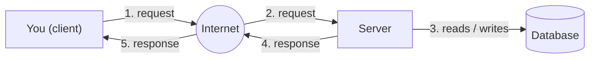
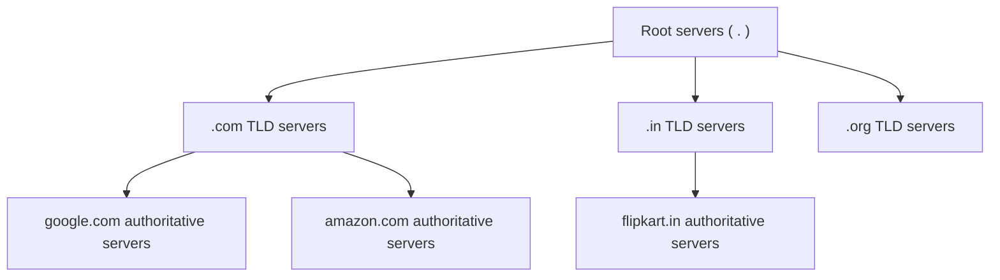
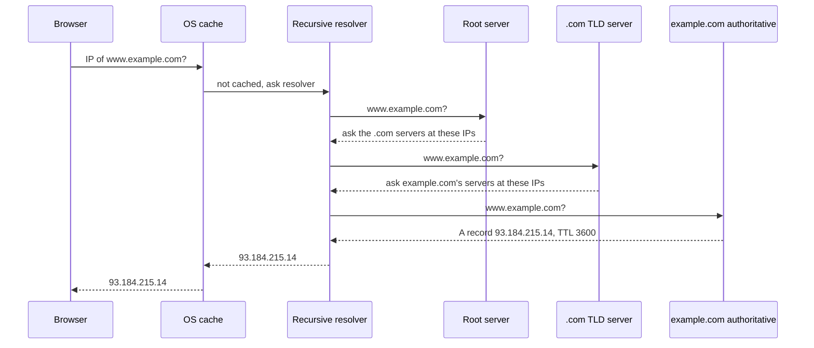
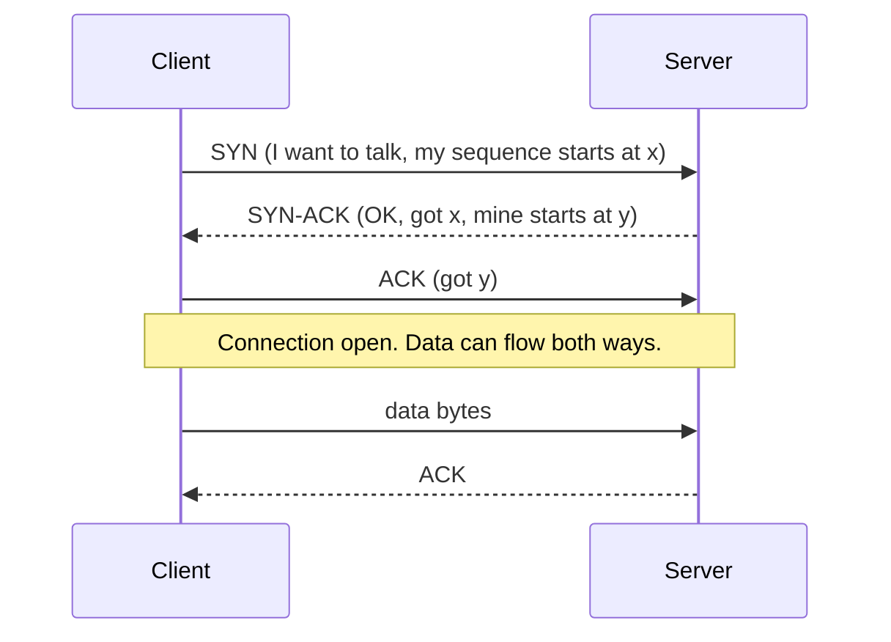
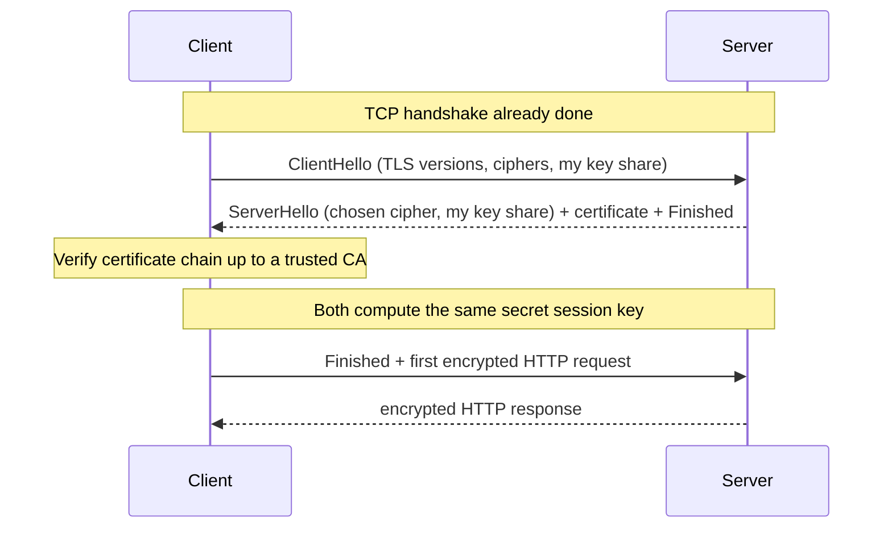
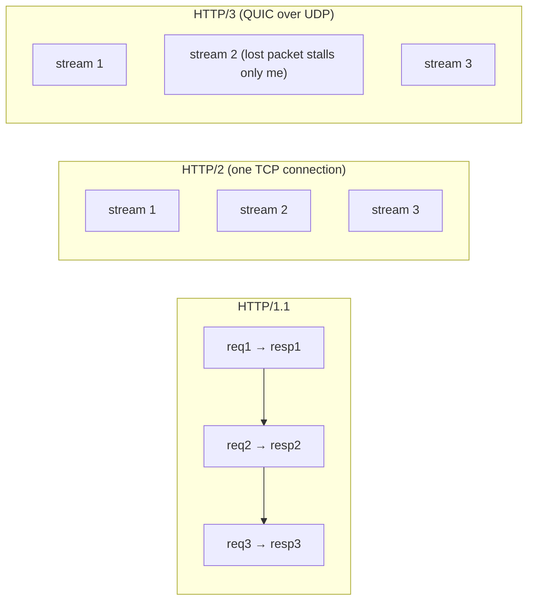
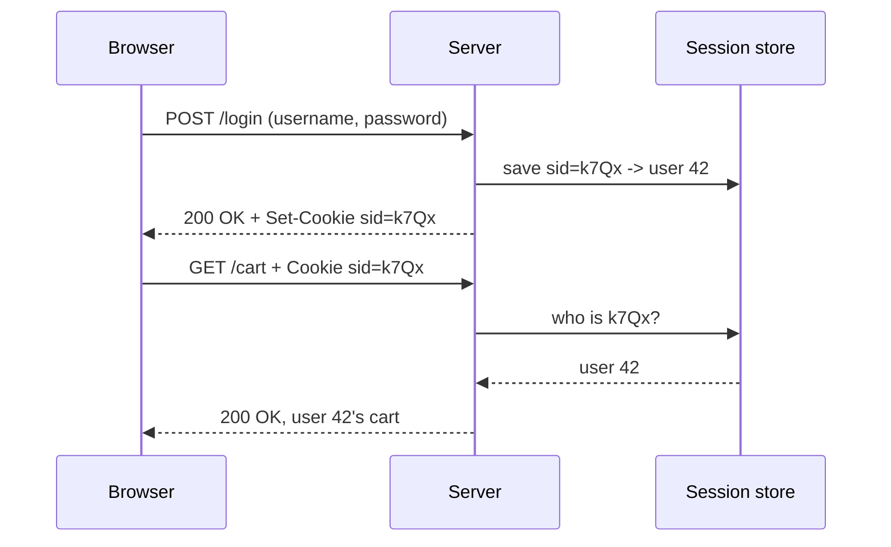
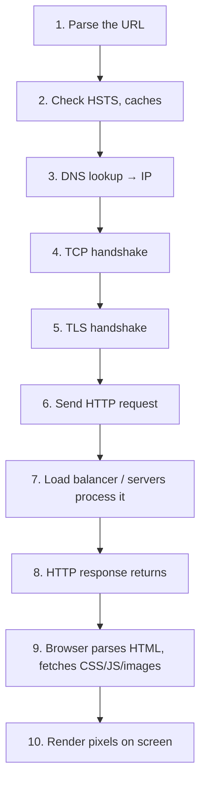
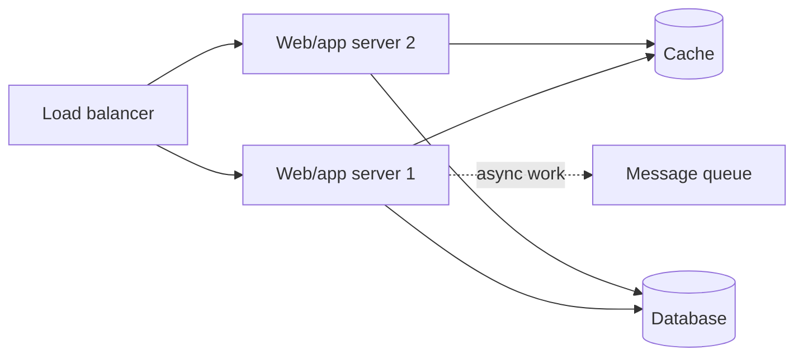
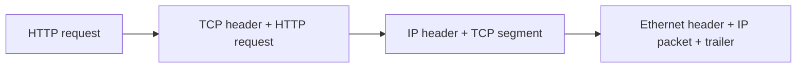

# Chapter 01 · What System Design Is & How the Internet Works

> You tap "Order" on a food app. Half a second later a restaurant 8 km away prints your ticket, a rider's phone buzzes, and your screen says "Preparing your food". Dozens of machines you will never see just cooperated perfectly. System design is the craft of planning that cooperation, and it starts with understanding how two computers talk at all.

**You will learn:**
- What "system design" means and why interviews for every level above fresher ask it
- The client-server model, IP addresses, ports and what a "connection" really is
- DNS resolution step by step, TCP vs UDP, the TLS handshake, and HTTP/1.1 vs 2 vs 3
- The anatomy of an HTTP request and response, status codes, cookies and sessions
- The full journey of what happens when you type a URL and press Enter
- Latency numbers every engineer should know, and how to use them
- Functional vs non-functional requirements and the 8 key qualities, including the "nines" of availability

**Before this:** Nothing from system design! You only need Python ([Part 1](../part-1-python/01-getting-started.md)) and comfort with dictionaries ([Dictionaries & Hashing](../part-1-python/09-dictionaries.md)) and Big-O ([Big-O](../part-2-dsa/01-big-o-complexity.md)).

---

## 🧠 The Big Idea

In DSA you made **one program on one machine** fast. In system design you make **many programs on many machines** work together, for **many users at once**, while machines crash, networks drop messages and traffic suddenly jumps 10×.

Think of the difference between cooking dinner at home and running a restaurant chain:

| Home cooking (DSA) | Restaurant chain (System design) |
|---|---|
| One cook, one kitchen | Hundreds of cooks, many kitchens |
| "Is my recipe efficient?" | "What if the head chef is sick? What if 500 people walk in at 8 pm?" |
| Measure: time per dish | Measure: dishes per hour, wait time, how often you're closed |
| Mistake = burnt dinner | Mistake = thousands of angry customers |

The most basic picture, which every other chapter builds on, is this one:



A **client** (your phone, browser, or another program) asks for something. A **server** (a program running on a computer somewhere) does the work, often with help from a **database** that remembers data, and sends back an answer. Everything in system design (load balancers, caches, queues, shards) is a way to make this picture survive millions of users.

> 💡 **The core insight:** a system is a set of boxes connected by a network. The network is slow, unreliable and limited. Most of system design is about the **arrows**, not the boxes.

---

## 🔨 Building It Up

### 1. What system design is, and why interviews ask it

**System design** is deciding *which components* a software system needs, *how they talk to each other*, and *how data flows and is stored*, so that the system meets its requirements (features, speed, uptime, cost).

A system design interview usually sounds like: *"Design a URL shortener"*, *"Design WhatsApp"*, *"Design a rate limiter"*. You get 45–60 minutes, a whiteboard, and no single right answer.

Why companies ask it:

1. **Real jobs are mostly this.** Writing a sorting function is rare. Deciding "should this go in a cache or a queue?" happens every week.
2. **It tests judgment, not memory.** There are trade-offs everywhere: faster vs cheaper, simpler vs more scalable. Interviewers want to hear *you reason* about them.
3. **It shows seniority.** A junior asks "how do I code this?". A senior asks "what happens when this breaks at 10× traffic?".

What interviewers look for, in order:

- You **clarify requirements** before drawing anything.
- You **estimate scale** (users, requests per second, storage). We'll learn this in [Chapter 11](11-estimation-framework.md).
- You draw a **simple working design** first, then improve it.
- You **name trade-offs** ("I chose X; the cost is Y").
- You find and fix **bottlenecks and single points of failure**.

This chapter gives you the vocabulary. Without it, every later chapter is noise.

### 2. Client and server: two programs, one conversation

A **server** is not a special kind of computer. It's just a program that **waits** for requests and answers them. A **client** is a program that **starts** a conversation. Your laptop can be both at once.

Here is a tiny client-server conversation in pure Python, without a real network. The "network" is just a function call, but the shape is identical to the real thing.

```python
def server(request):
    """A server: takes a request, returns a response. That's all it is."""
    menu = {"/": "Welcome!", "/menu": "Dosa, Idli, Vada"}
    if request in menu:
        return 200, menu[request]
    return 404, "Not found"

def client(path):
    status, body = server(path)          # in real life, this crosses the internet
    print(f"GET {path} -> {status} {body}")

client("/")
client("/menu")
client("/pizza")
```

```text
GET / -> 200 Welcome!
GET /menu -> 200 Dosa, Idli, Vada
GET /pizza -> 404 Not found
```

What just happened: the client sends a **request** (a path), the server looks it up and returns a **response** made of a **status code** (200 = OK, 404 = not found) and a **body**. Real web servers do exactly this, only the request travels as bytes over wires and radio waves.

### 3. IP addresses and ports: the street address and the flat number

To send a letter you need an address. Computers on the internet have one too: an **IP address** (Internet Protocol address).

- **IPv4** looks like `142.250.183.14`: four numbers from 0 to 255, so 32 bits, about 4.3 billion addresses. That's fewer than the number of devices on Earth.
- **IPv6** looks like `2404:6800:4009:82a::200e`: 128 bits, enough for every grain of sand to have many addresses.
- **Private IPs** like `192.168.1.5` or `10.0.0.7` only work inside your home or office network. Your router uses **NAT** (Network Address Translation) to share one public IP among all your devices, like a building with one street address and a receptionist who forwards mail.

But one computer runs many programs. How does a message reach the right one? With a **port**: a number from 0 to 65535 that identifies a program on that machine.

| Analogy | Networking |
|---|---|
| Building's street address | IP address |
| Flat number inside the building | Port |
| Full address: "Flat 443, 142 MG Road" | `142.250.183.14:443` |

Well-known ports you will see forever:

| Port | Used by |
|---|---|
| 80 | HTTP (web, unencrypted) |
| 443 | HTTPS (web, encrypted) |
| 22 | SSH (remote login) |
| 53 | DNS |
| 5432 | PostgreSQL |
| 3306 | MySQL |
| 6379 | Redis |

A **connection** is identified by four things: client IP, client port, server IP, server port. Your browser picks a random high "ephemeral" port (like 54321) for its side. That's how one server on port 443 can hold thousands of separate connections at once: each has a different client IP/port pair.

### 4. DNS: the internet's phone book

Humans remember `google.com`. Computers need `142.250.183.14`. The **Domain Name System (DNS)** translates names to IPs. It's like the contacts app on your phone: you tap "Mom", the phone dials a number.

DNS is not one giant server. It's a **hierarchy**, read from right to left:



- **Root servers** know who handles each top-level domain. There are 13 root server *names* (a.root-servers.net to m.root-servers.net), each backed by many machines around the world.
- **TLD servers** (Top-Level Domain: `.com`, `.in`, `.org`) know who is in charge of each domain under them.
- **Authoritative servers** hold the actual records for a domain, set by its owner.

Between you and them sits a **recursive resolver**, usually run by your internet provider, or a public one like Google's `8.8.8.8` or Cloudflare's `1.1.1.1`. It does the legwork for you.

The full resolution of `www.example.com`, when nothing is cached:



Notice two styles of question:

- **Recursive query**: "get me the final answer" (browser → resolver). The resolver must do all the work.
- **Iterative query**: "tell me what you know" (resolver → root → TLD → authoritative). Each server just points to the next one.

**Caching makes DNS fast.** Every answer comes with a **TTL** (time to live, in seconds). The browser, the operating system and the resolver all cache answers until the TTL expires. That's why most lookups take ~0 ms (browser cache) or a few ms (resolver cache), and only a cold lookup walks the whole tree.

Common **DNS record types**:

| Record | Maps | Example |
|---|---|---|
| A | name → IPv4 | `example.com → 93.184.215.14` |
| AAAA | name → IPv6 | `example.com → 2606:2800::1` |
| CNAME | name → another name (alias) | `www.shop.com → shop.cdn-provider.net` |
| MX | domain → mail server | `gmail.com → gmail-smtp-in.l.google.com` |
| NS | domain → its authoritative name servers | `example.com → a.iana-servers.net` |
| TXT | name → any text (verification, email security) | `"v=spf1 include:..."` |

Here is a small simulation of a recursive resolver with a cache and TTLs. The "servers" are dictionaries.

```python
ROOT = {"com": "tld-com", "in": "tld-in"}
SERVERS = {
    "tld-com": {"example.com": "auth-example"},
    "tld-in": {"shop.in": "auth-shop"},
    "auth-example": {"www.example.com": ("93.184.215.14", 300)},
    "auth-shop": {"www.shop.in": ("203.0.113.9", 60)},
}

class Resolver:
    def __init__(self):
        self.cache = {}                        # name -> (ip, expires_at)

    def resolve(self, name, now):
        if name in self.cache and self.cache[name][1] > now:
            print(f"  t={now}: {name} cache HIT")
            return self.cache[name][0]
        hops = []
        tld = name.rsplit(".", 1)[1]           # "www.example.com" -> "com"
        tld_server = ROOT[tld]; hops.append("root")
        domain = ".".join(name.split(".")[-2:])   # "example.com"
        auth = SERVERS[tld_server][domain]; hops.append(tld_server)
        ip, ttl = SERVERS[auth][name]; hops.append(auth)
        self.cache[name] = (ip, now + ttl)
        print(f"  t={now}: {name} cache MISS, asked {' -> '.join(hops)}")
        return ip

r = Resolver()
print(r.resolve("www.example.com", now=0))
print(r.resolve("www.example.com", now=100))   # within TTL 300
print(r.resolve("www.example.com", now=400))   # TTL expired
print(r.resolve("www.shop.in", now=400))
```

```text
  t=0: www.example.com cache MISS, asked root -> tld-com -> auth-example
93.184.215.14
  t=100: www.example.com cache HIT
93.184.215.14
  t=400: www.example.com cache MISS, asked root -> tld-com -> auth-example
93.184.215.14
  t=400: www.shop.in cache MISS, asked root -> tld-in -> auth-shop
203.0.113.9
```

What just happened: the first lookup walked root → TLD → authoritative and cached the result for 300 seconds. The second was instant. After the TTL expired, the resolver had to walk the tree again. A brand-new name (`www.shop.in`) always starts with a miss.

> 💡 **Why TTL matters in system design:** a short TTL (60 s) lets you move traffic to new servers quickly (useful for failover). A long TTL (1 day) means fewer lookups but slow changes. When you migrate servers, lower the TTL a day *before* the move.

### 5. TCP vs UDP: registered post vs postcards

Once you know the IP, you need a way to deliver data. Data travels in small chunks called **packets** (typically up to ~1,500 bytes each). Packets can get lost, duplicated, or arrive out of order. Two transport protocols handle this differently.

**TCP (Transmission Control Protocol)** is like registered post with tracking:

- **Connection first.** Before sending data, client and server do a **three-way handshake**.
- **Reliable.** Every byte is acknowledged. Lost packets are re-sent.
- **Ordered.** Bytes arrive in the order they were sent, even if packets took different routes.
- **Flow and congestion control.** It slows down if the receiver or network is overloaded.



The handshake costs **one round trip** (RTT, round-trip time: there and back) before any data moves. If the server is 100 ms away, that's 100 ms of pure waiting. This is why reusing connections matters so much.

**UDP (User Datagram Protocol)** is like throwing postcards:

- **No connection, no handshake.** Just send.
- **No guarantees.** Packets may be lost or arrive out of order. Nobody re-sends.
- **Tiny overhead, low latency.**

| | TCP | UDP |
|---|---|---|
| Connection | Yes (handshake) | No |
| Delivery | Guaranteed, re-sends lost data | Best effort |
| Order | Preserved | Not preserved |
| Speed / overhead | More overhead | Minimal |
| Used for | Web (HTTP/1.1, HTTP/2), email, file transfer, databases | Video calls, online games, live streaming, DNS, QUIC (HTTP/3) |

**Rule of thumb:** if a late packet is useless (a video frame from 2 seconds ago, a game position), use UDP. If every byte matters (a bank transfer, a web page), use TCP.

Let's simulate what TCP's guarantees buy you. Packets arrive shuffled and one is lost; TCP-style logic re-orders and re-requests.

```python
import random

random.seed(7)
message = "HELLO WORLD!"
packets = list(enumerate(message))          # (sequence number, byte)
random.shuffle(packets)                     # the network reorders packets
lost = packets.pop(3)                       # ...and loses one

udp_view = "".join(ch for _, ch in packets)
print("UDP receiver sees:", repr(udp_view))

received = dict(packets)                    # TCP keeps packets by sequence number
missing = [i for i in range(len(message)) if i not in received]
print("TCP notices missing seq:", missing)
for seq in missing:
    received[seq] = message[seq]            # sender re-transmits
print("TCP receiver sees:", repr("".join(received[i] for i in range(len(message)))))
```

```text
UDP receiver sees: 'O!LROLEHWL '
TCP notices missing seq: [10]
TCP receiver sees: 'HELLO WORLD!'
```

What just happened: the UDP receiver got 11 scrambled characters (the `D` was lost and nobody noticed). TCP's sequence numbers let it put bytes back in order and notice the gap, then the sender re-sends. UDP just hands over whatever arrived.

### 6. TLS: the secret handshake behind the padlock

Plain HTTP sends everything as readable text. Anyone on the same café Wi-Fi could read your password. **TLS** (Transport Layer Security; its old name was SSL) adds three things:

1. **Encryption**: eavesdroppers see gibberish.
2. **Authentication**: you know you're really talking to `yourbank.com`, not an imposter. The server proves this with a **certificate** signed by a trusted **Certificate Authority (CA)**, like a passport stamped by a government your browser trusts.
3. **Integrity**: nobody can change the data in transit without being detected.

**HTTPS** is simply HTTP running inside a TLS connection, on port 443.

The TLS 1.3 handshake, at the level interviews expect:



The key trick is **key exchange** (Diffie-Hellman): both sides send public "key shares" and each mixes the other's share with its own secret to get the **same session key**, without ever sending that key across the network. After that, everything uses fast **symmetric encryption** with the session key.

Cost: TLS 1.3 adds **one round trip** (TLS 1.2 needed two). So a fresh HTTPS connection costs 1 RTT for TCP + 1 RTT for TLS before the first byte of the request. On a 100 ms link, that's 200 ms of handshakes. Remember this; it's why connection reuse, CDNs (servers closer to users) and HTTP/3 matter.

### 7. HTTP: the language of the web

**HTTP** (HyperText Transfer Protocol) is a simple text-based request/response protocol. The client sends a **request**; the server returns a **response**. Each request is **stateless**: the server doesn't automatically remember previous requests (we'll fix that with cookies in section 10).

**Anatomy of a request:**

```text
POST /api/orders HTTP/1.1                    <- request line: method, path, version
Host: food.example.com                       <- headers: key: value
Content-Type: application/json
Authorization: Bearer eyJhbGciOi...
Cookie: session_id=abc123
Content-Length: 41
                                             <- blank line ends the headers
{"restaurant_id": 42, "items": [7, 9, 9]}    <- body (optional)
```

**Anatomy of a response:**

```text
HTTP/1.1 201 Created                         <- status line: version, code, reason
Content-Type: application/json
Location: /api/orders/9001
Cache-Control: no-store
Set-Cookie: last_order=9001; HttpOnly; Secure

{"order_id": 9001, "status": "PLACED", "eta_minutes": 35}
```

The common **methods** (also called verbs):

| Method | Meaning | Safe? (no changes) | Idempotent? (repeat = same effect) |
|---|---|---|---|
| GET | Read a resource | Yes | Yes |
| POST | Create / perform an action | No | No |
| PUT | Replace a resource fully | No | Yes |
| PATCH | Partially update | No | Not guaranteed |
| DELETE | Remove | No | Yes |
| HEAD | Like GET but headers only | Yes | Yes |
| OPTIONS | What's allowed here? (used by CORS) | Yes | Yes |

**Idempotent** means doing it twice has the same effect as doing it once. Deleting order 9001 twice still leaves it deleted. Posting "create order" twice creates *two* orders. This matters hugely for safe retries ([Chapter 07](07-apis-communication.md) goes deep).

Since a request is just text, parsing one is a nice Python exercise:

```python
raw = (
    "POST /api/orders HTTP/1.1\r\n"
    "Host: food.example.com\r\n"
    "Content-Type: application/json\r\n"
    "Content-Length: 27\r\n"
    "\r\n"
    '{"restaurant_id": 42, "x": 1}'
)

def parse_request(text):
    head, body = text.split("\r\n\r\n", 1)        # blank line separates head and body
    lines = head.split("\r\n")
    method, path, version = lines[0].split(" ")
    headers = {}
    for line in lines[1:]:
        key, value = line.split(":", 1)
        headers[key.strip().lower()] = value.strip()   # header names are case-insensitive
    return method, path, version, headers, body

method, path, version, headers, body = parse_request(raw)
print(method, path, version)
print(headers)
print(body)
```

```text
POST /api/orders HTTP/1.1
{'host': 'food.example.com', 'content-type': 'application/json', 'content-length': '27'}
{"restaurant_id": 42, "x": 1}
```

What just happened: HTTP/1.1 is literally lines of text separated by `\r\n` (carriage return + newline). A blank line marks the end of headers. Real servers do the same thing, just faster and with many more checks.

**Headers you should recognise:**

| Header | Direction | Purpose |
|---|---|---|
| `Host` | request | Which website (one IP can host many sites) |
| `Content-Type` | both | Format of the body (`application/json`, `text/html`) |
| `Authorization` | request | Credentials, e.g. a token |
| `Cookie` / `Set-Cookie` | request / response | Small data the browser stores and sends back |
| `Cache-Control` | response | How long the response may be cached ([Chapter 04](04-caching-cdn.md)) |
| `ETag` / `If-None-Match` | response / request | Version tag to avoid re-downloading unchanged data |
| `Location` | response | Where a created or moved resource lives |
| `User-Agent` | request | What client is calling |
| `Accept-Encoding` / `Content-Encoding` | both | Compression like gzip or br |

### 8. Status codes: the server's facial expression

Status codes come in five families. Learn the families first; individual codes follow naturally.

| Range | Meaning | Mood |
|---|---|---|
| 1xx | Informational ("keep going") | 🤔 |
| 2xx | Success | 😀 |
| 3xx | Redirection ("look elsewhere") | 👉 |
| 4xx | **Client** error ("you messed up") | 🙅 |
| 5xx | **Server** error ("we messed up") | 🔥 |

The ones you must know cold:

| Code | Name | When |
|---|---|---|
| 200 | OK | Normal success |
| 201 | Created | POST created something (with `Location` header) |
| 204 | No Content | Success, nothing to return (often DELETE) |
| 301 | Moved Permanently | URL changed forever (browsers and search engines remember) |
| 302 | Found | Temporary redirect |
| 304 | Not Modified | "Your cached copy is still good" |
| 400 | Bad Request | Malformed input |
| 401 | Unauthorized | Not logged in / bad credentials (really means "unauthenticated") |
| 403 | Forbidden | Logged in, but not allowed |
| 404 | Not Found | No such resource |
| 409 | Conflict | Clashes with current state (e.g. duplicate username) |
| 429 | Too Many Requests | Rate limited ([Chapter 07](07-apis-communication.md)) |
| 500 | Internal Server Error | Bug or crash on the server |
| 502 | Bad Gateway | A proxy got a bad answer from the server behind it |
| 503 | Service Unavailable | Overloaded or down for maintenance |
| 504 | Gateway Timeout | A proxy waited too long for the server behind it |

Why does the family matter in design? **Retries.** A 5xx or timeout might succeed if retried. A 4xx won't: the request itself is wrong.

```python
def should_retry(status):
    """Retry on server-side trouble and rate limiting, never on client mistakes."""
    if status == 429:
        return True              # wait (honour Retry-After) and retry
    return 500 <= status <= 599  # server errors may be temporary

for code in [200, 400, 404, 429, 500, 503]:
    print(code, "retry" if should_retry(code) else "don't retry")
```

```text
200 don't retry
400 don't retry
404 don't retry
429 retry
500 retry
503 retry
```

### 9. HTTP/1.1 vs HTTP/2 vs HTTP/3

HTTP has evolved to waste fewer round trips. A modern web page needs dozens of files (HTML, CSS, JS, images), so how they share connections matters.

**HTTP/1.0:** one TCP connection per request. Open, request, response, close. Very wasteful (a handshake every time).

**HTTP/1.1 (1997):**
- **Keep-alive**: reuse one TCP connection for many requests, one after another.
- But on one connection, responses come back **in order**. If response 1 is slow, responses 2 and 3 wait behind it. This is **head-of-line (HOL) blocking**, like a slow customer at the only billing counter.
- Browsers work around it by opening ~6 parallel connections per domain.

**HTTP/2 (2015):**
- **Binary framing** instead of text.
- **Multiplexing**: many requests and responses travel *interleaved* on **one** TCP connection as independent **streams**. No more HTTP-level HOL blocking.
- **Header compression (HPACK)**: repeated headers (cookies, user agent) aren't re-sent in full.
- Still on TCP, so if **one packet** is lost, TCP holds back *all* streams until it's re-sent. HOL blocking moved down to the TCP layer.

**HTTP/3 (2022):**
- Runs on **QUIC**, a protocol built on **UDP** that implements reliability *per stream*. A lost packet only stalls its own stream.
- **TLS 1.3 is built in**: connection + encryption setup in **1 RTT**, and **0-RTT** when resuming with a server you've talked to before.
- **Connection migration**: your phone switches from Wi-Fi to 4G and the connection survives (connections are identified by an ID, not by IP+port).



| | HTTP/1.1 | HTTP/2 | HTTP/3 |
|---|---|---|---|
| Transport | TCP | TCP | QUIC over UDP |
| Format | Text | Binary frames | Binary frames |
| Requests per connection | One at a time | Many, multiplexed | Many, multiplexed |
| Head-of-line blocking | HTTP level and TCP level | TCP level only | Eliminated across streams |
| Header compression | No | HPACK | QPACK |
| Handshake (new connection) | TCP 1 RTT + TLS 1–2 RTT | Same as 1.1 | 1 RTT total (0-RTT on resume) |

Let's count round trips for loading 6 files over one connection on a 50 ms RTT link, ignoring transfer time:

```python
RTT_MS = 50
FILES = 6

def http11_one_connection():
    handshakes = 1 + 1            # TCP + TLS 1.3
    return (handshakes + FILES) * RTT_MS   # requests go one after another

def http2():
    handshakes = 1 + 1
    return (handshakes + 1) * RTT_MS       # all 6 requests multiplexed in one round trip

def http3(resumed=False):
    handshakes = 0 if resumed else 1       # QUIC merges transport + TLS
    return (handshakes + 1) * RTT_MS

print("HTTP/1.1, 1 connection :", http11_one_connection(), "ms")
print("HTTP/2                 :", http2(), "ms")
print("HTTP/3 (new)           :", http3(), "ms")
print("HTTP/3 (0-RTT resume)  :", http3(resumed=True), "ms")
```

```text
HTTP/1.1, 1 connection : 400 ms
HTTP/2                 : 150 ms
HTTP/3 (new)           : 100 ms
HTTP/3 (0-RTT resume)  : 50 ms
```

What just happened: the same 6 files cost 400 ms or 50 ms depending only on how round trips are used. On a slow mobile network, this is the difference between "snappy" and "laggy". **Round trips are the currency of latency.**

### 10. Cookies and sessions: giving a stateless protocol a memory

HTTP is **stateless**: each request is a stranger to the server. But you stay logged in on Amazon across clicks. How?

**Cookies.** The server sends a `Set-Cookie` header; the browser stores it and attaches it as a `Cookie` header to every later request to that site. Think of a cloakroom token: you hand over your coat, get token #47, and show the token to get your coat back.

**Sessions.** The usual pattern is that the cookie holds only a random, unguessable **session ID**. The actual data ("user 42 is logged in, cart has 3 items") lives on the server in a **session store**.



```python
import secrets
import random

random.seed(1)

class WebServer:
    def __init__(self):
        self.sessions = {}                              # session_id -> user data
        self.users = {"asha": "pass123"}

    def login(self, username, password):
        if self.users.get(username) != password:
            return 401, {}, "bad credentials"
        sid = "".join(random.choice("abcdefghjkmnpqrstuvwxyz23456789") for _ in range(8))
        self.sessions[sid] = {"user": username, "cart": []}
        return 200, {"Set-Cookie": f"sid={sid}; HttpOnly; Secure"}, "welcome"

    def add_to_cart(self, cookie, item):
        sid = cookie.removeprefix("sid=")
        session = self.sessions.get(sid)
        if session is None:
            return 401, "please log in"
        session["cart"].append(item)
        return 200, f"{session['user']}'s cart: {session['cart']}"

server = WebServer()
status, headers, body = server.login("asha", "pass123")
print(status, body, headers)
cookie = headers["Set-Cookie"].split(";")[0]          # browser stores "sid=..."
print(server.add_to_cart(cookie, "masala dosa"))
print(server.add_to_cart(cookie, "filter coffee"))
print(server.add_to_cart("sid=forged", "free stuff"))
print("real apps use secrets.token_urlsafe():", len(secrets.token_urlsafe(16)) > 0)
```

```text
200 welcome {'Set-Cookie': 'sid=ev643cjd; HttpOnly; Secure'}
(200, "asha's cart: ['masala dosa']")
(200, "asha's cart: ['masala dosa', 'filter coffee']")
(401, 'please log in')
real apps use secrets.token_urlsafe(): True
```

What just happened: the server created a session, handed the browser only an ID, and looked the ID up on each request. A forged ID finds nothing. We seeded `random` so the output is repeatable; **real systems must use `secrets`**, which is cryptographically unpredictable.

Important cookie attributes:

| Attribute | Effect |
|---|---|
| `HttpOnly` | JavaScript can't read it (protects against stolen cookies via XSS attacks) |
| `Secure` | Only sent over HTTPS |
| `SameSite=Lax/Strict` | Not sent on most cross-site requests (protects against CSRF attacks) |
| `Max-Age` / `Expires` | When it dies; without it, it's a "session cookie" deleted when the browser closes |
| `Domain` / `Path` | Which URLs receive it |

> ⚠️ Storing sessions **in one server's memory** breaks the moment you have two servers: a request that lands on server B won't find a session created on server A. Fixing this is a key topic of [Chapter 02](02-scalability-load-balancing.md). The alternative, **tokens like JWT** that carry the data themselves, is in [Chapter 07](07-apis-communication.md).

### 11. What happens when you type a URL and press Enter

This is one of the most famous interview questions of all time. Let's put every piece together for `https://www.example.com/products?id=7`.



**Step 1: Parse the URL.** The browser splits it:

```text
https://www.example.com:443/products?id=7#reviews
\___/   \_____________/ \_/\_______/ \__/ \_____/
scheme       host       port  path   query fragment
```

The **fragment** (`#reviews`) is never sent to the server; it's for the browser only. If you typed something that isn't a URL, the browser treats it as a search.

**Step 2: Quick checks.** Is `example.com` on the **HSTS** list (a list of sites that must always use HTTPS)? Is the page in the browser's HTTP cache and still fresh? If so, skip the network entirely.

**Step 3: DNS.** Browser cache → OS cache (and the `hosts` file) → recursive resolver → root → TLD → authoritative (section 4). Result: an IP address, often of a **CDN** edge server near you ([Chapter 04](04-caching-cdn.md)) or a **load balancer** ([Chapter 02](02-scalability-load-balancing.md)).

**Step 4: TCP handshake.** SYN, SYN-ACK, ACK with the IP on port 443. One RTT.

**Step 5: TLS handshake.** ClientHello, ServerHello + certificate, key exchange, certificate verification. One RTT with TLS 1.3. (With HTTP/3, steps 4 and 5 merge into one QUIC handshake.)

**Step 6: Send the HTTP request.** `GET /products?id=7` with headers: `Host`, cookies, `Accept-Encoding`, and so on.

**Step 7: The server side.** This is where system design lives:



A load balancer picks a healthy server. The server checks authentication (the cookie), looks for product 7 in a **cache**, falls back to the **database** on a miss, maybe drops an "analytics event" into a **queue** ([Chapter 08](08-queues-events.md)), and builds a response.

**Step 8: The response travels back.** Status `200 OK`, headers like `Content-Type: text/html` and `Cache-Control`, and a compressed body.

**Step 9: The browser parses the HTML.** It builds the **DOM** (a tree of page elements), finds `<link>` and `<script>` and `` tags, and fetches those too, reusing the connection (HTTP/2 multiplexing). Many come from a CDN. JavaScript may make more API calls.

**Step 10: Render.** CSS is parsed into the **CSSOM**, combined with the DOM into a render tree, then **layout** (where does each box go?) and **paint** (pixels). You see the page.

Total on a good connection: often a few hundred milliseconds. Every chapter of Part 3 makes some piece of step 7 faster or tougher.

### 12. Latency numbers every engineer should know

You can't design well if you think a network call and a memory read cost the same. These approximate numbers (popularised by Jeff Dean and Peter Norvig; exact values vary by hardware, but the **ratios** are what matter) are worth memorising:

| Operation | Approx. time | Human-scale (if 1 ns = 1 s) |
|---|---|---|
| L1 cache reference | 0.5 ns | half a second |
| Branch mispredict | 5 ns | 5 seconds |
| L2 cache reference | 7 ns | 7 seconds |
| Mutex lock/unlock | 25 ns | 25 seconds |
| Main memory (RAM) reference | 100 ns | under 2 minutes |
| Compress 1 KB (fast compressor) | ~2 µs | ~33 minutes |
| Send 1 KB over 1 Gbps network | 10 µs | ~3 hours |
| Random read from SSD (4 KB) | ~100 µs | ~1 day |
| Read 1 MB sequentially from RAM | ~250 µs | ~3 days |
| Round trip within same datacenter | 500 µs | ~6 days |
| Read 1 MB sequentially from SSD | ~1 ms | ~12 days |
| Disk (HDD) seek | 10 ms | ~4 months |
| Read 1 MB sequentially from HDD | ~20 ms | ~8 months |
| Packet round trip California ↔ Netherlands | 150 ms | ~5 years |

(1 ms = 1,000 µs = 1,000,000 ns.)

Lessons hidden in this table:

1. **Memory is ~1,000× faster than SSD and ~100,000× faster than an HDD seek.** That's why caches ([Chapter 04](04-caching-cdn.md)) exist.
2. **A cross-continent round trip is ~300× slower than a datacenter round trip.** That's why CDNs and multi-region deployments exist.
3. **Sequential reads beat random reads.** That's why databases use logs and LSM trees ([Chapter 03](03-databases.md)).
4. **Network inside a datacenter is fast but not free.** 100 sequential calls of 0.5 ms each add 50 ms. Batch them.

Let's use the numbers to compare three ways of fetching 100 user profiles:

```python
NS = 1
US = 1_000 * NS
MS = 1_000 * US

RAM_READ = 100 * NS
SSD_RANDOM_READ = 100 * US
DC_ROUND_TRIP = 500 * US

def fmt(ns):
    return f"{ns / MS:.3f} ms"

profiles = 100
from_local_ram = profiles * RAM_READ
db_one_call_each = profiles * (DC_ROUND_TRIP + SSD_RANDOM_READ)
db_one_batched_call = DC_ROUND_TRIP + profiles * SSD_RANDOM_READ

print("local in-memory cache     :", fmt(from_local_ram))
print("100 separate DB calls     :", fmt(db_one_call_each))
print("1 batched DB call         :", fmt(db_one_batched_call))
```

```text
local in-memory cache     : 0.010 ms
100 separate DB calls     : 60.000 ms
1 batched DB call         : 10.500 ms
```

What just happened: the same work ranges from 0.01 ms to 60 ms. Batching removed 99 round trips; caching removed the network and the disk. Back-of-envelope reasoning like this is exactly what interviewers want to hear.

### 13. Requirements: functional vs non-functional

Every design starts with **requirements**. Skipping them is the #1 interview mistake.

**Functional requirements** describe **what** the system does: its features.

- "Users can post a photo with a caption."
- "Users can follow other users."
- "Users see a feed of photos from people they follow."

**Non-functional requirements (NFRs)** describe **how well** it does them: its qualities.

- "The feed loads in under 200 ms for 99% of requests."
- "The service is available 99.99% of the time."
- "Uploaded photos are never lost."
- "Must handle 10 million daily active users."

A good test: if removing it changes **what** the user can do, it's functional. If it changes **how fast, how reliably, how safely**, it's non-functional.

| Functional | Non-functional |
|---|---|
| Send a message | Delivered within 1 second |
| Shorten a URL | Redirect in under 50 ms; links never expire wrongly |
| Upload a video | Videos are durable; upload works on slow 3G |
| Search products | Results in under 300 ms; handles 50k searches/second |

> 💡 In an interview, spend the first 3–5 minutes listing 3–5 functional requirements and 3–5 non-functional ones. Then **say which ones you're optimising for**. "This is a read-heavy system where availability matters more than strong consistency" is a sentence that changes the whole design.

### 14. The key qualities, defined precisely

These words get thrown around loosely. Use them precisely and you'll sound like an engineer who has run real systems.

**Scalability**: the ability to handle **more load** by adding resources, without redesigning. Load can mean more users, more data, or more requests per second. ([Chapter 02](02-scalability-load-balancing.md))

**Availability**: the fraction of time the system is **up and answering**. Measured in "nines" (see below). A system can be available but return stale data.

**Reliability**: the system **does the right thing** consistently, even when parts fail. Available = "it answers"; reliable = "it answers *correctly*". A server that's always up but drops 1% of orders is available but not reliable.

**Latency**: the time **one request** takes, start to finish. Usually reported as percentiles: **p50** (median), **p95**, **p99** (99% of requests are faster than this). Averages hide pain; p99 shows it.

**Throughput**: how many requests (or bytes) the system handles **per unit of time**, e.g. 20,000 requests/second (RPS or QPS, queries per second).

Latency vs throughput, by analogy: a highway's **latency** is how long it takes one car to drive from A to B. Its **throughput** is how many cars pass per hour. Adding lanes raises throughput without making any car faster.

**Consistency**: every reader sees the **latest write** (or at least a well-defined version of the data). Different systems promise different levels. ([Chapter 06](06-cap-consistency.md))

**Durability**: once the system says "saved", the data **survives** crashes, power loss, and disk failure. Achieved by writing to disk and replicating to several machines. ([Chapter 05](05-replication-sharding.md))

**Maintainability**: how easily engineers can **understand, change, and operate** the system. Simple designs, good monitoring ([Chapter 09](09-microservices-reliability.md)), clear boundaries. Often the most underrated quality.

Here is percentile latency computed from a sample of response times, so you see why averages lie:

```python
import random

random.seed(42)
# 1000 requests: most are fast, a few hit a slow path (e.g. a cache miss + disk read)
latencies = [random.randint(20, 60) for _ in range(980)] + \
            [random.randint(800, 1500) for _ in range(20)]
latencies.sort()

def percentile(sorted_values, p):
    index = max(0, int(round(p / 100 * len(sorted_values))) - 1)   # nearest-rank method
    return sorted_values[index]

avg = sum(latencies) / len(latencies)
print(f"average: {avg:.0f} ms")
for p in (50, 95, 99, 99.9):
    print(f"p{p}: {percentile(latencies, p)} ms")
```

```text
average: 62 ms
p50: 40 ms
p95: 59 ms
p99: 1094 ms
p99.9: 1423 ms
```

What just happened: the average looks acceptable, p50 and p95 look great, but p99 reveals that 1 in 100 users waits over a second. If a single page makes 50 backend calls, about 4 in 10 page loads hit at least one slow call (1 − 0.99⁵⁰ ≈ 0.39). That's why big companies set targets on **p99**, not on averages.

### 15. Availability and the "nines"

**Availability = uptime / (uptime + downtime)**, usually per year or per month. People describe it by counting nines:

```python
MINUTES_PER_YEAR = 365 * 24 * 60
MINUTES_PER_MONTH = MINUTES_PER_YEAR / 12

def describe(minutes):
    if minutes >= 24 * 60:
        return f"{minutes / (24 * 60):.2f} days"
    if minutes >= 60:
        return f"{minutes / 60:.2f} hours"
    if minutes >= 1:
        return f"{minutes:.2f} minutes"
    return f"{minutes * 60:.2f} seconds"

print(f"{'availability':<14}{'downtime/year':<18}{'downtime/month'}")
for pct in ["90", "99", "99.9", "99.95", "99.99", "99.999"]:
    down_fraction = (100 - float(pct)) / 100
    year = describe(MINUTES_PER_YEAR * down_fraction)
    month = describe(MINUTES_PER_MONTH * down_fraction)
    print(f"{pct + '%':<14}{year:<18}{month}")
```

```text
availability  downtime/year     downtime/month
90%           36.50 days        3.04 days
99%           3.65 days         7.30 hours
99.9%         8.76 hours        43.80 minutes
99.95%        4.38 hours        21.90 minutes
99.99%        52.56 minutes     4.38 minutes
99.999%       5.26 minutes      26.28 seconds
```

The "nines" table in words:

| Nines | Availability | Downtime per year | Typical for |
|---|---|---|---|
| Two | 99% | ~3.65 days | Internal tools |
| Three | 99.9% | ~8.76 hours | Many web apps |
| Four | 99.99% | ~52.6 minutes | Payments, major consumer apps |
| Five | 99.999% | ~5.26 minutes | Telecom, critical infrastructure |

Each extra nine is **10× less downtime** and usually much more than 10× the cost and effort.

**Availability in series and in parallel.** If a request must pass through components A *and* B, both must be up:

- **Series:** `A_total = A1 × A2`. Two 99.9% components in series: 0.999 × 0.999 ≈ 99.8%. Chains get *worse*.
- **Parallel (redundant):** the system is down only if *all* copies are down: `A_total = 1 − (1 − A1) × (1 − A2)`. Two 99% servers in parallel: 1 − 0.01 × 0.01 = 99.99%. Redundancy gets *better*.

```python
def series(*parts):
    total = 1.0
    for a in parts:
        total *= a
    return total

def parallel(*parts):
    all_down = 1.0
    for a in parts:
        all_down *= (1 - a)
    return 1 - all_down

lb, app, db = 0.9999, 0.999, 0.999
print(f"LB -> app -> DB in series         : {series(lb, app, db):.4%}")
two_apps = parallel(app, app)
two_dbs = parallel(db, db)
print(f"LB -> 2 apps -> 2 DBs (redundant) : {series(lb, two_apps, two_dbs):.4%}")
print(f"two 99% servers in parallel       : {parallel(0.99, 0.99):.4%}")
```

```text
LB -> app -> DB in series         : 99.7901%
LB -> 2 apps -> 2 DBs (redundant) : 99.9898%
two 99% servers in parallel       : 99.9900%
```

What just happened: chaining three good components gave a worse total than any of them alone. Doubling the app and DB tiers pushed the whole system to nearly four nines, now limited mainly by the single load balancer. That's the math behind "remove single points of failure", the heart of [Chapter 02](02-scalability-load-balancing.md). (This simple model assumes failures are independent; in reality two servers in the same rack can fail together, which is why we spread copies across zones.)

**SLI, SLO, SLA** (you'll hear these constantly):

- **SLI** (Service Level *Indicator*): a measured number. "99.95% of requests succeeded this month."
- **SLO** (Service Level *Objective*): an internal target. "We aim for 99.9% success."
- **SLA** (Service Level *Agreement*): a promise to customers **with penalties**. "If we fall below 99.9%, you get a 10% credit."

---

## 🔬 Under the Hood

### The layers: how one HTTP request becomes electrical signals

Networking is organised in **layers**, each solving one problem and relying on the one below. The simplified **TCP/IP model**:

| Layer | Job | Examples | Analogy |
|---|---|---|---|
| Application | What the data *means* | HTTP, DNS, SMTP, gRPC | The letter's content |
| Transport | Program-to-program delivery, reliability | TCP, UDP, QUIC | Registered post vs postcard |
| Network (Internet) | Machine-to-machine routing across networks | IP | The postal routing system |
| Link | One hop on one physical link | Ethernet, Wi-Fi | The van between two post offices |

The older **OSI model** has 7 layers (adding Presentation and Session, and splitting Link into Data Link and Physical). Interviewers use OSI numbers as shorthand: "**L4** load balancer" means transport level (sees IPs and ports), "**L7** load balancer" means application level (sees HTTP paths and headers). You'll need this in [Chapter 02](02-scalability-load-balancing.md).

**Encapsulation**: each layer wraps the data from the layer above with its own header, like envelopes inside envelopes:



Routers along the way only open the outer envelopes (Link, IP) to decide where to forward. Only the final server opens all of them.

### Why TCP slows down at the start

TCP doesn't know how fast the network is, so it starts cautiously with a small **congestion window** (how much unacknowledged data it may have in flight) and roughly **doubles** it each round trip while things go well (**slow start**). When it sees loss, it cuts back. Consequence: a brand-new connection can't immediately use the full bandwidth, so the first few hundred KB of a page take several round trips. Another reason to **reuse connections** (keep-alive, connection pools) instead of opening new ones.

### Why the certificate check works

The server's certificate contains its public key and domain name, **signed** by a CA. The CA's certificate is signed by a root CA whose certificate is pre-installed in your OS or browser. Your browser checks the chain of signatures up to a trusted root, checks the domain name matches, and checks it hasn't expired. An attacker can't forge the signature without the CA's private key, so they can't impersonate the site.

### Why DNS uses UDP (mostly)

A DNS question and answer usually fit in one small packet each. A TCP handshake would triple the cost. So DNS uses UDP on port 53, and if the reply is lost the client simply asks again. Large responses (and zone transfers between servers) fall back to TCP.

### Where latency really comes from

Total latency for a request = **propagation** (speed of light in fiber, ~200,000 km/s, so ~5 ms per 1,000 km one way) + **transmission** (pushing bits onto the wire: size ÷ bandwidth) + **queuing** (waiting in router and server buffers) + **processing** (your code, the database). You can't beat physics on propagation, so you move servers **closer** (CDNs, regions). You fix the rest with caching, better code and less waiting.

---

## 🧩 Pattern Decoder

For system design chapters, this section is a set of **decision guides**: if you need X, choose Y because Z.

### Decision guide: transport and protocol

| If you need... | Choose | Because |
|---|---|---|
| Every byte, in order (web pages, APIs, payments) | TCP (HTTP/1.1 or HTTP/2) | Reliable and ordered |
| Lowest latency where late data is useless (voice, video calls, games) | UDP (often with custom logic, e.g. WebRTC) | No re-sends, no HOL blocking |
| Fast web on lossy mobile networks | HTTP/3 (QUIC) | Per-stream loss recovery, 0/1-RTT setup, connection migration |
| Many small files from one domain | HTTP/2 or HTTP/3 | Multiplexing on one connection |
| Encryption for anything on the public internet | TLS (HTTPS) | Confidentiality, integrity, server authentication |

### Decision guide: DNS TTL

| Situation | TTL | Why |
|---|---|---|
| Stable record, rarely changes | Hours to a day | Fewer lookups, faster for users |
| You may need fast failover / migrations | 30–300 seconds | Changes spread quickly |
| Planning a migration | Lower TTL a day early, move, raise it again | Old long TTLs must expire first |

### Decision guide: which quality are you optimising?

| Signal in the requirements | Main quality | Typical design moves |
|---|---|---|
| "millions of users", "traffic spikes" | Scalability | Stateless servers, load balancers, sharding |
| "must always be up", "global users" | Availability | Redundancy, multiple zones/regions, failover |
| "never lose an order/payment" | Durability, reliability | Replication, write-ahead logs, backups, idempotent retries |
| "feels instant", "real-time" | Latency | Caching, CDNs, fewer round trips, async work |
| "analytics", "logs", "ingest firehose" | Throughput | Batching, queues, append-only storage |
| "balance must be exact", "no double booking" | Consistency | Transactions, single leader, consensus |

### Trade-off table: the fundamental tensions

| You gain... | ...you usually pay with | Example |
|---|---|---|
| Lower latency (caching) | Staleness (consistency) | Like counts that lag a few seconds |
| Higher availability (replicas) | Consistency or cost | Replicas may serve old data during failures |
| Stronger consistency | Latency, availability | Waiting for many replicas to confirm |
| Higher throughput (batching) | Latency for each item | Sending emails every 5 seconds in bulk |
| More nines | Money and complexity | Multi-region active-active setups |

### The requirements template (use this in every interview)

```text
Functional (what):
  1. ...
  2. ...
  3. ...
Non-functional (how well):
  - Scale: DAU, requests/sec (read vs write ratio), data size
  - Latency target: p99 < ___ ms for ___
  - Availability target: ___ nines
  - Consistency need: strong for ___, eventual OK for ___
  - Durability: can we ever lose ___?
Out of scope: ...
```

### When NOT to over-engineer

- An internal tool for 50 employees doesn't need five nines, multiple regions or sharding. One server and a backup is a fine answer, if you *say why*.
- Don't put UDP under something that needs every byte unless you're ready to rebuild reliability yourself.
- Don't promise strong consistency everywhere "to be safe". It costs latency and availability ([Chapter 06](06-cap-consistency.md)).

---

## ⚠️ Traps & Common Mistakes

1. **Jumping into boxes and arrows before requirements.** You'll design the wrong system beautifully. Always clarify first.
2. **Mixing up availability and reliability.** "It was up" doesn't mean "it was right".
3. **Quoting average latency.** Averages hide the slow tail. Use p95/p99.
4. **Confusing latency and throughput.** More servers raise throughput; they don't make one request faster.
5. **Thinking 401 means "forbidden".** 401 = not authenticated (who are you?). 403 = authenticated but not allowed.
6. **Retrying non-idempotent requests blindly.** Retrying a timed-out `POST /payments` can charge twice. Use idempotency keys ([Chapter 07](07-apis-communication.md)).
7. **Forgetting DNS caching during migrations.** Changing a record with a 24 h TTL means some users hit the old IP for up to a day.
8. **Saying "HTTP/2 removed head-of-line blocking."** It removed it at the HTTP layer; TCP-level HOL blocking remains. HTTP/3 fixes that.
9. **Storing sessions in one server's memory** and then adding a second server. Users randomly get logged out.
10. **Assuming components fail independently.** Two "redundant" servers on the same power supply fail together.
11. **Using predictable session IDs.** Sequential or `random`-based IDs can be guessed:

```py
# ❌ guessable: an attacker can try sid=1001, 1002, ...
session_id = str(next_id)
next_id += 1

# ✅ unguessable, cryptographically random
import secrets
session_id = secrets.token_urlsafe(32)
```

---

## 💡 Tips & Tricks

- Memorise **ratios**, not exact nanoseconds: RAM ≈ 100 ns, SSD ≈ 100 µs, same-datacenter round trip ≈ 0.5 ms, cross-continent ≈ 100–150 ms.
- **Each nine is 10× less downtime.** 99.9% ≈ 8.8 h/year, 99.99% ≈ 53 min/year. Derive the rest.
- Count **round trips** whenever someone says "make it faster". Eliminating one RTT often beats any code optimisation.
- Say requirements in numbers: not "fast", but "p99 under 200 ms".
- In the URL question, **name each step and one detail** (DNS caching + TTL, TCP 3-way handshake, TLS cert check, LB, cache, DB, rendering). Breadth first, then go deep wherever the interviewer nudges.
- Use `curl -v https://example.com` on your laptop to *see* DNS, TLS and HTTP headers live. `dig example.com` (or `nslookup`) shows DNS records and TTLs.
- Series availability multiplies; parallel availability multiplies the **downtime** fractions. Two lines of math, huge insight.

---

## 🎯 Interview Questions

### 1. What happens when you type a URL into the browser and press Enter? 🔥🔥🔥

<details><summary>Answer</summary>

1. **Parse URL** into scheme, host, port, path, query. Check HSTS (force HTTPS) and the browser cache.
2. **DNS resolution:** browser cache → OS cache/hosts file → recursive resolver → root → TLD → authoritative server, returning an IP (often a CDN or load balancer). Answers are cached per their TTL.
3. **TCP handshake** (SYN, SYN-ACK, ACK) to port 443: one round trip.
4. **TLS handshake:** ClientHello/ServerHello, server certificate verified against trusted CAs, key exchange produces a shared session key. One RTT in TLS 1.3. (HTTP/3 merges steps 3–4 over QUIC/UDP.)
5. **HTTP request** sent with method, path, headers (Host, Cookie, Accept-Encoding).
6. **Server side:** load balancer → app server → authenticate via cookie/token → cache lookup → database on miss → build response; possibly enqueue async work.
7. **HTTP response:** status code, headers (Content-Type, Cache-Control, Set-Cookie), compressed body.
8. **Browser** parses HTML into the DOM, fetches CSS/JS/images (often from a CDN, multiplexed over HTTP/2), builds CSSOM, runs JS, does layout and paint.

Tip: give this full skeleton in 60 seconds, then offer to go deep on any step.

</details>

### 2. Explain TCP vs UDP. When would you use each? 🔥🔥🔥

<details><summary>Answer</summary>

**TCP** is connection-oriented (3-way handshake), reliable (acknowledgements and retransmission), ordered (sequence numbers), and has flow and congestion control. Cost: handshake latency and head-of-line blocking when packets are lost.

**UDP** is connectionless, best-effort, unordered, with tiny headers and no handshake.

Use TCP when every byte matters: web pages and APIs (HTTP/1.1, HTTP/2), databases, file transfer, email. Use UDP when timeliness beats completeness: voice/video calls, live streams, multiplayer games, DNS lookups, and as the base for QUIC (HTTP/3), which rebuilds reliability per stream on top of UDP.

</details>

### 3. How does DNS work? 🔥🔥🔥

<details><summary>Answer</summary>

DNS maps names to records (A for IPv4, AAAA for IPv6, CNAME aliases, MX mail, NS name servers, TXT). It's a distributed hierarchy: **root** servers point to **TLD** servers (.com, .in), which point to a domain's **authoritative** servers, which hold the actual records.

The client asks a **recursive resolver** (ISP, 8.8.8.8, 1.1.1.1) for the final answer. The resolver performs **iterative** queries: root → TLD → authoritative. Every answer carries a **TTL**, and the browser, OS and resolver cache it, so most lookups never leave the cache. DNS mostly runs over UDP port 53 because messages are tiny.

Design relevance: TTL controls how fast you can fail over or migrate; DNS can also do load distribution and geo-routing ([Chapter 02](02-scalability-load-balancing.md)).

</details>

### 4. What's the difference between HTTP/1.1, HTTP/2 and HTTP/3? 🔥🔥

<details><summary>Answer</summary>

- **HTTP/1.1:** text protocol, keep-alive connections, but one request at a time per connection, so responses queue (HTTP-level head-of-line blocking). Browsers open ~6 connections per host as a workaround.
- **HTTP/2:** binary framing, **multiplexing** many streams over one TCP connection, header compression (HPACK), stream prioritisation. Removes HTTP-level HOL blocking, but a lost TCP packet still stalls all streams.
- **HTTP/3:** runs on **QUIC** over UDP. Loss affects only its own stream, TLS 1.3 is built in (1-RTT setup, 0-RTT resumption), and connections survive network changes (Wi-Fi to mobile) using connection IDs.

</details>

### 5. How does HTTPS / TLS keep my data safe? 🔥🔥

<details><summary>Answer</summary>

TLS gives **confidentiality** (encryption), **integrity** (tampering is detected), and **authentication** (you're talking to the real server).

Handshake (TLS 1.3): client sends ClientHello with supported ciphers and a key share; server replies with its key share, its **certificate**, and a Finished message. The client verifies the certificate chain up to a trusted root CA and checks the hostname. Both sides combine key shares (Diffie-Hellman) to derive the same **session key** without ever transmitting it. Then all traffic uses fast symmetric encryption. TLS 1.3 needs 1 round trip (TLS 1.2 needed 2), and supports 0-RTT resumption.

</details>

### 6. HTTP is stateless. How do websites keep you logged in? 🔥🔥🔥

<details><summary>Answer</summary>

After login, the server creates a **session** (data stored server-side, e.g. in Redis) keyed by a random, unguessable **session ID**, and returns it in a `Set-Cookie` header. The browser sends it back in the `Cookie` header on every request; the server looks it up to identify the user.

Secure it with `HttpOnly` (JS can't read it), `Secure` (HTTPS only), `SameSite` (CSRF protection) and an expiry.

Alternative: **stateless tokens** (e.g. JWT) that carry signed user claims, so the server doesn't need a lookup, at the cost of harder revocation. With multiple servers, server-side sessions must live in a **shared store**, not one server's memory.

</details>

### 7. What is the difference between latency and throughput? 🔥🔥

<details><summary>Answer</summary>

**Latency** is the time for one operation (e.g. 120 ms per request), reported as percentiles (p50, p99). **Throughput** is operations per unit time (e.g. 10,000 requests/second).

They're related but independent: adding servers increases throughput but doesn't reduce a single request's latency; batching increases throughput but adds latency per item. A highway analogy: latency is travel time for one car, throughput is cars per hour. Interviewers like hearing "we optimise p99 latency for user-facing reads, and throughput for the background pipeline."

</details>

### 8. What do availability "nines" mean? How do you reach four nines? 🔥🔥

<details><summary>Answer</summary>

99.9% ≈ 8.76 h downtime/year, 99.99% ≈ 52.6 min/year, 99.999% ≈ 5.26 min/year. Each nine is 10× less downtime.

Components in **series** multiply availabilities (a chain is weaker than its parts); **redundant** components in parallel fail only when all fail: 1 − Π(1 − Aᵢ). So you reach four nines by removing single points of failure: multiple stateless app servers behind redundant load balancers, replicated databases with automatic failover, deployment across multiple availability zones, health checks, plus safe deployments (canary, quick rollback), since many outages come from bad changes rather than hardware.

</details>

### 9. What are functional and non-functional requirements? Give examples for a chat app. 🔥🔥

<details><summary>Answer</summary>

**Functional** = features: send 1:1 messages, group chats, delivery/read receipts, online status, message history.

**Non-functional** = qualities: message delivered in < 500 ms p99; 99.99% availability; messages never lost once acknowledged (durability); ordering within a conversation; support 100 M daily users; end-to-end encryption.

Clarifying both at the start decides the architecture: e.g. real-time delivery pushes you toward WebSockets; durability toward replicated storage; per-conversation ordering toward partitioning by conversation ID.

</details>

### 10. What's the difference between 401 and 403? 502, 503 and 504? 🔥

<details><summary>Answer</summary>

- **401 Unauthorized**: you're not authenticated (missing/invalid credentials). Log in and retry.
- **403 Forbidden**: you're authenticated but lack permission. Retrying won't help.
- **502 Bad Gateway**: a proxy/load balancer got an invalid response from the upstream server (e.g. it crashed mid-response).
- **503 Service Unavailable**: the server is overloaded or in maintenance; often includes `Retry-After`.
- **504 Gateway Timeout**: the proxy waited too long for the upstream.

5xx (and 429) may be retried with backoff; 4xx generally not.

</details>

### 11. Why does reusing connections matter so much? 🔥

<details><summary>Answer</summary>

A new HTTPS connection costs 1 RTT for TCP + 1 RTT for TLS 1.3 before any request, and TCP **slow start** limits its early bandwidth. On a 100 ms RTT link that's 200 ms of pure overhead. Keep-alive, HTTP/2 multiplexing, and connection pools (between app servers and databases) pay this cost once and amortise it over many requests. HTTP/3 shrinks it further with combined and 0-RTT handshakes.

</details>

### 12. Which latency numbers should every engineer know, and how do you use them? 🔥🔥

<details><summary>Answer</summary>

Roughly: L1 cache 0.5 ns, RAM 100 ns, SSD random read ~100 µs, datacenter round trip ~0.5 ms, HDD seek ~10 ms, cross-continent round trip ~150 ms. Use them to reason: RAM is ~1,000× faster than SSD, so cache hot data; cross-region calls are ~300× a local call, so keep chatty calls inside one region and serve users from nearby edges; sequential I/O beats random I/O, so use append-only logs; N sequential network calls cost N round trips, so batch or parallelise.

</details>

---

## 🏋️ Practice

**🟢 1. Requirements drill.** Write 4 functional and 4 non-functional requirements for a URL shortener like bit.ly.

<details><summary>Solution</summary>

Functional: (1) create a short link for a long URL; (2) visiting the short link redirects to the long URL; (3) optional custom alias; (4) optional expiry date; (bonus) click analytics.

Non-functional: (1) redirect latency p99 < 50 ms; (2) high availability, 99.99% for redirects (a broken redirect breaks other people's websites); (3) durability: a created link must never be lost; (4) scale: read-heavy, e.g. 100:1 redirects vs creations; short codes must be unpredictable enough that people can't enumerate private links. This exact system is designed in [Chapter 12](12-case-studies-1.md).

</details>

**🟢 2. Nines math.** Your SLA is 99.95% monthly availability. How many minutes of downtime per 30-day month does that allow?

<details><summary>Solution</summary>

```python
minutes = 30 * 24 * 60
print(f"{minutes * (1 - 0.9995):.1f} minutes")
```

```text
21.6 minutes
```

</details>

**🟡 3. Series and parallel.** A request passes through a CDN (99.99%), one load balancer (99.99%), app servers, and a database (99.95%). App servers are 99.9% each. How many app servers in parallel do you need for the whole path to reach at least 99.9%? What's the real bottleneck?

<details><summary>Solution</summary>

```python
def parallel(a, n):
    return 1 - (1 - a) ** n

cdn, lb, db, app = 0.9999, 0.9999, 0.9995, 0.999
for n in range(1, 4):
    total = cdn * lb * parallel(app, n) * db
    print(n, f"{total:.5%}")
```

```text
1 99.83008%
2 99.92991%
3 99.93001%
```

Two app servers reach 99.93%. After that, adding app servers barely helps: the **single database** (99.95%) is now the weakest link. Fix it with a replica and automatic failover ([Chapter 05](05-replication-sharding.md)).

</details>

**🟡 4. Round-trip budget.** A user in Mumbai talks to a server in Virginia (RTT ≈ 200 ms). Using HTTP/2 over TLS 1.3 on a fresh connection, how long before the first response byte arrives (ignore server time)? What two changes would cut this most?

<details><summary>Solution</summary>

TCP handshake (1 RTT) + TLS 1.3 (1 RTT) + request/response (1 RTT) = 3 × 200 = **600 ms**.

Biggest wins: (1) **move the server closer**: a CDN edge or a region in India cuts RTT to maybe 20–30 ms, so ~75 ms total; TLS can terminate at the edge. (2) **HTTP/3 (QUIC)** merges the transport and TLS handshakes (2 RTT total for a new connection, 1 RTT with 0-RTT resumption). Connection reuse removes the handshake cost for later requests entirely.

</details>

**🟡 5. DNS simulator extension.** Extend the resolver from section 4 so the resolver also caches **which authoritative server** handles a domain. A second lookup for a *different* name in the same domain should skip root and TLD.

<details><summary>Solution</summary>

```python
ROOT = {"com": "tld-com"}
SERVERS = {
    "tld-com": {"example.com": "auth-example"},
    "auth-example": {"www.example.com": ("93.184.215.14", 300),
                     "api.example.com": ("93.184.215.20", 300)},
}

class Resolver:
    def __init__(self):
        self.answers = {}        # name -> (ip, expires)
        self.delegations = {}    # domain -> authoritative server

    def resolve(self, name, now):
        if name in self.answers and self.answers[name][1] > now:
            return self.answers[name][0], ["cache"]
        domain = ".".join(name.split(".")[-2:])
        hops = []
        if domain not in self.delegations:
            tld = ROOT[name.rsplit(".", 1)[1]]
            hops += ["root", tld]
            self.delegations[domain] = SERVERS[tld][domain]
        auth = self.delegations[domain]
        hops.append(auth)
        ip, ttl = SERVERS[auth][name]
        self.answers[name] = (ip, now + ttl)
        return ip, hops

r = Resolver()
print(r.resolve("www.example.com", 0))
print(r.resolve("api.example.com", 1))
print(r.resolve("www.example.com", 2))
```

```text
('93.184.215.14', ['root', 'tld-com', 'auth-example'])
('93.184.215.20', ['auth-example'])
('93.184.215.14', ['cache'])
```

(Real resolvers also respect TTLs on the NS delegation records; we skipped that for brevity.)

</details>

**🟡 6. Percentiles.** Given latencies `[12, 15, 11, 300, 14, 13, 16, 12, 15, 900]` ms, compute the average, p50 and p90 (nearest-rank). Which number would you report to a product manager, and why?

<details><summary>Solution</summary>

```python
import math

lat = sorted([12, 15, 11, 300, 14, 13, 16, 12, 15, 900])

def nearest_rank(values, p):
    return values[math.ceil(p / 100 * len(values)) - 1]

print("avg", sum(lat) / len(lat))
print("p50", nearest_rank(lat, 50))
print("p90", nearest_rank(lat, 90))
```

```text
avg 130.8
p50 14
p90 300
```

The average (131 ms) describes nobody: most users see ~14 ms, and 1 in 10 sees 300 ms or more. Report p50 *and* p90/p99, and investigate the tail.

</details>

**🔴 7. Design reasoning.** A video-calling app currently runs all media over TCP and users complain of "freezing then fast-forwarding" on bad networks. Explain the cause and propose a fix.

<details><summary>Solution</summary>

TCP guarantees in-order delivery: when one packet is lost, every later packet waits in the receive buffer until the lost one is re-sent (head-of-line blocking). The video freezes for a round trip or more, then the backlog plays out quickly ("fast-forward"). For real-time media, a frame that's 300 ms late is useless.

Fix: send media over **UDP** (in practice via WebRTC/RTP), accept occasional loss, and use techniques like jitter buffers, forward error correction, and lowering bitrate when loss rises. Keep **signalling** (call setup, chat messages) on a reliable channel like TCP/WebSocket, because those bytes must arrive.

</details>

**🔴 8. Explain-it-like-a-senior.** Your service's p50 is 40 ms but p99 is 2 seconds. List four likely causes and how you'd confirm each.

<details><summary>Solution</summary>

1. **Cache misses** falling through to the database or disk: compare latency of hits vs misses in logs/metrics.
2. **Garbage collection pauses or CPU saturation** on some hosts: check per-host latency and GC/CPU graphs; are slow requests concentrated on a few machines?
3. **Slow queries** (missing index, big table scans) for certain inputs: database slow-query log, query plans ([Chapter 03](03-databases.md)).
4. **Fan-out amplification**: a request calling many backends is as slow as the slowest; distributed tracing ([Chapter 09](09-microservices-reliability.md)) shows which span dominates.

Also: new connections paying handshakes (no pooling), lock contention, noisy neighbours, retries piling up. The method is the same: slice the slow requests by host, endpoint, input and dependency until the pattern appears.

</details>

---

## 🧠 Never-Forget Summary

- System design = choosing components and how they talk so the system meets **functional** (what) and **non-functional** (how well) requirements.
- Client asks, server answers. IP = building, port = flat. A connection = (client IP, client port, server IP, server port).
- **DNS**: recursive resolver walks root → TLD → authoritative; answers cached by **TTL**.
- **TCP** = reliable, ordered, handshake (1 RTT). **UDP** = fast, no guarantees. **QUIC** = reliability per stream on UDP.
- **TLS** = encryption + integrity + authentication via certificates; TLS 1.3 adds 1 RTT.
- **HTTP/1.1** one-at-a-time, **HTTP/2** multiplexed on TCP, **HTTP/3** multiplexed on QUIC.
- Status families: 2xx ok, 3xx go elsewhere, 4xx your fault, 5xx our fault. Retry 5xx/429, not 4xx.
- Cookies carry a session ID; session data lives server-side (in a shared store once you have many servers).
- Latency ratios: RAM 100 ns, SSD 100 µs, datacenter RTT 0.5 ms, cross-continent 150 ms. **Round trips are the currency of latency.**
- Use **percentiles** (p99), not averages.
- Each nine = 10× less downtime. **Series multiplies availability; parallel multiplies downtime.**

**Memory hooks:**
- **"Root, TLD, Auth, then Cache it all"** for DNS.
- **"SYN, SYN-ACK, ACK: hello, hello back, great"** for TCP.
- **"SLARD-TCM"** for the 8 qualities: **S**calability, **L**atency, **A**vailability, **R**eliability, **D**urability, **T**hroughput, **C**onsistency, **M**aintainability.
- **"Three nines, eight hours. Four nines, under an hour. Five nines, five minutes."**

**One picture:**

| Step of a request | Protocol | Cost | Chapter that optimises it |
|---|---|---|---|
| Find the server | DNS (UDP) | 0 ms cached, ~tens of ms cold | 02 (GeoDNS) |
| Connect | TCP / QUIC | 1 RTT | 07 (protocols) |
| Secure | TLS 1.3 | +1 RTT (0 with QUIC resume) | 04 (CDN edge termination) |
| Ask and answer | HTTP | 1 RTT + server time | 02, 03, 04, 05 |
| Survive failures | redundancy | money | 02, 05, 06, 09 |

> **If you remember only one thing:** the network is slow and unreliable, so good design minimises round trips, keeps data close, and assumes every box can fail.

---
**Next:** [Chapter 02 · Scalability & Load Balancing](02-scalability-load-balancing.md)  ·  **Back to** [Contents](../README.md)
