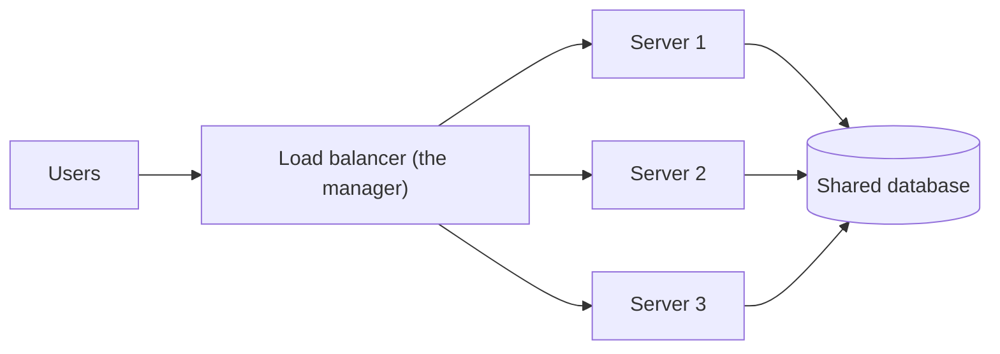
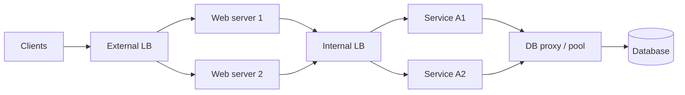
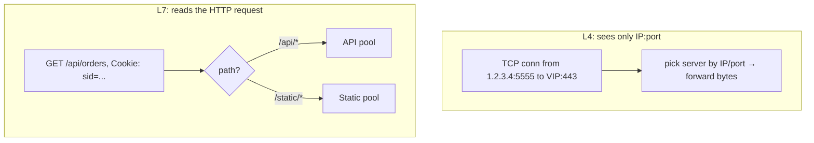
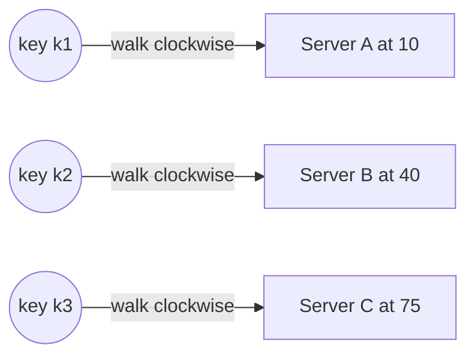
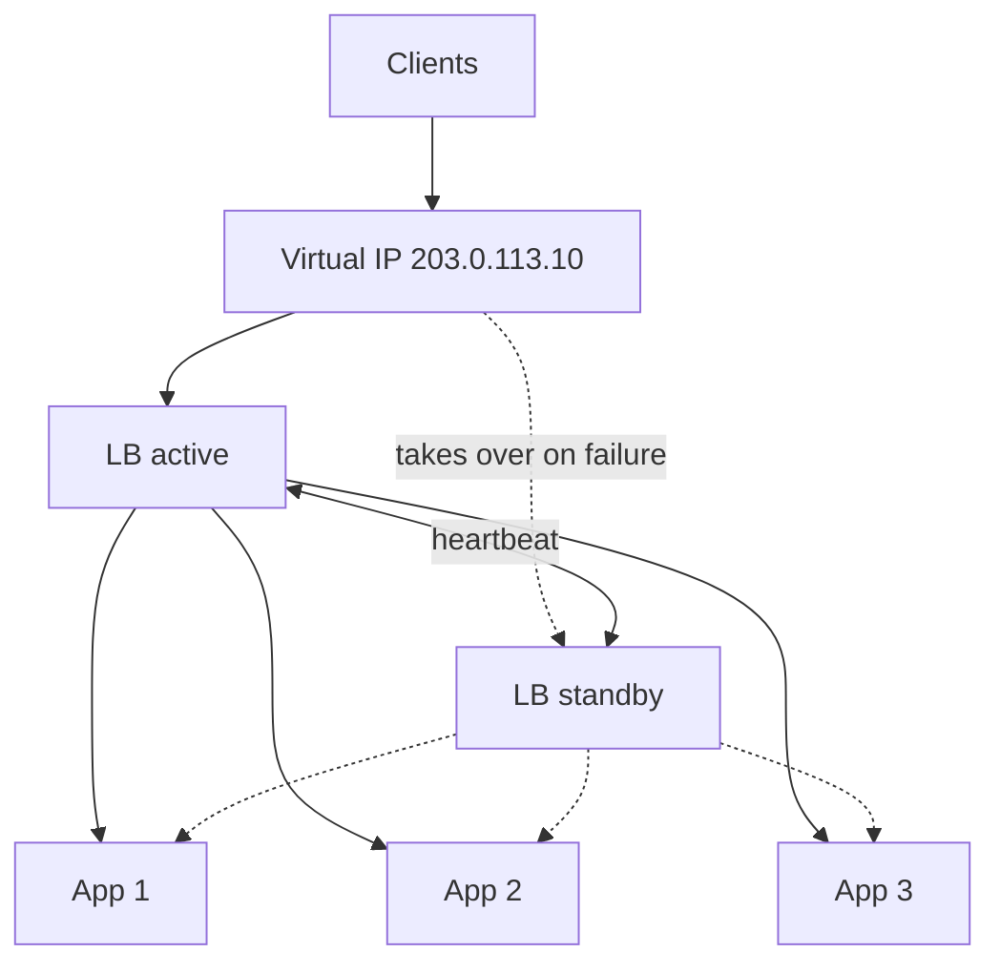
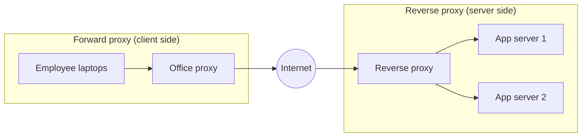
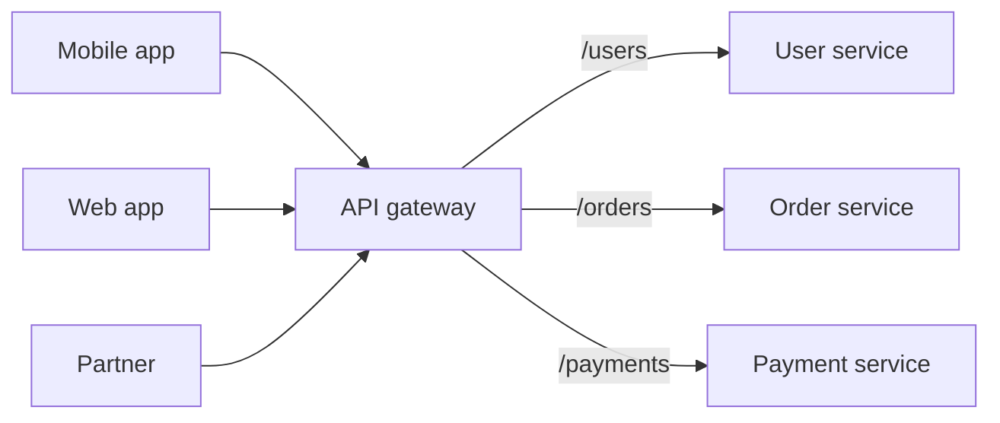
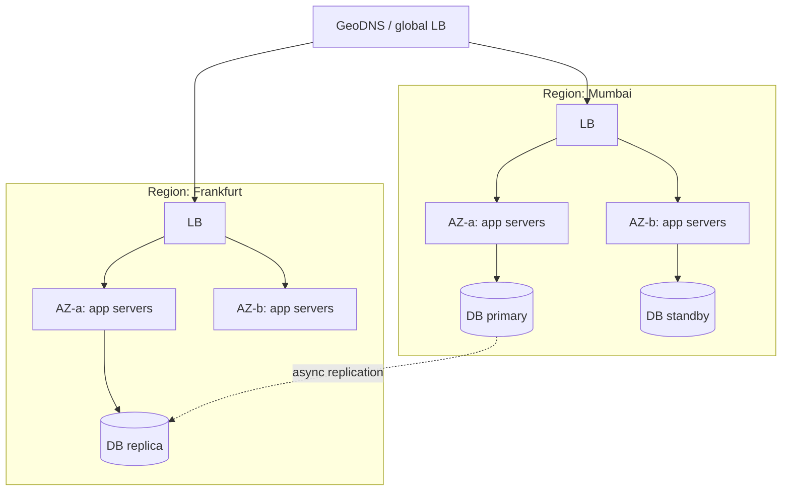
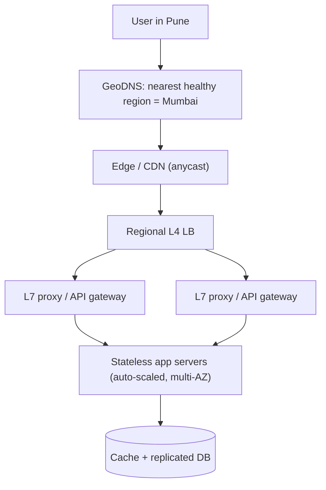
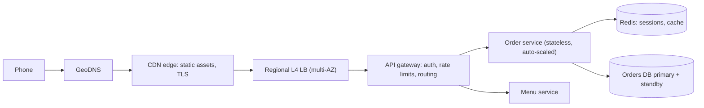

# Chapter 02 · Scalability & Load Balancing

> On a normal Tuesday your app serves 200 requests a second. Then a cricket star tweets your link, and 20,000 requests a second arrive in under a minute. One server melts. Ten servers would have been fine, *if* something could spread the traffic across them. That something is a load balancer, and this chapter is about how to grow without melting.

**You will learn:**
- Vertical vs horizontal scaling, and why the industry bets on horizontal
- Stateless vs stateful services, and where to keep sessions when you have many servers
- Load balancers: L4 vs L7, and the algorithms (round robin, weighted, least connections, IP hash, consistent hashing) with runnable simulations
- Health checks, LB redundancy, and how to remove single points of failure
- Reverse proxy vs forward proxy vs API gateway
- Auto-scaling, multi-AZ and multi-region designs, DNS load balancing and GeoDNS

**Before this:** [Chapter 01 · What System Design Is & How the Internet Works](01-foundations-internet.md)

---

## 🧠 The Big Idea

Picture a popular dosa stall with one cook. When the queue grows, you have two choices:

1. **Make the cook faster**: buy a bigger griddle, a sharper spatula, a cook with four arms. This is **vertical scaling** (scale *up*). It works until no bigger griddle exists, and if that one cook falls sick, the stall closes.
2. **Hire more cooks** with identical griddles, and put a manager at the front who sends each customer to a free cook. This is **horizontal scaling** (scale *out*), and the manager is the **load balancer**.



There's one catch. Horizontal scaling only works smoothly if **any cook can serve any customer**. If cook #2 is the only one who remembers your half-finished order, you must always go back to cook #2. In software terms, servers must be **stateless**: they keep no memory of a user between requests. All memory goes into shared places (a database, a cache, a session store).

> 💡 **The core insight:** scalability comes from *identical, interchangeable, stateless* workers behind a traffic director. Make the workers stateless, and you can add or remove them like Lego bricks.

---

## 🔨 Building It Up

### 1. What "scalable" actually means

A system is **scalable** if you can handle more load by adding resources **roughly in proportion**: double the servers, roughly double the throughput, without redesigning.

"Load" is described with **load parameters**: requests per second, number of concurrent users, read/write ratio, data size, number of followers per user. A design that scales for one parameter may fail on another. A chat app may handle 1 million users fine but choke on one group chat with 100,000 members.

Two warning signs of a design that doesn't scale:

- Adding servers stops helping because everyone waits on **one shared thing** (one database, one lock, one leader). This is a **bottleneck**.
- Cost grows much faster than load (10× traffic needs 100× money).

### 2. Vertical scaling (scale up)

Buy a bigger machine: more CPU cores, more RAM, faster disks.

**Pros:**
- Zero code changes. Your app doesn't know it moved.
- No distributed-systems problems (no network between parts, no consistency headaches).
- Great for databases early on: one big primary database can go surprisingly far.

**Cons:**
- **Hard ceiling.** The biggest cloud machines have a few hundred cores and some terabytes of RAM. You can't go beyond.
- **Cost grows faster than linearly** at the top end: the largest machines cost a premium per core.
- **Single point of failure.** One machine, one failure, total outage.
- Upgrading often means **downtime** (reboot into the bigger machine).

### 3. Horizontal scaling (scale out)

Add more machines of the same size and spread work across them.

**Pros:**
- **Practically unlimited**: add the 11th, the 101st server.
- **Fault tolerant**: one server dies, others keep serving.
- **Elastic**: add servers at 7 pm, remove them at 3 am (auto-scaling, section 18).
- Commodity hardware is cheap.

**Cons:**
- Needs a **load balancer**.
- Servers must be **stateless** (or you need smart routing).
- The shared pieces (database, cache) become the next bottleneck, which is what Chapters [03](03-databases.md)–[06](06-cap-consistency.md) solve.
- More moving parts: deployments, monitoring, network failures.

Let's compare them with a simple simulation. Each server handles a fixed number of requests per second (RPS). We'll look at capacity and what happens when one machine fails.

```python
def capacity(servers):
    return sum(servers)

big_box = [12_000]                 # vertical: one huge machine
fleet = [1_500] * 8                # horizontal: eight small machines

for name, servers in [("vertical", big_box), ("horizontal", fleet)]:
    total = capacity(servers)
    after_failure = capacity(servers[1:])       # one machine dies
    print(f"{name:<10} capacity={total:>6} rps  after 1 failure={after_failure:>6} rps "
          f"({after_failure / total:.0%} left)")
```

```text
vertical   capacity= 12000 rps  after 1 failure=     0 rps (0% left)
horizontal capacity= 12000 rps  after 1 failure= 10500 rps (88% left)
```

What just happened: same total capacity, but losing one machine is a full outage for the vertical setup and a 12.5% dip for the fleet. That difference is why almost every large system scales its **stateless tiers horizontally**.

| | Vertical (up) | Horizontal (out) |
|---|---|---|
| How | Bigger machine | More machines |
| Code changes | None | Must be stateless, need LB |
| Limit | Hardware ceiling | Practically none (bottleneck moves elsewhere) |
| Failure | Total outage | Partial capacity loss |
| Cost curve | Steep at the top | Roughly linear |
| Good for | Early-stage DBs, quick fixes | Web/app servers, caches, most large systems |

> 💡 Real systems do **both**: scale up until it's expensive or risky, then scale out. Interviewers love hearing "I'd start with a single bigger DB, then add read replicas and shard only when needed."

### 4. Stateless vs stateful services

A service is **stateless** if each request carries everything needed to handle it, or the needed data lives in a shared external store. Any server can handle any request.

A service is **stateful** if it keeps data in its own memory or disk that later requests depend on: logged-in sessions in a local dict, a shopping cart in RAM, an open game room, uploaded files on local disk.

```python
class StatefulServer:
    """Keeps carts in its own memory. Breaks when there is more than one server."""
    def __init__(self, name):
        self.name = name
        self.carts = {}

    def add(self, user, item):
        self.carts.setdefault(user, []).append(item)

    def view(self, user):
        return self.carts.get(user, [])

servers = [StatefulServer("A"), StatefulServer("B")]
requests = [("add", "riya", "phone"), ("add", "riya", "case"), ("view", "riya", None)]

for i, (action, user, item) in enumerate(requests):
    server = servers[i % 2]                      # round robin between A and B
    if action == "add":
        server.add(user, item)
        print(f"server {server.name}: added {item}")
    else:
        print(f"server {server.name}: riya's cart = {server.view(user)}")
```

```text
server A: added phone
server B: added case
server A: riya's cart = ['phone']
```

What just happened: Riya added two items, but her cart shows one. Each server remembered only what *it* saw. Now the stateless version, where carts live in a shared store (think Redis, [Chapter 04](04-caching-cdn.md)):

```python
class SharedStore:
    """Stands in for Redis or a database that every server talks to."""
    def __init__(self):
        self.data = {}

class StatelessServer:
    def __init__(self, name, store):
        self.name = name
        self.store = store                       # no user data kept here

    def add(self, user, item):
        self.store.data.setdefault(user, []).append(item)

    def view(self, user):
        return self.store.data.get(user, [])

store = SharedStore()
servers = [StatelessServer("A", store), StatelessServer("B", store)]
requests = [("add", "riya", "phone"), ("add", "riya", "case"), ("view", "riya", None)]

for i, (action, user, item) in enumerate(requests):
    server = servers[i % 2]
    if action == "add":
        server.add(user, item)
        print(f"server {server.name}: added {item}")
    else:
        print(f"server {server.name}: riya's cart = {server.view(user)}")
```

```text
server A: added phone
server B: added case
server A: riya's cart = ['phone', 'case']
```

What just happened: the servers became interchangeable. You can kill server B, add server C, or restart everything, and Riya's cart survives. **State didn't disappear; it moved** to a place built to hold it.

> 💡 Some things are stateful by nature: databases, caches, WebSocket connections, game rooms. The trick is to **isolate** state into a few specialised components and keep everything else stateless.

### 5. Where to keep sessions: four options

Logged-in sessions are the classic piece of state. Options:

| Option | How | Pros | Cons |
|---|---|---|---|
| **Sticky sessions** | LB always sends a user to the same server (via cookie or IP hash) | No code change | Uneven load; server dies → its users are logged out; hard to scale down |
| **Shared session store** | Sessions in Redis/Memcached; servers look them up | Servers truly stateless; fast (~1 ms) | One more component to run and keep highly available |
| **Database sessions** | Sessions in a DB table | Durable, simple | Slower; adds load to the DB |
| **Client-side tokens** (signed cookie / JWT) | Session data signed and stored on the client | No lookup at all; scales trivially | Hard to revoke before expiry; size limits; must never hold secrets ([Chapter 07](07-apis-communication.md)) |

**Default interview answer:** "Stateless app servers, sessions in a replicated Redis, or signed tokens if we want to avoid the lookup." Sticky sessions are a stop-gap, not a design.

### 6. Load balancers: what they do

A **load balancer (LB)** sits between clients and a pool of servers (the **backend pool** or **upstream**). It:

1. **Distributes** requests across healthy servers.
2. **Detects failures** with health checks and stops sending traffic to dead servers.
3. **Hides** the servers: clients see one address (a **virtual IP**), so you can add, remove and replace servers freely.
4. Often **terminates TLS** (decrypts HTTPS once, so app servers don't have to), compresses responses, and adds headers like `X-Forwarded-For` (the original client IP).

Where load balancers appear in a typical system:



They can be **hardware** appliances (older, expensive), **software** (NGINX, HAProxy, Envoy), or **managed cloud** services (AWS ELB/ALB/NLB, Google Cloud Load Balancing).

### 7. L4 vs L7 load balancing

Remember the layers from [Chapter 01](01-foundations-internet.md): L4 is transport (TCP/UDP), L7 is application (HTTP).

**Layer 4 LB** looks only at IPs and ports. It forwards whole TCP connections (or UDP packets) without reading their content.

- Very fast, low CPU, handles millions of connections.
- Protocol-agnostic: works for databases, game servers, anything over TCP/UDP.
- Can't route by URL, can't read cookies, can't retry a single HTTP request.

**Layer 7 LB** understands HTTP. It reads the method, path, headers, cookies.

- **Content-based routing**: `/api/*` to API servers, `/images/*` to image servers, `Host: admin.site.com` to the admin pool.
- Can terminate TLS, rewrite headers, compress, cache, do A/B splits ("5% of users to the new version"), rate limit, and retry failed requests on another server.
- More CPU per request; must decrypt to read.



| | L4 | L7 |
|---|---|---|
| Sees | IPs, ports, TCP/UDP | Full HTTP: path, headers, cookies |
| Speed | Faster, cheaper | Slower per request |
| Routing | By connection | By content (path, host, header) |
| TLS | Usually passes through | Usually terminates |
| Features | Simple forwarding | Retries, rewrites, A/B, auth checks, caching |
| Examples | AWS NLB, LVS, HAProxy (TCP mode) | NGINX, Envoy, AWS ALB, HAProxy (HTTP mode) |

A common setup: an **L4 LB in front** spreading connections across a fleet of **L7 proxies**, which then route by content.

### 8. Algorithm 1: Round robin

Send request 1 to server A, 2 to B, 3 to C, 4 to A again, and so on. Like dealing cards.

```python
from itertools import cycle

class RoundRobin:
    def __init__(self, servers):
        self._ring = cycle(servers)

    def pick(self):
        return next(self._ring)

lb = RoundRobin(["A", "B", "C"])
print([lb.pick() for _ in range(7)])
```

```text
['A', 'B', 'C', 'A', 'B', 'C', 'A']
```

**Good when:** servers are identical and requests cost about the same. **Bad when:** servers differ in size, or some requests are heavy (a report that takes 5 s) while others are light (a 5 ms lookup), because round robin ignores how busy a server is.

### 9. Algorithm 2: Weighted round robin

Give bigger servers a bigger share. If A has weight 5 and B and C have weight 1, A gets 5 of every 7 requests. A naive version sends A, A, A, A, A, B, C (bursty). The **smooth weighted round robin** algorithm used by NGINX spreads them out:

```python
class SmoothWeightedRoundRobin:
    """NGINX-style: each pick, every server gains its weight; the leader is chosen
    and pays back the total. Bigger weights win more often but never in long bursts."""
    def __init__(self, weights):
        self.weights = weights
        self.current = {name: 0 for name in weights}
        self.total = sum(weights.values())

    def pick(self):
        for name, w in self.weights.items():
            self.current[name] += w
        best = max(self.current, key=self.current.get)
        self.current[best] -= self.total
        return best

lb = SmoothWeightedRoundRobin({"A": 5, "B": 1, "C": 1})
print("".join(lb.pick() for _ in range(14)))
```

```text
AABACAAAABACAA
```

What just happened: over 7 picks, A got 5, B got 1, C got 1, but A's turns are interleaved with B and C instead of five in a row. Use weights when servers have different capacities, or to **gradually shift traffic** to a new version (weight 1 for the new one, 9 for the old).

### 10. Algorithm 3: Least connections

Send each request to the server with the **fewest active connections** right now. If requests vary a lot in duration, this adapts automatically: slow servers accumulate connections and get fewer new ones.

Let's simulate heavy and light requests and compare round robin with least connections:

```python
import heapq
import random

def simulate(policy, n_servers=4, n_requests=3000, seed=11):
    rng = random.Random(seed)
    active = [[] for _ in range(n_servers)]     # per server: heap of finish times
    rr_next = 0
    peak = 0
    for t in range(n_requests):                 # one request arrives per time unit
        for heap in active:                     # drop finished requests
            while heap and heap[0] <= t:
                heapq.heappop(heap)
        duration = 40 if rng.random() < 0.1 else 2   # 10% of requests are heavy
        if policy == "round_robin":
            s = rr_next
            rr_next = (rr_next + 1) % n_servers
        else:                                   # least connections
            s = min(range(n_servers), key=lambda i: len(active[i]))
        heapq.heappush(active[s], t + duration)
        peak = max(peak, max(len(h) for h in active))
    return peak

print("round robin       peak connections on one server:", simulate("round_robin"))
print("least connections peak connections on one server:", simulate("least_conn"))
```

```text
round robin       peak connections on one server: 6
least connections peak connections on one server: 3
```

What just happened: round robin blindly kept feeding a server that was stuck with several heavy requests, so its queue spiked. Least connections noticed the pile-up and steered new work elsewhere, keeping the worst server's load lower. **Least connections** (and its cousin **least response time**) is a strong default when request costs vary.

A popular cheap trick at huge scale is **power of two choices**: pick **two** random servers and send the request to the less busy one. It gets most of the benefit of least connections without the LB needing a perfect global view.

### 11. Algorithm 4: IP hash (and why plain hashing hurts)

Hash the client's IP and take it modulo the number of servers: `server = hash(ip) % N`. The same client always lands on the same server. That's a simple way to get **sticky sessions** or cache locality.

The problem: when **N changes**, almost every client moves.

```python
import hashlib

def stable_hash(key):
    # Python's built-in hash() is randomised per process for strings, so use md5
    return int(hashlib.md5(key.encode()).hexdigest(), 16)

clients = [f"10.0.0.{i}" for i in range(1, 1001)]

def assign(n_servers):
    return {c: stable_hash(c) % n_servers for c in clients}

before = assign(4)
after = assign(5)                      # we added one server
moved = sum(before[c] != after[c] for c in clients)
print(f"clients that moved when going 4 -> 5 servers: {moved / len(clients):.0%}")
```

```text
clients that moved when going 4 -> 5 servers: 82%
```

What just happened: adding one server reshuffled about 80% of clients. If those servers were holding sessions or cached data, 80% of users just lost them. Mathematically, a key keeps its server only if `h % 4 == h % 5`, which happens for about 1 in 5 keys.

### 12. Algorithm 5: Consistent hashing (preview)

**Consistent hashing** fixes the reshuffle. Imagine a clock face (a "ring") of hash values. Put each server at a position on the ring by hashing its name. To place a key, hash it onto the ring and walk **clockwise** to the first server.



When a server is added, it only takes over keys from **one neighbour**: about 1/N of the keys move instead of almost all of them.

```python
import bisect
import hashlib

def h(key):
    return int(hashlib.md5(key.encode()).hexdigest(), 16) % 1_000_000

class HashRing:
    def __init__(self, servers, vnodes=100):
        self.ring = []                               # sorted list of (position, server)
        for s in servers:
            for v in range(vnodes):                  # many points per server = even spread
                self.ring.append((h(f"{s}#{v}"), s))
        self.ring.sort()
        self.positions = [p for p, _ in self.ring]

    def pick(self, key):
        i = bisect.bisect(self.positions, h(key)) % len(self.ring)   # wrap around
        return self.ring[i][1]

clients = [f"10.0.0.{i}" for i in range(1, 1001)]
before = HashRing(["s0", "s1", "s2", "s3"])
after = HashRing(["s0", "s1", "s2", "s3", "s4"])
moved = sum(before.pick(c) != after.pick(c) for c in clients)
print(f"clients that moved when going 4 -> 5 servers: {moved / len(clients):.0%}")
```

```text
clients that moved when going 4 -> 5 servers: 19%
```

What just happened: only about 1/5 of clients moved, exactly the share the new server should own. The "100 points per server" trick is called **virtual nodes**. [Chapter 05](05-replication-sharding.md) builds consistent hashing fully and uses it for sharding databases. For load balancers, it's used when **affinity matters**: routing the same user or the same cache key to the same server (e.g. caching proxies, WebSocket servers).

### 13. Algorithm summary

| Algorithm | Idea | Best for | Weakness |
|---|---|---|---|
| Round robin | Take turns | Identical servers, uniform requests | Ignores load and server size |
| Weighted RR | Turns proportional to weight | Mixed server sizes, gradual rollouts | Still ignores live load |
| Least connections | Fewest active connections | Requests with varied durations, long-lived connections | Needs connection tracking |
| Least response time | Fastest recent responses | Mixed hardware, latency-sensitive | Needs measurements; can herd |
| Random / power of two choices | Random, or best of 2 random | Huge fleets, many LBs | Plain random is uneven at small scale |
| IP hash | `hash(ip) % N` | Simple stickiness | Reshuffles on N change; NAT puts many users on one IP |
| Consistent hashing | Hash ring | Cache affinity, sharded state | More complex; needs vnodes for balance |

### 14. Health checks

A load balancer must know which servers are alive. Two kinds of checks:

- **Active health checks**: every few seconds the LB calls an endpoint like `GET /health`. If it fails N times in a row (say 3), the server is marked **unhealthy** and removed. After M successes (say 2), it's added back. The thresholds prevent **flapping** (rapid in/out).
- **Passive health checks**: the LB watches real traffic. Too many errors or timeouts from a server → take it out for a while.

What should `/health` check?

- **Liveness**: "is the process running?" Return 200 if the program can answer at all.
- **Readiness**: "can I serve traffic right now?" Is the DB connection pool up, caches warmed, config loaded?

> ⚠️ Don't make the health check call *every* dependency deeply. If the database blips, every app server fails its health check at once, the LB removes all of them, and a small blip becomes a full outage.

```python
class HealthChecker:
    def __init__(self, servers, fail_threshold=3, pass_threshold=2):
        self.state = {s: {"healthy": True, "fails": 0, "passes": 0} for s in servers}
        self.fail_threshold = fail_threshold
        self.pass_threshold = pass_threshold

    def record(self, server, ok):
        st = self.state[server]
        if ok:
            st["fails"] = 0
            st["passes"] += 1
            if not st["healthy"] and st["passes"] >= self.pass_threshold:
                st["healthy"] = True
                print(f"  {server} back IN rotation")
        else:
            st["passes"] = 0
            st["fails"] += 1
            if st["healthy"] and st["fails"] >= self.fail_threshold:
                st["healthy"] = False
                print(f"  {server} taken OUT of rotation")

    def healthy(self):
        return [s for s, st in self.state.items() if st["healthy"]]

hc = HealthChecker(["A", "B", "C"])
# B fails 3 checks in a row, then recovers
timeline = [("B", False), ("B", True), ("B", False), ("B", False), ("B", False),
            ("B", True), ("B", True)]
for tick, (server, ok) in enumerate(timeline):
    print(f"tick {tick}: {server} check {'ok' if ok else 'FAILED'}")
    hc.record(server, ok)
    print(f"  healthy pool: {hc.healthy()}")
```

```text
tick 0: B check FAILED
  healthy pool: ['A', 'B', 'C']
tick 1: B check ok
  healthy pool: ['A', 'B', 'C']
tick 2: B check FAILED
  healthy pool: ['A', 'B', 'C']
tick 3: B check FAILED
  healthy pool: ['A', 'B', 'C']
tick 4: B check FAILED
  B taken OUT of rotation
  healthy pool: ['A', 'C']
tick 5: B check ok
  healthy pool: ['A', 'C']
tick 6: B check ok
  B back IN rotation
  healthy pool: ['A', 'B', 'C']
```

What just happened: one random failure at tick 0 didn't remove B (the count reset at tick 1). Three failures *in a row* did. Two passes in a row brought it back. That's how real LBs avoid overreacting.

**Connection draining**: when removing a server on purpose (deploys, scale-in), the LB stops sending **new** requests but lets **in-flight** ones finish (e.g. up to 30 s). Users never see a cut-off request.

### 15. Single points of failure and LB redundancy

A **single point of failure (SPOF)** is any component whose failure takes down the whole system. We just made app servers redundant... but now the **load balancer** is a SPOF!

Fixes:

- **Active-passive pair**: two LBs share a **floating virtual IP**. They exchange heartbeats (e.g. with VRRP/keepalived). If the active one stops answering, the passive one claims the virtual IP within seconds.
- **Active-active**: several LBs all serve traffic, with DNS returning multiple IPs, or with network-level tricks like **anycast** (many machines announce the same IP; the network routes you to the nearest).
- **Managed cloud LBs** are already redundant across machines and zones internally.



**Hunting SPOFs** is a standard interview move. Walk your diagram box by box and ask "what if this dies?":

| Component | SPOF fix |
|---|---|
| Load balancer | Active-passive pair or managed multi-AZ LB |
| App servers | ≥2 instances across zones, behind LB |
| Database | Replicas + automatic failover ([Chapter 05](05-replication-sharding.md)) |
| Cache | Replicated cache cluster; app must survive a cache outage |
| DNS provider | Use a provider with anycast; some companies use two providers |
| A whole datacenter | Multi-AZ; for the biggest risks, multi-region |
| One engineer who knows everything | Documentation and runbooks (yes, really) |

### 16. Reverse proxy vs forward proxy

A **proxy** is a middleman that forwards requests. The question is: whose side is it on?

**Forward proxy**: acts on behalf of **clients**. The server sees the proxy, not you. Uses: corporate internet filters, caching for an office, hiding client identity (VPN-like), getting around geo-blocks.

**Reverse proxy**: acts on behalf of **servers**. The client sees the proxy, not the servers. Uses: load balancing, TLS termination, caching, compression, hiding internal servers, serving static files, request buffering against slow clients.



| | Forward proxy | Reverse proxy |
|---|---|---|
| Represents | Clients | Servers |
| Who configures it | Client side (browser/OS/network) | Server owner |
| Hides | Clients from servers | Servers from clients |
| Typical uses | Filtering, anonymity, egress control | LB, TLS, caching, security |
| Examples | Squid, corporate proxies | NGINX, HAProxy, Envoy, Cloudflare |

A load balancer is a kind of reverse proxy whose main job is spreading traffic. An L7 load balancer and a reverse proxy are often the same software.

### 17. API gateway

As a system splits into many services (user service, order service, payment service), clients shouldn't need to know all of them. An **API gateway** is a reverse proxy specialised for APIs: **one front door** for all services.



Typical responsibilities:

- **Routing** requests to the right service (by path, version, header)
- **Authentication** (validate tokens once, at the edge)
- **Rate limiting** and quotas per client ([Chapter 07](07-apis-communication.md), [Chapter 12](12-case-studies-1.md))
- **TLS termination**, request/response transformation, protocol translation (REST outside, gRPC inside)
- **Aggregation**: one client call fans out to several services and merges results
- **Observability**: logging, metrics, tracing for every API call

| | Load balancer | Reverse proxy | API gateway |
|---|---|---|---|
| Main job | Spread traffic | Front servers (LB, TLS, cache) | Manage APIs (auth, limits, routing) |
| Knows about | Servers and health | HTTP | API consumers, keys, versions |
| Example | AWS NLB/ALB | NGINX | Kong, AWS API Gateway, Apigee |

> ⚠️ An API gateway is in the path of *every* request: keep it highly available and avoid putting heavy business logic in it, or it becomes a bottleneck and a monolith in disguise.

### 18. Auto-scaling

Traffic changes by hour, by day, and by event. Running for peak all the time wastes money; running for average melts at peak. **Auto-scaling** adds and removes servers automatically.

Types:

- **Reactive (target tracking)**: "keep average CPU near 60%". Above → add servers; below → remove.
- **Scheduled**: "at 6 pm, scale to 40 servers" (you know dinner rush is coming).
- **Predictive**: forecast from historical patterns and scale ahead.

Key settings: **min** and **max** instance counts (a floor for safety, a ceiling for cost), a **cooldown** (wait after scaling before deciding again, so the new servers' effect shows up), and a **warm-up time** (new servers need time to boot and warm caches).

```python
import math

def autoscale(traffic, rps_per_server=500, target_util=0.6,
              min_servers=2, max_servers=20, cooldown=2):
    servers = min_servers
    last_change = -cooldown
    for minute, rps in enumerate(traffic):
        desired = math.ceil(rps / (rps_per_server * target_util))
        desired = max(min_servers, min(max_servers, desired))
        if desired != servers and minute - last_change >= cooldown:
            servers, last_change = desired, minute
            action = "scale"
        else:
            action = "hold"
        util = rps / (servers * rps_per_server)
        flag = "  <-- overloaded!" if util > 1 else ""
        print(f"min {minute}: {rps:>5} rps  servers={servers:>2}  util={util:.0%}  {action}{flag}")

autoscale([400, 900, 3000, 6000, 6200, 5000, 1500, 600])
```

```text
min 0:   400 rps  servers= 2  util=40%  hold
min 1:   900 rps  servers= 3  util=60%  scale
min 2:  3000 rps  servers= 3  util=200%  hold  <-- overloaded!
min 3:  6000 rps  servers=20  util=60%  scale
min 4:  6200 rps  servers=20  util=62%  hold
min 5:  5000 rps  servers=17  util=59%  scale
min 6:  1500 rps  servers=17  util=18%  hold
min 7:   600 rps  servers= 2  util=60%  scale
```

What just happened: at minute 2 traffic tripled, but the cooldown blocked scaling and the fleet was overloaded for a minute. That's the real-world lesson: **auto-scaling is not instant**. Keep headroom (the 60% target), use scheduled scaling for known peaks, and protect yourself with rate limiting and queues ([Chapter 08](08-queues-events.md)) for sudden spikes.

> 💡 Only **stateless** tiers scale in and out this easily. Scaling databases is much harder, which is why Chapters 03–06 exist.

### 19. Availability zones and regions

Cloud providers split the world into **regions** (e.g. Mumbai, Singapore, Virginia), and each region into several **availability zones (AZs)**: separate datacenters with independent power, cooling and networking, a few kilometres apart, connected by fast, low-latency links (around 1–2 ms).

**Multi-AZ** (the standard for production):
- Run app servers in at least 2–3 AZs behind a LB that spans them.
- Database primary in one AZ, synchronous or near-synchronous standby in another.
- Survives a whole datacenter failure (fire, power cut) with little or no data loss.

**Multi-region** (for the biggest scale or strictest uptime):
- Survives an entire region failing, and serves global users with low latency.
- Much harder: cross-region round trips are 50–250 ms, so synchronous replication across regions is slow. Data consistency becomes the hard problem ([Chapter 06](06-cap-consistency.md)).

Two styles:

- **Active-passive (disaster recovery)**: one region serves; another holds replicated data and spare capacity, ready to take over. Simpler, but failover takes minutes and the standby must actually work (test it!).
- **Active-active**: all regions serve live traffic. Best latency and availability, but you must handle writes in several places (conflicts, [Chapter 05](05-replication-sharding.md)).



Two disaster-recovery terms to know:

- **RTO** (Recovery Time Objective): how long can we be down? "Back within 15 minutes."
- **RPO** (Recovery Point Objective): how much data can we lose? "At most 5 seconds of writes." Async cross-region replication means RPO > 0.

### 20. DNS-based load balancing and GeoDNS

Before a request even reaches your LB, **DNS** can spread traffic:

- **Round-robin DNS**: return several A records (`203.0.113.10`, `203.0.113.11`, ...) and rotate their order. Clients usually take the first. Cheap and simple, but DNS caching means you can't react quickly (clients keep using a dead IP until TTL expires), and it can't see server load.
- **Health-checked DNS**: managed DNS (e.g. Route 53, Cloudflare) stops returning IPs that fail health checks.
- **Weighted DNS**: return region A 90% of the time, region B 10% (gradual migrations).
- **GeoDNS / latency-based routing**: return a different IP depending on **where the user is** (by the resolver's location, or by a hint of the client subnet). Users in India get the Mumbai region; users in Germany get Frankfurt. Lower latency, and data can stay in-country for legal reasons.
- **Failover DNS**: return the primary region's IP while healthy, the backup region's IP otherwise.

```python
REGIONS = {
    "mumbai":    {"ip": "203.0.113.10", "healthy": True},
    "singapore": {"ip": "203.0.113.20", "healthy": True},
    "frankfurt": {"ip": "203.0.113.30", "healthy": True},
}
NEAREST = {                      # preference order per user location
    "IN": ["mumbai", "singapore", "frankfurt"],
    "SG": ["singapore", "mumbai", "frankfurt"],
    "DE": ["frankfurt", "mumbai", "singapore"],
}

def geodns(country):
    for region in NEAREST[country]:
        if REGIONS[region]["healthy"]:
            return region, REGIONS[region]["ip"]
    return None, None

for c in ["IN", "SG", "DE"]:
    print(c, "->", geodns(c))

REGIONS["mumbai"]["healthy"] = False          # Mumbai region outage
print("Mumbai down!")
print("IN", "->", geodns("IN"))
```

```text
IN -> ('mumbai', '203.0.113.10')
SG -> ('singapore', '203.0.113.20')
DE -> ('frankfurt', '203.0.113.30')
Mumbai down!
IN -> ('singapore', '203.0.113.20')
```

What just happened: each user got the nearest healthy region, and Indian users automatically failed over to Singapore. In reality, failover is only as fast as the DNS TTL allows, which is why GeoDNS records use short TTLs (30–60 s).

**Anycast** is the alternative used by CDNs and big DNS providers: the *same* IP is announced from many locations, and internet routing (BGP) naturally sends you to the nearest one. No DNS trickery needed, and failover happens at the network layer.

The full layered picture of global traffic:



---

## 🔬 Under the Hood

### How an L4 load balancer forwards packets

An L4 LB keeps a **connection table**: `(client IP, client port, VIP, VIP port) → chosen backend`. The first packet of a TCP connection (the SYN) triggers a backend choice; every later packet of that connection looks up the table and goes to the same backend. Without this table, packets of one connection would scatter across servers and TCP would break.

Forwarding modes:

- **NAT mode**: the LB rewrites the destination IP to the backend's IP, and responses come back through the LB (which rewrites them back).
- **Direct Server Return (DSR)**: the LB forwards the request, but the backend replies **directly** to the client. Responses (usually much bigger than requests) skip the LB, so one LB can handle enormous traffic.
- **Tunnelling/encapsulation**: the packet is wrapped and sent to the backend, which unwraps it.

### How an L7 load balancer works

An L7 LB is a full **proxy**: it terminates the client's TCP (and TLS) connection, reads the HTTP request, picks a backend, and sends the request over a **separate connection** it keeps open to the backend (a connection pool). Two separate connections means it can:

- Retry a failed request on another server
- Buffer slow clients (a phone on 2G uploading slowly doesn't tie up an app server)
- Multiplex many client requests onto a few backend connections

The price is CPU: TLS decryption and HTTP parsing for every request.

### Why least connections beats round robin with variable work

Think of supermarket queues. Round robin is "customer 1 to till 1, customer 2 to till 2..." regardless of whether till 2 has someone with a full trolley. Least connections is "join the shortest queue". Queueing theory shows that when job sizes vary a lot, joining the shortest queue dramatically cuts waiting time. The **power of two choices** result is a famous surprise: checking just *two* random queues and picking the shorter gives an exponential improvement in the worst queue length over picking one at random.

### Why `hash % N` reshuffles almost everything

With N = 4, key `h` goes to `h % 4`. With N = 5, to `h % 5`. For a random h, these agree only when... about 1/5 of the time (in general about 1/(N+1)). So ~80% of keys move. Consistent hashing changes the question from "which bucket number?" to "which server is next on the ring?", and adding a server only steals a slice of the ring from its neighbour.

### Why auto-scaling lags

The scaling loop is: measure metrics (often averaged over 1–5 minutes) → decide → launch instances (30 s to several minutes to boot) → pass health checks → warm up (JIT, caches, connection pools). That can add up to several minutes. A spike that arrives faster than that must be absorbed by **headroom**, **queues** or **load shedding** (deliberately rejecting some requests with 503/429 so the rest succeed).

---

## 🧩 Pattern Decoder

### Decision guide: scaling

| If you see... | Do this | Because |
|---|---|---|
| Early stage, modest traffic, single DB | Scale up first | Simplest; no distributed complexity |
| Web/app tier needs more capacity | Scale out stateless servers behind an LB | Linear capacity, fault tolerant |
| Servers keep user state in memory | Move state to Redis/DB or use signed tokens | Makes servers interchangeable |
| Predictable daily peaks | Scheduled + target-tracking auto-scaling | Ready before the peak arrives |
| Sudden unpredictable spikes | Headroom + queues + rate limiting + auto-scaling | Auto-scaling alone is too slow |
| Database is the bottleneck | Caching, read replicas, then sharding (Ch. 04, 05) | DBs don't scale out by just adding boxes |

### Decision guide: load balancer type and algorithm

| If you need... | Choose | Because |
|---|---|---|
| Raw TCP/UDP at massive scale (DBs, games, MQTT) | L4 LB | Fast, protocol-agnostic |
| Routing by path/host, TLS termination, retries | L7 LB / reverse proxy | Understands HTTP |
| Many services behind one public API with auth & quotas | API gateway | Central API policy |
| Identical servers, similar requests | Round robin | Simple, fair |
| Servers of different sizes, canary releases | Weighted round robin | Proportional shares |
| Long or variable requests, WebSockets | Least connections | Adapts to live load |
| Same user/key must hit same server (cache affinity) | Consistent hashing | Stable mapping, minimal reshuffle |
| Global users, low latency, regional failover | GeoDNS / anycast + regional LBs | Route to nearest healthy region |

### Trade-off table: session storage

| Need | Choice | Trade-off accepted |
|---|---|---|
| Quick fix, no code change | Sticky sessions | Uneven load, lost sessions on failure |
| Stateless servers, instant logout | Shared Redis session store | Extra component to run and keep available |
| No lookups at all, huge scale | Signed tokens (JWT) | Hard to revoke; token size |
| Strong durability of sessions | Database | Slower, DB load |

### Trade-off table: redundancy level

| Level | Survives | Cost/complexity | Typical use |
|---|---|---|---|
| Single server | Nothing | Lowest | Prototypes, internal tools |
| Multiple servers, one AZ | Server failure | Low | Small production apps |
| Multi-AZ | Datacenter failure | Moderate | Standard production |
| Multi-region active-passive | Region failure (with some RTO/RPO) | High | Important business systems |
| Multi-region active-active | Region failure, near-zero downtime | Highest | Global giants, payments |

### The scale-out checklist (say this in interviews)

1. Make app servers **stateless**; move sessions/files out.
2. Put them behind a **redundant LB** with **health checks**.
3. Spread across **≥2 AZs**; **auto-scale** with headroom.
4. Add a **cache** and **CDN** ([Chapter 04](04-caching-cdn.md)) to cut load.
5. Scale the **database**: replicas, then sharding ([Chapter 05](05-replication-sharding.md)).
6. Add **queues** for slow/background work ([Chapter 08](08-queues-events.md)).
7. Go **multi-region** only if requirements demand it.

### When NOT to scale out

- If one server handles your load with room to spare, two servers for **redundancy** are enough. Don't build for Google's traffic on day one.
- If the bottleneck is the database, adding app servers makes it **worse** (more connections hammering the same DB).

---

## ⚠️ Traps & Common Mistakes

1. **Adding app servers when the DB is the bottleneck.** More servers → more DB connections → slower DB. Find the bottleneck first.
2. **Keeping sessions, uploads or caches on local disk/memory** and then scaling out. Users lose data randomly. Move them to shared stores (Redis, object storage).
3. **Forgetting the LB is a SPOF.** Always mention LB redundancy (pair or managed service).
4. **Health checks that are too deep.** A shared dependency blip makes *every* server unhealthy at once → total outage. Keep liveness shallow; use readiness carefully.
5. **Health checks that are too shallow.** Returning 200 while the app can't reach anything means the LB keeps sending traffic to a broken server. Balance it.
6. **Using `hash(key) % N` for affinity.** Every scale event reshuffles almost everything. Use consistent hashing.
7. **IP hash behind NAT.** Thousands of users in one office or mobile carrier share one public IP → one server gets all of them.
8. **Assuming auto-scaling handles spikes instantly.** It takes minutes. Keep headroom, use queues and rate limiting.
9. **No connection draining.** Deploys cut off in-flight requests and users see errors.
10. **Putting business logic in the API gateway.** It becomes a bottleneck and a hidden monolith.
11. **Using Python's built-in `hash()` for routing across processes.** String hashes are randomised per process, so two LB processes disagree:

```py
# ❌ different result in every process (PYTHONHASHSEED randomisation)
server = hash(user_id) % n_servers

# ✅ stable across processes and machines
import hashlib
server = int(hashlib.md5(user_id.encode()).hexdigest(), 16) % n_servers
```

---

## 💡 Tips & Tricks

- In interviews, draw the LB **from the first diagram**, and say "it's a managed, multi-AZ LB, so not a SPOF".
- Default answer for app servers: **stateless, horizontally scaled, auto-scaled, multi-AZ, behind an L7 LB.**
- Default algorithm: **least connections** (or round robin if requests are uniform). Mention **consistent hashing** whenever stickiness or caches are involved.
- Use **weighted routing** for canary releases: send 1–5% of traffic to the new version and watch error rates.
- Keep 30–40% **headroom**: target ~60% CPU, not 90%, so a spike or a lost AZ doesn't tip you over. If you run in 3 AZs and one fails, the other two must carry 150% of their normal load.
- **Shed load** gracefully: when overloaded, reject some requests fast (503 + `Retry-After`) rather than letting everything time out slowly.
- GeoDNS TTLs should be short (30–60 s) so regional failover is quick.

---

## 🎯 Interview Questions

### 1. What's the difference between vertical and horizontal scaling? When would you use each? 🔥🔥🔥

<details><summary>Answer</summary>

**Vertical** = bigger machine (more CPU/RAM). No code changes, no distributed complexity, but a hardware ceiling, steep cost at the top, and a single point of failure. **Horizontal** = more machines behind a load balancer. Nearly unlimited, fault tolerant, elastic, cheap commodity hardware, but requires stateless services, a load balancer, and handling distributed concerns.

Use vertical for quick wins and for stateful components early on (a single primary database can scale a long way). Use horizontal for stateless web/app tiers and whenever you need fault tolerance or large scale. Most real systems do both.

</details>

### 2. What is a load balancer and why do we need one? 🔥🔥🔥

<details><summary>Answer</summary>

A load balancer sits in front of a pool of servers and distributes incoming requests among them. It provides: **scalability** (add servers behind one address), **availability** (health checks remove failed servers), **flexibility** (deploy, scale and replace servers invisibly), and often **TLS termination**, compression, and routing. It should itself be redundant (active-passive with a floating IP, active-active, or a managed multi-AZ service).

</details>

### 3. L4 vs L7 load balancing? 🔥🔥🔥

<details><summary>Answer</summary>

**L4** works at the transport layer: it sees IPs and ports and forwards TCP connections/UDP packets without reading content. Very fast, protocol-agnostic, but can't route by URL or retry individual requests.

**L7** works at the application layer: it terminates the connection (and TLS), parses HTTP, and can route by path, host, header or cookie, retry failed requests, do canary splits, rate limit, compress and cache. Costs more CPU per request.

Common pattern: L4 at the edge for raw throughput, L7 proxies behind it for smart routing.

</details>

### 4. Explain load balancing algorithms and when to use each. 🔥🔥🔥

<details><summary>Answer</summary>

- **Round robin:** rotate through servers. Identical servers, uniform requests.
- **Weighted round robin:** proportional to capacity. Mixed server sizes, canaries.
- **Least connections / least response time:** send to the least-busy server. Variable request durations, long-lived connections (WebSockets).
- **Random / power of two choices:** pick 2 random servers, use the less loaded. Great at very large scale with many LBs.
- **IP hash:** stickiness by client IP, but reshuffles when servers change and is skewed by NAT.
- **Consistent hashing:** stable key→server mapping where only ~1/N keys move on changes. Used for cache affinity and sharded state.

</details>

### 5. What does it mean for a service to be stateless, and why does it matter? 🔥🔥🔥

<details><summary>Answer</summary>

A stateless service keeps no client-specific data between requests in its own memory/disk; every request carries what's needed or the data lives in a shared store (DB, Redis, object storage). This makes servers **interchangeable**: any server can handle any request, so you can load balance freely, auto-scale in and out, deploy by replacing servers, and survive server crashes without losing user data. State still exists; it's moved into components designed to store and replicate it.

</details>

### 6. How do you handle user sessions with multiple servers? 🔥🔥

<details><summary>Answer</summary>

Options: (1) **sticky sessions**: LB pins a user to one server; simple but uneven load and sessions die with the server. (2) **Centralised session store** like Redis: servers stay stateless, lookups ~1 ms, the store must be replicated. (3) **Database-backed sessions**: durable but slower. (4) **Client-side signed tokens (JWT)**: no lookup, scales trivially, but revocation is hard and tokens must be short-lived.

Typical answer: stateless servers with sessions in replicated Redis, or short-lived JWTs plus refresh tokens.

</details>

### 7. How do you avoid the load balancer itself being a single point of failure? 🔥🔥

<details><summary>Answer</summary>

Run at least two. **Active-passive**: two LBs share a floating virtual IP using heartbeats (VRRP/keepalived); if the active fails, the standby takes the IP in seconds. **Active-active**: multiple LBs serve simultaneously, reached through DNS with multiple records or anycast. In the cloud, managed LBs are already distributed across machines and AZs. Combine with health-checked DNS across regions for region-level failures.

</details>

### 8. What is the difference between a reverse proxy, a forward proxy, a load balancer and an API gateway? 🔥🔥

<details><summary>Answer</summary>

- **Forward proxy**: acts for clients; hides clients from servers (corporate filtering, anonymity).
- **Reverse proxy**: acts for servers; hides servers from clients; does TLS termination, caching, compression, routing.
- **Load balancer**: a reverse proxy (or L4 device) focused on spreading traffic across healthy servers.
- **API gateway**: a reverse proxy specialised for APIs: authentication, rate limiting, quotas, routing to microservices, versioning, request transformation and aggregation.

The same software (e.g. NGINX, Envoy) can play several of these roles.

</details>

### 9. How do health checks work? What can go wrong? 🔥🔥

<details><summary>Answer</summary>

The LB periodically probes each server (e.g. `GET /health` every 5 s). After N consecutive failures the server is removed; after M consecutive successes it returns. Passive checks watch real traffic errors too. Separate **liveness** (process alive) from **readiness** (able to serve now).

Pitfalls: checks too deep (a shared dependency hiccup marks every server unhealthy → total outage); too shallow (a server that can't reach its DB still gets traffic); thresholds too sensitive (flapping); and forgetting connection draining during removals.

</details>

### 10. How does auto-scaling work and what are its limits? 🔥🔥

<details><summary>Answer</summary>

A controller watches metrics (CPU, requests per server, queue length, latency) and adjusts instance count within min/max bounds: target tracking ("keep CPU at 60%"), step policies, schedules for known peaks, or predictive models. Cooldowns prevent oscillation.

Limits: it reacts in **minutes** (metric windows, boot time, warm-up), so sudden spikes need headroom, queues, rate limiting and load shedding. It works easily only for stateless tiers; databases don't auto-scale this way. Scale-in needs connection draining.

</details>

### 11. How would you make a service survive a full datacenter or region outage? 🔥🔥

<details><summary>Answer</summary>

**Datacenter (AZ):** run app servers in ≥2–3 AZs behind a zone-spanning LB, keep a synchronous/semi-synchronous DB standby in another AZ with automatic failover, and size capacity so the remaining AZs can absorb the lost one.

**Region:** replicate data to another region (usually async, so RPO > 0), keep capacity there (warm standby or active-active), and route with health-checked GeoDNS or a global anycast LB. Decide RTO/RPO targets, handle cross-region write conflicts if active-active, and **regularly test failover**.

</details>

### 12. What is GeoDNS and how is it different from anycast? 🔥

<details><summary>Answer</summary>

**GeoDNS** returns different IP addresses depending on the requester's location (usually the resolver's location), so users reach the nearest or the designated region. It's limited by DNS caching (TTL) and resolver location accuracy.

**Anycast** announces the *same* IP from many locations; internet routing (BGP) delivers packets to the topologically nearest site. Failover happens at the routing level without waiting for TTLs. CDNs and public DNS resolvers (1.1.1.1, 8.8.8.8) use anycast.

</details>

---

## 🏋️ Practice

**🟢 1. Spot the state.** Which of these make a web server stateful? (a) an in-memory dict of logged-in users, (b) a read-only config file loaded at startup, (c) user uploads saved to `/var/uploads`, (d) an in-process cache of product prices, (e) a WebSocket connection to a user.

<details><summary>Solution</summary>

(a) **Stateful**: move to Redis or use tokens. (b) **Fine**: identical on every server, not per-user. (c) **Stateful**: move uploads to object storage like S3 ([Chapter 10](10-storage-search-ids.md)). (d) **Mostly fine**: it's a cache, so a miss just refetches, but servers may show different prices briefly; keep TTLs short or use a shared cache. (e) **Stateful by nature**: the connection lives on one server. Use least-connections or consistent hashing, and keep a shared registry of "user → server" so other servers can route messages ([Chapter 13](13-case-studies-2.md)).

</details>

**🟢 2. Weighted shares.** Servers A, B, C have weights 3, 2, 1. Out of 600 requests, how many does each get? Verify with the smooth weighted round robin code.

<details><summary>Solution</summary>

A: 300, B: 200, C: 100.

```python
from collections import Counter

class SmoothWeightedRoundRobin:
    def __init__(self, weights):
        self.weights = weights
        self.current = {name: 0 for name in weights}
        self.total = sum(weights.values())

    def pick(self):
        for name, w in self.weights.items():
            self.current[name] += w
        best = max(self.current, key=self.current.get)
        self.current[best] -= self.total
        return best

lb = SmoothWeightedRoundRobin({"A": 3, "B": 2, "C": 1})
print(Counter(lb.pick() for _ in range(600)))
```

```text
Counter({'A': 300, 'B': 200, 'C': 100})
```

</details>

**🟡 3. Power of two choices.** Implement "pick two random servers, choose the one with fewer active requests" and compare the maximum load against plain random for 10 servers and 10,000 balls (requests that never finish). Seed your randomness.

<details><summary>Solution</summary>

```python
import random

def max_load(choices, n_servers=10, n_requests=10_000, seed=3):
    rng = random.Random(seed)
    load = [0] * n_servers
    for _ in range(n_requests):
        candidates = [rng.randrange(n_servers) for _ in range(choices)]
        best = min(candidates, key=lambda i: load[i])
        load[best] += 1
    return max(load), min(load)

print("random        (max, min):", max_load(1))
print("two choices   (max, min):", max_load(2))
```

```text
random        (max, min): (1092, 939)
two choices   (max, min): (1001, 997)
```

With one choice, the busiest server got 1,092 and the quietest 939, around an average of 1,000. With two choices, max and min are within a couple of requests of each other. Checking just one extra server nearly perfectly balances the load.

</details>

**🟡 4. Capacity planning with AZ failure.** You need to serve 9,000 RPS at peak. Each server handles 500 RPS at your safe 60% target (so ~833 max). You run in 3 AZs. How many servers per AZ so that losing one whole AZ still keeps every surviving server at or under its max?

<details><summary>Solution</summary>

If one AZ dies, the remaining 2 AZs must serve 9,000 RPS. Each server can take at most ~833 RPS in an emergency. 9,000 / 833 ≈ 10.8 → 11 servers across 2 AZs → 6 per AZ (rounding up so each AZ is equal). Normal operation: 18 servers, 500 RPS each = 9,000 RPS at exactly the 60% target.

```python
import math

peak, max_per_server, azs = 9000, 500 / 0.6, 3
needed_after_loss = math.ceil(peak / max_per_server)
per_az = math.ceil(needed_after_loss / (azs - 1))
print(per_az, "servers per AZ,", per_az * azs, "total")
print(f"normal load per server: {peak / (per_az * azs):.0f} rps")
```

```text
6 servers per AZ, 18 total
normal load per server: 500 rps
```

</details>

**🟡 5. Design the front door.** A food delivery company has a mobile app, a website, and a partner API for restaurants. Behind them are 6 microservices. Sketch the request path from a phone to the order service and name each component's job.

<details><summary>Solution</summary>



GeoDNS routes to the nearest healthy region; the CDN serves images/JS and terminates TLS near the user; the L4 LB spreads connections across gateway instances in several AZs; the API gateway validates tokens, applies per-client rate limits (stricter for partners), and routes `/orders` to the order service; stateless order servers use Redis and a replicated database. Every box is redundant.

</details>

**🔴 6. Least connections with slow servers.** Extend the least-connections simulation: server 0 is 4× slower (every request takes 4× as long on it). Compare peak connections for round robin vs least connections.

<details><summary>Solution</summary>

```python
import heapq
import random

def simulate(policy, slow_factor=(4, 1, 1), n_requests=3000, seed=5):
    rng = random.Random(seed)
    n = len(slow_factor)
    active = [[] for _ in range(n)]
    rr = 0
    peak = [0] * n
    for t in range(n_requests):
        for heap in active:
            while heap and heap[0] <= t:
                heapq.heappop(heap)
        base = rng.choice([4, 5, 6])
        if policy == "rr":
            s, rr = rr, (rr + 1) % n
        else:
            s = min(range(n), key=lambda i: len(active[i]))
        heapq.heappush(active[s], t + base * slow_factor[s])
        peak[s] = max(peak[s], len(active[s]))
    return peak

print("round robin peaks per server      :", simulate("rr"))
print("least connections peaks per server:", simulate("lc"))
```

```text
round robin peaks per server      : [8, 2, 2]
least connections peaks per server: [3, 3, 3]
```

Round robin gives the slow server the same share, so its queue grows. Least connections automatically sends it fewer requests, evening out the peaks. This is why "least connections" handles heterogeneous or degraded servers gracefully.

</details>

**🔴 7. Failover thought experiment.** Your GeoDNS TTL is 1 hour and the Mumbai region dies. What do Indian users experience, and how would you redesign?

<details><summary>Solution</summary>

Resolvers and clients cached the Mumbai IP for up to an hour, so many users keep hitting a dead region for up to 60 minutes even after DNS is updated (some misbehaving clients cache even longer). Redesign: (1) cut TTL to 30–60 s for failover records; (2) use **anycast** or a **global load balancer** whose IP stays the same while it routes around failed regions internally; (3) make clients retry against a secondary endpoint; (4) keep the Singapore region warm with enough capacity and replicated data; (5) rehearse the failover regularly.

</details>

---

## 🧠 Never-Forget Summary

- **Vertical** = bigger box (simple, ceiling, SPOF). **Horizontal** = more boxes (scalable, fault tolerant, needs statelessness).
- **Stateless servers** are the foundation of scale-out. State moves to Redis, databases, object storage, or signed tokens.
- **Load balancers** distribute traffic, run health checks, and hide servers. **L4** = fast, IP/port. **L7** = smart, HTTP-aware.
- Algorithms: **round robin**, **weighted**, **least connections**, **power of two**, **IP hash**, **consistent hashing** (only ~1/N keys move).
- **Health checks**: consecutive-failure thresholds, liveness vs readiness, connection draining.
- **No SPOFs**: redundant LBs (floating IP), multiple AZs, replicated data.
- **Reverse proxy** = server's middleman; **forward proxy** = client's middleman; **API gateway** = API policy front door.
- **Auto-scaling** adds/removes stateless servers but reacts in minutes; keep headroom.
- **Multi-AZ** for datacenter failures, **multi-region** for region failures and global latency. Know **RTO** and **RPO**.
- **DNS LB / GeoDNS** route users to the nearest healthy region; failover speed is bounded by TTL. **Anycast** avoids that.

**Memory hooks:**
- **"Up is easy, out is endless."**
- **"Cattle, not pets"**: stateless servers are interchangeable cattle; don't name and nurse individual servers.
- **"Round, Weight, Least, Hash"**: the four families of LB algorithms.
- **"Every box twice, every zone twice."**

**One picture:**

| Layer | Tool | Solves | Watch out for |
|---|---|---|---|
| Global | GeoDNS / anycast | Nearest healthy region | TTL caching |
| Region | L4 LB (redundant) | Spread connections, no SPOF | Can't see HTTP |
| Edge of app | L7 proxy / API gateway | Routing, TLS, auth, rate limits | Becoming a bottleneck |
| App tier | Stateless servers + auto-scaling | Throughput, elasticity | Hidden local state |
| Data tier | Cache, replicas, shards | The real bottleneck | Next four chapters |

> **If you remember only one thing:** make servers stateless and interchangeable, put a redundant load balancer in front, and spread them across zones; then the only hard scaling problem left is the data.

---
**Next:** [Chapter 03 · Databases: SQL, NoSQL, Indexes & Transactions](03-databases.md)  ·  **Back to** [Contents](../README.md)
